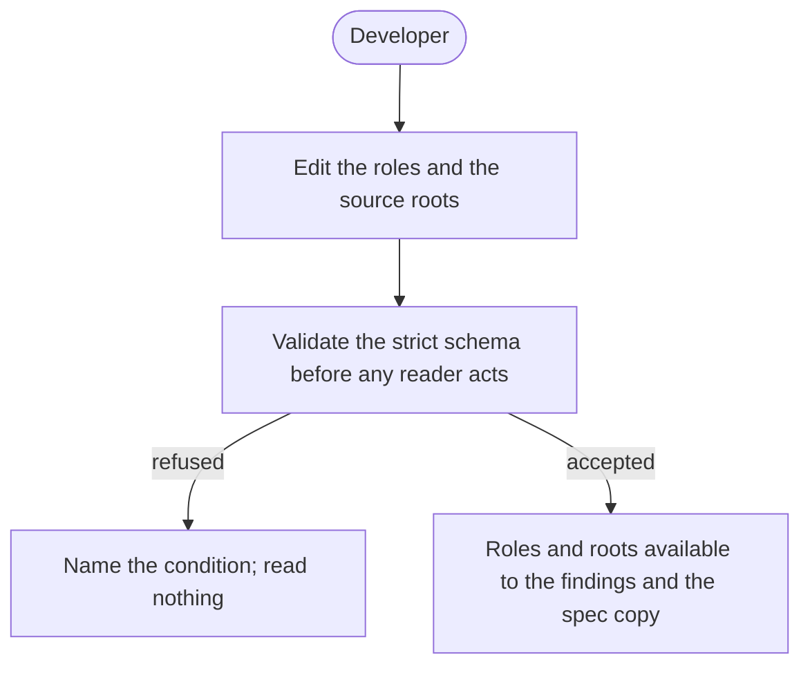

<!-- givn:base-sha256:b75aae827e299b38819cb42bb9bf79cc9deadab019f05fa1ea41a676a474041e -->
# Use case: declare-the-specification

## Level

!

## Actors

- Developer
- Supporting: Authoring agent (reads the declaration before authoring a change)

## Goal

Declare the boundary between the Specification and the Source code.

## Trigger

The developer changes a declared role or a replaceable source root, or a
durable contract moves to another path.

## Preconditions

- The project is initialized.
- `ise` is effective, which requires `architecture_principles`.
- The declaration is present from project setup or upgrade.
- The project is the developer's to configure.

## Main flow

1. The developer maps each Specification role to its paths and lists the replaceable source roots in the declaration; the system reads the current declaration and the project tree.
2. The developer saves the changed declaration; the system validates it against the declaration rules before any reader acts on it and refuses an unknown key, an unknown or repeated role, an omitted role, an absent list of replaceable source roots, and a path outside the project.
3. The system exposes the resolved roles and roots to the flows that read them: the project-health findings in `verify-change` today, and the boundary check and spec-copy preparation the later capabilities add.

## Extensions

- 2: an unknown key or role name → the refusal names it and nothing is read; protects the minimal guarantee.
- 2: a role is named twice → the refusal names the role and nothing is read; protects the minimal guarantee.
- 2: a Specification role is omitted or the list of replaceable source roots is absent → the refusal names the missing role or list and nothing is read; protects the minimal guarantee.
- 2: a role or a source root falls outside the project → the refusal names the path and nothing is read; protects the minimal guarantee.
- 2: the declaration cannot be read → the refusal names the file and the read error, exits 1, and nothing is read; protects the minimal guarantee.
- 2: the declaration cannot be parsed → the refusal names the file and the loader's reason, exits 1, and nothing is read; protects the minimal guarantee.
- 1: `ise` is not effective → the declaration is never read, and a file left in the tree is preserved; protects the success guarantee.

## Rules

- The declaration is `givn/specification.yaml`, holding exactly five Specification roles: `behavior`, `structure`, `contracts`, `limits`, `e2e`.
- Exactly one `source:` list of replaceable roots; every declared path and every root is bounded to the project.
- The schema is strict: an unknown key, an unknown or repeated role, an omitted role, an absent `source:` list, or a path outside the project is refused, named, and never read. The declaration is project-owned text: a refusal never rewrites the file and never exposes a partial role set.
- An empty role list retains nothing and produces no finding; a declared non-empty path that matches nothing does.
- No `components:` key and no per-component file list: the rebuilt component's paths are a command input for `prepare-an-ise-test`, not a permanent project declaration.
- A declared path missing from the tree, one path declared in two roles, and a `.feature` file outside the `behavior` globs are advisory findings reported by `verify-change`; none refuses the declaration.
- The `e2e` role holds path globs like the other four roles; the union of their matches identifies the packages holding the End-to-end (E2E) test runner and every `@e2e` step definition, resolved by the nearest project-relative package manifest walking up from each matched path. Whether those packages exist and link no production source is a `verify-change` finding, not a declaration refusal. The frozen digest of a later change covers the resolved files, not one directory.
- The declaration reader parses text and does not own file access. `givn lint` reads the working-tree declaration and refuses a present but unreadable file by name with exit 1; `givn ise rebuild-all` and `givn ise rebuild-component` read the declaration recorded at the selected revision and refuse four cases with exit 1 before any write: the revision does not record it (names the path, the revision, and `does not record`), the revision records it but the backend returns no blob (names the path, the revision, and `returned no blob`), the bytes are not UTF-8 (names the path and the decoding error), and the bytes are not a valid declaration (names the path and the loader's reason). Both surfaces parse the same bytes with the same strict loader, and neither exposes a partial role set.
- One declaration feeds every reader: no second role list or component list exists elsewhere.
- A written declaration is project-owned: setup and upgrade scaffold it only when absent and never rewrite its content.

## Examples

- A Givn self-rebuild declaration reads `behavior: ["givn/specs/**"]`, `structure: ["docs/glossary.md", "docs/domain-model.md"]`, `contracts: ["docs/reference.md"]`, `limits: ["docs/arc42/02-architecture-constraints.md"]`, `e2e: ["tests/e2e"]`, and `source: ["src/**"]`; the declaration is accepted, and a later component rebuild naming `src/cli/archive.rs` accepts that path because it falls inside `src/**`.
- The developer writes a sixth role named `acceptance`; the refusal names `acceptance`, and the declaration keeps its five roles.
- The developer writes `e2e` twice; the refusal names `e2e` and the file is never read as a role set.
- The developer writes `source: ["../gh-notify/crates/**"]`; the refusal names `../gh-notify/crates/**` because the root leaves the project.
- The developer moves `contracts` from `docs/reference.md` to `docs/cli-contract.md`; the next read retains `docs/cli-contract.md`, and `docs/reference.md` is now outside the declaration.
- The developer declares `limits: ["docs/performance.md"]` while that file does not exist; the declaration is accepted, and `givn lint` reports an advisory finding naming `docs/performance.md` and still exits 0.
- A project edits its `limits` paths and later crosses a release gap; `givn upgrade` leaves the declaration byte-identical.

## Minimal guarantee

A refused declaration leaves the previous declaration byte-for-byte unchanged
and exposes no partial role set.

## Success guarantee

The declaration names exactly the five Specification roles and one list of
replaceable source roots, every path bounded to the project, and the resolved
roles and roots are available to the flows that read them.

## Personas

- developer--primary-user
- agent--technical-role
- givn-maintainer--owner

## Capabilities

- specification-declaration

## Interactions

| Capability | Consumer action | E2E scenario |
|---|---|---|
| specification-declaration | declare the five roles and the replaceable source roots (an unknown key, an unknown or repeated role, an omitted role, an absent source list, and a path outside the project are refusal variants) | The declared roles are read by the project-health pass |

## Includes

- none

## Extends

- none

## Out of scope

Boundary: the project's declaration of its Specification and
replaceable Source code. Everything below stays outside this case.

- Authoring the durable contracts the roles retain: the change's authoring
  flow.
- Materializing a spec copy: `prepare-an-ise-test`.
- Reporting declaration findings: `verify-change`.
- Scaffolding the declaration file: `initialize-project` and
  `upgrade-a-project`.

## Diagram

