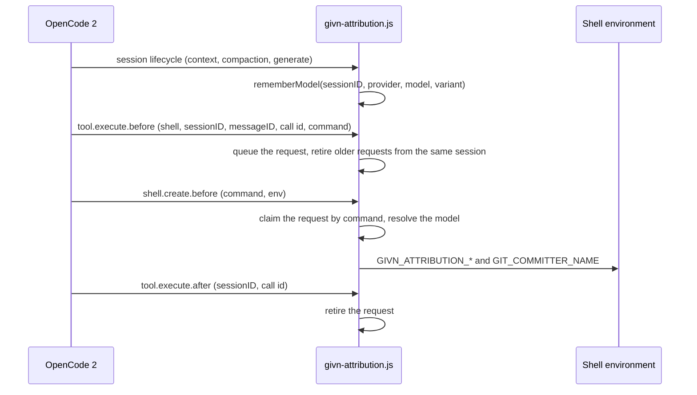

# Design: support-opencode-2

## Context

The product surface of this change is one generated JavaScript file: the
OpenCode attribution integration. The Rust CLI, the generated paths, and the
commit-attribution protocol are untouched. The acceptance scenario that
previously drove the integration through the OpenCode 1 plugin contract is
rewired to drive it through the OpenCode 2 contract.

## Decisions

- Decides D1 (compatibility window): OpenCode 2 only. The integration keeps a
  single `export default { id, setup(ctx) }` and drops the named V1 export and
  the default-export `server()` shim. Realized in
  `assets/agent-integrations/opencode/givn-attribution.js` and in the
  acceptance glue.
- Decides D2 (issuing-session link): a shell request is linked to its issuing
  session through the tool lifecycle and claimed at shell creation. Realized
  in the integration's `pendingShells` queue, `execute.before`/`execute.after`
  handlers, and `claimShell`; the resolution order is the issuing session's
  model, then the last observed model, then OpenCode 2's configured default,
  then unavailable.
- Decides D3 (verification surface): the acceptance scenario simulates the
  OpenCode 2 plugin lifecycle with an inline Node driver; no pinned runtime,
  no npm dependency tree, no provider stub, no network isolation. Realized in
  `tests/steps/llm_attribution_e2e_steps.rs`.

## Component and sequence view

Only the integration and its acceptance glue change:

```text
assets/agent-integrations/opencode/givn-attribution.js   rewritten (V2-only)
.opencode/plugins/givn-attribution.js                    regenerated copy
tests/steps/llm_attribution_e2e_steps.rs                 driver rewritten
docs/arc42/02, 06, 10, 11                                wording updates
```

The OpenCode 2 lifecycle the integration participates in:



Failure discipline: every hook body is guarded; a failing hook is reported
once through `console.warn` and never blocks the command. `shell.create.before`
writes the unavailable defaults into the environment before its first
`await`, so a slow or failing configured-default lookup still leaves a
well-formed, non-blocking attribution context.

## Step definitions

- Acceptance glue for the `attribute-commits` capability stays in
  `tests/steps/llm_attribution_e2e_steps.rs` (one file per capability). The
  changed behavior is confined to the given and `When` steps and their
  helpers.
- The given step that initializes the project also asserts that the file
  `givn init` generated in the temporary project equals the embedded asset,
  following the existing omp pattern; today it only compares the embedded
  asset with the repository's own `.opencode/plugins` copy.
- `when_opencode_supplies_selected_model` accumulates the supplied models by
  session instead of keeping a single session, so a scenario can remember
  more than one session's model.
- `when_opencode_prepares_shell` selects the named session, writes the V2
  driver, and runs it.
- The driver replays the scenario shapes: a single session (the acceptance
  scenario), two sessions (the session-link scenario), and no session (the
  unavailable scenario).
- The non-e2e commit-attribution steps remain in
  `tests/steps/llm_attribution_steps.rs` and are untouched.
- No new step file, no new fixture file, no new crate or test target.

The inline driver (written into the temporary project, then run with `node`)
replays the scenario's events:

1. imports the default export from `.opencode/plugins/givn-attribution.js`;
2. builds a fake context capturing `session.hook`, `tool.hook`, and
   `shell.hook` registrations and a `model.default` callback;
3. fires `session:generate` once per supplied session with that session's
   provider/model and the `high` variant (none for the unavailable scenario);
4. fires `tool:execute.before` for the selected session's shell command with
   a message and call identifier;
5. calls `shell:create.before` and prints the resulting environment as JSON.

The step writes the driver with a `.mjs` extension, so no `package.json` type
declaration is needed for the driver itself; the generated project keeps the
existing `{"type":"module"}` declaration for the plugin file.

## Test runner and strict mode

- Integration runner: `./run-tests.sh` (must execute the `.feature` files via
  the Gherkin runner in `tests/features_runner.rs`).
- E2E runner: `./run-tests.sh --e2e`.
- Change-scoped runs:
  `GIVN_FEATURES=givn/changes/support-opencode-2/specs ./run-tests.sh`
  with the same `--e2e` / `--non-e2e` split.
- Single scenario:
  `GIVN_FEATURES=givn/changes/support-opencode-2/specs cargo nextest run --locked --test features_runner -- 'fragments/attribute-commits.feature::OpenCode prepares attribution using its selected model'`.
- Strict mode: the Cucumber builder calls `.fail_on_skipped()` and the plain
  run exits non-zero when any scenario is skipped. Undefined or pending steps
  therefore fail. `@wip` is a lint marker only and is removed when this
  change's step glue is implemented.

## E2E smoke test infrastructure

- **E2E runner command**: `./run-tests.sh --e2e` (`verify.e2e_command`),
  filtered to the `@e2e` tag.
- **E2E step definition location**:
  `tests/steps/llm_attribution_e2e_steps.rs`.
- **Local test infrastructure**: none beyond a `node` binary on `PATH`
  (already used by the existing OpenCode acceptance glue). No server, no
  port, no database, no container, no network access.
- **E2E framework choice**: the project's existing cucumber-rs runner over
  Gherkin features; the interface under test is a JavaScript plugin contract,
  so the driver is a Node script that exercises the real integration file the
  CLI generates.
- **E2E strict-mode proof**: `.fail_on_skipped()` on the Cucumber builder
  plus the runner's non-zero exit on skipped scenarios; the tasks setup
  re-runs the scenario and observes the proof.
- **Anticipated interface obstacle**: the generated plugin is an ES module
  while OpenCode 2 imports it from a project directory. The existing steps
  already write `package.json` with `{"type":"module"}` around the generated
  integration; the driver itself uses a `.mjs` extension. Both stay.

## Interaction Coverage Matrix

| Inventory entry | @e2e scenario title | Real interface | Driving mechanism |
|---|---|---|---|
| `attribute-commits`: an OpenCode session supplies a model and prepares a shell (change-level mapping; the fragment's durable inventory holds no `attribute-commits` rows — a pre-existing gap this change does not extend) | OpenCode prepares attribution using its selected model | OpenCode 2 plugin contract (JavaScript library interface) | Inline Node driver replaying the session, tool, and shell hook events against the generated integration and reading the contributed environment |

The change adds two regular scenarios on the same interface: `OpenCode leaves
attribution unavailable when no model is observed` and `OpenCode attributes a
command to the session that issued it`.

## Use-case traceability

The fragment document (`givn/specs/fragments/fragment.md`) owns the
`attribute-commits` capability; this change re-specifies one of its
scenarios.

| Fragment guarantee / rule | Technical decision | E2E evidence |
|---|---|---|
| Attribution context is best-effort and never blocks a command | Guarded hooks; unavailable defaults written before the first await; fallbacks end in `unavailable` | Scenario `OpenCode prepares attribution using its selected model` asserts the populated case; the new regular scenario `OpenCode leaves attribution unavailable when no model is observed` asserts the unavailable case |
| The harness is named in the environment | `GIVN_ATTRIBUTION_HARNESS=opencode` always stamped | same scenarios |
| The model identity and reasoning mode reach the shell environment | Session-scoped model memory; issuing-session link | the acceptance scenario plus the new regular scenario `OpenCode attributes a command to the session that issued it` |

Persona impact: `developer--primary-user` reads the attribution in commit
history. No browser interface and no CLI text output changes, so no visual
contract applies.

## Visual Design Contract

- Interface: none — the change alters a generated plugin file and its
  acceptance driver; it renders no screen and emits no CLI text.

## Local runnability and digital twins

- Local run command: `./run-tests.sh` for the full suite;
  `GIVN_FEATURES=givn/changes/support-opencode-2/specs ./run-tests.sh --e2e`
  for this change's acceptance scenario. Both need only the repository
  checkout and `node` on `PATH`.
- External dependencies: none. OpenCode 2 is not started; the plugin contract
  is replayed in-process by the driver, and the driver makes no network
  request. No digital twin is required.

## Version freshness

- Node.js: whatever `node` the developer's `PATH` provides (recommended:
  current LTS, resolved with `node --version` at run time). This change
  introduces no pin.
- OpenCode: not a runtime dependency of the suite; the contract replayed is
  the OpenCode 2 plugin lifecycle. No version is pinned by this change.

## Risks

- OpenCode 2's contract can drift again; the guarded hooks keep drift
  non-blocking and R-50 records the risk.
- An OpenCode 1 user loses attribution after regenerating until they upgrade;
  recorded in D1 and the proposal's Out of Scope.
