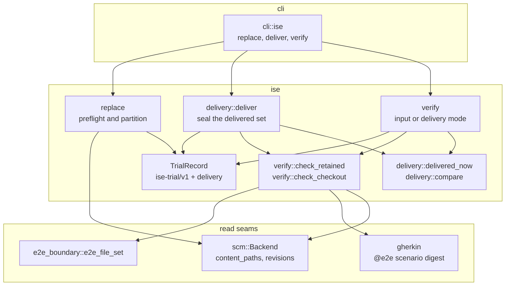
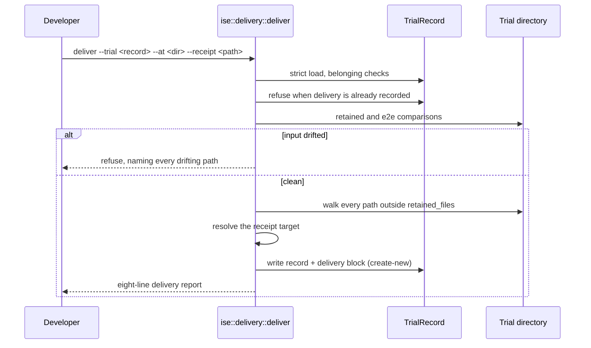

# Design: add-delivery-identity-to-trial-record

## Overview

One new subcommand, one optional record block, one verify mode, and one moved
helper:

1. **`src/ise/delivery.rs` (new) owns the delivered set.** It walks the trial
   directory, skips every path the record retains, hashes what remains with the
   record's existing identity rule, compares a recorded set against the current
   one, and records the seal.
2. **`src/ise/record.rs` gains the `Delivery` block and the identity entry
   point.** `TrialRecord` gains an optional `delivery` field, the `Delivery`
   struct holds `delivered_files`, `delivered_digest`, and `givn_version`, and
   `identity_at` moves here from `verify.rs` so preparation, verification, and
   the seal hash one rule.
3. **`src/ise/verify.rs` gains a mode.** `verify` takes `VerifyMode::{Input,
   Delivery}`, refuses delivery mode on a record without the block, adds the
   delivered comparison, and reports the delivery line state.
4. **`src/cli/ise.rs` and `src/main.rs` gain the surface.** `IseCommands::Deliver`
   and `--delivery` on `IseCommands::Verify`; the adapter formats the delivery
   report, the `Delivery:` lines, and the exit codes.

The change adds no dependency, no configuration key, and no new file format
version. A record `givn ise replace` writes keeps its exact bytes: the
`delivery` field is skipped when absent. A project with `ise` off keeps its
current behavior, and the new command refuses at the same add-on check.

## Visual Design Contract

```
- Interface: terminal
- Viewports: not applicable (terminal text surface)
- States: not applicable
- Design system: none (CLI)
```

`Interface: terminal` is deliberate: the change alters terminal text, exit
codes, and a YAML record, not a rendered screen. Each delta `@e2e` scenario
commits a transcript at
`givn/changes/add-delivery-identity-to-trial-record/evidence/visual/<scenario-slug>/transcript.txt`:

| Scenario | Slug |
|---|---|
| Developer records a trial's delivery identity and receives the delivery report | `developer-records-a-trial-s-delivery-identity-and-receives-the-delivery-report` |
| Verifier re-checks a delivered trial and receives the delivery report | `verifier-re-checks-a-delivered-trial-and-receives-the-delivery-report` |

**Baseline asserted at every transcript-producing assertion:**

- every refusal names the condition and the path, record, receipt, or trial
  directory it is about;
- no Rust module, struct, or field name appears in user-facing output; the
  record's own field names do appear in a record assertion, because the record
  is the verifier's interface;
- exit codes: `0` for a recorded delivery or a clean re-check, `1` for a
  refusal or drift, `2` for a clap usage error;
- the delivery report prints its eight lines in one order, and the re-check
  prints `Delivery: not checked` or `Delivery: clean` only where the run
  actually knows which question it answered;
- digests print as the first 12 lowercase hex characters and `…`; the record
  carries the full 64 characters.

**Personas:** `developer--primary-user` records the delivery and reads its
report; `agent--technical-role` reads the refusals and the drift lines;
`givn-maintainer--owner` owns the record shape and the compatibility rule.

## Use-Case Traceability

Owning use-case ID: `prepare-an-ise-test` (`clean-room-preparation`,
`trial-input-verification`, `trial-delivery-identity`).
Ideation source: `ise-rebuildability`. No change seed covers this defect.
Confirmed Persona IDs: `developer--primary-user`, `agent--technical-role`,
`givn-maintainer--owner`.

| Use-case contract element | Technical decision | Capability / scenario evidence |
|---|---|---|
| Goal: the verifier confirms the frozen inputs **and** the delivered replacement | The goal clause gains the delivered replacement; `givn ise deliver` and `--delivery` are its two actions | both `trial-delivery-identity` `@e2e` scenarios |
| Main flow 6: the developer records the delivery identity after the build | `delivery::deliver`: strict record load, belonging checks, input re-check, delivered-set walk, create-new receipt | `Developer records a trial's delivery identity and receives the delivery report`; the eight recording refusal scenarios |
| `replaced_digest` describes the trial input, never the delivered bytes | The name stays; the block is named `delivery` with `delivered_digest` and `delivered_files`; the use-case rules state both objects | the e2e seal scenario asserts `delivery.delivered_digest` **and** that the trial record keeps `replaced_digest` |
| The delivered set is the trial minus the retained set | `delivery::delivered_now` walks the trial, skips `retained_files` keys, and hashes the rest by the record's identity rule | e2e seal scenario asserts a replaced path and a kept-source path in the set and no retained path; `Verification names every delivered file changed after the delivery was recorded` names a replaced path and a kept-source path in one run |
| Recording requires clean frozen inputs | The seal runs the same retained and checkout comparisons `verify` runs and refuses with every drifting path | `Recording a delivery identity refuses a trial whose frozen inputs drifted` |
| A delivery is recorded once | `deliver` refuses a record whose `delivery` is `Some`; every run writes a new file | `Recording a delivery identity refuses a record that already holds one` |
| The delivered set re-checks per path | `delivery::compare` produces `Delivered` drift for missing, differing, and gained paths | `Verification names every delivered file changed after the delivery was recorded`, `... a path the builder added ...`, `... a delivered path missing from the trial` |
| A delivery re-check needs a delivery identity | `verify` refuses `VerifyMode::Delivery` before any comparison when the block is absent | `Verification refuses a record that holds no delivery identity` |
| The default re-check keeps its comparisons and does not claim the delivery check | `DeliveryLine::NotChecked` prints one line; the three existing lines and the drift reasons are untouched | `Verification reports the delivery identity as not checked without the delivery flag` |
| The record stays `ise-trial/v1` and older records stay readable | `#[serde(default)]` plus `skip_serializing_if` on the field; a missing block means no delivery identity | the e2e seal scenario over a record `replace` wrote; the `ise-trial/v1` reader scenarios of `trial-input-verification` stay green |
| The seal names what it bound | `DeliveryReport` rendered by `cli::ise`; eight fixed lines | e2e seal scenario asserts every line |
| Recording writes nothing on refusal | Every check precedes `TrialRecord::write`, which is create-new | the five recording refusals assert the delivery record path stays absent |

## Architecture Impact

New module:

- `src/ise/delivery.rs`: `delivered_now` (the trial walk and identity map),
  `compare` (recorded against current, producing `Delivered` drift), and
  `deliver` (the seal: load, belong, require clean input, refuse a second
  seal, resolve the target, write, report).

Modified modules:

- `src/ise/record.rs`: `Delivery`, the optional `TrialRecord.delivery` field,
  the delivery digest checks used by the strict reader, and `identity_at` (the
  entry-kind and executable-aware per-path identity, moved from `verify.rs`).
- `src/ise/verify.rs`: `VerifyMode`, the `DeliveryLine` state on
  `VerifyReport`, the `Delivery` drift line, the block refusal, and the
  delivered comparison.
- `src/ise/mod.rs`: `pub mod delivery`, the `DeliverRequest` and
  `DeliveryReport` types, `pub fn deliver`, and the receipt-only target check.
- `src/cli/ise.rs`: `deliver` formatting and the delivery lines on the verify
  report.
- `src/main.rs`: `IseCommands::Deliver` and `IseCommands::Verify { delivery }`.

Unchanged: `src/ise/partition.rs` (the seal re-checks the recorded retained set
and never re-partitions), `src/scm.rs`, `src/e2e_boundary/`, `src/gherkin/`,
`src/proof.rs`, and every archive path.



Arrows point from consumer to provider.

### Contracts and Components

| Contract | Consumer use case | Consumers | Implementing component today | Split trigger |
|---|---|---|---|---|
| `CleanRoomTrial` (`replace`, `deliver`, `verify`, `TrialRecord`) | `prepare-an-ise-test` (`clean-room-preparation`, `trial-input-verification`, `trial-delivery-identity`) | `cli::ise` | `src/ise` | a second materialization mode (branch or worktree) or a second record scope |
| `RevisionContent` (`revision_files`, `revision_blobs`, `content_paths`) | `prepare-an-ise-test` (read one revision, read the current tree for the `e2e` re-check) | `ise` (`replace`, `verify`) | `src/scm`, `src/git`, `src/fossil` | a third backend or a revision stream instead of a path list |
| `RevisionE2eFileSet` (`e2e_file_set`) | `prepare-an-ise-test` (freeze and re-check the resolved `e2e` package) | `ise` (`replace`, `verify`) | `src/e2e_boundary` | a second resolution rule or a non-Cargo manifest |
| `ScenarioDigest` (selected `@e2e` scenarios per feature file) | `prepare-an-ise-test` (freeze and re-check the selected `@e2e` scenarios) | `ise` (`replace`, `verify`) | `src/gherkin` | a second selection rule or a non-Gherkin behavior format |

`deliver` joins the `CleanRoomTrial` contract rather than forming a second one:
it reads the same record, the same trial directory, and the same trust-anchor
checks, and it adds no external dependency. `src/ise/delivery.rs` is an
internal unit with one responsibility (the trial's delivered set and its
identity), so it needs no contract of its own. The three read seams keep their
existing consumers: the seal reads the current checkout through the same
`e2e` checks that `verify` already runs, so `RevisionContent` gains no caller.

## Technology Decisions

| Technology | Version | Resolution |
|---|---|---|
| Rust | edition 2024, repository-pinned toolchain | Repository-pinned in `Cargo.toml`; unchanged |
| `serde_yaml_ng` | 0.10.0 | Locked in `Cargo.lock` (read this checkout, 2026-11-16); serializes the record and the block |
| `sha2` | 0.11.0 | Locked in `Cargo.lock` (read this checkout, 2026-11-16); hashes the delivered identities |
| `clap` | 4.6.7 | Locked in `Cargo.lock` (read this checkout, 2026-11-16); the subcommand and the flag |
| `cucumber` (cucumber-rs) | 0.23.0 | Locked in `Cargo.lock` (read this checkout, 2026-11-16); test runner |
| `git`, `fossil` CLIs | repository toolchain | Existing requirement; the delivery scenarios use Git fixtures |

No new dependency and no version selected from memory.

## Decisions

- Decides D1: **`givn ise deliver` writes a new record that holds every field
  of the trial record it read plus a `delivery` block.** The command is
  `givn ise deliver --trial <record> --at <dir> --receipt <path>`; `--receipt`
  is required. It loads the record with the strict reader, runs the trust
  anchor checks (`written_path` equals the canonicalized `--at`, `backend`
  equals the selected backend, the record lies outside the trial), re-checks
  the frozen inputs, refuses a record that already holds a block, walks the
  delivered set, resolves the receipt target, and writes the new record with
  create-new semantics. The input record file is never rewritten. Rejected:
  letting `givn ise verify` write the block (the identity would be computed
  from the same bytes the same run compares, so it always matches and detects
  nothing, and the verifier would become a writer) and a separate
  `ise-delivery/v1` file naming the trial record by digest (a verifier must
  hold and pair two files, the reader gains a second scope, and a mismatched
  pair becomes a new refusal class). Realized in `src/ise/delivery.rs` and
  `src/main.rs`.
- Decides D2: **the existing name stays, the new identity is named for its
  object, and the scope does not change.** `replaced_digest` keeps its value
  and means the rollup over the replaced set's identities at the record's
  `revision` (the trial input). The delivery side is `delivery.delivered_files`
  (one identity per delivered path) and `delivery.delivered_digest` (their
  rollup), plus `delivery.givn_version` for the sealing binary. The record
  keeps `schema: 1` and `content_scope: ise-trial/v1`. Rejected: renaming
  `replaced_digest` to `replaced_input_digest` with an `ise-trial/v2` scope (a
  second scope, a permanent alias reader for every record already written, and
  `replaced_paths` would need the same rename to stay coherent) and reusing
  one field for the delivered rollup (one key, two objects at two times, which
  is the defect). Realized in `src/ise/record.rs`; the naming rule below states
  the contract, and the compatibility table states what each reader does.
- Decides D3: **the delivered set is every regular file and symlink under the
  trial directory whose path the recorded `retained_files` does not list.**
  That set holds the replaced paths the builder recreated, the kept source the
  builder may rewrite, and any path the builder created. Directories carry no
  identity, and a symlink is identified by its target text. The retained
  identity and the delivered identity then partition the trial directory, so no
  path in it is outside both. Rejected: the recorded replaced paths only (a
  kept-source edit and a new path would stay unbound while the record read as
  complete) and the whole trial including retained paths (a retained path
  would gain a second identity channel that must agree with `retained_digest`,
  and one retained edit would print two drift lines). Realized in
  `src/ise/delivery.rs`.
- Decides D4: **`--delivery` selects the mode on `givn ise verify`, and the
  mode check runs before any comparison.** Delivery mode refuses a record with
  no `delivery` block, naming the record and the missing identity; otherwise it
  runs the frozen-input checks and then the delivered comparison. Input mode
  keeps its three lines and adds `Delivery: not checked` when the record holds
  a block. Rejected: a `givn ise verify-delivery` subcommand (it would repeat
  the record load, the belonging checks, and the input re-check, so two
  commands would differ by one flag) and checking delivery whenever the block
  is present (a verifier could not ask the input question alone, and the
  report's meaning would vary with the record's content). Realized in
  `src/ise/verify.rs` and `src/cli/ise.rs`.
- Decides D5: **a seal requires clean frozen inputs, and a replaced path with
  no delivered file is allowed.** Recording runs the retained and checkout
  comparisons first and refuses with every drifting path and its reason. A
  rebuild that merges or drops a replaced file still seals: the record carries
  `replaced_paths` and `delivery.delivered_files`, so a reader sees which input
  paths have no delivered file. Rejected: requiring every replaced path to
  exist (a legitimate rebuild could not be sealed, and under `--full` that is
  most real rebuilds) and requiring nothing (a seal over an already drifted
  trial would record the drifted bytes as the delivery, and a later verifier
  could not tell). Realized in `src/ise/delivery.rs`.

No decision is carried. Each is foundational for this change; reversing any of
them changes the record shape or the command surface, and the tasks are written
against these defaults.

## Naming rule

A field names the object it digests, and the word in front of `_digest` is that
object.

| Field | Object | When it is computed | What it never describes |
|---|---|---|---|
| `replaced_digest` | the replaced set at the record's `revision` | `givn ise replace`, before the build | the delivered bytes |
| `delivery.delivered_digest` | the delivered set under the trial directory | `givn ise deliver`, after the build | the removed input |
| `retained_digest` | the retained set recorded at the revision | `givn ise replace` | the checkout's later content |
| `e2e_digest` | the `e2e` package plus the selected `@e2e` scenarios | `givn ise replace` | a component step definition |

The rule a reader applies: a digest inside the `delivery` block describes what
was delivered; every other digest in the record describes the trial input. The
glossary carries both terms, and the use-case rules state the same rule.

### Compatibility rule

| Reader | `ise-trial/v1` without `delivery` | `ise-trial/v1` with `delivery` |
|---|---|---|
| New binary, input mode | reads; prints `Retained: clean` and `E2E: clean` | reads; adds `Delivery: not checked` |
| New binary, delivery mode | refuses, naming the record and the missing identity | reads; compares the delivered set |
| Older binary | reads, exactly as today | refuses by the unknown field `delivery`, which is the intended failure: it cannot check the block and must not ignore it |

## Data Model Changes

### `TrialRecord` and `Delivery`

```rust
pub(super) struct TrialRecord {
    pub schema: u32,
    pub content_scope: String,
    pub backend: String,
    pub revision: String,
    pub named_paths: Vec<String>,
    pub replaced_paths: Vec<String>,
    pub counts: Counts,
    pub retained_digest: String,
    pub e2e_digest: String,
    pub replaced_digest: String,
    pub retained_files: BTreeMap<String, String>,
    pub e2e_files: BTreeMap<String, String>,
    pub e2e_scenarios: BTreeMap<String, String>,
    pub written_path: String,
    pub givn_version: String,
    #[serde(default, skip_serializing_if = "Option::is_none")]
    pub delivery: Option<Delivery>,
}

#[derive(Debug, Clone, PartialEq, Eq, Serialize, Deserialize)]
#[serde(deny_unknown_fields)]
pub(super) struct Delivery {
    pub delivered_digest: String,
    pub delivered_files: BTreeMap<String, String>,
    pub givn_version: String,
}
```

- `serde(default, skip_serializing_if = "Option::is_none")` keeps a record
  written by `replace` byte-identical to today's: no key is added and no
  existing key moves. A record without the field parses as `None`.
- `Delivery` carries `deny_unknown_fields`, so a hand-edited block with an
  unknown key refuses instead of being read as a smaller identity.
- The delivery record is `TrialRecord` with `delivery: Some(..)`, serialized by
  the same `yaml()` method. The input block is re-serialized from the parsed
  record: for a record `replace` wrote, the bytes are identical, and a
  hand-edited record is normalized first (its semantic content is then checked
  against the trial, so a hand edit still shows as drift).

### Delivery record

```yaml
schema: 1
content_scope: ise-trial/v1
backend: git
revision: 768e2c65a1b2c3d4e5f60718293a4b5c6d7e8f90
named_paths:
  - src/keys/parser.rs
replaced_paths:
  - src/keys/parser.rs
counts:
  retained: 3
  kept_source: 1
  replaced: 1
  outside_declaration: 0
  not_replaced: 0
retained_digest: "<64 hex>"
e2e_digest: "<64 hex>"
replaced_digest: "<64 hex>"
retained_files:
  docs/reference.md: "<64 hex>"
  givn/specification.yaml: "<64 hex>"
  givn/specs/demo/spec.feature: "<64 hex>"
e2e_files:
  tests/e2e/Cargo.toml: "<64 hex>"
  tests/e2e/steps/keys.rs: "<64 hex>"
e2e_scenarios:
  givn/specs/demo/spec.feature: "<64 hex>"
written_path: /tmp/ise-passuff
givn_version: 0.9.20
delivery:
  delivered_digest: "<64 hex>"
  delivered_files:
    src/keys/parser.rs: "<64 hex>"
    src/keys/steps.rs: "<64 hex>"
  givn_version: 0.9.20
```

`revision`, `replaced_digest`, and every other input field keep the values the
input record holds. `delivered_files` is sorted by path. The delivered set
excludes every `retained_files` key by construction, so the two maps are
disjoint and no path hashes twice.

### Identity entry point

`identity_at(root, path) -> Result<String, IdentityGap>` moves from
`src/ise/verify.rs` to `src/ise/record.rs` unchanged: it reads
`symlink_metadata`, hashes a symlink by `read_link` target text, hashes a
regular file with its executable bit, and returns `Differs` for any other
entry. `verify` and `delivery` both call it, so a delivered path and a
retained path are hashed by one rule.

The digest shape and the rollup are unchanged:
`sha256(path NUL kind NUL executable-marker NUL bytes-or-target)` per path, and
`sha256(join(sorted(path NUL digest NUL "\n")))` per rollup.
`delivered_digest = rollup(delivered_files)`. An empty delivered set is valid
and yields the rollup of no pairs; a verifier then passes only when the trial
holds no path outside the retained set.

### `DeliverRequest`, `DeliveryReport`, and the target check

```rust
pub struct DeliverRequest {
    pub trial: PathBuf,
    pub at: PathBuf,
    pub receipt: PathBuf,
}

pub struct DeliveryReport {
    pub trial: PathBuf,
    pub revision: String,
    pub backend: &'static str,
    pub delivered: usize,
    pub delivered_digest: String,
    pub receipt: PathBuf,
}
```

`src/ise/mod.rs` gains `require_delivery_target(project_root, trial, receipt)`.
It resolves the receipt through the existing `resolved_target` (the deepest
existing ancestor is canonicalized, so a symlinked parent cannot alias the
checkout) and refuses a receipt inside the checkout, an existing receipt, and a
receipt inside the trial. The ancestor-of-the-trial rule needs no separate
check: an ancestor of the trial is an existing directory, so the existing-path
rule refuses it. The receipt is written by `TrialRecord::write`, which is
create-new.

### Seal and re-check flow



The order matters: the add-on check runs first (no record is read), the strict
load runs before the trust anchor, the block check runs before the expensive
comparisons, the input comparisons run before the walk, the walk runs before the
target check writes nothing, and the write is last. Every refusal leaves the
checkout, the trial, and the input record unchanged, and writes no delivery
record.

### Report shapes

`givn ise deliver` prints eight lines:

```text
Trial: /tmp/ise-passuff
Trial revision: 768e2c65a1b2c3d4e5f60718293a4b5c6d7e8f90
Backend: git
Retained: clean
E2E: clean
Delivered: 2
Delivered digest: 9e8fe3ae7d01…
Receipt path: /tmp/ise-passuff-delivery.yaml
```

`Trial revision:` is the record's input revision, so the line cannot be read as
a delivered commit. `Delivered:` is `delivered_files.len()`.

`givn ise verify` clean output gains one line, and only where the run knows the
answer:

```text
Trial: /tmp/ise-passuff
Retained: clean
E2E: clean
Delivery: clean
```

| Record state | Input mode | Delivery mode |
|---|---|---|
| no `delivery` block | three lines (today) | refusal, exit 1 |
| `delivery` block | three lines plus `Delivery: not checked` | four lines, with `Delivery: clean` |

A failing run keeps its shape: `Trial:` and the drift lines on stderr, then the
count, exit 1. The delivery drift label is `Delivery drift`.

### Drift reasons

| Line | Reason | Meaning |
|---|---|---|
| `Delivery` | `the delivered path is missing from the trial` | A recorded delivered path is absent. |
| `Delivery` | `the trial's delivered content differs from the record` | The per-path digest differs. |
| `Delivery` | `the trial gained this path after the delivery was recorded` | The trial holds a path outside the retained set that the record does not list. |

The retained and `e2e` reasons stay unchanged.

### Refusals

| Condition | Named output |
|---|---|
| `ise` off, or `architecture_principles` off | the add-on and its enable command, before any read |
| The record is unreadable, malformed, another schema or scope, or has no 64-hex `replaced_digest` | the record path and the reason, from the existing strict reader |
| The `delivery` block holds a digest that is not 64 hex characters | the record and the delivered digest |
| A `delivered_files` entry is not a 64-hex value | the record and the path |
| The record's `written_path` is not the trial, or its `backend` is not the selected one | the record and the mismatch, from the shared trust anchor |
| The trial directory is missing | the trial directory |
| The record already holds a delivery identity | the record |
| A retained or `e2e` identity already drifted | every drifting path and its reason |
| The receipt exists, lies inside the checkout, or lies inside the trial | the receipt |
| A delivered path is neither a regular file nor a symlink, or cannot be read | that path and the reason |
| Delivery mode is asked for a record with no block | the record and the missing identity |

## Step Definitions

| Capability | Step definition file | Permanent merge target |
|---|---|---|
| `trial-delivery-identity` | `tests/steps/trial_delivery_identity_steps.rs` | same file |
| `trial-delivery-identity` (E2E) | `tests/steps/trial_delivery_identity_e2e_steps.rs` | same file |

Both are registered in `tests/steps/mod.rs`. The delivery fixtures extend
`tests/steps/ise_clean_room_support.rs`: it already owns the prepared-trial
fixture, the record rewrite helpers, the append helper, and the trial path
accessors, and a delivery scenario is a prepared trial plus one action. The
support module gains `deliver(world)` (invoke the built binary's
`ise deliver`), `delivery_record_path(world)`, `delivered_set(world)`,
`write_delivered_replacement(world, path)`, and `add_trial_file(world, path)`.
It carries no `#[given]`/`#[when]`/`#[then]`.

Every delta phrase is bound in these permanent files; no delta step copy is
introduced. Four phrases reuse bindings that already exist:
`a prepared Git trial with a receipt`, `a prepared Git trial with a record that
is not a trial record`,
`the verifier changes the retained file "givn/specs/demo/spec.feature" in the
trial`, and `the verifier changes the kept source file "src/keys/steps.rs" in
the trial`.

## Test Runner and Strict Mode

Test runner command (from `givn/commands.yaml`):

```text
./run-tests.sh --non-e2e
```

E2E runner command:

```text
./run-tests.sh --e2e
```

The E2E scope sets `GIVN_RESULT_SCOPE=e2e`; the regular scope sets no scope and
reports `regular`. Both scopes must report zero failed and zero skipped tests.

Single-scenario run command for this change's feature:

```text
GIVN_FEATURES=givn/changes/add-delivery-identity-to-trial-record/specs cargo test --locked --test features_runner -- --exact "prepare-an-ise-test/trial-delivery-identity.feature::Developer records a trial's delivery identity and receives the delivery report"
```

**Strict mode:** `cucumber-rs` 0.23 with `.fail_on_skipped()` in
`tests/features_runner.rs`. An undefined step becomes a failed `NotFound` step,
the writer records `failed = 1`, and the process exits 1. The change's step
files bind every phrase of
`specs/prepare-an-ise-test/trial-delivery-identity.feature`; `givn check tasks`
refuses the change while a selected delta scenario is unbound. No step body is
empty.

## Testability Seams

- `delivery::delivered_now` is a pure function of a directory and a retained
  map. Module tests cover a delivered directory containing a symlink (hashed by
  target text), an empty subdirectory (adds no entry), and a path the retained
  map lists (excluded).
- `record.rs` deserialization tests cover a record without `delivery` (parses
  as `None`), a record with an unknown key inside `delivery` (refuses), and a
  record whose `delivery.delivered_digest` is not 64 hex (refuses). The reader
  is the boundary that a hand-edited record crosses, and these cases are
  cheaper and more precise as unit tests than as CLI fixtures.
- `delivery::compare` is a pure map comparison, so missing, differing, and
  gained cases are unit-tested without a filesystem.
- The CLI scenarios cover the ordering the unit tests cannot: the add-on check
  before the record read, the input refusal before the receipt write, and the
  create-new receipt.

## Interaction Coverage Matrix

| Inventory entry | @e2e scenario title | Real interface | Driving mechanism |
|---|---|---|---|
| `clean-room-preparation`: prepare a clean-room trial from a selected revision | Developer prepares a clean-room trial from a recorded revision | CLI | The test binary runs the built `givn` binary as a subprocess inside a temporary Git project and reads stdout, stderr, and the written trial (unchanged by this change) |
| `trial-input-verification`: re-check a prepared trial's frozen inputs | Verifier re-checks a prepared trial and receives the frozen-input report | CLI | The test binary runs `givn ise verify --trial <record> --at <trial>` in the temporary project and reads the report (unchanged by this change) |
| `trial-delivery-identity`: record the delivery identity of a finished trial | Developer records a trial's delivery identity and receives the delivery report | CLI | The test binary runs `givn ise deliver --trial <record> --at <trial> --receipt <path>` in the temporary project, then reads the report and the record file |
| `trial-delivery-identity`: re-check a delivered trial's replacement bytes | Verifier re-checks a delivered trial and receives the delivery report | CLI | The test binary runs `givn ise verify --trial <delivery record> --at <trial> --delivery` in the temporary project and reads stdout, stderr, and the exit code |

## External Boundary Cases

The trial directory and the record file are the change's external boundary.

| Case | Treatment | Proof |
|---|---|---|
| Wrong identity: the record names another trial | refuse, naming the recorded path and the trial | `Recording a delivery identity refuses a record that names another trial` |
| Wrong identity: the record names another backend | refuse, naming the record and the backend | shared trust anchor, proven through the `trial-input-verification` scenario that verifies the same record body |
| Wrong request: delivery mode over a record with no block | refuse before any comparison | `Verification refuses a record that holds no delivery identity` |
| Malformed shape: unknown key inside `delivery` | refuse, naming the record and the unknown field | `record.rs` deserialization test |
| Malformed shape: a digest that is not 64 hex | refuse, naming the record and the digest | `Verification refuses a delivery identity that is not a SHA-256 value` plus the `record.rs` test |
| Wrong entry kind: a delivered symlink and a regular file with the same target text | different identities; the walk never follows a symlink | `delivery.rs` module test |
| Unreadable or non-regular delivered path | refuse, naming the path | `delivery.rs` module test |
| Replay: a second seal of the same trial | refuse, naming the record | `Recording a delivery identity refuses a record that already holds one` |
| Replay: a second seal into an existing receipt | refuse, naming the receipt | `Recording a delivery identity refuses an existing receipt` |
| Partial response: the record write fails | the error names the receipt; a partially written file is removed before the error returns | `TrialRecord::write` is create-new, so at most one partial file exists; the removal mirrors `replace`'s trial removal. No test forces a mid-write failure; the observable contract is the error naming the path. |
| Origin change: the trial directory is deleted after preparation | refuse, naming the trial directory when the path disappears, or report the retained drift when only a file disappears | `Recording a delivery identity refuses a missing trial directory`; the retained-missing scenario of `trial-input-verification` |
| Empty delivery: the builder wrote nothing outside the retained set | seal with `Delivered: 0` and the empty rollup; the re-check then reports a gained path for anything written later | design case, no fixture: the state is a legitimate delivery and needs no refusal |

High-risk rules with a sensitivity check: identity (the trust anchor and the
per-path digest), alternative coverage (the kept-source and replaced-path
scenarios prove the delivered set is not the replaced set alone), boundaries
(the retained set is excluded exactly), and precedence (the add-on check, then
the load, then the block check, then the input comparison, then the walk).

## Local Runnability

The product is one CLI binary with no service, database, queue, or third-party
dependency. The delivery command reads local files only: the record, the trial
directory, and the checkout tree through the existing `e2e` checks.

| Thing | Command or note |
|---|---|
| Whole system | `cargo build --locked` then `target/debug/givn ise deliver --help`; there is no service to start |
| Regular suite | `./run-tests.sh --non-e2e` |
| E2E suite | `./run-tests.sh --e2e` |
| Test fixtures | Temporary Git projects under the test temp root; no network and no container |
| Digital twins | None: the command talks to no external service |

No interface obstacle is anticipated: every step drives the real binary through
`std::process::Command` and reads its streams and files, which is the interface
the consumer uses.

## Personas

- `developer--primary-user` records the delivery and reads the eight-line
  report, so the report names the trial, the revision, and the delivered
  count without requiring the record to be opened.
- `agent--technical-role` reads the refusals and the `Delivery drift` lines,
  so every refusal names its subject and every drift line names its path.
- `givn-maintainer--owner` owns the record shape, the compatibility rule, and
  the boundary between the two identities.
