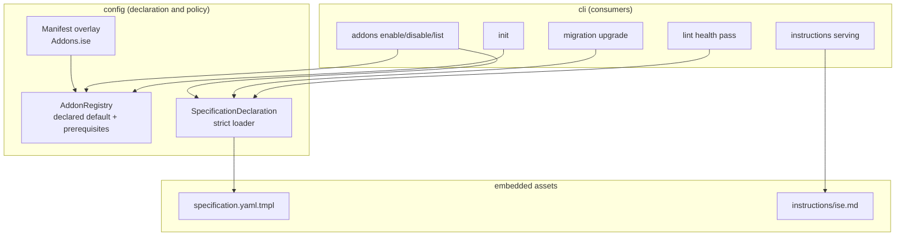

# Design: add-ise-addon-and-specification

## Overview

Five coordinated surfaces, each owned by one component:

1. **Addon registry** (`src/config/addons.rs`, new; consumed by
   `src/cli/addons.rs`, `src/cli/init.rs`, `src/config/lock.rs`, and
   `src/skills/render.rs`) gains a per-addon declared default and one
   prerequisite relation, and stops assuming that every addon is default-on.
2. **Declaration of the Specification** (`src/config/declaration.rs`, new) is a
   strict, read-only loader for `givn/specification.yaml`; the only managed
   write is the one-time scaffold from `assets/specification.yaml.tmpl`.
3. **Specification-health pass** (`src/cli/lint.rs`) adds four advisory
   findings and one blocking declaration error, in the default project scope
   only.
4. **Addon-bound instruction serving** (`src/cli/instructions.rs`,
   `assets/instructions/ise.md`, new) gates `givn instructions ise` on the
   effective addon.
5. **Guidance and vocabulary** (`assets/instructions/{design,design-review,review,proposal}.md`,
   `docs/glossary.md`, `docs/arc42/01-introduction-and-goals.md`,
   `docs/arc42/02-architecture-constraints.md`, `docs/reference.md`) records
   the two change records and lands the confirmed rows with the code that
   makes each statement true.

No new command, no new binary, no network, and no change for a project that
never enables `ise`. The declaration is project-owned text: Givn scaffolds it
once, validates it on every read, and never rewrites it.

## Visual Design Contract

```
- Interface: terminal
- Viewports: not applicable (terminal text surface)
- States: not applicable
- Design system: none (CLI)
```

`Interface: terminal` is deliberate: the change alters terminal text and exit
codes, not a rendered screen. Evidence is a captured transcript per `@e2e`
scenario at
`givn/changes/add-ise-addon-and-specification/evidence/visual/<scenario-slug>/transcript.txt`
(`Interface: terminal`, so no screenshots and no viewports).

**Baseline asserted at every transcript-producing assertion:**

- every message names the flag, role, addon, or path it is about;
- a refusal names the condition and the next action;
- no internal identifier (Rust module, struct, or field name) appears in
  user-facing output;
- exit codes stay stable: `givn lint` 0 for advisories, 1 for a parse or
  declaration error, 2 for `@wip`, 3 for a duplicate title; `givn addons`
  and `givn instructions` 0 on success and nonzero on refusal;
- the `--json` path carries the same content as the text path.

**Personas:** `developer--primary-user`, `agent--technical-role`,
`givn-maintainer--owner` are confirmed; `agent--technical-role` is the reader
of every instruction and refusal studied here.

## Use-Case Traceability

Owning use-case IDs: `initialize-project`, `upgrade-a-project`,
`declare-the-specification`, `verify-change`, `obtain-effective-guidance`,
`create-change`, fragment `support`.
Ideation source: `ise-rebuildability`.
Confirmed Persona IDs: `developer--primary-user`, `agent--technical-role`,
`givn-maintainer--owner`.

| Use-case contract element | Technical decision | Capability / E2E evidence |
|---|---|---|
| `initialize-project` rule: each addon declares its own default; `ise` is the one opt-in addon | `AddonSpec.default_enabled` stays the single registry source; `config::manifest::Addons::ise` uses a `false` serde default; `Addons::NAMES`, `entries()`, and `Default` grow to ten | `enable-optional-addons`; E2E `A consumer lists addons and each declared default is reported` |
| `initialize-project` rule: a fresh init writes explicit `true` for default-on addons and omits `ise` | The fresh-init loop already gates on `addon.default_enabled`; `--no-addons` writes `false` for all ten | `initialize-a-project`; modified E2E `Consumer selects agent targets during interactive init`; `enable-optional-addons`; regular `givn init --no-addons writes an explicit false for every addon including ise` |
| `initialize-project` rule: both prerequisite refusals leave both flags unchanged | `AddonSpec.requires` read by `run_enable` and `run_disable` before any write; exact refusal strings | `enable-optional-addons`; E2E `A consumer disables a required addon and the refusal names ise`; regular `Enabling ise without its prerequisite is refused by name` |
| `initialize-project` rule: the first effective enable scaffolds the declaration once | `scaffold_enabled("ise")` writes `assets/specification.yaml.tmpl` through a declaration-specific write that checks `is_file()`, not `exists()`; a repeated enable reports the existing file, a directory path attempts the write and fails by name | `enable-optional-addons`; regular `Enabling ise writes the setting and scaffolds the declaration`, `Enabling ise preserves an edited declaration`, `Repeating the enable changes nothing`, `A declaration scaffold failure names the path and the applied setting`, `Disabling ise preserves the declaration and reports it project-owned`, `A forced re-initialization preserves an effective ise and its declaration`, `A change locked before ise existed accepts the enabled addon` |
| `upgrade-a-project` rule: write and stage the scaffold only when absent; report which happened | `run_managed_upgrade` adds the declaration to the failure snapshot when absent and to the staged allowlist only after it was written | `apply-a-managed-upgrade`; regular `An upgrade writes and stages the declaration when ise is effective and it is absent` |
| `upgrade-a-project` rule: an existing declaration joins neither the write nor the staged set | `declaration_absent` guard before both; report line `project-owned` | `apply-a-managed-upgrade`; regular `An upgrade preserves an edited declaration` |
| `declare-the-specification` rules: strict five roles plus one `source:` list; every path bounded | `config::declaration::load` with a top-level key scan plus `deny_unknown_fields`; `Path::components` bound check | `specification-declaration`; E2E `The declared roles are read by the project-health pass`; refusal Outline |
| `verify-change` rule: an empty declared role retains nothing and produces no finding | Findings iterate declared non-empty lists only | `check-specification-health`; regular `An empty role list retains nothing and produces no finding` |
| `verify-change` rules: the four declaration findings are advisory and never change the exit code | `Severity::Advisory` via `severity_for`; default project scope only | `check-specification-health`; five regular findings scenarios plus the JSON scenario |
| `verify-change` rule: change-scoped lint keeps its refusals and reads no declaration | The health pass runs only when `paths.is_empty() && change.is_none()` | `check-specification-health`; regular `Change-scoped lint does not read the declaration` |
| `obtain-effective-guidance` rule: an addon-bound id is served only while the addon is effective | `ADDON_BOUND_INSTRUCTION_IDS` checked in `run_artifact` before cascade resolution | `serve-extended-rules`; regular `The ise instruction is served while ise is effective`, `An ise instruction request with the addon off is refused by name` |
| `obtain-effective-guidance` rule: text and JSON carry identical content | One resolved `content` value feeds both paths | `serve-extended-rules`; regular `The machine-readable ise path carries the same content as the text path` |
| `create-change` rule: one `Change strategy` in the existing `Decides D<n>` ledger, no new field | Conditional guidance block in `assets/instructions/design.md`; design-review finding block | `change-strategy`; E2E `The design guidance requires one recorded change strategy` |
| `create-change` rule: one `Spec gap` outcome before any fix; only `specification defect` is a gap | Conditional blocks in `review.md` and `proposal.md` | `spec-gap`; E2E `The review guidance requires one spec gap outcome before any fix` |
| `support` rule: the `ise` instruction carries the five obligations and uses established vocabulary | `assets/instructions/ise.md`, served only when effective; the prerequisite guarantees `Component` resolves | `instruction-integrity`; regular `The ise instruction carries the five rebuild obligations` |
| `support` rule: the review asks the neighboring-components question, never a gate | `review.md` conditional block names it as a question | `instruction-integrity`; regular `The review guidance asks the neighboring-components question without a gate` |
| `support` rule: `Opt-in addon` is the only posture name; two scenario titles mean "an enabled addon" | Two title renames in `match-guidance-to-enabled-addons.feature`; glossary rewrites | `match-guidance-to-enabled-addons`; renamed scenarios retain their bodies |

## Architecture Impact

New modules `src/config/addons.rs` (registry) and `src/config/declaration.rs`
(strict loader); modified modules: `src/cli/addons.rs`, `src/cli/init.rs`,
`src/cli/migration.rs`, `src/cli/instructions.rs`, `src/cli/lint.rs`,
`src/config/mod.rs`, `src/config/manifest.rs`, `src/config/lock.rs`,
`src/skills/render.rs`.
New assets: `assets/specification.yaml.tmpl`, `assets/instructions/ise.md`.



### Contracts and Components

| Contract | Consumer use case | Consumers | Implementing component today | Split trigger |
|---|---|---|---|---|
| `AddonRegistry` (`declared_default`, `requires`, `dependents`) | Resolve and validate an addon posture | `cli::init`, `cli::addons`, `config::lock`, `skills::render` | `config::addons::KNOWN_ADDONS` const table | A second registry consumer needs a runtime-loaded addon set |
| `SpecificationDeclaration` (`load`, `is_effective`, `role_paths`) | Read the declared roles and replaceable roots | `cli::lint`; later `cli::ise` and the change gate | `config::declaration` | A second declaration-file format is adopted, or the `e2e` resolution grows a second package-manifest reader |
| `SpecificationHealth` (`findings`) | Report declaration health | `cli::lint` default scope | `cli::lint` health functions | The findings must run outside `givn lint` |
| `InstructionServing` (addon-bound gate) | Serve an instruction only while its addon is effective | `cli::instructions` | `cli::instructions::run_artifact` | A second addon-bound instruction with a different gate shape |

`AddonRegistry` and the declaration loader live in `config` because both `cli`
and the lock consume them; `cli::addons` consumes `config::addons` directly and
re-exports nothing, `src/config/mod.rs` declares both modules, and no `config`
module imports `cli`. The declaration loader imports no `cli` type. One
contract, one component; no second role list exists anywhere.

## Technology Decisions

| Technology | Version | Resolution |
|---|---|---|
| Rust | edition 2024, toolchain from `rust-toolchain`/`flake.nix` | Repository-pinned; unchanged |
| `serde_yaml_ng` | locked in `Cargo.lock` | Existing dependency; unchanged |
| `toml` (new runtime dependency) | latest stable at implementation time | `cargo add toml` resolves the current stable release from crates.io; record the resolved version in the batch revision. Needed only to read Cargo manifests for the `e2e` dependency edge |
| cucumber-rs | 0.23 (locked in `Cargo.lock`) | Existing test runner; unchanged |
| cargo-nextest | locked by `run-tests.sh` default | Existing runner; unchanged |

No glob crate: `src/config/declaration.rs` implements a 60-line matcher for
`*`, `**`, `?`, and literal segments plus one bounded project walker. Adding a
second walker dependency for one advisory finding is not justified.

## Decisions

- Decides D1 (seed open question: scaffold values): the scaffold writes the
  six required keys with **empty active lists and a comment block that names
  each role with one example path**, so the file validates immediately, no
  project path is invented, and the first trial refuses until the developer
  declares roots. Realized in `assets/specification.yaml.tmpl` and the
  `scaffold_enabled("ise")` arm.
- Decides D2 (seed placement question): this change serves the `ise`
  instruction as a policy id gated by `addons.ise`; `split-stack-instructions`
  adds only the reference and line-budget checks for that id. Realized in
  `POLICY_INSTRUCTION_IDS`, `ADDON_BOUND_INSTRUCTION_IDS`, and
  `assets/instructions/ise.md`.
- Decides D3 (seed guarantee limit: `e2e` manifest coverage): the dependency
  edge is computed from **Cargo manifests only**, statically, with no command
  invocation. A declared `e2e` path that resolves no package manifest is
  reported by the boundary finding, and a malformed manifest skips the edge
  comparison; both limits are documented in the `check-specification-health`
  use-case contract and `docs/reference.md`. Realized in the health pass's
  `e2e` boundary check.

No decision is carried: every proposal question is resolved here. The three
seed open questions and the guarantee limit are therefore closed with the
artifacts that state them.

## Data Model Changes

### `givn/specification.yaml` — strict shape

A project declaration (example; the scaffold writes the same six keys with
empty lists and comments, not these paths):

```yaml
# Comment block: each role names what it retains and one example path.
behavior: ["givn/specs/**"]
structure: ["docs/glossary.md", "docs/domain-model.md"]
contracts: ["docs/reference.md"]
limits: ["docs/arc42/02-architecture-constraints.md"]
e2e: ["tests/e2e"]
source: ["src/**"]
```

- Exactly six top-level keys; no nesting except the string lists.
- All six required; an empty list is valid and retains nothing.
- Every value is a list of strings. A string must be project-relative, may not
  be empty, may not start with `/` or a Windows prefix, and may not escape the
  project after `Path::components` normalization.
- Duplicate top-level keys are impossible to observe after deserialization, so
  the loader scans the source lines for `^[A-Za-z_][A-Za-z0-9_]*:` before
  parsing and refuses a repeated key by name. The schema is flat, so that scan
  is exact for this file.

### Structs and errors

```rust
pub const DECLARATION_PATH: &str = "givn/specification.yaml";

pub struct SpecificationDeclaration {
    behavior: Vec<String>, structure: Vec<String>, contracts: Vec<String>,
    limits: Vec<String>, e2e: Vec<String>, source: Vec<String>,
}

pub enum Role { Behavior, Structure, Contracts, Limits, E2e } // as_str(), ALL

pub enum DeclarationError {
    UnknownKey { key: String }, RepeatedKey { key: String },
    MissingRole { role: &'static str }, MissingSource,
    OutsideProject { path: String }, Malformed { reason: String },
}

impl SpecificationDeclaration {
    pub fn load(project_root: &Path) -> Result<Option<Self>, DeclarationError>;
    pub fn roles(&self) -> [(Role, &[String]); 5];
    pub fn is_effective(manifest: &Manifest) -> bool; // manifest.addons.ise
}
```

Refusal messages (each names the offending element and the file):

| Error | Message |
|---|---|
| `UnknownKey` | `givn/specification.yaml: unknown key 'components' — the declaration holds only behavior, structure, contracts, limits, e2e, and source` |
| `RepeatedKey` | `givn/specification.yaml: 'e2e' is declared more than once` |
| `MissingRole` | `givn/specification.yaml: missing role 'limits'` |
| `MissingSource` | `givn/specification.yaml: missing the 'source:' list of replaceable roots` |
| `OutsideProject` | `givn/specification.yaml: '[path]' is outside the project` |
| `Malformed` | `givn/specification.yaml: <yaml, type, or read reason>` |

### Registry and manifest

```rust
// src/config/addons.rs — new: the registry lives in config because config::lock
// and cli both consume it; cli::addons re-exports nothing.
pub struct AddonSpec {
    pub id: &'static str, pub description: &'static str,
    pub default_enabled: bool, pub requires: &'static [&'static str],
}
// added: AddonSpec { id: "ise", description: "...", default_enabled: false,
//                     requires: &["architecture_principles"] }
```

| Change | Location |
|---|---|
| `ise: bool` with `#[serde(default = "disabled_by_default")]` | `Addons` (`src/config/manifest.rs`) |
| `NAMES`, `entries()`, `Default` grow from 9 to 10 | `Addons` (`src/config/manifest.rs`) |
| `AddonSpec` and `KNOWN_ADDONS` move from `cli::addons`; `requires` added to all nine existing entries as `&[]` | `src/config/addons.rs`; `src/config/mod.rs` declares the module |
| `KNOWN_ADDON_KEYS` and `manifest_addon_enabled` gain `ise` | `src/skills/render.rs` |
| `proposed_addons` proposes the registry declared default instead of `!no_addons` | `src/config/lock.rs` |
| `run_enable`'s recorded `before` uses the declared default, not `unwrap_or(true)` | `src/cli/addons.rs` |
| `givn addons list` tip states per-addon declared defaults | `src/cli/addons.rs` |

No lock migration: a lock written before `ise` existed omits the key, and
`differences()` compares only recorded keys.

## Registry and prerequisite behavior

**Enable** (`run_enable`):

1. Read the effective manifest once.
2. If any `requires` entry is effective-off, bail with
   `addon 'ise' requires 'architecture_principles'; enable it first` before
   `set_addon` or any scaffold. Nothing is written.
3. Write the flag, run `scaffold_enabled`, record the override when a locked
   change selected this addon, then sync.

**Disable** (`run_disable`): if any registered addon whose `requires` contains
this id is effective-on, bail with
`addon 'architecture_principles' is required by 'ise'; disable 'ise' first`,
naming the first dependent in registry order. Nothing is written.

**Init**: the fresh path already skips `!default_enabled`, so `ise` is omitted
without a new branch; `--no-addons` uses `disable_all`, which covers ten; the
forced re-init path keeps iterating all ten and applies the preserved value,
so a preserved `ise: true` scaffolds the declaration.

**Enable scaffold** (`scaffold_enabled("ise")`): write
`givn/specification.yaml` from `specification.yaml.tmpl` through a
declaration-specific write. An existing regular file is project-owned: its
bytes are preserved and reported as `content preserved`. The write checks
`is_file()`, not `exists()`: a path occupied by a directory or another
non-regular file is not an existing declaration, so the write is attempted and
its failure returns an error naming the path, the reason (`not a regular
file`), and the note that `addons.ise` was already written. No completion is
claimed and no exit 0 is reported for that path.

**Disable cleanup**: `disable_scaffold("ise")` removes nothing. It prints
`  exists   givn/specification.yaml  (project-owned; not removed)` when the
declaration is present as a regular file, and names the declaration as
project-owned in the disable report.

## Upgrade behavior

In `run_managed_upgrade`:

1. Compute `declaration_absent = ise_effective && !path.is_file()`; a path
   occupied by a directory counts as absent so the write is attempted and its
   failure is reported.
2. Add the declaration path to `snapshot_paths` when `declaration_absent &&
   !path.exists()`, so a failed upgrade restores it and `report.completed`
   names it.
3. `apply_managed_upgrade` writes the scaffold when `declaration_absent`,
   reports `givn/specification.yaml (declared Specification)` and returns
   whether it wrote the file.
4. `commit_managed_upgrade` receives the declaration path only when it was
   written; an existing declaration is never staged.
5. `ise` off: no write, no stage, no read; a leftover declaration is left
   untouched.

## Specification-health pass

Runs only when `paths.is_empty() && change.is_none()` and
`SpecificationDeclaration::is_effective(&manifest)`. The declaration is loaded
**before** the existing empty-feature early return in `run_with_root`, so a
malformed, absent, or unreadable declaration is reported on a project with no
`.feature` file. With `ise` off nothing is loaded, even when the file exists.

| Finding kind | Condition | Severity | Exit |
|---|---|---|---|
| `specification_declaration` | `load` returned an error, or returned `Ok(None)` while `ise` is effective; the message names the path and states `the declaration checks were not performed` | Blocking | 1 |
| `specification_path_missing` | a non-empty glob in one of the four roles other than `e2e` (`behavior`, `structure`, `contracts`, `limits`) matches no path in the project | Advisory | 0 |
| `specification_role_duplicate` | the same declared string appears in two roles | Advisory | 0 |
| `specification_feature_unretained` | a `.feature` under the project matches no `behavior` glob | Advisory | 0 |
| `specification_e2e_boundary` | the `e2e` role matches nothing; or a matched path resolves no package manifest; or a resolved package's manifest directory is under a `source:` root; or it depends transitively on such a package | Advisory | 0 |

- Findings iterate declared non-empty lists only. `behavior: []` and `e2e: []`
  therefore contribute no finding; an empty role retains nothing.
- `e2e` is excluded from `specification_path_missing`; its absent package is
  reported once by `specification_e2e_boundary`, naming the role entry and the
  reason. The generic path-missing finding covers only `behavior`, `structure`,
  `contracts`, and `limits`. The missing-package scenario asserts one finding,
  not two.
- Prose labels `DECL`, `SPEC `; JSON carries `kind` and `severity`.
- Walk exclusions: `.git`, `.hg`, `.svn`, `.fossil`, `target`, `givn/archive`
  (historical, never retained), and `givn/changes` (active deltas are not
  permanent behavior). The feature-retention scan walks the project under the
  same exclusions.
- Glob matching is against project-relative paths; a literal path is an
  existence check; a `**` segment matches zero or more path segments.
- The `e2e` role is a list of path globs like the other four. The union of its
  matches is evaluated; a package is identified by the nearest
  project-relative `Cargo.toml` walking up from each matched path, bounded at
  the project root. The distinct manifests form the dependency-check set.
  Manifests are parsed from one bounded walk; path and workspace-inherited
  dependencies build the transitive edge graph. Zero matches or zero manifests
  produces the boundary finding with the role entry and reason. No `cargo`
  invocation, so `givn lint` stays static. A malformed `Cargo.toml` skips the
  edge comparison for that package, and no edge finding is emitted for it. A
  later change's frozen digest covers the resolved files, not one directory.
- A malformed, absent, or unreadable declaration short-circuits: the single
  blocking declaration error is the only finding, and no advisory finding is
  computed from a partial role set.
- `Severity::Blocking` for the declaration error reuses the parse-error exit
  path (1); the precedence order becomes 1 (parse or declaration), 3
  (duplicate/empty), 2 (`@wip`), 0.

## Instruction serving

`POLICY_INSTRUCTION_IDS` gains `ise`.

```rust
const ADDON_BOUND_INSTRUCTION_IDS: &[(&str, &str)] = &[("ise", "ise")];
```

In `run_artifact`, after the retired-id check and before the artifact lookup:

1. Resolve the effective manifest (already loaded).
2. If the id is addon-bound and the addon is effective-off, bail with
   `` instruction 'ise' requires the 'ise' addon; enable it with `givn addons enable ise` ``.
3. Otherwise resolve the cascade and serve text or JSON from the same
   `content`, as today.

An unknown id keeps the existing known-artifact diagnostic, with `ise` listed
among the policy ids.

`assets/instructions/ise.md` states the five obligations:

1. **Specification completeness** — every behavior, contract, limit, and
   acceptance test the rebuild relies on is declared and reachable.
2. **The two-layer test boundary** — `@e2e` scenarios run from the declared
   package and survive a rebuild; component scenarios and their step
   definitions are implementation and may be rewritten.
3. **Persisted-state continuity** — a replacement preserves persisted state
   and public contracts; a required manual migration is a blocked rebuild.
4. **The change strategy** — one `Decides D<n>` entry, with the `Ise Test`
   mode when the change rebuilds.
5. **The four-way spec gap** — exactly one outcome before any fix; only
   `specification defect` is a gap in the Specification.

It may use `Component`, `Port`, contract, `Specification`, and `Source code`
because `ise` requires `architecture_principles`; the instruction also says
that in one line.

## Guidance amendments

Every block is wrapped in `{{#if addons.ise}}`, so a project without `ise`
receives byte-identical guidance to today:

| Asset | Added requirement |
|---|---|
| `assets/instructions/design.md` | The Decisions section requires exactly one `change strategy` entry naming the three values, the `Ise Test` mode for a rebuild, and the affected consumers, persisted state, and rebuild boundary; no new mandatory field |
| `assets/instructions/design-review.md` | An unresolved or unrecorded strategy, and a rebuild with no recorded mode, are findings |
| `assets/instructions/review.md` | Exactly one `Spec gap` outcome before any fix, the four outcomes, only `specification defect` is a gap in the Specification, the record names the wrong artifact rather than who found it, an `E2E test defect` stops the trial and the trial restarts after the test is corrected, and the neighboring-components question as one question, never a gate |
| `assets/instructions/proposal.md` | A corrective proposal names the `Spec gap` record and its outcome, names the wrong artifact rather than who found it, and carries the corrective route per outcome: corpus or E2E suite edit for `specification defect` and `E2E test defect`, back to the builder with no corpus edit for `implementation defect`, and a corpus record for `acceptable undocumented change` |

## Vocabulary and documents

- Eight glossary rows, six rewrites, five anti-term additions, the two
  `match-guidance-to-enabled-addons` title renames, and the `docs/domain-model.md`
  corpus clarification are merged as part of this change, before tasks; row
  text is copied, not paraphrased. Each is committed in the batch whose code
  makes its statement true: the `Addon`, `Addon default`, and arc42 sentences
  with the registry; `Specification`, `Source code`, and the `Feature file`,
  `Permanent spec`, corpus, and `Use Case Elaboration` rows with the
  declaration and serving batch.
- `docs/arc42/01-introduction-and-goals.md`: replace "There is no default-off
  addon in the current registry." with "`ise` is the one opt-in addon in the
  current registry until promotion; every other registered addon is
  default-on."
- `docs/arc42/02-architecture-constraints.md` `TC-14`: replace the
  uniform-default sentence with "Every registered addon except an Opt-in addon
  is enabled by default; a missing key in a partial `addons:` block resolves
  that addon's declared default, and only an explicit `false` disables a
  default-on addon."
- `docs/reference.md`: the addon section names `ise` as the one opt-in addon,
  the `givn addons list`/`enable` behavior, `givn/specification.yaml` with its
  strict shape, the four advisory findings with exit 0, and the Cargo-only,
  zero-manifest, and malformed-manifest limits of the `e2e` boundary finding.
- `assets/config.yaml.tmpl`: the addon prose states the per-addon declared
  default and adds an `ise` comment line; no `ise:` value is written by a
  fresh init.

## External Boundary Cases

| Boundary | Adversarial cases the scenarios must cover |
|---|---|
| Declaration file | absent while `ise` is effective; unknown key `components`; misspelled role `behaviour`; repeated `e2e`; omitted `limits`; absent `source:`; `../` escape; absolute path; non-list value; malformed YAML; unreadable file |
| `e2e` package | declared path absent (zero matches); no package manifest at or above a matched path (named boundary finding); manifest names the source package; transitive edge; malformed `Cargo.toml` (edge comparison skipped) |
| Addon flags | `ise` omitted; `ise: true` with prerequisite off; prerequisite disabled while `ise` on; locked change plus operator override recording `before=false`; a lock written before `ise` existed |
| Scaffold writes | existing edited file; repeated enable; path occupied by a directory; upgrade write failure after other writes |
| Instruction request | `ise` off; `ise` on; `--json`; unknown id; `--change` absent (policy id needs none) |
| Lint scope | default scope with `.feature` files; default scope with none; `--change` scope; explicit paths; `ise` off with a malformed file on disk |

Sensitivity checks: the refusal strings are exact; the roles are read from one
loader; the advisory findings never change the exit code; the declaration is
never rewritten.

## Step Definitions

| Capability | Step definition file | Permanent merge target |
|---|---|---|
| `enable-optional-addons` | `tests/steps/enable_optional_addons_ise_steps.rs` | same file |
| `enable-optional-addons` (E2E) | `tests/steps/enable_optional_addons_ise_e2e_steps.rs` | same file |
| `initialize-a-project` | `tests/steps/initialize_a_project_steps.rs` | same file |
| `initialize-a-project` (E2E) | `tests/steps/initialize_a_project_e2e_steps.rs` | same file |
| `apply-a-managed-upgrade` | `tests/steps/run_upgrade_steps.rs` | same file |
| `specification-declaration` | `tests/steps/specification_declaration_steps.rs` | same file |
| `specification-declaration` (E2E) | `tests/steps/specification_declaration_e2e_steps.rs` | same file |
| `check-specification-health` | `tests/steps/specification_health_steps.rs` | same file |
| `serve-extended-rules` | `tests/steps/serve_extended_rules_steps.rs` | same file |
| `change-strategy` | `tests/steps/change_strategy_steps.rs` | same file |
| `change-strategy` (E2E) | `tests/steps/change_strategy_e2e_steps.rs` | same file |
| `spec-gap` | `tests/steps/spec_gap_steps.rs` | same file |
| `spec-gap` (E2E) | `tests/steps/spec_gap_e2e_steps.rs` | same file |
| `instruction-integrity` | `tests/steps/instruction_integrity_steps.rs` | same file |
| `match-guidance-to-enabled-addons` | `tests/steps/template_conditional_rendering_steps.rs` | same file |

Every new file is registered in `tests/steps/mod.rs`. The generic
`the user runs <command>`, `the consumer runs <command>`, `stdout contains`,
`stderr contains`, and file-assertion steps are already bound by the shared CLI
step modules; each new file holds only the declaration-specific, posture-specific,
and instruction-content steps. The integrity hook resolves each delta phrase
against these permanent files; no delta step copy is introduced.

Test runner command (from `givn/commands.yaml`):

```text
./run-tests.sh --non-e2e
```

E2E runner command:

```text
./run-tests.sh --e2e
```

Single-scenario run command (used by every RED/GREEN check in `tasks.md`):

```text
GIVN_FEATURES=givn/changes/add-ise-addon-and-specification/specs cargo test --locked --test features_runner -- --exact "<usecase>/<capability>.feature::<title>"
```

## Internal Primitives

| Primitive | Type | Purpose |
|---|---|---|
| `AddonSpec.requires` | `&'static [&'static str]` | The prerequisite relation read by enable, disable, and the registry test |
| `AddonSpec::declared_default` | `fn(&str) -> Option<bool>` | One declared default for the listing, the lock proposal, and `run_enable` |
| `SpecificationDeclaration` | `struct` | Parsed five roles plus the source list |
| `DeclarationError` | `enum` | Names the offending key, role, or path |
| `Role` | `enum` | The five role names and their declared paths |
| `declaration::load` | `fn` | Strict read; returns `Ok(None)` when absent |
| `Glob` | `struct` | One compiled role pattern (`*`, `**`, `?`, literal) |
| `walk_project` | `fn` | Bounded project walk used by the findings |
| `specification_findings` | `fn` | The four advisory findings and the load error |
| `CargoPackage` | `struct` | Package name, manifest dir, path/workspace dependency names |
| `ADDON_BOUND_INSTRUCTION_IDS` | `const` | Instruction id to addon id |
| `declaration_written` | `bool` | Upgrade return value deciding the staged allowlist |

## Strict Mode (mandatory)

`cucumber-rs` with `.fail_on_skipped()` on the `Cucumber` builder in both
`tests/features_runner.rs` registration points (lines 55 and 155 today). An
undefined step fails the run, a skipped step fails the run, and the archive
scopes run the same strict builder. No step body is left empty; every NEW
step starts with a real assertion or a `todo!`-free explicit failure.

Proof: the tasks setup batch runs one delta scenario whose step is knowingly
unbound and records the failing run, then binds it. `@wip` is not a strictness
mechanism: `run-tests.sh` selects `@e2e` / `not @e2e` and excludes only
`@givn.removed`, so an `@wip` scenario still runs. While any selected delta
scenario carries `@wip`, `givn check tasks` refuses the change
(`src/cli/check.rs`), so RED proof uses the single-scenario command directly
and no tasks gate passes until the tag is removed.

## Interaction Coverage Matrix

| Inventory entry | @e2e scenario title | Real interface | Driving mechanism |
|---|---|---|---|
| initialize-project / initialize-a-project: select agent targets in the interactive terminal (fresh default posture asserted here) | Consumer selects agent targets during interactive init | CLI | Real `givn init` subprocess driven through a PTY; read the selection prompt, choose `opencode, claude`, assert the written settings, absence of the declaration, and the captured transcript |
| initialize-project / initialize-a-project: initialize with an explicit noninteractive target selection (SCM backend, no-SCM, and `--no-addons` are precondition variants) | Consumer runs init non-interactively and gets opencode skills | CLI | Real `givn init --no-addons --agents opencode` subprocess; assert stdout and generated skills |
| initialize-project / initialize-a-project: resynchronize selected targets | Consumer re-syncs skills after init and the selection is honoured | CLI | Real `givn skills sync` subprocess; assert stdout and target contents |
| initialize-project / enable-optional-addons: enable an optional addon (the `ise` prerequisite check and the declaration scaffold are variants) | Consumer enables the outline addon and it is listed as enabled | CLI | Real `givn addons enable outline` then `givn addons list`; assert stdout |
| initialize-project / enable-optional-addons: disable an optional addon (the reverse prerequisite refusal is a variant) | A consumer disables a required addon and the refusal names ise | CLI | Real `givn addons disable architecture_principles` on an ise-enabled temp project; assert exit code, stderr, the unchanged config, and the captured transcript |
| initialize-project / enable-optional-addons: list the registered addons | A consumer lists addons and each declared default is reported | CLI | Real `givn init` then `givn addons list` subprocess; assert `[disabled]  ise`, `[enabled ]  outline`, the tip line, and the captured transcript |
| upgrade-a-project / apply-a-managed-upgrade: run a managed upgrade (an absent, an edited, and an ise-disabled declaration are precondition variants) | A clean project without migration requirements receives one managed upgrade commit | CLI | Real `givn upgrade` in a committed Git temp project; assert revision and report |
| upgrade-a-project / apply-a-managed-upgrade: invoke a retired engine command | A consumer invoking a retired engine command is told it does not exist | CLI | Real binary invocation of the retired command; assert exit code and stderr |
| upgrade-a-project / apply-a-managed-upgrade: invoke the retired history rewrite command | A consumer invoking the retired history rewrite command is told it does not exist | CLI | Real binary invocation of the retired command; assert exit code and stderr |
| upgrade-a-project / apply-a-managed-upgrade: archive a maintenance migration | A completed maintenance migration can be archived without a product specification | CLI | Real `givn archive --change <id>` subprocess; assert the archived candidate and receipt |
| declare-the-specification / specification-declaration: declare the five roles and the replaceable source roots (refusal variants are precondition variants) | The declared roles are read by the project-health pass | CLI | Real `givn lint` in an ise-enabled temp project with a written declaration; assert exit 0, no schema error, and the captured transcript |
| verify-change / validate-artifact-ids: check an unknown artifact | Consumer invokes givn check with an unknown artifact and gets a helpful error | CLI | Real `givn check unknown-artifact` subprocess; assert nonzero and the known-artifact list |
| verify-change / visual-review-gate: run the review check on a visual change | A visual change with complete evidence passes review | CLI | Real `givn check review --change <id>` on a project with complete visual evidence; assert the verdict |
| verify-change / visual-review-gate: read the visual review guidance | Review guidance requires the visual verdict and persona lenses | CLI | Real `givn instructions review --change <id>` subprocess; assert the served text |
| verify-change / spec-overlap-gates: detect a duplicate title | A duplicate title across two permanent spec files is a hard error | CLI | Real `givn lint` on a fixture with two permanent files sharing a title; assert exit 3 and the duplicate message |
| verify-change / spec-overlap-gates: inspect duplicate JSON | The json output reports duplicate-title findings machine-readably | CLI | Real `givn lint --json` subprocess; parse the finding kind |
| verify-change / resolve-change-directories: run integrity in a change | Consumer runs the integrity check on a change inside givn/changes and the correct directory is detected | CLI | Real `givn check review --change <id>`; assert the integrity phase runs against `givn/changes/<id>/specs` |
| verify-change / resolve-change-directories: reject placeholder commit evidence | Integrity check detects a placeholder COMMIT hash in tasks.md and fails | CLI | Real `givn check review --change <id>` with a placeholder hash; assert the refusal |
| verify-change / givn-workflow-enforcement: run migration coverage check | Consumer runs migration coverage check and sees passed evidence | CLI | Real `givn check migration --change <id>` subprocess; assert the receipt |
| verify-change / check-specification-health: lint the specification corpus (the declaration findings are data variants) | All clean .feature files report a clean summary on stdout | CLI | Real `givn lint` subprocess; assert exit 0 and the clean summary |
| verify-change / givn-workflow-enforcement: run the change-scoped checks | Consumer runs check tasks and receives a change verification receipt | CLI | Real `givn check tasks --change <id>`; assert the receipt path and counts |
| verify-change / givn-workflow-enforcement: request bare-check guidance without execution | Consumer invokes bare check and receives explicit non-executing guidance | CLI | Real `givn check` subprocess; assert the guidance and that no runner executed |
| verify-change / givn-workflow-enforcement: write a runner result | The result helper writes four counts without a scope | CLI | Real `givn test-result --total 3 --passed 3 --failed 0 --skipped 0`; read `GIVN_RESULT_FILE` |
| verify-change / givn-workflow-enforcement: run the review check on a change with use-case schema errors | Consumer runs review and receives every use-case schema problem in one pass | CLI | Real `givn check review --change <id>` on a fixture with several schema errors; assert every problem in one output |
| obtain-effective-guidance / serve-extended-rules: request effective instructions by id (artifact, policy, step, addon-bound, challenge subject, JSON, and change context are variants) | An agent receives the extended rules through the Givn CLI | CLI | Real `givn instructions` subprocess; assert served text |
| create-change / prose-consolidation: request canonical E2E guidance | Canonical E2E policy is emitted by specs instructions | CLI | Real `givn instructions specs --change <id>` subprocess; assert the canonical policy section |
| create-change / prose-consolidation: synchronize and inspect generated E2E guidance | Generated guidance points to the canonical E2E policy | CLI | Real `givn skills sync`; read the generated `SKILL.md` |
| create-change / visual-design-contract: request the design guidance for a visual interface | Author requests the visual design contract guidance | CLI | Real `givn instructions design --change <id>` subprocess; assert the contract section |
| create-change / visual-design-contract: read the synchronized design and step guidance | Synchronized guidance defines the contract approval and capture mechanics | CLI | Real `givn skills sync`; read the generated design and steps skills |
| create-change / change-release-note: create a change | A new change's proposal carries the release-note field | CLI | Real `givn new <id>` subprocess; read the generated `proposal.md` |
| create-change / change-release-note: read the proposal guidance | The proposal guidance requires a release note | CLI | Real `givn instructions proposal --change <id>` subprocess; assert the served text |
| create-change / change-release-note: read the generated implementation guidance | The generated implementation guidance shares the release note | CLI | Real `givn skills sync`; read the generated implement skill |
| create-change / change-strategy: read the design guidance for a rebuilding change (design-review guidance and the three strategy values are variants) | The design guidance requires one recorded change strategy | CLI | Real `givn instructions design --change <id>` subprocess; assert served text and transcript |
| create-change / spec-gap: read the review guidance after an Ise Test (the proposal guidance and the four outcomes are variants) | The review guidance requires one spec gap outcome before any fix | CLI | Real `givn instructions review --change <id>` subprocess; assert served text and transcript |
| support / instruction-integrity: resolve an instruction and expose the machine contract | An agent requests machine-readable artifact guidance | CLI | Real `givn instructions design --change <id> --json` subprocess; parse `instruction` and compare with the text path |
| support / instruction-integrity: request normal session-start instructions | Author starts a session with the universal dialog obligation | CLI | Real `givn instructions` subprocess; assert the dialog pointer |
| support / refresh-generated-guidance: synchronize selected skills | Synchronized guidance explains how to resolve the deterministic gates | CLI | Real `givn skills sync`; read a generated `SKILL.md` |
| support / adr-qualification-gate: request architecture-decision guidance (design-review selection is a regular variant) | An author requests the strict ADR guidance through the Givn CLI | CLI | Real `givn instructions arc42-docs --change <id>` subprocess; assert the qualification section |
| support / review-architecture-documentation: request architecture-aware review guidance | Arc42-enabled review instructions require conformance evidence | CLI | Real `givn instructions review --change <id>` subprocess; assert the Arc42 block |
| support / review-architecture-documentation: eject the review template | The review template includes the Arc42 conformance block | CLI | Real `givn eject review:template`; read the ejected project file |
| support / review-architecture-documentation: synchronize the generated review skill | Generated review guidance stays aligned after skill sync | CLI | Real `givn skills sync`; compare the generated skill with the served instruction |
| support / attribute-commits: initialize shared attribution plumbing | Consumer initializes a project and receives shared attribution plumbing | CLI | Real `givn init` subprocess; assert `.githooks/commit-msg` and the installation report |
| support / attribute-commits: commit explicit selected paths with attribution | An attributed commit exposes the current LLM and harness | CLI | Real `givn commit <paths> -m ...`; read the revision trailer |
| support / attribute-commits: prepare attribution with OpenCode's selected model | OpenCode prepares attribution using its selected model | CLI | Real OpenCode plugin invocation with a recorded payload; read the prepared message |
| support / attribute-commits: attribute a commit with Claude's current model | Claude attributes a commit using its current model | CLI | Real Claude hook invocation with a recorded payload; read the trailer |
| support / attribute-commits: attribute a commit with omp's current model | omp attributes a commit using its current model | CLI | Real omp hook invocation with a recorded payload; read the trailer |
| support / attribute-commits: attribute a commit with Maki's current model | Maki attributes a commit using its current model | CLI | Real Maki Lua hook invocation with a recorded payload; read the trailer |
| support / enable-commit-attribution: inspect attribution installation | Consumer sees the commit attribution installation report | CLI | Real `givn init` subprocess; assert the report line |
| support / enable-commit-attribution: upgrade missing attribution plumbing | Consumer upgrades an existing project with attribution plumbing missing | CLI | Real `givn upgrade` subprocess; assert the refreshed hook |
| support / enable-commit-attribution: initialize Fossil attribution | Consumer initializes a Fossil project and receives the givn commit path without a hook | CLI | Real `givn init` in a Fossil checkout; assert no hook and the reported commit path |
| support / measure-coverage-per-project: inspect initialized test and coverage scripts | An initialized project documents reusable test and coverage scripts | CLI | Real `givn init`; read `run-tests.sh` and `measure-coverage.sh` |
| support / measure-coverage-per-project: publish line and branch badges when archiving | Archiving publishes line and branch badges from the merged report | CLI | Real `givn archive --change <id>`; read the managed README block |
| support / coverage-readme-example: receive a complete README coverage example | Coverage-enabled project receives a complete README coverage example | CLI | Real `givn init`; read `README.md` |
| support / detect-the-project-repository: detect the repository from a Git worktree at the project root | A Git worktree at the project root selects the Git backend | CLI | Real `givn init` in a temp Git worktree; assert the Git backend line |
| support / find-existing-scenarios: find a permanent scenario by a step text token | Lexical search locates a permanent scenario by a step text token | CLI | Real `givn spec find <token>` subprocess; assert the scenario identity |
| support / find-existing-scenarios: inspect per-use-case counts in the spec tree | The spec tree reports per-use-case counts and the use-case narrative | CLI | Real `givn spec tree` subprocess; assert the counts and narrative |
| support / guide-domain-modeling: receive domain guidance for the next step | An agent requests next-step guidance and is routed to the domain skill | CLI | Real `givn instructions` subprocess; assert the domain-skill route |
| support / guide-domain-modeling: receive domain guidance for design | An agent requests the design guidance and is routed to the domain skill | CLI | Real `givn instructions design --change <id>`; assert the domain-skill pointer |
| support / guide-domain-modeling: receive domain guidance for specs | An agent requests the specs guidance and is routed to the domain skill | CLI | Real `givn instructions specs --change <id>`; assert the domain-skill pointer |
| support / guide-domain-modeling: receive the domain skill after synchronizing skills | An agent synchronizes skills and the domain skill is routed | CLI | Real `givn skills sync`; read the generated skills |
| support / match-guidance-to-enabled-addons: enable the addons a generated section needs | A consumer enables the addons a generated section needs and the guidance gains it | CLI | Real `givn addons enable <addon>` then `givn instructions <id>`; assert the gained section |
| support / match-guidance-to-enabled-addons: synchronize skills with disabled-addon sections omitted | A consumer synchronizes skills and the generated guidance omits disabled-addon sections | CLI | Real `givn skills sync` with an addon off; read the generated skill |
| support / route-a-change: route a proposal and inspect ranked candidates | Routing a proposal prints ranked candidates with evidence | CLI | Real `givn spec route --change <id>`; assert the ranked output |
| support / show-coverage-in-the-readme: place the coverage badge after the README title | Coverage-enabled project is guided to place the coverage badge directly after the README title | CLI | Real `givn instructions readme --change <id>` subprocess; assert the placement guidance |
| support / verify-repository-ownership: archive and publish consolidated permanent specifications | Archive publishes consolidated permanent specifications | CLI | Real `givn archive --change <id>`; read the merged permanent spec and revision |
| support / verify-repository-ownership: accept explicit overlap dispositions in repository-wide review | Repository-wide review accepts explicit overlap dispositions | CLI | Real `givn check review --change <id>` with a disposition line; assert the accepted disposition |

Every row has a driving mechanism; every capability with `@e2e` scenarios uses a
real CLI subprocess (the product is a CLI, so the real interface is the
binary). The inventory row count is 66: initialize-project 6,
upgrade-a-project 4, declare-the-specification 1, verify-change 13,
obtain-effective-guidance 1, create-change 9, and the support fragment 32.

### Persona impact

The change visibly changes CLI text output, so every user-visible capability
records its Persona impact.

| Capability | Persona | Impact |
|---|---|---|
| `enable-optional-addons`, `initialize-a-project` | `developer--primary-user` | Ordinary projects keep today's posture; `ise` activates only on an explicit enable, and refusals state the prerequisite and the next command. |
| `enable-optional-addons`, `apply-a-managed-upgrade` | `givn-maintainer--owner` | No project is altered or gated without the addon; the scaffold lands once, in the same revision the maintainer reviews. |
| `specification-declaration`, `check-specification-health` | `developer--primary-user` | A malformed declaration is refused by name; placement findings are advisory and never block a change. |
| `serve-extended-rules`, `instruction-integrity` | `agent--technical-role` | The obligations are served on request, name established vocabulary, and disappear with the addon. |
| `change-strategy`, `spec-gap` | `agent--technical-role`, `developer--primary-user` | The two records are stated where the author reads, with the corrective route per outcome. |
| `match-guidance-to-enabled-addons` | `agent--technical-role` | "Opt-in addon" names one posture; "an enabled addon" names any addon that is on. |

## E2E smoke-test infrastructure

- **Runner**: `./run-tests.sh --e2e` (`verify.e2e_command`), with
  `GIVN_RESULT_SCOPE=e2e` under the archive result contract.
- **Step definitions**: the `*_e2e_steps.rs` files named in the Step
  Definitions table.
- **Local infrastructure**: no server, database, container, or browser. Each
  scenario builds a `tempfile::TempDir`, writes a minimal Givn project, and
  runs the built `givn` binary as a subprocess (`env!("CARGO_BIN_EXE_givn")`).
  Git-backed scenarios initialise a repository in the temp directory.
- **Framework**: cucumber-rs, because the product's real interface is a CLI
  and the runner already drives it end to end.
- **Strict-mode proof**: `.fail_on_skipped()` runs in the same builder for
  both scopes; an undefined step is an error. `run-tests.sh` excludes only
  `@givn.removed`; `@wip` scenarios are selected and executed, and `givn check
  tasks` refuses the change while a selected delta scenario carries `@wip`.

## Local Runnability

The product needs no services: `cargo run -- instructions` (the declared
`run.command`) starts it. Tests need only the repository toolchain. There is
no external third-party dependency, so no digital twin is required. The one
foreseeable obstacle (cucumber-rs needs a single process to aggregate a result
file) is handled by `run-tests.sh`'s existing `runner=cargo` selection under
`GIVN_RESULT_FILE`.

## Coverage

| Process | Started by | Instrumented artifact | Profile output | Merge step | Non-zero production probe |
|---|---|---|---|---|---|
| Gherkin runner and `givn` subprocesses | `./measure-coverage.sh` | cargo coverage builds for the non-E2E and E2E scopes | `coverage/non-e2e-cobertura.xml`, `coverage/e2e-cobertura.xml` | `./merge-coverages.sh` | `config::declaration::load` (executed by every declaration scenario) and `cli::lint::specification_findings` |

Measured population: `src/`. Excluded: tests, generated assets, and fixtures.
The population is declared here before the first run and is not changed after
seeing the result.

## Risks and Trade-offs

- **`toml` dependency.** One new runtime crate for the advisory edge finding.
  Alternative: `cargo metadata` subprocess, rejected because `givn lint` must
  stay static and toolchain-free. Reversible within one batch if the finding
  is restricted further.
- **Duplicate-key scan is lexical.** It is exact for the flat schema and is
  paired with `deny_unknown_fields`; a future nested schema must revisit it.
- **Scaffold with empty lists.** A freshly enabled project receives findings
  only after it declares paths; the first trial refuses. This is the cost of
  never inventing paths, recorded in D1.
- **Advisory findings on a large tree.** The walker is bounded by the
  exclusion set; no finding runs in the change scope, so review cost is
  unchanged.
