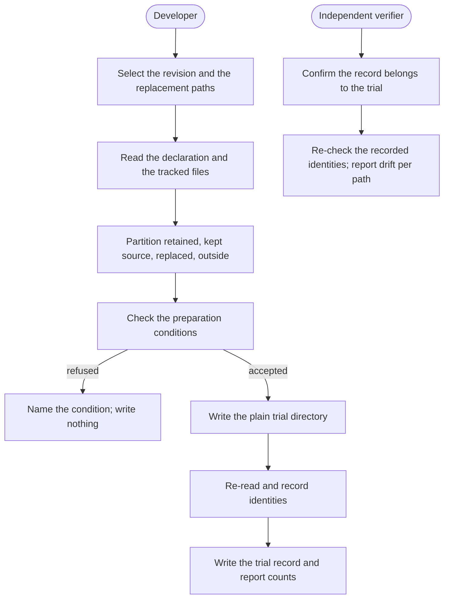

# Use case: prepare-an-ise-test

## Level

!

## Actors

- Developer (the consumer-project owner; the Givn maintainer when Givn rebuilds itself)
- Supporting: Independent verifier (runs the frozen End-to-end (E2E) test target and asks for the re-check)

## Goal

Produce a clean-room trial whose frozen inputs a verifier can confirm.

## Trigger

The developer starts an Ise Test.

## Preconditions

- `ise` is effective in the project, which requires `architecture_principles`.
- The declaration names the five retained roles and the replaceable source roots.
- The checkout is clean.
- One backend is selected; no missing, mixed, or nested repository.
- A revision is available to read; the selected revision defaults to `HEAD`.
- The component's paths fall inside the declared source roots.

## Main flow

1. The developer selects the revision, or accepts `HEAD`, and names the replacement unit's paths with `--path` (a tracked file or a directory) or names the whole declared source set with `--full`; the system reads the declaration and the tracked files at that revision.
2. The system partitions the tracked paths into the retained roles, the kept source outside the replaced paths, the replaced paths, and the files outside the declaration, and counts the tracked files in the replaced paths' directories that the developer did not name.
3. The system refuses by name, before any write, on a missing or malformed declaration, an addon that is not effective, a dirty checkout, a missing, mixed, or nested backend, a retained path that is missing at the revision, a `--path` value outside every source root, a `--path` value or directory expansion matched by a retained role, a write target inside the checkout or already existing, and a repository link or nested repository among the files written into the trial.
4. The system writes the retained roles and the kept source into one plain directory outside the checkout, preserving relative paths, the executable bit, and symlink targets, with no version-control metadata and no ignored or untracked files.
5. The system re-reads every written file, compares it to the file recorded at the selected revision, records a tamper-evident identity for the retained set, the `e2e` package, and the replaced paths, reports the counts, and prints the trial record with the revision, the replaced paths, the counts, the identities, the backend, and the running Givn version; a receipt path writes that record to the named file.
6. The independent verifier confirms the frozen inputs on request; the system confirms the record belongs to this trial and this backend, then re-checks the recorded identities against the written trial and the `e2e` package and reports drift per path.

## Extensions

- 3: the declaration is missing or malformed → the system refuses, names the declaration path and the loader's reason, and writes nothing; protects the minimal guarantee.
- 3: `ise` is not effective, or its `architecture_principles` prerequisite is not effective → the system refuses by name, reads no declaration, and writes nothing; protects the minimal guarantee.
- 3: neither `--full` nor `--path` is given, both are given, or `--into` is omitted → the command refuses as a usage error, names the missing or conflicting flags, exits 2, and writes nothing; protects the minimal guarantee.
- 3: the checkout is dirty → the system refuses, names every dirty path, and writes nothing; protects the minimal guarantee.
- 3: no backend owns the project, both markers sit at the root, or the project root is nested inside a worktree → the system refuses with the backend selector's message and writes nothing; protects the minimal guarantee.
- 3: a declared retained path is missing at the revision → the system refuses and names the path and the revision; protects the minimal guarantee.
- 3: a `--path` value falls outside every declared source root → the system refuses and names the path; protects the minimal guarantee.
- 3: a `--path` value, or a tracked file under a named directory, is matched by a retained role → the system refuses and names the path and the role; protects the minimal guarantee.
- 3: a write target is inside the checkout, already exists, is a receipt inside the trial, or is a receipt that is an ancestor of the trial → the system refuses and names the target; protects the minimal guarantee.
- 3: a copied file is a repository link or a nested repository → the system refuses and names the file; protects the minimal guarantee.
- 5: a written file differs from its content at the selected revision → the system names the drifting paths, removes the partial trial, and writes no trial record; protects the success guarantee.
- 5: the revision cannot be read → the system refuses before any write and names the path and the revision; protects the minimal guarantee.
- 5: the record cannot be written → the system names the record path, removes the trial it created, and reports no success; protects the success guarantee.
- 6: the record does not belong to this trial, names another backend, or lies inside the trial → the system refuses and names the record and the mismatch; protects the success guarantee.
- 6: a recorded retained or `e2e` identity no longer matches → verification fails and names every drifting path; protects the success guarantee.

## Rules

- Deletion is set arithmetic: preparation removes every tracked file named with `--path`, and every tracked file beneath a directory named with `--path` at the selected revision; a glob-shaped value is never expanded; `--full` removes every tracked file under every declared `source:` root; a named path absent from the revision removes nothing and is not one of the nine refusals.
- Internal unit tests are named the same way as any other replaced path; no unit-test path is inferred from `#[cfg(test)]`, `test_*.py`, a Maven test root, or a file-name convention.
- A retained role entry that matches a directory retains every tracked file under it; an entry that matches a file retains that file, and a path matched by a role is never replaced.
- A tracked path that matches both a retained role and a `source:` root is retained: the retained role wins, the file stays in the trial under `--full` as well as under `--path`, and `Replaced` counts only files that are not retained.
- `Not replaced` counts the direct tracked files in the replaced files' parent directories that the developer did not name; it is a containment count, never a refusal, and it never changes the recorded sets. A `--full` replacement removes every tracked file under the source roots, so the report shows `Not replaced: 0`.
- `Outside the declaration` counts the tracked files that fall outside every declared role and outside every source root and are not copied; they are neither errors nor trial content.
- Only the `End-to-end (E2E) test` package is frozen; component step definitions, fakes, and harness are implementation, never frozen or diff-counted, and enter the trial only as kept source when the declaration places them inside a source root.
- The `E2E digest` covers the `@e2e` scenarios selected by tag from the `.feature` files matched by the declared `behavior` role, and every tracked file of the resolved `e2e` package; the `e2e` role's matched paths resolve to their nearest package manifest at or above them, and a matched path that resolves no manifest is its own root.
- A scenario is frozen only after it was observed failing against the pre-change implementation for the intended reason; a mid-trial test defect stops the trial as a `Spec gap: E2E test defect`, and the trial restarts after the E2E test is corrected because the `e2e` package is part of the Specification.
- The trial is a plain directory outside the checkout, never a branch or a worktree, because a branch carries history and a Fossil checkout carries the repository database.
- Preparation reads the selected revision (`HEAD` when none is named), never the working tree, so ignored and untracked files cannot enter the trial; the checkout is never written, including the receipt, and the replaced component's Source code and its history are absent from the trial.
- Preparation and the re-check use the project's one selected backend; a missing, mixed, or nested repository is refused by name.
- Every refusal is checked before the first write, names its condition, and leaves the checkout and the target path unchanged.
- The command surface is `givn ise replace [--at <revision>] (--full | --path <path>...) --into <dir> [--receipt <path>] [--dry-run]`; `--at` defaults to `HEAD`, exactly one of `--full` or `--path` is required, and `--into` is required and must lie outside the checkout.
- `--path` is repeatable and accepts a tracked file or a directory; a directory expands to every tracked file beneath it at the selected revision, the retained-role check runs over the expansion, and a directory that contains a retained path refuses.
- The two write targets are the trial directory and, when given, the receipt file; both lie outside the checkout, the trial directory does not exist, and the receipt does not exist, does not lie inside the trial directory, and is not an ancestor of it.
- `--dry-run` performs every read, the partition, every refusal, the counts, and the identities, writes no directory and no record, and prints the ten fixed report lines, the receipt path when given, and the `Would write:` block with the sorted relative paths the trial would hold.
- An omitted `--receipt` prints the trial record to stdout after the report, prints no `Receipt path` line, and writes nothing, so `givn ise verify --trial <receipt>` requires an explicit path.
- The trial record carries the revision, the named paths, the counts, the retained, `e2e`, and replaced identities, the backend, the written trial path, and the running Givn version; it carries one digest per retained and `e2e` path, the per-feature scenario digest, and one rollup per identity, so a verifier names drift per path.
- The record's per-path identity names the entry kind (`f`, `x`, or `l`) beside the path and the executable marker, so a symlink and a regular file with the same target text are different entries.
- The report prints the fixed lines `Backend`, `Revision`, `Retained`, `Kept source`, `Replaced`, `Outside the declaration`, `Not replaced`, `Retained digest`, `E2E digest`, and `Written path`, plus `Receipt path` when a receipt path was given.
- The two printed digests are the first 12 lowercase hex characters of the rollup followed by `…`; the record carries the full digests.
- With `ise` off, preparation and the re-check refuse by name and no declaration is read; the effective project configuration decides effectiveness, and a change lock decides the change-scoped boundary gate, not these project-scoped commands. A project whose `architecture_principles` is off refuses the same way.
- The trial directory and the receipt are created with create-new semantics; an existing path is refused, never overwritten.
- The re-check refuses unless the record's written path is the given trial directory, the record's backend is the selected backend, and the record path lies outside the trial; it then asserts the recorded replaced digest and re-checks the retained and `e2e` identities.
- The trial record does not carry the verifier's runner command; the independent verifier chooses and records it outside the record.
- On unix, the executable bit and a symlink are written as recorded; on a platform without symlink support, a symlink entry refuses by name before the trial is recorded.
- The verifier names every drifting path in one run and never edits the trial; a changed component file outside the frozen inputs produces no drift.

## Examples

- A `passuff` project declares `source: ["crates/**", "scripts/**"]` and runs `givn ise replace --at 8c1f2ab --path crates/passuff-tui/src/keys/parser.rs --path crates/passuff-tui/tests/keys.rs --into /tmp/ise-passuff --receipt /tmp/ise-passuff-trial.yaml`; the report prints `Backend: git`, `Revision: 8c1f2ab`, `Retained: 214`, `Kept source: 72`, `Replaced: 2`, `Outside the declaration: 3`, `Not replaced: 2`, `Retained digest: 4f1c9a2b7d01…`, `E2E digest: 82be07c3e5a9…`, `Written path: /tmp/ise-passuff`, and `Receipt path: /tmp/ise-passuff-trial.yaml`.
- The component's directory `crates/passuff-tui/src/keys/` still holds `mod.rs` and `tests.rs`, neither named; preparation succeeds, the report says `Not replaced: 2`, and the two files remain in the trial as kept source, so the count shows what the replacement unit still contains.
- The developer runs `givn ise replace --full --into /tmp/ise-passuff`; every tracked file under `crates/**` and `scripts/**` is removed, the report says `Not replaced: 0`, and the trial holds only the retained roles.
- The developer runs `givn ise replace --path crates/passuff-tui/src/keys --into /tmp/ise-passuff`; the directory expands to every tracked file beneath it, so `parser.rs` and `mod.rs` are removed while `crates/passuff-tui/src/tui.rs` stays.
- The developer runs `givn ise replace --into /tmp/ise-passuff`; the command refuses as a usage error, names `--full` and `--path`, exits 2, and writes nothing.
- The developer runs `givn ise replace --path docs/reference.md --into /tmp/ise-passuff`; the refusal names `docs/reference.md` because it falls outside every declared source root, and nothing is written.
- The developer runs preparation with `--into ./trial` inside the checkout; the refusal names the target, and the checkout keeps no trial directory.
- The developer runs preparation into `/tmp/ise-passuff` a second time; the refusal names the existing directory and leaves it untouched.
- The developer names `--receipt /tmp/ise-passuff/record.yaml`; the refusal names the receipt because it lies inside the trial, and nothing is written.
- The developer names `--receipt /tmp` while the trial is `/tmp/ise-passuff`; the refusal names the receipt because it is an ancestor of the trial, and nothing is written.
- The declaration names `contracts: ["docs/cli-contract.md"]`, but no such file exists at the selected revision; the refusal names `docs/cli-contract.md` as a retained path missing at the revision.
- The checkout has one uncommitted file; the refusal names the dirty path and writes no trial.
- The developer names `--path crates/passuff-tui/src/keys/parsr.rs` (a typo); the path is absent from the revision, so nothing is removed, the report says `Replaced: 0`, and the developer sees that the component file stayed in the trial.
- The developer edits `/tmp/ise-passuff/givn/specs/verify-change/usecase.md` after preparation; `givn ise verify --trial /tmp/ise-passuff-trial.yaml --at /tmp/ise-passuff` fails and names that path.
- The developer edits `/tmp/ise-passuff/tests/e2e/steps/keys.rs`; the re-check fails and names that file, because every file of the `e2e` package is frozen.
- The developer edits `/tmp/ise-passuff/crates/passuff-cli/tests/steps/tui.rs` (kept source, outside the frozen inputs); the re-check reports no drift, because component step definitions are implementation.
- The developer edits a scenario tagged `@e2e` in the current checkout after preparation; the re-check names its feature file, because the selected scenario content changed.
- The developer rewrites the record's written path to another directory; `givn ise verify` refuses and names the record and the trial, because the record does not belong to this trial.
- A new `@e2e` scenario was observed failing against the pre-change implementation for the intended reason, so it enters the frozen set; a scenario that turns out mid-trial to assert the wrong behavior stops the trial as a `Spec gap: E2E test defect`, and the trial restarts after the E2E test is corrected.
- With `ise` off, `givn ise replace` refuses by name and reads no declaration.
- A dry run prints the ten fixed report lines, the receipt path, and a `Would write:` block with the sorted paths the trial would hold; `/tmp/ise-passuff` and the receipt remain absent.

## Minimal guarantee

A refusal leaves the checkout byte-for-byte unchanged and writes no trial directory or receipt.

## Success guarantee

A trial directory outside the checkout holds the declared Specification and the kept source with the component's paths removed, and, when a receipt path was given, the trial record's retained and `e2e` evidence re-checks against it.

## Personas

- developer--primary-user
- agent--technical-role
- givn-maintainer--owner

## Capabilities

- clean-room-preparation
- trial-input-verification

## Interactions

| Capability | Consumer action | E2E scenario |
|---|---|---|
| clean-room-preparation | prepare a clean-room trial from a selected revision (the `--path` and `--full` forms, the nine refusals, dry run, and both backends are variants of this action) | Developer prepares a clean-room trial from a recorded revision |
| trial-input-verification | re-check a prepared trial's frozen inputs (a clean run, retained drift, `e2e` drift, current-checkout drift, and a record that does not belong to the trial are variants of this action) | Verifier re-checks a prepared trial and receives the frozen-input report |

## Includes

- none

## Extends

- none

## Out of scope

Boundary: the clean-room trial directory and its record. The checkout, the declaration, and the corrective change stay outside it.

- Declaring the roles and source roots: `declare-the-specification`.
- Building the replacement: the rebuilding agent, outside Givn.
- Running the frozen End-to-end (E2E) tests: the independent verifier, outside Givn.
- Classifying a difference and opening the corrective change: `create-change` (`spec-gap`).

## Diagram

