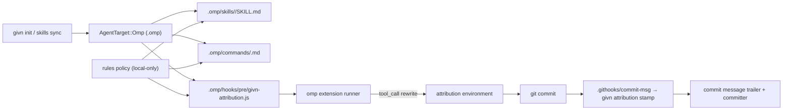

# Design: add-omp-agent-target

## Decisions

- **Decides D1: rewrite only revision-creating Bash commands.** The generated
  hook prepends the attribution exports only when the command text names a
  revision verb (`\bcommit\b`, which matches `git commit`, `git -c … commit`,
  `givn commit`, and `git merge --commit`). omp persists the revised call as
  the tool call it displays and records, so rewriting every command would put
  the export prefix into every transcript entry. Accepted costs: a revision
  path that never spells "commit" (`git merge --no-edit`, `git cherry-pick`)
  receives no attribution (R-77), and a non-revision command that merely
  contains the word (`git log --grep commit`, `git commit-graph write`) is
  rewritten harmlessly. Realized in
  `assets/agent-integrations/omp/givn-attribution.js`.
- **Decides D2: a `pre` hook factory under `.omp/hooks/pre/`.** omp discovers
  project hook factories at `<cwd>/.omp/hooks/pre/*.{ts,js}` and
  `<cwd>/.omp/hooks/post/*.{ts,js}`, loads them through its extension runner,
  and emits `tool_call` before a tool executes; a non-blocking handler may
  return `{ input }` to replace the execution arguments. Realized in
  `assets/agent-integrations/omp/givn-attribution.js` and
  `src/skills/targets.rs` (`sync_agent_integrations`).

## Technology decisions

- **The omp extension contract** (source: the installed omp 18.3.0
  documentation — `hooks.md`, `extension-loading.md`, `skills.md`; the
  contract is external, so drift is tracked as R-78):
  - native project hook root: `<cwd>/.omp/hooks/pre/` and `.../post/`, scanned
    for `.ts`/`.js` files only; both are loaded through the extension runner;
  - a hook module default-exports a factory that receives the API object and
    registers handlers with `api.on(event, handler)`;
  - `tool_call` handlers receive `(event, ctx)` and may return
    `{ input }` (raw execution arguments) or `undefined`;
  - the context exposes the live model through `ctx.models.current()` and
    `ctx.model`, and the factory API exposes `pi.getThinkingLevel()`.
- **Generated hook shape** (pinned, because the E2E harness implements the
  same contract):
  - file: `.omp/hooks/pre/givn-attribution.js`, plain ECMAScript module, no
    imports;
  - `export default function givnAttribution(pi) { pi.on("tool_call", handler) }`;
  - `handler(event, ctx)` returns `undefined` unless
    `event.toolName === "bash"` and `event.input.command` contains a revision
    verb; otherwise it returns
    `{ input: { ...event.input, command: "<exports>; <command>" } }`.
- **Language/runtime of the generated hook**: plain ECMAScript module, no
  dependency, so a harness upgrade cannot break it on a version skew. The file
  stays `.js` like the existing OpenCode asset.
- **Model identity source**: `ctx.models.current()` with `ctx.model` as the
  fallback. The resolved model carries `provider` (string) and `id` (string);
  the identity is `<provider>/<id>`, matching the OpenCode integration.
- **Reasoning source**: `pi.getThinkingLevel()`; `undefined` becomes the
  literal `unavailable`.
- **Node.js** (test driver only): no version pinned; the existing OpenCode
  integration E2E already runs `node` on `PATH`, and this change reuses it.
- **No new runtime dependency** is added to the `givn` binary; the hook is an
  embedded asset like the two existing integrations.

## Runtime behaviour of the generated hook

For a `bash` tool call whose `command` matches `\bcommit\b`, the hook returns
`{ input: { ...input, command: "<exports>; <command>" } }` where `<exports>`
is `export GIVN_ATTRIBUTION_ACTIVE='1' GIVN_ATTRIBUTION_LLM='…'
GIVN_ATTRIBUTION_REASONING='…' GIVN_ATTRIBUTION_HARNESS='omp'
[GIT_COMMITTER_NAME='LLM: … via omp']`. Values are POSIX single-quoted with
the same `'` → `'"'"'` escaping as the Claude integration. When the model is
unknown, `GIVN_ATTRIBUTION_LLM` is `unavailable` and `GIT_COMMITTER_NAME` is
omitted, so the harness is still recorded.

Any other tool call, any non-`bash` tool, and any command without a revision
verb return `undefined` — the call is untouched.

The `.githooks/commit-msg` hook and the environment protocol are unchanged: the
exported variables are the same ones the OpenCode and Claude integrations set,
and `givn attribution stamp` consumes them identically.

## Production files

- `src/skills/targets.rs` — add `AgentTarget::Omp` (`omp`, `.omp`) and append
  it to `ALL`; write skills to `<dir>/skills` for every target and commands to
  `<dir>/commands` for the command-owning targets (`opencode`, `omp`) in
  `sync`; dispatch the omp attribution asset in `sync_agent_integrations`;
  include `.omp/skills/**`, `.omp/commands/**`, and
  `.omp/hooks/pre/givn-attribution.js` in `managed_generated_paths`; make
  `reconcile_addon_artifacts` remove the addon skills and the grill commands
  for every command-owning target.
- `assets/agent-integrations/omp/givn-attribution.js` — the new integration.
- `src/skills/rules.rs` — add the `.omp` patterns to `ignore_entries()` and
  `is_rule_path()` (`.omp/skills/givn-*/`, `.omp/commands/givn-*.md`,
  `.omp/commands/grill-*.md`, `.omp/hooks/pre/givn-attribution.js`).
- `src/config/overlay.rs` — add `omp` to `KNOWN_AGENT_TARGETS` (otherwise the
  selection would be silently dropped).
- `src/cli/init.rs` — report the omp attribution integration in the
  installation summary and name `.omp` in the "no agent target selected" error.
- `src/cli/skills.rs` — name every command-owning target's commands directory
  in the `givn skills sync` report instead of `.opencode/commands/` only.
- `src/cli/addons.rs` — include `.omp` in the addon skill and command cleanup.
- `src/main.rs` — name `omp` in the `--agents` help.
- `src/cli/upgrade.rs` — unchanged. Its generic "attribution plumbing was
  refreshed" sentence stays accurate because the managed upgrade re-runs the
  same sync path and the same managed-path allowlist.
- `docs/arc42/` — chapters 03, 04, 05, 06, 08, 10, 11, 12 and
  `adr/ADR-013-agent-integration.md` (plus the chapter-09 register entry).

## Architecture impact

## Data model

No schema or persisted-format change. The change adds files to the set that
`AgentTarget` writes; the commit-attribution protocol and its trailers stay as
they are.

## Step definitions

- `tests/steps/init_agent_target_selection_steps.rs` — the omp target-selection
  and per-target file-existence steps.
- `tests/steps/llm_attribution_e2e_steps.rs` — the omp attribution steps: build
  the project, drive the generated hook through `node`, run the prepared
  command, and assert the resulting commit. The two non-`@e2e` omp scenarios
  reuse this harness because they assert the generated artifact's behaviour,
  not a weaker boundary.
- `tests/steps/mod.rs` — the `--agents all` fixtures are target-agnostic; no
  new file.

No second file is introduced for a capability an existing file already owns.

## Test runner and strictness

- **Runner**: `./run-tests.sh` (`cargo nextest run --test features_runner`
  under `GIVN_TEST_RUNNER=nextest`, `cargo test --test features_runner` under
  `GIVN_TEST_RUNNER=cargo`). It runs the `.feature` files under `givn/specs/`
  and the active change's `specs/` via `GIVN_FEATURES`.
- **E2E runner**: `./run-tests.sh --e2e` (`verify.e2e_command`), the same
  binary filtered to `@e2e`.
- **Strict mode**: `GivnWorld::cucumber().fail_on_skipped()` in
  `tests/features_runner.rs`. Undefined or pending steps fail; a new scenario
  starts with `@wip` and a non-empty step body.
- **Single-scenario command**:
  `GIVN_FEATURES=givn/changes/add-omp-agent-target/specs cargo test --test features_runner -- --name "omp attributes a commit using its current model"`.

## E2E smoke test infrastructure

- **Real interface**: the compiled `givn` CLI (subprocess) and the generated
  `.omp/hooks/pre/givn-attribution.js` artifact executed by `node`.
- **Driving mechanism**: `common::run_givn` to initialize the project; a
  generated `.mjs` harness that imports the integration, collects the
  `tool_call` handler from a fake `pi` (`{ on, getThinkingLevel }`), invokes it
  with a synthetic omp event (`{ toolName: "bash", input: { command } }`) and
  context (`{ models: { current: () => model }, model }`); `sh -c` to run the
  returned command; `git show` to read the commit.
- **Module-context fixture**: `node` resolves a `.js` file's module type from
  the nearest `package.json`, so the scenario writes
  `package.json` = `{"type":"module"}` beside the project before importing the
  integration — the same fixture the existing OpenCode step uses.
- **Local infrastructure**: none beyond `git` and `node`, both already
  required by the existing OpenCode/Claude integration E2E. No server,
  database, container, or network dependency.
- **Strictness proof**: the shared runner configuration; the setup task
  records the strictness check output.
- **Live contract check**: a manual smoke run against a real omp session is
  the documented validation for the external contract (R-78); it is not part
  of the automated suite because it needs model credentials.

## Interaction Coverage Matrix

`src/gherkin/interaction.rs` skips the `givn/specs/fragments/` directories, so
a fragment capability carries no interaction-inventory row; `fragment.md`'s
`## Interactions` table lists only `instruction-integrity`. The new omp
attribution `@e2e` therefore follows the established precedent rather than
adding an inventory entry: the permanent `attribute-commits.feature` already
holds one attribution `@e2e` per harness (OpenCode, Claude), and this change
adds the omp counterpart.

This change adds no new inventory action:

- the `initialize-project` inventory entry "initialize with an explicit
  noninteractive target selection" is already covered by "Consumer runs init
  non-interactively and gets opencode skills"; naming `omp` is a target-name
  variant of that action, so it stays a regular scenario;
- the `fragments` capability has no inventory table to extend.

| Inventory entry | @e2e scenario title | Real interface | Driving mechanism |
|---|---|---|---|
| initialize-project — initialize with an explicit noninteractive target selection | Consumer runs init non-interactively and gets opencode skills | CLI | `common::run_givn` subprocess; the omp selection is a target-name variant of the same action |
| fragments — no inventory (directory skipped by the interaction walk) | omp attributes a commit using its current model | CLI + generated artifact + Git CLI | `node` imports `.omp/hooks/pre/givn-attribution.js`, invokes its `bash` `tool_call` handler with a synthetic model/reasoning context, `sh -c` runs the returned command, `git show` reads the commit |

## Visual Design Contract

Not present: the change adds one line to the CLI installation report and
created files; there is no rendered screen, so the visual review gate stays
inactive (same precedent as `llm-attribution-installation` and
`keep-agent-prompt-open`).

## Black-Box-First

Two non-`@e2e` scenarios are retained because they assert invariants the
commit E2E cannot observe:

- "omp leaves a command that creates no revision unchanged" — the E2E only
  observes a rewritten command that commits; a passing commit cannot show that
  a non-revision command is untouched.
- "omp marks a partial attribution context as unavailable" — the E2E runs with
  a known model; the missing-model fallback is a distinct branch.

Both drive the same real generated artifact through `node`; neither asserts
against a weaker boundary than the E2E.

## Personas

- `agent--technical-role` — consumes the generated `.omp` skills and commands
  and executes the attribution hook; review lens for the hook contract and the
  partial-context fallback.
- `developer--primary-user` — selects the `omp` target and reads the
  installation report; review lens for the report wording and the refusal
  message.
- `givn-maintainer--owner` and `external-contributor--open-source-consumer` —
  no specific lens: the change adds a target inside the existing boundary and
  changes no contributor-facing contract. Disposition: not relevant.

## Use-case traceability

| Guarantee | Design decision | Capability owner | Evidence |
|---|---|---|---|
| Initialization reports what was installed and why | The init report names the omp integration beside the existing ones | `enable-commit-attribution` | Consumer sees the commit attribution installation report |
| The selected agent targets each receive their guidance | `AgentTarget::Omp` writes `.omp/skills` and `.omp/commands` | `initialize-a-project` | The omp target receives its own guidance and attribution integration |
| A commit exposes the LLM and harness that produced it | The generated hook exports the same protocol variables as the other integrations | `attribute-commits` | omp attributes a commit using its current model |
| A commit without full context stays usable | Missing model → `unavailable` and no committer override; non-revision commands are untouched | `attribute-commits` | omp marks a partial attribution context as unavailable; omp leaves a command that creates no revision unchanged |
| Generated rules stay out of the repository under local-only | `.omp` patterns added to the ignore entries and the rule predicate | `local-only-transition` / `publication-cleanliness` | existing transition scenarios, extended paths |

## Compatibility

- The existing `.opencode`, `.agents`, and `.claude` targets are unchanged.
- `--agents all` gains one target; `givn skills targets add all` mirrors it.
- An existing project that never selects `omp` is unaffected: no `.omp` path
  is written, and `managed_generated_paths` only includes them for a configured
  `omp` target.
- Adding `omp` to `KNOWN_AGENT_TARGETS` means an existing configuration that
  already lists `omp` (previously dropped as unknown) starts writing `.omp`
  paths on the next sync.
