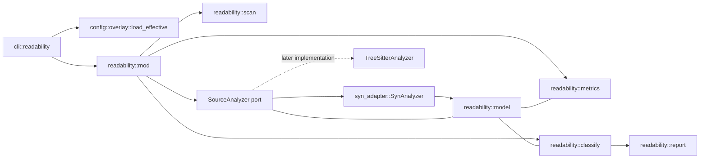
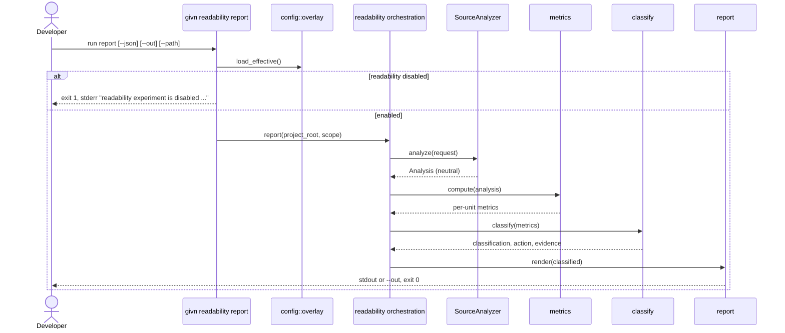

# Design: add-readability-report

Status: design complete; D4 carried by its owner. No code changed.

## Context

This change adds the opt-in `readability` addon and the on-demand
`givn readability report [--json] [--out <path>]` command. The report scans
production Rust sources, measures each source unit, classifies it with the
tuned gate vocabulary, recommends `watch`, `plan`, `exception`, `advisory`, or
no action, and prints an advisory report. It stores no baseline, watchlist,
classification, cache, or feedback ledger.

The design fixes four things the implementation must not re-litigate:

1. the addon is default-off and is the only opt-in switch;
2. the report is on-demand and stateless;
3. every metric, classification, and action runs above a neutral
   `SourceAnalyzer` port; `syn` appears only inside the first adapter;
4. the human and machine-readable report formats are engine-independent so a
   later tree-sitter adapter is a drop-in implementation.

## Decisions

| ID | Decision | Realized in |
|---|---|---|
| D1 | Decides D1: default-off addon `readability`; `givn init` enables only the default-on set; `givn addons enable readability` opts in; existing default-on addons keep their behavior. | `src/cli/addons.rs` registry (`AddonSpec.default_enabled`), `src/cli/init.rs` enable/print loops, `src/config/manifest.rs` `Addons.readability`, `assets/config.yaml.tmpl`, arc42 ch. 8.11 |
| D2 | Decides D2: the report is generated on demand with no stored baseline, watchlist, or historical classification. The only writes are stdout/stderr and the explicit `--out` path. The later review gate does base/head analysis itself. | `src/cli/readability.rs`, `src/readability/report.rs`; no cache/ledger module exists |
| D3 | Decides D3: Rust-only first. `SourceAnalyzer` is the port; `SynAnalyzer` is the first adapter; metrics and classification are shared and run above the port; `syn` types stay inside the adapter; a later `TreeSitterAnalyzer` must pass the same non-E2E scenarios and produce the same report. | `src/readability/model.rs`, `analyzer.rs`, `metrics.rs`, `classify.rs`, `syn_adapter.rs`; `tests/steps/readability_report_steps.rs` |
| D4 | **Resolved: owner-judged exit, no ledger now.** The `readability` addon stays default-off. The owner judges the experiment after using the report on real changes; feedback is recorded manually in `givn/ideation/readability-experiment/feedback.md` (created when the first entry is recorded). A structured ledger is deferred to `add-readability-review-gate`; promotion to default-on/opt-out, removal, or full integration is a later owner decision and out of scope here. No product state is added; D2 is unchanged. | `design.md` OD1; `proposal.md` D4; no code |
| D5 | Decides D5: stdout is the default, `--json` selects the machine-readable form, `--out <path>` diverts the selected form to a file. Names are fixed: addon `readability`, command `givn readability report`, later review markers `READABILITY: PASS`, `WATCH <path>`, `PLAN <path>`, `EXCEPTION <path>`, `FAIL <reason>`. | CLI contract below; report schema v1; later change owns markers |
| DD1 | The addon registry becomes a single source of truth: `AddonSpec { id, description, default_enabled }`. `givn init` enables only `default_enabled`; `givn addons list` shows every addon and marks the default-off ones; `--no-addons` still enables none. | `src/cli/addons.rs`, `src/cli/init.rs` |
| DD2 | The command is always registered and gated at runtime, so the disabled path can name the reason. Disabled exit is 1 with stderr containing `readability experiment is disabled`. Findings never affect the exit code. | `src/cli/readability.rs` |
| DD3 | The neutral model carries per-line classification (`code`/`comment`/`blank`), per-method neutral flow facts, field accesses, calls with resolution labels, and a structured outline. No metric is computed inside the adapter. | `src/readability/model.rs`, `syn_adapter.rs` |
| DD4 | Shared metric definitions: code lines, LCOM4, TCC/LCC in integer permille, complexity from the neutral flow tree, public surface. | `src/readability/metrics.rs` |
| DD5 | Shared classification with one precedence table, fixed thresholds, and one action per unit; every non-unsupported unit has exactly one classification and one action. | `src/readability/classify.rs` |
| DD6 | Report schema v1, rules version 1, deterministic ordering, relative paths, no timestamps, no analyzer identity. Human text and JSON are rendered from the same classified model. | `src/readability/report.rs` |
| DD7 | Production scope defaults to the project-root `src/` tree and is replaced by repeatable `--path <dir>` roots. Values are root-relative; absolute paths and `..` are rejected. Test/tooling directories (`tests/`, `benches/`, `examples/`, `target/`) and item-level `#[cfg(test)]` items are excluded. `src/bin/**` is included. Files are deduplicated across overlapping roots. An explicit path that does not exist is an operational error; a missing default `src/` is an empty-scope report. Parent-module `#[cfg(test)]` is not propagated and platform `#[cfg(...)]` branches are counted together (DD12). | `src/readability/scan.rs`, `src/cli/readability.rs`, `syn_adapter.rs` |
| DD8 | Replaceability is enforced by a non-E2E Gherkin scenario that renders the same source through a fake adapter and `SynAnalyzer` in process, plus a source-scan unit test that keeps `syn` out of every non-adapter module. | `tests/steps/readability_report_steps.rs`; `src/readability/mod.rs` test |
| DD9 | Test infrastructure: one non-E2E step file for CLI gate/scope scenarios plus in-process pipeline scenarios (boundaries, adapter contract, determinism, one-classification/action), one E2E step file for the real CLI journey, the existing `features_runner` strict mode, and an exact single-scenario command. No separate `tests/analyzer_contract.rs` target; `run-tests.sh` and `givn/commands.yaml` are unchanged. | `tests/steps/readability_report_steps.rs`, `tests/steps/readability_report_e2e_steps.rs`, `tests/features_runner.rs` |
| DD10 | `givn readability report` is a read view: it appends no development-record entry, matching `givn history` and `givn timeline`. This is part of the no-stored-state decision. | `src/main.rs` `records()` |
| DD11 | The neutral analyzer port qualifies as an ADR (ADR-074 candidate): it fixes the dependency direction and the durable report contract for at least the later review-gate change and the later tree-sitter adapter. | arc42 ch. 9 and `docs/arc42/adr/ADR-074-*` during the arc42-docs step |
| DD12 | **Accepted limitation (design review Q6, option D):** conditional compilation is counted as written. Every non-test `#[cfg(...)]` branch contributes to metrics, and `#[cfg(test)]` is honored only where it appears on the parsed item or module; a parent `mod tests;` declaration does not mark `src/tests.rs` or `src/tests/**` as test code. The report adds no cfg diagnostic and does not mark a unit incomplete merely for cfg-conditional code. Recorded as R-97 and specified by the scenario "Conditional code is counted as written". | `syn_adapter.rs`; arc42 ch. 11 R-97 |

No proposal open question is left silently unresolved. D4 is explicitly
carried with the user as owner.

## Use-case traceability

Owning use case: `assess-code-structure`. Actor: **Developer**; supporting
actor: **Authoring agent**. Personas are review lenses, not actors:
`developer--primary-user`, `agent--technical-role`,
`givn-maintainer--owner`.

| Use-case element | Guarantee / rule / event | Technical decision | E2E or other evidence |
|---|---|---|---|
| Goal: see the structure and the units needing a plan or exception | Success guarantee | CLI report over the neutral analysis; classification and action per unit (DD4, DD5, DD6) | `@e2e` scenario "A developer runs a readability report and sees the classified units" |
| Main flow 1: request the report, read production sources | Precondition: production sources exist in the requested scope | Addon gate, scoped scan (`src/` or `--path`), per-file analysis (DD2, DD7) | Same `@e2e` scenario; scope scenario |
| Main flow 2: report size, public surface, cohesion/coupling, complexity | Every analyzed unit has metrics | Shared metrics above the port (DD3, DD4) | Non-E2E boundary scenario plus the `@e2e` scenario's classification assertion |
| Main flow 3: classify and recommend watch/plan/exception | Every analyzed unit has exactly one classification and one action | Precedence table and action map (DD5) | Scenario "Every analyzed unit has one classification and one action"; classification-variant scenarios |
| Main flow 4: developer receives the report | Minimal guarantee | Human/JSON renderer (DD6) | `@e2e` scenario and JSON scenario |
| Extension 1: experiment disabled | Command names the reason and exits non-zero | Runtime addon gate (DD2) | Scenario "The readability report is unavailable when the experiment is disabled" |
| Extension 1: no production sources in the requested scope | Report says there are no production sources | Empty-scope handling in `scan`/`report` (DD7) | Scenario "The report says when the scope has no production sources"; unit test `empty_scope_names_no_production_sources` |
| Extension 1: an explicit scope does not exist | Command names the path and exits 1 | Path validation in `cli/readability.rs` (DD7) | Scenario "An explicitly requested scope that does not exist is an error" |
| Extension 2: a file cannot be analyzed | Name the file, continue with the rest | `AnalysisDiagnostic` per file; report continues (DD3, DD6) | Scenario "A file that cannot be analyzed is reported and the report continues" |
| Extension 2: unsupported construct | Mark unsupported, invent no data | `UnsupportedConstruct` diagnostics; wholly unsupported units are excluded from classification (DD3) | Contract fixture `macro_items.rs`; no user-action variant, so no separate E2E |
| Rule: advisory, does not block review/archive | No exit-code effect from findings | Exit 0 whenever the report is produced (DD2) | `@e2e` scenario plus unit test `findings_exit_zero` |
| Rule: no baseline or historical classification | No repository state | No write path except `--out` (D2, DD10) | `@e2e` scenario asserts no baseline file and an unchanged project tree |
| Rule: deterministic and offline | Byte-stable output for the same input/toolchain | Sorted traversal, relative paths, no timestamps, integer ratios, no network (DD4, DD6) | Scenario "The report is deterministic"; no network dependency exists |
| Rule: production sources only | Test/tooling directories and item-level `#[cfg(test)]` excluded; parent-module cfg and platform cfg are accepted limitations (DD12) | Source scope and item-level `#[cfg(test)]` exclusion (DD7, DD12) | Contract fixture `cfg_test.rs`; scenario "Conditional code is counted as written" |
| Rule: scope is explicit and bounded | Every analyzed file comes from the default `src/` or a named `--path` root | Root validation, deduplication, deterministic ordering (DD7) | Scenario "A developer scopes the report to a workspace member"; in-process scan assertions for overlapping roots |
| Rule: format independent of the analysis engine | Same report from any adapter | Neutral model, renderers take only the model, no analyzer identity in the report (DD3, DD6, DD8) | Scenario "The same source produces the same report through either analysis engine" |
| Minimal guarantee: name every unanalysed unit and every classification/action | Every failure and unsupported construct is named | Diagnostics and report sections (DD6) | Malformed-file scenario; in-process corpus assertion over every unit |
| Events | None | No event/state model exists in this use case | None |

### Persona impact

| Persona | User-visible surface | Impact |
|---|---|---|
| `developer--primary-user` | CLI text on stdout | Reads the per-unit structure and the watch/plan/exception recommendation. |
| `agent--technical-role` | CLI JSON via `--json` | Consumes the stable schema v1; later gate can read the same neutral model without parsing human text. |
| `givn-maintainer--owner` | Addon config plus CLI behavior | Chooses opt-in; the report cannot block review or archive and stores no state to maintain. |

The use-case document lists `developer--primary-user` and
`givn-maintainer--owner`; the proposal additionally confirmed
`agent--technical-role` for the topic. The agent is the supporting authoring
actor that consumes `--json`; it is not a Gherkin actor and has no separate
scenario. The use-case document is not changed by this design.

## Architecture impact

New module tree (plain listing, not a diagram):

```
src/readability/
  mod.rs          orchestration: analyze -> metrics -> classify -> render
  model.rs        neutral data model; no `syn` import
  analyzer.rs     SourceAnalyzer port, request/scope, capabilities
  scan.rs         production source discovery and deterministic ordering
  metrics.rs      shared metric computation over the neutral model
  classify.rs     thresholds, precedence, classification, action, evidence
  report.rs       human and JSON rendering; schema v1
  syn_adapter.rs  SynAnalyzer: syn AST -> neutral model; only file importing syn
src/cli/readability.rs  clap handler: addon gate, request, output destination
```

Touched existing files: `src/main.rs` (command dispatch, `mod readability`,
`records()`), `src/lib.rs` (`pub mod readability`), `src/cli/mod.rs`
(`pub mod readability`), `src/cli/addons.rs` (registry and list), 
`src/cli/init.rs` (default-on enable/print loops), `src/config/manifest.rs`
(`Addons.readability`), `assets/config.yaml.tmpl` (commented opt-in entry),
`Cargo.toml` (`syn` dependency), `tests/steps/mod.rs` (step module
registration), `test-corpus/readability/**` (contract fixtures).



Dependency direction: `cli -> readability -> model`; `metrics`, `classify`, and
`report` depend only on `model`; `syn_adapter` depends on `model` and `syn`;
nothing depends on `syn_adapter` except the analyzer factory. The later
tree-sitter adapter adds one sibling module and one factory arm; no report,
metric, classification, or marker code changes.



## Data model

All types live in `src/readability/model.rs` except the port types in
`analyzer.rs`. The model is plain Rust data with no `syn` dependency and is
`Clone + Debug + PartialEq` so the contract scenario can compare it.

### Analysis root

| Type | Fields |
|---|---|
| `AnalysisRequest` | `project_root: PathBuf`, `scope: SourceScope` |
| `SourceScope` | `language: Language`, `roots: Vec<PathBuf>`, `include_test_sources: bool` (always false in production) |
| `AnalyzerCapabilities` | `language`, `supported_constructs: Vec<Construct>`, `limitations: Vec<Limitation>`, `resolution_labels: Vec<Resolution>` |
| `Analysis` | `files: Vec<AnalyzedFile>`, `units: Vec<SourceUnit>`, `diagnostics: Vec<AnalysisDiagnostic>` |
| `AnalyzedFile` | `path: RepoPath`, `physical_lines: u32`, `lines: Vec<LineKind>`, `status: FileStatus`, `unit_ids: Vec<UnitId>` |
| `FileStatus` | `Analyzed`, `Failed` |
| `LineKind` | `Code`, `Comment`, `Blank` |
| `AnalysisDiagnostic` | `kind: DiagnosticKind`, `path: RepoPath`, `line: Option<u32>`, `message: String` |
| `DiagnosticKind` | `FileUnreadable`, `ParseFailed`, `UnsupportedConstruct`, `AmbiguousType` |
| `Language` | `Rust` |
| `RepoPath` | `String` newtype rendered project-relative, `/`-separated |
| `SourceSpan` | `file: RepoPath`, `start_line: u32`, `end_line: u32` |
| `Construct` | `Struct`, `Enum`, `Trait`, `Union`, `TypeAlias`, `InherentImpl`, `TraitImpl`, `InlineModule`, `FileModule`, `FreeFunction` (JSON: snake_case) |
| `Limitation` | `ItemMacros`, `IncludeMacro`, `NonUtf8File` (JSON: `item-macros`, `include-macro`, `non-utf8-file`) |

`RepoPath` renders project-relative, `/`-separated paths. Absolute paths and
symlink escapes never enter the model or the report.

`SourceScope.roots` is the ordered, deduplicated set of root-relative scan
roots: `["src"]` when `--path` is omitted, otherwise the `--path` values. The
CLI rejects absolute values and values containing `..` (exit 2) before the
scope reaches the port. Overlapping roots are allowed; the scanner walks them
in argument order, sorts the resulting file set by `RepoPath`, and analyzes
each file once.

### Units

| Type | Fields |
|---|---|
| `SourceUnit` | `id: UnitId`, `kind: UnitKind`, `name`, `module_path`, `declaration_file: RepoPath`, `files: Vec<RepoPath>`, `spans: Vec<SourceSpan>`, `visibility: Visibility`, `origin: UnitOrigin`, `methods: Vec<Method>`, `fields: Vec<Field>`, `relations: Vec<TypeRelation>`, `outline: Vec<OutlineItem>`, `complete: bool`, `unsupported: Vec<UnsupportedNote>` |
| `UnitKind` | `Type(TypeKind)` or `Module` |
| `TypeKind` | `Struct`, `Enum`, `Trait`, `Union`, `TypeAlias` |
| `UnitOrigin` | `Production`, `Test` (test units are filtered before metrics) |
| `Visibility` | `Public`, `Crate`, `Restricted`, `Private` |
| `TypeRelation` | `ImplementsUnit(UnitId)`, `ImplementedBy(UnitId)`, `ContainedIn(UnitId)` |
| `UnsupportedNote` | `construct: Construct`, `span: SourceSpan`, `reason: String` |
| `UnitId` | stable string: `type:<module_path>::<Name>` or `module:<relative_path>`; a name-only ambiguity creates a separate unit plus an `AmbiguousType` diagnostic and never merges two declarations |

The port's own unit kinds are `Type` and `Module`. The report's `interface` and
`data-only` labels are classifications derived **above** the port from
`TypeKind` (`Trait` for interface; `Struct`/`Enum` with at most one method for
data-only) plus method and field counts; the adapter never decides a
classification. Likewise, computed metrics are not port data: the adapter
supplies the facts (spans, line kinds, field accesses, calls, flow), and all
metric values are computed in `metrics.rs`.

Type units aggregate the declaration, inherent impls, and trait impls across
files by resolved type path. Module units are per file in v1 (the gate's "the
file for now"); directory-module aggregation is not part of this change. A
module unit's metrics include every **production** line and type in that file;
its spans are the union of production item spans, so `#[cfg(test)]` items are
excluded from both the module total and the file's production `code_lines`.

### Methods, fields, calls, outline

| Type | Fields |
|---|---|
| `Method` | `id: MethodId`, `name`, `visibility`, `signature: Signature`, `span: SourceSpan`, `flow: Flow`, `field_accesses: Vec<FieldId>`, `calls: Vec<Call>`, `is_trait_default: bool`, `origin: UnitOrigin` |
| `Field` | `id: FieldId`, `name`, `visibility`, `span: SourceSpan`, `type_label: String`, `origin: UnitOrigin` |
| `Call` | `order: u32`, `callee: String`, `resolution: Resolution`, `target: Option<MethodId>` |
| `Resolution` | `SameFile`, `ProjectOtherFile`, `NameOnly`, `Ambiguous`, `Dynamic`, `External` (JSON labels: `same_file`, `project_other_file`, `name_only`, `ambiguous`, `dynamic`, `external`) |
| `OutlineItem` | `kind: OutlineKind` (`Type`, `Field`, `Method`, `TraitMethod`), `name`, `visibility`, `signature`, `order`, `calls: Vec<Call>` |
| `Signature` | rendered text: name, generics, parameters, and return type; no body |
| `MethodId`, `FieldId` | stable strings within the owning `UnitId` |
| `CallId` | `u32` index into the owning method's `calls` by `order` |
| `Flow` | neutral control-flow tree: `Block(Vec<Flow>)`, `Branch(Box<Flow>)`, `Loop(Box<Flow>)`, `Match { arms: u32, bodies: Vec<Flow> }`, `Try(Box<Flow>)`, `ShortCircuit(Box<Flow>, Box<Flow>)`, `Return(Option<Box<Flow>>)`, `Call(CallId)` |

The outline contains signatures, visibility, names, and call order only. No
method bodies, no comments, no doc comments, and no call arguments.

### Metrics and classifications

Metrics and classifications are produced above the port and are not stored in
the model:

| Type | Fields |
|---|---|
| `UnitMetrics` | `physical_lines`, `code_lines`, `methods`, `public_methods`, `fields`, `declared_types`, `public_surface`, `lcom4`, `tcc_permille: Option<u32>`, `lcc_permille: Option<u32>`, `max_method_code_lines`, `max_method_complexity`, `files` |
| `MethodMetrics` | `code_lines`, `complexity`, `nesting`, `visibility`, `finding: Option<MethodFinding>` |
| `MethodFinding` | `MethodLength`, `Complexity` (JSON: `method-length`, `complexity`; `null` when none) |
| `ClassifiedUnit` | `unit_id`, `kind`, `name`, `path`, `classification`, `action`, `recommendation`, `metrics`, `method_findings`, `evidence: Vec<Evidence>` |
| `Classification` | `GodType`, `Interface`, `MultiTypeModule`, `Module`, `DataOnly`, `CohesiveLargeType`, `MethodLength`, `WithinLimits` (JSON: `god-type`, `interface`, `multi-type-module`, `module`, `data-only`, `cohesive-large-type`, `method-length`, `within-limits`) |
| `Action` | `Watch`, `Plan`, `Exception`, `Advisory`, `None` (JSON: `watch`, `plan`, `exception`, `advisory`, `none`) |
| `Evidence` | `rule: &'static str`, `observed: MetricValue`, `threshold: MetricValue`, `comparison: Comparison`, `satisfied: bool` |
| `MetricValue` | `Count(u64)`, `Permille(u32)`, `Undefined` (renders `null`) |
| `Comparison` | `GreaterThan` (`>`), `LessThan` (`<`), `AtLeast` (`>=`), `AtMost` (`<=`), `Equal` (`=`) |

`Exception` means "plan or a recorded exception; the owner chooses". The report
recommends it; it never records an exception itself. `WithinLimits` is the
required "no finding" value that satisfies the rule that every analyzed unit has
exactly one classification; it is not one of the seven tuned-gate finding
classes.

## Metric definitions (shared, above the port)

| Metric | Definition |
|---|---|
| code lines | Count of `LineKind::Code` lines in the unit's span union per file. A line whose first non-whitespace token starts a line/block/doc comment is `Comment`; a blank line is `Blank`; a code line with a trailing comment is `Code`. Attributes are code. |
| physical lines | For a file, the number of lines in the file; for a unit, the number of lines in the unit's span union per file. |
| methods / public methods | Production methods (inherent, trait impl, trait signature) of a type; for a module, every production method of its types plus free functions. Trait signatures count as public. `pub` maps to `Public`, `pub(crate)` to `Crate`, `pub(super)`/`pub(in …)` to `Restricted`, and no visibility to `Private`; only `Public` counts toward the public metrics. |
| fields | Production fields; enum variant fields count; tuple fields are indexed. |
| public surface | For a type: public methods + public fields. For a module: public types + public methods + public fields declared in the file. |
| files (unit metric) | Number of distinct files contributing a span to the unit. |
| LCOM4 | Connected components of the graph whose nodes are production methods plus fields; a method–field edge exists when the method accesses the field; a method–method edge exists when one calls the other with `same_file` resolution and the target is in the same unit. 0 methods → 0; 1 method → 1. |
| TCC / LCC | Over the methods that access at least one field (`M`): `pairs = C(|M|, 2)`. TCC = directly connected pairs / pairs, where a pair is connected when the methods share a field or call each other. LCC = transitively connected pairs / pairs. Stored as integer permille (`0..=1000`); `None` when `pairs = 0`. |
| complexity | `1 + decision_points` over the method's neutral `Flow` tree. Decision points: each `Branch` (if / else-if / if-let), each `Loop` (for / while / while-let / loop), each `Match` arm after the first, each `Try` (`?`), each `ShortCircuit` operator (`&&`, `||`). A closure is not a decision point; its body is analyzed in place. |
| nesting | Maximum depth of `Branch`, `Loop`, `Match`, `Try`, and `ShortCircuit` nodes in the flow tree. |
| method length | Method code lines, counted from the method span with the same line-kind rule. |

Integer permille and integer line counts make the metrics byte-stable across
platforms; no floating-point value is persisted or compared.

## Classification and actions (tuned gate)

First match wins. All thresholds are `rules_version: 1`.

| # | Unit | Condition | Classification | Action |
|---|---|---|---|---|
| 1 | type | `type_kind = trait && code_lines > 500`, or `public_methods > 50` | `interface` | `plan` — recommendation `trait-composition plan: split by trait composition and parameter objects, not by line count` |
| 2 | type | `type_kind in {struct, enum} && methods <= 1 && code_lines > 500` | `data-only` | `advisory` — data-only is exempt from the god-type rule; no type split |
| 3 | type | `code_lines > 500 && (lcom4 > 2 || tcc < 0.5)` | `god-type` | `plan` — decomposition plan |
| 4 | type | `code_lines > 500 && lcom4 <= 2 && tcc >= 0.8` | `cohesive-large-type` | `advisory` — inspect the outline; grow only with an exception |
| 5 | type | `code_lines > 500` (inspect band: TCC 0.5–0.8 or undefined) | `cohesive-large-type` | `exception` — inspect; plan or record an exception with evidence |
| 6 | module | `code_lines > 1000` | `module` | `exception` — plan or recorded exception |
| 7 | module | `500 <= code_lines <= 1000 && declared_types >= 2` | `multi-type-module` | `watch` — review the module outline; extract only visible seams |
| 8 | module | `500 <= code_lines <= 1000`; one dominant type with `tcc >= 0.8` | `module` | `watch` — review the module outline; the cohesive dominant type does not need a plan |
| 9 | module | `500 <= code_lines <= 1000`; otherwise | `module` | `watch` — review the module outline |
| 10 | type, or module for a free-function method | no earlier match and any method has `code_lines > 100` or `complexity > 50` | `method-length` | `watch` — split the method; separate from unit size |
| 11 | any | no earlier match | `within-limits` | `none` |

Rules that fall out of the table:

- A type over 500 always wins over its module finding; the module is reported
  separately as the secondary (file-level) measure.
- A `data-only` unit never gets a plan, even when it is over 1,000 lines.
- A trait over 500 is an `interface`, never a `god type`, even when its LCOM4
  is high.
- A `cohesive-large-type` with TCC ≥ 0.8 is advisory; the same class in the
  0.5–0.8 inspect band gets `exception`.
- Method findings are always reported per method; a unit with a size finding
  keeps its size classification, and a unit with only method findings gets
  `method-length`. The finding attaches to the owning type unit; a module unit
  is raised to `method-length` when the long method is a free function with no
  owning type unit. This avoids reporting the same method finding twice for a
  file and its type.
- Unsupported units are not classified at all. A partially analyzed unit is
  classified from visible syntax and carries `complete: false` plus its
  unsupported notes.

Escalation is applied after the first match: a non-data-only type with
`code_lines > 1_000` whose class is `cohesive-large-type` gets `exception`
(plan or owner decision) instead of `advisory`; a type over 5,000 records
`critical` evidence; `interface` and `god-type` already require a plan. A
`data-only` type stays `advisory` at any size, matching the gate's explicit
data-only exemption. Module escalation is already rule 6. The cohesive
classification scenario fixture stays below 1,000 lines so it exercises the
advisory band; a contract fixture covers the escalated band.

Evidence rules: `type-code-lines`, `type-lcom4`, `type-tcc`,
`type-public-methods`, `type-kind-trait`, `type-method-count`,
`module-code-lines`, `module-declared-types`, `module-public-surface`,
`dominant-type-tcc`, `method-code-lines`, `method-complexity`. Each evidence row
records the observed value, the threshold, the comparison, and whether it
fired.

Action severity order for rendering: `plan`, `exception`, `watch`, `advisory`,
`none`.

## Addon: default-off mechanism

The registry becomes:

```
AddonSpec { id: &'static str, description: &'static str, default_enabled: bool }
pub const KNOWN_ADDONS: &[AddonSpec]
```

All existing entries set `default_enabled: true`. `readability` is the first
entry with `default_enabled: false`.

| Command | Behavior after this change |
|---|---|
| `givn init` | Enables only `default_enabled` specs through `enable_scaffold`; does not write `readability: true`. Prints the enabled addons, then a separate line: `addons available (default off): readability — enable with givn addons enable readability`. |
| `givn init --no-addons` | Enables none; the existing `disabled (--no-addons)` text is unchanged. |
| `givn init --force` | Rewrites config from the template and re-enables the default-on set; `readability` stays absent (false). |
| `givn addons list` | Lists every spec. The readability line is exactly `  [disabled]  readability` when its config key is absent or false. Existing addons render exactly as before. |
| `givn addons enable readability` | `set_addon("readability", true)`, prints `enabled addon 'readability' in givn/config.yaml`, then `The readability report is available: givn readability report`. Runs `skills sync` as for every addon, but no skill or command is generated. |
| `givn addons disable readability` | Writes `false`; the report then exits 1 with the disabled message. No generated files are removed because none are owned by this addon. |
| `givn upgrade` | Refreshes the managed config scaffold (the commented entry) and never enables the addon. Existing projects resolve absent → false. |

`Addons` gains `readability: bool` with `#[serde(default)]`; the embedded
default manifest and all default-on addons are unchanged. No
`skills/render.rs` key, no skill template, and no instruction template is added:
this addon owns a command and a runtime gate, not generated guidance. The
`skills sync` path therefore cannot accidentally install anything when the
addon is off.

`assets/config.yaml.tmpl` gains a commented entry and a short section:

```yaml
#   readability: false      # opt-in readability report; default off
# ...
# --- Addon: readability -------------------------------------------------------
# Opt-in experiment (default off). Enables `givn readability report`.
# It generates no skill or command and changes no review or archive gate.
# Enable with: givn addons enable readability.
```

The arc42 chapter 8.11 paragraph that currently says `givn init` enables every
registered addon is corrected to "every default-on registered addon"; the same
correction is applied to the chapter 1, 4, and 6 statements and to the
`src/cli/init.rs` / `assets/config.yaml.tmpl` comments that repeat it.

One permanent-spec wording gap remains: the scenario
`givn init defaults to all addons enabled and generates their files` in
`givn/specs/initialize-project/enable-optional-addons.feature` asserts only
the default-on skill and command files, so its body still passes after this
change, but its title becomes false. The implementation must not leave that
claim uncorrected; resolving it needs a spec edit (a `@givn.modified` delta or a
direct permanent-spec edit), which this design does not make. It is recorded as
OD3 with the spec owner, not silently ignored.

## CLI contract

```
givn readability report [--json] [--out <path>] [--path <dir>]...
```

- `--json`: emit schema v1 JSON instead of human text.
- `--out <path>`: write the selected form to the path and print nothing on
  stdout. The parent directory must exist; a missing parent or unwritable path
  is an operational error (exit 1). The file is overwritten. `--out -` is not a
  special value; it is treated as a file name.
- `--path <dir>`: analyze the given project-root-relative directory tree
  instead of the default `src/`. Repeatable; overlapping roots are
  deduplicated. `.` is allowed. Absolute values and values containing `..` are
  clap usage errors (exit 2). An explicit path that does not exist is an
  operational error (exit 1) naming the path; an existing path with no
  production Rust files is an empty-scope report (exit 0). The test/tooling
  exclusions still apply, so `--path tests` yields no production sources.
- Without `--out`, the selected form goes to stdout.
- The command works from any directory that contains `givn/config.yaml`; the
  project root is the current directory, matching every other Givn command.
- `--json` without `--out` prints only the JSON document on stdout; diagnostics
  are data inside the document, not stderr noise.

### Exit behavior

| Situation | Exit | Output |
|---|---|---|
| Report produced, any number of findings | 0 | selected form |
| No production sources under the requested scope (default `src/` or an existing `--path`) | 0 | human message or empty-scope JSON |
| An explicit `--path` does not exist | 1 | stderr error naming the path |
| Parse failures or unsupported constructs | 0 | report plus failure/unsupported sections |
| Addon disabled | 1 | stderr contains `readability experiment is disabled; enable it with givn addons enable readability` |
| `--out` write failure | 1 | stderr error naming the path |
| Invalid CLI usage (including absolute or `..` `--path`) | 2 | clap usage error |

The report is advisory: no finding changes the exit code. This is the
mechanism that keeps it out of review and archive enforcement.

## Report format

### Human text

Deterministic and plain text: no ANSI color, no locale-dependent text, no
timestamps, no absolute paths. One header, then one block per classified unit,
sorted by action severity (`plan`, `exception`, `watch`, `advisory`, `none`),
then classification, then relative path, then unit id. A `within-limits` unit
gets one compact line; a finding gets an evidence line per fired rule.

```
readability report — rust, 12 files, 40 units, 3 findings
advisory: this report does not block review or archive

PLAN        type    src/engine.rs::Engine        god-type
            code lines 11834 > 500; methods 257; public methods 42; fields 14
            LCOM4 11 > 2; TCC 0.120 < 0.5; impls in 3 files
            recommendation: decomposition plan

WATCH       module  src/history.rs               multi-type-module
            code lines 712; types 11; public surface 45
            recommendation: review the module outline; extract only visible seams

ADVISORY    type    src/error.rs::KieksteError   data-only
            code lines 798 > 500; methods 1 <= 1
            recommendation: data-only; exempt from the god-type rule

NONE        type    src/lib.rs::SmallThing       within-limits
            code lines 120; methods 4; LCOM4 1; TCC 1.000

failures (1):
  src/broken.rs: parse-failed: expected `;` at line 12
unsupported (1):
  src/macros.rs: macro-generated-items: item-position macro is not expanded
```

The full outline is not printed in human text (it would dominate the report for
large units). It is present in the JSON document, so the later review gate and
tooling receive it without a format change.

### JSON schema v1

The document is rendered from the neutral analysis plus the classified units;
it carries no analyzer identity. `schema_version` changes only for a breaking
shape change; `rules_version` changes when thresholds or classification rules
change.

```json
{
  "report": "readability",
  "schema_version": 1,
  "rules_version": 1,
  "scope": { "language": "rust", "roots": ["src"], "production_only": true },
  "capabilities": {
    "language": "rust",
    "supported_constructs": ["struct", "enum", "trait", "union", "type_alias", "inherent_impl", "trait_impl", "inline_module", "file_module", "free_function"],
    "limitations": ["item-macros", "include-macro", "non-utf8-file"],
    "resolution_labels": ["same_file", "project_other_file", "name_only", "ambiguous", "dynamic", "external"]
  },
  "summary": {
    "files_scanned": 12,
    "files_analyzed": 11,
    "files_failed": 1,
    "units": 40,
    "units_classified": 39,
    "units_unsupported": 1,
    "findings": 3,
    "unsupported": 1
  },
  "files": [
    {
      "path": "src/engine.rs",
      "status": "analyzed",
      "physical_lines": 12010,
      "code_lines": 11834,
      "units": ["type:engine::Engine", "module:src/engine.rs"]
    }
  ],
  "units": [
    {
      "id": "type:engine::Engine",
      "kind": "type",
      "type_kind": "struct",
      "name": "Engine",
      "declaration_file": "src/engine.rs",
      "files": ["src/engine.rs", "src/workflow/preview.rs", "src/workflow/execute.rs"],
      "classification": "god-type",
      "action": "plan",
      "recommendation": "decomposition plan",
      "metrics": {
        "physical_lines": 11840,
        "code_lines": 11834,
        "methods": 257,
        "public_methods": 42,
        "fields": 14,
        "declared_types": 1,
        "public_surface": 42,
        "lcom4": 11,
        "tcc_permille": 120,
        "lcc_permille": 210,
        "max_method_code_lines": 212,
        "max_method_complexity": 61,
        "files": 3
      },
      "evidence": [
        { "rule": "type-code-lines", "observed": 11834, "threshold": 500, "comparison": ">", "satisfied": true },
        { "rule": "type-lcom4", "observed": 11, "threshold": 2, "comparison": ">", "satisfied": true },
        { "rule": "type-tcc", "observed": 120, "threshold": 500, "comparison": "<", "satisfied": true }
      ],
      "methods": [
        { "name": "run", "visibility": "public", "code_lines": 212, "complexity": 61, "nesting": 5, "finding": "method-length" }
      ],
      "outline": [
        { "kind": "method", "name": "run", "visibility": "public", "signature": "fn run(&mut self) -> Result<()>", "order": 1,
          "calls": [ { "callee": "prepare", "resolution": "same_file" } ] }
      ]
    },
    {
      "id": "type:lib::SmallThing",
      "kind": "type",
      "type_kind": "struct",
      "name": "SmallThing",
      "declaration_file": "src/lib.rs",
      "files": ["src/lib.rs"],
      "classification": "within-limits",
      "action": "none",
      "recommendation": "none",
      "metrics": {
        "physical_lines": 128,
        "code_lines": 120,
        "methods": 4,
        "public_methods": 2,
        "fields": 3,
        "declared_types": 1,
        "public_surface": 2,
        "lcom4": 1,
        "tcc_permille": 1000,
        "lcc_permille": 1000,
        "max_method_code_lines": 22,
        "max_method_complexity": 3,
        "files": 1
      },
      "evidence": [],
      "methods": [],
      "outline": []
    }
  ],
  "failures": [
    { "kind": "parse-failed", "path": "src/broken.rs", "line": 12, "message": "expected `;`" }
  ],
  "unsupported": [
    { "kind": "item-macros", "path": "src/macros.rs", "line": 4, "message": "item-position macro is not expanded" }
  ]
}
```

Schema rules: every array is deterministically ordered; `capabilities`
describes support, never analyzer identity; `tcc_permille` and `lcc_permille`
are `null` when undefined; `units` counts every reported unit,
`units_classified` counts units with a classification and action, and
`units_unsupported` counts wholly unclassified units; `findings` counts units
whose classification is not `within-limits`; no timestamp or host-specific value
appears anywhere.

## Neutral analyzer port and `syn` adapter

### Port

```rust
pub trait SourceAnalyzer: Send + Sync {
    fn capabilities(&self) -> AnalyzerCapabilities;
    fn analyze(&self, request: &AnalysisRequest) -> Result<Analysis>;
}

pub fn rust_analyzer() -> Box<dyn SourceAnalyzer>; // the only public factory
```

`analyze` returns the neutral `Analysis`. Per-file failures are data
(`AnalysisDiagnostic`), not `Err`; `Err` (`anyhow::Result`) is reserved for an
adapter-internal failure that makes the whole run impossible. The port has no
metric, threshold, classification, or rendering method. A fake implementation
is therefore able to prove sufficiency.

### `SynAnalyzer` mapping

- One `syn::parse_file` per discovered `.rs` file; parse errors become
  `parse-failed` diagnostics and the file is skipped.
- Items map to units: struct/enum/trait/union/type alias; `impl` blocks attach
  to the resolved self type; `mod` blocks stay inside the file unit in v1.
- Fields, methods, visibility, spans, and line kinds come from the AST plus the
  lexical line scanner.
- Calls are collected in source order with the six resolution labels. A
  cross-file symbol index is built in a first pass so `impl` blocks in other
  files attach to the same type unit and calls can resolve to
  `project_other_file`.
- `#[cfg(test)]` on an item or module marks it `UnitOrigin::Test`; the shared
  engine filters it. Test directories are excluded by `scan.rs` before parsing.
  Parent-module `#[cfg(test)]` is not propagated across files, and non-test
  `#[cfg(...)]` branches are counted together as written (DD12, R-97).
- Item-position macro invocations, `include!`, and non-UTF8 files produce
  diagnostics. Macro bodies are not expanded: the adapter declares that as a
  capability limitation instead of inventing units.
- `syn` types never leave `syn_adapter.rs`. The adapter is the only file that
  imports `syn`; the factory returns a trait object.

### Dependency and binary impact

`Cargo.toml` adds:

```toml
syn = { version = "3.0.9", default-features = false, features = ["full", "parsing", "visit"] }
```

- Version verified: syn 3.0.9 is the latest stable release on crates.io as of
  2026-10-20 (published 2026-10-12; checked via the crates.io API). The caret
  requirement is pinned by `Cargo.lock`.
- Features exclude `printing`, `quote`, `proc-macro`, and `derive`; parsing and
  visiting are the only needs. No C toolchain and no network at runtime.
- The project already carries `syn 2.0.119` and `syn 3.0.3` transitively, so
  the license/source policy in `deny.toml` is unchanged (MIT OR Apache-2.0,
  crates.io).
- Binary impact is measured, not guessed: the implementation records
  `cargo bloat --release --crates` before and after and notes the delta in the
  change. The release profile already strips, LTOs, and optimizes for size. No
  size threshold is invented here; a material regression is an owner decision.

### Replaceability and pipeline evidence

The non-E2E scenarios in `tests/steps/readability_report_steps.rs` run the
public pipeline in process; they do not spawn the CLI:

| Scenario / step assertion | What it enforces |
|---|---|
| "The same source produces the same report through either analysis engine" | A `FakeAnalyzer` built from a hand-written neutral `Analysis` and `rust_analyzer()` on an equivalent fixture both run metrics, classification, and both renderers; human and JSON output are byte-identical and carry no analyzer identity. Proves the port carries enough information and that no shared code needs `syn`. |
| "A type at the readable size limit is within limits" and "A type one line over the readable size limit is a finding" | The 500/501 code-line boundary and the metric subset recorded for each fixture. |
| "The report is deterministic" | Two runs over the same fixture produce byte-identical human and JSON output. |
| "Every analyzed unit has one classification and one action" | Total-function check over the corpus and the boundary fixtures: every analyzed unit has one kind, spans, visibility, outline, one classification, and one action. |
| "A file that cannot be analyzed is reported and the report continues" | Paths stay relative and sorted; per-file diagnostics are data and the run continues. |
| "The report says when the scope has no production sources" | The empty-scope model and documented message. |

The steps call the public library surface:

```rust
use givn::readability::{analyze, assess};
use givn::readability::analyzer::SourceAnalyzer;
use givn::readability::report::{render_human, render_json};
```

`analyze` takes a `&AnalysisRequest` and a `&dyn SourceAnalyzer`; `assess`
runs the shared metrics and classification; the renderers take the assessment.
The model, port, metrics, classification, and report modules are `pub` under
`pub mod readability` so the integration-test step crate uses the same surface
a future consumer would. No test-only CLI flag and no `cfg(test)` seam is
added. The static `syn`-leak scan remains a `#[cfg(test)]` unit test in
`src/readability/mod.rs`: it scans `src/readability/**` plus
`src/cli/readability.rs`, inspects source layout rather than observable
behaviour, and is therefore not a Gherkin scenario.

The later `TreeSitterAnalyzer` is accepted only when it is registered in the
factory and the same non-E2E scenarios pass unchanged. It must not edit the
report, metrics, classification, or marker code. This is the named drop-in
contract.

`test-corpus/readability/src/` fixtures: `god_type.rs`, `data_only.rs`,
`interface.rs`, `cohesive.rs`, `inspect_band.rs`, `multi_type_module.rs`,
`method_length.rs`, `malformed.rs`, `macro_items.rs`, `cfg_test.rs`, and
`not_a_production_dir/tests/ignored.rs`. The fixture root is `src/` so the real
scanner sees the same production layout as a project; test/tooling exclusions
are exercised inside that root. Each is small except where a threshold
requires size; the fixture generator in the step support writes large units for
CLI scenarios.

## Test strategy

### Test runner and strict mode

| Item | Value |
|---|---|
| `verify.command` | `./run-tests.sh --non-e2e` (already configured in `givn/commands.yaml`) |
| `verify.e2e_command` | `./run-tests.sh --e2e` (already configured) |
| Runner | `cargo nextest run --locked --test features_runner`, with `GIVN_CUCUMBER_TAGS='not @e2e'` or `'@e2e'`; `GIVN_TEST_RUNNER=cargo` falls back to `cargo test --locked --test features_runner -- --tags …` |
| Feature scope | `GIVN_FEATURES` selects the change delta in the gate; `./run-tests.sh` defaults to `givn/specs` |
| Delta run | `GIVN_FEATURES=givn/changes/add-readability-report/specs ./run-tests.sh --non-e2e` |
| Strict mode | `GivnWorld::cucumber().fail_on_skipped()` in `tests/features_runner.rs`; the binary exits non-zero when `stats.failed > 0 || stats.skipped > 0`. An undefined or pending step is skipped and therefore fails the run. |
| Not-implemented stub pattern | Every new step body starts as `unimplemented!("<step text>: no assertion yet")` (or an explicit `panic!` with the step text), never an empty body and never a no-op `Ok(())`. A bound-but-unimplemented step therefore fails even if skip accounting changes. RED is recorded before any production code exists: the step drives the real binary, the command is absent or the output lacks the asserted value, and the scenario fails. |
| Strict proof (non-E2E) | Before the step file exists, `GIVN_FEATURES=givn/changes/add-readability-report/specs ./run-tests.sh --non-e2e` must exit non-zero with skipped scenarios. The tasks setup task records this output. |
| Strict proof (E2E) | The same command with `--e2e` must exit non-zero while the E2E scenario has no binding. The independent proof uses a temporary feature with one deliberately undefined `@e2e` step: `probe=$(mktemp -d); printf '@e2e\nFeature: strict probe\n  Scenario: undefined step\n    Given a step with no definition\n' > "$probe/probe.feature"; GIVN_FEATURES="$probe" ./run-tests.sh --e2e` must exit non-zero. |
| In-process pipeline evidence | The non-E2E scenarios listed under "Replaceability and pipeline evidence" call the public `givn::readability` API in process and run under the same `features_runner` scope. No separate `tests/analyzer_contract.rs` target and no `run-tests.sh` or `givn/commands.yaml` change. |
| Full suite | `cargo nextest run --locked` |

Single-scenario command for this change (non-E2E):

```sh
GIVN_FEATURES=givn/changes/add-readability-report/specs \
  cargo test --locked --test features_runner -- \
  "assess-code-structure/readability-report.feature::A developer runs a readability report and sees the classified units" \
  --exact --nocapture
```

For any other scenario, replace the scenario name with its exact title. The
custom harness unit format is `<relative feature path>::<scenario title>`; the
`--exact` path bypasses tag/regex parsing. The `@e2e` scenario runs through the
same exact invocation (the tag filter is not applied when a single unit is
requested), or through `GIVN_FEATURES=… ./run-tests.sh --e2e` for the whole
E2E scope.

### Step definition locations

One file per capability, plus a separate E2E file:

| File | Role |
|---|---|
| `tests/steps/readability_report_steps.rs` | Non-E2E bindings for the `readability-report` capability. CLI scenarios: addon-default-off, disabled command, classification variants, explicit scope, empty scope. In-process pipeline scenarios: 500/501 boundaries, adapter contract, determinism, one-classification/action, malformed-file continuation, JSON shape. Registers the `Given`/`When`/`Then` text used only by the delta feature. |
| `tests/steps/readability_report_e2e_steps.rs` | The single `@e2e` binding for the capability: real `givn` subprocess in a temp project, stdout classification assertions, tree-unchanged assertion. Separate because it owns the real-interface evidence and must not share fixtures with the classification-variant steps. |
| `tests/steps/readability_report_support.rs` | Fixture helpers only (not step bindings): `write_god_type`, `write_data_only_enum`, `write_large_trait`, `write_cohesive_type`, `write_malformed_file`, `write_workspace_member`, `enable_readability`, `snapshot_project_tree`. Imported by both step files. |
| `tests/steps/mod.rs` | `pub mod readability_report_steps; pub mod readability_report_e2e_steps; pub mod readability_report_support;` |

The step files use two interfaces, matching the scenario subject. CLI
scenarios drive the real binary through `common::run_givn` (which uses
`CARGO_BIN_EXE_givn`). Pipeline scenarios call the public `givn::readability`
API in process, as existing non-E2E step files already do for
`givn::history` and `givn::config` (for example
`tests/steps/development_record_steps.rs`). No scenario uses a test-only CLI
flag.

### E2E infrastructure

| Item | Value |
|---|---|
| E2E runner | `./run-tests.sh --e2e` = `GIVN_FEATURES=$GIVN_FEATURES GIVN_CUCUMBER_TAGS=@e2e cargo nextest run --locked --test features_runner` |
| E2E step file | `tests/steps/readability_report_e2e_steps.rs` |
| Framework | `cucumber` 0.23 (already in `Cargo.lock`) with the project's `features_runner`; justified because the capability's real interface is the CLI and the project's specs are executed by this one runner. |
| Fixture | `tempfile::TempDir` + `common::run_givn(env, ["init", "--agents", "opencode"])` + `givn addons enable readability` + generated production `.rs` files under `src/`. |
| Real driver | The built `givn` binary as a subprocess; `common::run_givn` captures stdout/stderr/exit. No browser, server, port, database, container, or external service. |
| Local infrastructure | None beyond `cargo`, `git` (the default fixture initializes a repository), and the temporary directory. The fixture builder does not require network. |
| Digital twins | None: the system has no external service dependency. `syn` is an in-process library. |
| Strict proof | As above: `fail_on_skipped()` plus the non-zero exit on `skipped > 0`; proved by running the E2E scope before the E2E binding exists. |

### Black-Box-First policy

The `@e2e` scenario is the only scenario for the user action "run a
readability report"; it drives the real CLI, asserts on stdout, and asserts
the project tree is unchanged. The non-E2E scenarios assert distinct
invariants (default-off listing, disabled-path error, classification variants,
JSON validity, malformed-file continuation), not a re-assertion of the E2E
outcome.

Non-E2E scenarios are retained for behaviour the E2E cannot observe or would
observe only expensively. They use the public pipeline in process when the
subject is the pipeline, and the CLI when the subject is CLI configuration:

- **Adapter replaceability**: the E2E proves one adapter's output; it cannot
  prove a second adapter is a drop-in. The scenario supplies a fake adapter and
  compares rendered output.
- **Metric and classification boundaries**: the E2E covers a representative
  unit, not the 499/500/501 and LCOM4/TCC edge table. Boundary scenarios call
  the pipeline directly; no 500-line fixture is spawned as a subprocess.
- **Schema stability**: the JSON scenario asserts the full v1 shape in process;
  the E2E asserts only that the CLI accepts `--json`.
- **Scope selection**: the scope scenarios cover the CLI flag; in-process scan
  assertions cover overlapping roots, default-vs-explicit missing roots, and
  test/tooling exclusion.

No scenario is duplicated under a weaker title.

## Interaction Coverage Matrix

Inventory source: `givn/specs/assess-code-structure/usecase.md` → `## Interactions`.

| Inventory entry | @e2e scenario title | Real interface | Driving mechanism |
|---|---|---|---|
| `readability-report` / run a readability report | A developer runs a readability report and sees the classified units | CLI (real subprocess) | `tests/steps/readability_report_e2e_steps.rs` spawns `CARGO_BIN_EXE_givn readability report` in a temp initialized project with the addon enabled and an over-threshold type, using `common::run_givn`; asserts stdout names the unit, `god type`, `plan`, and that no baseline file was written. |

## Visual Design Contract

```
- Interface: none
- Viewports: not applicable — the capability renders no screen, HTML, CSS, or JavaScript
- Design system: docs/design/design-system.md (unchanged; no tokens, primitives, breakpoints, or motion are added)
```

- **Screens covered**: none. The capability has no screen, page, or terminal
  full-screen view; it prints an advisory report to stdout.
- **Opposite classification test**: the output is plain UTF-8 text, not HTML,
  CSS, or JavaScript, it has no browser DOM, no HTTP route, and no web server,
  so it cannot be a Web UI. It also has no interactive terminal screen (no TUI,
  no cursor control, no widgets), so the terminal-interface evidence rule does
  not apply. `none` is therefore the correct fail-closed classification.
- **Accessibility**: the text is line-oriented, carries no color-only meaning,
  uses stable section headings, and is readable when piped or redirected. The
  step assertions verify the exact unit classification and recommendation
  words rather than color or layout.
- **Capture mechanism and evidence path**: none. There is no screen to
  screenshot and no interactive terminal session to record; the `@e2e`
  scenario's captured stdout and exact-line assertions are the evidence.
- **Motion**: none.

If a later change gives the report an interactive terminal UI, this contract
must be replaced with `Interface: terminal` and its transcript-evidence rule.

## Coverage process boundaries

Coverage is enabled in this project (`addons.coverage: true`). The new code runs
in the test runner and in the CLI subprocess the tests start.

| Process | Started by | Instrumented artifact | Profile output | Merge step | Non-zero production probe |
|---|---|---|---|---|---|
| `features_runner` | `./measure-coverage.sh` (`./run-tests.sh` runs the uninstrumented suite) | `target/llvm-cov-target/debug/deps/features_runner-*` built by `cargo llvm-cov nextest --test features_runner` | cargo-llvm-cov's `LLVM_PROFILE_FILE` under `target/llvm-cov-target/` (per-process, collision-safe) | `cargo llvm-cov report --cobertura --output-path …` once per scope (`non-e2e`, then `e2e`) | `readability::metrics::compute` and `readability::classify::classify` executed by the step assertions |
| `givn` CLI subprocess | `common::run_givn` in the step files | `target/llvm-cov-target/debug/givn` (same instrumented RUSTFLAGS; discovered through `CARGO_BIN_EXE_givn`) | inherited `LLVM_PROFILE_FILE`; each process exits normally, flushing its profile before the scope's report | same `cargo llvm-cov report` after the scope completes | `cli::readability::run` and `readability::report::render_human` executed by the `@e2e` and variant scenarios |

`run_givn` does not override `LLVM_PROFILE_FILE`; it only removes
`GIVN_FEATURES` and sets `FOSSIL_USER`. `measure-coverage.sh` pre-builds
`ready_fixture` and cleans profraw between scopes, as today. No browser or
server process exists for this change.

## Local runnability & digital twins

- **Local run command** (whole system, one binary): `cargo run -- readability report`,
  run from the project root that contains `givn/config.yaml`. The one-time
  opt-in is `cargo run -- addons enable readability`; after it, the single
  command above runs the complete system. There is no application server,
  database, queue, or container to start.
- **Isolated network**: no dependency is reached over the network. Source
  analysis is in-process (`syn`), and the report has no model, no remote call,
  and no telemetry. A docker-compose network is therefore not introduced; there
  is nothing to isolate.
- **Digital twins**: none. The only external dependency is the Rust source tree
  on disk; the parser is a linked library. No scenario depends on a live
  third-party service.
- **Test isolation**: every scenario uses its own `TempDir` and its own
  `givn/config.yaml`; no test reads or writes a shared project or a shared
  port.

### Interface obstacles and named fixes

| Obstacle | Named fix |
|---|---|
| A disabled addon must still be able to explain itself, so the command cannot be hidden by clap when the addon is off. | Register `readability` unconditionally; gate inside `cli::readability` after `load_effective()`. The disabled path is a normal `anyhow` error, which `main` prints to stderr and exits 1. |
| Absolute paths and OS separators would make the report non-deterministic and machine-specific. | `RepoPath` stores project-relative paths with `/`; `scan.rs` sorts before analysis; renderers never call `canonicalize` for output. |
| A malformed or non-UTF8 file must not abort the report. | `analyze` converts per-file read/parse failures into `AnalysisDiagnostic`; the orchestrator continues and reports `files_failed`. |
| `syn` cannot see macro-expanded items. | Record `UnsupportedConstruct` at the invocation site and set `complete: false`; never synthesize units or fields. |
| A type declared in one file and implemented in another could be split by file. | Build a cross-file type index first; attach impls by resolved path. On a name-only ambiguity, keep separate units and emit `AmbiguousType`. |
| `--out` to a missing directory could silently create state. | Fail with exit 1 and a path-naming error; never create parent directories. |
| Large reports could interleave or truncate. | Render through a `BufWriter` in one pass; no pagination and no terminal-width dependence. |
| Test subprocesses must not inherit the outer suite's feature scope. | `common::run_givn` already removes `GIVN_FEATURES`; the new steps rely on that and add no override. |

## arc42 impact

The arc42-docs step will write `givn/changes/add-readability-report/arc42.md`
with the full 12-row assessment and update the chapters below. This design does
not create those files.

| # | Chapter | Affected | Why |
|---|---|---|---|
| 1 | 01 introduction-and-goals | Yes | Adds the opt-in structural-visibility goal for maintainers; the experiment remains opt-in, not a product-wide gate. Corrects the "all addons by default" statement. |
| 2 | 02 architecture-constraints | Yes | Adds constraints: Rust-only first, offline/deterministic report, advisory only, no stored baseline, `syn` as the only new parse dependency. |
| 3 | 03 context-and-scope | Yes | New external surface: the `readability` addon and `givn readability report [--json] [--out]`; no new service or network context. |
| 4 | 04 solution-strategy | Yes | Records the neutral-port strategy: shared metrics/classification above a language adapter, so the engine is replaceable; updates the addon-default statement. |
| 5 | 05 building-block-view | Yes | Adds `src/readability/*` and `src/cli/readability.rs`; updates the addon registry responsibility and the crate diagram. |
| 6 | 06 runtime-view | Yes | Adds the report flow: addon gate → scan → analyze → metrics → classify → render; and the disabled path. Updates the init flow's addon step to "default-on set". |
| 7 | 07 deployment-view | No | Still one statically linked binary; no new process, container, port, or deployment artifact. The binary-size effect is recorded under chapter 11, not the deployment topology. |
| 8 | 08 crosscutting-concepts | Yes | Updates 8.11 for the default-off addon; adds report determinism, per-file diagnostics, and the advisory exit-code contract. |
| 9 | 09 architecture-decisions | Yes | Proposes ADR-074 (neutral source-analyzer port); the next free number at authoring time. No existing ADR covers this boundary. |
| 10 | 10 quality-requirements | Yes | Adds quality scenarios: deterministic byte-stable report, advisory non-blocking behavior, named unanalysed files, engine-independent format. |
| 11 | 11 risks-and-technical-debt | Yes | Records macro blindness, threshold false positives, directional tuning from 13 cases, binary-size cost, and adapter-drift risk (including ADR-074's "Bad, because…" consequences). |
| 12 | 12 glossary | Yes | Adds readability report, readability addon, source unit, classification, action, outline, LCOM4, TCC/LCC, production source. |

ADR qualification for the analyzer port (recorded in the design so the
arc42-docs step does not re-argue it):

| Dimension | Verdict | Evidence |
|---|---|---|
| Real alternatives | PASS | Direct `syn` coupling, neutral port with `syn` adapter, tree-sitter first, external analyzer process. |
| Architectural impact | PASS | Fixes the dependency direction and the durable model/report boundary that the later review gate and later language adapter build on. |
| Durable consequence | PASS | Reversal rewrites metrics, classification, report, and the later gate's analysis; the adapter contract is shared across at least two future changes. |
| Lower-level artifact | PASS | The change-scoped `design.md` cannot own a cross-change dependency boundary; the report format belongs to the ADR plus the specs. |
| Existing-ADR check | PASS | No active or archived ADR covers source analysis, metrics, or an analyzer port; routing is `NEW_ADR`. |
| Must be shared | SUPPORTING | New contributors must not import `syn` outside the adapter or compute metrics inside an adapter. |

Route: `NEW_ADR`, proposed ADR-074, owner the givn maintainer, confirmed at
design-review and written during the arc42-docs step. If another change takes
ADR-074 before then, the arc42 step uses the next free number and keeps the
same content.

Cheaper-home check for this `NEW_ADR`: the change-scoped mechanics (the model
fields, metric formulas, and rendering) stay in this `design.md` and arc42
chapters 4, 5, and 8; those artifacts cannot own the cross-change dependency
boundary (no `syn` outside the adapter, shared metrics above the port, a
drop-in later adapter). The ADR owns only that boundary and its consequences.
It is not duplicated into the Gherkin spec (the spec owns observable report
behaviour) or into process documentation.

## Open design questions

**OD1 — resolved by the design review Q3: owner-judged exit, no ledger now.**
Owner: user (`givn-maintainer--owner`). The experiment stays opt-in;
`readability` remains default-off. Feedback on real reports is recorded
manually in `givn/ideation/readability-experiment/feedback.md` (created when
the first entry is recorded): date, project, unit, genuine or false positive,
and the action taken. The owner judges promote/keep/retire after using the
report on real changes, matching the ideation Q4 owner-judged fix spike. A
structured feedback ledger is deferred to `add-readability-review-gate`; it
must not become a stored classification baseline. Promotion to
default-on/opt-out, removal, or full integration is a later owner decision and
out of scope for this change. `givn readability report` stays a read view and
writes nothing.

**OD2 — resolved by the design review Q2: explicit scope, no Cargo resolution.**
Owner: user. `--path <dir>` (repeatable) lets the developer name workspace
member directories; the default remains the project-root `src/`. Givn does not
parse `Cargo.toml` or infer workspace members. Automatic workspace resolution
is a later change, not a hidden behavior of this one.

**OD3 — resolved by the design review Q1.**
The change adds a delta under
`specs/initialize-project/enable-optional-addons.feature`: the old
`givn init defaults to all addons enabled and generates their files` scenario
is `@givn.removed`, and new scenarios cover default-on-only init and the
readability opt-in. The `initialize-project` use case now has an
`enable-optional-addons` interaction row and an E2E scenario. The permanent
spec title is corrected through the delta; no direct permanent edit.

## Risks

| Risk | Response |
|---|---|
| Threshold tuning is directional (13 historical crossings, three young projects). | Put every threshold in one `rules_version: 1` table with boundary tests; change the rules version, not the schema, when tuning changes. D4's feedback review is the owner's decision point. |
| LCOM4/TCC are syntactic. Macros, trait dispatch, and dynamic calls can hide cohesion. | Declare the limitation in `capabilities`; report the labels and evidence; never convert a missing edge into a fabricated one. |
| `syn` cannot expand item macros. | Emit `UnsupportedConstruct`; mark the file/unit incomplete; keep the rest of the report. |
| A type name resolved only by name could merge unrelated types. | Separate units plus `AmbiguousType`; never merge on a bare name. |
| The neutral model could become a lowest common denominator that loses tree-sitter information. | Contract fixtures cover structs, enums, traits, impls across files, fields, calls, flow, test items, macros, and malformed files; the later adapter must pass them unchanged. |
| Binary growth from `syn`. | Measure `cargo bloat --release --crates` before/after; the owner decides whether the delta is acceptable. |
| Report output changes when rules change, breaking a consumer. | `rules_version` is explicit; `schema_version` changes only for shape changes. |
