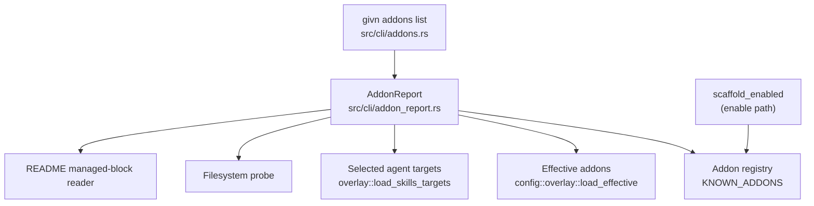

# Design: addon-artifact-report

## Summary

`givn addons list` keeps its config resolution and gains a materialization report. The addon registry declares what each addon writes; one reporting module compares that declaration against the filesystem and prints the result plus one literal suggestion per difference. Nothing is written.

## Affected modules

| Path | Change |
|---|---|
| `src/cli/addons.rs` | `AddonSpec` gains a `materialization` field; `run_list` calls the new report and returns a non-zero exit when an enabled addon's materialization is broken |
| `src/cli/addon_report.rs` | New. Resolves the observed state per addon, formats lines and suggestions, and returns whether a broken enabled addon exists |
| `src/config/manifest.rs` | Read-only consumer: `Addons::entries()`, `Addons::RETIRED` |
| `src/config/overlay.rs` | Read-only consumer: `load_skills_targets` |
| `src/main.rs` | `addons list` exits with the report's status |
| `tests/steps/addon_artifact_report_steps.rs` | New permanent step file bound to this capability's scenarios |



## Domain model

The glossary already defines **Addon** as "embedded behavior toggled through `addons.<name>`". This change introduces one term; it goes into `docs/glossary.md`:

**Addon materialization** — the filesystem effect an addon declares: the documentation paths it scaffolds and, for a skill addon, the generated skill directory in every selected agent target. Anti-term: "installation" (an addon is embedded in the binary, never installed; presence of files is not presence of the addon).

Observable states, kept distinct and never merged into one word:

| State | Meaning |
|---|---|
| `present` | Every declared path exists and the managed block, if declared, is intact |
| `missing` | At least one declared path or managed block is absent |
| `partial` | A multi-target addon whose skill exists in at least one selected agent target but not all |
| `none` | The addon declares no materialization path, or the check applies to no selected target (a skill addon with no generated skill directory to look for) |

## Data model

```rust
pub struct AddonSpec {
    pub id: &'static str,
    pub description: &'static str,
    pub default_enabled: bool,
    pub materialization: Materialization,
}

pub enum Materialization {
    /// No filesystem effect; the addon's effect is a managed block elsewhere
    /// or pure generated guidance.
    None,
    /// Paths that must all exist. `anchors` are named in suggestions.
    Files(&'static [&'static str]),
    /// A managed fenced block inside a project file.
    ManagedBlock { file: &'static str, begin: &'static str, end: &'static str },
    /// Files plus one generated skill directory name, checked in every
    /// selected agent target.
    FilesAndSkill { files: &'static [&'static str], skill: &'static str },
}
```

Declared values, one source of truth:

| Addon | Materialization |
|---|---|
| `arc42` | `Files(["docs/arc42", "docs/glossary.md"])` |
| `communication_policy` | `ManagedBlock { file: "AGENTS.md", /* givn:begin:communication-policy markers */ }` |
| `readme` | `Files(["README.md"])` |
| `coverage` | `None` (enabling it only sets `coverage.measure_command`/`merge_command` in `givn/commands.yaml`; it scaffolds no files) |
| `domain_modeling` | `FilesAndSkill { files: ["docs/domain-model.md"], skill: "givn-domain-modeling" }` |
| `dev_principles` | `FilesAndSkill { files: [], skill: "givn-dev-principles" }` |
| `challenge` | `FilesAndSkill { files: [], skill: "givn-challenge" }` |
| `architecture_principles` | `ManagedBlock { file: "AGENTS.md", /* givn:begin:architecture-principles markers */ }` |
| `outline` | `None` |

Each declaration is checked against the corresponding scaffold or generation routine before implementation; a mismatch is a design defect fixed here, not a compromise in the report. The `readme` addon also owns the `givn:coverage-badge` fence inside `README.md`; because the file itself is the declared path, a missing README already reports `missing`, and the fence is not tracked separately.

The scaffold routines read the same declaration: `scaffold_enabled` dispatches on `materialization` instead of a `match` on the addon name, and `scaffold_arc42` takes the directory from the declaration. Adding an addon without declaring its materialization does not compile, which satisfies `Decides D1`.

## Output format

The existing per-addon lines stay byte-for-byte; the report appends indented lines under each.

```
  [enabled ]  arc42
              Arc42 architecture documentation — ...
              artifacts: present
  [enabled ]  readme
              README scaffolding — ...
              artifacts: missing README.md
              suggestion: givn addons enable readme
```

`partial` names the failing targets on one continuation line: `artifacts: partial (.agents/skills/givn-domain-modeling missing)` followed by `suggestion: givn skills sync`.

**Shared paths belong to one addon.** `docs/glossary.md` is scaffolded by both `arc42` and `domain_modeling` (`src/cli/addons.rs:145,155`); it is declared only under `arc42`, which scaffolds it first and keeps it for the addon that outlives the other. `domain_modeling` declares `docs/domain-model.md` alone, so a project that disabled `domain_modeling` and kept the shared glossary does not report `partial`. No path appears under two entries; a test asserts this over the registry.

**Suggestions name the lock.** `enable`, `disable`, and `skills sync` all refuse while an active change holds the add-on lock (`guard_addon_mutation`, `src/cli/addons.rs:318`). When `config::lock::locked_active_changes` returns any change, each suggestion gains a suffix naming it:

```
              suggestion: givn addons enable readme  (refused while change addon-lock holds the add-on lock)
```

The report reads the lock only to compute the suffix; it never writes it and never refuses.

Retired keys are reported after the registered addons, only when present in `givn/config.yaml`:

```
  [retired ]  grill_me  (replaced by challenge)
              suggestion: replace `addons.grill_me` with `addons.challenge` in givn/config.yaml
```

Suggestions are plain strings built from the addon id; `addon_report.rs` holds them in one function so tests assert one source.

## Exit status and mutation gate

`run_list` returns `Result<bool>` where `true` means "an enabled addon is broken". `main.rs` maps that to `ExitCode`. Both `enable` and `disable` refuse while an active change has a config lock (`guard_addon_mutation`); `list` must not, or it would fail during a locked change whenever a difference exists. The report therefore never reads or writes the lock, and the "writes nothing" scenario covers the lock file too.

The report reads the lock (`config::lock::locked_active_changes`) only to suffix suggestions; it never writes it and never refuses.

## Contracts and Components

| Contract | Consumer use case | Consumers | Implementing component today | Split trigger |
|---|---|---|---|---|
| `AddonMaterializationReport` | initialize-project (enable optional addons) | `givn addons list`, later `givn upgrade`'s refresh step | `src/cli/addon_report.rs` | A second consumer needs partial-path detail (per-file, not per-addon) or a non-CLI rendering |

One contract, one component, one external dependency (the filesystem). No port/adapter split is warranted.

## Use-case traceability

| Use-case item | Technical decision | Evidence |
|---|---|---|
| Main flow 5 — "resolves effective addon defaults and explicit choices consistently" | Report reads `load_effective`, never the raw overlay | Scenario "Consumer lists addons and sees each addon's materialized files reported" |
| Main flow 3 — "removes recognizable generated legacy commands and disabled-addon skills" | `partial` state names selected targets missing a skill | Scenario "An enabled skill addon missing its skill from a selected target is reported as partial" |
| Guarantee — no implicit commit or write | `addon_report` has no write path; exit status only | Scenario "The listing writes nothing to the project" |
| `Addons::RETIRED` map | Retired keys reported with `Addons::replacement_for_retired` | Scenario "A retired addon key in the configuration is reported with its replacement" |

Persona impact: terminal text output. The proposal confirms no Persona because no new visual or interactive surface is introduced; the developer Actor of `initialize-project` is the consumer.

## Step definitions

| Step definition file | Capability | Permanent merge target |
|---|---|---|
| `tests/steps/addon_artifact_report_steps.rs` | `enable-optional-addons` | same path |

Steps reused from `tests/steps/default_all_addons_steps.rs` (`givn addon "<name>" is "<state>"`, `the givn config keeps addon ...`, `an initialized addon-free project`), `tests/steps/template_conditional_rendering_support.rs::set_addon`, and generic file/exit assertions from `tests/common/mod.rs`. New phrases and their bindings:

| Phrase | Binding |
|---|---|
| `the listing reports <addon> as <state> with artifacts <state>` | stdout of the recorded `givn addons list` output |
| `the listing suggests `<cmd>`` | same stdout, `suggestion:` line |
| `the listing reports "<x>" as retired` / `names "<y>" as the replacement` | same stdout |
| `the listing names "<target>" as a selected target missing the skill` | same stdout |
| `the managed communication block in "<file>" is (intact\|damaged)` | edits the fixture's `AGENTS.md` block markers |
| `the project files are unchanged` | tree snapshot (path + bytes) taken before the run |
| `whose givn/config.yaml contains the retired key "<key>"` | appends `  <key>: true` under `addons:` |

## Test runner

- `verify.command`: `./run-tests.sh --non-e2e` (unchanged; `cargo nextest run`).
- `verify.e2e_command`: `./run-tests.sh --e2e` (unchanged).
- Single scenario: `cargo test --test features_runner -- "Consumer lists addons and sees each addon's materialized files reported" --exact` is not supported by the custom runner; use `GIVN_FEATURE=<path> GIVN_SCENARIO="<title>" ./run-tests.sh --e2e` per its existing contract, or `cargo test --test features_runner <name> -- --exact` when the runner registers the filter.
- Strict mode: `.fail_on_skipped()` on both `Cucumber` builders in `tests/features_runner.rs` (lines 55 and 155). Undefined steps fail.

## E2E smoke test

- **Real interface**: a subprocess `givn addons list` in a fixture project (`common::run_givn`).
- **E2E scenario**: "Consumer lists addons and sees each addon's materialized files reported" (`@e2e`), scope `GIVN_RESULT_SCOPE=e2e`.
- **Step file**: `tests/steps/addon_artifact_report_steps.rs`.
- **Infrastructure**: none beyond a temp directory and the built binary.
- **Framework**: `cucumber-rs`, matching the CLI interface.
- **Strict-mode proof**: `.fail_on_skipped()`; the `@e2e` run of this change is red until the report is implemented.

## External boundary cases

The filesystem is the only external boundary.

| Case | Covered by |
|---|---|
| Declared path absent | "An enabled addon with missing files is reported and the exit status is non-zero" |
| Declared path present for a disabled addon | "Files present for a disabled addon are reported without failing the command" |
| Path exists but is a file where a directory is declared | Regular scenario: `docs/arc42` exists as a regular file, reported `missing` |
| Unreadable declared path (permission denied) | Regular scenario: reported `missing` with the path, no panic |
| No `givn/config.yaml` | Existing advice; suggestions suppressed, exit 0 |
| Managed block start marker present, end marker absent | "A damaged managed block for an enabled addon fails the command" |
| Shared path retained after the co-scaffolding addon is disabled | "Disabling domain_modeling keeps the shared glossary from a partial report" |
| An active change holds the add-on lock | "A locked change adds the lock to each suggestion" |

## Decisions

- Decides D1: materialization is declared on `AddonSpec` and read by both the scaffold routines and the report — realized in `src/cli/addons.rs` (`AddonSpec::materialization`, `scaffold_enabled` dispatch on it). The alternative of a side table is rejected because nothing fails when a scaffold gains a path the table does not know.
- Decides D2: the report writes nothing and takes no lock — realized in `src/cli/addon_report.rs` and the "The listing writes nothing to the project" scenario; `run_list` returns a status instead of calling `guard_addon_mutation`.
- Decides F1 (design review): suggestions name the active add-on lock when one exists — realized in the lock suffix of `src/cli/addon_report.rs` and the scenario "A locked change adds the lock to each suggestion".
- Decides F2 (design review): a shared path is declared under exactly one addon; `docs/glossary.md` stays under `arc42` — realized in the registry table above and the scenario "Disabling domain_modeling keeps the shared glossary from a partial report".

## Out of scope

Aggregation of `readme check`, `lint`, `status`, or stale receipts; a `diagnose` command; a `--fix` flag; binary-version comparison.
