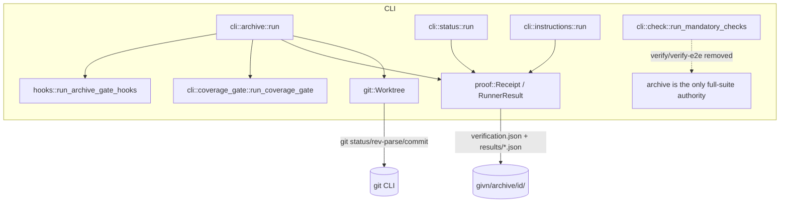
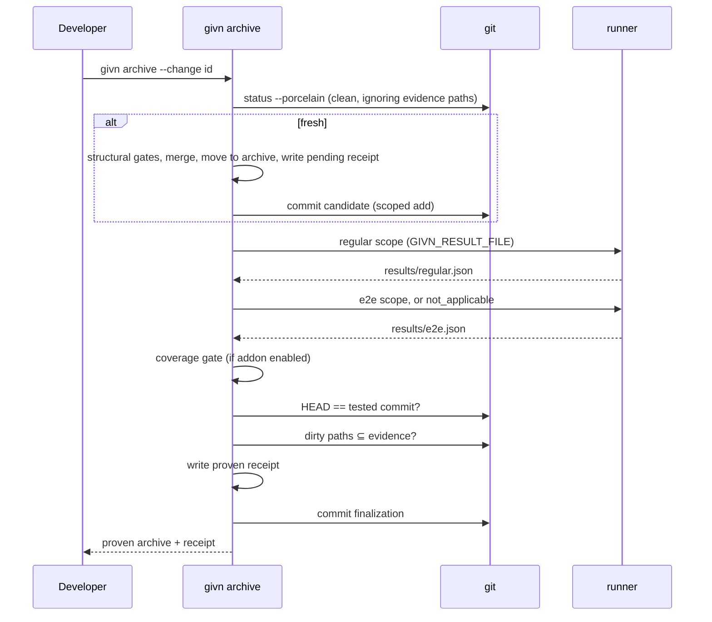

# Design: archive-proof

## Context

The archive becomes a forward-only publication with a durable proof receipt.
This design covers the HOW: the Git integration, the archive state machine,
the receipt and runner-result data models, the finalization guard, the
module/function map, and the test infrastructure.

Domain vocabulary is fixed in `docs/arc42/12-glossary.md`: **archive
candidate**, **proven archive**, **verification receipt**, **verification
scope**, **runner result**, **forward repair**. Spec, design, and code use
those exact terms.

## Technology Decisions

| Decision | Choice | Rationale |
|---|---|---|
| Git access | Shell out to the `git` CLI from a small wrapper (`src/git.rs`) | The project already depends on the host Git CLI (`src/cli/git.rs` installs hooks); no new crate, no linking a Git library. |
| Receipt/result format | JSON via the existing `serde_json` dependency | Already used across the CLI; human-readable and machine-stable. |
| Timestamps | `SystemTime` + `local_timestamp()` reuse | `src/subprocess.rs` already provides local timestamps for stage logging. |
| New dependencies | None | Correctness and simplicity: the change is a workflow restructure, not a library need. |
| Commit strategy | Normal `git commit` (hooks run) with scoped `git add` | A9: no `--no-verify`, no `git add -A`; attribution and user hooks keep working. |

No versioned component is introduced, so no version-freshness lookup applies.
The only external tool is the host `git`, already a hard dependency of the
project (hook installation, attribution integration). Rust edition and crate
versions are pinned by the existing `Cargo.toml`/`Cargo.lock`.

## Architecture Impact



New modules:

- `src/git.rs` — `Worktree` wrapper (`is_worktree`, `head`, `dirty_entries`,
  `commit`).
- `src/proof.rs` — `ArchiveProof` status detection, `RunnerResult`,
  `Receipt`, `ScopeOutcome`, `CoverageOutcome`, allowed-path predicate.

Changed modules:

- `src/cli/archive.rs` — `run` becomes the two-stage forward-only pipeline.
- `src/cli/check.rs` — the `review` branch drops the `verify` and
  `verify-e2e` mandatory checks.
- `src/cli/coverage_gate.rs` — drops the backup/rollback machinery; failures
  propagate so the candidate stays unproven.
- `src/cli/status.rs`, `src/cli/instructions.rs` — surface pending archives.
- `src/state.rs` — archive provenance helpers next to `list_archived`.
- `src/lib.rs` — register `git` and `proof`.
- `tests/features_runner.rs`, `run-tests.sh` — write `GIVN_RESULT_FILE`.

## Git integration (`src/git.rs`)

```rust
pub struct Worktree { root: PathBuf }

impl Worktree {
    /// Fails when `root` is not inside a Git work tree.
    pub fn open(root: &Path) -> Result<Self>;
    /// `git rev-parse HEAD`.
    pub fn head(&self) -> Result<String>;
    /// `git status --porcelain -z`, parsed into display paths.
    pub fn dirty_entries(&self) -> Result<Vec<String>>;
    /// Stage exactly `paths` and commit; returns the new commit id.
    pub fn commit(&self, message: &str, paths: &[&str]) -> Result<String>;
}
```

- `dirty_entries` uses `--porcelain -z` so paths with spaces and rename
  entries survive intact; it reports both modified tracked files and
  untracked non-ignored files (A5).
- `commit` runs `git add -- <paths>` then `git commit -m <message>` in the
  repository root. Hooks run; failure returns the hook's stderr context.
- All Git errors wrap the exact command and stderr with `anyhow::Context`
  so the developer sees what Git objected to.

## Archive flow

### State detection

`proof::read_status(archive_dir)`:

| Filesystem | Status | Archive behavior |
|---|---|---|
| no archive dir | `None` | Fresh archive |
| archive dir, no `verification.json` | `Legacy` | Refuse: already archived (pre-receipt archives) |
| `verification.json.status == "pending"` | `Pending` | Resume |
| `verification.json.status == "proven"` | `Proven` | Refuse: already proven |
| both `givn/changes/<id>` and `givn/archive/<id>` | corrupt | Refuse (A6) |

### Pipeline



Ordered steps of `cli::archive::run`:

1. Resolve the change id; `Worktree::open` — a non-Git project blocks with a
   Git-mentioning error (A2).
2. Detect archive status (table above). Fresh requires
   `givn/changes/<id>` to exist.
3. Clean-tree witness: `dirty_entries` filtered through
   `proof::is_evidence_path(project_root, id, manifest, path)`. The first
   offending path aborts with its name. Evidence paths are:
   `givn/archive/<id>/**`, `README.md` (readme addon), and the three
   configured coverage paths (coverage addon). These are the finalization-
   allowed paths — leftovers from an earlier failed attempt must not block
   the repair.
4. Fresh only — structural gates, in the existing order, none of which write
   to the tree before the merge:
   - `apply.requires` artifact/task/review checks (existing state logic);
   - `hooks::run_archive_gate_hooks` (custom user hooks; built-ins are no
     longer in the default `post` lists);
   - run-declaration check; README completeness check;
   - use-case document validation and delta prevalidation (parse, `@wip`,
     `@givn.retired`, routing resolution);
   - e2e-configured precondition: if the merged scenario set (delta ∪
     permanent) contains `@e2e` and `verify.e2e_command` is unconfigured,
     block before any mutation, leaving the change active. This is a
     configuration gap, not a verification result.
5. Fresh only — merge and publish the candidate:
   - `merge_usecase_documents` + `process_delta_file` per file;
   - copy `givn/changes/<id>` → `givn/archive/<id>`, remove the change dir;
   - write `verification.json` with `status: "pending"`, the first-parent
     `candidate_commit` set after the commit, empty scopes;
   - `Worktree::commit("chore(<id>): publish archive candidate", scoped
     paths)`. Scoped paths: `givn/specs`, `givn/archive/<id>`,
     `givn/changes/<id>`.
     If the commit is rejected (e.g. a user commit hook), the error explains
     that the merge is staged but uncommitted and the archive is not proven;
     the tree is repaired forward like any other failure.
6. Verification against the committed HEAD (`tested_commit`):
   - regular scope: `verify.command` with `GIVN_FEATURES=givn/specs` and
     `GIVN_RESULT_FILE=<archive>/results/regular.json`;
   - e2e scope: when the merged permanent specs contain `@e2e`,
     `verify.e2e_command` with `GIVN_RESULT_FILE=<archive>/results/e2e.json`;
     otherwise recorded as `not_applicable` with no run;
   - coverage (when `addons.coverage`): the existing
     `coverage_gate::run_coverage_gate` pipeline, now without backups or
     rollback.
7. Finalization:
   - refresh the managed README development/run blocks (readme addon);
   - write the proven `verification.json` (tested commit, scope outcomes,
     coverage outcome, timings);
   - guard A: `HEAD == tested_commit` — otherwise refuse ("the tested tree
     changed");
   - guard B: every line of `dirty_entries` is an evidence path — otherwise
     refuse and name the offending path;
   - commit the evidence paths (receipt/results under the archive dir,
     README, coverage outputs). Hooks run.

Any failure from step 4 onward prints:

```
archive blocked: <reason>. The archive candidate at givn/archive/<id>/ is
unproven. Repair the committed state and rerun:
  givn archive --change <id>
```

and exits non-zero without touching the candidate. Resume runs steps 1–3,
skips 4–5, and continues at 6.

### Rejected alternative: automatic rollback

The old backup/`rollback_specs` machinery is deleted, not adapted. Keeping
rollback would require a third "restored" state that no consumer can observe,
and it destroys the failing tree the developer needs for repair. Forward
repair is strictly simpler: the candidate is already committed, so the repair
is an ordinary commit on top.

## Data Model Changes

### Runner result (`results/<scope>.json`)

```json
{
  "scope": "regular",
  "total": 392,
  "passed": 392,
  "failed": 0,
  "skipped": 0
}
```

`proof::RunnerResult::parse(path)` + `validate(expected_scope)` reject:

- missing or unreadable file;
- malformed JSON or missing keys;
- `scope` mismatch;
- `total == 0`;
- `failed != 0`;
- `skipped != 0`;
- `passed + failed + skipped != total` (non-reconciling counts).

Every rejection is fail-closed and names the offending file.

### Verification receipt (`givn/archive/<id>/verification.json`)

```json
{
  "schema": 1,
  "change": "archive-proof",
  "status": "proven",
  "candidate_commit": "9f3c...",
  "tested_commit": "9f3c...",
  "scopes": {
    "regular": { "status": "passed", "total": 392, "passed": 392,
                 "failed": 0, "skipped": 0, "seconds": 18.1 },
    "e2e":     { "status": "passed", "total": 77, "passed": 77,
                 "failed": 0, "skipped": 0, "seconds": 4.2 }
  },
  "coverage": { "status": "passed", "line_covered": 6461,
                "line_valid": 18713, "line_percent": 35 },
  "started_at": "2026-09-10T12:00:00+02:00",
  "finished_at": "2026-09-10T12:05:00+02:00"
}
```

- `status`: `pending` | `proven`; only `pending` and `proven` are recognized.
- scope entries: `passed` | `not_applicable`. A failed run does not rewrite
  the pending receipt, so the candidate commit stays exactly the tested tree.
- `coverage`: `passed` | `not_enabled` (disabled addon). A coverage failure
  aborts before the receipt is written.
- The receipt records per-scope counts, never a de-duplicated total (A11).

## Finalization guard

`proof::is_evidence_path` is the single predicate used both for the initial
clean-tree witness (filter) and for the post-verification guard (all lines
must satisfy it). One predicate means the "what may change" rule cannot drift
between the two checks. Paths are compared after normalizing `./` and
converting to forward slashes; a path is evidence when it starts with
`givn/archive/<id>/` or equals one of:

- `README.md` (readme addon),
- `coverage.non_e2e_path`, `coverage.e2e_path`, `coverage.output_path`
  (coverage addon).

## Module / function map

| Unit | Responsibility |
|---|---|
| `git::Worktree::open` | `git rev-parse --is-inside-work-tree` |
| `git::Worktree::dirty_entries` | `git status --porcelain -z` parsing |
| `git::Worktree::head` | `git rev-parse HEAD` |
| `git::Worktree::commit` | scoped `git add` + `git commit` |
| `proof::read_status` | classify archive provenance from `verification.json` |
| `proof::is_evidence_path` | shared allowed-path predicate |
| `proof::RunnerResult::{parse,validate}` | fail-closed scope-result contract |
| `proof::Receipt::{write_pending,write_proven,read}` | receipt persistence |
| `cli::archive::run` | two-stage pipeline, resume mode, finalization guards |
| `cli::archive::finalize` | guard + receipt + finalization commit |
| `cli::coverage_gate::run_coverage_gate` | coverage pipeline, no backup/rollback |
| `cli::check::run_mandatory_checks` | review branch without verify/verify-e2e |
| `cli::status::run` | list pending archives and route to resume |
| `cli::instructions` | `report_archived_change` routes pending archives |
| `state::list_unproven_archives` | filesystem view for status/instructions |

## Step Definitions

| Capability / Feature | Step definition file |
|---|---|
| archive-proof (regular scenarios) | `tests/steps/archive_proof_steps.rs` |
| archive-proof (@e2e scenarios) | `tests/steps/archive_proof_e2e_steps.rs` |
| extract-coverage-gate | `tests/steps/extract_coverage_gate_steps.rs` |
| enforce-post-merge-e2e-gate | `tests/steps/enforce_post_merge_e2e_gate_steps.rs` |
| givn-workflow-enforcement | `tests/steps/workflow_enforcement_steps.rs` |
| repository-ownership-fixtures | `tests/steps/repository_ownership_fixtures_steps.rs` |

Support module `tests/steps/archive_proof_support.rs`:

- `given_archive_ready_change(world, id)` — init project, write all required
  artifacts, configure verify/e2e to `./emit-result.sh`, `git init` + initial
  commit.
- `commit_all(env)` — `git add -A && git commit` for fixtures that mutate the
  tree after the initial commit.
- `write_result_runner(env)` — executable `emit-result.sh` writing a valid
  `$GIVN_RESULT_FILE` for `regular`/`e2e`; variant knobs for failed/skipped/
  zero/non-reconciling/missing results.
- receipt readers (`archive_status(env,id)`, `receipt_json(env,id)`).

`tests/common/mod.rs` gains `git_init(env)`, `git_commit_all(env, msg)`,
`git_head(env)`, and a `git_output(...)` helper. `make_init_root` initializes
Git and commits the scaffold, because every archive flow now requires a
committed state and a dirty worktree blocks.

### Fixture migration (blast radius)

All existing archive-flow fixtures currently use `verify.command: "true"`
(and often `e2e_command: "true"`); these are replaced with
`./emit-result.sh regular` / `./emit-result.sh e2e`, or with commands that
intentionally omit the result for the fail-closed scenario. Failing fixtures
keep failing commands (exit code already blocks). The shared helpers are
updated once in `tests/common/mod.rs` and
`tests/steps/repository_ownership_fixtures_support.rs`, then the ~12 step
files that configure archive projects are updated mechanically.

## Runner command, strict mode, single scenario

| Field | Value |
|---|---|
| `verify.command` | `./run-tests.sh` |
| `verify.e2e_command` | `./run-tests.sh --e2e` |
| `verify.features_path` | `givn/specs` |
| Runner | `cargo nextest run --test features_runner` (default), `cargo test --test features_runner` fallback |
| Strict mode | `GivnWorld::cucumber().fail_on_skipped()` in `tests/features_runner.rs` — a skipped/undefined step fails the run |
| Not-implemented stub | `unimplemented!("<scenario>")` in each new step body during RED; `@wip` marks the scenario until GREEN |
| Single-scenario command | `GIVN_FEATURES=givn/changes/archive-proof/specs cargo test --test features_runner -- --name "<scenario title>"` |

### `GIVN_RESULT_FILE` support

`run-tests.sh` forces the single-process `cargo test` path when
`GIVN_RESULT_FILE` is set (nextest runs one process per scenario and cannot
aggregate one result file), and exports `GIVN_RESULT_SCOPE=regular|e2e`
derived from its own `--e2e` flag. `tests/features_runner.rs` switches the
main run from `run_and_exit` to `run`, reads
`writer.scenarios_stats()` from the default `Summarize` writer, writes the
scope JSON when `GIVN_RESULT_FILE` is set, and exits non-zero when any
scenario failed. The scope value is written by the runner, never injected by
Givn; Givn validates it against the expected scope, which keeps the
reconciliation honest.

## Interaction Coverage Matrix

| Inventory entry | @e2e scenario title | Real interface | Driving mechanism |
|---|---|---|---|
| archive a completed change | Consumer archives a completed change and receives a proven archive | CLI subprocess | `common::run_givn(env, ["archive", "--change", "proof-real"])` against a committed fixture |
| repair a blocked archive | Consumer repairs a blocked archive and the rerun proves it | CLI subprocess | `common::run_givn(env, ["archive", "--change", "proof-repair"])` after a fixture repair commit |
| inspect an unproven archive candidate | Consumer inspects an unproven archive candidate | CLI subprocess | `common::run_givn(env, ["status"])` reading the pending receipt |

The `givn instructions` route to the same inspection action is covered by a
regular scenario (agent-facing projection of the same status).

## E2E infrastructure

- E2E runner: `./run-tests.sh --e2e`, which sets
  `GIVN_CUCUMBER_TAGS='@e2e'` (nextest) / `--tags '@e2e'` (cargo) and scopes
  `GIVN_FEATURES`.
- E2E step definitions: `tests/steps/archive_proof_e2e_steps.rs`, separate
  from the regular file.
- Framework: `cucumber-rs` 0.23 with the `features_runner` custom harness —
  the correct driver for a CLI whose real interface is the `givn` binary
  invoked as a subprocess.
- Local infrastructure: none beyond the host Git CLI; every e2e scenario runs
  against a `tempfile` project that executes the compiled `CARGO_BIN_EXE_givn`
  binary. No servers, databases, or third-party services.
- E2E strict mode: `.fail_on_skipped()` applies to the e2e scope too (same
  runner, tag-filtered), so an undefined e2e step fails the run.

## Local runnability & digital twins

- Local run command: `cargo run -- archive --change <id>` (the product is the
  CLI; the test suite's one-command local entry point is `./run-tests.sh`).
- Isolated network: not applicable — no external services are contacted.
- Digital twins: none. The only external process is the local `git` CLI,
  which is the real dependency, not a third party to mock.
- Anticipated interface obstacles: Git commit hooks can reject commits
  (nested hooks are not testable inside `git commit` fixtures); the fixtures
  keep hooks uninstalled by using bare `git init` without `givn skills sync`
  so commits are deterministic.

## Coverage process boundaries

Coverage is enabled in this project (`addons.coverage: true`,
`measure-coverage.sh` + `merge-coverages.sh`). The archive coverage gate
launches:

| Process | Started by | Instrumented artifact | Profile output | Merge step | Non-zero production probe |
|---|---|---|---|---|---|
| `features_runner` non-e2e | `measure-coverage.sh` (`cargo llvm-cov nextest` with `GIVN_CUCUMBER_TAGS='not @e2e'`) | `target/llvm-cov-target` build of the test harness + `givn` binary | profraw under `target/llvm-cov-target` | `cargo llvm-cov report --cobertura` → `coverage/non-e2e-cobertura.xml` | `src/cli/archive.rs` archive pipeline lines |
| `features_runner` e2e | `measure-coverage.sh` (`GIVN_CUCUMBER_TAGS='@e2e'`) | same instrumented harness | profraw reset via `cargo llvm-cov clean --profraw-only` | → `coverage/e2e-cobertura.xml` | `common::run_givn` fixture path in `tests/common/mod.rs` |
| `ready_fixture` | `cov_ready` in `measure-coverage.sh` | instrumented `ready_fixture` binary | discarded with the clean before the replay | n/a | fixture startup path |

`merge-coverages.sh` unions the two reports into
`coverage/cobertura-coverage.xml`; the README publish step consumes that
file. The command contract is unchanged (out of scope).

## Use-case traceability

| Use-case element | Technical decision | Capability | E2E evidence |
|---|---|---|---|
| Minimal guarantee: failed archive never proven, candidate repairable in place | `verification.json.status`, pending receipt committed before verification, forward-repair pipeline | archive-proof | Consumer repairs a blocked archive and the rerun proves it |
| Success guarantee: receipt binds proven archive to the tested commit | `tested_commit` + finalization guard A | archive-proof | Consumer archives a completed change and receives a proven archive |
| Rule: rerun resumes pending, refuses proven | `proof::read_status` mode detection | archive-proof | Consumer repairs a blocked archive and the rerun proves it |
| Extension: uncommitted work blocks and names files | `Worktree::dirty_entries` witness | archive-proof | (regular scenarios) |
| Rule: use-case replacement matches base revision | existing `validate_usecase_documents` (unchanged) | grouped-merge-for-new-capabilities | existing e2e |
| Rule: feature behavior never silently dropped | existing merge semantics (unchanged) | grouped-merge-for-new-capabilities | existing e2e |
| Coverage runs once against the candidate and publishes | coverage gate without rollback | extract-coverage-gate | existing coverage e2e |
| E2E scope verified against the candidate, not a rollback | post-candidate e2e scope + not_applicable | enforce-post-merge-e2e-gate | existing e2e |
| Review does not execute the suite | review mandatory checks trimmed | givn-workflow-enforcement | existing migration e2e |
| Inspect an unproven candidate | status/instructions pending projection | archive-proof | Consumer inspects an unproven archive candidate |

Personas: none confirmed, so no Persona lens applies. Actors remain Developer
and Reviewer.

## Internal Primitives

| Primitive | Type | Purpose |
|---|---|---|
| `git::Worktree` | struct | Root-bound Git CLI wrapper (open/head/dirty/commit) |
| `proof::ArchiveProof` | enum (`None`/`Legacy`/`Pending`/`Proven`) | Provenance classification read from the receipt |
| `proof::RunnerResult` | struct (serde) | Parsed per-scope runner result |
| `proof::Receipt` | struct (serde) | `verification.json` model |
| `proof::ScopeOutcome` | struct (serde) | Per-scope status and counts |
| `proof::CoverageOutcome` | struct (serde) | Coverage status and merged counters |
| `proof::is_evidence_path` | fn | Single allowed-path predicate shared by the witness and the guard |
| `cli::archive::ArchivePhase` | private enum | `Fresh` / `Resume` mode selection |

## Documentation and asset updates

- `assets/instructions/review.md` and `assets/templates/review.md`: replace
  the "run the suite / measure coverage in review" requirements with the
  archive-receipt evidence model; sign-off items for verify exit codes and
  coverage measurement are dropped (they become receipt requirements). The
  fabrication audit and static checks stay.
- `README.md`, `docs/reference.md`, `docs/workflow.md`: the archive row and
  archive mechanics section describe the two-commit model, the Git
  prerequisite, and forward repair.
- `CHANGELOG.md` (`Unreleased`): note the breaking behavior change.
- `docs/arc42/` chapters are handled by the arc42 artifact of this change.

## Open Technical Questions

None. The only deliberately deferred detail is the exact `cucumber-rs` writer
generics in `tests/features_runner.rs`; the design pins the mechanism
(`Summarize::scenarios_stats()` from the default writer) and the RED step
proves the invocation.

## Risks and mitigations

| Risk | Mitigation |
|---|---|
| Review loses measured coverage classification until a receipt exists | Review still classifies from the most recent available evidence and uses static inspection; the receipt is the durable gate. Documented in the review instruction update. |
| Large fixture blast radius (Git prerequisite + result contract) | Centralized helpers (`git_init`, `commit_all`, `emit-result.sh`) updated once, then mechanical per-fixture edits; the full suite is the detector. |
| Automated commits interact with commit hooks | Scoped `git add`, normal commits, hook output surfaced with context; fixtures use bare repos without Givn hooks for determinism. |
| Leftover uncommitted evidence from a failed attempt blocks resume | The witness and the guard share `is_evidence_path`, so leftover receipt/result/coverage/README files never block a repair. |
| Induction assumption: permanent specs are green between archives | Proven by construction: the only writer of permanent specs is the archive, which refuses to mark an unverified tree proven. |
