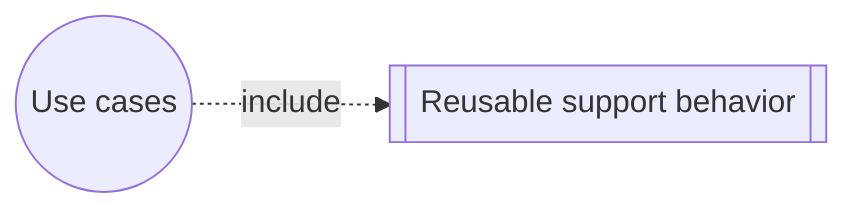

# Fragment: support

## Capabilities

- ideation-skill
- template-conditional-rendering
- domain-skill-trigger
- spec-explore-permanent
- coverage-script-workflow
- repository-ownership-fixtures
- coverage-readme-example
- spec-explore-change
- readme-coverage-badge
- skill-rewrites
- arc42-review-alignment
- instruction-integrity
- choose-project-license
- adr-qualification-gate
- llm-attribution
- llm-attribution-installation
- scm-backend-selection

## Interactions

- none

## Diagram

<!-- givn:base-sha256:469c4d540c7c6c769a0b204d01d3f28af0c8532833624be190ade934f82b668d -->

<!-- givn:base-sha256:db311dbecc71d458d4c2798500191f6e535506dcbef9a8dd9e69053fd2a72888 -->
