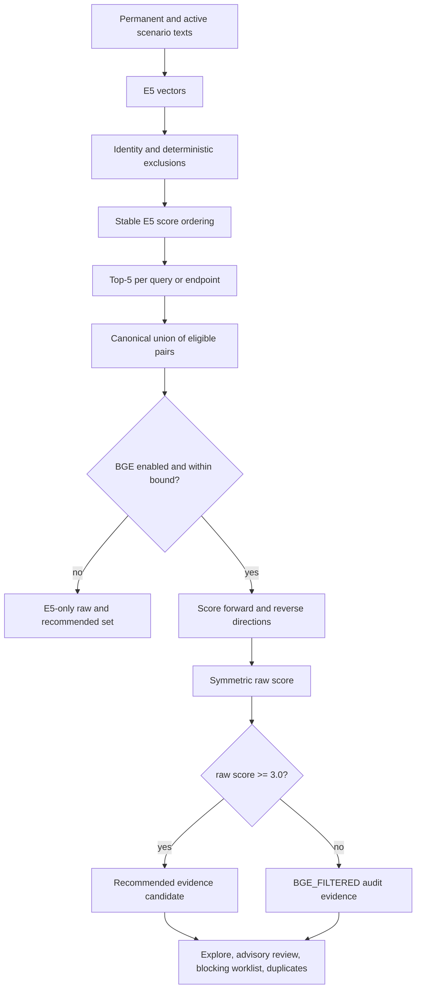

# Design: BGE Reranking Evidence

## Product Boundary

E5 remains the candidate generator. BGE is an advisory second-stage relevance
filter on a deterministic E5 shortlist. It has two observable outputs:

1. The **E5 raw candidate set** remains visible for auditability. It is the
   existing top-K result set and is not changed by enabling BGE.
2. The **recommended review set** contains only BGE-admitted candidates. A
   candidate below the BGE operating point is recorded as `BGE_FILTERED`; it is
   not silently discarded and it is never mapped to `DUPLIKAT`, `VARIANTE`,
   `VALID-BOUNDARY`, or `UNCERTAIN`.

This is the distinction between advisory evidence and automatic Givn
classification. BGE may reduce the worklist that the agent is asked to review,
but it never edits a feature file, assigns a Givn class, or verifies a
remediation. A BGE-admitted candidate still requires the existing explicit
agent classification and remediation rules.

The BGE operating point is the existing experiment's raw-logit value `3.0`.
It is a fixed, non-configurable **recommendation-admission** value, not a Givn
class threshold. It is permitted in this slice only because the change adds a
labeled four-class benchmark and reports its precision, recall, false-positive,
and false-negative consequences. The benchmark is a release gate for this
filter: if it does not reduce false positives without unacceptable top-K
recall loss, the product build is not approved for BGE admission and remains
the E5-only contract. This benchmark approval state is not a runtime
`BGE_UNAVAILABLE` model error; it is the absence of opt-in product approval.

Approval is represented by a maintainer-generated JSON artifact at
`givn/.spec-bge-admission.json` (or the path in
`GIVN_SPEC_BGE_APPROVAL_FILE`). It is accepted only when its schema version,
model id, operating point, bounded-pool constants, production candidate-pipeline
fingerprint, artifact hashes, and all five acceptance booleans match the
compiled contract. `evaluate_bge_admission.py --enforce --approval-file <path>`
is the only supported writer of a passing approval artifact; supplying
`--approval-file` without `--enforce` is rejected. A missing, failed, or Python-only
benchmark report therefore keeps local/default BGE on the E5-only contract; it
does not manufacture `BGE_FILTERED`. The deterministic `GIVN_SPEC_BGE=stub`
backend is a test fixture and is explicitly exempt from product approval so
the executable specification can run without model artifacts.

The approval document has exactly these top-level fields and no others:
`schema_version`, `model`, `threshold`, `top_k`, `max_unique_pairs`,
`candidate_pipeline`, `pipeline_fingerprint`, `rust_attestation`, `acceptance`,
and `artifact_hashes`. `acceptance` contains the five thresholds, five
criterion booleans, `candidate_pipeline_pass`, and aggregate `pass`; every
artifact hash entry contains only a positive `bytes` value and a lowercase
64-character SHA-256 value. The evaluator revalidates the model directory,
compares every hash, verifies the complete parity document by invoking the
compiled binary, and rejects missing, extra, stale, or mismatched fields before
writing approval.

## Feature And Runtime Matrix

The existing feature name is retained, but its old implication that BGE is the
similarity gate is removed. `spec-similarity-gate` remains an independent
E5-only hard-gate feature. The combinations are explicit:

| Build/runtime mode | E5 | BGE | Behavior |
|---|---:|---:|---|
| no `spec-retrieval` | unavailable | unavailable | Existing `spec retrieval is unavailable` error |
| `spec-retrieval` | on | off | Existing E5-only path and candidate set |
| `spec-retrieval,cross-encoder-reranker`, BGE disabled | on | off | E5-only comparison path; identities and order unchanged |
| `spec-retrieval,cross-encoder-reranker`, BGE stub/local | on | on | Bounded directional BGE scoring and admission filter |
| `spec-retrieval,cross-encoder-reranker`, missing artifact or pool overflow | on | unavailable | Explicit unavailable evidence; no output claims BGE participation |
| `spec-retrieval,spec-similarity-gate` | on | off | Existing independent E5 gate |
| both gate and BGE features | on | on | Existing E5 gate plus advisory BGE evidence; BGE never becomes the gate |

The `nli-evidence` feature and the E5+NLI/E5+BGE+NLI runtime combinations are
documented compatibility targets for PR 8, not PR 7 test invocations. PR 7's
matrix test asserts that no NLI selector or output is reached without that
future capability.

The Cargo feature declaration `nli-evidence = ["spec-retrieval"]` is added as
the PR-8 boundary, but PR 7 does not select or score NLI. Existing NLI code and
its selector must be cfg-gated so a BGE build cannot reach it accidentally.

The BGE runtime selector is test-only and explicit through the dedicated
`GIVN_SPEC_BGE` variable; it is not the NLI selector:

- `GIVN_SPEC_BGE=disabled`: BGE off in a feature-enabled build.
- `GIVN_SPEC_BGE=stub`: deterministic local BGE fixture.
- `GIVN_SPEC_BGE=missing`: explicit `BGE_UNAVAILABLE` result with no model
  participation; the command's normal E5/review exit status is preserved.
- `GIVN_SPEC_BGE=local`: use the explicitly provisioned local artifact directory
  after offline preflight; corrupt or incomplete files produce the same
  `BGE_UNAVAILABLE` result without constructing the downloader-backed model.
- unset in a BGE build: load the local cached BGE artifact; no test invokes
  this path.

Before constructing FastEmbed, the implementation checks the local model
directory for `model.onnx`, `tokenizer.json`, `config.json`,
`special_tokens_map.json`, and `tokenizer_config.json`; `model.onnx.data` is
required when the ONNX graph references external weights. The local loader uses
FastEmbed's `try_new_from_user_defined` API with a file-backed ONNX source and
never the downloader-backed constructor. A missing/corrupt local set produces
`BGE_UNAVAILABLE` with reason `missing-artifact`; it never enters a
download-capable model constructor. Test runs always select `stub` or
`disabled`, so no network or model download is required.

The benchmark's Python parser is a measurement harness, not the production
candidate generator. Its report is marked `candidate_pipeline:
python-reference-v1`; it cannot create an approval artifact. The compiled
retrieval binary exposes the hidden maintainer command `givn spec bge-parity`,
which emits the Rust pipeline fingerprint and exact constants. A passing
approval requires that external attestation plus the benchmark metrics,
preventing a Python/Rust candidate-set mismatch from enabling admission.

The existing NLI experiment selector is not used by the BGE product path. PR 7
must isolate it now: `cross-encoder-reranker` uses a BGE-specific selector,
while the existing NLI implementation is compiled/selected only through the
independent `nli-evidence` feature boundary. PR 7 does not add NLI scoring or
NLI output; it only prevents an NLI value from silently replacing BGE.

The four dispatch cases are explicit: BGE selector without NLI capability runs
BGE; an NLI selector without `nli-evidence` is ignored and cannot produce NLI
output; an NLI selector with `nli-evidence` preserves the diagnostic experiment;
and no selector runs the E5-only path. `spec-similarity-gate` remains an
independent E5 hard gate in every case.

The implementation migration is intentionally explicit: `review_enabled` first
resolves the BGE selector when `cross-encoder-reranker` is compiled, then
resolves the NLI selector only inside `#[cfg(feature = "nli-evidence")]`, and
otherwise falls back to the E5 advisory or independent E5 gate path. The BGE
selector reads only `GIVN_SPEC_BGE`; the NLI selector reads only
`GIVN_SPEC_RERANKER` inside the NLI capability. The old
`run_reranker_review` hard-failure path is replaced by the BGE evidence renderer
and is never called merely because `spec-similarity-gate` is enabled. The
implementation task also moves every NLI type/function and its unit tests behind
the same feature boundary, preserving the historical NLI experiment only in the
explicit capability build.

## Bounded Candidate Pipeline

The implementation is in `src/spec/retrieval.rs`. Candidate construction is
shared; each command only chooses its renderer.



The fixed constants are:

- `RERANKER_TOP_K = 5`.
- `BGE_ADMISSION_THRESHOLD = 3.0` raw symmetric logit.
- `BGE_MAX_PAIRS = 512` undirected pair inferences per command invocation.

The exact maximum selected input is:

- permanent duplicate audit: `min(E5_semantic_pairs,
  permanent_endpoint_count * RERANKER_TOP_K)`;
- change-aware query/review: `min(candidate_pairs,
  active_query_count * RERANKER_TOP_K)`;
- one exploration query: at most `RERANKER_TOP_K`.

The pair count is measured after deterministic exclusions and after intersecting
with the E5 semantic candidate set for review/duplicate admission. A successful
bounded run may leave E5 raw pairs outside the top-K union as
`BGE_UNSCORED`; those pairs remain blocking and are ordered by E5 score and
endpoint tuple. If the selected bounded set itself exceeds `BGE_MAX_PAIRS`, the
command does not start model inference. It emits an explicit
`BGE_UNAVAILABLE: bounded candidate pool exceeds 512 pairs` result and retains
the complete E5 raw set as the visible fallback. In the unavailable branch all
raw pairs are unscored and no partial inference is attempted. The fallback is
labeled unavailable, never presented as a successful BGE run. Missing model
artifacts use the same `BGE_UNAVAILABLE` result. BGE
unavailability does not change process exit status by itself: advisory commands
remain successful, and blocking commands use the normal E5/admitted-candidate
status. This is a deterministic refusal, not an unbounded safety valve.

Neighbor ties are ordered by `(E5 score descending, normalized file ascending,
title ascending)`. Pair keys are canonicalized by endpoint tuple. A
delta-to-delta pair is inserted once even if both queries select it.

Deterministic exclusions happen before BGE:

- `@givn.removed` scenarios are absent.
- A file-query's exact source identity is absent.
- A modified query's projected target identity is absent.
- Exact duplicate and structural-overlap pairs in the permanent duplicate
  audit are marked deterministic and never enter BGE.
- Sharing a file is not an exclusion. An eligible scenario in the same feature
  file remains selectable; only the exact normalized identity is removed.

## BGE Evidence And Admission

`BgePairEvidence` stores `forward_raw`, `reverse_raw`, and
`symmetric_raw = (forward_raw + reverse_raw) / 2`. Directional scores are
computed for every selected pair, including the stub. The admission status is
derived only from the symmetric raw value:

- `BGE_RECOMMENDED`: raw score at least `3.0`.
- `BGE_FILTERED`: raw score below `3.0`.

Neither status is a Givn classification. The report carries the E5 score,
BGE directional scores, BGE symmetric score, admission status, and the run
summary so an agent can challenge a false positive rather than rewrite prose
to evade E5.

The model identity is `rozgo/bge-reranker-v2-m3`. FastEmbed-rs is used at the
locked version in `Cargo.lock` (5.17.2); its `TextRerank` API and
`RerankerModel::BGERerankerV2M3` were checked against the current FastEmbed-rs
documentation on 2026-08-18. The local loader uses the existing cache,
maximum pair length 512, batch size 32, four intra-op threads, and hidden
download progress. Model load and inference are measured with a monotonic
clock and exposed as `bge_runtime_ms` (elapsed runtime, not a misleading
process-CPU claim).

The deterministic test seam accepts endpoint-keyed directional overrides:

```text
<file>|<title>-><file>|<title>=<forward>;<file>|<title>-><file>|<title>=<reverse>
```

The seam is valid only when the E5 and BGE test backends are selected. Duplicate
or malformed entries fail clearly. This proves arithmetic symmetry without a
model or network.

## Surface Contracts

### Permanent And Change-Aware Explore

The E5 raw results retain their existing rank and order. In BGE mode the human
output prints the raw candidate count, recommended count, filtered count,
model, symmetric score, admission status, and runtime. The recommended view
contains only `BGE_RECOMMENDED` candidates. Change-aware exploration ranks
against permanent plus active non-removed scenarios and applies the same
identity exclusions before top-K selection.

In participating BGE mode, Explore JSON adds an `evidence` object only as an
additive field. Its fields are `status`, `candidate_generator`, `top_k`, `e5_candidates`,
`recommended_candidates`, `bge_filtered_candidates`, `bge_pairs`, optional
`bge_model`, optional `bge_runtime_ms`, and per-result directional/raw BGE
evidence. E5-only JSON has no BGE evidence object and remains the existing
document byte-for-byte. Existing `query`, `index`, and result fields remain in
their existing order.

### Advisory Review

`givn spec review --change` remains exit-zero advisory behavior. It prints the
E5 raw count and the reduced recommended count, emits filtered evidence as
`BGE_FILTERED`, and states that no Givn class is assigned. It never edits
`review.md`, feature files, or the permanent index.

### Blocking Review

`semantic_review_enabled` retains the existing E5-only report behavior when
BGE is off. When BGE is enabled, only `BGE_RECOMMENDED` candidates enter the
blocking `## Candidate` worklist. Filtered pairs are retained in explicit
`## BGE Filtered Candidate` evidence blocks with no classification field. The
`BGE_FILTERED` status is intentionally non-blocking: it does not need a Givn
classification, does not contribute to the blocking candidate count, and cannot
make `check review` fail. This is a deliberate change to the prior E5-only
worklist contract and is documented in the canonical specs instruction and
Arc42 ADRs.

The report summary records E5 raw count, recommended count, filtered count,
unscored count, BGE pair count, model, and runtime. Candidate blocks retain the
existing `UNCERTAIN`/classification/rationale workflow and add optional BGE
directional fields. A BGE score cannot make a class, delete a scenario, merge a
scenario, or validate remediation. If BGE is unavailable or the bounded pool
overflows, no pairs are marked `BGE_FILTERED`; all E5 candidates remain in the
blocking worklist under an explicit `BGE_UNAVAILABLE` summary. In that summary,
`BGE model` and `BGE runtime ms` are `null`, unique and directional pair counts
are zero, filtered count is zero, unscored count equals the E5 raw count,
`BGE model load attempts` is zero, and the report contains normal `## Candidate`
blocks for those E5 candidates.

`givn check review --change` remains the E2E boundary. It invokes the real CLI,
generates the report, and runs the existing hooks. If BGE is unavailable, the
report says so and the E5-only blocking semantics remain visible; no BGE claim
is made. If BGE is available, only BGE-recommended candidates can block after
the agent has classified them.

The BGE invocation is intentionally opt-in and has no automatic wall-clock
cutoff: the local CPU cost is reported in `bge_runtime_ms`, and maintainer
approval records the observed budget separately. A slow but bounded run does
not turn a successful BGE score into an unavailable result; pair-cap and
artifact refusal are the only runtime refusal conditions in this slice.

### Permanent Duplicate Audit

The audit first produces exact, structural, and E5 semantic candidates exactly
as before. It then builds the endpoint top-K union after deterministic
exclusions and scores only its intersection with E5 semantic candidates. JSON
schema version 1 remains byte-compatible when BGE is off. BGE mode uses schema
version 2 with an optional `bge_run` summary, per-pair BGE evidence, and an
explicit filtered-pair collection. The main `candidate_count` is the
recommended audit count; `e5_candidate_count` and `bge_filtered_count` preserve
the raw accounting.

## Wire Contracts

The following fields and ordering are part of the design contract.

### Explore JSON

E5-only JSON remains the existing PR-1/PR-2 document, including the already
shipped additive `scope`/`change` metadata, with no new BGE participation fields.
When BGE participates, the top-level object appends `evidence` after
`results`. Its fields are ordered:

```text
status, reason, candidate_generator, top_k, e5_candidates,
recommended_candidates, bge_filtered_candidates, bge_unscored_candidates,
bge_pairs, bge_directional_calls, bge_model, bge_model_load_attempts,
bge_runtime_ms
```

`status` is exactly `BGE_ENABLED` or `BGE_UNAVAILABLE`; `reason` is `null` for
enabled runs and exactly `missing-artifact` or `pair-cap` for unavailable runs.
E5-only has no evidence object.
`bge_model` and `bge_runtime_ms` are `null` when BGE does not participate.
`bge_pairs` counts unique undirected pairs and `bge_directional_calls` is twice
that count. A successful one-query Explore always scores its complete at-most-
five BGE pool, so `bge_unscored_candidates` is zero; overflow is
`BGE_UNAVAILABLE`. Raw `results` retain their existing rank/order and append a
per-result `bge` object. Its `status` is `BGE_RECOMMENDED` or `BGE_FILTERED`;
scored objects additionally contain ordered
`forward_raw, reverse_raw, symmetric_raw` fields. A
`recommended_results` array is appended only in participating BGE mode and
contains the raw result objects whose admission is `BGE_RECOMMENDED`.
In `BGE_UNAVAILABLE` mode, `recommended_candidates` and `bge_pairs` are zero,
all E5 raw results are counted as `bge_unscored_candidates`, and the raw result
array remains the explicit E5 fallback.

### Duplicate JSON

E5-only output remains schema version 1 and retains its exact four top-level
fields. BGE output uses schema version 2 and appends
`e5_candidate_count, bge_run, filtered_candidates` in that order.
`candidate_count` equals the emitted `candidates` array length, containing
deterministic candidates plus BGE-recommended semantic candidates.
`e5_candidate_count` counts all E5 semantic candidates before BGE.
`bge_run` fields are ordered `status, reason, model, top_k, unique_pairs,
directional_calls, recommended_count, filtered_count, unscored_count,
model_load_attempts, runtime_ms`. Filtered entries contain endpoint tuples, E5 score, and the same
ordered BGE evidence object but no Givn classification. BGE JSON additionally
appends `unscored_candidates` after `filtered_candidates`; each entry contains
the endpoint tuple, E5 score, and `BGE_UNSCORED` status.

### Semantic report

E5-only reports retain report schema version 1. BGE reports use schema version 2
and add a fixed run summary after `Candidate count`:

```text
BGE status, BGE reason, BGE model, BGE top_k, BGE E5 raw count,
BGE recommended count, BGE filtered count, BGE unscored count,
BGE unique pair count, BGE directional call count, BGE model load attempts,
BGE runtime ms
```

`## Candidate` blocks contain BGE-recommended or BGE-unscored candidates and
retain the existing classification/rationale fields followed by ordered
`bge_forward_raw, bge_reverse_raw, bge_symmetric_raw, bge_admission` fields
when scored. An unscored block uses `bge_admission: BGE_UNSCORED` and null
directional fields but remains blocking because its E5 candidate was not
disproven by BGE. Only `BGE_FILTERED` blocks are non-blocking.
`## BGE Filtered Candidate` blocks contain endpoint/E5/BGE evidence only and
never classification or rationale fields. Unscored and unavailable counts are
summary evidence; unscored candidates remain E5 candidates and are not silently
treated as filtered.

Partial bounded coverage is represented by the normal contiguous `## Candidate`
blocks with `bge_admission: BGE_UNSCORED`; a separate header grammar is not
introduced.

Across surfaces, `BGE_UNSCORED` membership is the same canonical set: eligible
E5 raw pairs absent from the surface's top-K union and therefore absent from
the scored BGE subset, provided the bounded subset is within the 512-pair cap.
The set is
ordered by descending E5 score and normalized endpoint tuple, and its count is
the `bge_unscored_count` summary field. In semantic
reports those entries are contiguous normal blocking candidate blocks with null
BGE directionals; in duplicate JSON they are the `unscored_candidates` array
with the same endpoint/E5/status fields. Explore has no successful partial
unscored set because its complete at-most-five pool is always scored or becomes
`BGE_UNAVAILABLE`. An overflow run uses `BGE_UNAVAILABLE` for every surface,
including duplicate audit, and does not partially score the first 512 pairs.

For unavailable BGE duplicate JSON, `bge_run.status` is `BGE_UNAVAILABLE`,
`reason` is `missing-artifact` or `pair-cap`, `model` and `runtime_ms` are `null`,
`unique_pairs`, `directional_calls`,
`recommended_count`, and `filtered_count` are zero, `unscored_count` equals
`e5_candidate_count`, and `filtered_candidates` is an empty array. The emitted
`candidates` array remains the complete E5/deterministic fallback. The same
values are used by the semantic-report summary, so the three surfaces do not
invent separate unavailable conventions.

## Benchmark And Authoring Risk

The change adds `tools/approach-comparison/bge-reference-labels.json` with
manually adjudicated pairs covering `DUPLIKAT`, `VARIANTE`,
`VALID-BOUNDARY`, and `UNRELATED`. Labels include provenance and hard-negative
grouping by invariant. `compare.py` records the local E5/BGE pair report and
`evaluate_bge_admission.py` joins that report with the label file and records
E5-only versus E5+BGE admission metrics:

- top-K recall before admission;
- E5 raw, BGE scored, recommended, and filtered candidate counts;
- BGE runtime and score distribution;
- precision, recall, false-positive rate, false-negative rate, and aggregate
  baseline deltas;
- character count, step count, assertion count, E5 score, and BGE score.

The benchmark operating point is evidence for the recommendation filter only.
It must not be described as a Givn classifier. The historical comparison
remains relevant: BGE reduced 199 strict E5 pairs to 45 raw-logit hits at 3.0,
but the manually selected set still contained a valid boundary above that
value. The new report must therefore show residual false positives rather than
pretending BGE makes them impossible. If admission recall or precision fails
the documented acceptance criteria, the feature remains explicitly E5-only and
does not mark any pair `BGE_FILTERED`.

The acceptance criteria are `0.9000` admission recall among E5 top-K positives,
`0.8000` precision for recommended positive admissions, at least 25 percent
conservative false-positive reduction against the E5 raw baseline, no more than
a 10 percentage-point false-negative increase, and zero labeled positives left
unscored in the bounded admission sample. An unscored candidate remains a
blocking E5 candidate at runtime; the zero-unscored criterion only prevents an
unproven BGE admission build from being approved. The evaluator emits both
split and aggregate metrics and fails `--enforce` when any criterion is unmet.

The benchmark documentation records the hypothesis that E5-only false
positives can cause an LLM to add characters, duplicated setup, overloaded
steps, and irrelevant qualifiers merely to get below `0.9500`. Guidance tells
the author to sharpen invariants and boundary facts and forbids prose inflation
as a scoring workaround.

## NLI Boundary

NLI is not implemented or activated in this change. The shared bounded pool,
canonical pair identity, `BgePairEvidence` attachment point, and
`BGE_RECOMMENDED`/`BGE_FILTERED` admission interface are model-neutral so PR 8
can add an independent `nli-evidence` flag without duplicating candidate
generation.

The four future configurations are:

| Configuration | E5 | BGE | NLI |
|---|---:|---:|---:|
| E5-only | on | off | off |
| E5+BGE | on | on | off |
| E5+NLI | on | off | on |
| E5+BGE+NLI | on | on | on |

NLI remains diagnostic and cannot map natural-language labels directly to Givn
classes. PR 7 does not add NLI scoring, but it does isolate the existing
experiment selector behind `nli-evidence` so a BGE build cannot select NLI
implicitly.

## Test Architecture

The real interface is the compiled `givn` CLI invoked as a subprocess. There
is no server, database, cloud service, or third-party runtime dependency. The
local full-suite command is `./run-tests.sh`; the configured E2E command is
`./run-tests.sh --e2e`. Temporary project roots isolate every scenario. E5 and
BGE stubs eliminate network and model downloads. No digital twin or container
is required.

Regular steps live in `tests/steps/bge_reranking_evidence_steps.rs`; separate
real-subprocess steps live in `tests/steps/bge_reranking_evidence_e2e_steps.rs`.
The runner is `cucumber-rs` through `tests/features_runner.rs` and strict mode
is `.fail_on_skipped()`. No new step may be empty or use a no-op body.

The exact single-scenario command is:

```sh
GIVN_FEATURES=givn/changes/bge-reranking-evidence/specs \
GIVN_SPEC_EMBEDDER=stub GIVN_SPEC_BGE=stub \
cargo test --features spec-retrieval,cross-encoder-reranker \
  --test features_runner -- --name "Permanent exploration exposes bounded second-stage evidence"
```

The feature-free compatibility scenario builds and invokes a separate binary
with:

```sh
cargo build --no-default-features --bin givn --target-dir target/bge-no-retrieval
target/bge-no-retrieval/debug/givn spec explore --file draft.feature
```

It must fail with the existing retrieval-unavailable diagnostic. The ordinary
E5 and BGE suites never use this binary implicitly; the scenario invokes it as
an explicit subprocess seam.

The feature runner is the executable specification; no internal retrieval
function is used as an E2E substitute. Coverage uses the same subprocess
paths. The BGE-tagged suite is run separately from the E5-only suite so both
configuration paths are exercised without silently enabling BGE for existing
tests.

## Step Definitions

| Scenario class | Exact file | Responsibility | Runner command |
|---|---|---|---|
| Regular BGE scenarios | `tests/steps/bge_reranking_evidence_steps.rs` | Temporary project fixtures, local E5/BGE/NLI selector seams, JSON/report assertions, benchmark-boundary assertions | `GIVN_FEATURES=givn/changes/bge-reranking-evidence/specs GIVN_SPEC_EMBEDDER=stub GIVN_SPEC_BGE=stub cargo test --features spec-retrieval,cross-encoder-reranker --test features_runner -- --tags '@bge and not @gate-combination and not @e2e'` |
| Regular E5/gate matrix scenarios | `tests/steps/bge_reranking_evidence_steps.rs` | E5-only, BGE-disabled, gate-only, and combined gate+BGE compatibility assertions | `./run-tests.sh --non-e2e` (the script invokes each feature/env combination separately) |
| Feature-free retrieval compatibility | `tests/steps/bge_reranking_evidence_steps.rs` | Builds the no-retrieval binary and asserts the explicit retrieval-unavailable CLI error | `cargo build --no-default-features --bin givn --target-dir target/bge-no-retrieval` followed by the scenario subprocess |
| Real CLI E2E scenarios | `tests/steps/bge_reranking_evidence_e2e_steps.rs` | Temporary project setup and assertions against compiled `givn` subprocess stdout/stderr/exit status | `./run-tests.sh --e2e` |

Neither module calls `src/spec/retrieval.rs` directly. The BGE backend seam is
local and deterministic; the feature-free scenario builds the separate
no-retrieval binary described above.

The test-only candidate-pool seam is deterministic: a fixture declares an
endpoint list and E5 score map through `GIVN_SPEC_BGE_TEST_POOL`. The parser
rejects duplicate or malformed endpoint identities, canonicalizes pair keys,
and supplies three explicit cases without relying on hash-vector collisions:
`bounded-512` has exactly 512 E5 raw pairs in the top-K union, `overflow-513`
has exactly 513 pairs in that union, and `partial-raw-513` has 513 E5 raw pairs
but exactly 512 pairs in the top-K union because one pair is ranked below five
higher-scoring neighbours at both endpoints. Directional scores use the
endpoint-keyed BGE override seam;
malformed, duplicate, and incomplete overrides are rejected before model
construction.

## Interaction Coverage Matrix

| Inventory entry | `@e2e` scenario title | Real interface | Driving mechanism |
|---|---|---|---|
| run permanent scenario exploration through the givn CLI | Permanent exploration exposes bounded second-stage evidence | CLI | Real compiled `givn spec explore --file ...` subprocess; assert exit/stdout |
| run change-aware scenario exploration through the givn CLI | Change-aware exploration narrows the union of permanent and active neighbours | CLI | Real `givn spec explore --change ... --file ...` subprocess; assert returned candidates |
| run advisory change review through the givn CLI | Advisory change review presents second-stage evidence without classifying candidates | CLI | Real `givn spec review --change ...` subprocess; assert advisory stdout |
| run blocking change review through the givn CLI | Blocking change review records second-stage evidence in the semantic report | CLI | Real `givn check review --change ...` subprocess; assert exit/stdout and generated report |
| run the permanent duplicate audit through the givn CLI | Permanent duplicate audit uses a bounded endpoint-neighbour union | CLI | Real `givn spec duplicates --format json` subprocess; assert JSON response |
| request semantic authoring guidance through the givn CLI | Semantic authoring guidance prevents score-avoidance prose | CLI | Real `givn instructions specs` subprocess; assert printed guidance |

## Files And Documentation

Production changes are limited to `Cargo.toml`, `src/spec/retrieval.rs`,
`assets/instructions/specs.md`, and the test/benchmark runners. Benchmark
evidence is added under `tools/approach-comparison/` and
`docs/bge-reranking-benchmark.md`. The change must also update the relevant
Arc42 chapters and ADRs because the Arc42 addon is enabled.

No edit is planned for `givn/archive/spec-duplicates/` or the permanent
`givn/specs/spec-duplicates/` feature. Existing E5-only duplicate output is
preserved; BGE-enabled schema additions are opt-in and covered by this change's
new scenarios.
