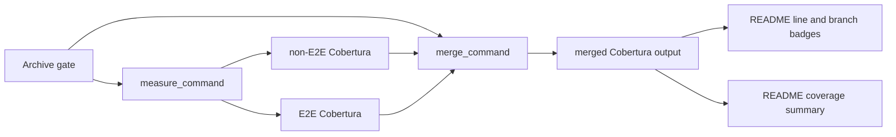

# Design: coverage-script-workflow

## Technical Approach

Keep the archive coverage gate in Rust, but make the project-owned coverage
workflow explicit. The gate will execute one measurement command and one merge
command from `givn/commands.yaml`:

```yaml
coverage:
  measure_command: "./measure-coverage.sh"
  merge_command: "./merge-coverages.sh"
  non_e2e_path: "coverage/non-e2e-cobertura.xml"
  e2e_path: "coverage/e2e-cobertura.xml"
  output_path: "coverage/cobertura-coverage.xml"
```

`measure_command` is responsible for producing the non-E2E and E2E input
reports. `merge_command` is responsible for producing the final report at
`output_path`. givn validates both input reports before the merge and validates
the merged report after the merge. The gate does not calculate a second merged
result in Rust; the report emitted by the configured merge script is
authoritative. The gate removes any previous output before invoking the merge
command, then requires the command to recreate it, so a stale report cannot be
accepted as a successful merge.

The commands run from the project root and receive these environment variables
so scripts can use the configured paths without duplicating them:

| Variable | Value |
|---|---|
| `GIVN_COVERAGE_NON_E2E_PATH` | `coverage.non_e2e_path` |
| `GIVN_COVERAGE_E2E_PATH` | `coverage.e2e_path` |
| `GIVN_COVERAGE_OUTPUT_PATH` | `coverage.output_path` |

The existing Cobertura parser remains the validation boundary. The old pair of
inline `non_e2e_command` and `e2e_command` fields is replaced by the single
measurement command and explicit merge command. The sentinel commands remain
the defaults so an unconfigured project fails with setup guidance rather than
silently passing. The shipped command template documents the conventional
`./run-tests.sh`, `./measure-coverage.sh`, and `./merge-coverages.sh` values;
the repository itself uses those scripts. A generic initialized project must
provide or edit those project-owned scripts before its archive gates can pass;
the manifest fallback remains a sentinel when no commands file exists.

## README Ownership

The coverage gate writes two independent managed blocks:

- `coverage-badge`, placed immediately after the first level-one README title,
  containing line and branch badges. Both badges link to `output_path`.
- `coverage`, containing the merged line and branch totals, the merged report
  link, and the exact `measure_command` and `merge_command` reproduction
  commands.

If the README has no level-one Markdown title, the badge block is inserted at
the top. Existing managed blocks are replaced in place. A legacy generated
coverage badge immediately below the title is removed when the managed block is
installed; unrelated badges remain untouched. The README scaffold
contains the badge block placeholder and documents `run-tests.sh`,
`measure-coverage.sh`, and `merge-coverages.sh` in its development section.
The generated README never presents non-E2E-only values as the project-wide
badge or summary.

README rollback restores the complete pre-archive README from the archive
backup, or removes a README created by the failed gate when no README existed
before archive. Coverage input and output files are backed up and restored by
the same transaction. Every failure after the archive merge therefore rolls
back the specs, README, and coverage files.

## Architecture Impact

Production and generated surfaces:

- `src/config/manifest.rs` — replace coverage command fields with
  `measure_command` and `merge_command`.
- `src/cli/coverage_gate.rs` — run measurement and merge scripts from the
  project root, pass path environment variables plus `GIVN_FEATURES=givn/specs`,
  stage and restore coverage files, parse the script-produced merged report,
  and update both README blocks.
- `src/cobertura.rs` — add rendering for two badges and the merged README
  summary while retaining parser validation. A zero branch denominator renders
  as `n/a`, not a false `0%` claim.
- `src/cli/agents_block.rs` — add a small helper for inserting/replacing a
  managed block directly after a Markdown title, with pure tests for title,
  titleless, replacement, and idempotent cases.
- `src/integrity_hook.rs`, `src/config/overlay.rs`, and `src/cli/addons.rs` —
  validate and explain the new measurement/merge contract.
- `assets/commands.yaml.tmpl` and `assets/config.yaml.tmpl` — document the
  script contract and new keys.
- `assets/addons/readme/README.md.tmpl` — add the top badge block and the
  reusable test/coverage script documentation.
- `assets/skills/givn-archive/SKILL.md.tmpl` — explain the script workflow and
  merged-report README output.
- `.agents/`, `.claude/`, and `.opencode/` generated archive skills — refreshed
  from the canonical template.
- `run-tests.sh`, `measure-coverage.sh`, and `merge-coverages.sh` — make the
  givn repository itself use the documented project-owned workflow.
- `givn/commands.yaml` and `givn/config.yaml` — configure the repository's
  scripts using the new schema.



## Data Model

`Coverage` has these fields:

| Field | Type | Default | Meaning |
|---|---|---|---|
| `measure_command` | string | `givn missing-coverage` | Produces both source reports |
| `merge_command` | string | `givn missing-coverage` | Produces the merged report |
| `non_e2e_path` | string | `coverage/non-e2e-cobertura.xml` | First source report |
| `e2e_path` | string | `coverage/e2e-cobertura.xml` | Second source report |
| `output_path` | string | `coverage/cobertura-coverage.xml` | Script-produced merged report |

The merged report is parsed into the existing `CoberturaReport`; its line and
branch counters are the only counters rendered into the README.

## Internal Primitives

| Primitive | Type | Purpose | Exercised by |
|---|---|---|---|
| Coverage command configuration | `Coverage` | Stores measurement, merge, input, and output paths | archive scenarios and manifest tests |
| Coverage command runner | private gate helper | Executes a script from the project root with controlled environment variables and status errors | archive scenarios |
| Coverage transaction backup | private gate helper | Restores README and all configured Cobertura paths after any failure | merge-failure scenario and archive regression tests |
| Merged report renderer | `cobertura` functions | Renders the authoritative line/branch values, badges, report link, and scripts | README assertions and unit tests |
| Title-aware managed block | `agents_block` function | Places and updates the badge block without touching unrelated README content | pure block tests and archive scenario |

## Step Definitions

The non-E2E failure scenario uses
`tests/steps/coverage_script_workflow_steps.rs`. The two `@e2e` scenarios use
`tests/steps/coverage_script_workflow_e2e_steps.rs`. Both are registered from
`tests/steps/mod.rs`. The modules create isolated temporary projects, write
small executable shell fixtures for the configured commands, invoke the real
`givn` binary, and assert on generated configuration, README, command output,
and report files. They do not call Rust production functions directly.

## Test Runner And Strict Mode

The executable specification runner is:

```sh
cargo test --test features_runner
```

It runs the repository's permanent specs and the active change specs through
the `cucumber-rs` runner. Strict mode is `.fail_on_skipped()` in
`tests/features_runner.rs`; undefined or skipped steps fail the process.

The single-scenario commands are:

```sh
GIVN_FEATURES=givn/changes/coverage-script-workflow/specs \
  cargo test --test features_runner -- \
  --name "An initialized project documents reusable test and coverage scripts"

GIVN_FEATURES=givn/changes/coverage-script-workflow/specs \
  cargo test --test features_runner -- \
  --name "Archiving publishes line and branch badges from the merged report"

GIVN_FEATURES=givn/changes/coverage-script-workflow/specs \
  cargo test --test features_runner -- \
  --name "A failed merge command blocks archive and preserves the project"
```

## E2E Infrastructure

The two `@e2e` scenarios are CLI scenarios. The real interface is the `givn`
subprocess invoked in an isolated temporary project. No browser, server,
database, network, or third-party dependency is involved. The test writes
local shell scripts as deterministic digital twins for a project's test and
coverage commands; the merge fixture emits a deliberately distinct merged
Cobertura result so the assertions prove that givn consumed the script output.

The E2E runner is the same strict runner filtered to `@e2e`:

```sh
GIVN_FEATURES=givn/changes/coverage-script-workflow/specs \
  cargo test --test features_runner -- --tags @e2e
```

The local run command for the complete capability is `cargo test --test
features_runner`; it starts no external services and requires no isolated
network because all interfaces under test are local subprocesses and files.

The strictness setup task will first run both the normal and `@e2e` filtered
commands against a temporary feature with an `unimplemented!()` step body and
capture their non-zero exits. Every later step starts with a real failing
assertion in the same runner.

## Interaction Coverage Matrix

| Inventory entry | @e2e scenario title | Real interface | Driving mechanism |
|---|---|---|---|
| initialize a project and inspect its test and coverage command guidance | An initialized project documents reusable test and coverage scripts | CLI | Run `givn init` in an isolated subprocess project and read the generated README and `givn/commands.yaml` |
| archive a completed change and inspect the published merged coverage result | Archiving publishes line and branch badges from the merged report | CLI | Run `givn archive` in an isolated subprocess project with deterministic measurement and merge scripts, then inspect its README and report |

## Compatibility And Migration

New projects use `measure_command` and `merge_command`. Existing projects may
temporarily retain both legacy coverage command fields: givn executes those
two commands and uses the prior counter-summing fallback so an upgrade does not
break an otherwise working project. The archive guidance identifies the new
script contract, and project owners should move the two legacy commands into
`measure-coverage.sh` and `merge-coverages.sh`. The repository and harness
fixtures are migrated in this change.
