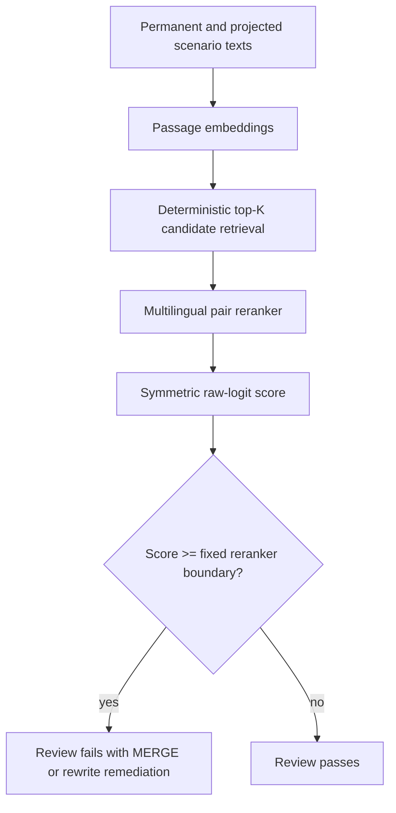

# Design: cross-encoder-reranker

## Architecture

This branch keeps the existing bi-encoder index as a fast candidate generator
and replaces the embedding-score gate with a local pair reranker:



The bi-encoder remains responsible for indexing and fast interactive search.
The pair model sees both complete scenario texts jointly and is used only for
review candidates. This is the standard retrieve-then-rerank pattern: cheap
vector retrieval provides recall, while the more expensive cross-encoder makes
the final pair comparison.

The real interface remains the CLI. `givn spec review --change <id>` audits
added/modified delta scenarios against the pre-change permanent tree and the
projected permanent tree after add/modify/remove operations. The candidate set
uses the top five embedding neighbours per scenario. The old embedding
threshold is not a gate in this branch.

## Pair model

Use the existing feature-gated `fastembed` Rust dependency's `TextRerank` API
with `RerankerModel::BGERerankerV2M3`. FastEmbed-rs documents this model as a
multilingual reranker and exposes the `TextRerank::rerank` query/document-pair
API. The repository lockfile already contains the locally used FastEmbed-rs
release; the API was checked against its installed source and the Context7
FastEmbed-rs documentation on 2026-08-16.

The model returns a raw relevance logit, not a calibrated probability. The
review path therefore:

1. scores both `(scenario A, scenario B)` and `(scenario B, scenario A)`;
2. averages the two raw logits to remove query/document ordering bias;
3. displays the raw logit and its sigmoid only as diagnostic output;
4. fails when the averaged raw logit is at or above the binary constant
   `RERANKER_LOGIT_THRESHOLD = 3.0`.

The `3.0` boundary is a branch-local calibration starting point, not the old
embedding `0.95` boundary. It is private to the binary and cannot be changed by
the project, CLI, environment, or review notes. Future calibration requires a
new code/plan change and a new labeled evaluation.

The pair-reranker path is behind the opt-in Cargo feature
`cross-encoder-reranker`, which also enables `spec-similarity-gate` and
`spec-retrieval`. The ordinary `spec-retrieval` build remains advisory; this
experiment is not active until a later stack layer explicitly builds with
`--features spec-retrieval,cross-encoder-reranker`.

The model cache is separate from the embedding cache at
`givn/.spec-reranker-cache/`. The default/no-feature binary remains free of the
reranker and ONNX Runtime. `GIVN_SPEC_RERANKER=stub` is test-only deterministic
backend selection, analogous to the existing embedding test stub; production
runs leave it unset.

## Candidate retrieval

For each permanent or projected scenario, cosine similarity ranks all stored
passage vectors and retains the top five other identities. Candidate pairs are
canonicalized and de-duplicated before reranking. A pair can therefore be
reranked once in each direction, not once per duplicate path through the
neighbour lists.

The five-neighbour limit is deliberately explicit. It bounds CPU work for the
local CLI while preserving the standard reranker architecture. The semantic
reranker is applied to cross-feature pairs; same-file structural variants are
owned by the deterministic overlap gate. The review output reports the
candidate-generation limit so a future evaluation can measure recall against a
larger K. The branch's benchmark must compare K=5, K=10, and the previous
score-threshold candidate set before selecting a final default.

## Review semantics

The existing remediation contract remains:

- an exact duplicate is `MERGE` and the redundant scenario must be deleted;
- a same-invariant value or command variant is `MERGE` and must be combined or
  parameterised into one scenario;
- a genuinely different boundary is `KEEP-AS-BOUNDARY` and the retained scenario must be
  rewritten until the reranker score falls below the fixed boundary;
- a review note never suppresses a score above the reranker boundary.

The report includes candidate scope, both files, both titles, raw reranker
score, displayed sigmoid score, model identifier, K, and the fixed boundary.
The final error is non-zero and names the remediation. Interactive
`givn spec search` remains advisory and keeps its embedding-only top-five
behavior.

## Data and file impact

| Area | Change |
|---|---|
| `src/spec/retrieval.rs` | Replace the hard embedding threshold path with top-K candidate generation, local `TextRerank`, symmetric logit scoring, reranker setup errors, and diagnostic output. |
| `src/cli/check.rs` | Keep feature-enabled review failures blocking and no-feature behavior unchanged. |
| `src/cli/archive.rs` | Keep the strict pre-merge review and post-archive embedding refresh; reranker setup is part of the pre-merge gate. |
| `tests/steps/enforce_spec_similarity_gate_steps.rs` | Reuse temporary-project fixtures and set the deterministic reranker backend. |
| `tests/steps/mod.rs` | Register the branch capability steps if new bindings are needed. |
| `givn/.spec-reranker-cache/` | Generated local model cache, ignored by Git. |
| `examples/rerank_probe.rs` | Temporary/benchmark-only local measurement harness; remove before final PR unless converted into a maintained tool. |

No permanent scenario is modified by the benchmark. The branch is intended to
compare this reranker gate against commit `38c2f22`, which contains the strict
embedding-threshold baseline.

## Test runner and strict mode

The executable specification remains:

```text
GIVN_SPEC_EMBEDDER=stub GIVN_SPEC_RERANKER=stub \
GIVN_FEATURES=givn/changes/cross-encoder-reranker/specs \
cargo test --features spec-retrieval,cross-encoder-reranker --test features_runner
```

The runner uses `.fail_on_skipped()` in `tests/features_runner.rs`. The real
CLI subprocess is invoked by Cucumber steps; no in-process reranker assertion
stands in for the user-facing command.

Single-scenario command:

```text
GIVN_SPEC_EMBEDDER=stub GIVN_SPEC_RERANKER=stub \
GIVN_FEATURES=givn/changes/cross-encoder-reranker/specs \
cargo test --features spec-retrieval,cross-encoder-reranker --test features_runner -- \
  --name '^Review evaluates semantic candidates through the pair reranker$'
```

The stub makes RED/GREEN deterministic and offline. A separate real-model
benchmark runs the same corpus with `GIVN_SPEC_EMBEDDER` and
`GIVN_SPEC_RERANKER` unset, records model-cache setup, scores, candidate count,
latency, and manually labeled duplicate/boundary outcomes.

## Local runnability and external dependencies

The interface is CLI-only. No server, database, browser, or external runtime
service exists. The local test command starts no network dependency. Production
first use may download the embedding and reranker models into project-local
caches; tests use both deterministic stubs and never require network access.

If either model is unavailable, feature-enabled review fails explicitly. It
never reports a clean similarity result with an absent pair model.

## Interaction coverage matrix

| Inventory entry | @e2e scenario title | Real interface | Driving mechanism |
|---|---|---|---|
| Run `givn spec review --change <id>` to evaluate scenario pairs with the local pair reranker | Review evaluates semantic candidates through the pair reranker | CLI | Cucumber invokes the compiled `givn spec review --change running-change` subprocess with deterministic embedding/reranker test backends and asserts stdout/stderr and exit status. |

## Evaluation protocol

The branch is not accepted based on model intuition alone. The benchmark records:

- embedding-only candidate count and top-K recall;
- reranker candidate count at raw-logit boundary `3.0`;
- scores for the known duplicate, boundary, and overlap examples;
- full-pair and cross-feature counts;
- CPU time for model initialization and reranking;
- a manually labeled confusion table produced from the highest candidates.

The comparison is successful only if the reranker reduces manually labeled
false positives without losing the known duplicate candidates, and if the
runtime remains practical for the local review command.
