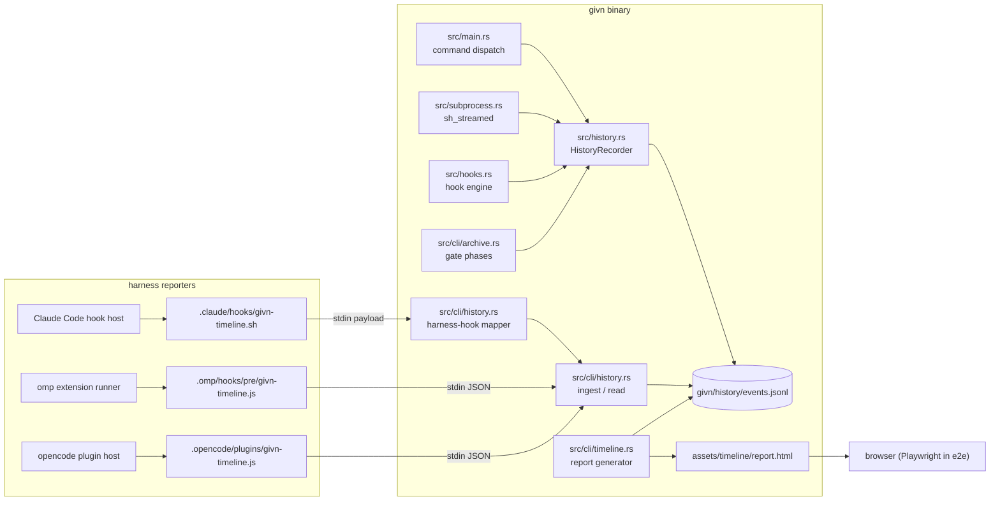

# Design: development-timeline

## Overview

The change has three layers, each with one owner:

1. **The development record** — an append-only, scope-tagged event log, written
   by Givn itself while it runs commands (`src/history.rs` owns the schema, the
   store, and the scope resolution). Instrumentation is deliberately thin and
   centralized: the command dispatcher, the single shell-execution choke point
   (`src/subprocess.rs::sh_streamed`), the hook engine, the archive phase
   boundaries, and `givn commit` emit entries.
2. **The intake and the reporters** — a Givn-owned command
   (`givn history ingest`) that validates agent-reported events and appends
   them, plus one generated reporter per supported harness (omp, opencode,
   Claude Code), each installed beside the commit-attribution integration that
   harness already gets and each delivering through the one intake. The `agents`
   target is a skills mirror with no runtime, so it has nothing to report.
3. **The report** — `givn timeline` reads the record for one scope and writes a
   single self-contained HTML file (`assets/timeline/report.html` + the report
   model). The browser screen is hand-authored inline CSS/JS/SVG: no
   third-party JavaScript, no CDN, no server, no build step.

Recording is best-effort by construction: a record that cannot be written warns
and continues, and no recorded entry ever changes the outcome of the work it
records. The record is a consumer of existing signals, never a new gate.

## Use-Case Traceability

> Owning use-case ID: `inspect-development-history` (new in this change)
> Ideation source: none
> Confirmed Persona IDs: `developer--primary-user`, `agent--technical-role`

| Use-case contract element | Technical decision | Capability / E2E evidence |
|---|---|---|
| Guarantee: recording never changes the outcome of the work it records | Every write is best-effort and swallowed with a warning; the command's own exit code is untouched (`src/history.rs::record`) | development-record: "A record that cannot be written never fails the command it records" |
| Guarantee: the record is append-only | One JSONL line per entry, opened append-only; no rewrite, no reordering | development-record: "The record is append-only across commands" |
| Guarantee: every entry belongs to exactly one scope | `resolve_scope` binds change → ideation topic → project, in that order | development-record: "Activity outside a change belongs to the project scope" |
| Rule: a duration is measured, never inferred | `std::time::Instant` around the step itself; no back-filling from neighbours | development-record: "A recorded step keeps a measured duration and its outcome" |
| Rule: the record keeps metadata and one bounded label | `bound_label` truncates the subject to ≤ 120 characters; the complete command, tool input, and question text are never stored | development-record: "A recorded label is bounded to 120 characters" |
| Rule: reading the record never extends it | `givn history` and `givn timeline` run without a recorder | development-record: "Reading the development record does not extend it" |
| Guarantee: an ideation is reportable before a change exists | A topic window renders the topic's own entries; `resolve_scope` binds them to the one unfinished topic | development-record: "Activity during an ideation belongs to its topic scope" and development-report: "The report of an ideation topic names the work done before the change exists" |
| Extension: a rejected event leaves the record intact | `givn history ingest` validates each event and keeps the accepted ones | agent-activity-reporting: "A reported event that does not match the intake contract is rejected without corrupting the record" |
| Extension: the report's empty state | The report model marks a scope with no entries `empty` and the screen renders the empty state | development-report: "The report shows the empty state for a scope with no recorded activity" (report level) and "Consumer opens the report of a scope with no recorded activity" (`@e2e` Web UI) |
| Goal: see what was worked on and how long it took | The report ranks the longest steps, totals wait time and tokens, and counts subagent fan-out | development-report: "Consumer opens the generated development report in a browser" |
| Persona `developer--primary-user` | The report is read by the developer; it answers the three questions the requester named (slowest step, agent fan-out, waiting) | development-report: "The report names the agent's fan-out into small subagents" |
| Persona `agent--technical-role` | The intake is a machine contract: stdin JSON, stable exit codes, a rejected event reported without failing the caller; every supported harness reaches it the same way | agent-activity-reporting: "Consumer installs the agent reporter and its reported activity lands in the record" (outline over the three harnesses) |
| Guarantee: every supported harness reports its own activity | One generated reporter per executing agent target (omp, opencode, Claude Code), all delivering through `givn history ingest`; the `agents` skills mirror gets none | agent-activity-reporting: "Every supported harness receives a development reporter" and "The neutral skills target receives no development reporter" |
| Rule: a recorded duration is measured, never inferred | The harness's own `duration_ms` or `created` timestamp is used where it exists; otherwise the reporter stamps its own start (omp tool events, Claude pre-tool and permission waits) | agent-activity-reporting: "A wait the harness does not time is still recorded with a duration" |
| Gap honesty: a harness that cannot deliver a signal | Token usage is read from the harness's own session record where no payload carries it (Claude) and rendered as unavailable where it is absent, never as zero | agent-activity-reporting: "Token usage read from the harness's own session record is recorded with its model" and "Absent token usage is recorded as unavailable" |

Actors in Gherkin stay the roles defined in the use case (Developer, Authoring
agent); the Persona IDs above are review lenses, never Gherkin actors.

## Technology Decisions

No new language, framework, or Rust dependency is introduced. The report is a
static asset so it needs no runtime of its own; the only new toolchain is a
Node-based browser driver for the browser tier.

| Technology | Version | Resolution |
|---|---|---|
| Rust | existing workspace toolchain (edition 2024) | unchanged; the crate builds with the repository's own `cargo` |
| cucumber-rs (`tests/features_runner.rs`) | existing `cucumber = "0.23"` dev-dependency | reused; no second runner |
| `serde_json` / `serde` / `rust-embed` | existing `Cargo.toml` entries | reused for the record, the intake payload, and the report asset; no new crate |
| Node.js | latest LTS | resolution strategy: install the current LTS (`nvm install --lts`, or nodejs.org) at setup time. The design machine reported `node --version` = `v22.20.0` on 2026-10-16; the version is not pinned by Givn |
| Playwright | 1.64.1 | looked up, not remembered: `npm view playwright version` and `https://registry.npmjs.org/playwright/latest` both reported `1.64.1` on 2026-10-16. The setup step pins the resolved version in `tests/e2e/package.json`; the design does not |
| Chromium (browser under test) | the build bundled with the resolved Playwright | `npx playwright install chromium` at setup time; never a system browser |
| omp (reporter host) | 18.6.1 | verified 2026-10-16: the installed package `@oh-my-pi/pi-coding-agent` 18.6.1 under `~/.bun/install/global/node_modules`, whose shipped types are the contract the reporter is written against (external contract → R-84) |
| opencode (reporter host) | 2.0.26, V2 plugin API | verified 2026-10-16: `opencode --version` (`opencode v2.0.26`) and the running CLI's own log (`~/.local/share/opencode/log/opencode.log`, `version=2.0.26`). The target API is **V2** per the official migration guide (`https://opencode.ai/v2/docs/build/plugins/migrate-v1`: V1 implementations do not run in V2; V2 default-exports `{ id, setup(ctx) }`; local V2 plugins live in `.opencode/plugins/`; a published plugin depends on `@opencode/plugin` at a version compatible with its CLI — npm `latest` 2.0.30, with 2.0.26 at the CLI's own tag). Hook names, payload types, event envelope, and `Tokens.Info` were read from the tagged upstream source at `v2.0.26` and cross-checked against the live `opencode.db` |
| Claude Code (reporter host) | 2.1.266 | verified 2026-10-16: `claude --version` (`2.1.266 (Claude Code)`) with `~/.local/bin/claude → ~/.local/share/claude/versions/2.1.266`; the event set cross-checked against the changelog shipped with that build (`~/.claude/cache/changelog.md`, top section `## 2.1.266`), payload schemas from the published hook documentation (which describes a newer build and is used for schemas only), corroborated by real transcripts under `~/.claude/projects/-home-buster-projects-givn/*.jsonl` |
| Report technology | hand-authored inline CSS + vanilla JS + inline SVG in one file | chosen over Mermaid, d3, or any CDN-delivered library: the report must render with no network, must not add a JavaScript dependency to a single-binary Rust project, and must be deterministic for screenshots. A second, third-party visual stack would also need its own version policy |

**Why a Node driver is acceptable in a Rust repository.** The browser tier has
no Rust-native equivalent that is this repository's default: the design
instruction names Playwright as the default browser driver, and Playwright is a
Node library. The driver is a single Node script invoked by the Rust steps
(`tests/common/browser.rs`); it is development-time tooling only and ships
nowhere near the `givn` binary (`tests/e2e/` is not part of the crate). `node`
is already required on `PATH` by the existing omp/OpenCode attribution E2E.

## Decisions

- **Decides D3: a Givn-owned intake command, fed in batches by the reporter.**
  The generated omp asset buffers each turn's events and posts them to
  `givn history ingest` (stdin JSON) at turn end and at session end. Chosen over
  the reporter writing record lines itself because the record's format then has
  exactly one owner and a buggy or stale reporter cannot corrupt the store; the
  reporter keeps no knowledge of the line format. Cost accepted: one short-lived
  process per flush, and a version relationship between the installed reporter
  and the installed Givn (a stale reporter's events are rejected with a warning
  and the rest are kept). Realized in `assets/agent-integrations/omp/givn-timeline.js`
  and `src/cli/history.rs`.
- **Decides D4: an on-demand command that writes one self-contained file.**
  `givn timeline [--change <id>|--topic <id>] [--out <path>]` writes the report
  and prints its path. Opening it stays the developer's own step, exactly as the
  proposal requires ("its path is printed so the developer decides whether to
  open it"), so the command gains no `--open` flag — and no `--json` mode
  either: the report model is embedded in the file the command writes, and the
  machine-readable view of the record itself is `givn history --json`, which
  already exists and is covered by the `development-record` scenarios. With
  `--out` omitted the report goes to the default path
  `givn/history/reports/<scope>.html` (chapter 07's project footprint), so the
  flagless form — render the resolved scope into the default path and print it —
  is the whole default. Chosen over an automatic publish in the archive gate (a
  frozen report cannot benefit from a later renderer fix, and the gate would
  gain a rendering step) and over a local server (a listening port and a
  supervised process are a network surface this tool does not have today).
  Realized in `src/cli/timeline.rs`.
- **Decides D5: the record keeps everything, with the project as the fallback
  scope.** Work outside a change or an ideation is the answer to "where did the
  time go" just as much as work inside one, and dropping it would make the
  question unanswerable; unrelated stretches appear as the project scope in the
  record and as the "outside a scope" band when a project report is rendered.
  Cost accepted: the store grows with unrelated work. Realized in
  `src/history.rs::resolve_scope` and the report's band assembly; the resolution
  rules and the project report window that renders those entries are specified
  in *Scope resolution and the report window* below.
- **Decides D1: one local project store, kept out of repository history.**
  Approved by the operator on 2026-10-16. The record lives at
  `givn/history/events.jsonl`, and keeping it out of repository history is split
  by who owns the destination:

  **The rule.** The recorder never writes a versioned file; the record path
  reaches the versioned destinations only through the commands that own them
  (`givn init`, `givn skills sync`, `givn upgrade` — the existing
  `write_ignores` path), while the recorder asserts the never-dirty
  destinations on every write.

  | State of the project | Destination | Written by |
  |---|---|---|
  | A Git worktree exists | the `# givn:begin:history` block in `.git/info/exclude`, resolved with `git rev-parse --git-path info/exclude` and **re-asserted idempotently on every record write** (best effort); never `.gitignore` | the recorder |
  | No repository exists yet (`givn init` in a bare directory) | the `# givn:begin:history` block in `.gitignore` as the scaffold-time safety net | the recorder at its first write (nothing is tracked yet; the user commits the scaffold) |
  | A Fossil checkout exists and `.fossil-settings/ignore-glob` is **absent** | the repository-level `ignore-glob` setting (`fossil settings --value ignore-glob` … `fossil settings ignore-glob <value>`), never-tracked and effective while no file overrides it | the recorder |
  | A Fossil checkout exists and `.fossil-settings/ignore-glob` is **present** | the record path is part of the **managed entry list inside that file**; a committed file overrides the repository setting, so writing the setting alone would leave the store an `EXTRA` | the owning commands (`givn init`, `givn skills sync`, `givn upgrade`) through `write_ignores` — never the recorder at plain-command time |

  The Fossil entry form is **`givn/history/*`**, not `givn/history`: a Fossil
  glob must match the entire path and `*` crosses `/`, so a bare directory path
  matches nothing. Repository existence is decided by the backend markers at the
  project root — the same markers `scm::select` reads — and **never** by whether
  `scm::select` succeeds, because select also bails for a nested root, both
  markers at the root, or a missing executable; a select-keyed branch would
  write a versioned file while a worktree exists.

  **Why the never-dirty constraint holds.** A recorder runs at command start, so
  a write to a versioned ignore file would dirty the working tree before the
  command did anything, and `givn upgrade`'s clean-checkout precondition
  (`src/cli/migration.rs`: "automatic managed upgrade requires a clean checkout")
  would refuse a project that did nothing wrong; for a store that was already
  committed, no ignore destination could suppress its modification either. The
  ownership split is what keeps the versioned write inside a command that owns
  and commits that file. Rejected: committing the record with the change,
  because agent telemetry would enter repository history permanently and could
  then only be removed with a history rewrite; and a user-level store outside
  the project, because it is invisible to project review and is lost with the
  home directory. Realized in `src/history.rs::store_path`,
  `src/history.rs::ensure_ignored`, and the existing
  `src/skills/rules.rs::write_ignores` call sites.
- **Decides D2: metadata plus a bounded 120-character label.** Approved by the
  operator on 2026-10-16. An entry keeps kind, timestamps, duration, outcome,
  model, token counts, subagent identity, and a single label derived from the
  subject and truncated to 120 characters; complete tool inputs, complete
  command text, and complete question text are never stored, and only a
  question's first line is kept as its label. Rejected: complete payloads,
  because credentials and private code that pass through a command would be
  written into the record; and counts only, because the developer could not see
  which task the agent looped around. Realized in `src/history.rs::bound_label`.
- **Decides D6: the dense timeline (view 1) is the report's visual direction.**
  Approved by the operator on 2026-10-16 after reviewing the three rendered
  reference views in `docs/design/design-system.md`; views 2 (phase lanes) and 3
  (dashboard) stay there as reference alternatives. The direction was chosen
  because it is the only one that shows the absolute time axis *and* the
  nesting of subagent work inside the step that spawned it, which are the two
  things the requester asked to see. Realized in `assets/timeline/report.html`
  and the Visual Design Contract below.

## Record Model And Intake Contract

### When the recorder engages

The recorder engages **only when the project root carries the Givn scaffold
(`givn/`)**. Before the scaffold exists it writes nothing and creates no
directory, so a refused command in a bare root — `givn init` with no agent
target, or a root a backend preflight refuses — leaves that root exactly as it
was. A successful `givn init` creates the scaffold and then records.

The rule keys on the **scaffold**, never on the VCS markers: once `givn/` exists,
every command records, including refusals and failures, and a scaffolded project
without a usable backend still records (its own store write is legitimate — the
ignore destinations are Task 10/11's business, not the recorder's).

### Test-side exclusion of the store

The store is Givn runtime state, not project content, so the acceptance suite's
project-state comparison helpers exclude `givn/history/**`:
`tests/steps/scm_backend_selection_steps.rs::snapshot_tree`/`collect_tree`
(which already skips `.git`/`.fslckout`/`_FOSSIL_` and drives "no file in the
project changed") and `tests/steps/serve_extended_rules_steps.rs::project_files`/
`collect_project_files` (which drives "no project file changed"). Without the
exclusion, a legitimate command entry makes refusal and guidance scenarios
report a changed project. The other tree walkers in the suite never reach the
record directory (their callers root them at `givn/specs` or at feature files),
so the exclusion is scoped to the record directory and changes no other path's
behavior.

### Scope resolution and the report window

`resolve_scope` binds every recorded entry to exactly one scope from the
project's own state, without a new state file:

- **Change scope** — exactly one active change, the rule
  `givn instructions <artifact>` already applies (`src/cli/instructions.rs:84-86`
  over `state::list_changes`): one active change records into it, zero active
  changes fall through, and several active changes fall through too — a recorder
  never guesses which of two changes is being worked on.
- **Ideation scope** — exactly one *unfinished* ideation topic:
  `givn/ideation/<topic>/session.md` exists and carries no `## Completion`
  section — the section the handoff step appends beside its "handoff complete"
  phase line. All three topics in this repository carry one today, so nothing
  here is scoped to a topic. Several unfinished topics fall through for the same
  ambiguity reason.
- **Project scope** — the fallback for work outside a change or an ideation.

The intake payload's `change` and `topic` are **optional overrides** a reporter
sets when it knows its own scope: a present value wins over the resolution
above, an absent one is resolved by the binary, and when both are present the
change scope wins — the record's one ordering is change → topic → project. A
named scope that does not exist is a per-event rejection and never a silent
fallback, so a stale reporter cannot mis-attribute work.

**The report window.** `givn timeline --change <id>` renders that change's
entries and `--topic <id>` that topic's. `givn timeline` with no scope flag
renders the **project report**: every project-scope entry appears in the
"outside a scope" band, so work done between two changes is rendered and not
merely recorded — which is what makes the approved D5 answer reachable.
Ideation reporting is not a special case of the change path: a topic window is
the topic's own entries, and its band carries the topic's session work, which is
the part of an ideation that exists before any change directory does. Bands are
the report's rows — one per archived change, one per change or topic in flight,
and the "outside a scope" band in the project report — exactly the design
system's `Band row` primitive with its "outside a scope" state. Entries inside
every band are ordered by `at` (the entry's recorded end timestamp), never by
their position in the store's file: the store is append-only and concurrent
writers make file order and time order different things, while `at` is the only
ordering the record guarantees.

**Rejected: an active-scope marker file read by the reporters.** A
`givn/history/active-scope` marker could be written when a change or a topic
starts and read by each reporter, so the reporter would name its own scope.
Rejected because it duplicates state the project already derives from the
filesystem (ADR-014 recomputes state rather than storing a second copy of it),
because it needs its own write path, repair path, and staleness handling for
exactly the two rules above, and because a reporter forwarding a stale marker is
still wrong while the binary resolving from the project cannot be — the
resolution rule lives in one place and is exercised by the recording scenarios.

### On-disk record

One file per project: `givn/history/events.jsonl`. One JSON object per line,
appended, never rewritten. Field set (serde-serialized `HistoryEntry`):

| Field | Type | Meaning |
|---|---|---|
| `schema` | integer | record schema version; a reader skips a line whose schema it does not know |
| `id` | integer | unique per project, minted at append time under the store's exclusive append lock from the store's current last line — a second Givn process appending at the same time cannot mint the same id |
| `at` | string | RFC 3339 UTC end timestamp of the entry, millisecond precision |
| `scope` | object | `{"kind": "change"｜"ideation"｜"project", "id": "<change-id>｜<topic-id>｜<project-name>"}` |
| `source` | string | `givn` (Givn recorded it) or `agent` (reported through the intake) |
| `kind` | string | `command`, `phase`, `hook`, `step`, `revision`, `session`, `turn`, `tool`, `subagent`, `question`, `usage` |
| `name` | string | domain name of the entry (for example `givn check tasks`, `verify`, `archive gate: verification scopes`) |
| `label` | string, optional | the bounded subject label (≤ 120 characters, truncation marked with `…`) |
| `duration_ms` | integer, optional | measured duration; absent for a point entry |
| `outcome` | string | `ok`, `failed`, `skipped`, `unknown` |
| `parent` | integer, optional | the `id` of the enclosing entry (a step inside a command, a subagent inside a turn); a parent is only ever an id minted by the same process, so a parent link always names an entry that exists in the store |

`kind: "usage"` entries carry `data: {input, output, cache_read, cache_write,
total_tokens, model, subagent}`; everything else carries `data` only where the
report needs a non-generic value (for example `exit_code` on a step entry).

### Storage rationale and scale

The store stays dependency-free append-only JSONL, and that is a decision, not
an omission. A whole ideation can run for hours to days and produce hundreds of
tasks and thousands of tool calls, so the expected order of magnitude is at most
**10,000 entries × ~200 bytes ≈ 2 MB** for one long ideation. The report build
is one sequential scan of that file (tens of thousands of short lines) plus an
in-memory grouping: milliseconds on the same hardware that already parses the
spec corpus and runs the archive gate, measured against a file smaller than the
repository's own lockfile. No bottleneck has been measured anywhere in this
change, and AGENTS.md's rule is explicit — do not guess at bottlenecks, measure
before optimizing — so no index, database, or background daemon is introduced
on speculation.

Rejected alternatives:

- **DuckDB** — an embedded analytical database would give SQL over the record,
  but it is a large C++ dependency inside a binary whose profile is deliberately
  size-optimized (`opt-level = "z"`, `lto = true`, `strip = true`, and thirteen
  small dependencies in `Cargo.toml`, ADR-004/ADR-069). The dependency would
  outweigh the feature it serves.
- **SQLite** — smaller than DuckDB and still a native dependency plus a schema
  and migration surface, for a workload that is one append and one scan. It
  buys nothing the JSONL does not already do at this scale.

The plain JSONL is also the interoperability win: because the format is one
JSON object per line, the record can be queried directly from outside Givn with
`jq`, DuckDB, or SQLite's JSON functions, so ad-hoc analytics needs no Givn
dependency and no export step. If a real run ever measures slowness, the record
file is the interface: a later change can add an index, a derived store, or a
compaction command behind the same file contract without changing what is
recorded (D-23).

### Ignoring the store without dirtying the worktree

`ensure_ignored` runs on **every** record write (not only when the store is
created, so a store that predates the repository still becomes ignored) and it
never writes a versioned file. The destinations split by ownership:

| State of the project | Destination | Writer |
|---|---|---|
| Git worktree | `.git/info/exclude` block, re-asserted idempotently on every write | the recorder |
| No repository yet | `.gitignore` block (scaffold-time safety net) | the recorder at its first write |
| Fossil checkout, no `.fossil-settings/ignore-glob` file | the repository-level `ignore-glob` setting (never-tracked, effective while no file overrides it) | the recorder |
| Fossil checkout with `.fossil-settings/ignore-glob` present | `givn/history/*` in that file's managed entry list | `givn init` / `givn skills sync` / `givn upgrade` through the existing `write_ignores` |

Two details matter. The Fossil entry is `givn/history/*`, not `givn/history`,
because a Fossil glob must match the whole path and `*` crosses `/` (a bare
directory path matches nothing). And the Fossil destinations are a
**deduplicated entry list without fence markers** — only the two Git
destinations are fenced `# givn:begin:history` blocks — so re-running either
one never duplicates an entry and user entries stay untouched.

Repository existence is decided by the backend markers at the project root, the
same markers `scm::select` reads, never by `scm::select` succeeding: select also
bails for a nested root, both markers at the root, or a missing executable, and
a select-keyed branch would write a versioned file while a worktree exists.

The result is the property the change promises: the record stays ignored, no
command can dirty a worktree through an ignore write, `givn upgrade`'s
clean-checkout precondition is never affected, and a clean clone becomes ignored
on its first Givn command.

### Pending state for process-per-hook harnesses

A harness that runs every hook as its own process (Claude Code) cannot hold a
start timestamp in memory, so its reporter keeps a small pending-state file per
session under `givn/history/pending/<harness>-<session-id>.json`:
`{<tool_use_id>: {started_at, kind, label}}`. Entries are written atomically
before the tool runs, consumed by the matching end event, and pruned by age
(older than 24 hours) and at session end. The file holds no payload content —
only the opaque harness id, the start time, the entry kind, and the same bounded
label the record would keep — so it obeys the record's privacy bound. Losing it
costs a duration, never an entry: a start without an end becomes an unmeasured
entry, and an end without a start keeps the harness's own `duration_ms` when the
harness provides one. In-process harnesses (omp, opencode) keep the same state
in memory and need no file.

### Intake payload

`givn history ingest` reads one JSON object from stdin:

```json
{
  "schema": 1,
  "reporter": "omp",
  "session": "<harness session id>",
  "change": "development-timeline",
  "topic": null,
  "events": [
    {"kind": "turn", "at": "2026-10-16T09:12:44.321Z", "turn": 12,
     "duration_ms": 41230, "model": "deepseek/deepseek-flash",
     "usage": {"input": 12043, "output": 812, "cache_read": 9000,
               "cache_write": 0, "total_tokens": 21855}},
    {"kind": "tool", "at": "2026-10-16T09:12:44.321Z", "tool": "bash",
     "label": "cargo test", "duration_ms": 1240, "outcome": "ok"},
    {"kind": "subagent", "at": "2026-10-16T09:12:44.321Z", "agent": "scout",
     "subagent": "Architect.Scout", "status": "completed", "duration_ms": 61300},
    {"kind": "question", "at": "2026-10-16T09:12:44.321Z",
     "label": "Which store should the record use?", "duration_ms": 480000}
  ]
}
```

Rules the intake enforces, and the reason each exists:

- an event whose `kind` is unknown, whose `at` is unparsable, or that lacks a
  required field for its kind is **rejected individually**: it is named on
  stderr and the remaining events are still appended (the reporter must never be
  able to corrupt or block the record);
- `scope` is resolved from the optional `change`/`topic` overrides, falling back
  to `resolve_scope` (*Scope resolution and the report window*); a named scope
  that does not exist is a per-event rejection;
- exit codes: `0` when the payload was read (rejected events are warnings), `2`
  when stdin is not readable JSON at all. A record that cannot be written warns
  and still exits `0` — the reporter's caller must not fail because Givn's disk
  was full.

## Capture Architecture

### Givn self-instrumentation points

| Point | File | Entries emitted |
|---|---|---|
| Command dispatch | `src/main.rs` | one `command` entry per `givn` invocation (name, scope, duration, outcome, exit code) — subject to the engagement rule below: nothing is emitted or created before the project carries the Givn scaffold |
| Shell execution (the single choke point) | `src/subprocess.rs::sh_streamed` | one `step` entry per shell command with its existing `label` (gate hook, verification scope, coverage pass) and its measured duration |
| Hook engine | `src/hooks.rs::run_artifact_hooks`, `run_archive_gate_hooks` | one `hook` entry per hook, parented to the command entry |
| Archive gate phases | `src/cli/archive.rs::run` | one `phase` entry per gate phase (the ten numbered phases), parented to the archive command |
| Verification scopes | `src/cli/archive.rs::run_scope` | the scope `duration_ms` that already exists is recorded as the step's duration |
| Commit | `src/cli/commit.rs::commit` | one `revision` entry per created revision (backend, revision id) |
| Check | `src/cli/check.rs::run` | the mandatory-check boundary as `phase` entries |

**Two commands are deliberately not recorded: `givn history` and
`givn timeline`.** Reading the record never mutates it, and an inspection that
appended an entry about itself would put the newest entry into every report it
produced and make the record's size depend on how often it was read. Both
commands therefore run without a recorder; every other command, including the
intake, records normally — **within the engagement rule of the record model
section**: this section lists what is recorded once the project carries the
Givn scaffold, and before that scaffold exists the recorder writes nothing and
creates no directory.

The recorder is a small `HistoryRecorder` value created once per process
(`src/history.rs`): it holds the store path and the resolved scope, mints each
entry's `id` when it appends (under the store's append lock, from the store's
current last line), and exposes `record(entry)` plus a `span(name)` guard that
measures `Instant::now()..drop`. It never returns an error to its caller.

### The harness reporters

The repository's agent targets are `opencode`, `agents`, `claude`, and `omp`
(`src/skills/targets.rs::AgentTarget::ALL`). Three of them execute the agent's
work and therefore have activity to report; the fourth is a skills mirror that
no harness runs, so it receives no reporter — `sync_agent_integrations` writes
integrations for exactly those three today.

| Harness | Asset | Install path | Registration | Process model |
|---|---|---|---|---|
| omp 18.6.1 | `assets/agent-integrations/omp/givn-timeline.js` | `.omp/hooks/pre/givn-timeline.js` | auto-discovered `pre` hook factory (no manifest) | in-process, one buffer for the session |
| opencode 2.0.26 | `assets/agent-integrations/opencode/givn-timeline.js` | `.opencode/plugins/givn-timeline.js` | auto-discovered; `setup(ctx)` registers hooks plus one event subscription | in-process, one buffer for the session |
| Claude Code 2.1.266 | `assets/agent-integrations/claude/givn-timeline.sh` | `.claude/hooks/givn-timeline.sh` + one entry per event in `.claude/settings.local.json` | command hook per event, merged into the project settings file | one process per hook invocation |

Shared wiring: every asset is copied verbatim by
`src/skills/targets.rs::sync_agent_integrations`, added to
`managed_generated_paths` (so `givn init`, `givn skills sync`, and the managed
upgrade keep it current and the migration allowlist stages it), and listed in
`src/skills/rules.rs::ignore_entries()` so the `local-only` policy keeps it out
of a repository. All three deliver through `givn history ingest`, and none of
them knows the record's line format (ADR-073). Because a Claude hook is its own
process, its payload mapping lives in the binary (`givn history harness-hook
--harness claude`) and the generated asset stays a three-line `sh` shim that
pipes stdin to it — the same shape the attribution integration already uses.

#### omp — verified against the installed package 18.6.1 (2026-10-16)

Handlers and what each one contributes (event names and payload fields read from
the shipped types of the installed `@oh-my-pi/pi-coding-agent` 18.6.1; the
contract is external, so its drift is R-84):

| omp event | Reported |
|---|---|
| `session_start` | session entry (session id from `ctx.sessionManager.getSessionId()`) |
| `turn_start` / `turn_end` | turn entry with `turnIndex`; `turn_end.message.usage` becomes the turn's usage; the turn is the flush boundary |
| `tool_execution_start` / `tool_execution_end` | tool entry: omp emits no timestamps and no duration on either event, so the reporter stamps `Date.now()` on start and pairs by `toolCallId` |
| `message_end` / `assistant_message` | usage entries (`message.usage`: input, output, cacheRead, cacheWrite, totalTokens, cost) with `message.model` |
| `before_subagent_spawn` | the dispatch record: agent definition name and the attempted model patterns |
| `pi.events.on("task:subagent:lifecycle", …)` | subagent start/complete with `id`, `agent`, `status`, `sessionFile`, `parentToolCallId` |
| rebound handler in a subagent session (`ctx.agent.kind === "sub"`) | that subagent's own turns, tools, and usage, tagged with `ctx.agent.name` and `parentId` |
| a `tool_execution_start` naming the question tool | the start of a question wait; the matching end closes it and the wait duration is recorded; the question's first line becomes the label |
| `session_shutdown` | final flush (the shutdown budget is 2 s, so the flush is one `pi.exec` and an await) |

#### opencode — verified against the installed CLI 2.0.26 (2026-10-16)

- **Entry contract (V2):** the default export is a definition with a stable
  `id` and `async setup(ctx)` (the shape the guide writes as
  `Plugin.define({ id, async setup(ctx) { … } })`); `setup` may return a cleanup
  function. Hooks are registered per domain: `ctx.session.hook(<name>)`
  (`prompt`, `context`, `compaction`, `generate`, `title`, `model.request`,
  `http.request`, `http.response`, `retry`),
  `ctx.tool.hook("execute.before"｜"execute.after")`,
  `ctx.shell.hook("create.before")`, `ctx.permission.hook("evaluate")`.
- **Event stream:** events arrive only through `ctx.event.subscribe({signal})`,
  an async iterable over the server's event stream. Every event carries
  `{id, type, created, data, location?, metadata?}` with `created` in epoch
  milliseconds plus a durable `{aggregateID, seq, version}` — so, unlike its
  hooks, the opencode event stream *does* carry timestamps.

| opencode source | Reported |
|---|---|
| `session.step.started` / `session.step.ended` / `session.step.failed` | turn entries with the step's model, its `Tokens.Info` usage and cost; the step end is the flush boundary |
| `session.usage.updated` | session-level usage totals, covering a turn whose step events were missed |
| `session.tool.input.started` … `session.tool.success` / `session.tool.failed` | tool entries using the harness's own `created` timestamps and the tool name, keyed by the tool call id |
| `ctx.tool.hook("execute.before")` / `("execute.after")` | the pairing backstop: hook payloads carry no timestamp, and a call can end without a success event |
| `session.created` / `session.forked` carrying `parentID`, plus the `subagent` tool (legacy name `task`) | subagent spans: a child session is a subagent, and its own step events carry its tokens |
| `permission.asked` / `permission.replied`, `form.created` / `replied` / `cancelled`, the `question` tool | question and permission waits |
| `session.execution.succeeded` / `failed` / `interrupted`, `session.status` | the turn/step outcome and the flush boundary |

Verified how: `opencode --version` reports `opencode v2.0.26`, and the running
CLI's own log (`~/.local/share/opencode/log/opencode.log`) reports
`version=2.0.26` and the plugin paths it loads on 2026-10-16. The hook names,
payload types, event envelope, and `Tokens.Info` fields were read from the
tagged upstream source at `v2.0.26` (`packages/plugin/src/promise/*.ts`,
`packages/schema/src/*.ts`) and cross-checked against the live
`~/.local/share/opencode/opencode.db` (`session_v2.version = 2.0.26`, the
distinct tool names for those sessions, and the message-type histogram).

Target API: the **V2** plugin API of the installed CLI, as the official
migration guide requires (`https://opencode.ai/v2/docs/build/plugins/migrate-v1`,
read 2026-10-16: "V1 plugin implementations do not run in V2"; a V2 plugin
default-exports a definition with a stable `id` and `setup(ctx)` that registers
its hooks through the context; the local-plugin directory for V2 files is
`.opencode/plugins/`; a published plugin depends on `@opencode/plugin` at a
version compatible with the CLI it targets). Verified against the installed CLI
2.0.26 and its tagged upstream source (`v2.0.26`):

- **(a) discovery path** — `.opencode/plugins/` is the V2 local-plugin
  directory (the guide's configuration section: "use `.opencode/plugins/` for
  V2 files"; the older `.opencode/plugin/` is still scanned), corroborated by
  the installed CLI's own log, which loads
  `.opencode/plugins/givn-attribution.js` in this project.
- **(b) entry shape** — a bare `export default { id, async setup(ctx) { … } }`
  with **no import** is accepted; `Plugin.define` is the guide's documented
  helper, not a requirement. The working generated attribution asset has
  exactly that shape today and the installed CLI loads it, and the archived
  `support-opencode-2` change drove the same shape against real 2.0.22 servers
  with a recorded contract probe.
- **(c) stable plugin id** — the reporter's id is `givn-timeline`, unique per
  location and matching its asset and the sibling `givn-attribution`; the guide
  requires a stable `id` because plugin storage and diagnostics are scoped by it.
- **(d) no V1 hooks** — the reporter registers only V2 domain APIs
  (`ctx.session.hook(…)`, `ctx.tool.hook("execute.before"｜"execute.after")`,
  `ctx.shell.hook("create.before")`, `ctx.permission.hook("evaluate")`) plus one
  `ctx.event.subscribe` iterable. It contains no V1 string-key hook object
  (`server()`, `"tool.execute.before"`, `"shell.env"`, `"chat.params"`), which
  is precisely what the migration guide's mapping table retires.

Recorded note: the V2 API is young, so **the installed CLI version defines the
surface this reporter targets** — the repository pins no type package, and R-84
tracks that drift. This working copy's untracked, gitignored dev pin
(`.opencode/.gitignore` ignores `.opencode/package.json`) names
`@opencode/plugin` at `2.0.26` — the CLI's own tagged line, and the package that
carries the V2 domain surface this reporter uses — so the working copy and the
reporter agree on the package. It replaced the pin the earlier draft of this
note recorded (`@opencode-ai/plugin` 1.18.14) when the operator moved it on
2026-10-16; that older `v2` subtree exposed only the
`options/agent/aisdk/catalog/command/integration/plugin/reference/skill`
domains and could not describe the session, tool, shell, permission, and event
domains this reporter uses. The file remains local dev config, not repository
content and not a design input: because the reporter imports nothing, no type
package decides its behaviour.

#### Claude Code — verified against the installed 2.1.266 (2026-10-16)

| Claude Code source | Reported |
|---|---|
| `PreToolUse` (`tool_name`, `tool_input`, `tool_use_id`) | tool start: the payload carries **no timestamp and no duration**, so the reporter stamps `Date.now()` into its pending state keyed by `tool_use_id` |
| `PostToolUse` (`duration_ms`, `tool_response`) and `PostToolUseFailure` (`duration_ms`, `error`) | tool end with the harness's own `duration_ms`; the pending entry is consumed and pruned |
| `PreToolUse` with `tool_name == "AskUserQuestion"` | question entry whose label is the first question; the matching `PostToolUse` closes it, and the wait duration is that call's `duration_ms`, which includes the human's answer time |
| `PermissionRequest` (`tool_name`, `tool_input`) and `Notification` with `notification_type` `permission_prompt` / `idle_prompt` | the start of a permission or idle wait; because `duration_ms` **excludes** time spent in permission prompts, the wait duration comes from the reporter's own pending-state stamps |
| `SubagentStart` / `SubagentStop` (`agent_id`, `agent_type`, `agent_transcript_path`) joined through the `Agent` tool call's `tool_use_id` and the subagent's `agent-<id>.meta.json` (`toolUseId`) | subagent spans with their identity and their own transcript |
| `Stop` (`last_assistant_message`, `background_tasks`) and `SubagentStop` | the turn boundary and the usage flush point |
| `SessionStart` / `SessionEnd` | session span, final flush, pending-state pruning |
| the transcript at `transcript_path`, and `agent_transcript_path` for a subagent | token usage: assistant entries carry `message.usage.{input_tokens, cache_creation_input_tokens, cache_read_input_tokens, output_tokens, output_tokens_details.thinking_tokens}` beside `message.model`, and `type:"cost-state"` entries carry the session rollup per model |

Registration: command hooks in `.claude/settings.local.json` shaped
`hooks.<Event>[{matcher, hooks:[{type:"command", command}]}]`. The existing
merger (`merge_claude_settings`) knows only `PreToolUse` and is idempotent by
command equality alone; it is extended to merge this reporter's per-event
entries idempotently per `(event, matcher, command)` — so a changed matcher is
re-applied — without touching user entries or the attribution entry.

Verified how: `claude --version` reports `2.1.266 (Claude Code)` with
`~/.local/bin/claude → ~/.local/share/claude/versions/2.1.266` on 2026-10-16.
The event set was cross-checked against the changelog shipped inside the
installed build (`~/.claude/cache/changelog.md`, top section `## 2.1.266`),
because the published hook documentation describes a newer build (it cites
2.1.271 and later and lists two events absent from 2.1.266); payload schemas
came from that documentation and were corroborated by real transcripts under
`~/.claude/projects/-home-buster-projects-givn/*.jsonl` — the usage keys above,
a `cost-state` rollup entry, subagent transcripts carrying `isSidechain` and
`agentId` beside `.meta.json`, and a real `AskUserQuestion` call.

Recorded gaps: hook payloads carry no timestamps at all and no token usage or
cost, so pre-tool starts and permission waits are measured from the reporter's
own pending state and token usage is read from the session record; that record
is written asynchronously and may lag the live turn, so usage is collected only
at `Stop`, `SubagentStop`, and `SessionEnd` and never assumed current mid-turn;
a background subagent launch answers `status: "async_launched"` with no usage in
the tool response, so a subagent's tokens come from its own transcript at
`SubagentStop`; `SubagentStop` also fires for the harness's internal helper
agents, which are recorded as subagent spans like any other; and the two events
the current documentation adds after this build (`PostToolBatch`,
`UserPromptExpansion`) are not planned against.

#### Failure discipline per harness

- **omp:** handlers never throw (a throw on `tool_call` is fail-closed and would
  block the tool); the buffer is bounded at 1,000 events with one warning; the
  flush happens at turn end and at `session_shutdown` (2 s budget).
- **opencode:** `setup` registers every hook inside the existing guarded
  wrappers, so one failing registration never stops the others; the event
  subscription fills a bounded buffer flushed at step end and at
  `session.execution.*`; because hooks are awaited, no hook path does I/O.
- **Claude Code:** every mapping step is best-effort and the mapper always exits
  `0` (a non-zero exit is a hook error and exit `2` blocks the tool), the
  payload is parsed defensively, and the pending state is written atomically and
  pruned by age and at session end. Tool-level hooks are registered `async: true`
  so they never slow the agent; `Stop` and `SessionEnd` are synchronous with a
  short timeout so the final flush is bounded (`SessionEnd` shares a 1.5 s
  budget).
- **All three:** the number of dropped events is counted and reported, so the
  report shows a gap instead of a silently short timeline.

#### What the report shows when a harness cannot deliver a signal

Missing data is rendered as missing, never as zero:

- an unmeasured duration renders as "not measured" and an unknown outcome as
  `unknown`, and neither is counted in the duration totals;
- absent token usage renders as "unavailable" (the existing `Absent token usage
  is recorded as unavailable` scenario), and the summary states how many turns
  were unmeasured rather than summing them as zero;
- a harness that exposes no per-subagent usage contributes subagent spans whose
  token column reads "unavailable", while session-level totals still include
  them;
- the record-gap notice names the dropped count and the harness that dropped it.

## Report Generation

`givn timeline` builds a `ReportModel` from the record and writes one HTML file:

- **Bands and the report window**: one row per archived change, one per change
  or ideation topic in flight, and the "outside a scope" band in the project
  report (*Scope resolution and the report window*); a change's row carries its
  phases (propose, specs, design, arc42, design-review, tasks, implement,
  review, archive) and, beneath them, commands, gate phases, steps, agent turns,
  tool ticks, subagent spans, and question waits.
- **Phase derivation rule**: Givn records one `phase` entry when an artifact
  file of the change appears, and an entry belongs to the stage of the latest
  such transition at or before its own `at`; entries recorded before the band's
  first transition stay in the band's opening stage, and a scope with no
  transitions gets one unnamed stage instead of an invented phase name. The CLI
  `@e2e` scenario asserts one concrete stage name against a seeded record whose
  last transition is `tasks.md`.
- **Ordering**: within every band the spans are ordered by `at` (the entry's
  recorded end timestamp), never by the entry's line position in the store. The
  store is append-only and concurrent writers make file order and time order
  different things, while `at` is the only ordering the record guarantees.
- **Summary**: total elapsed, the ranked longest steps, the number of entries,
  the question-wait total and count, the subagent count and combined duration,
  token totals overall, per model, and per subagent.
- **Aggregation at low zoom**: the timeline never draws one shape per entry
  when that would be unreadable. At the initial zoom, entries shorter than the
  time-per-pixel of the visible range — dense agent ticks and short steps in
  particular — collapse into one aggregate marker per band and time bucket that
  names how many entries it covers and their combined duration; a record of tens
  of thousands of entries therefore renders at a bounded number of shapes and
  stays readable. Individual spans replace their aggregate as the zoom narrows,
  and a click on an aggregate zooms to its bucket instead of opening a details
  panel for an entry that stands for many. The summary and the longest-step
  ranking always cover the full record, never only the visible window. This is
  proven by the regular scenario "A dense record is reported as aggregates
  instead of raw ticks", which is a rendering rule rather than a second
  interaction, so it adds no `@e2e` scenario and no inventory row.
- **Rendering**: the generator fills the asset's data slot
  (`/*__GIVN_REPORT_DATA__*/`) with the JSON model; the file's inline script
  builds an SVG time axis, nests spans by `parent`, and wires zoom (wheel,
  buttons), pan (drag), selection (click/Enter) and the details panel. The
  script never calls `fetch`, never loads a remote resource, and never uses
  `Date.now()` — the axis is derived from the embedded timestamps, so the same
  record always renders identically. Panning (drag) is an implementation detail
  of that same axis: it only changes which part of the already-rendered range is
  in view, so it adds no interaction-inventory row and no `@e2e` scenario of its
  own — the zoom scenario is the axis-state evidence. `givn timeline` writes to
  `givn/history/reports/<scope>.html` when `--out` names no other path, which is
  the chapter 07 footprint.
- **Accessibility**: the timeline is a labelled `svg` inside `main`; every span
  is a focusable element with an accessible name; the detail panel is a
  labelled region with a close control; `prefers-reduced-motion` disables the
  zoom transition and the panel animation.

## Step Definitions

| Capability | Unit/integration steps | E2E steps |
|---|---|---|
| development-record | `tests/steps/development_record_steps.rs` | `tests/steps/development_record_e2e_steps.rs` |
| agent-activity-reporting | `tests/steps/agent_activity_reporting_steps.rs` | `tests/steps/agent_activity_reporting_e2e_steps.rs` |
| development-report | `tests/steps/development_report_steps.rs` | `tests/steps/development_report_e2e_steps.rs` |

Shared, not per-capability: `tests/steps/development_timeline_support.rs`
(record fixtures, the seeded-history builder, and the three harness drivers — a
fake `pi` extension context for omp, a fake plugin context capturing
`session.hook`/`tool.hook`/`shell.hook` plus the event subscription for
opencode, and a payload-on-stdin invocation of the generated Claude shim with a
fixture transcript) and
`tests/common/browser.rs` (the Rust side of the browser driver). Every module is
registered in `tests/steps/mod.rs`; `GivnWorld` gains one slot per capability.

Test runner (from `verify.command` in `givn/commands.yaml`, which this change
sets to `./run-tests.sh --non-e2e`; `verify.e2e_command` stays
`./run-tests.sh --e2e`):

```
./run-tests.sh --non-e2e
```

Single-scenario run command (the repository's canonical `--exact` form — never
`--name`):

```
GIVN_FEATURES=givn/changes/development-timeline/specs cargo test --locked --test features_runner -- --exact "inspect-development-history/development-report.feature::Consumer opens the generated development report in a browser"
```

## Internal Primitives

| Primitive | Type | Purpose |
|---|---|---|
| `HistoryEntry` | `struct` | One record line: id, at, scope, source, kind, name, label, duration_ms, outcome, parent, data |
| `Scope` | `enum` | `Change(id)`, `Ideation(id)`, `Project(name)` — the exactly-one-scope rule |
| `HistoryStore` | `struct` | Append and read `givn/history/events.jsonl`; owns the schema and mints each `id` at append time under the append lock |
| `HistoryRecorder` | `struct` | Per-process recorder: store handle, resolved scope, `record`, `span` |
| `resolve_scope` | `fn` | The exactly-one-unfinished-scope rule: one active change → one unfinished ideation topic → project (*Scope resolution and the report window*) |
| `bound_label` | `fn` | Derives the ≤ 120-character subject label; the only place raw subjects are touched |
| `IngestedEvent` | `struct` | One reported event from the intake payload, with its per-kind validation |
| `HarnessPayload` | `struct` | One raw hook payload from a process-per-hook harness, with the fields the mapper reads |
| `map_harness_event` | `fn` | Raw harness payload → record events plus pending-state updates; the Claude mapper's only entry point, also usable by a future shell-based harness |
| `PendingState` | `struct` | Start timestamps for process-per-hook harnesses, keyed by the harness's own call id; written atomically, pruned by age and at session end |
| `ReportModel` | `struct` | Everything the report screen renders: scope, bands, entries, summary |
| `build_report_model` | `fn` | Record lines → `ReportModel` (phase derivation, ranking, totals) |
| `render_report` | `fn` | `ReportModel` → the HTML document (data slot substitution, escaping) |
| `run_givn` (test) | `fn` | Existing harness: runs the compiled binary in a temp project root |

## Strict Mode (mandatory)

Unchanged and already in place:

```
tests/features_runner.rs uses cucumber-rs `.fail_on_skipped()`; a scenario
whose step is undefined or pending fails the runner and exits non-zero.
```

Not-implemented stub for every new step body (never an empty body):

```rust
unimplemented!("TODO: development-timeline")
```

The browser driver cannot create a silent pass either: `tests/common/browser.rs`
turns a non-zero driver exit, a timeout, or a JSON `{"error": …}` reply into a
failed step, never into a skipped one; the strictness proof in the setup task
asserts that an undefined step fails before any of this is implemented.

## Local Runnability & Digital Twins (mandatory)

**Local run command** (one-time browser setup, then the whole verification
surface):

```
./setup-e2e-browser.sh        # npm ci --prefix tests/e2e && npx --prefix tests/e2e playwright install chromium
./run-tests.sh --non-e2e      # the regular scope: every non-@e2e scenario
./run-tests.sh --e2e          # e2e scope, browser included
```

The regular scope is `--non-e2e` and not the bare `./run-tests.sh` form: the
bare form runs the whole suite including `@e2e`, which would make the regular
archive receipt depend on a browser. **Implementation requirement (not edited
in this design):** `verify.command` in `givn/commands.yaml` changes from
`./run-tests.sh` to `./run-tests.sh --non-e2e`, and the README's command table
follows it; `verify.e2e_command` keeps `./run-tests.sh --e2e`, so the archive
still produces a regular receipt and an e2e receipt separately.

`./setup-e2e-browser.sh` is a new root-level script next to `run-tests.sh`,
`measure-coverage.sh`, and `merge-coverages.sh`; it pins the Playwright version
resolved at implementation time and installs only Chromium.

**Isolated network:** not applicable in the container sense — nothing in this
system listens on a port and nothing is fetched over the network. The browser
loads the generated report from a `file://` URL inside the temporary project
root the scenario created, so no host service and no shared resource is
involved, and a scenario cannot accidentally depend on a service "already
running". `./setup-e2e-browser.sh` is the only step that touches the network,
and it runs once, outside the suite.

**Digital twin per external/third-party dependency:** none. This system talks
to no external service at test time or at run time: the report is a local file,
the record is a local file, and the only non-Rust process is the browser itself.
Stated explicitly rather than left blank, per the instruction.

**Anticipated interface obstacles and their fix:**

| Obstacle | Fix (named now, not discovered during implementation) |
|---|---|
| Browser state must persist across the steps of one scenario (page, zoom level, open panel) | `tests/e2e/browser-driver.mjs` starts **one** browser and **one** context per scenario and accepts commands as JSON lines on stdin; the Rust step helper owns the process for the scenario's lifetime. No step opens a second context |
| `file://` and module loading | the report is one file with inline script and no imports, so no module resolution, no CORS, and no `fetch` is involved; the driver navigates with `page.goto("file://…")` |
| Non-deterministic screenshots (animation, fonts, optional waits) | `prefers-reduced-motion: reduce` is emulated for the context, the driver awaits `document.fonts.ready` and a `requestIdleCallback` tick before capture, and the report animates nothing when reduced motion is set |
| The report's clock | the report renders from embedded timestamps only (no `Date.now()`), so two runs of the same record produce the same pixels |
| A stray browser surviving a failure | the driver exits on stdin EOF and on a `quit` command; the Rust helper kills the child on drop, and the scenario's `TempDir` removal is what deletes the report |

## E2E Smoke Test Infrastructure

**Interface type:** two real interfaces, both driven as the consumer touches
them: the `givn` CLI (a real subprocess) for `development-record` and
`agent-activity-reporting`, and the **Web UI** (a real browser via Playwright)
for `development-report`.

**E2E runner command** (`verify.e2e_command`, unchanged by this change):

```
./run-tests.sh --e2e
```

**Suite prerequisites in CI and release — implementation requirements, not
edits to this design.** Both workflows gain the Node/Chromium setup *before
their first suite invocation*: `.github/workflows/ci.yml` runs
`./setup-e2e-browser.sh` and then `./run-tests.sh --non-e2e` followed by
`./run-tests.sh --e2e` (today's bare `./run-tests.sh` plus `./run-tests.sh
--e2e` would run the browser tier twice once the regular scope narrows), and
`.github/workflows/release.yml` gets the same install step before the suite it
runs at its existing invocation pair, because the browser tier is now part of
the verified surface a release publishes. Node is already on both runners; the
Playwright-bundled Chromium download is the new prerequisite.

**E2E step location:** `tests/steps/development_record_e2e_steps.rs`,
`tests/steps/agent_activity_reporting_e2e_steps.rs`,
`tests/steps/development_report_e2e_steps.rs` — separate from the
unit/integration step files, one file per capability, plus the shared
`tests/common/browser.rs` helper.

**Local test infrastructure:** the built `givn` binary in a `tempfile` project
root; `node` on `PATH` (already required by the existing attribution E2E); the
Playwright-installed Chromium; no server, port, database, or container, and no
harness credentials. The browser scenarios generate the report into the
temporary project root and open it from `file://`. The three harness reporters
are driven through their own real entry point, never through a live model
session:

| Harness | Driver |
|---|---|
| omp | `node` imports the generated `.omp/hooks/pre/givn-timeline.js`, calls its factory with a fake `pi` (`on`, `events.on`, `exec`, `getThinkingLevel`), fires synthetic tool/turn/subagent events, and the reporter calls the real `givn history ingest` |
| opencode | `node` imports the generated `.opencode/plugins/givn-timeline.js`, calls `setup` with a fake `ctx` that captures `session.hook`/`tool.hook`/`shell.hook` registrations and an `event.subscribe` async iterable, emits the synthetic events, and the reporter calls the real `givn history ingest` |
| Claude Code | the generated `.claude/hooks/givn-timeline.sh` shim is executed directly with a real hook payload on stdin (`PreToolUse`, `PostToolUse`, `AskUserQuestion`, `PermissionRequest`, `SubagentStart`/`Stop`, `Stop`), with `PATH` shimming `givn` to the built binary and a fixture transcript at `transcript_path`; the shim's real mapper runs in the binary |

**E2E framework choice and justification:** cucumber-rs (already the project's
runner) plus Playwright as the browser driver. cucumber-rs drives the CLI
directly — it is the real interface — and for the browser tier it drives
Playwright through the JSON-line driver, which is the default driver named by
the design instruction. An HTTP client would be wrong here: the report is a
rendered HTML/JS surface with an interactive SVG, so only a browser can click,
zoom, and read the rendered result.

**E2E strict-mode proof:** `GivnWorld::cucumber().fail_on_skipped()` plus the
driver's error contract above; the setup task records the output of the
strictness check against this exact configuration.

## Interaction Coverage Matrix

Every row is one normalized inventory entry from
`givn/changes/development-timeline/specs/inspect-development-history/usecase.md`
§Interactions, matched to exactly one `@e2e` scenario.

| Inventory entry | @e2e scenario title | Real interface | Driving mechanism |
|---|---|---|---|
| development-record: run a lifecycle command | Consumer runs a lifecycle step and reads its recorded actions | CLI | `common::run_givn`: `givn status --change demo`, then `givn history --change demo --json`; the assertion reads the printed record |
| development-record: read the development record | Consumer reads the development record as machine-readable output | CLI | `common::run_givn`: `givn history --change demo --json` against a seeded record; the assertion parses the printed entries |
| agent-activity-reporting: report agent activity | Consumer installs the agent reporter and its reported activity lands in the record | CLI (harness integration) | one `@e2e` Scenario Outline with one Examples row per harness: install the project (`givn init --agents <target>`), then drive that harness's generated reporter through its real entry point — `node` with a fake `pi` for omp, `node` with a fake plugin context for opencode, and the generated Claude shim with a real hook payload on stdin (mapper in the binary) — emitting a tool call, a subagent start/stop, and a question wait; every reporter calls the real `givn history ingest`, and `givn history --change demo --json` is asserted |
| development-report: generate the development report for a change | Consumer generates the development report for a change | CLI | `common::run_givn`: `givn timeline --change demo --out report.html`; the assertion reads the written file |
| development-report: open the report in a browser | Consumer opens the generated development report in a browser | Web UI | Playwright: one `@e2e` Scenario Outline with a change row and a topic row — one normalized action with input variants, so it adds no second inventory row — `page.goto("file://<root>/report.html")`, then read the rendered heading, the timeline SVG, and the longest step's duration from the DOM |
| development-report: select a timeline element | Consumer selects a timeline element and reads its details | Web UI | Playwright: click the longest step's span (or focus it and press Enter), then read the details panel's rendered text |
| development-report: zoom the timeline | Consumer zooms the timeline to a shorter time range | Web UI | Playwright: click the zoom-in control, then read the rendered range label before and after and assert it narrowed |
| development-report: open the report of a scope with no recorded activity | Consumer opens the report of a scope with no recorded activity | Web UI | Playwright: generate the report for a scope with no recorded activity, `page.goto("file://<root>/report.html")`, then read the rendered empty-state heading and the absence of any axis from the DOM |

**Primary-assertion rule:** every browser scenario asserts on what the browser
rendered (DOM text, accessible names, the rendered range label) — never on the
report file's raw bytes as its primary assertion. The CLI scenarios assert on
the subprocess's stdout and the files it wrote. Repository checks are secondary
only.

**Rendered state:** the zoom scenario is the change's rendered-state evidence —
it reads a value the page's own script produced (the visible time range) and
asserts it changed between two observations. The empty-scope scenario is the
evidence for the contract's declared `empty` state: it is the `@e2e` traversal
of that state and it commits `<viewport>--empty.png` at both viewports. The
matrix has eight rows, one for each inventory entry in
`specs/inspect-development-history/usecase.md` §Interactions, and the eight
`@e2e` titles are exactly the titles in this table.

## Visual Design Contract

The machine-read contract lines (plain list lines, deliberately not fenced so
the visual review gate reads them):

- Interface: web
- Viewports: mobile (360x780), desktop (1920x1080)
- States: empty
- Design system: docs/design/design-system.md

The full contract — tokens, primitives, breakpoints, accessibility, screens,
and the three rendered reference views — lives in
`docs/design/design-system.md`, created by this change. This section records
the change-specific rules.

**Tokens** (in the design system; the report carries them inline):

- Color roles: `surface`, `surface-raised`, `border`, `text`, `text-muted`,
  `accent` (the scope bar and focus ring), `ok`, `warn`, `error`, plus one hue
  per band class (command, gate/step, agent, wait) that stays distinguishable
  in greyscale.
- Spacing scale: 4/8/12/16/24/32 px. Typography scale: 12/14/16/20/28 px, one
  family (system UI stack), tabular numerals for every duration.
- Radii: 4 px for spans, 8 px for panels. Elevation: one level (the details
  panel).

**Component primitives** (each with all its states): timeline span (default,
hover, focus, selected, overlong/label-omitted), band label, zoom control
(default, hover, focus, disabled at the zoom limit, loading never applies), the
details panel (closed, open, empty), the summary tile (default, zero-value),
and the empty state (empty, error). Every primitive has a visible label
requirement: a span's accessible name is always its name plus its duration.

**Breakpoints:** one column below 720 px (mobile: the timeline scrolls
horizontally, the details panel becomes a full-width sheet, the summary stacks
vertically); two columns from 720 px; the desktop viewport shows the summary
beside the timeline. Both mandatory viewports are covered by the e2e tier.

**Accessibility:** body text meets 4.5:1 contrast against its surface and
non-text UI meets 3:1; every control is reachable by Tab with a visible focus
ring; the page has a real `title`, one `h1`, `header`/`main`/`aside` landmarks,
and the timeline `svg` carries an accessible name. Verification is part of the
e2e assertions (labels, heading, focus order, landmark presence) and the
`prefers-reduced-motion` assertion.

**Screens covered:** the development report screen for a change or ideation
(declared state: empty; a populated report is the implicit final state); no
other screen is introduced or visibly changed.

**Rendered reference:** `docs/design/design-system.md` carries three rendered
directions as inline SVG reference views; the operator approved the **dense
timeline** (view 1) on 2026-10-16, and the phase-lane and dashboard views stay
there as reference alternatives (D6).

**Capture mechanism and evidence path:**

- every `@e2e` scenario commits a final-state screenshot per viewport under
  `givn/changes/development-timeline/evidence/visual/<scenario-slug>/<viewport>.png`
  (`mobile.png` at 360x780, `desktop.png` at 1920x1080), with no intermediate
  captures under the change directory;
- the visual gate is change-wide, so it expects an evidence file for *every*
  `@e2e` scenario in this change, including the CLI ones — the CLI scenarios
  commit the report they produced, rendered in the browser, at both viewports;
- the declared `empty` state is traversed by the `@e2e` scenario "Consumer opens
  the report of a scope with no recorded activity", which commits
  `mobile--empty.png` and `desktop--empty.png` beside its final-state
  screenshots — the enforced rule (`src/integrity_hook.rs:377-397`) requires a
  non-empty `<viewport>--<state>.png` for every declared state and viewport. The
  regular scenario of the same name asserts the same state at the report level,
  and the open/select/zoom scenarios render a populated record, so the `empty`
  captures come from that one scenario. The `populated` state is deliberately
  not declared: a populated record is what the final-state `<viewport>.png` of
  every other `@e2e` scenario already is;
- `scenario_slug` follows the existing rule: lowercase ASCII, every run of
  non-alphanumeric characters becomes one `-`, leading and trailing `-`
  removed;
- intermediate captures, if any, go to `reports/visual/` and are not review
  evidence.

**Motion:** the report's only motion is the zoom transition and the details
panel's entrance, both short and both disabled under
`prefers-reduced-motion: reduce`; the e2e tier asserts that emulated
preference, and screenshots are captured with animations disabled.

## Coverage Process Boundaries

The coverage addon is enabled (`givn/config.yaml`: `addons.coverage: true`,
`coverage.measure_command: ./measure-coverage.sh`,
`coverage.merge_command: ./merge-coverages.sh`), so this change declares every
process its tests start.

| Process | Started by | Instrumented artifact | Profile output | Merge step | Non-zero production probe |
|---|---|---|---|---|---|
| cucumber test runner (`tests/features_runner`) | `./measure-coverage.sh` pass 1 (`not @e2e`) and pass 2 (`@e2e`) | `cargo llvm-cov nextest --no-report --locked --test features_runner` (the instrumented build, not a plain `cargo test`) | llvm-cov profraw sets, cleaned between passes with `cargo llvm-cov clean --profraw-only`, then `cargo llvm-cov report --cobertura` to `coverage/non-e2e-cobertura.xml` and `coverage/e2e-cobertura.xml` | `./merge-coverages.sh` unions the two reports into `coverage/cobertura-coverage.xml` by `(filename, line)` | `src/history.rs::bound_label` and `src/cli/timeline.rs::build_report_model`, both exercised by the new scenarios |
| `givn` CLI (the production binary) | `tests/features_runner` steps via `CARGO_BIN_EXE_givn` in a temp project root, and the generated Claude shim `.claude/hooks/givn-timeline.sh`, which execs that same binary through a `PATH` shim | the same `cargo llvm-cov` build; `measure-coverage.sh` first instrumented-builds `ready_fixture` so a cold replay cannot replace the instrumented binary mid-run | the child writes into the inherited `LLVM_PROFILE_FILE` set, so its lines land in the same pass's profraw set | same `./merge-coverages.sh` step | `src/history.rs::record` (every recorded command), `src/cli/history.rs::ingest`, and `src/cli/history.rs::map_harness_event` (exercised by the Claude mapping scenarios) |
| `node` browser driver and harness drivers | the browser steps in the e2e pass (`tests/common/browser.rs` spawns `tests/e2e/browser-driver.mjs`) and the omp/opencode reporter steps, which run their generated assets with `node` against fake harness contexts | none — they are JavaScript test infrastructure outside the Rust coverage surface, and they are not production code | none | none (no profile to merge) | n/a — test-only drivers; they are named here so the process inventory is complete rather than silently omitted |

The regular verification scope this change declares (`verify.command:
./run-tests.sh --non-e2e` in `givn/commands.yaml`) runs exactly the `not @e2e`
tag set, which is the split `measure-coverage.sh` already uses for its two
passes; `verify.e2e_command` stays `./run-tests.sh --e2e` for the e2e receipt.
Before this change the bare `./run-tests.sh` regular scope ran the whole suite,
`@e2e` included, so narrowing it is what keeps the regular receipt free of the
browser tier instead of duplicating it.

The two profraw sets stay separated exactly as `measure-coverage.sh` already
does it, because the archive gate rejects a duplicated report; the new scenarios
follow the existing tag split (`@e2e` against `not @e2e`), so no change to the
coverage scripts is required.

## Architecture Impact



| Module / asset | Change |
|---|---|
| `src/history.rs` | **new** — entry schema, store, scope resolution, bounded labels, pending state, and `ensure_ignored` with its ownership split (the recorder re-asserts `.git/info/exclude` on every write, writes Fossil's repository `ignore-glob` setting only while no managed file overrides it, and uses `.gitignore` only before a repository exists; the Fossil entry `givn/history/*` joins the managed list through `write_ignores`) |
| `src/cli/history.rs` | **new** — `givn history` (read), `givn history ingest` (the one intake), and `givn history harness-hook --harness claude` (the raw-payload mapper and transcript reader for process-per-hook harnesses) |
| `src/cli/timeline.rs` | **new** — report model and HTML rendering |
| `assets/timeline/report.html` | **new** — the self-contained report asset (inline CSS/JS/SVG, one data slot) |
| `assets/agent-integrations/omp/givn-timeline.js` | **new** — the omp reporter (`pi.on` handlers plus one event-bus subscription) |
| `assets/agent-integrations/opencode/givn-timeline.js` | **new** — the opencode reporter (`setup(ctx)`: domain hooks plus one `ctx.event.subscribe` iterable) |
| `assets/agent-integrations/claude/givn-timeline.sh` | **new** — the Claude Code shim that pipes its payload to the binary-side mapper |
| `docs/design/design-system.md` | **new** — the durable design system and the reference views |
| `src/main.rs` | two new commands plus the recording wrapper around dispatch |
| `src/subprocess.rs` | emit a `step` entry (label, duration, outcome) at the shell choke point |
| `src/hooks.rs` | emit a `hook` entry per hook |
| `src/cli/archive.rs` | emit `phase` entries at the existing gate boundaries; record the existing scope duration |
| `src/cli/check.rs`, `src/cli/commit.rs` | phase and revision entries |
| `src/skills/targets.rs` | install all three reporter assets for their targets; extend `merge_claude_settings` to merge the per-event Claude registration idempotently per `(event, matcher, command)` and to re-apply a changed matcher; register all three in `managed_generated_paths` |
| `src/skills/rules.rs` | add the three reporter paths to `ignore_entries` so the `local-only` policy keeps them out of a repository |
| `tests/` | six new step files, one support file, `tests/common/browser.rs`, `tests/e2e/` (driver + `package.json`); the **fixture class** whose hand-written ignore content would otherwise commit the store (`tests/steps/run_execution_e2e_steps.rs::git_managed_project`, `tests/steps/release_0_3_0_e2e_steps.rs::git_project_with_version` and `::fossil_project_with_version`; minimal remedy: the record path joins each fixture's hand-written ignore content, or the store is removed before the fixture commit); and the **comparison-helper class** that must exclude the record directory (`tests/steps/scm_backend_selection_steps.rs::snapshot_tree`/`collect_tree` and `tests/steps/serve_extended_rules_steps.rs::project_files`/`collect_project_files`) |
| `setup-e2e-browser.sh` | **new** — one-time browser installation |
| `givn/commands.yaml` | `verify.command` narrows to `./run-tests.sh --non-e2e`; `verify.e2e_command` stays `./run-tests.sh --e2e` (the README's command table follows) |
| `.github/workflows/ci.yml`, `.github/workflows/release.yml` | install Node/Chromium (`./setup-e2e-browser.sh`) before the first suite invocation, and run the regular scope as `./run-tests.sh --non-e2e` before the e2e scope |

## Data Model Changes

No existing schema, struct, or file format changes: the archive receipt
(`proof::Receipt`), the runner result contract, `givn/specs/.retired.yaml`, and
the configuration surface are untouched. The change adds one new on-disk format
(the record, described in **Record Model And Intake Contract**) and one new
in-memory model (`ReportModel`) that is serialized only inside the generated
HTML. `src/state.rs` keeps its derived-state contract and gains no file.

## Open Technical Questions

None. The record schema, the intake contract, the flush and failure discipline,
the report technology, the capture points, and the browser driver are fixed
above, and the operator answered the three questions that were carried here on
2026-10-16: D1 (one local project store kept out of repository history), D2
(metadata plus a bounded 120-character label), and D6 (the dense timeline). The
ledger above records each answer with its rejected alternatives, so no proposal
question remains open and nothing blocks the task list.
