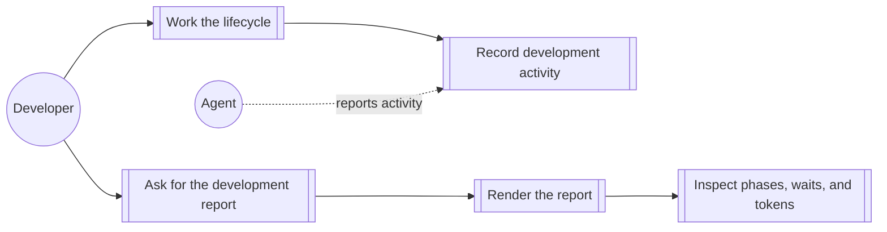

# Use case: inspect-development-history

## Level

!

## Actors

- Developer
- Supporting: Authoring agent (whichever harness runs it)

## Goal

See how a change or an ideation was developed — which steps ran, what the agent
did, where the time went — without reading raw logs.

## Trigger

The developer asks for the development history of a change or an ideation.

## Preconditions

- The project is a Givn project.
- The requested change or ideation exists.

## Main flow

1. The developer and the agent work as usual; the system records the steps it
   runs and the agent activity reported to it.
2. The developer asks for the development report of one change or ideation; the
   system renders the recorded history as one interactive report.
3. The developer inspects the timeline: the phases, the longest steps, the
   subagent work, the question waits, and the token totals.

## Extensions

- 2: no activity is recorded for the requested scope → the report renders an
  explicit empty state; protects the success guarantee.
- 1: a reported agent event does not match the intake contract → the event is
  rejected with a warning and the record is not corrupted; protects the minimal
  guarantee.
- 1: the record cannot be written → the work being recorded continues and
  reports its own outcome; protects the minimal guarantee.

## Rules

- Recording never changes the outcome of the command or the agent action it
  records.
- Every supported harness reports its own activity through the same intake, and
  a signal a harness cannot deliver is recorded as missing rather than as zero.
- The record is append-only: a recorded entry is never rewritten.
- Every recorded entry belongs to exactly one scope: a change, an ideation
  topic, or the project.
- A recorded duration is measured, never inferred from two entries that disagree.
- Recording is the observation substrate of this use case rather than a goal of
  its own: entries exist so this use case can read them back, and recording
  never changes the work it observes — no gate, no proof, no exit code, no
  artifact lifecycle. A behaviour that mutates what it observes while claiming
  this use case's goal is out of scope here.

## Examples

- The developer reads the report of an archived change and sees the archive
  verification scope as the longest single step.
- A record written before a restart is still in the report afterwards.

## Minimal guarantee

A failed report or a rejected event never damages the development record, and a
failed record never fails the work it was recording.

## Success guarantee

The developer can see what was worked on and how long it took for the requested
scope.

## Personas

- developer--primary-user
- agent--technical-role

## Capabilities

- development-record
- agent-activity-reporting
- development-report

## Interactions

| Capability | Consumer action | E2E scenario |
|---|---|---|
| development-record | run a lifecycle command | Consumer runs a lifecycle step and reads its recorded actions |
| development-record | read the development record | Consumer reads the development record as machine-readable output |
| agent-activity-reporting | report agent activity from a supported harness | Consumer installs the agent reporter and its reported activity lands in the record |
| development-report | generate the development report for a change | Consumer generates the development report for a change |
| development-report | open the report in a browser | Consumer opens the generated development report in a browser |
| development-report | open the report of a scope with no recorded activity | Consumer opens the report of a scope with no recorded activity |
| development-report | select a timeline element | Consumer selects a timeline element and reads its details |
| development-report | zoom the timeline | Consumer zooms the timeline to a shorter time range |

## Includes

- none

## Extends

- none

## Out of scope

Reconstructing activity from before the record existed, and comparing history
across projects or machines.

## Diagram

