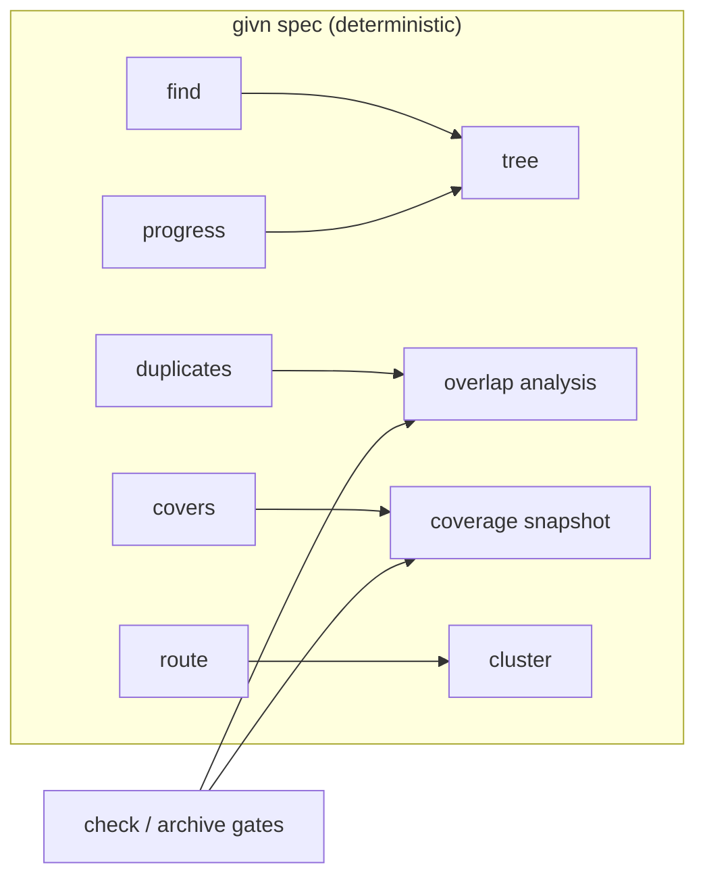

# Design: drop-embedding-features

## Technology decisions

- Rust / cucumber-rs / tokio stay as pinned by `Cargo.lock` (cucumber 0.23,
  tokio 1.x — checked in this repository's lockfile at design time). No new
  dependencies are introduced; no version decisions are required.
- Removed dependencies (declared optional behind the features): `fastembed`,
  `hf-hub`, `ndarray`, `ort`, `tokenizers`. Their transitive set (including
  the ONIG runtime and ONNX binaries) leaves the lockfile with them.
- `sha2` stays (used by non-engine code).

## Removal inventory (source)

| Unit | Action | Reason |
|---|---|---|
| `Cargo.toml` `[features]` block (`spec-retrieval`, `spec-similarity-gate`, `cross-encoder-reranker`, `nli-evidence`) | delete | the contract this change pins: no opt-in features are declared |
| optional dependencies above + `[target.'cfg(unix)'.dependencies]` entries used only by the engine | delete | only the engine consumed them |
| `src/spec/retrieval.rs` (8,886 lines) | delete | the engine: index, search, explore, semantic review, duplicate-audit scoring, model download, `GIVN_SPEC_*` stub handling |
| `src/spec/remediation_log.rs` | delete | only the engine called it |
| `src/spec/mod.rs` engine wiring | reduce to `cluster`, `coverage`, `route`, `routing_table`, `tree` | deterministic modules stay |
| `src/cli/spec.rs` `run_index`, `run_search`, `run_explore`, `run_review`, `run_bge_parity` + their `#[cfg]` blocks | delete | engine-backed commands and the hidden attestation |
| `src/main.rs` `SpecCommands::{Index, Search, Explore, Review, BgeParity}` variants + dispatch arms | delete | command surface shrinks; `Coverage`, `Duplicates`, `Tree`, `Find`, `Progress`, `ProposeUsecases` stay |
| `src/cli/check.rs` `run_retrieval_gate` + call site | delete | blocking semantic review gate |
| `src/cli/archive.rs` `run_similarity_gate` (+ non-feature stub), `refresh_similarity_index` (+ stub) + call sites | delete | archive semantic gates; archive keeps deterministic gates only |
| residual `#[cfg(feature = ...)]` / `#[cfg(not(feature = ...))]` in `check.rs`, `archive.rs`, `spec.rs` | strip, keep the unconditional path | single binary, no variants |

## Removal inventory (tests, scripts, docs)

| Unit | Action | Reason |
|---|---|---|
| `tests/steps/release_strict_overrides_steps.rs` (76 ln) | delete | retired capability's non-e2e steps |
| `tests/steps/release_strict_overrides_e2e_steps.rs` (234 ln) + its `mod` entry | delete | retired capability's e2e steps |
| `tests/steps/instruction_integrity_steps.rs` retrieval-guidance steps (the "Retrieval guidance distinguishes build capabilities" bindings) | replace with the modified scenario's absence assertions | live permanent scenario contradicted the removal |
| `tests/steps/readme_enforcement_steps.rs` "semantic gate is offline" step body | reduce to the deterministic assertion it already makes | sets retrieval world fields that no longer exist |
| `tests/steps/review_disposition_gates_steps.rs` `cfg!(feature = "spec-retrieval")` + `GIVN_SPEC_EMBEDDER` usage | strip the conditional and env override | feature selector gone |
| `env_remove("GIVN_SPEC_MAX_RERANK_PAIRS")` in `tests/common/mod.rs` and `tests/steps/run_execution_e2e_steps.rs` | delete | env knob gone |
| orphaned Then-steps in `tests/steps/release_0_3_0_steps.rs` (old "every optional model feature" bindings) | delete | replaced by the modified scenario's steps |
| `assets/skills/givn-spec/SKILL.md.tmpl`, `assets/commands/givn-spec.md` | remove engine/feature sections from generated guidance | guidance must not reference engine-backed commands |
| `GivnWorld` retrieval fields + `release_model_cache` (`tests/steps/mod.rs`) and their only setters | delete | engine scenario state |
| `common::run_release_givn` / `common::release_givn_binary` (`tests/common/mod.rs`) | delete | only release-strict scenarios used them |
| `run-tests.sh` | collapse: drop the feature-group partition, all `GIVN_SPEC_*` stub envs, `tag_present` gates and `run_release_strict`; keep the scenario-presence guard, the `ready_fixture` pre-build, and the `GIVN_FEATURES` scope override. Modes: default = all scenarios; `--e2e` = `--tags '@e2e'`; `--non-e2e` = `--tags 'not @e2e'` | single feature-free pass |
| `measure-coverage.sh` | collapse: `ready_fixture` instrumented run, profraw clean, one non-e2e group (`not @e2e`), cobertura report, clean, one e2e group (`@e2e`), cobertura report | archive coverage gate still requires two distinct reports; `merge-coverages.sh` and `givn/commands.yaml` stay unchanged |
| `tests/steps/mod.rs` module list, `run-tests.sh` header comments | update | documentation truth |
| `README.md` install/build sections (features table, "all features incl. semantic retrieval", "minimal build") | rewrite to the single-binary contract | docs must match the build |
| `docs/arc42/12-glossary.md` engine terms (E5, BGE/NLI, rulebook, report, remediation-log, model-cache, build-kind rows) | deleted rows recorded in the change's `arc42.md` | glossary truth |
| `docs/arc42/03-context-and-scope.md`, `05-building-block-view.md`, `08-crosscutting-concepts.md` | remove engine building blocks / stub-env concepts where present | arc42 alignment; recorded in the change's `arc42.md` |
| `givn/specs/discover-specifications/usecase.md` Interactions table | remove the 4 `release-strict-model-overrides` rows | capability retired |
| `givn/specs/maintain-project/usecase.md` Interactions table | add row: `release-0-3-0` / "invoke a retired engine command" / the new e2e scenario | inventory completeness |

## Architecture impact

After the change, the specification toolchain is deterministic end to end:

The engine building block (`spec::retrieval`), the model-artifact path, the
similarity-gate hooks, and the `GIVN_SPEC_*` stub environment disappear from
the binary; `check review` and `archive` keep every deterministic gate with
unchanged exit semantics.

## Routing-gate extension (discovered during review)

The 0.6.0 routing gate had no path for fragment capabilities: `EXTEND`
skips `givn/specs/fragments/` and `NEW in <usecase>` demanded a
`usecase.md`. This change's guidance delta is the first fragment edit
through the gate. The gate's `NEW in` branch now accepts `NEW in
fragments`: it validates `givn/specs/fragments/fragment.md`, requires the
declared capability in its Capabilities list, requires the delta under
`specs/fragments/`, and applies no interaction requirement (fragments
declare `Interactions: none` by contract). No other gate behaviour
changes.

## Data model changes

- No persisted project state changes.
- `givn/specs/.retired.yaml` gains one tombstone entry
  (`release-strict-model-overrides`, `retired_by_change:
  drop-embedding-features`), produced by the archive merge of the
  `@givn.retired` delta, exactly as `retire-semantic-capabilities` did.

## Step definitions

One file per capability, existing convention preserved:

- `tests/steps/release_0_3_0_steps.rs` — extended with the two modified/added
  build-contract steps ("no optional model features are declared") and the
  e2e steps for the retired-command scenario (`spec index` exits non-zero
  with an unavailable-command error; stdout free of engine wording).
- The retired capability's step files are deleted (see removal inventory).

## Test runner and strict mode

- `verify.command`: `./run-tests.sh` (unchanged in `givn/commands.yaml`)
- `verify.e2e_command`: `./run-tests.sh --e2e` (unchanged)
- coverage: `measure-coverage.sh` + `merge-coverages.sh` (unchanged wiring)
- Strict mode: cucumber-rs `.fail_on_skipped()` in
  `tests/features_runner.rs` — an undefined step fails the run; the e2e
  scenarios share the same runner and therefore the same enforcement.
- Single-scenario run:
  `cargo test --test features_runner -- --name "<scenario title>"`.

## E2E smoke infrastructure

- Runner: the same cucumber binary through `./run-tests.sh --e2e`
  (`@e2e`-filtered). The real interface is the compiled `givn` binary
  spawned as a subprocess (`CARGO_BIN_EXE_givn`) inside a per-scenario
  `tempfile::TempDir` — no servers, ports, or containers for this change's
  scenarios.
- The new e2e scenario for `release-0-3-0` lives in the capability's
  existing step file and drives the real CLI (unknown-command error path).

## Use-case traceability

| Guarantee / contract | Technical decision | E2E evidence |
|---|---|---|
| maintain-project: the shipped build is feature-free (release-0-3-0) | delete `[features]`; build-contract scenario asserts zero declared features | modified default-features scenario |
| maintain-project: the binary exposes no engine commands | `SpecCommands::{Index, Search, Explore}` removed | new e2e: `givn spec index` exits non-zero with unavailable-command error |
| discover-specifications: installed-build engine strictness no longer exists | capability retired via `@givn.retired`; tombstone on archive | retirement delta (placeholder) |
| verify-change / archive gates unchanged semantics | deterministic gates keep their call sites and exit codes | existing permanent scenarios (312 non-e2e + 71 e2e keep passing) |

## Risks and mitigations

- **Residual feature gates / dead code after deletion**: `cargo check
  --workspace --all-targets` plus `cargo clippy --workspace --all-targets --
  -D warnings` must be clean with no feature flags; the compiler rejects
  dangling references. Completion checklist before archive:
  `grep -rl 'retrieval\|GIVN_SPEC\|spec-retrieval' tests/ assets/ givn/specs/`
  must return only intentional tombstone wording.
- **Script collapse breaks the archive coverage gate**: keep the two-report
  structure (non-e2e / e2e) and `merge-coverages.sh` untouched; the gate
  compares the two reports and rejects duplicates — two genuinely distinct
  scenario sets preserve that.
- **Lint overlap findings against the new e2e scenario**: the review gate
  requires disposition rows for every shape/subset finding that involves the
  delta; add rows to the change's `review.md` when findings exist.
- **Stale references to removed commands in templates/guidance**: `grep -r
  "spec index"` over embedded assets and templates before archive; the new
  e2e assertion (`stdout free of "embedding" and "download" wording`) covers
  the generated-guidance path.
