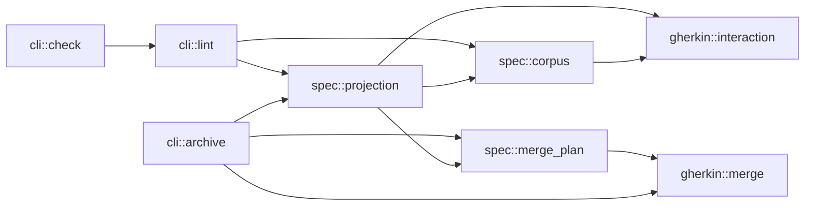

# Design: enforce-spec-interaction-integrity

## Technology

- Rust 2024, the existing `givn` crate. No new dependency and no version change: the Gherkin parser, YAML, and SHA-256 crates are already pinned in `Cargo.lock`. The projection uses no tempdir; `tempfile` remains available for test fixtures only.
- The implementation is a library change consumed by three CLI surfaces, not a new service.
- Test runner: `./run-tests.sh --non-e2e` for the regular scope and `./run-tests.sh --e2e` for the E2E scope. Both execute `givn/specs/**` and the change's `specs/**` through `tests/features_runner.rs`.
- Strict mode: `cucumber-rs` `.fail_on_skipped()` on the `Cucumber` builder (`tests/features_runner.rs`). Undefined or skipped steps fail the run.
- Single-scenario run command:
  `cargo nextest run --test features_runner '<relative feature>::<scenario title>'`
  Nextest selects the unit and invokes the harness with `--exact`; passing
  `--exact` to nextest itself is rejected. The harness's direct name-predicate
  branch requires `<unit> --exact` only when the binary is invoked without
  nextest. The nextest form was verified against an existing scenario in this
  checkout.

## Architecture Impact

The archive module currently owns two responsibilities: publication orchestration and merge planning. The projection needs the merge plan, the merge text function, and the in-memory corpus, and a library module must not depend on `cli::archive`. The change extracts the merge planning into `src/spec/merge_plan.rs`, adds `spec::corpus` and `spec::projection`, and reuses the same merge text function for the archive's real writer.

### Components

| Component | Responsibility | New or changed |
|---|---|---|
| `src/spec/corpus.rs` | Read a specifications tree into an in-memory `SpecCorpus` of narrative and feature text keyed by project-relative path; expose the logical narrative and feature maps. | New |
| `src/spec/merge_plan.rs` | Build the ordered delta-to-permanent plan; produce the merged feature text through one shared merge function; write it through the thin file writer; delegate narrative overlay and retirement to `SpecCorpus`. No receipts, no console, no publication. | New, extracted from `cli::archive` |
| `src/spec/projection.rs` | Build a projected `SpecCorpus` from the permanent corpus, change specs, plan, and merge progress; run the interaction inventory gate; return findings with logical project paths. No temporary directory. | New |
| `src/gherkin/interaction.rs` | Parse the interaction inventory from a `SpecCorpus`, report missing or unlisted `@e2e` scenarios, and report feature files absent from the capability list. | Changed |
| `src/cli/lint.rs` | Build the permanent `SpecCorpus` for default lint, run the projection for `--change`, and include its findings in the lint result. Both paths use the same gate. | Changed |
| `src/cli/archive.rs` | Run the projection before mutation on the fresh and resumed-before-merge paths; run the permanent inventory gate before verification on a merged candidate; materialize the real merge through the same merge-text function and a thin file writer. | Changed |
| `src/cli/check.rs` | No new code; the review branch already calls `lint::run_scoped`, which now sees the projection findings. | Unchanged |
| `src/overlap/analysis.rs` | Build a `SpecCorpus` from `givn/specs` and pass it to the interaction gate. | Changed call site |

The single merge implementation is the feature-level `gherkin::merge::apply_feature_deltas` plus a new public `apply_feature_deltas_retry`. These include background conflict checks, inherited tag propagation, and the new-capability header; the lower-level `apply_deltas`/`apply_deltas_retry` are not the full feature merge. `spec::merge_plan::merge_feature_text(permanent_text, entry, retry)` wraps those two functions and returns the merged text. The thin read/write wrapper moves to `spec::merge_plan::write_feature`/`write_feature_retry`; it preserves the `is_delta_feature` guard and the atomic `.givn-tmp` write/rename, so the dependency direction is `spec::merge_plan -> gherkin::merge`; `gherkin::merge` keeps only the text merge. The archive calls `write_feature`; the projection calls `merge_feature_text`. There is no second merge algorithm and no temporary specifications tree. Narrative overlay and retirement are `SpecCorpus::overlay_narrative` and `SpecCorpus::remove_capability`; `spec::merge_plan` delegates to them, and the archive materializes the same operations.

### Contracts and Components

| Contract | Consumer use case | Consumers | Implementing component today | Split trigger |
|---|---|---|---|---|
| Projected interaction inventory | `verify-change`, `archive-change` | `cli::lint`, `cli::archive` | `spec::projection` | A second consumer needs a different projection (editor, CI service) or the corpus/gate contract diverges. |
| Merge plan application | `verify-change`, `archive-change` | `cli::archive`, `spec::projection` | `spec::merge_plan` | A second merge consumer appears or retirement rules must differ between audit and publication. The shared `merge_feature_text` is the only merge. |
| Spec corpus | `verify-change`, `archive-change` | `cli::lint`, `spec::projection`, `gherkin::interaction` | `spec::corpus` | A consumer needs a different corpus shape (editor, incremental index) or the logical path contract changes. |
| Interaction inventory findings | `verify-change`, `archive-change` | `spec::projection`, `overlap::analysis` | `gherkin::interaction` | The inventory notation changes or an external consumer reads the findings directly. |

The projection is a component, not a helper, because it has a named responsibility (compute the accepted corpus before acceptance) and two consumers outside itself.

### Flow

## Data Model

No persistent schema changes. The change introduces no database, file format, or receipt field.

- `MergeEntry` moves to `spec::merge_plan` with its existing fields: `relative`, `feature`, `target`, `retire`, `cap`.
- `SpecCorpus` is in memory and is not persisted. It holds `narratives: BTreeMap<PathBuf, String>` and `features: BTreeMap<PathBuf, String>` keyed by project-relative paths that include the `givn/specs/` prefix (for example `givn/specs/fragments/fragment.md`). `SpecCorpus::read` returns `Result`: a missing `givn/specs` yields an empty corpus; any other read failure is a named error. `gherkin::interaction::usecase_coverages(&SpecCorpus)` and `interaction_gate_findings(&SpecCorpus) -> Vec<Finding>` replace the root-based functions; the gate is infallible after the read, and a document or feature parse error becomes a blocking `usecase_invalid` finding. `scan_tree` maps a corpus read error to a blocking finding; the projection returns the read error to the command.
- The permanent corpus repair changes `givn/specs/fragments/fragment.md` and the `@e2e` tag on one `initialize-project` scenario. No tool schema changes.
- `Finding.titles` for an interaction mismatch keeps the existing declared/actual count detail and adds the plural-replacement labels:
  `interaction inventory mismatch: use case '<use case>' capability '<capability>' declares <N> interaction(s) and has <M> @e2e scenario(s); missing @e2e scenario '<title>'; unlisted @e2e scenario '<title>'`
  Multiple items repeat the singular label separated by `; `. Keeping the count preserves the existing `0 @e2e scenario(s)` assertion; the old `missing declared scenarios` phrase is replaced by the singular labels. The finding `files` remain the use-case narrative and the capability feature. The JSON `severity` stays `blocking`.
- The delta narrative for `givn/specs/fragments/fragment.md` carries the current permanent base hash `a219ed7197dd6d8a424ca7f418d7ef956c89ec7fa116b2ce65ce14774878c22b`. Refreshing that header is part of the corpus repair; the archive's `validate_usecase_documents` compares it before merge.
- The delta narrative supplies the repaired `fragments/fragment.md`; archive writes it to the permanent path. The permanent file is not edited directly during the change.
- `docs/domain-model.md` is unchanged: the change adds no bounded context, aggregate, or relationship. The model explicitly excludes internal Rust components, and the new modules are internal.
- `spec::merge_plan::merge_feature_text(permanent_text, entry, retry)` is the one merge entry point. It calls `gherkin::merge::apply_feature_deltas` / `apply_feature_deltas_retry`; the archive's `write_feature` reads, calls it, and writes. The projection calls it and stores the returned text. `SpecCorpus::overlay_narrative` and `SpecCorpus::remove_capability` own the operations; `spec::merge_plan` delegates to them.
- `MergeEntry` carries `target_rel: PathBuf`, a forward-slash normalized project-relative path including the `givn/specs/` prefix: `givn/specs/<usecase>/<cap>.feature` for a merge, or `givn/specs/<usecase>` for a retirement. `build_merge_plan` computes it from the resolved target and refuses a target outside `givn/specs`; `plan_from_receipt` recomputes it from the receipt target with the same refusal; `receipt_plan` and the projection use it directly, with no absolute-path fallback. The retirement feature key is `target_rel/<cap>.feature`; the narrative key is `target_rel/usecase.md` or `givn/specs/fragments/fragment.md`.
- Retirement mirrors `retire_capability`: remove `target_rel/<cap>.feature`; if the directory is not `fragments` and it has no features left, remove `target_rel/usecase.md` (or keep `fragments/fragment.md`); an already-absent feature is an idempotent no-op. The archive materializes the same removals.
- `MergeProgress<'_>` has `merged: &[String]`, `in_progress: Option<&str>`, and `retry_unrecorded: bool`. The last field mirrors `legacy_unrecorded_merge` in `cli::archive` (`merge_plan`, `merged_deltas`, and `merge_in_progress` all empty) and makes the projection call `merge_feature_text(..., retry = true)` for every entry.
- The reverse inventory check adds the blocking finding kind `undeclared_capability`: a feature file in a use-case or fragment directory that the document's `## Capabilities` list does not name. The `- none` sentinel means an empty list, not a capability.

## Decisions

- Decides D1: project the merged corpus before mutation, and enforce it in change-scoped lint, review, and the archive static gates. Realized in `spec::projection`, `cli::lint::run_with_root`, and the pre-mutation call in `cli::archive::run`. Rejected: post-merge-only checks move the failure after the mutation the gates protect; CI-only checks do not satisfy the hard gate.
- Decides D2: keep lint exit code `1` for use-case and interaction findings. Realized in the existing `has_use_case_error` mapping in `cli::lint`; the reference and runtime chapter are corrected to match. Rejected: changing to `3` would invalidate the existing executable scenarios for an error class that is already blocking.
- Decides D3: correct the `missing-e2e-runner` documentation instead of adding a hidden command. Realized in `docs/reference.md` and `docs/arc42/06-runtime-view.md`. Rejected: adding an unexercised CLI surface.
- Decides D4: extend the gate to permanent features absent from the use case's capability list. Realized in `gherkin::interaction`'s reverse check and the `undeclared_capability` finding. Rejected: narrowing the claim leaves the new-capability false green; deferring keeps the stated guarantee partial.
- Projection storage: compute a `SpecCorpus` in memory and reuse `merge_feature_text` for the archive's real merge. Rejected: a temporary specifications copy, which adds I/O, cleanup, path mapping, and a second path to the merge application. Realized in `spec::corpus`, `spec::projection`, and the archive writer.

No decision is carried.

## Use-Case Traceability

| Contract element | Technical decision | E2E or executable evidence |
|---|---|---|
| `verify-change` rule: interaction coverage matches capability plus scenario identity, including fragment-owned declarations | `spec::projection` overlays the delta narratives and features on an in-memory `SpecCorpus`; `gherkin::interaction` compares the projected inventory with the projected features. | New review and change-scoped lint scenarios; existing `givn-workflow-enforcement` and `check-specification-health` E2E rows. |
| `verify-change` success guarantee: applicable, actionable failures | A projection mismatch is a blocking lint finding that names the use case, capability, and scenario; review fails before archive. | `Review refuses a projected interaction-inventory mismatch before archive` |
| `archive-change` main flow steps 1 and 3: gates run before mutation and the accepted documents merge | The fresh archive builds the merge plan, projects it, and refuses before the pending receipt or the rename. A resumed candidate checks the same projection before completing its merge. | `Archive refuses a projected interaction-inventory mismatch before moving the change` |
| `archive-change` success guarantee: the permanent corpus contains the accepted change | A merged candidate is checked against the permanent inventory before its verification scopes run; a red candidate stays unproven and repairable. | `Archive refuses a merged candidate whose interaction inventory is inconsistent` |
| `initialize-project` interaction inventory declares the noninteractive init as E2E | The repaired delta adds `@e2e` to the existing scenario; the archive merge preserves the tag. | `Consumer runs init non-interactively and gets opencode skills` (now E2E) |
| `fragments` interaction inventory is the durable support contract | The delta narrative adds the 19 missing rows for the 10 fragment capabilities. | Existing fragment `@e2e` scenarios; `givn lint` clean after archive |
| Persona impact: `developer--primary-user` and `agent--technical-role` read CLI refusal text | The finding names the capability and the exact scenario; the exit code is `1` for both `givn lint` and the lint phase of review. | New lint and review scenarios |

The change introduces or visibly changes no screen. It changes CLI refusal text and documentation, so no `## Visual Design Contract` is declared. The persona impact is recorded here; the visual review gate is not applicable.

## Projection Semantics

`spec::projection::interaction_findings_for_plan(project_root, change_specs, plan, progress)`:

`progress` is a `MergeProgress<'_>` value with `merged: &[String]`, `in_progress: Option<&str>`, and `retry_unrecorded: bool`. The fresh path passes an empty progress. The resumed-before-merge path passes the pending receipt's `merged_deltas` and `merge_in_progress`, plus `retry_unrecorded` when the receipt has no merge plan and no recorded progress. The merged-candidate path does not project.

1. `SpecCorpus::read(project_root/givn/specs)` reads the direct child use-case and `fragments` documents and their direct feature files into `narratives` and `features` text, keyed by project-relative paths including the `givn/specs/` prefix. Nested features and nested documents are outside the capability inventory and are recorded as a limitation; the archive's narrative collector recursion is a separate materialization concern. A missing root is an empty corpus; another read failure is a named command error. The gate parses the text and returns `Vec<Finding>`; a malformed document or feature is a blocking `usecase_invalid` finding. A `merge_feature_text` failure (added already present, modified/removed absent, background conflict) is a named command error; lint, review, and archive fail closed. A unit test covers both.
2. Overlay the change's `usecase.md` and `fragment.md` documents on `corpus.narratives`, using the same narrative-target rules as archive.
3. Apply the plan to the corpus:
   - For each `MergeEntry`, use `entry.target_rel` as the corpus key. Skip an entry whose `relative` is in `progress.merged`; a `progress.in_progress` entry or any entry when `progress.retry_unrecorded` is true passes `retry = true`.
   - Read the permanent feature text from `corpus.features[target_rel]` (absent for a new capability) and call `spec::merge_plan::merge_feature_text(permanent_text, entry, retry)`. Store the returned text at `target_rel`.
   - A retired entry removes the capability feature from the corpus and, when the directory is not `fragments` and it is the last capability, removes the narrative; an already-absent feature is a no-op; no `.retired.yaml` is written in the projection.
4. Run `gherkin::interaction::interaction_gate_findings(&corpus)`.
5. Return the findings. Their `files` and `titles` already use project-relative paths; there is no temporary path and no mapping step.

The same `merge_feature_text` is used by the archive's real merge: `spec::merge_plan::write_feature` reads the permanent file, calls it, and writes the result. The archive's narrative materialization writes the same overlaid corpus narrative; its retirement materialization deletes the paths the corpus operation removed. The projection never writes a file.

The convenience entry point `interaction_findings(project_root, change)` resolves `givn/changes/<change>`, builds the plan with `validate = false` for lint and review, passes an empty `MergeProgress`, and calls the function above. `build_merge_plan` returns a typed `MergePlanError`; the unplaceable case is `MergePlanError::UnplaceableCapability { capability, detail }`. The convenience entry matches that variant and returns a blocking `interaction_mismatch` finding with the title `interaction inventory mismatch: capability '<cap>' cannot be placed in the projected corpus: <detail>`; other plan errors propagate as command errors. The archive passes the plan it already built with `validate = true`. The lint path tolerates `@wip`; the archive path refuses it.

`gherkin::interaction` also performs the reverse check: every `.feature` file directly under a use-case or fragment directory must be named in that document's `## Capabilities` list. An undeclared feature produces a blocking `undeclared_capability` finding with the title `interaction inventory mismatch: use case '<usecase>' has undeclared capability '<cap>'` and lists its `@e2e` scenario titles. The `- none` sentinel is an empty list. A declared capability whose feature is absent from the projected corpus is a blocking `usecase_interaction_invalid` finding. Both findings join the same `severity_for` blocking set and the `has_use_case_error` exit-code match in `cli::lint`, so default-scope lint exits `1`; a default-scope scenario pins the undeclared-capability case.

`permanent_interaction_findings(project_root)` reads `project_root/givn/specs` into a `SpecCorpus` and runs the same gate for a merged candidate. It does not project or merge. Default `givn lint` builds the same corpus and calls the same gate, so the projection is the only place that applies a change.

The projection deliberately does not subtract pre-existing findings. A permanent corpus that already contradicts its inventory is not a valid baseline: every change would inherit a false green. The repair of this project's 11 findings is part of the change. A downstream project with drift is blocked until it repairs, and `givn lint` names every row.

## Lint and Review Integration

`cli::lint::run_with_root` keeps its existing delta scan and adds one step:

- Default `scan_tree` builds the same `SpecCorpus`; a read error becomes a blocking `usecase_invalid` finding, and a document/feature parse error is a blocking finding from the infallible gate.
- When `paths.is_empty() && change.is_some() && !has_parse_error && !has_use_case_error`, call `spec::projection::interaction_findings(project_root, id)` before the empty-feature early return. A change whose specs tree has no `.feature` files but has a delta narrative still projects; the empty-feature shortcut applies only to the parse/scan phase. This pins O2.
- The projection's unplaceable-capability finding is appended like any other blocking finding. The existing `--change` scope and review-disposition fixtures receive a `NEW in <usecase>` routing row from `tests/steps/mod.rs::feature_file_at` -> `common::declare_fixture_routing`, and after `write_fixture_usecase` generates `- none` for a capability with no `@e2e` titles, their scenarios remain green. The new raw-delta scenario uses a fixture step that writes the file without declaring routing. The implementation runs the projection after the tree-wide `scan_tree` has set the parse and use-case flags; the empty-feature early return is moved or bypassed for change scope.
- Append those findings to `findings` after the delta-path filter, because their files are permanent paths. Increment `total_errors` and set `has_use_case_error = true` for each projection finding.
- The prose and JSON renderers show the new title and `blocking` severity. The command exits `1`.
- The default scope (`change.is_none()`) does not project, but `scan_tree` now also reports undeclared capabilities through the reverse check; the permanent inventory mismatch remains direct.
- Explicit paths are unchanged; they do not project.

`cli::check::run_mandatory_checks("review")` already calls `lint::run_scoped`, which calls `run_with_root(Some(change))` and bails on a non-zero code. No additional review code is needed. The review output names the finding before the `lint gate failed` summary.

## Archive Integration

- Fresh archive: after `build_merge_plan` and before `ensure_e2e_configured`, call `projection::interaction_findings_for_plan(project_root, &source_specs, &plan, MergeProgress::empty())`. On a finding, bail with `archive blocked: <titles>` before the pending receipt is written or the change moves. The titles already begin with `interaction inventory mismatch`.
- Resumed candidate before merge: when `merge_needed`, build `plan_from_receipt`, which recomputes each `target_rel` from the receipt target and refuses a target outside `givn/specs`; pass the receipt's `merged_deltas`, `merge_in_progress`, and `legacy_unrecorded_merge` as `MergeProgress`, and run the same projection against `archive_target/specs` before `apply_merge_plan`. Already-applied entries are skipped; the in-flight or legacy-unrecorded entries use retry mode. A finding leaves the candidate unproven.
- Merged candidate: after the merge/publication block and before the verification scopes, call `projection::permanent_interaction_findings(project_root)`. A finding leaves the pending candidate unproven and repairable; the archive does not run its scopes.
- The post-merge check is defense in depth. It catches a concurrent committed edit between the pre-mutation projection and the candidate publication, and it validates the actual merged bytes.
- The archive error uses the same title text as lint. It does not use `cli::lint` and does not run a test suite.

## Step Definitions

The delta specs add no `specs/steps/` copy. The new step definitions are authored directly in the permanent test tree, so the archive's step-definition preflight sees no delta step file and no permanent merge target.

| Capability | Step definition file | Permanent merge target |
|---|---|---|
| `check-specification-health` | `tests/steps/spec_overlap_gates_steps.rs` | Authored in the permanent tree; no delta copy |
| `givn-workflow-enforcement` | `tests/steps/workflow_enforcement_steps.rs` | Authored in the permanent tree; no delta copy |
| `archive-proof` | `tests/steps/archive_proof_steps.rs` | Authored in the permanent tree; no delta copy |
| `initialize-a-project` | `tests/steps/init_agent_target_selection_steps.rs` | Existing bindings; tag change only |
| Shared projection fixtures | `tests/steps/interaction_projection_steps.rs` (registered in `tests/steps/mod.rs`) | Authored in the permanent tree; no delta copy |
| Shared fixture repair | `tests/steps/archive_proof_support.rs`, `tests/steps/enforce_post_merge_e2e_gate_steps.rs`, `tests/steps/review_disposition_gates_steps.rs`, `tests/steps/deduplicate_change_dir_detection_steps.rs`, `tests/steps/fix_uppercase_checkbox_parsing_steps.rs`, `tests/steps/workflow_enforcement_steps.rs`, `tests/steps/extract_coverage_gate_steps.rs`, `tests/steps/readme_enforcement_steps.rs`, `tests/steps/grouped_merge_steps.rs`, `tests/steps/preserve_docstrings_on_archive_steps.rs`, `tests/steps/repository_ownership_fixtures_support.rs`, `tests/steps/mod.rs` (persona narrative fixture), and `tests/common/mod.rs::write_fixture_usecase` (called by `declare_fixture_routing`) | Authored in the permanent tree; every literal interaction row is generated from the actual `@e2e` titles, with `- none` when none; a no-document feature directory gains its document |

The shared archive fixture repair makes the `ready_change` corpus consistent before the new archive scenarios run. The unproven-candidate fixture therefore creates its candidate cleanly, and the merged-candidate scenario injects the mismatch after that candidate exists.

`tests/common/mod.rs::write_fixture_usecase` is part of the repair. It is called by `declare_fixture_routing` for a new capability and currently writes a placeholder `No E2E interaction` row. It must generate the interaction rows from the delta feature's actual `@e2e` titles and write `- none` when there are none; otherwise the new-capability fixtures project a declared interaction with no matching scenario.

The merged-candidate fixture uses `archive_proof_support.rs::write_pending_receipt` with `merge_completed: true` to create an unproven candidate with empty `scopes` and `scope_evidence`; the merged corpus comes from the `ready_change` project copied into the archive location with `copy_dir_all`. It then injects the mismatch. It does not use `e2e_toggle_candidate`, which has already run a scope.

The fixture-repair batch audits every test fixture that writes a `## Interactions` table, not only the builders above. The known additional writers are `deduplicate_change_dir_detection_steps.rs` (resolve-change-directories), `fix_uppercase_checkbox_parsing_steps.rs` (read-task-progress), `workflow_enforcement_steps.rs` (review scenarios), `extract_coverage_gate_steps.rs` (archive coverage), `readme_enforcement_steps.rs` (README enforcement), `grouped_merge_steps.rs` (retirement and grouped merge), and `repository_ownership_fixtures_support.rs` (permanent features with no document). Each must emit only rows for actual `@e2e` titles, or `- none`. A writer that emits a literal row for a capability with no `@e2e` scenario will project a blocking mismatch.

The exception is a fixture whose scenario intentionally asserts a use-case schema error, such as the `register-readiness` interaction at `workflow_enforcement_steps.rs:1716-1723` asserted by `givn-workflow-enforcement.feature:334-342`. Those fixtures keep their deliberate interaction and schema error; the schema gate reports the deliberate interaction once, and the projection is skipped when the delta scan already reports a use-case schema error. The batch records the exception explicitly.

The no-document fixtures at `readme_enforcement_steps.rs:244-279`, `workflow_enforcement_steps.rs:1025-1063`, `workflow_enforcement_steps.rs:910-916`, `enforce_post_merge_e2e_gate_steps.rs:47-59,209-221`, `preserve_docstrings_on_archive_steps.rs:99-110,180-206,267-284`, and `grouped_merge_steps.rs:521-555` gain their `usecase.md` or `fragment.md` in batch 1 under the N4 rule. `repository_ownership_fixtures_support.rs` writes two directories (`fixture-existing`, `fixture-retained`) and needs two documents, not one. The `preserve_docstrings_on_archive_steps.rs` success fixtures gain a `usecase.md` that declares the capability and sets `## Interactions` to `- none` beside their permanent feature.

`collect_capability_names` keys fixture capabilities by both use case and capability, so multiple new capabilities in one use case do not collapse; `ensure_fixture_usecase` extracts the actual `@e2e` titles and must count `Scenario Outline:` as well as `Scenario:`; `write_fixture_usecase` writes the document, selecting `fragment.md` when the use case is `fragments`. The audit covers that. The reverse check scans `.feature` files directly under the use-case or fragment directory; nested feature files and a `.feature` directly under `givn/specs` are outside the capability inventory and are recorded as limitations, not findings. A document-less use-case directory is reported by both the existing use-case-document check and the new reverse check; both are blocking, and the duplicate is intentional because the projection does not run the existing check. A `fragments` directory with no `fragment.md` is reported by the reverse check alone, because the existing graph check only inspects an existing fragment document.

`grouped_merge_steps.rs` also exercises retirement. For a retirement that leaves sibling capabilities, the delta narrative removes only the retired capability. For a last-capability retirement, the delta omits the change-local narrative and the archive's retirement cleanup removes the feature and the permanent narrative; a leaf use case with `- none` is invalid (`parse_usecase_md` requires at least one capability), so the design does not use that shape. The fixture repair removes the `specs/only-cap/usecase.md` write at `grouped_merge_steps.rs:172-201` for the last-capability case. A retirement that leaves a stale declaration is a blocking `usecase_interaction_invalid`.

The persona narrative fixture at `tests/steps/mod.rs:1429-1446` writes a change use-case document that declares a capability without a feature. The projection reports a declared capability with no projected feature as a blocking `usecase_interaction_invalid` finding. The fixture repair adds a permanent `givn/specs/persona-change/usecase.md` declaring `persona-change` with `- none` interactions and a permanent `givn/specs/persona-change/persona-change.feature` containing at least one non-`@e2e` scenario; alternatively it uses the routing-proposal plus change-feature shape. The change document's interaction row becomes `- none` (or the alternative change feature carries `@e2e Scenario: S`). A bare permanent feature without its document, or a leaf document with `- none` capabilities, is invalid and is not used. The persona advisory and default-scope scenarios then exit 0.

The new fixture phrases:

- `a project with a permanent fragment whose interaction inventory declares "<scenario>"`
- `a change "<id>" whose delta adds an E2E scenario "<scenario>" without an interaction row`
- `a change "<id>" whose delta removes the only E2E scenario for "<scenario>"`
- `a change "<id>" whose delta adds an E2E scenario "<scenario>" with its interaction row`
- `the change's delta adds an E2E scenario "<scenario>" without an interaction row`
- `the change's delta adds an E2E scenario "<scenario>" with its interaction row`
- `the permanent interaction inventory does not declare an E2E scenario that the merged corpus contains`
- `a change "<id>" whose delta adds an E2E scenario "<scenario>" under an undeclared capability "<cap>"`
- `a raw delta feature at "<path>" with:`
- `a change "<id>" with no delta features`
- `the permanent corpus contains an E2E scenario "<scenario>" in an undeclared capability "<cap>"`
- `an unproven archive candidate "<id>" with a merged corpus and no verification scopes`

The existing `the findings report missing E2E evidence for "<capability>" and "<scenario>"` assertion in `spec_overlap_gates_steps.rs` is updated to the new singular labels and keeps the `declares N interaction(s) and has M @e2e scenario(s)` count. `wrong_capability_scenario` at `spec_overlap_gates_steps.rs:743-744` is re-anchored to `missing @e2e scenario '<title>'` while preserving the `0 @e2e scenario(s)` count. The absence assertions at `:750-751` use the new singular labels. The in-module tests in `src/gherkin/interaction.rs` are re-rooted to the `SpecCorpus` contract and assert the new label. The new fixture phrases for the pre-existing-mismatch and archive-placement scenarios are:

- `the permanent corpus contains an unlisted E2E scenario "<scenario>"`
- `a change "<id>" with no delta features`
- `no verification scope ran for the candidate`

The generic `the user runs` step drives the real CLI.

## Interaction Coverage Matrix

The change adds no new inventory entry. It repairs one existing entry and leaves the other touched capabilities' entries unchanged.

| Inventory entry | @e2e scenario title | Real interface | Driving mechanism |
|---|---|---|---|
| `check-specification-health`: lint the specification corpus | All clean .feature files report a clean summary on stdout | CLI | `givn lint` subprocess |
| `givn-workflow-enforcement`: run migration coverage check | Consumer runs migration coverage check and sees passed evidence | CLI | `givn check migration --change <id>` subprocess |
| `givn-workflow-enforcement`: run the change-scoped checks | Consumer runs check tasks and receives a change verification receipt | CLI | `givn check tasks --change <id>` subprocess |
| `givn-workflow-enforcement`: request bare-check guidance without execution | Consumer invokes bare check and receives explicit non-executing guidance | CLI | `givn check` subprocess |
| `givn-workflow-enforcement`: write a runner result | The result helper writes four counts without a scope | CLI | `givn test-result --total ... --passed ... --failed ... --skipped ...` subprocess |
| `givn-workflow-enforcement`: run the review check on a change with use-case schema errors | Consumer runs review and receives every use-case schema problem in one pass | CLI | `givn check review --change <id>` subprocess |
| `archive-proof`: archive a completed change | Consumer archives a completed change and receives a proven archive | CLI | `givn archive --change <id>` subprocess |
| `archive-proof`: repair a blocked archive | Consumer repairs a blocked archive and the rerun proves it | CLI | `givn archive --change <id>` subprocess after a repair |
| `archive-proof`: inspect an unproven archive candidate | Consumer inspects an unproven archive candidate | CLI | `givn status --change <id>` subprocess |
| `archive-proof`: archive a change after documentation-only review edits | Consumer archives a change after documentation-only review edits and the proof is reused | CLI | `givn archive --change <id>` subprocess |
| `initialize-a-project`: select agent targets in the interactive terminal | Consumer selects agent targets during interactive init | CLI | `givn init` in a real PTY |
| `initialize-a-project`: initialize with an explicit noninteractive target selection | Consumer runs init non-interactively and gets opencode skills | CLI | `givn init --no-addons --agents opencode` subprocess (repaired with `@e2e`) |
| `initialize-a-project`: resynchronize selected targets | Consumer re-syncs skills after init and the selection is honoured | CLI | `givn skills sync` subprocess |

## E2E Infrastructure

- E2E runner command: `./run-tests.sh --e2e`; the script sets `GIVN_RESULT_SCOPE=e2e` and selects `@e2e and not @givn.removed`.
- E2E step locations: the existing `tests/steps/init_agent_target_selection_steps.rs` for the repaired init scenario; the other matrix entries use their existing capability step files. No new E2E step is introduced.
- Local infrastructure: no browser, server, database, or container. The product is a CLI; the E2E scenarios run the built binary as a subprocess, and the interactive init scenario uses the real terminal prompt through a PTY (`script` on Unix, as the repository acceptance suite already requires).
- Framework: `cucumber-rs` with the custom nextest harness. Strict mode is `.fail_on_skipped()`; undefined or skipped E2E steps fail.
- Real-interface fidelity: every E2E row invokes the real binary or the real PTY. No HTTP client substitutes for a CLI.

## Local Runnability

- Full local suite: `./run-tests.sh --non-e2e` and `./run-tests.sh --e2e`.
- A single scenario: `cargo nextest run --test features_runner '<relative feature>::<scenario title>'`.
- Manual projection probe: `cargo run -- lint --change <id>`; review probe: `cargo run -- check review --change <id>`; archive probe: `cargo run -- archive --change <id>`.
- No external service or network is required. The repository's `run` block already starts the CLI from source (`cargo run -- instructions`); no change is needed.

## Coverage Process Boundaries

Coverage is enabled in `givn/config.yaml`. The existing `measure-coverage.sh` and `merge-coverages.sh` own instrumentation and merging; this change adds no process.

| Process | Started by | Instrumented artifact | Profile output | Merge step | Non-zero production probe |
|---|---|---|---|---|---|
| Regular test suite | `./measure-coverage.sh` / `./run-tests.sh --non-e2e` under coverage | the built `givn` test binary | configured non-e2e Cobertura output | `merge-coverages.sh` | `spec::projection::interaction_findings_for_plan` and `spec::merge_plan::merge_feature_text` exercised by a mismatched fixture |
| E2E suite | `./run-tests.sh --e2e` under coverage | the built `givn` test binary | configured e2e Cobertura output | `merge-coverages.sh` | the repaired `givn init --no-addons --agents opencode` path |

Measured population: production source under `src/`, including the new `spec::corpus`, `spec::merge_plan`, and `spec::projection` modules. Excluded: `tests/`, generated assets, and the coverage outputs. The population is declared before the first run and is not changed after seeing the result.

## External Boundary Cases

The external boundaries are the CLI arguments, the project filesystem, and the in-memory corpus.

- Missing change directory: `givn lint --change <id>` and review return the named change-not-found error; no projection is attempted.
- Corrupt use-case document: the infallible gate returns a blocking `usecase_invalid` finding. An unreadable document is a named `SpecCorpus::read` error. The command fails closed.
- Non-UTF-8 or unreadable feature: the projection fails with the path; it does not silently skip the file.
- Delta that removes the only E2E scenario: the projection reports `missing @e2e scenario '<title>'`.
- Delta that adds an E2E scenario without a row: the projection reports `unlisted @e2e scenario '<title>'`.
- New capability declared `NEW in <usecase>`: the plan resolves the target; the delta narrative must declare the interaction, and a missing row is reported. The existing `--change` fixtures also receive `- none` when their new capability has no `@e2e` scenario through `write_fixture_usecase`, not from the routing row alone.
- Feature file absent from the capability list: the reverse check reports `undeclared_capability`, naming the use case and capability.
- Declared capability with no projected feature: the gate reports a blocking `usecase_interaction_invalid` finding. The persona narrative fixture is repaired to keep its scenario's expected exit 0.
- Feature directory with no use-case or fragment document: the reverse check reports `undeclared_capability` for its features rather than silently skipping the directory. `repository_ownership_fixtures_support.rs` gains a document as part of the fixture repair.
- Nested feature files under a capability directory are outside the direct capability inventory; the gate records the limitation and does not invent a nested capability.
- Delta capability with no permanent owner and no `NEW in` routing: the projection reports a blocking `interaction_mismatch` finding with `cannot be placed in the projected corpus`; the existing `.feature file at` fixtures declare routing through `declare_fixture_routing`, and `write_fixture_usecase` emits `- none` when the delta has no `@e2e` titles, so their scope scenarios stay green. A raw-delta fixture pins the unplaceable case.
- Delta contains no feature files: the projection still runs; a narrative-only delta can introduce or clear a mismatch. This pins O2.
- Legacy pending receipt with empty merge progress: `MergeProgress.retry_unrecorded` applies every entry with `merge_feature_text(..., retry = true)`, mirroring the archive's legacy branch.
- Retired capability: a retirement that leaves siblings updates the delta narrative to remove only the retired capability; a last-capability retirement omits the change-local narrative and the archive cleanup removes the feature and permanent narrative. A stale declaration is a blocking `usecase_interaction_invalid`; a leaf `- none` document is invalid. The `grouped_merge_steps.rs` fixture follows the last-capability case; the sibling retirement is unit-tested.
- `@wip` delta: lint and review project with `validate = false` and report the inventory finding; archive projects with `validate = true` and refuses the WIP first.
- Missing `givn/specs`: `SpecCorpus::read` yields an empty corpus; the permanent gate returns no findings and the projection has no inventory to compare. An unreadable root is a read error, not an empty corpus. A project with no corpus is not blocked by this gate.
- Corpus read failure: the command fails with a named path. A document or feature parse failure: the gate returns a blocking `usecase_invalid` finding; review and archive fail closed. A merge-text failure is a named command error.
- Logical paths: the finding `files` and `titles` use the same project-relative paths as default lint; no temporary path exists. A unit test asserts the logical paths.
- Concurrent edit after the projection: the clean-state witness runs before the projection and catches an uncommitted edit; a committed edit between projection and publication is caught by the merged-candidate gate before verification, and finalization repeats the clean-state check.

## Risks

- Pre-existing drift blocks the next review or archive after upgrade. This is deliberate: the permanent corpus must satisfy its own executable contract. Mitigation: `givn lint` names every finding; the release note names pre-existing drift; the proposal/design record the one-time repair for downstream projects.
- A feature file absent from its use case's capability list blocks the next review or archive. Mitigation: the finding names the use case and capability; the repair is to declare the capability or remove the stray feature; no automatic rewrite.
- Projection divergence from the real merge. Mitigation: `spec::merge_plan::merge_feature_text` is the only merge entry point; the archive writer is a thin read/write wrapper; unit tests cover added, modified, removed, new, retired, and legacy-retry cases; the feature scenarios cover the projected gate.
- The shared fixture repair changes the archive/review fixtures' corpus and may change regular/E2E scope counts. Mitigation: every known fixture writer (`archive_proof_support.rs`, `enforce_post_merge_e2e_gate_steps.rs`, `review_disposition_gates_steps.rs`, `deduplicate_change_dir_detection_steps.rs`, `fix_uppercase_checkbox_parsing_steps.rs`, `workflow_enforcement_steps.rs`, `extract_coverage_gate_steps.rs`, `readme_enforcement_steps.rs`, `grouped_merge_steps.rs`, `preserve_docstrings_on_archive_steps.rs`, `repository_ownership_fixtures_support.rs`, the persona narrative fixture, and `write_fixture_usecase`) generates the inventory from the actual `@e2e` titles, with `- none` when none, and adds documents to the named no-document fixtures; the retirement fixture covers the last-capability case and the sibling case is unit-tested; the existing archive/review suites are run before the behavior batches. The fixture steps commit their edits and refresh the change receipt before the archive clean-state witness; the archive refusal step records any long-scenario disposition; the undeclared-capability delta carries a placement route.
- In-memory corpus memory footprint. The corpus is the specification text; the current corpus is 58 feature files (77 files under `givn/specs`, about 566 KiB of text, 740 KiB on disk). Measure before optimizing; do not add a persistent cache that becomes a stale baseline.
- Message compatibility. The finding title changes from plural detail to singular labels. Mitigation: update the existing step assertion and any scenario that depends on the old text; keep the exit code `1`.
- Projection cost is linear in the specification corpus. The current corpus is 58 feature files (77 files); the read/parse is not measured as a bottleneck. Measure before optimizing, and do not add a cache that becomes a stale baseline.
- The merged-candidate check adds a new failure point after the candidate is published. The pending receipt already leaves the candidate repairable in place; the scenario asserts that state.

## Test Plan

Unit tests (`src/spec/corpus.rs`, `src/spec/merge_plan.rs`, `src/spec/projection.rs`, `src/gherkin/interaction.rs`):

- A clean projected corpus yields no findings.
- An added `@e2e` scenario without a row yields `unlisted @e2e scenario '<title>'`.
- A removed declared scenario yields `missing @e2e scenario '<title>'`.
- A delta narrative that adds the row clears the finding.
- A new capability under `NEW in <usecase>` resolves its target.
- A retired capability removes the feature and does not produce a missing finding.
- Findings and titles use project-relative paths directly; the projection creates no temporary directory.
- A `SpecCorpus` overlay applies added, modified, removed, new, retired, and retry entries in memory.
- Retirement covers a sibling retirement, a last-capability retirement, the `fragments` narrative exemption, and an already-applied retirement no-op.
- `target_rel` is normalized, refuses a target outside `givn/specs`, is recomputed from a receipt on resume, and is looked up with the same project-relative key as an existing permanent feature.
- A merge-text failure (added already present, modified/removed absent, background conflict) is a named command error.
- The archive's `write_feature` and the projection call the same `merge_feature_text`.
- A corpus read error is a named command error; a document/feature parse error is a blocking `usecase_invalid` finding.
- A narrative-only delta still projects and reports a mismatch.
- A partially merged candidate skips entries already in `merged_deltas` and retries the in-flight entry.
- A legacy pending receipt with empty merge progress applies every entry in retry mode.
- An undeclared feature yields `undeclared_capability`.
- A declared capability with no projected feature yields `usecase_interaction_invalid`.
- A default-scope undeclared capability exits `1`, not only prints a blocking severity.
- A delta capability with no permanent owner and no routing yields a blocking `cannot be placed in the projected corpus` finding.
- An unreadable file returns a named error.

Feature scenarios (the delta specs):

- `Change-scoped lint reports an E2E scenario the projected inventory does not declare`
- `Change-scoped lint reports a declared interaction whose projected corpus has no E2E scenario`
- `Change-scoped lint accepts a delta that keeps the projected inventory consistent`
- `Change-scoped lint reports a pre-existing inventory mismatch`
- `Change-scoped lint reports a feature the projected inventory does not declare`
- `Change-scoped lint reports a delta capability with no projected owner`
- `Default lint reports an undeclared capability`
- `Review refuses a projected interaction-inventory mismatch before archive`
- `Review accepts a delta whose projected interaction inventory is consistent`
- `Archive refuses a projected interaction-inventory mismatch before moving the change`
- `Archive publishes a consistent projected interaction inventory`
- `Archive refuses a merged candidate whose interaction inventory is inconsistent`

Regression checks:

- `givn lint` on the permanent corpus exits `0` after the repair.
- `./run-tests.sh --non-e2e` and `./run-tests.sh --e2e` pass.
- `givn readme check` passes.
- The existing `spec_overlap_gates_steps.rs` assertion for missing E2E evidence uses the new labels; `wrong_capability_scenario` keeps its `0 @e2e scenario(s)` count; the absence assertions at `:750-751` use the new labels.
- The `src/gherkin/interaction.rs` unit tests are re-rooted to the `SpecCorpus` contract.
- The shared fixture writers (`archive_proof_support.rs`, `enforce_post_merge_e2e_gate_steps.rs`, `review_disposition_gates_steps.rs`, `deduplicate_change_dir_detection_steps.rs`, `fix_uppercase_checkbox_parsing_steps.rs`, `workflow_enforcement_steps.rs`, `extract_coverage_gate_steps.rs`, `readme_enforcement_steps.rs`, `grouped_merge_steps.rs`, `preserve_docstrings_on_archive_steps.rs`, `repository_ownership_fixtures_support.rs`, the persona narrative fixture, and `tests/common/mod.rs::write_fixture_usecase`) generate the inventory from the actual `@e2e` titles, with `- none` when none, and add documents to the named no-document fixtures; the retirement fixture covers the last-capability case and the sibling case is unit-tested; the existing scope counts are rechecked.
- The existing archive proof suite remains green after the fixture repair, including the interrupted-move, interrupted-merge, failed-scope, the last-capability retirement, and `Consumer archives a modified scenario and the permanent spec keeps the docstring` scenarios; the projection's `MergeProgress` and `retry_unrecorded` paths are covered by unit tests. The merged-candidate scenario uses the pending-receipt fixture with empty scopes, so its no-scope assertion is true by construction.
- The existing `--change scopes` and review-disposition scenarios remain green because their `.feature file at` fixtures declare a `NEW in` routing and `write_fixture_usecase` writes `- none` when the delta has no `@e2e` titles.

Batch plan:

1. Audit and repair every fixture writer (`archive_proof_support.rs`, `enforce_post_merge_e2e_gate_steps.rs`, `review_disposition_gates_steps.rs`, `deduplicate_change_dir_detection_steps.rs`, `fix_uppercase_checkbox_parsing_steps.rs`, `workflow_enforcement_steps.rs`, `extract_coverage_gate_steps.rs`, `readme_enforcement_steps.rs`, `grouped_merge_steps.rs`, `preserve_docstrings_on_archive_steps.rs`, `repository_ownership_fixtures_support.rs`, the persona narrative fixture, and `tests/common/mod.rs::write_fixture_usecase`) so their inventories match their actual `@e2e` titles, with `- none` when none; add the no-document fixtures at `readme_enforcement_steps.rs:244-279`, `workflow_enforcement_steps.rs:910-916,1025-1063`, `enforce_post_merge_e2e_gate_steps.rs:47-59,209-221`, `preserve_docstrings_on_archive_steps.rs:99-110,180-206,267-284`, and `grouped_merge_steps.rs:521-555`; add both repository-ownership documents; keep the intentional schema-error fixture `register-readiness` (`workflow_enforcement_steps.rs:1716-1723`) as an explicit exception; the retirement fixture covers the last-capability case and the sibling case is unit-tested; add the pending-receipt fixture for the merged-candidate scenario; add `spec::corpus` and the shared `merge_feature_text`, and extract `spec::merge_plan` with behavior-preserving archive tests; repair the delta `fragment.md` base hash and the init `@e2e` tag; add the projection unit tests.
2. Add the projection, the reverse undeclared-capability check, unplaceable-delta handling, and the lint/review enforcement; turn the nine lint/review scenarios green.
3. Add the archive pre-mutation and merged-candidate enforcement; turn the three archive scenarios green.
4. Correct the lint exit-code, sentinel, glossary, workflow, and 8.24 documentation; run the full suite and archive.
