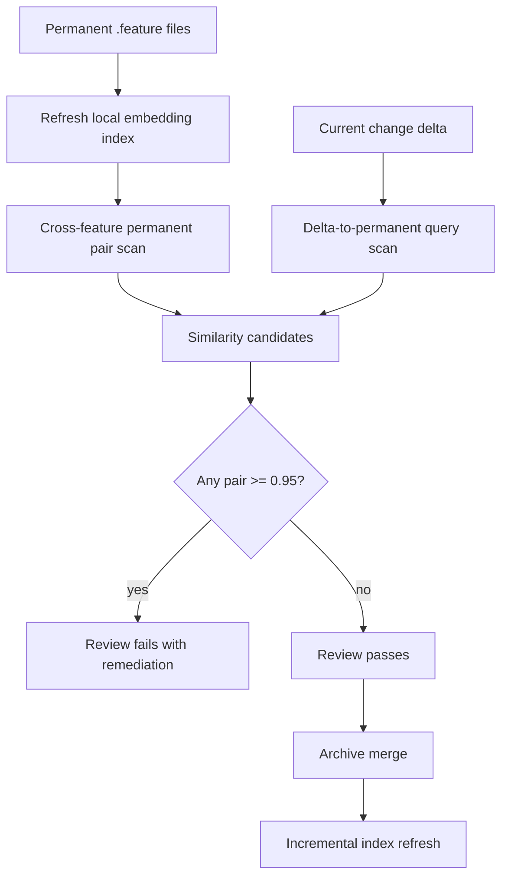

# Design: enforce-spec-similarity-gate

## Architecture

The existing local retrieval path remains the source of embeddings and ranking.
The strict gate is opt-in through the Cargo feature
`spec-similarity-gate`, which also enables `spec-retrieval`; the default
retrieval build remains advisory until this change is deliberately adopted.
The change adds a strict similarity-review phase around it:

- `givn spec review --change <id>` refreshes the permanent index, audits
  permanent scenarios against one another, and compares the current delta
  scenarios with the permanent index;
- `givn check review --change <id>` runs the same similarity check as a blocking
  review gate when retrieval is compiled in;
- `givn archive --change <id>` refreshes the index after the merged permanent
  specifications pass the existing archive gates.

The permanent audit compares every distinct pair of permanent scenarios,
including scenarios in the same `.feature` file. A same-file pair is reported
with its scope so the author can see whether the collision is local or
cross-feature; it is not an exemption. Current delta scenarios are compared
with every permanent scenario because the delta has not yet been assigned to
the permanent feature tree.



Retrieval remains feature-gated. A binary compiled without
`spec-retrieval` continues to report that the retrieval commands are
unavailable; the ordinary non-retrieval workflow is not linked to ONNX Runtime.
The feature-enabled test and production path uses the existing local
`fastembed` model and no external service during search.

## Similarity policy

`src/spec/retrieval.rs` gains a small policy layer around the existing
`SpecIndex` and `IndexEntry` types.

- Fixed threshold: `SIMILARITY_THRESHOLD = 0.95` in the feature-enabled binary.
- The constant is private and has no project-config, CLI, or environment
  override. This prevents an authoring agent from raising the threshold to make
  a failing review pass.
- Permanent full-audit candidates include same-file and cross-file pairs. The
  report labels the pair scope but applies the same hard gate to both.
- Delta candidates are emitted for every permanent entry at or above the
  threshold, not only the first five ranked entries.
- Candidate ordering is deterministic: descending score, then both relative
  file paths, then both titles.
- Permanent-to-permanent scores use the stored `passage:` vectors and cosine
  similarity. Delta-to-permanent scores use a new `passage:` vector for the
  delta, not the interactive `query:` role, so both sides of the gate have the
  same scenario-to-scenario semantics.
- The full normalized scenario text is embedded. Alternative weighting and
  behavior-focused representations remain an offline experiment until their
  scores are reproduced with the production Rust embedding path.
- Scenario identity is `(relative feature path, scenario title)`. A pair is
  skipped only when both identities are identical; endpoint identities are
  sorted before reporting so each pair appears once.
- Any candidate is a hard failure. There is no disposition that suppresses a
  pair while its score remains at or above the threshold.
- The report labels the remediation: `MERGE` means delete the true duplicate;
  `KEEP-AS-BOUNDARY` means rewrite the retained scenario's title and steps to
  make the observable boundary explicit and lower the score.
- The threshold and model identifier are printed with each candidate report.
  The persisted index continues to store the scenario content hash, so changing a
  scenario invalidates its reused vector.

The audit builds a projected permanent scenario set in memory by applying the
current delta's added, modified, and removed scenarios to the permanent set.
Projection uses the same capability tag, scenario-title replacement, and
operation ordering as archive merge. Delta files are processed in sorted path
order; the capability tag selects the permanent target, with archive's filename
fallback when a legacy delta has no capability tag; `@givn.removed` deletes
the matching title, `@givn.modified` replaces it when present (or projects the
new version for later archive validation), and `@givn.added` appends it.
A boundary rewrite that changes a scenario title is represented as a removed
old title plus an added new title; `@givn.modified` remains replacement-by-title
and is not extended into a hidden rename operation.
A duplicate-removal change can pass only when the projected permanent set no
longer contains the forbidden pair. Added and modified scenarios are also
embedded as passage text and compared with the pre-change permanent index so
the author receives a direct delta-to-baseline finding. Delta filenames do not
determine the target capability; the parsed capability tag does. Multiple delta
files targeting one capability are applied in the same sorted order as the
projection.

Permanent pair scoring uses one stored passage vector per scenario. The pair
loop excludes identical `(file, title)` identities, canonicalises the two
endpoints, and emits one result per pair. The inclusive comparison is
`score >= 0.95`; a score of exactly `0.9500` is a failure.

For a `@givn.modified` delta, the logical target identity is the permanent
capability path plus the unchanged scenario title. The delta-to-baseline scan
excludes only that own predecessor; it still compares the modified scenario
with every other permanent scenario. A title-changing boundary rewrite uses
the removed-plus-added representation above, so both the old identity removal
and the new identity's comparisons are explicit.

Before the gate is declared complete, the current permanent repository tree is
audited with this exact passage-to-passage algorithm. Every existing candidate
must be removed or rewritten as part of this change; no historical pair is
grandfathered. The baseline candidate list and the resulting clean scan are
recorded in the implementation/review evidence.

## Review and disposition flow

`review_enabled` performs the following sequence:

1. Validate the change directory and collect the permanent scenario index.
2. Refresh or reuse permanent vectors using the existing content-hash logic.
3. Scan current-delta-to-permanent pairs and all pairs in the
   projected post-change permanent pair set.
4. Print every candidate with scope, paths, titles, score, fixed threshold, and
   remediation guidance.
5. Return an error listing every candidate that still violates the threshold.

Candidate detail is written to stdout in deterministic order. The final gate
error is written to stderr and exits through the normal non-zero CLI error path.
The detail includes `score`, `threshold 0.9500`, both relative files, both
titles, and either `MERGE` or `KEEP-AS-BOUNDARY` remediation. A pair is printed
once, including when more than five candidates exist. A project value such as
`retrieval.similarity_threshold: 1.00`, a similarly named CLI/environment value,
or a review note is ignored because no such override is part of the binary
contract; the hard-coded `0.95` comparison remains active.

Review dispositions remain human notes only. They cannot suppress a retrieval
candidate, so the existing overlap disposition parser does not need a new
decision vocabulary or persistence lookup.

`src/cli/check.rs` changes the retrieval call from advisory-only to a strict
gate only when the `spec-retrieval` feature is present. The no-feature build
keeps ordinary `givn check review` and archive behaviour unchanged; direct
`givn spec review` still reports that retrieval is unavailable. The feature
gate is compile-time, not a runtime setting.

`src/cli/archive.rs` reruns the strict retrieval review after the existing
archive gate hooks and before backing up or writing the permanent tree. This
prevents a stale `REVIEW: PASS` marker from bypassing the similarity gate. The
same projected-tree calculation is therefore exercised both by an explicit
review and by the archive command.

`src/cli/archive.rs` invokes an index refresh after the merged permanent tree
passes verify, verify-e2e, and coverage gates and after the change has been
moved to `givn/archive/`. Refresh failure is reported as an advisory warning,
because the archive has already passed its correctness gates; the next review
will retry the refresh. The refresh is a compile-time no-op in a binary without
`spec-retrieval`. The generated index remains ignored by Git. A post-merge
refresh never runs before a gate that may roll the permanent tree back.

## Data and file impact

| Area | Change |
|---|---|
| `src/spec/retrieval.rs` | Fixed threshold, pairwise permanent scan, projected delta audit, delta candidate filtering, remediation output, and strict review result. |
| `src/cli/check.rs` | Propagate retrieval review failures when the retrieval feature is compiled. |
| `src/cli/archive.rs` | Best-effort post-archive index refresh. |
| `givn/changes/.../specs` | Executable scenarios for hard failure, rewrite, duplicate removal, fixed threshold, and archive refresh. |
| `tests/steps/enforce_spec_similarity_gate_steps.rs` | Black-box fixture and disposition steps for the new capability. |
| `tests/steps/spec_retrieval_steps.rs` | Update existing retrieval fixtures to create threshold candidates that cannot be hidden by review notes. |
| `tests/steps/mod.rs` | Register the new capability step module. |
| `givn/.spec-index.json` | Existing generated index format remains unchanged and ignored. |
| `givn/.spec-model-cache/` | Existing generated model cache remains unchanged and ignored. |

No embedding vector is stored in a permanent feature file, and no external
database or service is introduced.

## Test runner and strict mode

The executable specification remains the Cucumber suite:

```text
./run-tests.sh
./run-tests.sh --e2e
./run-tests.sh --non-e2e
```

These commands invoke `cargo test --features spec-retrieval --test
features_runner` and execute the `.feature` files under `givn/specs/`. The
runner uses `.fail_on_skipped()` in `tests/features_runner.rs`. New step
definitions live in `tests/steps/enforce_spec_similarity_gate_steps.rs`; their
real implementations must never be empty or silently passing.

Single-scenario command:

```text
GIVN_FEATURES=givn/changes/enforce-spec-similarity-gate/specs \
GIVN_SPEC_EMBEDDER=stub \
cargo test --features spec-retrieval,spec-similarity-gate --test features_runner -- \
  --name '^Review blocks an unclassified permanent near-duplicate$'
```

The test embedder is the existing deterministic stub. It exercises the real
compiled CLI subprocess, persisted index, pairwise ranking, fixed-threshold,
projected-audit, and exit-code behaviour without downloading a model. Real
users leave `GIVN_SPEC_EMBEDDER` unset and use the local E5 model.

## Local runnability and external dependencies

The real interface is a CLI subprocess. No server, database, queue, browser,
or third-party runtime dependency exists. `./run-tests.sh` starts the complete
local test run; no isolated network or digital twin is required. The optional
model registry is used only for first-time production model setup and is
replaced by `GIVN_SPEC_EMBEDDER=stub` in the executable test suite.

The only anticipated interface obstacle is model availability. The production
path reports a setup error with the model-cache location; the test path uses the
deterministic stub and therefore remains offline and repeatable.

## Interaction coverage matrix

| Inventory entry | @e2e scenario title | Real interface | Driving mechanism |
|---|---|---|---|
| Run `givn spec review --change <id>` to audit the permanent scenario tree | Review blocks an unclassified permanent near-duplicate | CLI | Cucumber invokes the compiled `givn spec review --change running-change` subprocess and asserts stdout/stderr and exit status. |
| Run `givn spec review --change <id>` to audit the current change against the permanent tree | Review blocks an unclassified current scenario against the permanent specifications | CLI | Cucumber invokes the compiled `givn spec review --change running-change` subprocess with a real temporary project and asserts the CLI result. |
| Run `givn archive --change <id>` after the similarity review has passed | Accepted archive refreshes the permanent similarity index | CLI | Cucumber invokes the compiled `givn archive --change integrity-hook-and-archive-gate` subprocess and asserts its exit status and generated index through the CLI result. |

## Coverage process

| Process | Started by | Instrumented artifact | Profile output | Merge step | Non-zero production probe |
|---|---|---|---|---|---|
| Cucumber runner and `givn` subprocesses | `./measure-coverage.sh` | Feature runner and feature-enabled `givn` binary | Existing non-E2E and E2E Cobertura reports | `./merge-coverages.sh` | `src/spec/retrieval.rs` pair scan and unresolved-disposition exit path |
