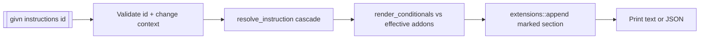

# Design: extended-rules

## Overview

The change makes the served instruction the single home for rule content and
turns every installed skill and command into a thin direction to it. It adds
the project's extension mechanism on the serving path, renders the always-on
`AGENTS.md` task-checkoff and commit-message obligations from the canonical
tasks instruction, and reworks the acceptance assertions that today read rule
content from generated files so that they read the served instruction instead.

The WHAT lives in `proposal.md`; the observable behaviour is locked by the
delta features under `specs/`. There is no new workflow machinery and no new
configuration surface beyond the extension map: rewriting the shipped assets
makes every generated file carry the direction, and reconciliation is the
existing overwrite on the next render. The two production seams are the
serving path (`src/cli/instructions.rs`) and the extraction of the block's
obligations from the tasks instruction (`src/cli/project_hint.rs`).

## Decisions

- Decides D1 (seed Q2): **the project-start block's task-checkoff and
  commit-message obligations are generated from the canonical source.** The
  obligations move into `assets/instructions/tasks.md` between
  `<!-- givn:resident-rules:begin -->` / `<!-- givn:resident-rules:end -->`
  markers; `assets/agents-project-hint.md` carries a `{{RESIDENT_RULES}}`
  placeholder where they render; `src/cli/project_hint.rs` extracts the marked
  section from the same embedded `instructions/tasks.md` asset the request
  path serves and substitutes it. The block's text and the served instruction
  can then never disagree, and the dialog obligation stays exactly as today.
  Rejected: keeping today's hand-written block text (the drift risk this change
  exists to remove would survive for the commit rule); directions only (an
  agent that never pulls the implementation guidance would lose the
  safety-critical commit rule).
- Decides D2 (seed Q4): **the extension lives in a new config-map key
  `extensions:` in `givn/config.yaml`**, mapping instruction id to a list of
  rule strings; the served content appends them after the built-in rules
  under the marked `## Project extension` section; an unknown id or a
  malformed entry is dropped with a warning naming it, and the request serves
  the built-in rules alone. Rejected: an extension file per instruction
  (`givn/artifacts/<id>/extension.md` — a second discovery mechanism beside
  the config overlay, with the prose advantage this trial does not need);
  both mechanisms (the largest surface to specify, test, and document).
- Decides D3 (seed Q5): **every generated skill and command directs to exactly
  one served instruction id.** Artifact-aligned steps keep their existing ids;
  `givn-implement` directs to the tasks instruction (the implement files
  restate the tasks instruction end to end); the remaining steps receive new
  unconditional instruction assets (`archive`, `explore`, `ideation`, `steps`,
  `reverse-engineer`, `characterize`, `domain-modeling`, `dev-principles`,
  `grill-me`, `grill-with-docs`). The single-source claim then holds for every
  file, and the extension mechanism reaches every step. Rejected: artifact-
  and policy-aligned steps only (duplication would persist for the largest,
  most rule-heavy skills and the generated direction would go untested
  there); staged coverage (the single-source claim would stay partial until
  a follow-up lands).
- Decides D4 (seed Q7): **the extension applies on top of a project-owned
  replacement of the instruction facet.** The replacement is the effective
  base; the marked extension section is appended to it. One consistent rule —
  the extension always extends the effective base — and no recorded
  configuration is silently shadowed. The replacement file itself is never
  modified or injected (R-74 unchanged). Rejected: the replacement shadows
  the extension (two project-owned paths would cancel each other); refusing
  the combination (refuses a configuration that could be intended, for
  example an organization-wide replacement plus team rules).
- Decides (design): **the direction to the served instruction is the
  rendered asset.** The skill templates and command assets are rewritten so
  their embedded content *is* the direction to the instruction; the render
  path (`src/skills/render.rs`, `src/skills/targets.rs::sync`) is untouched.
  Reconciliation needs no new code: a full copy installed by an earlier
  version is overwritten by the next synchronization or upgrade render,
  exactly as every managed file is today; project-owned replacements keep
  winning through the existing cascade; disabled-addon removal already
  exists (`reconcile_addon_artifacts`).
- Decides (design): **addon-gated instruction content is resolved when
  guidance is requested.** `src/skills/render.rs` gains
  `render_conditionals` (the existing `render_lines` semantics: fail-closed
  on an unknown addon key or an unbalanced conditional) and
  `src/cli/instructions.rs` renders the resolved instruction with the
  project's enabled addons before appending the extension and printing. The
  gated sections move from the skill/command templates into the instruction
  assets wrapped in `{{#if addons.<key>}}`. Rejected: keeping the prose
  "N/A when disabled" clauses only — the addon condition would stop
  selecting the content, and the match-guidance-to-enabled-addons contract
  could not be asserted on the served surface.
- Decides (design): **the config parse stays lenient.** `OverlayDoc` reads
  `extensions` as an ordered list of entries carrying a raw
  `serde_yaml_ng::Value` (a small private wrapper in `src/config/overlay.rs`)
  instead of a duplicate-checked `serde_yaml_ng::Value` mapping, so neither a
  malformed map nor a repeated instruction key fails every command; a
  repeated instruction key keeps its last occurrence (recorded behavior —
  the pinned parser rejects duplicate keys inside a `Value` mapping, so the
  map is read as entries). `src/config/extensions.rs` validates at request
  time and warns per bad entry. Unknown top-level keys stay ignored, as
  today.
- Decides (design): **the commit and release-note contract has exactly one
  home: `assets/instructions/tasks.md`.** The steps instruction references it
  instead of restating it; `assets/instructions/tasks-reverse.md` stops
  pointing at the `givn-steps` skill and points at the served steps
  instruction. Rejected: repeating the contract in the steps instruction
  (the drift site this change removes would reappear).
- Decides (design): **the commit-path wording in the project-start block is
  backend-neutral** ("a raw Git commit is stamped by the hook, a raw Fossil
  commit carries no attribution"). The request path never inspects project
  state beyond the enabled addons; the requested instruction carries no
  per-project substitution. Rejected: rendering SCM facts into the
  instruction at request time — new state-dependent rendering for a fact
  both existing scenarios assert as a fixed sentence.
- Decides (design): **instruction-id references are a graded reference
  class, and a direction is invokable in its documented context.**
  `instruction-integrity` gains the acceptance check that every
  `givn instructions <id>` a generated file names resolves through the CLI,
  with the context the direction itself names: a direction to an artifact
  instruction carries a resolvable change context (the named `--change` or
  the project's single active change), and a direction to a policy or step
  instruction carries no change context and resolves without one. A
  syntactically resolvable id that cannot be invoked in its documented
  context is a defect. This is the fail-closed guard analogous to the Q-97
  file-reference check.
- Decides (design): **no render cache and no new command surface.**
  `givn instructions` resolves, renders, appends, and prints on every call;
  the extension map is read from `givn/config.yaml` on every call. Nothing
  is written.

## Generated guidance carries a direction

Every generated skill and command renders as:

1. **Trigger metadata** — the YAML frontmatter (`name`, `description`) is
   kept, so the harness still indexes the file.
2. **Invocation-specific orchestration** — only what the step needs to run:
   the change id and context paths, subagent boundaries, stop conditions,
   reporting, transition suggestions, the verify-command block, the
   dialog-policy direction.
3. **A direction** — a line naming the exact call, for example:

   ```
   Run `givn instructions proposal --change {{CHANGE_ID}}` and follow it.
   ```

   Artifact instructions carry `--change {{CHANGE_ID}}`; policy and step
   instructions are requested without a change.

No built-in rule text remains in the file. The mapping fixes D3:

| Generated file | Instruction id |
|---|---|
| `givn-propose` | `proposal` |
| `givn-spec` | `specs` |
| `givn-design` | `design` |
| `givn-design-review` | `design-review` |
| `givn-tasks` | `tasks` |
| `givn-implement` | `tasks` |
| `givn-review` | `review` |
| `givn-archive` | `archive` (new asset) |
| `givn-explore` | `explore` (new) |
| `givn-ideation` | `ideation` (new) |
| `givn-steps` | `steps` (new) |
| `givn-reverse-engineer` | `reverse-engineer` (new) |
| `givn-characterize` | `characterize` (new) |
| `givn-domain-modeling` | `domain-modeling` (new) |
| `givn-dev-principles` | `dev-principles` (new) |
| `grill-me` (addon command) | `grill-me` (new) |
| `grill-with-docs` (addon command) | `grill-with-docs` (new) |

The moved rule content lands in the instruction assets; the gated sections
(`arc42`, `domain_modeling`, `readme`, `coverage`) travel as
`{{#if addons.<key>}}` blocks inside the target instruction asset.

## The serving path



- `src/config/cascade.rs::resolve_instruction` keeps its signature and order
  (project override, embedded, addon).
- `src/cli/instructions.rs` is the only caller of the serve path. It renders
  conditionals with the project's enabled addons, then appends the project's
  extension for the requested id, then prints. The JSON branch fills
  `instruction` with the same rendered-and-extended text; `id`, `generates`,
  `requires`, and `skill_to_load` are unchanged (arc42 §8.3b).
- `src/config/extensions.rs` (new):
  - `load(project_root) -> Vec<(String, Vec<String>)>`: reads
    `givn/config.yaml`; an absent key yields empty; a present map is walked
    in document order, and a repeated instruction key keeps its last
    occurrence (the lenient entry read recorded in the decisions). Every
    rejection is deterministic, one warning line per rejected entry, in
    document order:
    - a value that is not a list warns
      (`warning: ignoring malformed extension for '<id>': …`) and is
      skipped;
    - a list element that is not a string, or is empty or whitespace-only
      after trimming, warns the same way and is skipped;
    - an empty list — like a list whose entries were all skipped — is valid
      and adds nothing;
    - an instruction key that does not resolve through the request path
      warns (`warning: ignoring extension for unknown instruction '<id>'`)
      and is skipped.
  - `append(content, rules) -> String`: when at least one rule remains,
    appends:

    ```
    ---

    ## Project extension

    This project extends the built-in rules above with the following rules.
    They add to the built-in rules and never override, suppress, or reorder
    them.

    - <rule>
    - <rule>
    ```

    The `## Project extension` heading is the marker the acceptance suite
    asserts against; rule order follows the config order.
- `src/cli/eject.rs` keeps materializing raw assets; a project override that
  contains conditional directives is rendered by the serve path, which is the
  documented behavior of an override that uses the asset format.

## The project-start block

- `assets/instructions/tasks.md` carries the block's subset between the
  `<!-- givn:resident-rules:begin -->` and `<!-- givn:resident-rules:end -->`
  markers: the task-checkoff obligation and the atomic-commit obligation with
  the backend-neutral attribution sentence. They are part of the served
  instruction, so the text has exactly one home.
- `assets/agents-project-hint.md` replaces its two resident bullets with the
  `{{RESIDENT_RULES}}` placeholder; the direction, the dialog obligation, the
  status line, and the pointer line stay as they are.
- `src/cli/project_hint.rs::apply` reads the embedded
  `instructions/tasks.md`, extracts the marked section, substitutes it into
  the hint, and writes the block through `agents_block::apply`. A missing
  marker is a shipped-asset defect: the call fails naming the asset instead of
  writing a block without the task-checkoff and commit-message obligations.
- The block is written by `givn init` and every `givn skills sync`, so its
  text is refreshed when the binary changes (the embedded asset changed) and
  never drifts from the instruction.

## Extension source shape

```yaml
# givn/config.yaml — user-owned; never touched by upgrade
extensions:
  proposal:
    - Keep proposals under 500 words.
  dialog:
    - Answer in the project's glossary terms.
```

- `assets/config.yaml.tmpl` documents the key in its managed comment scaffold
  (a commented example), so new and upgraded projects see it.
- The key is distinct from `rules:` (the generated-rules policy scalar),
  `skills:` (agent targets), and the manifest overlay `artifacts:`.
- Rejection is warn-and-drop on the request path; nothing is written, and no
  command fails because of a bad extension entry.

## Exact file changes

| Path | Change |
|---|---|
| `src/skills/render.rs` | Expose `render_conditionals`; `render_template` delegates to it. |
| `src/cli/instructions.rs` | Render conditionals for the resolved instruction; append the extension on the text and JSON paths. |
| `src/config/extensions.rs` (new) | `load` (validate + warn) and `append` (marked section). |
| `src/config/mod.rs` | Register the new module. |
| `src/config/overlay.rs` | `OverlayDoc` gains the lenient `extensions` entry list (raw values in document order, a repeated instruction key last-wins). |
| `src/cli/project_hint.rs` | Extract the marked section from `instructions/tasks.md`; substitute `{{RESIDENT_RULES}}`; fail closed when the marker is missing. |
| `assets/skills/*/SKILL.md.tmpl` (15 files) | Direction to the served instruction; addon-gated rule sections removed (they move into the instruction assets). |
| `assets/commands/*.md` (15 files) | Direction to the served instruction; addon-gated rule sections removed. |
| `assets/instructions/archive.md`, `explore.md`, `ideation.md`, `steps.md`, `reverse-engineer.md`, `characterize.md`, `domain-modeling.md`, `dev-principles.md`, `grill-me.md`, `grill-with-docs.md` | New canonical assets carrying the rules moved out of the corresponding skill/command files; addon-gated sections as `{{#if addons.*}}` blocks; the dialog obligation remains a direction; `ideation.md` carries the whole ideation discipline, including the conditional `domain_modeling`/`arc42` fragments moved from the skill template. |
| `assets/instructions/review.md`, `design-review.md`, `tasks.md` | Addon-gated sections from the templates become conditional blocks in the served instruction; the review/design-review prose N/A clauses are absorbed by the conditional selection. |
| `assets/instructions/tasks.md` | Gains the marked task-checkoff and commit-message section (the `givn:resident-rules` markers) and the backend-neutral attribution wording. |
| `assets/instructions/tasks-reverse.md` | Points at the steps instruction instead of the `givn-steps` skill. |
| `assets/agents-project-hint.md` | `{{RESIDENT_RULES}}` placeholder. |
| `assets/config.yaml.tmpl` | Documents `extensions:` in the comment scaffold. |
| `givn/changes/extended-rules/specs/**` | The delta features and narrative replacements (already authored). |
| `tests/steps/serve_extended_rules_steps.rs` (new) | Extension recording/serving steps plus the shared served-instruction content step (`the served <id> instruction contains/does not contain …`). |
| `tests/steps/serve_extended_rules_e2e_steps.rs` (new) | The serving `@e2e` steps (real CLI). |
| `tests/steps/instruction_extension_steps.rs` (new) | Record/change/remove/reject steps. |
| `tests/steps/instruction_extension_e2e_steps.rs` (new) | The recording and upgrade `@e2e` steps (real CLI). |
| `tests/steps/prose_consolidation_steps.rs` | Generic direction steps (`the generated <file> guidance directs …`), `the project-start block carries the resident rules section…`, updated generic content steps. |
| `tests/steps/instruction_integrity_steps.rs` | Id-resolution step; `no generated skill or command copies the built-in rules of its instruction` (the ideation feature's served-instruction steps use the shared step in `serve_extended_rules_steps.rs`). |
| `tests/steps/template_conditional_rendering_steps.rs` | Addon-condition steps read the served instruction (`the served review instruction omits/contains …`). |
| `tests/steps/init_agent_target_selection_steps.rs` | Fossil commit-path steps read the project-start block; new fixture for a full-copy skill installed by an earlier version. |
| `tests/steps/initialize_a_project_e2e_steps.rs` | E2E additions for the init scenario: the installed-guidance direction assertion (real CLI). |
| `tests/steps/run_upgrade_steps.rs` | Upgrade reconciliation, extension-preservation, and replacement-preservation steps. |
| `tests/steps/visual_design_contract_steps.rs`, `visual_review_gate_steps.rs` | No new content bindings: the changed scenarios consume the shared served-instruction step in `serve_extended_rules_steps.rs`; these files keep their existing eject and fixture steps. |
| `docs/arc42/08-crosscutting-concepts.md` | §8.3a and §8.7 wording (see `arc42.md`). |
| `docs/arc42/10-quality-requirements.md` | Q-97 row and §10.3 bullet gain the instruction-id resolution clause. |

## Step definitions

One file per capability; shared fixtures in the files that already own them.

- `serve-extended-rules` → `tests/steps/serve_extended_rules_steps.rs` and
  `tests/steps/serve_extended_rules_e2e_steps.rs`.
- `instruction-extension` → `tests/steps/instruction_extension_steps.rs` and
  `tests/steps/instruction_extension_e2e_steps.rs`.
- Modified capabilities keep their existing files:
  `initialize-a-project` → `tests/steps/init_agent_target_selection_steps.rs`
  (plus `initialize_a_project_e2e_steps.rs` for the e2e additions),
  `apply-a-managed-upgrade` → `tests/steps/run_upgrade_steps.rs`,
  `instruction-integrity` → `tests/steps/instruction_integrity_steps.rs`,
  `refresh-generated-guidance` → `tests/steps/prose_consolidation_steps.rs`
  (shared generic steps) and `tests/steps/instruction_integrity_steps.rs`,
  `match-guidance-to-enabled-addons` →
  `tests/steps/template_conditional_rendering_steps.rs`,
  `generate-ideation-guidance` →
  `tests/steps/serve_extended_rules_steps.rs` (the shared served-instruction
  step), `prose-consolidation` / `change-release-note` /
  `visual-design-contract` → `tests/steps/prose_consolidation_steps.rs` /
  `tests/steps/visual_design_contract_steps.rs`,
  `visual-review-gate` → `tests/steps/visual_review_gate_steps.rs`.
- The shared helper `served_instruction(env, id) -> String` runs
  `givn instructions <id>` and passes `--change <active>` for manifest
  artifact ids; it lives beside the generic served-instruction step so every
  modified scenario uses one implementation.
- The shared served-instruction content step takes a quoted string
  (`the served <id> instruction contains "…"` / `does not contain "…"`);
  the addon-condition steps keep their literal, unquoted section-name form
  so the two families never match the same line.
- The shared serving assertions `the served content carries the project's
  rule in the marked extension section` and `the served content carries no
  extension section` live in
  `tests/steps/serve_extended_rules_steps.rs`;
  `tests/steps/instruction_extension_steps.rs` holds only mutation,
  validation, and rejection steps.
- The no-duplication step reads every installed skill and command for the
  configured targets and asserts: the file names `givn instructions <id>`,
  and none of a fixed marker list appears — "Artifact-specific rules",
  "carries the release note as its message subject", "Overlap dispositions",
  "Black-Box-First", "the user's verified name", "VISUAL-REVIEW: PASS",
  "one question at a time". The marker list is deliberately representative,
  not exhaustive: it samples rules owned by different instruction assets, so
  a copy reappearing in any generated file is caught.

## Runner and strict mode

- Verify command (`givn/commands.yaml`): `./run-tests.sh`; E2E smoke:
  `./run-tests.sh --e2e`.
- Runner: `cargo nextest run --test features_runner` via `./run-tests.sh`
  (fallback `GIVN_TEST_RUNNER=cargo`). Cucumber/Gherkin library: `cucumber`
  0.23.0, `gherkin` 0.16 — both as pinned in `Cargo.lock` in this checkout
  (read, not remembered).
- Strict mode: `tests/features_runner.rs` builds the runner with
  `.fail_on_skipped()` and exits non-zero when `failed > 0 || skipped > 0`;
  `@wip` scenarios are the delta's not-yet-implemented steps and `givn lint`
  reports them. The proof-of-strictness check is the setup task's job as
  usual.
- Change-scope run:
  `GIVN_FEATURES=givn/changes/extended-rules/specs ./run-tests.sh`
- Single scenario:
  `GIVN_FEATURES=givn/changes/extended-rules/specs cargo test --locked --test features_runner -- --exact "obtain-effective-guidance/serve-extended-rules.feature::An agent receives the extended rules through the Givn CLI"`

## Use-case traceability

| Use-case element | Technical realization | E2E evidence |
|---|---|---|
| `obtain-effective-guidance` / `serve-extended-rules`: the request serves the built-in rules plus the extension, identical on both paths | `src/cli/instructions.rs` renders conditionals and appends `config/extensions::append`; JSON `instruction` carries the same text; a rejected entry warns and the built-in rules are served alone | "An agent receives the extended rules through the Givn CLI"; the JSON scenario asserts parity |
| `extend-an-instruction` / `instruction-extension`: the project-owned configuration is effective at the next request, survives upgrades, never enters files or revisions | `givn/config.yaml` `extensions:` map read on every request; sync/upgrade never read or write it; a rejected entry is skipped with a warning and mutates nothing | "A developer records an extension and it governs the next guidance request"; "An upgrade preserves the extension and the next request serves it" |
| `initialize-project` / `initialize-a-project`: rendering the direction, reconciliation, task-checkoff and commit-message obligations from the canonical source | Rewritten assets render through the unchanged sync; `project_hint` renders `{{RESIDENT_RULES}}` from `instructions/tasks.md` | "Consumer runs init non-interactively and gets opencode skills"; reconciliation and block scenarios (non-e2e) |
| `upgrade-a-project` / `apply-a-managed-upgrade`: the revision refreshes generated guidance to the direction, never extensions or replacements | The existing managed-path synchronization renders the rewritten assets; the extension key is user-owned config outside the allowlist | Existing managed-upgrade e2e scenarios; new reconciliation/preservation scenarios (non-e2e) |
| Fragment `instruction-integrity`: resolution and the machine contract stay; every direction is invokable in its documented context | `resolve_instruction` unchanged; new id-resolution and direction-context acceptance check (artifact directions name a resolvable change context; policy and step directions name none) | Existing "An agent requests machine-readable artifact guidance"; the direction-context scenario (non-e2e) |
| Fragments `refresh-generated-guidance`, `match-guidance-to-enabled-addons`, `generate-ideation-guidance`: rule content leaves the files; addon conditions select the served content | Assets rewritten; `render_conditionals` at request time | Modified e2e scenarios; the canonical ideation e2e |
| `create-change`/`verify-change` capabilities: content assertions move to the served instruction | Delta scenarios re-target the CLI output | Modified e2e scenarios in the named features |

Actors in the scenarios (`the user`, `the agent`, `the developer`) stay
distinct from Personas, which are review lenses:

- `agent--technical-role` — the served content must be deterministic and
  complete on both paths.
- `developer--primary-user` — the extension lives in project-owned
  configuration and survives upgrades.
- `givn-maintainer--owner` — one canonical asset per rule; the acceptance
  suite grades the new surfaces.

## Visual Design Contract

- Interface: terminal
- Viewports: not applicable to CLI text; no screens are introduced or changed.
- Design system: not applicable; the change reuses Givn's existing plain
  CLI/Markdown output. The opposite classification does not hold: nothing
  renders HTML, CSS, or JavaScript in a browser — `givn instructions` and
  `givn skills sync` print plain text and write repository assets, with no
  page, route, or browser renderer.
- Evidence kind: captured final transcripts. Every terminal `@e2e` scenario
  commits its final transcript at
  `givn/changes/extended-rules/evidence/visual/<scenario-slug>/transcript.txt`,
  with `<scenario-slug>` the kebab-case scenario title
  (`givn::integrity_hook::scenario_slug`), mirroring the established archive
  pattern under
  `givn/archive/make-user-questions-decision-ready/evidence/visual/`.
- Capture procedure: run the scenario's real commands against the compiled
  `givn` binary in its fixture project, and after the scenario's final
  assertion write one transcript recording the scenario title, the exact
  `argv`, the working-directory disposition, the exit code, and the raw
  stdout and stderr (the archive transcript shape). Preserve raw output; do
  not substitute file excerpts for stdout. Intermediate captures, if any,
  live under `reports/visual/` and are not review evidence. `givn check
  review` requires one non-empty transcript per delta `@e2e` scenario under
  this contract.
- Expected evidence set — one transcript per delta `@e2e` scenario (12):
  - "An agent receives the extended rules through the Givn CLI"
    (`obtain-effective-guidance/serve-extended-rules.feature`)
  - "A developer records an extension and it governs the next guidance
    request" (`extend-an-instruction/instruction-extension.feature`)
  - "An upgrade preserves the extension and the next request serves it"
    (`extend-an-instruction/instruction-extension.feature`)
  - "Consumer runs init non-interactively and gets opencode skills"
    (`initialize-project/initialize-a-project.feature`)
  - "A consumer synchronizes skills and every agent target receives the
    ideation facilitation skill"
    (`fragments/generate-ideation-guidance.feature`)
  - "Synchronized guidance explains how to resolve the deterministic gates"
    (`fragments/refresh-generated-guidance.feature`)
  - "A consumer synchronizes skills and the generated guidance omits
    disabled-addon sections"
    (`fragments/match-guidance-to-enabled-addons.feature`)
  - "A consumer enables the addons a generated section needs and the
    guidance gains it" (`fragments/match-guidance-to-enabled-addons.feature`)
  - "A consumer disables an addon the domain-modeling skill needs and the
    generated domain skill is removed"
    (`fragments/match-guidance-to-enabled-addons.feature`)
  - "Generated guidance points to the canonical E2E policy"
    (`create-change/prose-consolidation.feature`)
  - "The generated implementation guidance shares the release note"
    (`create-change/change-release-note.feature`)
  - "Synchronized guidance defines the contract approval and capture
    mechanics" (`create-change/visual-design-contract.feature`)
- Motion: not applicable.

## Interaction Coverage Matrix

Every inventory entry of the affected use-case documents
(`obtain-effective-guidance`, `extend-an-instruction`, `initialize-project`,
`upgrade-a-project`) and of the `support` fragment document appears below
with its owning capability, its exact `@e2e` scenario title, and its driving
mechanism. The `create-change` and `verify-change` use cases keep their
contracts; their touched capabilities (`prose-consolidation`,
`change-release-note`, `visual-design-contract`, `visual-review-gate`)
re-target assertions, so their inventories, scenario titles, and driving
mechanisms are unchanged and stay with their permanent use-case documents.

| Inventory entry | @e2e scenario title | Real interface | Driving mechanism |
|---|---|---|---|
| serve-extended-rules: request effective instructions by id (artifact, general policy, JSON, and change context are variants) | An agent receives the extended rules through the Givn CLI | CLI | Real `givn instructions proposal --change …` subprocess; assert built-in rules + marked section |
| instruction-extension: record an extension for an instruction | A developer records an extension and it governs the next guidance request | CLI | Write the extension into `givn/config.yaml` (fixture), then a real `givn instructions` subprocess |
| instruction-extension: upgrade a project that holds an extension | An upgrade preserves the extension and the next request serves it | CLI | Real `givn upgrade` then `givn instructions` subprocesses; inspect the revision and the served content |
| initialize-a-project: select agent targets in the interactive terminal | Consumer selects agent targets during interactive init | CLI | Real `givn init` under a PTY (`script -qec`); arrow, space, and enter keys drive the selection |
| initialize-a-project: initialize with an explicit noninteractive target selection (SCM backend and no-SCM are precondition variants) | Consumer runs init non-interactively and gets opencode skills | CLI | Real `givn init --no-addons --agents opencode` subprocess; assert the report, the generated files, and the preserved AGENTS.md |
| initialize-a-project: resynchronize selected targets | Consumer re-syncs skills after init and the selection is honoured | CLI | Real `givn skills sync` subprocess; assert the refreshed guidance, the persisted targets, and the preserved human text |
| apply-a-managed-upgrade: plan a release migration | A clean 0.2.0 project receives a reviewable aggregate migration plan | CLI | Real `givn upgrade` on a committed 0.2.0 fixture (Git and Fossil example rows); assert the managed revision and the plan change |
| apply-a-managed-upgrade: run a managed upgrade | A clean project without migration requirements receives one managed upgrade commit | CLI | Real `givn upgrade` subprocess; assert one allowlist-only revision and no migration change |
| apply-a-managed-upgrade: upgrade a Fossil project | A clean Fossil project receives the same managed upgrade revision shape | CLI | Real `givn upgrade` in a Fossil checkout; assert the check-in shape |
| apply-a-managed-upgrade: invoke a retired engine command | A consumer invoking a retired engine command is told it does not exist | CLI | Real subprocess of the retired `givn spec index`; assert the non-zero named refusal |
| apply-a-managed-upgrade: archive a maintenance migration | A completed maintenance migration can be archived without a product specification | CLI | Real `givn archive` subprocess; assert the archived maintenance change and the feature-free specification tree |
| instruction-integrity (support fragment): resolve an instruction and expose the machine contract | An agent requests machine-readable artifact guidance | CLI | Real `givn instructions specs --change … --json` subprocess; assert the JSON contract |
| instruction-integrity (support fragment): request normal session-start instructions | Author starts a session with the universal dialog obligation | CLI | Real `givn instructions` subprocess without an id; assert the startup guidance and the dialog obligation |

Two ownership notes keep this matrix and `specs/fragments/fragment.md` in
agreement:

- The relocated row: the former `instruction-integrity` inventory entry
  "request effective instructions by id" is now `obtain-effective-guidance`'s
  "request effective instructions by id (artifact, general policy, JSON, and
  change context are variants)" (scenario "An agent receives the extended
  rules through the Givn CLI"); the fragment keeps the resolution and
  machine-contract action, whose retained `@e2e` scenario is in the matrix
  above. The matching E2E evidence moves with the row, so the
  interaction-gate rule — each inventory row carries its owning use case's
  matching `@e2e` scenario — holds for both documents.
- The session-start row stays under `instruction-integrity` in
  `fragment.md`: the fragment owns the startup instruction's resolution and
  dialog obligation, and its feature carries the matching `@e2e` scenario.
  `inspect-change-state` owns the change-state reporting the startup guidance
  renders and carries no separate session-start interaction row, and
  `obtain-effective-guidance` leaves session-start guidance to it.

## Version freshness

No language, framework, library, database, or container version is introduced
or changed. Rust: the toolchain in this checkout (edition 2024, rustc 1.98.1
observed locally). Cucumber/Gherkin: as pinned in `Cargo.lock` (cucumber
0.23.0, gherkin 0.16 — read from the lockfile in this checkout). No new
dependency is added.

## Local runnability & digital twins

The system runs and tests locally with one command: `./run-tests.sh` (and
`./run-tests.sh --e2e`). No external or third-party service is touched: the
change edits Givn's own assets, CLI, config parsing, and acceptance suite, so
no docker-compose stack, isolated network, or digital twin is required. The
`givn instructions` scenarios drive the real subprocess; no interface
obstacle is anticipated.

## E2E smoke test infrastructure

- Runner command: `./run-tests.sh --e2e` (the configured
  `verify.e2e_command`), filtered to `@e2e`.
- Step locations: `tests/steps/serve_extended_rules_e2e_steps.rs` and
  `tests/steps/instruction_extension_e2e_steps.rs`; the modified features'
  e2e steps stay in their existing per-capability files.
- Local infrastructure: none beyond a temporary project directory and the
  compiled `givn` binary the harness spawns; the interface is the CLI.
- Framework: `cucumber-rs` over real subprocess invocations — the CLI is the
  real interface, so no browser or HTTP driver applies.
- Strict-mode proof: the same `.fail_on_skipped()` configuration that covers
  the whole suite; the e2e scope uses the same runner, so undefined e2e steps
  fail the run.

## Arc42 impact

Chapters 05 (building block view: `config::extensions`, the amended
`cli::instructions`, and the refreshed project-start block), 06 (runtime
view: the two added request steps), 08 (crosscutting concepts: §8.3a
normative authoring guidance and §8.7 skill and rule generation), 10 (quality
requirements: Q-97 and its verification signal), and 11 (risks: R-79 and
R-80) are affected; the full assessment, the ADR qualification verdict, and
the exact wording live in `arc42.md`. Chapter 12 needs no change: the
confirmed term the change relies on (`Extended rule`) predates this change
(see `arc42.md`). Chapter 09 needs no ADR: the decision is a continuation of
the documented guidance-delivery contract, recorded in 8.3a and 8.7.

## Out of scope, recorded deliberately

- The `generated-file-form` fragment and any config key selecting a file form
  (Q1 branch-only): no selector exists; if a future trial needs side-by-side
  comparison, it returns as a follow-up seed.
- Custom workflow configuration; the built-in flow is not replaced.
- The `local-only`/`versioned` policy semantics, the upgrade allowlist
  mechanics, and the clean-history behavior are untouched.
- The hand-written `gh-stack` skill beside the generated ones is untouched.
- `givn check`'s visual and coverage gates, the review fabrication audit, and
  the reference-check extraction rules stay as they are.

## Internal Primitives

New production surfaces, all small:

- `givn::config::extensions::{load, append}` — the extension map and the
  marked-section rendering.
- `givn::skills::render::render_conditionals` — the existing conditional
  renderer, exposed for the request path.
- `src/cli/project_hint.rs`'s `resident_rules_section(asset: &str) -> Result<&str>`
  — marker extraction with a fail-closed error.
- `src/config/overlay.rs`'s private entry-list wrapper for `extensions:` —
  deserialization only, keeping duplicate keys from failing every command.

No other new struct, trait, or abstraction beyond these; no state is stored.
