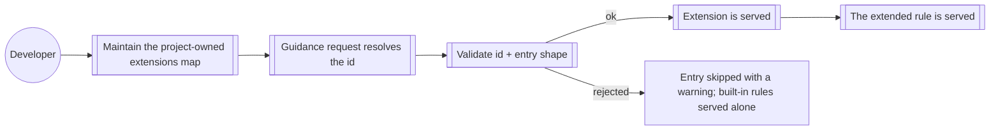

# Use case: extend-an-instruction

## Level

!

## Actors

- Developer

## Goal

Extend an instruction's built-in rules with project-specific rules.

## Trigger

The developer maintains project-owned configuration for an instruction —
because the project needs guidance the technology-agnostic built-in rules do
not carry (a house convention, a domain rule, a local constraint).

## Preconditions

- The project is initialized as a Givn project.

## Main flow

1. The developer edits the project-owned `extensions:` map in
   `givn/config.yaml` — adding, changing, or removing the rule strings for an
   instruction id. The actor's action is maintaining project configuration,
   not invoking a Givn command.
2. Givn loads and validates the map when it resolves guidance: the id names
   an artifact, a policy, or a step, and a rule is a non-empty string.
3. No generated file, installed artifact, and no managed revision is touched:
   the map is project-owned configuration outside every managed path.
4. The next guidance request for that id serves the extended rule (the merge
   itself is obtain-effective-guidance's flow).

## Extensions

- 2: the id is unknown to the request path → the entry is skipped with a warning naming it; the request serves the built-in rules alone; nothing in the project is mutated.
- 2: a rule is not a string, or is empty or whitespace-only → the entry is skipped with a warning naming it; the request serves the built-in rules alone.
- 2: an empty list → valid; the served content adds nothing and carries no extension section.
- 2: a repeated instruction key → the last occurrence is kept (recorded YAML behavior); the earlier occurrence is never served.
- 3: the extension is changed → the next request serves the changed text; no installed file, revision, or built-in rule is touched.
- 3: the extension is removed → the built-in rules stand alone again; nothing else needs cleanup because the extension never entered installed files or the revision.
- 3: the extension textually contradicts a built-in rule → both appear in the served content; the system detects no semantic conflict; rules are extended, never overridden.
- 3: a project-owned replacement of the instruction facet exists for the same id → the replacement is the base the extension extends; the replacement file itself stays byte-for-byte.

## Rules

- The extension adds project-specific rules; it never changes steps, order,
  gates, or the artifact list — the built-in flow is not configurable.
- It never overrides, replaces, suppresses, or reorders the built-in rules.
- It lives in project-owned configuration; it never enters generated files,
  the managed revision, or the published clean-history surface.
- Givn validates the entry when it resolves guidance; a rejected entry warns
  and is skipped, and the request succeeds with the built-in rules alone.
- It is effective at the next request: no synchronization, upgrade, or
  restart is needed.
- It belongs to the project: every upgrade leaves it untouched.
- Project-, technology-, and domain-specific guidance enters only through
  extensions; the built-in rules stay technology-agnostic.

## Examples

- Record: the developer adds "Keep proposals under 500 words" to the
  `extensions:` map for the proposal instruction; the next `givn instructions
  proposal` serves the built-in rules plus that line.
- Change: the developer edits the line to "Keep proposals under 300 words";
  the next request serves the new text; nothing else changes.
- Remove: the developer deletes the entry; the served content is the built-in
  rules alone.
- Unknown target: the map names `propozal`; the next guidance request warns,
  skips the entry, and serves the built-in rules alone; the map stays
  unchanged.
- Contradiction: the developer records "Never write a release note" while the
  built-in proposal rules require one; the served content carries both; the
  project resolves its own contradiction.

## Minimal guarantee

A rejected entry changes no project state: the configuration stays
byte-for-byte, no generated file, revision, or installed artifact is touched,
and the guidance request warns and serves the built-in rules alone for the
rejected entry.

## Success guarantee

The instruction serves the extended rule: Givn's built-in rules plus the
project's extension. The extension belongs to the project and survives
upgrades untouched; removing it restores the built-in rules alone.

## Personas

- developer--primary-user
- givn-maintainer--owner

## Capabilities

- instruction-extension

## Interactions

| Capability | Consumer action | E2E scenario |
|---|---|---|
| instruction-extension | record an extension for an instruction | A developer records an extension and it governs the next guidance request |
| instruction-extension | upgrade a project that holds an extension | An upgrade preserves the extension and the next request serves it |

## Includes

- none

## Extends

- none

## Out of scope

The request-time merge and delivery (obtain-effective-guidance); the
mechanism that replaces an instruction facet with project-owned content
itself (separate ownership); generating and refreshing installed guidance
(initialize-project, upgrade-a-project); custom workflow configuration
(never).

## Diagram

