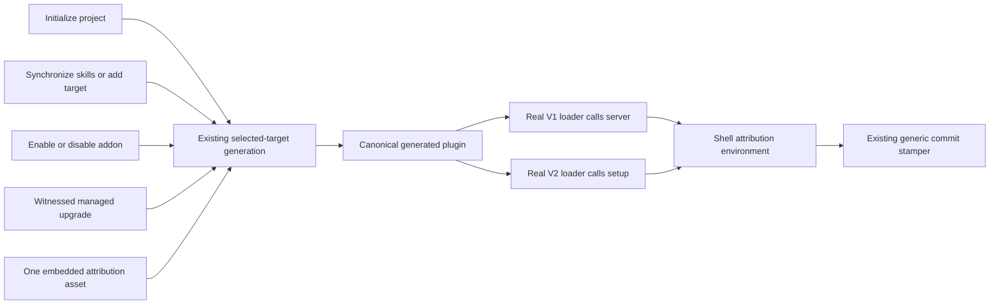
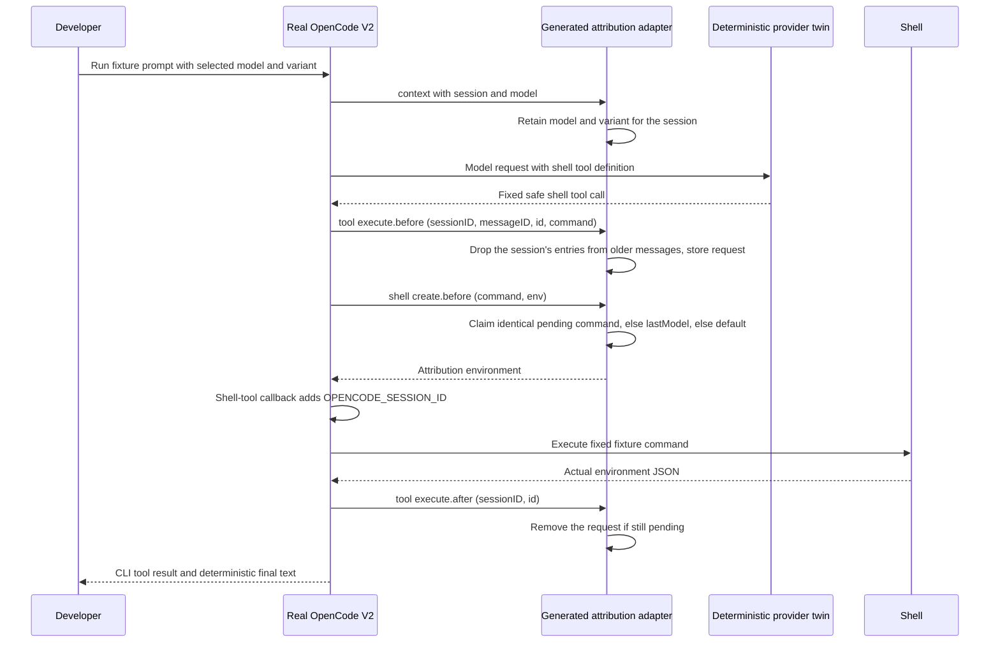

# Design: fix-opencode-v2-attribution

## Scope and binding inputs

Planning only. The production change is confined to the embedded OpenCode
attribution asset; supporting tests and their isolated runtime provisioning are
described here, not implemented. No changes to user-owned
`.opencode/plugins/givn-attribution.js`, `.opencode/plugins/givn-attribution_v1.js`,
or harness plugins are permitted. Both user files were read in full on
2026-10-04. The former is the supplied prototype: it remains the behavioral
baseline for the V1 hooks and the retained fallbacks, but not for the V2
`setup()`, which the rewrite decision (D3) replaces. The latter is the legacy
installation fixture input, not a second generated entrypoint.

Read-baseline SHA-256 values, rechecked after authoring:
`e7e5fa591521ba67fd05f3d5757b68baea4b9bb15ad674fb2f3ca9178c886c9d`
for the canonical supplied prototype and
`e1eec8605d353fdced8ec2f3068dadb720614dabf786312fb26d07af62999d27`
for the legacy file. The immutable fixture copies must match these values;
if root content changes meanwhile, do not copy it blindly as the baseline.

The compatibility-window decision (D1) promises recent V1 and V2, not older V1.
The preserve-attribution-behavior decision (D2) originally prohibited changing
the supplied logic; the V2 rewrite decision (D3, 2026-10-06) supersedes it for
the V2 session link and the configured-default lookup, and its refinement
(stale pending shell requests) fixes how unclaimed requests are forgotten. The
retained fallbacks of D2 still bind. Full questions, options, user responses,
and rejected alternatives remain in `proposal.md`.

The production asset `assets/agent-integrations/opencode/givn-attribution.js`
is already final for this plan (120 lines, read 2026-10-06). The sections
below describe that asset; implementation tasks verify it scenario by scenario
and must not rewrite it again without a new decision.

## Decisions

- **Decides D1: support OpenCode V1 1.18.29+ within the V1 generation and
  OpenCode V2 through one canonical default object with `id`, `server`, and
  `setup`** — realized in the embedded asset and three-release real-loader
  matrix. `server()` delegates to the retained named `GivnAttributionPlugin`.
  The named export can remain for consumer-fixture compatibility. No runtime
  version detection and no generated V1 sibling. Reject older-V1 support and
  separate version-specific installation because the user selected the recent
  V1 plus V2 window.
- **Decides D2 (superseded in part by D3): retain the supplied prototype's
  fallbacks** — realized by public-hook characterization of the V1 hooks and
  the retained fallbacks, installed-file parity with the embedded asset, and a
  narrowly clarified glossary/adapter risk. Per-session memory, `id`/`modelID`,
  variant retention, last observed model, configured default, and swallowed
  lookup errors behave as in the prototype. Reject current-session-only
  fallback, clearing retained variants, extra title hooks, persistent model
  state, and fatal default lookup failures. The user's original constraint was
  “No changes to the plugin logic itself.” D3 supersedes it for the V2 session
  link and the default lookup; it no longer binds the V2 `setup()` text or
  logic. Inferred labels are not verified facts.
- **Decides D3: rewrite the V2 half — link each V2 shell command to its
  issuing session through the tool hooks, and read the real configured-default
  response** — realized in the embedded asset. User answer on 2026-10-06:
  “Keep last-model guess”. Released V2 2.0.22 evidence: the shell
  `create.before` event carries only `{command, cwd, timeout, shell, env}` and
  `OPENCODE_SESSION_ID` is added after it, so the prototype's session lookup
  never matches. Tool `execute.before` carries
  `{tool, sessionID, agent, messageID, id, input}` and runs before shell
  creation; `execute.after` carries the same `sessionID` and `id` and fires for
  completed and failed (`Tool.Error`) executions. The adapter stores the whole
  `execute.before` event of each `shell` tool call with a string command,
  claims the first pending entry whose stored `input.command` equals the
  `create.before` command (read from the stored event at claim time, so a later
  rewrite of the event's input by another plugin is seen), and removes an entry
  in `execute.after` by `(sessionID, id)`. A claimed entry selects the issuing
  session's remembered model; a subagent runs in its own child session that
  observes its own model, so main and subagent commands each get their own.
  Unlinked commands (user `!` commands, terminals, requests whose text no
  longer matches) use `lastModel`, then `ctx.model.default()`. Two sessions
  issuing an identical command concurrently are claimed in issue order, which
  can swap their labels; this is the retained best-effort risk.
  `ctx.model.default()` returns `{location, data}` where `data` is the real V2
  `Model.Info` (`id`/`modelID`, no variant); the adapter reads only
  `response.data` and keeps the swallowed-error behavior. V1 is unchanged: its
  `shell.env` input carries the child session's `sessionID` for task-tool
  subagents. Reject unavailable and main-session-only fallbacks because the
  user chose to keep the guess.
- **Decides D3 refinement: drop stale pending shell requests by newer message
  of the same session** — realized in the embedded asset. User answer on
  2026-10-06: “Drop older same-session entries”. Options kept in full:
  1. *Expire by age* — drop a pending request after a fixed time. Gain: also
     clears quiet sessions. Cost: a time constant; a slow permission prompt
     expires a legitimate request, whose command then falls back to the last
     observed model.
  2. *Drop older same-session entries (chosen)* — each shell-tool
     `execute.before` first drops that session's pending entries whose
     `messageID` differs from the new request's, then records the new one.
     Gain: no timer; a session that keeps working leaves no stale request.
     Cost: entries of a session that goes quiet stay until plugin cleanup.
  3. *Accept* — keep stale entries until unload. Gain: simplest. Cost: an
     aborted request can label any later identical command from any session.
  Entries are removed in `execute.after` by `(sessionID, id)`; the command is
  read from the stored event at claim time; `pendingShells` lives in the
  `setup()` closure (one list per plugin instance) and the returned cleanup
  empties it. Example: session A's `git commit` is aborted in message 1; A then
  requests `git status` in message 2, which drops the stale entry; session B's
  later `git commit` is labeled with B's model, not A's. Residual risk: a quiet
  session's stale entry stays pending until cleanup and can still label a
  later identical command from another session. Only shell-tool requests
  trigger the drop; a session that only uses other tools afterwards keeps its
  stale entry. Reject expiry by age and acceptance for the reasons recorded in
  `proposal.md`.

### Decision ledger

| Question | Status | Resolution in this design |
|---|---|---|
| Supported OpenCode generations (D1) | Resolved | First bullet above; recent V1 plus V2, one default object. |
| Preserve supplied attribution behavior (D2) | Resolved; superseded in part by D3 | Retained fallbacks bind; the V2 session link and default lookup are no longer bound by “No changes to the plugin logic itself.” |
| Rewrite the V2 half for subagents and the real V2 API (D3) | Resolved | Tool-hook session link, last-model then configured-default fallback, `response.data` lookup. |
| Stale pending shell requests (D3 refinement) | Resolved | Drop older same-session entries; residual quiet-session risk documented. |

No proposal question is carried; none is seed-sourced.

No operator question remains unresolved. Deployment provision hashes and the
latest release refresh are mechanical setup values, not new product choices.

## Architecture impact

### Existing boundary and minimal realization

Givn's workflow bounded context already has an agent-integration adapter. Model
extraction belongs to the embedded JavaScript asset, not the generic Rust
attribution stamper. No Aggregate, Domain Event, repository, or domain
dependency is introduced. The module-level session map is adapter runtime
state, not a domain Aggregate or a persisted model selection.

| Exact path | Planned responsibility/change |
|---|---|
| `assets/agent-integrations/opencode/givn-attribution.js` | Already final (120 lines): V1 hooks as in the prototype, a default object with `id`, `server()` delegating to `GivnAttributionPlugin`, and a rewritten V2 `setup` with the tool-hook session link, the stale-request drop, and the `response.data` default lookup (D3 and its refinement). |
| `src/config/embedded.rs` | Existing Rust embedding; no source change required. A rebuilt binary embeds the updated asset. |
| `src/skills/targets.rs` | Existing `sync_agent_integrations` writes `.opencode/plugins/givn-attribution.js` from that asset when OpenCode is selected; `write_embedded_file` overwrites it unconditionally. No seam refactor, preservation feature, or second writer. |
| `src/cli/init.rs`, `src/cli/skills.rs`, `src/cli/addons.rs`, `src/cli/migration.rs`, `src/cli/upgrade.rs` | Existing callers converge on `skills::targets::sync`. Keep call order, reports, error policy, clean-state witnesses, allowlist calculation, and pending-migration early returns. No production edits expected. |
| `tests/steps/llm_attribution_steps.rs` | Existing per-capability regular bindings for `attribute-commits`; add prototype characterization glue here. |
| `tests/steps/llm_attribution_e2e_steps.rs` | Existing per-capability E2E bindings for `attribute-commits`; replace Node-only compatibility proof with the actual OpenCode runtime driver. Preserve unrelated Git/Claude bindings. |
| `tests/steps/llm_attribution_installation_steps.rs` | Existing regular bindings for `enable-commit-attribution`; reinit/config preservation, no-addons and target-exclusion variants. |
| `tests/steps/llm_attribution_installation_e2e_steps.rs` | Installation/report/upgrade and four new regeneration E2E actions, separate from regular bindings. |
| `tests/common/opencode_runtime.rs`, `tests/common/mod.rs`, `tests/steps/mod.rs` | Test-only runtime admission, supervisor lease, fresh World state, and module registration; no production abstraction. |
| `tests/opencode_supervisor.rs`, `Cargo.toml` test-target declaration | Test-only `harness = false` supervisor target using the existing unix `libc` dependency; signal-aware process-group teardown and parent-lease monitoring. No new production dependency or executor change. |
| `tests/fixtures/opencode/runtime_driver.mjs` | Real-runtime orchestration and result normalization; does not emulate the plugin loader. |
| `tests/fixtures/opencode/provider_stub.mjs` | Deterministic loopback OpenAI-compatible provider, catalog/proxy twin, request recording, deadlines and rejection of unexpected requests. |
| `tests/fixtures/opencode/prototype/givn-attribution.js` | Immutable copy of the full supplied 107-line prototype, made during implementation from the read baseline; never import mutable root content. Oracle for the V1 hooks and retained fallbacks only. |
| `tests/fixtures/opencode/prototype/givn-attribution_v1.js` | Immutable copy of the supplied 38-line legacy input, used only to seed obsolete integrations in temporary projects. |
| `tests/fixtures/opencode/characterize.mjs` | Consumer of public V1/V2 hooks with controlled event payloads, including V2 tool `execute.before`/`execute.after` events with `sessionID`, `messageID`, `id`, and `input.command`. For the V1 hooks and the retained fallbacks it also compares generated behavior with the immutable prototype; the V2 session-link, identical-command, and stale-request scenarios are asserted against their Gherkin values only, because the prototype has no link. Not E2E loader evidence. |
| `tests/fixtures/opencode/run-suite.sh`, `tests/fixtures/opencode/resolve-runtime.sh`, `tests/fixtures/opencode/network.sb`, `tests/fixtures/opencode/runtime-lock.json` | Test-only shell suite and validator for the runtime variables exported by the active development environment, Darwin network policy template, and exact runtime URL/integrity/version/help provenance. These scripts never invoke Nix or Fish. |
| `run-tests.sh` | Validate the active-shell runtime variables using `resolve-runtime.sh` before running the existing scope command; preserve feature-root selection, tag filters, exit propagation, and one result per scope. |
| `flake.nix` | The sole Nix expression: inline the test-only pinned OpenCode runtimes, latest-LTS Node, required modules, and existing development tools; export the `GIVN_OPENCODE_*` runtime paths from the dev-shell hook. This is the only repository file containing Nix expressions or invoking Nix. No production npm dependencies. |
| `givn/specs/fragments/fragment.md` | Durable capability-aware interaction inventory already maintained before delta authoring. No new `usecase.md` for the reusable fragment. |

The existing E2E fixture at `llm_attribution_e2e_steps.rs:23–26` compares the
embedded asset with the manually editable root plugin. Remove that dependency
from the fixture, not from the user file. Compare the generated temporary
project's installed canonical file against the embedded asset. Separately
compare the V1 hooks and retained-fallback behavior against the immutable
prototype fixture; the rewritten V2 session link has no prototype oracle and is
asserted against its Gherkin values. Do not mistake byte parity with the asset
for compatibility or behavior preservation.



### Regeneration coverage and unchanged preconditions

| Action | Existing production path | Fixture precondition |
|---|---|---|
| init, including reinit without `--force` | `cli::init::run` → `skills::targets::sync` | Writable fresh project; reinit has saved targets and `--no-addons` to avoid unrelated addon writes. |
| skills sync | `cli::skills::run_sync` → same sync | Existing config selects OpenCode; obsolete canonical file seeded in fixture. |
| skills targets add | `cli::skills::run_targets_add` → persisted target addition → same sync | Add OpenCode to Claude-only, or add Claude with OpenCode already selected. |
| addons enable/disable | `cli::addons::run_enable/run_disable` → same sync | Toggle `dev_principles`, which has no external dependency. |
| upgrade | `cli::upgrade::run` → managed preparation in `cli::migration` → same sync | Clean Git fixture with `rules: versioned`, both OpenCode and Claude selected, no pending migration, no migration-bearing release gap. Commit the missing/obsolete state before invoking upgrade. |

For the missing-plumbing variant remove and commit the original scenario's
shared hook and both selected attribution integrations; its managed revision
must restore all of them. For the V1-only variant record obsolete content only
at the canonical OpenCode file; require that file in the upgrade revision, not
unchanged hook/Claude files. Compare all refreshed bytes against embedded
assets and keep the existing allowlist-only assertion. Test-only OpenCode
configuration and probe scripts are created after upgrade, never left dirty
before its witness.

Initialization catches generation errors and warns; the other commands retain
their existing error propagation. This change does not repair that policy.
Tests require successful generation and reject its warning in the happy path;
an exit code alone is insufficient. Missing executable, tool timeout, malformed
provider output, omitted shell result, and loader failure are hard test failures,
not skips. A pending-migration upgrade may return before generation; it is not
claimed to refresh attribution.

### Runtime semantics

`rememberModel` accepts `id` or `modelID`; it retains provider, model and variant
from the current session when omitted. An explicit variant overrides a model
variant, which overrides the remembered variant. A record with a model identity
updates global `lastModel`, including non-session observations. An event with
neither model nor variant is ignored. The session map and `lastModel` are
module state, ephemeral and unbounded for the module's lifetime; the pending
shell list lives in the V2 `setup()` closure and is emptied by its cleanup.

V1 returns `chat.message`, `chat.params`, and `shell.env`, unchanged from the
prototype. It uses the issuing session's record (V1 `shell.env` receives the
issuing session, subagent child sessions included) or the global last record.
V2 registers `context`, `compaction`, and `generate` (model observation), tool
`execute.before` and `execute.after` (session link and stale-request drop, D3
and its refinement), and shell `create.before`; no `title` or `prompt` hook is
added. At `create.before` V2 claims the pending request with the identical
command and uses its session's record; when no request is linked or the linked
session has no usable identity it uses `lastModel`, then
`ctx.model.default()`. The default lookup reads only `response.data` from the
real `{location, data}` response; its errors remain swallowed.

Real V2 `Model.Info` carries no variant, so against a real V2 runtime the
configured-default fallback yields reasoning `unavailable`. The regular
scenario “OpenCode V2 uses its configured default when no model has been
remembered” expects reasoning `low` because its controlled payload carries a
variant; it characterizes the adapter's handling of such a payload, not real
V2 output. The user chose on 2026-10-06 to keep that scenario text; this is a
retained, documented spec/reality mismatch, not a claim about real V2.

Both generations initialize `GIVN_ATTRIBUTION_ACTIVE=1`, model and reasoning
to `unavailable`, and harness to `opencode`. With a usable identity they stamp
`GIVN_ATTRIBUTION_LLM` and `GIT_COMMITTER_NAME`; reasoning changes only for a
truthy remembered/default variant. Without a usable identity the prior Git
committer name stays unchanged. Do not invent an author-name/email change.

The verified V2 shell lifecycle invokes `create.before` before the shell-tool
callback adds `OPENCODE_SESSION_ID`, so that field is absent or stale at the
hook and is not read. The session link comes from the tool hooks (D3):
`execute.before` precedes `create.before` and names the issuing session, the
message, the call identifier, and the command; `execute.after` follows the
execution. Subagent child sessions fire `context`/`compaction`/`generate` with
their own `sessionID` and model, so their linked commands resolve to the
child's model. Fixture-supplied tool events characterize the link, identical
concurrent commands, and stale-request dropping (regular scenarios). The
real-runtime subagent E2E scenario characterizes the real loader's subagent
path; see “Subagent E2E scenario: what it proves”.



Map access/update is O(1) per observation; claiming and dropping scan the
pending list, which holds at most the in-flight shell requests plus stale
entries of quiet sessions. State uses O(number of observed sessions) memory.
Default lookup is one asynchronous fallback, not a new retry policy. No
performance optimization is warranted.

## Technology decisions and verified sources

All research below was checked on 2026-10-04. Context7 resolution was attempted
in this session and failed with an invalid API key; official V2 documentation
and exact released source were the fallback. V1 docs/source were used only as
migration inputs, never to infer V2 fields.

| Technology | Choice and freshness/provenance |
|---|---|
| Rust and embedding | Existing Rust 2024 edition from `Cargo.toml`; latest stable Rust resolved through the locked Nix development environment at setup. Existing `rust-embed`; no new production library. |
| Cucumber/Gherkin | `cucumber` 0.23.0 and `gherkin` 0.16.0 verified in `Cargo.lock`; preserve lockfile-resolved versions. |
| Runtime scripting | Plain JavaScript ES modules; Node latest LTS resolved from official Node release metadata at setup and pinned in the development-shell lock. Native OpenCode binaries remain the real loaders. |
| V1 floor | `opencode-ai` 1.18.29, floor verified in the official plugin migration guide and exact tag's `plugin/index.ts` and `plugin/shared.ts`. |
| Latest stable V1 | `opencode-ai` 1.18.34 from `https://registry.npmjs.org/opencode-ai/latest`; exact tarball and npm integrity recorded at setup. Refresh latest stable within V1 before implementation, then pin the resolved release. |
| Latest stable V2 | `@opencode/cli` 2.0.22 from `https://registry.npmjs.org/@opencode%2fcli/latest`; local `opencode --version` also returns `v2.0.22`. `@opencode/core` 2.0.22 released npm metadata and chunks verified. Refresh latest stable within V2 before implementation, then pin the resolved release. |
| Provisioning | `flake.nix` alone owns pinned fixed-output release downloads and module provisioning, using `flake.lock` and `runtime-lock.json` metadata for supported Darwin/Linux platforms. Its development-shell hook exports absolute runtime paths. Test scripts only validate those already-exported paths and versions; they never call Nix, Fish, a registry, or an installer. Enter the development environment before invoking test commands. |
| Process/terminal driver | Rust `std::process::Command` through existing common fixtures, real OpenCode CLI, separate E2E bindings. PTY scenarios use the platform-provided `script` command with Darwin BSD syntax or util-linux syntax on Linux, supplied by the active development shell. No browser, database service, container engine, or paid provider is needed. |

Primary official sources:

- `https://opencode.ai/v2/docs/build/plugins/migrate-v1` — shared `server/setup`
  shape and floor; register request kinds separately, APIs are not translated.
- `https://opencode.ai/v2/docs/build/plugins` — full Promise API, models,
  session-hook payloads, shell event, plugin listing and lifecycle.
- `https://opencode.ai/v2/docs/migrate-v1` — migration input and V2-native
  provider/model/variant shapes.
- `https://opencode.ai/v2/docs/cli`, `/cli/commands`, `/config`, `/providers`,
  `/models`, `/plugins`, `/network` — private service, run flags, native provider
  configuration, model variants, discovery, global update suppression, proxy.
- `https://raw.githubusercontent.com/anomalyco/opencode/v1.18.29/packages/opencode/src/plugin/index.ts`
  and `shared.ts` — default object read happens before legacy named-export
  enumeration and returns after adding its server hooks. Keeping the named
  function does not activate the canonical source twice at the supported floor.
- The same tag's `cli/cmd/run.ts` — V1 `--model` uses provider/model and has
  separate `--variant`, `--auto`, and `--format json`; no V2 standalone flag.
- `https://unpkg.com/@opencode/core@2.0.22/dist/chunks/instruction-discovery-wbx60fzd.js`
  — released V2 loader decodes only `module.default` with `id` and
  `setup/effect`; ignores `server` and the named V1 export.
- Released chunks `instruction-discovery-rz6t0wqc.js` and
  `instruction-discovery-0n82x6dt.js` — shell hook precedes session-ID injection.
- Released chunk `instruction-discovery-4g11qfmx.js:190–303` — models.dev uses
  a bundled snapshot and background catalog refresh from
  `https://models.opencode.ai/api.json`; do not guess a disable-fetch env flag.
- `https://raw.githubusercontent.com/anomalyco/opencode/v1.18.29/packages/core/src/models-dev.ts:160–176`
  — V1 floor also defaults to `https://models.opencode.ai/api.json` (with
  `OPENCODE_MODELS_URL` override). No override is needed: intercept the exact
  default catalog request in the fixture proxy. Inspect the latest pinned V1
  source at setup to detect drift, not to choose an unspecified architecture.
- `https://opencode.ai/v2/openapi.json` — `server.info` is `GET /api/info`,
  including `pid`, `version`, `urls` and `paths.tmp`; `plugin.list` is
  `GET /api/plugin` with deep-object `location[directory]` query encoding.

Loader-source inspection proves export selection, while the E2E matrix proves
the generated artifact works through the installed release. Environment writes
are idempotent: counting them is not an activation-count proof. Inspect the V2
active plugin list for exactly one canonical local source/ID where available;
V1 source and a fixture with only the canonical external plugin bound the
evidence. Do not add an unrequested exactly-once-hook product requirement.

## Local runnability and digital twins

### One command and complete lifecycle

Local setup commands: `tests/fixtures/opencode/run-suite.sh --regular` and `tests/fixtures/opencode/run-suite.sh --e2e`, from an already active project development shell whose `flake.nix` hook provides pinned test-runtime variables and tools. Setup modes validate and execute permanent specs only; delta scenarios remain `@wip` until their scenario-by-scenario TDD tasks.

After all delta scenarios are green, run `tests/fixtures/opencode/run-suite.sh --all`. That final mode executes four fail-fast root/scope combinations: permanent regular, delta regular, permanent E2E, delta E2E. `--name <anchored title>` targets matching permanent and delta scenarios separately; a zero match in either tree is an error. Every mode validates exported runtimes, prepares `ready_fixture` and the supervisor, and fails on any child error; skips are not treated as passing. No host OpenCode service or existing project database is used. The wrapper uses POSIX shell and never invokes Nix or Fish.

### Shared runtime admission for every verification entrypoint

`tests/fixtures/opencode/resolve-runtime.sh` is a POSIX-shell validator, not a package resolver. It validates the runtime paths exported by `flake.nix` against `runtime-lock.json`, including exact versions, required CLI flags, fixture modules, and platform isolation prerequisites. It never starts Nix or Fish, changes PATH to a host-selected OpenCode, installs packages, or downloads anything. Missing variables or mismatched runtimes fail with a named setup error before Cucumber starts.

`run-tests.sh` and `run-suite.sh` call this validator directly before fixture builds or Cucumber. Direct Rust test invocations also validate exported runtime variables in `tests/common/opencode_runtime.rs`; they do not start a resolver process. The caller's `GIVN_FEATURES`, result/tag/name/profile variables, `CARGO_BIN_EXE_givn`, and supervisor path remain unchanged. The test wrapper builds the supervisor before scenarios and exports its exact Cargo-reported path. `run-suite.sh --regular` and `--e2e` target permanent specs during setup. `run-suite.sh --all` adds the delta root only after all delta tasks are green. The flake shell hook is the only place that declares/provisions Nix derivations and exports runtime paths.

Each compatibility example owns a unique temporary root under the approved
OpenCode temporary directory on Darwin; explicitly set `TMPDIR`. Set fresh
`HOME`, `XDG_CONFIG_HOME`, `XDG_DATA_HOME`, `XDG_CACHE_HOME`,
`XDG_STATE_HOME`, and Git config locations; use `env_clear` and a whitelist of
Nix executables, test variables and locale. Supply only a fake fixture key,
never inherited provider keys, tokens, proxies, MCP servers or global plugins.
Remove inherited `OPENCODE_SESSION_ID`. Verify ancestors outside the temporary
root contain no OpenCode configuration/plugin discovery directories, or fail
setup by name; V2 discovers config to filesystem root.

Generate the canonical plugin by running the compiled `givn` binary in the
temporary project. Do not copy the repository's `.opencode` tree. In particular,
`givn-attribution_v1.js` would be autodiscovered as a second plugin and is never
present in the runtime fixture's plugin discovery directory. Seed obsolete
content only at its canonical path before the tested regeneration action.

Setup smoke starts the provider twin on an owned loopback port and verifies its nonce-bearing readiness without asserting attribution. The real-loader shell-result assertion is reserved for the selected-model E2E scenario after the adapter TDD task adds the V2 entrypoint. The per-example driver starts the provider/proxy twin on kernel-assigned loopback ports. The twin publishes readiness after binding, including its port
and fake catalog. Start a real V2 foreground server using
`opencode serve --hostname 127.0.0.1 --port <reserved-port>`, with a unique
temporary database in its XDG data directory. Reserve an ephemeral port for
the server, close the reservation immediately before spawning, and retry a
bounded number of times on bind collision. Probe its actual `/api/info` through
the CLI/API before running the prompt; require the reported PID to equal the
spawned server process, version to equal the pinned release, and `paths.tmp`
to lie inside the example's temporary root. Reject accidental connection to
an unrelated process. Twin readiness includes a driver-generated nonce;
OpenCode's server-info API is not assumed to expose a nonce. V1 `run` uses its real
in-process server, without shared host service discovery.

RAII alone cannot clean up after the runner receives SIGINT/SIGTERM or calls
`process::exit`. Each example therefore uses a separate test-only supervisor
executable, `tests/opencode_supervisor.rs`, declared as a `harness = false`
Cargo test target and built with `ready_fixture` before scenarios. It uses
existing `libc`, `std::os::unix::process::CommandExt::process_group`,
`std::process::Child::{try_wait,wait}`, and `std::time::Instant`; no production
executor logic or new production dependency is added.

`tests/common/opencode_runtime.rs` launches the supervisor in its own process
group with piped stdin as a parent lease. Only the runner keeps the write end;
it is closed on unwind, explicit teardown, or OS process exit and is never
inherited by fixture children. The supervisor monitors lease EOF using
`libc::poll`/`read` and registers SIGINT/SIGTERM via `libc::sigaction`; handlers
only set a signal-safe flag, with cleanup in the main loop. It owns one separate
process group whose leader is Node running `runtime_driver.mjs`; the V2 server,
CLI runs, shell descendants, and provider/proxy twins inherit that group.
Children must not detach or invoke shared-service discovery. Record leader PID,
PGID and role/PID diagnostics at spawn, never infer ownership from a port.

Ready timeout is 15 seconds, provider request timeout 5 seconds, and run deadline
60 seconds. Readiness retains nonce/owned-server PID/version/tmp checks above;
early exit, wrong server, malformed readiness, bind retry exhaustion, missing
completed tool result, and timeout are hard failures with captured logs. On
completion, failure, lease EOF, signal, or deadline, the supervisor stops new
requests and signals only its registered fixture PGID with
`libc::kill(-pgid, SIGTERM)`. The Node driver uses `process.on('SIGTERM', ...)`
and `process.on('SIGINT', ...)` to abort outstanding work, close twin listeners,
stop the owned server, and await child exit/output. After 3 seconds the
supervisor sends SIGKILL to surviving members, waits for the direct child, and
confirms owned PIDs/PGID have disappeared before deleting only its owned root.
On Linux it first enables `libc::prctl(PR_SET_CHILD_SUBREAPER, 1, ...)` and
drains adopted descendants with `libc::waitpid`; failure is a setup failure.
On Darwin orphan reaping belongs to the OS; PID/group disappearance polling
has a further 5-second bound after direct-child reaping. Teardown failure remains
non-zero even if the attribution assertion succeeded.

Mandatory controlled probes interrupt the runner with SIGINT and SIGTERM,
exercise runner process exit/lease EOF, and force the run deadline while an
owned server, runtime descendant, and twins are alive. Each must demonstrate
escalation/reaping and closed owned ports, while an unrelated user-service
sentinel PID/listener remains alive and responsive. Record observed PIDs,
signals, exit status and logs; these probes have not run. Simultaneous external
SIGKILL of the supervisor itself is outside this controlled-interruption proof,
not an RAII guarantee. Never kill a process found only by a port number.

### Concrete Darwin network isolation

The development environment provides dependencies, not a network sandbox. Use `/usr/bin/sandbox-exec`
with a generated Seatbelt profile for each OpenCode process and all of its
descendants. The checked profile shape is:

```scheme
(version 1)
(allow default)
(deny network*)
(allow network-bind (local ip "localhost:*"))
(allow network-inbound (local ip "localhost:*"))
(allow network-outbound (remote ip "localhost:PROVIDER_PORT"))
(allow network-outbound (remote ip "localhost:PROXY_PORT"))
(allow network-outbound (remote ip "localhost:SERVER_PORT"))
```

Replace only the three driver-owned outbound ports with decimal bound values;
omit the server allowance for in-process V1. A literal `127.0.0.1:*` profile
address was rejected by the local parser; use its supported `localhost` form.
Do NOT use `(allow network* (local ip "localhost:*"))`: a planning probe found
that this incorrectly permits non-loopback outbound sockets. The separated
bind/inbound/remote-outbound profile was exercised on this host: local TCP
returned `loopback:local`, and TCP to reserved non-loopback `192.0.2.1:443`
failed immediately with `EPERM`. Repeat that proof at setup, with the narrowed
actual-port allowances and an unrelated loopback listener as a negative probe.
Allowed ports are fixture-owned; connections to other host services are denied.

A second planning probe exercised a concrete owned-port allowance: its
fixture TCP connection returned `owned:owned`, a different live loopback
listener failed with `other:EPERM`, and the non-loopback connection failed
with `remote:EPERM`; the probe exited 0. This establishes the narrowed profile
behavior on this Darwin host, not merely successful profile parsing.

Wrap twins in their own profile with no network-outbound permission. They accept
only driver/OpenCode loopback clients and cannot forward to a live provider.
The runner additionally checks nonce-bearing readiness and distinct allocated
ports per example. Filesystem home/config isolation and port ownership provide
the equivalent per-project local stack; no shared database is assumed. For
Linux CI use an unshared network namespace containing only the loopback
interface and these owned processes; a capability/namespace failure fails
setup, never silently falls back to host networking. Darwin Seatbelt is a
deprecated system tool: absence or inability to apply it is a named setup
failure, not authorization to weaken network evidence.

### External systems and twins

| External dependency | Local deterministic twin/control |
|---|---|
| Paid/model-provider API | `provider_stub.mjs`: actual loopback HTTP server implementing OpenAI-compatible chat completion JSON and streaming SSE. Fake `givn-fixture/model-a`, `model-b`, and `title-model`; no real credentials or model inference. |
| models.dev/catalog refresh | The same fixture's HTTPS-intercepting proxy serves fixed `/api.json` catalog JSON (empty catalog is valid; the fixture's models are configured explicitly). Preprovision a fixture CA/key in the development closure with OpenSSL; trust only in the test process with `NODE_EXTRA_CA_CERTS`. `HTTP_PROXY` and `HTTPS_PROXY` point at the local proxy; `NO_PROXY=localhost,127.0.0.1,::1` leaves owned local services direct. Support CONNECT only to `models.opencode.ai:443`, verified for V1 floor and V2; latest-release drift requires updating an explicit pinned fixture mapping. Log and fail on unknown destinations, never forward traffic. The proxy is test infrastructure, not a plugin. |
| OpenCode update service | Disable V2 updates with global `update: "disable"` in the temporary XDG config, as documented; V1 with `autoupdate: false`. Any unexpected residual update request is rejected/recorded by the proxy and OS sandbox; no live update/registry request can occur. |
| npm/provider/plugin package acquisition | The test-only hash-pinned development closure supplies native runtimes and all modules before scenario execution. No local package plugin and no runtime install; unplanned acquisition is a failing fixture prerequisite. |
| Git/Fossil and OpenCode itself | Real provisioned executables, not API twins. OpenCode's real loader is indispensable compatibility evidence. The existing Fossil fixture uses a private repository. |

The fake provider recognizes request kind from actual messages/tool schemas,
not a plugin-only test switch. Primary requests first return one tool call to
the runtime's advertised `shell` (V2) or `bash` (V1), using the exact advertised
schema. Arguments select only the fixed safe command
`node attribution-fixture.mjs` in the temporary project; it prints a sentinel
and JSON containing the four Givn attribution variables and Git committer name.
The next request containing that tool result returns deterministic final text.
Non-streaming and SSE formats include role, tool-call ID, argument deltas,
finish reason and usage as required by the pinned runtime. Title requests
return a fixed title without tools; compaction and transient-generation
requests return fixed text. Requests beyond this finite state machine fail
with diagnostic fixture output. No arbitrary model-supplied command is run.

For the V2 subagent E2E scenario the twin gains one more finite state. A
primary request for `model-a` that advertises the `subagent` tool and carries
the subagent prompt returns one `subagent` tool call with arguments
`{agent: "attribution-subagent", description: "Run the attribution fixture", prompt: "Run the attribution fixture command."}`
(the released 2.0.22 `subagent` tool input is `{agent, description, prompt}`
plus optional `model`, `sessionID`, `background`, which the twin omits so the
child runs in the foreground on the agent's configured model). The child
session's first request reaches the twin for `model-b`; its user text starts
with the released prefix “You are a subagent spawned by another session.”.
The twin answers it with the fixed `shell` tool call
`node attribution-fixture.mjs`, then the child's request carrying that tool
result with fixed final text, then the parent's request carrying the
`subagent` tool result with fixed final text. The twin selects states by
requested model and message content, never by a plugin-only switch.

### Verified runtime command and configuration shapes

V2 `run --help` was checked locally at 2.0.22; `--server`, `--standalone`,
`--format json`, `--auto` and model `provider/model#variant` are supported.
Use the owned foreground server for continued diagnostics and active-plugin
inspection:

```sh
opencode run --server http://127.0.0.1:SERVER_PORT --format json --auto --model givn-fixture/model-a#high 'Run the attribution fixture command.'
```

An equivalent fresh private-server diagnostic run is
`opencode run --standalone --format json --auto --model givn-fixture/model-a#high 'Run the attribution fixture command.'`;
it must receive the same isolated environment and no host service. It is not a
second required E2E action. V1 uses:

```sh
opencode run --format json --auto --model givn-fixture/model-a --variant high 'Run the attribution fixture command.'
```

Driver argv is constructed directly, not shell-evaluated. Preserve raw CLI
output, then parse actual tool-result events and final text from NDJSON. Primary
compatibility evidence is the real command's successful acknowledged tool
result containing the actual spawned environment, not the provider's final
text (which could repeat invented values). Installed-file parity, repository
state and plugin diagnostics are secondary checks.

#### Subagent E2E scenario: what it proves

“OpenCode V2 attributes a subagent's command to the subagent's model” is a
characterization of real-loader subagent behavior. It can pass before this
change: the prior V2 half falls back to `lastModel`, and at the child's shell
creation the last model observed is the child's own `context` event
(`model-b`), so the prior fallback happens to stamp the child's model. The user
chose on 2026-10-06 to keep the scenario as written. The discriminating
behavior — a main-session command issued after the child's context still gets
the main model — is proven by the regular hook-level scenarios “A subagent's
shell command is attributed to the subagent's own model” (V2 `main-session`
row) and “Identical shell commands from two OpenCode V2 sessions are attributed
in the order issued”, not by this E2E.

Driver: V2 latest only, owned foreground server, prompt asking the main agent
to have its subagent run the fixture command, `--model
givn-fixture/model-a#high`. The fixture config adds the `attribution-subagent`
agent (`mode: "subagent"`, `model: "givn-fixture/model-b#low"`) and the
`subagent` permission for it; admission must confirm the shell allowance for
`node attribution-fixture.mjs` also applies to that agent and fail otherwise.

Observation point, justified from released 2.0.22 source in
`@opencode/core` (`dist/chunks/instruction-discovery-qg6jkzae.js`, the
`subagent` tool, and `instruction-discovery-0n82x6dt.js`, the `shell` tool) and
`@opencode/client` 2.0.22:

1. The child's shell tool result belongs to the child session, not to the
   parent's `run --format json` stream. The parent only receives the
   `subagent` tool result, whose metadata is `{sessionID, status}` and whose
   content wraps the child's final text in
   `<subagent sessionID="…" state="completed">`. The child's final text is
   twin-written and is never attribution evidence.
2. The driver reads the child `sessionID` from that completed `subagent` tool
   result, then requests `GET /api/session/<child sessionID>/message` from the
   owned server and parses the child's completed `shell` tool result: the
   actual stdout of `node attribution-fixture.mjs`.
3. The fixture prints, besides the four attribution variables and the
   committer name, `OPENCODE_SESSION_ID`. The shell tool callback sets it after
   the attribution hook (released `invocation.env.OPENCODE_SESSION_ID =
   context.sessionID`), so it names the issuing session without being visible
   to the plugin. The driver records one output per role: the subagent role's
   record must carry the child `sessionID`, differ from the parent session ID
   reported in the parent's NDJSON, and is the record asserted by the Then
   steps. A missing child result, a parent-session ID in the subagent record,
   or a missing `subagent` tool result is a hard failure.

The shared regeneration assertion checks all four attribution variables and
the committer name from that completed tool result, not only the two model and
reasoning fields named by the step. Check installed bytes, only one canonical
external plugin path, and the absence of generation warnings as secondary
evidence. The supplied prototype is the behavior oracle for the V1 hooks and
the retained fallbacks only. There is no text-equality comparison with the
prototype: the V2 `setup()` is rewritten (D3), so a structural baseline that
removes only `server()` would be false. Hook registration is checked against
the design's list (V1 `chat.message`, `chat.params`, `shell.env`; V2
`context`, `compaction`, `generate`, tool `execute.before`/`execute.after`,
shell `create.before`; no `title`/`prompt`).

Native V2 fixture project config uses the official V2 shape below; its global
temporary config additionally disables updates. Substitute the bound URL and
configured shell path, retaining the published schema URI for editor
metadata without fetching it. The test orchestration scripts use POSIX `sh`; the configured fish executable remains a pinned test dependency only where a fixture explicitly needs it. This is not proof of the built-in tool's selected shell: released V2 compatibility-priority shell
selection rejects fish and falls back to `/bin/zsh` on Darwin. Runtime admission
must record the actual selected executable and compatibility-selection reason
from the pinned runtime, require that executable to exist, and retain a fixed
`node attribution-fixture.mjs` command valid in that shell. Linux admission
records its own actual selection; do not assume Darwin's fallback everywhere.
This corrects test setup only; no production shell-selection logic changes.

```json
{
  "$schema": "https://opencode.ai/config.json",
  "model": "givn-fixture/model-a",
  "shell": "NIX_FISH_PATH",
  "snapshots": false,
  "providers": {
    "givn-fixture": {
      "name": "Attribution fixture",
      "env": ["GIVN_FIXTURE_API_KEY"],
      "package": "@opencode/ai/providers/openai-compatible",
      "settings": {"baseURL": "http://127.0.0.1:PROVIDER_PORT/v1"},
      "models": {
        "model-a": {
          "capabilities": {"tools": true, "input": ["text"], "output": ["text"]},
          "limit": {"context": 32768, "output": 4096},
          "variants": [{"id": "high", "settings": {}}]
        },
        "model-b": {
          "capabilities": {"tools": true, "input": ["text"], "output": ["text"]},
          "variants": [{"id": "low", "settings": {}}]
        },
        "title-model": {}
      }
    }
  },
  "agents": {
    "title": {"model": "givn-fixture/title-model"},
    "attribution-subagent": {
      "mode": "subagent",
      "description": "Runs the attribution fixture command.",
      "model": "givn-fixture/model-b#low"
    }
  },
  "plugins": ["-opencode.provider.ollama", "-opencode.provider.lmstudio", "-opencode.provider.vllm"],
  "permissions": [
    {"action": "shell", "resource": "node attribution-fixture.mjs", "effect": "allow"},
    {"action": "subagent", "resource": "attribution-subagent", "effect": "allow"}
  ]
}
```

Deny other model-issued tools in the fixture agent's ordered permissions; keep
the built-in shell available, not a fake custom tool. V1 config uses singular
`provider`, provider `npm: "@ai-sdk/openai-compatible"`,
`options.baseURL`/fake `options.apiKey`, model `tool_call: true`,
`variants: {"high": {}}`, singular `agent`/`permission`, `snapshot: false`, and
`autoupdate: false`. Provide its preprovisioned AI SDK module through the pinned
runtime's normal resolution closure, never an online install. The legacy
fixture configuration is generated separately; do not mix nested V1 and V2
provider shapes. Recheck exact runtime help/config acceptance at setup against
both pinned V1 releases. Unknown flags or configuration warnings fail the
driver's admission check and require correcting fixture config, not weakening
the scenario or changing attribution logic.

For V2 diagnostic listing on the same owned server/location use a real HTTP
request to `GET /api/plugin?location[directory]=<URL-encoded-project-root>`.
Build the query with `URLSearchParams`, verify `plugin.list` against that
server's `/openapi.json`, and record the returned canonical local path,
`givn-attribution` ID and active state. The official published OpenAPI was
checked at design time. `opencode plugin list --help` has only `--builtin`,
not `--server`, so do not invent a CLI flag for this secondary diagnostic.
This is secondary inspection on the owned loopback server, not a weaker
replacement for CLI shell-result assertions. No extra SDK dependency or
attribution helper plugin is required.

## Executable specification, commands and strictness

`givn/commands.yaml` currently declares `verify.command: "./run-tests.sh"` and
`verify.e2e_command: "./run-tests.sh --e2e"`. Keep those configured values and
the existing runner's scope/result contract. `run-tests.sh` defaults to
nextest; `GIVN_TEST_RUNNER=cargo` selects plain cargo. Default runs all tags,
`--non-e2e` excludes E2E, and `--e2e` includes only E2E. It accepts exactly one
feature root from `GIVN_FEATURES` and does NOT combine permanent and delta
trees. For setup, `run-suite.sh --regular` and `--e2e` validate the permanent root only; this allows environment verification while all delta scenarios remain `@wip`. The final `--all` wrapper explicitly executes both roots after every delta scenario is green, using the same configured command per root and failing if any invocation fails:

```sh
env GIVN_FEATURES=givn/specs ./run-tests.sh --non-e2e
env GIVN_FEATURES=givn/changes/fix-opencode-v2-attribution/specs ./run-tests.sh --non-e2e
env GIVN_FEATURES=givn/specs ./run-tests.sh --e2e
env GIVN_FEATURES=givn/changes/fix-opencode-v2-attribution/specs ./run-tests.sh --e2e
```

These are ordered fail-fast shell invocations inside `run-suite.sh --all`, not four independent manual setup requirements. Every call uses the same shell-only runtime validation, including direct configured-gate invocation without the wrapper. Do not modify
runner behavior to select deltas by
filesystem sniffing. Givn gates already scope `GIVN_FEATURES` to a change; the
wrapper's explicit full validation adds permanent coverage rather than
claiming the single scoped gate discovered both. When `GIVN_RESULT_FILE` is
present, retain the runner's one-process-per-scope cargo path and do not merge
two root results into a fabricated receipt.

Exact single-scenario invocation; the common fixture validates already-exported runtime paths with the shell validator when wrapper-private admission JSON is absent:

Prerequisite: setup has already built the matching `opencode_supervisor`
artifact and supplied its executable path as `GIVN_OPENCODE_SUPERVISOR`, as
specified under shell-only runtime validation. The validator checks exported runtimes; it does not build the supervisor during scenario execution. Missing prepared artifact
is a named setup failure, not an on-demand build or skip.

```sh
env GIVN_FEATURES=givn/changes/fix-opencode-v2-attribution/specs cargo test --locked --test features_runner -- --name '^OpenCode prepares attribution using its selected model$'
```

The whole outline, including its release Examples, is one named scenario.
`--name` and `--tags` are mutually exclusive in this runner. Do not combine
them. The wrapper's `--name` runs the exact filter against both feature roots separately and fails if either has no match. A permanent run of a modified title and its delta run are two distinct
feature inputs before archive, not an instruction to duplicate scenario bodies.

Keep old permanent step text bindable until archive merges the delta. In
particular, the existing OpenCode selected-provider/model step records the
requested public selection; its shell-preparation step now drives a real
V1-floor CLI run against the same generated file and local provider twin,
configuring the fixture's explicit requested provider/model alias and high
variant. The arbitrary legacy session label is test selection state, not an
attempt to manufacture OpenCode's runtime session ID. New delta step text uses
the explicit release matrix. Both paths read the actual completed tool-result
environment; neither uses the old Node-only hook invocation as E2E evidence.
This compatibility glue lets permanent and delta verification both run before
the modified scenario replaces its permanent title. After archive, remove
unused legacy test glue only when no retained scenario uses it; never delete
user-owned plugin content to make the tests pass.

Strictness already uses `.fail_on_skipped()` at
`tests/features_runner.rs:54–64` for cargo and `:125–133` for nextest. Plain
runner explicitly exits non-zero on failed OR skipped scenarios. New Rust
bindings start with `unimplemented!("<step meaning>")`; no empty/no-op body,
`assert!(true)`, or catch-and-return-success. All added/modified scenarios stay
`@wip` until their bindings and scenario execution are genuinely green.

Before the first scenario, setup proves strictness and validates the environment using permanent-root gates only. The final `--all` run is after all delta scenarios are green. Setup verification independently runs two temporary Gherkin probes:
one undefined step, and one registered step that explicitly panics with
`unimplemented!()`. Repeat each under the cargo path, nextest custom harness,
and `--e2e` path with an `@e2e` probe. Each must exit non-zero and identify the
undefined/pending-or-unimplemented failure, not a setup/network failure.
Remove only temporary proof inputs afterward. This proves exact config, not
an assumed Cucumber default. Planning inspected the configured mechanism but
did not create bindings or execute these probes.

The delta contains 23 scenario identities: 20 added, 3 modified, none removed.
Eight E2E scenarios (seven outlines plus the V2 subagent scenario) cover
distinct changed actions; 15 regular scenarios cover separate edge/variant
invariants. Expanded Examples yield 26 E2E executions and 31 regular
executions, 57 total. Counted on 2026-10-06 from both delta files:
`attribute-commits.feature` has 15 identities (3 E2E, 12 regular) and
`enable-commit-attribution.feature` has 8 (5 E2E, 3 regular). Feature tags are
`@givn.delta` and exact capability; every delta scenario is `@wip`. The
permanent fragment retains its other E2E actions without copying their
scenarios into this change.

### Why regular characterization is retained

These public-hook tests are deliberately not advertised as real-loader
compatibility. They load the generated module in fresh processes and drive it
with controlled consumer payloads; fresh module loading avoids global/session
state leakage. For the V1 hooks and the retained fallbacks the same payloads
also run against the immutable prototype and the observable environments are
compared. The V2 session link, identical-command, and stale-request scenarios
have no prototype oracle (the prototype has no link) and assert their Gherkin
values directly. In V2 regular scenarios, “prepares an attributed shell for
session X” means a shell-tool `execute.before` for session X followed by
`create.before` with the same command; “no session” and “unknown session” mean
`create.before` without a linkable request. Inspect registration names against
the design's hook list to catch adding a title hook or omitting a hook. Do not
fake current OpenCode payloads for the E2E matrix.

| Regular invariant | Concrete coverage not provided by one-session real-loader happy path |
|---|---|
| Identifier spelling | Controlled `id` versus `modelID` payloads; real releases choose their own one spelling. |
| Session precedence | Two observations in different sessions; the shell is linked to the first session (V1 `shell.env` session, V2 tool-hook link). |
| Omitted variant retention | Model changes while variant is absent; successful high-variant E2E cannot detect clearing. |
| Subagent session link | “A subagent's shell command is attributed to the subagent's own model”: main and child sessions with different models, command issued by either; the V2 `main-session` row is the discriminating proof that a main command after the child's context keeps the main model. |
| Identical concurrent commands | “Identical shell commands from two OpenCode V2 sessions are attributed in the order issued”: two pending identical commands are claimed in issue order. |
| Blocked request across sessions | “A blocked shell request does not label a later identical command from another session”: an unclaimed request of session A is dropped by A's newer-message request, so B's identical command gets B's model, not A's (which is also the last observed model). |
| Older-message drop | “A request from an older message of the same session is dropped”: after the drop, a shell with the old command is unlinked and uses the last observed model, not the dropped session's model. |
| Global fallback | Unknown/absent session after a different session's observation; intentionally retains risk. |
| Remembered versus default priority | Contradictory remembered/default models, not one model. |
| Configured default only | No observed model before shell creation; E2E has a primary context event. Its payload carries a variant, which real V2 `Model.Info` lacks (retained mismatch, see “Runtime semantics”). |
| Unavailable/failing fallback | Missing/identityless/throwing default with preexisting committer; no live provider failure needed. |
| Non-title request kinds | Explicit primary/compaction/transient-generation inputs; E2E primary happy path is not compaction proof. |
| Reinit without force | Snapshot of saved config remains equal while canonical generated behavior refreshes. |
| No addons | Generation remains independent of addon enablement. |
| No OpenCode target | Negative installation/report behavior for Claude-only configuration. |

Keep generic stamper's existing human/partial-context/model-change tests; they
prove no fabrication by that consumer of supplied variables, not adapter
session accuracy. Keep existing Git/Fossil/Claude E2E drivers as regression
evidence. No separate hand-maintained test file duplicates feature assertions.

Existing coverage scripts remain authoritative. When running instrumented
coverage, the Cucumber runner binds the same feature files and each spawned
production Givn process must use its instrumented `CARGO_BIN_EXE_givn`, with
collision-safe `LLVM_PROFILE_FILE` paths inherited through the process
whitelist and flushed on orderly exit. Merge both runner and Givn profiles
before export; a non-zero `skills::targets` generation path and attribution
stamper path are the expected production probes. External OpenCode/Node
runtimes are not Givn production coverage targets. Do not substitute an
un-instrumented installed global Givn during measured E2E runs.

## Scenario revision evidence exception

Operator authorization: **2026-10-04, exact answer “1”**, to the sole
characterization/reuse evidence question recorded in `design-review.md`.
Limited to `fix-opencode-v2-attribution`: retain one atomic `givn commit` per
scenario. A genuine characterization/reuse revision may be test-only rather
than touching production source, but must contain real executable assertions,
targeted RED/GREEN/REFACTOR execution evidence, and an explicit reference to the
production-changing adapter revision it verifies. For example, the omitted
reasoning-mode scenario can commit its assertion that `high` is retained and
reference the adapter repair rather than rewrite that asset again.

RED must be a genuine targeted failure: record an undefined/unimplemented
binding failure before adding assertions, or an assertion-bearing negative
baseline/control that exposes the relevant invariant. If assertions already
pass on the repaired adapter, record that characterization honestly; never
pretend the retained behavior was defective or fabricate a product RED.
The scenario's evidence must show which failure was corrected and what the
subsequent assertion-bearing GREEN verifies. Reject empty steps, artificial
production edits/comment churn, repeated plugin rewrites, fabricated RED,
spec-only commits, batching scenario commits, or removal of `@e2e`. All other
completion-review, strictness, coverage, terminal-evidence and archive checks
remain mandatory. This is an explicit change-local evidence exception, not a
global workflow-policy edit and not executed GREEN.

## Step Definitions

| Capability | Exact binding path | Scope / module |
|---|---|---|
| attribute-commits | `tests/steps/llm_attribution_steps.rs` | Regular; `steps::llm_attribution_steps` |
| attribute-commits | `tests/steps/llm_attribution_e2e_steps.rs` | E2E; `steps::llm_attribution_e2e_steps` |
| enable-commit-attribution | `tests/steps/llm_attribution_installation_steps.rs` | Regular; `steps::llm_attribution_installation_steps` |
| enable-commit-attribution | `tests/steps/llm_attribution_installation_e2e_steps.rs` | E2E; `steps::llm_attribution_installation_e2e_steps` |

The canonical heading/table enables the existing promised-file integrity check.
Each row has exactly one project-relative binding path in column two; shared
runtime fixtures stay in the responsibility table, not a parallel capability
binding implementation. Presence checks do not prove assertion quality or GREEN.

## Use-case traceability

The initialization use case (`initialize-project`) guarantees selected agent
integrations and truthful backend-aware guidance. The upgrade use case
(`upgrade-a-project`) guarantees protected, history-visible managed refresh.
The support fragment owns reusable attribution, not either independent goal.
The existing contracts declare no new attribution Domain Event here; observable
installation/refreshed output and revision publication remain the existing
flow outcomes, not a newly minted event vocabulary.

| Contract concern | Technical realization | Capability/evidence | Confirmed Persona impact |
|---|---|---|---|
| Initialization success: chosen integrations work | Same selected-target writer, dual entrypoint asset | `attribute-commits`: “Consumer initializes a project and receives shared attribution plumbing” | Developer uses either supported harness generation without repair; agent receives executable context; maintainer checks matrix. |
| Target-selection rule and rejected-request protection | Keep persisted targets and validation; negative no-target regular invariant | `enable-commit-attribution`: “Consumer adds an agent target and receives compatible OpenCode attribution”; existing target-selection scenarios retained | Developer's choice remains effective; no new Persona. |
| Addons only by explicit decision | Attribution is independent of addon state; existing enable/disable policy preserved | New enable/disable E2E actions and no-addons regular invariant | Developer/agent keep working after explicit configuration changes. |
| Report names installed/skipped behavior | Preserve existing CLI text; require returned report and real shell acknowledgement | Existing “Consumer sees the commit attribution installation report”; sync/target/addon E2E reports | Developer can verify the reported installation; maintainer sees no new text contract. |
| Upgrade minimal guarantee and clean-state witness | Commit fixture's missing/V1-only state first; existing refusal/witness unchanged | “Consumer upgrades an existing project with attribution plumbing missing”; existing dirty/no-SCM upgrade tests retained | Developer's work is protected; maintainer can review managed history. |
| Upgrade success and allowlist-only revision | Existing managed-generated-path allowlist includes canonical plugin only for selected OpenCode | Same upgrade E2E, missing/obsolete Examples; revision check secondary | Maintainer gets explicit retrofit history, no extra integration path. |
| Backend attribution limitations | Generic Git hook and Fossil `givn commit` remain unchanged | Existing attributed-Git/Claude E2E and Fossil installation E2E | Developer's backend is not misrepresented. |
| Ownership/reuse | Two EXTEND decisions; fragment inventory instead of including-use-case duplication | Both delta files under `specs/fragments/`; no new use case | Agent and maintainer retain one support contract. |
| Runtime context optional/no fabrication in generic stamper | Preserve unavailable defaults and swallowed fallback; narrow adapter exception | Unknown/default/failed fallback regular invariants, existing human/partial commit cases | All three Personas must read inferred model labels as best effort, not verified current-session identity. |
| Subagent-correct labels on V2 | Tool-hook link from each shell request to its issuing session (D3) plus stale-request drop | `attribute-commits`: “A subagent's shell command is attributed to the subagent's own model”, identical-command, blocked-request and older-message regular scenarios; E2E “OpenCode V2 attributes a subagent's command to the subagent's model” as real-loader characterization | Developer reads each agent's own model on its commits, subagents included; agent unchanged; maintainer sees V1 semantics preserved and V2 limits documented. |
| Events/flow outcomes | No new Domain Event, Aggregate or persisted model state; reports and managed revision remain existing outcomes | Runtime sequence above and CLI transcripts | Agent/maintainer avoid fabricated modeling entities. |

## Interaction Coverage Matrix

Rows below cover all 39 normalized rows now recorded in the durable support
fragment (38 before design review plus the subagent row added on 2026-10-06). Non-attribution rows are retained inventory evidence, not extra
implementation scope. Their existing driver files are explicitly named;
limitations in historical file-only assertions remain preexisting and are not
claimed repaired by this compatibility change.

| Inventory entry (capability/action) | Exact @e2e scenario title | Real interface | Driving mechanism |
|---|---|---|---|
| attribute-commits / initialize shared attribution | Consumer initializes a project and receives shared attribution plumbing | CLI | Compiled givn init subprocess in Git fixture, stdout report, then actual provisioned OpenCode run acknowledges shell environment; `llm_attribution_e2e_steps.rs`. |
| attribute-commits / attributed Git commit | An attributed commit exposes the current LLM and harness | CLI | Existing real Git commit subprocess and Git show readback; same E2E file, unchanged. |
| attribute-commits / OpenCode attributed shell | OpenCode prepares attribution using its selected model | CLI | Actual V1/V2 run with loopback provider tool call, parse completed shell result and captured actual environment; same E2E file, new shared runtime driver. |
| attribute-commits / subagent attributed shell | OpenCode V2 attributes a subagent's command to the subagent's model | CLI | Actual V2 latest run on the owned server with the `attribution-subagent` fixture agent; parent NDJSON yields the `subagent` tool result and child session ID; `GET /api/session/<child>/message` yields the child's completed shell result, whose `OPENCODE_SESSION_ID` must be the child's; `llm_attribution_e2e_steps.rs` plus runtime driver. Characterization; can pass before the change. |
| attribute-commits / Claude attributed commit | Claude attributes a commit using its current model | CLI | Existing generated Claude hook invoked with fixture transcript/PreToolUse JSON, real wrapped Git command and Git show; same E2E file, unchanged. |
| enable-commit-attribution / read init report | Consumer sees the commit attribution installation report | CLI | Existing compiled givn init output assertions; `llm_attribution_installation_e2e_steps.rs`. |
| enable-commit-attribution / upgrade retrofit | Consumer upgrades an existing project with attribution plumbing missing | CLI | Real givn upgrade on clean committed missing/obsolete state, stdout refresh and OpenCode completed shell result; same installation E2E file. |
| enable-commit-attribution / Fossil init | Consumer initializes a Fossil project and receives the givn commit path without a hook | CLI | Existing real Fossil checkout and givn init report; installed path limitation asserted; installation E2E file. |
| enable-commit-attribution / skill sync | Consumer synchronizes skills and retains compatible OpenCode attribution | CLI | Real givn skills sync followed by actual OpenCode run against regenerated file; installation E2E file plus runtime driver. |
| enable-commit-attribution / target addition | Consumer adds an agent target and receives compatible OpenCode attribution | CLI | Real givn skills targets add with target variants, report plus OpenCode shell result; same files. |
| enable-commit-attribution / addon enable | Consumer enables an addon and retains compatible OpenCode attribution | CLI | Real givn addons enable dev_principles, report plus OpenCode shell result; same files. |
| enable-commit-attribution / addon disable | Consumer disables an addon and retains compatible OpenCode attribution | CLI | Real givn addons disable dev_principles, report plus OpenCode shell result; same files. |
| find-existing-scenarios / search | Lexical search locates a permanent scenario by a step text token | CLI | Existing `spec_discovery_deterministic_steps.rs`: real givn spec find subprocess and matching title/owner stdout. |
| find-existing-scenarios / tree | The spec tree reports per-use-case counts and the use-case narrative | CLI | Same existing driver invokes givn spec tree and reads names/counts/actor stdout. |
| coverage-readme-example / sync coverage guidance | Coverage-enabled project receives a complete README coverage example | CLI | `coverage_readme_example_steps.rs`: real skills sync; existing generated archive guidance readback. |
| show-coverage-in-the-readme / sync badge guidance | Coverage-enabled project is guided to place the coverage badge directly after the README title | CLI | `readme_coverage_badge_steps.rs`: real skills sync and existing archive guidance readback. |
| detect-the-project-repository / root Git upgrade | A Git worktree at the project root selects the Git backend | CLI | Existing SCM/backend fixture steps plus common command driver invoke real upgrade and revision readback. |
| refresh-generated-guidance / sync gate guidance | Synchronized guidance explains how to resolve the deterministic gates | CLI | `tests/steps/mod.rs::user_runs` invokes real skills sync; `prose_consolidation_steps.rs` asserts generated guidance/command content, with common stdout assertions. `skill_rewrites_steps.rs` reads instructions and is not this action's driver. |
| instruction-integrity / design instructions | An author requests the technical E2E design guidance | CLI | `instruction_integrity_e2e_steps.rs`: real givn instructions design and complete returned guidance. |
| instruction-integrity / JSON instructions | An agent requests machine-readable artifact guidance | CLI | Same driver invokes instructions specs --json and parses actual stdout. |
| instruction-integrity / review instructions | A reviewer requests disposition-aware review guidance | CLI | Same driver invokes instructions review and reads disposition-aware output. |
| route-a-change / proposal route | Routing a proposal prints ranked candidates with evidence | CLI | `spec_discovery_deterministic_steps.rs`: real givn spec route against fixture proposal and stdout ranking/evidence. |
| measure-coverage-per-project / initialize scripts | An initialized project documents reusable test and coverage scripts | CLI | `coverage_script_workflow_e2e_steps.rs`: real givn init, existing commands/README public-document readback. |
| measure-coverage-per-project / archive coverage | Archiving publishes line and branch badges from the merged report | CLI | Same driver starts real archive plus fixture coverage scripts and validates acknowledgement/report/README. |
| generate-ideation-guidance / sync facilitation | A consumer synchronizes skills and every agent target receives the ideation facilitation skill | CLI | Existing command bindings in `tests/steps/mod.rs` run skills sync; `prose_consolidation_steps.rs` reads generated skill/command content, and stdout acknowledges synchronization. |
| match-guidance-to-enabled-addons / sync filtered guidance | A consumer synchronizes skills and the generated guidance omits disabled-addon sections | CLI | `template_conditional_rendering_e2e_steps.rs`: real skills sync in addon fixture and existing guidance readback. |
| match-guidance-to-enabled-addons / enable required addons | A consumer enables the addons a generated section needs and the guidance gains it | CLI | Same driver executes real addon enable commands and reads generated guidance. |
| match-guidance-to-enabled-addons / disable required addon | A consumer disables an addon the domain-modeling skill needs and the generated domain skill is removed | CLI | Same driver executes real addon disable; Examples vary addon, readback verifies removed guidance. |
| verify-repository-ownership / review overlaps | Repository-wide review accepts explicit overlap dispositions | CLI | `repository_ownership_fixtures_steps.rs`: isolated real fixture review CLI, stdout disposition receipt. |
| verify-repository-ownership / archive consolidation | Archive publishes consolidated permanent specifications | CLI | Same driver invokes real fixture archive and reads acknowledgement/permanent tree. |
| adr-qualification-gate / strict ADR instructions | An author requests the strict ADR guidance through the Givn CLI | CLI | `adr_qualification_gate_e2e_steps.rs`: real instructions arc42-docs and complete output. |
| adr-qualification-gate / ADR-aware design review guidance | A reviewer requests design-review guidance through the Givn CLI | CLI | Same driver invokes instructions design-review and reads qualification output; not a review invocation by this planning session. |
| guide-domain-modeling / sync domain guidance | An agent synchronizes skills and the domain skill is routed | CLI | `fix_domain_modeling_skill_trigger_e2e_steps.rs`: real skills sync and existing generated skill readback. |
| guide-domain-modeling / next instructions | An agent requests next-step guidance and is routed to the domain skill | CLI | Same driver invokes real instructions and checks returned route. |
| guide-domain-modeling / specs instructions | An agent requests the specs guidance and is routed to the domain skill | CLI | Same driver invokes real instructions specs and checks returned route. |
| guide-domain-modeling / design instructions | An agent requests the design guidance and is routed to the domain skill | CLI | Same driver invokes real instructions design and checks returned route. |
| review-architecture-documentation / conformance instructions | Arc42-enabled review instructions require conformance evidence | CLI | `arc42_review_alignment_steps.rs`: existing real new/instructions review subprocess and output. |
| review-architecture-documentation / eject review template | The review template includes the Arc42 conformance block | CLI | Same driver invokes real eject review:template and reads ejected public document. |
| review-architecture-documentation / sync review guidance | Generated review guidance stays aligned after skill sync | CLI | Same driver invokes real skills sync and existing guidance readback. |

## Visual Design Contract

- Interface: terminal
- Screen scope: no new or visibly redesigned screen, browser, controls, design
  tokens, breakpoints, or motion. Browser viewports are not applicable. Although
  OpenCode serve can also host a Web UI, this repair introduces or changes no
  browser screen; the interaction is a real CLI executing the built-in shell
  tool. HTTP is used only for readiness and secondary diagnostics. The opposite
  Web UI classification therefore does not apply; no rendered-option approval
  or fictional browser evidence is required.
- Language: preserve current English CLI text and existing labels. The change
  does not add a terminal screen or style contract under `docs/design/`.
- Evidence kind: captured real terminal/subprocess transcript. For each of the
  eight affected E2E titles, combine its release/flag Examples into labeled
  sections under
  `givn/changes/fix-opencode-v2-attribution/evidence/visual/<scenario-slug>/transcript.txt`.
  Include executed argv, CLI stdout/stderr, actual shell tool result, exit
  status and release version. Do not fabricate screenshots or transcript text.
- Capture after final assertions; keep intermediate diagnostics in
  `reports/visual/`. Redact only random temp-path prefixes and credentials;
  fake model IDs, reported installed canonical paths and actual result fields
  must stay visible. JSON identifiers belong to requested machine output and
  fixture evidence, not accidental labels in human-facing installation text.
- With concurrent nextest execution, each example writes to a uniquely owned
  transcript shard in `reports/visual/`; the one-command wrapper assembles
  ordered, labeled shards for each title after successful final assertions.
  Never let parallel examples append nondeterministically to the committed
  transcript. Failure diagnostics remain separate from final pass evidence.
- Baseline checks at every terminal assertion: visible command/report labels,
  correct configured language, no unexpected internal-state text or duplicated
  content introduced by this change, and an actionable existing error report
  if the driver fails. Page headings, hover states and reduced-motion animation
  are inapplicable to these noninteractive commands, not deferred browser checks.
- Rendered reference: existing CLI installation report is the retained text
  baseline; committed reference/evidence is captured by implementation, not
  asserted as already present. V1/V2 transcripts normalize formatting only for
  parsed assertions, retaining raw consumer output in evidence.

## Retained risks and limitations

1. A command that cannot be linked to its issuing session (V1 unknown session;
   V2 user `!` command, terminal, or a request whose text no longer matches)
   can be attributed to another session's last model. The user chose to keep
   this guess (D3); it is not a verified current-session fact.
2. Configured default is a fallback model, not proof of the command's model.
   Real V2 `Model.Info` has no variant, so the default yields reasoning
   `unavailable` against real V2; the regular scenario expecting `low`
   characterizes a payload that carries a variant (retained mismatch).
   Swallowed lookup failures leave unavailable fields and preserve shell use.
2a. Pending-request residuals of the V2 link (D3 and its refinement):
   - A quiet session's stale request (vetoed or aborted, no newer shell request
     from that session) stays pending until plugin cleanup and can label a
     later identical command from another session.
   - Two sessions issuing an identical command concurrently are claimed in
     issue order; if shells are created in the other order, their labels swap.
   - A provider that reuses tool-call IDs across messages could let one
     request's `execute.after` remove another pending request of the same
     session; the command then falls back to the last observed model.
   - A plugin that rewrites the command text after `execute.before` by
     mutating the stored event is seen at claim time; a rewrite applied only at
     shell creation breaks the match and the command falls back.
   - A user `!` command identical to an agent's pending command can claim the
     agent's entry, so the user's shell gets the agent's model and the agent's
     shell falls back.
3. Omitted variants retain an earlier session variant even after model changes;
   compaction/transient-generation can update the remembered model. Title
   requests are intentionally not observed.
4. Module-global state lasts until plugin unload; no persistence, eviction,
   cross-session locking, or lifetime redesign is added.
5. Older V1 is outside the support window. Future payload drift requires the
   supported real-runtime matrix to be refreshed, not runtime detection.
6. Regeneration still overwrites the managed canonical file. Arbitrary local
   edits are not preserved; this fix prevents replacement with obsolete V1-only
   content, not overwriting as a general policy.
7. Active-shell runtime validation, signal-aware teardown, and Seatbelt availability
   are test setup prerequisites. The setup smoke proves owned provider readiness and permanent runner connectivity; the real V2 attribution tool-result assertion belongs to the selected-model scenario after the adapter RED/GREEN cycle. Failure is explicit; no test can substitute Node imports,
   synthetic loader status, live credentials, or host networking. The shell-only
   validator must work through canonical gates and coverage, not only the
   wrapper. RAII is insufficient for runner process exit or SIGINT/SIGTERM;
   supervisor lease and owned-process-group probes remain mandatory and unrun.
8. Active-plugin diagnostics and idempotent outputs cannot independently prove
   every hook was called exactly once. That is not a new product requirement;
   the documented entrypoint and real-loader evidence bound compatibility.

## Durable arc42 documentation handoff

The orchestrator delegates these durable edits to its documentation writer;
this session does not write arc42 chapters or its completion marker. The
writer must first read proposal, both complete delta files and this design,
then the relevant current chapters, and record the full assessment in
`givn/changes/fix-opencode-v2-attribution/arc42.md`, ending with the required
Status section only after its edits are complete. Do not mark future runtime
tests as executed. Keep current facts distinct from planned implementation.

| Assessment row | Affected? | Exact handoff |
|---|---|---|
| 1 Goals, stakeholders, quality attributes | Yes | This row maps chapters 01 and 10: supported-generation compatibility and truthfulness refine quality attributes in chapter 10. Existing chapter-01 goals/stakeholders/Personas remain unchanged; no chapter-01 churn is required. |
| 2 Constraints | Yes | `02-architecture-constraints.md`: replace V1-only TC-29 with the public recent-V1/V2 support window and unchanged optional best-effort behavior. Avoid hook/function detail in chapters 1–3. Unchanged by the 2026-10-06 rewrite (D3). |
| 3 External systems/interfaces/context | Yes | `03-context-and-scope.md`: OpenCode row covers both supported generations and explicitly distinguishes inferred fallback values from verified session facts; no new external production service. Unchanged by D3. |
| 4 Major strategy | Yes | Updated on 2026-10-05 for the flake-only test-runtime boundary; embedded adapter, one binary and generic stamper strategy unchanged. Unchanged by D3. |
| 5 Building blocks | Yes | `05-building-block-view.md`: one embedded adapter with V1 `server()` and a rewritten V2 `setup()` (tool-hook session link, stale-request drop, `response.data` default lookup); still one source and one generation writer; no new production module. |
| 6 Runtime flows | Yes | `06-runtime-view.md`: V2 sequence `execute.before` → `create.before` → `execute.after` with the issuing-session link, drop of older same-session entries, and fallback order; V1 unchanged. Mermaid only. |
| 7 Deployment | Yes | `07-deployment-view.md`: one canonical selected-target file works with the support window; no generated V1 sibling or production npm install. Test-only runtimes/twins are not new production services. Unchanged by D3. |
| 8 Cross-cutting concepts | Yes | `08-crosscutting-concepts.md`: issuing-session link first, then last-observed and configured-default fallbacks for unlinked commands; generic stamper no-fabrication/unknown handling preserved. |
| 9 Architecture decisions | No | No qualified new/amended/superseding ADR (dual entrypoint, retained fallbacks, and D3 all `NOT_QUALIFIED`). Existing agent ownership and upgrade ADR boundaries remain unchanged. |
| 10 Quality scenarios | Yes | `10-quality-requirements.md`: Q-78 real-loader evidence, Q-93–Q-95, plus a subagent/issuing-session quality scenario and the new delta titles in the acceptance mapping. Do not claim session accuracy for unlinked commands. |
| 11 Risks/debt | Yes | `11-risks-and-technical-debt.md`: R-73 rewritten for unlinked commands only; new risks for stale entries of quiet sessions, identical concurrent commands swapped, provider call-ID reuse, plugin rewriting command text, and a user `!` command claiming an agent's entry. |
| 12 Glossary | Yes | `12-glossary.md`: add Issuing session; amend Attribution context, Model identity and Reasoning mode as below; no new Aggregate or events. |

Update `docs/arc42/README.md` index/context note with a link to this change's
design and the compatible OpenCode adapter scope. Preserve unrelated chapters
and existing ADR indexes. The support-fragment inventory in
`givn/specs/fragments/fragment.md` has 39 rows: 34 existing E2E mappings, four
new regeneration actions, and the subagent shell action added on 2026-10-06.
Do not duplicate it into including use cases.

Exact glossary text:

```markdown
| **Attribution context** | The process-scoped values supplied while one commit is created: LLM, reasoning mode, harness, and Givn version. The generic stamper never fabricates missing values. The OpenCode adapter resolves the issuing session's model first and retains best-effort last-observed-model and (in V2) configured-default fallbacks; inferred fallback values are not verified current-session facts. Without a usable supplied or fallback value, the field remains unavailable. |
| **Issuing session** | The OpenCode session whose agent requested a shell command. A subagent runs in its own child session, which is then the issuing session of its commands. V1 hands the issuing session to the shell hook; in V2 the adapter links the command to it through the tool hooks. Anti-terms: linked shell, current session. |
| **Model identity** | The provider and model pair supplied for commit attribution. In the OpenCode adapter it is the issuing session's remembered model (V1 shell hook; V2 tool-hook link), else the last observed model, else the V2 configured default (no reasoning mode); a fallback does not verify which model issued the command. Anti-terms: model name, model label, verified session identity for inferred values. |
| **Reasoning mode** | The effort or thinking variant supplied for commit attribution. The OpenCode adapter retains a remembered variant when later metadata omits it; that retained variant is best effort, not proof of the current command's reasoning. Real OpenCode V2's configured default carries no variant, so a default-only label leaves reasoning unavailable. |
```

Exact cross-cutting clarification to insert adjacent to the environment
contract, not into the generic stamping algorithm:

> OpenCode attribution resolves the issuing session's model first: V1's shell
> hook names the issuing session, and in V2 the adapter links each shell
> request to its issuing session through the tool hooks, subagent child
> sessions included. A command that cannot be linked falls back to the global
> last-observed model and, in V2, the configured default. These fallbacks are
> an adapter-specific best-effort exception to treating every supplied value
> as a verified current-session fact; the user chose to keep them. The generic
> stamper only consumes supplied values and marks missing values unavailable;
> it does not infer a model itself.

### ADR classification supplied to the documentation writer

Active/archived registers and source files were searched for OpenCode, plugin,
attribution and agent integration on 2026-10-04. The existing generated-agent
ownership decision (ADR-013) and preservation-oriented upgrade decision
(ADR-023) remain applicable and unchanged. No independent attribution ADR was
found. One canonical target owns the local dual-entrypoint rationale:

```json
{
  "qualification": "NOT_QUALIFIED",
  "alternatives": "PASS",
  "architectural_impact": "PASS",
  "durable_consequence": "FAIL",
  "lower_level_artifact": "FAIL",
  "existing_adr_check": "PASS",
  "must_be_shared": "SUPPORTING",
  "routing": "CANONICAL_ARTIFACT",
  "canonical_artifact": "givn/changes/fix-opencode-v2-attribution/design.md",
  "target_adr": null,
  "replacement_adr": null,
  "evidence": {
    "alternatives": ["User chose recent V1 plus V2 over older V1 support (D1)", "One shared default object versus separate version-specific installation"],
    "architectural_impact": ["Documented adapter compatibility with the supported external plugin protocols"],
    "durable_consequence": ["One embedded adapter asset changes; entrypoint update can be reversed in one change without data migration"],
    "lower_level_artifact": ["Compatibility behavior belongs in the two existing features; complete local entrypoint rationale belongs in design.md"],
    "existing_adr_check": ["Read active and archived registers and ADR-013; searched all ADRs for OpenCode/plugin/attribution; existing ownership and upgrade boundaries are not changed"]
  }
}
```

Supporting MADR checklist treatment: hard to reverse **unchecked** (local
asset/test change); lasting quality-shaping constraint **unchecked** (no new
system-wide floor beyond existing adapter compatibility); structural
**checked** as external-protocol compatibility evidence, not a moved ownership
boundary; must be shared **checked** as maintainer support context only.
Single-change reversibility falsifies ADR candidacy. Do not create a parallel
ADR, amendment, archive copy, or record merely because chapters need updating.

The retained-best-effort-fallback candidate has a separate verdict:
`NOT_QUALIFIED`; alternatives `PASS`, architectural impact `FAIL`, durable
consequence `FAIL`, lower-level artifact `FAIL`, existing-ADR check `PASS`, and
must-be-shared `SUPPORTING`. Route: `CANONICAL_ARTIFACT`; its sole destination
and cheaper home is
`givn/changes/fix-opencode-v2-attribution/specs/fragments/attribute-commits.feature`.
The preserved-versus-current-session-only choice is observable behavior, not a
new component, authority, deployment or persisted-data boundary. Single-change
reversibility, no multi-change constraint, and product-behavior exclusion all
falsify a new ADR. Chapter 11 and the glossary record limits, not parallel
decision rationale; generated-agent ownership (ADR-013) and preservation-oriented
upgrade (ADR-023) remain unchanged. No new/amended/superseding MADR is required.

The V2 rewrite candidate (D3, including its stale-request refinement) has a
separate verdict, re-checked on 2026-10-06 against the active and archived
registers (searched for OpenCode, plugin, attribution, subagent, session):

```json
{
  "qualification": "NOT_QUALIFIED",
  "alternatives": "PASS",
  "architectural_impact": "FAIL",
  "durable_consequence": "FAIL",
  "lower_level_artifact": "FAIL",
  "existing_adr_check": "PASS",
  "must_be_shared": "SUPPORTING",
  "routing": "CANONICAL_ARTIFACT",
  "canonical_artifact": "givn/changes/fix-opencode-v2-attribution/design.md",
  "target_adr": null,
  "replacement_adr": null,
  "evidence": {
    "alternatives": ["Unlinked-command fallback: unavailable, main-session model, or last-model guess (user chose last-model guess)", "Stale requests: expire by age, drop older same-session entries, or accept (user chose drop older same-session entries)"],
    "architectural_impact": [],
    "durable_consequence": [],
    "lower_level_artifact": ["Observable labels belong in attribute-commits.feature (subagent, identical-command, blocked-request and older-message scenarios); the complete correlation rationale belongs in design.md"],
    "existing_adr_check": ["Generated-agent ownership (ADR-013) and preservation-oriented upgrade (ADR-023) are unchanged; no attribution, plugin or session-correlation ADR exists"]
  }
}
```

Architectural impact fails: the link is internal state of one embedded adapter
asset and moves no component, authority, dependency, or deployment boundary.
Durable consequence fails: the in-memory link is reversible within one change,
with no persisted data or migration. Lower-level artifact fails: the D3 entry
in this design plus `attribute-commits.feature` completely own the rationale
and the observable behavior. Single-change reversibility, no multi-change
constraint, and product-behavior exclusion all apply. Cheaper home: the D3
entry in this design and `attribute-commits.feature`; the verdict's single
canonical artifact is this design. No MADR, amendment, or register entry.

## Planning validation and handoff boundary

- Wrote only proposal, delta specs, this design and the permitted durable
  support-fragment inventory. No implementation, bindings, commits, regeneration,
  status commands, reviews, task authoring or arc42 marker writing.
- Routing the real proposal exited 0 with signal recommending
  `apply-a-managed-upgrade`, score 17.00; the proposal records both mandatory
  EXTEND decisions and explains the consumer-versus-fragment deviation.
- Historical (2026-10-04, before D3): `givn lint --change fix-opencode-v2-attribution` exited 2: all 18 scenarios
  parse; 18 WIP findings, plus advisory masked overlaps. JSON inspection found
  13 shape matches and 267 subsets, no syntax errors or contradictions. Many
  subsets share only generic successful CLI/output assertions; same-shaped
  regeneration outcomes correspond to genuinely different action boundaries.
  Formal overlap dispositions belong to later review, not this session.
- An initial explicit lint invocation passed directories and exited 1 because
  this binary's explicit-path mode expects files. The corrected shell invocation
  `givn lint givn/specs/fragments/*.feature givn/changes/fix-opencode-v2-attribution/specs/fragments/*.feature --json`
  exited 2 with exactly the 18 WIP findings and no parse errors. It is the
  file-scoped parsing check, not a claim that all repository lint is clean.
- 2026-10-06 design-review hardening: `givn lint --change fix-opencode-v2-attribution`
  exited 2 with `2 file(s) checked, 23 finding(s)`: 23 WIP findings (one per
  scenario identity) plus advisory overlaps, no parse error. `git diff --check`
  exited 0. The subagent tool, shell-tool session-ID injection, tool-hook
  trigger points (`execute.after` on completion and `Tool.Error`), and the
  `/api/session/{id}/message` client route were read in the released 2.0.22
  `@opencode/core` and `@opencode/client` tarballs.
- Source/help/registry and Darwin network proofs above were actually checked.
  Delta Cucumber runtime compatibility, strictness probes, runtime provisioning and
  terminal evidence are mandatory; distinguish setup-scope permanent runs from final `--all` execution after deltas are green. They require implementation
  of the test infrastructure before any scenario can be marked complete.

Stop after this technical design. The orchestrator's documentation writer owns
the durable arc42 step and required marker before a fresh-context design-review
handoff. No next-stage command sequence is hardcoded here; the effective
manifest remains the workflow authority.
