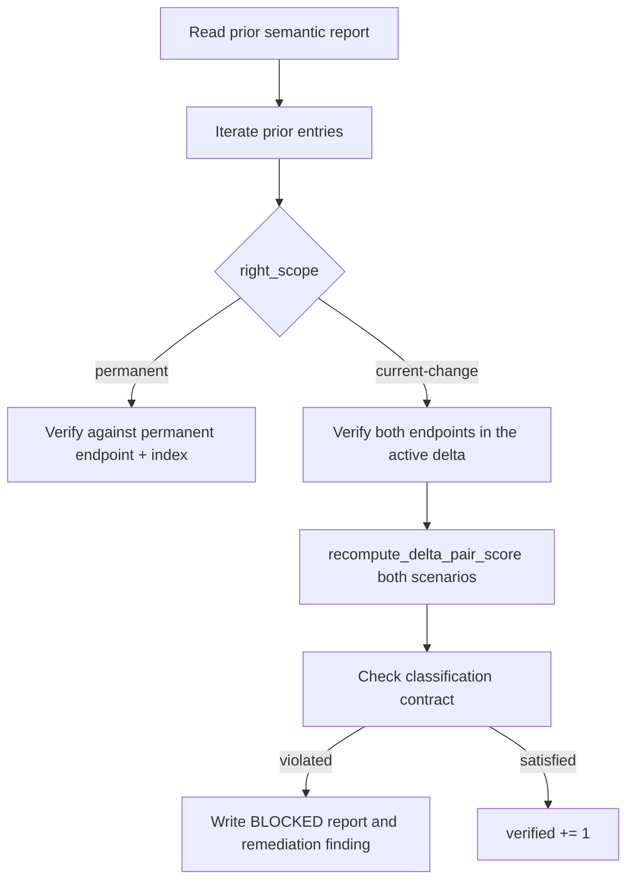

# Design: fix-remediation-delta2delta

## Architecture Impact

Extends `verify_semantic_remediation` in `src/spec/retrieval.rs` so prior
classifications whose *right endpoint lives in the change's own delta* can be
verified. Before this change the verifier only accepted
`right_scope: permanent`; any delta-to-delta candidate hard-bailed with a stale
classification error, permanently blocking review for changes in repositories
with an empty permanent spec (the first-change scenario).

The guard that collected the permanent endpoint is now scoped:

- `right_scope: permanent` -> resolve the right endpoint from the permanent
  index (unchanged behavior).
- `right_scope: current-change` -> resolve the right endpoint from the active
  delta; the recomputed score uses the configured embedder against the two
  delta scenarios directly, with no permanent index requirement.

## Delta-to-delta classification contracts

Each contract mirrors the permanent counterpart but operates on two active-delta
endpoints and a recomputed pair score:

- `DUPLICATE`: one endpoint is removed (the retained endpoint unchanged), or —
  with both still present — the recomputed score is below `0.9500`.
- `VARIANT`: the surviving endpoint is a parameterized `Scenario Outline` with a
  non-empty `Examples` table and changed content/evidence hashes, the redundant
  endpoint is removed, and the pair is no longer admitted.
- `VALID-BOUNDARY`: both endpoints remain, at least one is reworded, the
  recomputed score is below `0.9500`, and they describe observably distinct
  outcomes (`observable_distinction`).

New helpers: `recompute_delta_pair_score` (fresh-embed both delta scenarios,
cosine similarity), `delta_endpoint_unchanged`, `verify_duplicate_delta_to_delta`,
`verify_variant_delta_to_delta`, `verify_boundary_delta_to_delta`.

## Boundaries

- No automatic classification or feature-file editing; the verifier only checks
  evidence (matches ADR-047).
- BGE/NLI second-stage evidence remains advisory and unchanged.
- The `semantic_remediation_mode` world field is informational; the fix is
  asserted end-to-end through cucumber scenarios with stub embedder/reranker.
- The change's own `givn check review` semantic gate remains blocked (28
  delta-to-delta candidates among the regression scenarios): the scenarios
  share the remediation fixture skeleton and E5 cannot separate same-flow
  scenarios below `0.9500` (measured; the permanent remediation family scores
  0.954-0.975 against itself). Removing or merging scenarios would reduce
  regression coverage, so the delta keeps full coverage and the limitation is
  documented rather than masked.
