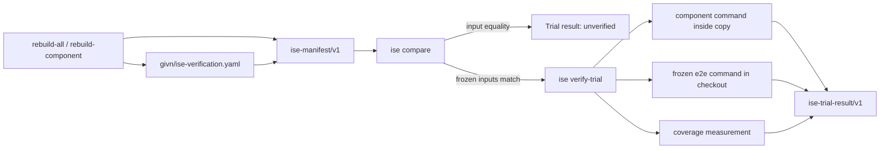

# Design: ise-component-tier-gate

## Overview

A rebuild writes one generated verification contract into the spec copy. The
contract turns the project's `verify`, `e2e`, and coverage settings plus the
declared scenario counts into one strict document. `givn ise compare` remains a
read-only frozen-input comparison and prints `Trial result: unverified`.
`givn ise verify-trial` is the only command that executes the contract, and it
prints a pass only when both tiers ran their exact declared execution-unit
counts with zero failed and zero skipped.

The split is deliberate: input equality answers "did the copy and checkout still
match the manifest", while the trial result answers "did the rebuilt component
corpus and the frozen suite execute". One exit code cannot mean both.

## Architecture impact

| Area | Change |
|---|---|
| `src/ise/contract.rs` (new) | `ise-verification/v1` structs, scenario execution-unit counting, strict read, write, and checksum. |
| `src/ise/verify.rs` (new) | `verify_trial`, fresh runner-result validation, component and End-to-end execution, coverage validation, and the `ise-trial-result/v1` record. |
| `src/ise/mod.rs` | Admission carries the effective manifest; the rebuild reserves the contract path, builds the contract from the selected revision, writes it after the copy, and records its checksum. |
| `src/ise/manifest.rs` | Optional `verification: {path, checksum}` field in `ise-manifest/v1`; a present record is checksum-validated. Old manifests stay readable. |
| `src/ise/compare.rs` | Confirms a present contract's checksum, excludes the reserved path from the added-Specification refusal, and keeps its result unchanged. |
| `src/config/manifest.rs` | `coverage.e2e_subprocess` (default false) declares the subprocess instrumentation limitation. |
| `src/cli/ise.rs`, `src/main.rs` | New `verify-trial` subcommand and output; `compare` gains the `Trial result: unverified` line. |
| `assets/instructions/ise.md` | Served rules name the contract, the exact-count gate, the read-only comparison, coverage, and the not-run rule. |
| `README.md`, `docs/reference.md`, `docs/arc42/**`, `docs/glossary.md` | Command surface, runtime flow, invariants, and terms. |
| `tests/steps/ise_clean_room_support.rs`, `tests/steps/trial_input_verification_steps.rs`, `tests/steps/prose_consolidation_steps.rs` | Trial-gate fixture and delta step bindings. |
| `tests/ise_component_tier_gate.rs` (new) | End-to-end acceptance fixture: 10 component + 1 `@e2e`, missing runner, exact mismatch, passing counts, not-run bypass, read-only compare. |



### Contracts and Components

| Contract | Consumer use case | Consumers | Implementing component today | Split trigger |
|---|---|---|---|---|
| Clean-room preparation outcome | prepare-an-ise-test | Developer, supporting verifier | `ise::rebuild` + `ise::contract` | A second spec-copy format or a non-file trial store appears |
| Trial input verification and result | prepare-an-ise-test | Independent verifier, harness | `ise::compare` + `ise::verify` + `proof::RunnerResult` | A second runner-result schema or a non-CLI verifier protocol appears |
| Effective guidance | obtain-effective-guidance | Authoring agent | `cli::instructions` + `assets/instructions/ise.md` | A second served-guidance source replaces the embedded assets |

## Data model

`givn/ise-verification.yaml` is strict (`deny_unknown_fields`):

```yaml
scope: ise-verification/v1
revision: <revision>
component:
  command: <verify.command>
  features: <verify.features_path>
  execution_units: <plain scenarios + outline example rows>
  scenarios: [<every declared component title>]
end_to_end:
  command: <verify.e2e_command>
  features: <verify.features_path>
  execution_units: <selected @e2e units>
  scenarios: [<every declared @e2e title>]
product:                        # required when either tier declares units
  path: <verify.product_path, relative to the copy>
  env: <verify.product_env, default GIVN_BIN>
coverage:                       # present only when addons.coverage is true
  measure_command: <coverage.measure_command>
  non_e2e_path: <coverage.non_e2e_path>
  e2e_path: <coverage.e2e_path>
  output_path: <coverage.output_path>
  e2e_subprocess: <bool>
```

An execution unit is one plain scenario, or one example row of a Scenario
Outline, matching the runner's expanded count. A feature-level `@e2e` tag
selects every scenario in the file.

The manifest gains an optional record:

```yaml
verification:
  path: givn/ise-verification.yaml
  checksum: <64 lowercase hex>
```

The absence of the record keeps an older `ise-manifest/v1` readable. A present
record whose copy file is missing or whose bytes differ refuses the comparison.

`ise-trial-result/v1` is JSON:

```json
{
  "scope": "ise-trial-result/v1",
  "revision": "<revision>",
  "copy_directory": "<absolute copy>",
  "component": {"status": "passed", "command": "...", "features": "...", "declared": 10, "executed": 10, "passed": 10, "failed": 0, "skipped": 0, "scenarios": ["<ten declared titles>"]},
  "end_to_end": {"status": "passed", "command": "...", "features": "...", "declared": 1, "executed": 1, "passed": 1, "failed": 0, "skipped": 0, "scenarios": ["acceptance"]},
  "coverage": {"component": {"status": "measured", "lines_covered": 80, "lines_valid": 100, "branches_covered": 4, "branches_valid": 8}, "end_to_end": {"status": "subprocess-uninstrumented", "lines_covered": 0, "lines_valid": 0, "branches_covered": 0, "branches_valid": 0}},
  "product": {"path": "<copy>/target/debug/product", "sha256": "<64 lowercase hex>"},
  "clean": true
}
```

`component.status` and `end_to_end.status` are `passed`, `failed`, `not_run`,
`not_applicable`, or `not_reached` (the second tier when the first failed).

## Command flow

`givn ise rebuild-all` and `givn ise rebuild-component`:

1. Admit the revision as today; carry the effective manifest in `Admission`.
2. Refuse when the revision tracks `givn/ise-verification.yaml`; the path is
   generated evidence, not project content.
3. Build the contract from the effective manifest and the behavior feature
   blobs at the selected revision.
4. Write and re-read the copy as today; write the contract; record its checksum
   in the manifest. A contract or manifest write failure removes the copy.

`givn ise compare`:

1. Read the manifest and copy; refuse a missing or changed contract when the
   manifest records one.
2. Run the existing frozen-input comparison. Exclude the recorded contract path
   from the added-Specification refusal.
3. Print the two subject lines and `Trial result: unverified`. Execute nothing.

`givn ise verify-trial`:

1. Read the effective manifest and require the addons.
2. Run `compare`; refuse a non-clean comparison before executing a command.
3. Read the manifest and contract; require the recorded checksum.
4. Resolve `--result` (relative paths under the project root) and refuse a path
   inside the copy.
5. Component: remove `$result.component`, run the contract command with
   `cwd=copy`, `GIVN_FEATURES`, `GIVN_RESULT_FILE`, and
   `GIVN_RESULT_SCOPE=component`. Require a fresh result with `total ==
   declared`, failed 0, skipped 0, and reconciling counts.
6. End-to-end: remove `$result.e2e`, run in the project root with `GIVN_RESULT_SCOPE=e2e`,
   and apply the same checks.
7. Coverage: remove both reports, run the measure command in the copy, require
   component `lines_valid > 0` and `lines_covered > 0`, require distinct
   instrumented reports, and accept a 0-line e2e report only with the declared
   subprocess flag.
8. Write `ise-trial-result/v1`. Any failure writes `clean: false` and returns
   exit 1 without a pass line; the successful record is `clean: true`.

## Failure handling

- **Missing result** — the raw file is removed before the run, so a stale result
  cannot satisfy the gate; the refusal names `component_executed=0/<declared>`.
- **Count-only result** — a result whose counts match but whose `scenarios` do
  not name every declared title refuses and names the missing titles.
- **Foreign product** — a result whose `product` path or `product_sha256`
  differs from the rebuilt product refuses.
- **Mismatch** — the refusal names `component_executed=<executed>/<declared>`;
  extra units fail because the comparison is exact.
- **Failed or skipped** — the shared `RunnerResult` validation refuses and the
  result records `clean: false`.
- **Unconfigured command** — a `givn missing-*` sentinel or an empty command
  refuses before execution.
- **Coverage** — a zero-line component report, a zero executed component, an
  invalid report, identical instrumented reports, or an undeclared zero-line
  e2e report refuses. A declared subprocess e2e report records
  `subprocess-uninstrumented` and is not treated as measured.
- **Not-run bypass** — `--component-not-run` is accepted only when the declared
  component count is zero; with a declared corpus it records `not_run` and
  returns exit 1.
- **Post-run drift** — the final comparison refuses if the checkout, manifest,
  or contract changed while the scripts ran.

## Step Definitions

| Step definition file | Permanent merge target |
|---|---|
| `tests/steps/trial_input_verification_steps.rs` | `tests/steps/trial_input_verification_steps.rs` |
| `tests/steps/prose_consolidation_steps.rs` | `tests/steps/prose_consolidation_steps.rs` |
| `tests/steps/ise_clean_room_support.rs` | `tests/steps/ise_clean_room_support.rs` |

The trial-gate fixture lives in `ise_clean_room_support.rs`: a Git project with
`ise` on, coverage off, ten component scenarios, one `@e2e` scenario, the
declared `tests/e2e` package, and `sh ./scripts/verify.sh` /
`sh ./scripts/e2e.sh`. Both fixture runners parse the feature corpus and emit
scenario titles; the component runner writes `target/debug/gate-product`, and
the End-to-end runner records that product's path and SHA-256. The count-only
and foreign-product variants are refusal fixtures. The delta bindings live in
`trial_input_verification_steps.rs`; the guidance assertion lives in
`prose_consolidation_steps.rs`. A separate integration test
`tests/ise_component_tier_gate.rs` drives the real binary for the acceptance
fixture.

## Test runner and strict mode

- Regular scope: `./run-tests.sh --non-e2e`
- Delta scope: `GIVN_FEATURES=givn/changes/ise-component-tier-gate/specs ./run-tests.sh --non-e2e`
- E2E scope: `./run-tests.sh --e2e --package e2e` (`verify.e2e_command`)
- ISE E2E scope: `GIVN_FEATURES=givn/specs/prepare-an-ise-test ./run-tests.sh --e2e --package e2e`
- Single scenario: `GIVN_FEATURES=givn/changes/ise-component-tier-gate/specs cargo test --locked --test features_runner -- --exact "<usecase>/<capability>.feature::<title>"`
- Strict mode: `tests/features_runner.rs` keeps `.fail_on_skipped()`; an
  unbound or skipped step fails the run.
- Acceptance test: `cargo test --test ise_component_tier_gate -- --test-threads=1`
- Full E2E preflight: after `./setup-e2e-browser.sh` installed the pinned
  Playwright package and Chromium, `./run-tests.sh --e2e --package e2e` passed
  120 of 120 scenarios (785 steps). The earlier 14 development-report failures
  were the missing browser dependency, not a change defect.

## Use-case traceability

| Use-case guarantee, rule, or capability | Technical decision | Evidence |
|---|---|---|
| clean-room-preparation writes the copy | Contract written after the copy and recorded in the manifest | `Preparation writes a runnable verification contract` |
| trial-input-verification compares frozen inputs | `compare` stays read-only and prints `Trial result: unverified` | `Comparison labels frozen-input equality as unverified` |
| A trial result requires the kept component corpus | `verify-trial` runs the component command and requires the exact count | `Verification records the exact declared counts`, `Verification refuses a missing component runner`, `Verification refuses an exact count mismatch` |
| A not-run decision never hides a declared corpus | Flag accepted only at zero declared units | `A not-run decision cannot replace declared component units` |
| Coverage is honest per tier | Non-zero component measurement, distinct reports, declared subprocess e2e | `verify` coverage unit tests (`coverage_rejects_a_zero_line_component_report`, `coverage_rejects_a_zero_line_e2e_report_without_the_declaration`, `coverage_accepts_a_declared_subprocess_e2e_report`) |
| Served guidance names the split | `ise.md` names the gate and the input-only comparison | `Served ise guidance distinguishes the trial gate from input equality` |

## Interaction Coverage Matrix

| Inventory entry | `@e2e` scenario | Real interface | Driving mechanism |
|---|---|---|---|
| clean-room-preparation: write the spec copy with `rebuild-all` or `rebuild-component` | Developer rebuilds the whole product from its Specification | Git revision read plus plain-directory write | The scenario drives the built `givn` binary's `ise rebuild-all` against a real Git fixture. |
| trial-input-verification: compare the frozen inputs, then run the trial verification when claiming a result | Verifier compares the spec copy with the manifest | CLI subprocess | The scenarios drive `givn ise compare` and `givn ise verify-trial` against a real Git fixture and real `sh` scripts. |
| serve-extended-rules: request effective instructions by id | An agent receives the extended rules through the Givn CLI | CLI subprocess | The scenario requests `givn instructions ise` through the built binary. |

## Decisions

- `Decides D1`: Exact execution-unit counts, with one unit per plain scenario
  and one per outline example row. Realized in `contract::scenario_execution_units`
  and the `counts.total != declared` checks in `ise::verify`.
- `Decides D2`: `givn ise compare` stays read-only; a separate explicit
  `verify-trial` command executes the contract. Realized in `cli::ise::compare`
  and `cli::ise::verify_trial`.
- `Decides D3`: The gate command is `givn ise verify-trial`; the retired
  `givn ise verify` name keeps its exit-2 contract. Realized in
  `IseCommands::VerifyTrial` and the unchanged retired-name scenario.
- `Decides D4`: Declared counts use expanded execution units, not scenario
  headings; `givn spec tree` is unchanged. Realized in
  `contract::scenario_execution_units`.
- `Decides D5`: A 0-line e2e report requires `coverage.e2e_subprocess: true`.
  Realized in `config::manifest::Coverage::e2e_subprocess` and
  `ise::verify::run_coverage`.
- `Decides D6`: The End-to-end run is bound to a declared `verify.product_path`
  and `verify.product_env`; the result must carry the product path and
  SHA-256. Realized in `ise::verify::bind_product`,
  `ise::verify::require_product`, and the fixture scripts.
- `Decides D7`: A runner result must name every declared scenario title and
  no undeclared title; a count-only or extra-title result refuses. Realized in `ise::verify::require_scenarios` and
  the `scenarios` arrays in both test runners.
- `Decides D8`: A `Whole-system rebuild` change must commit a clean
  `ise-trial-result/v1` under `evidence/ise/trial-result.json`; `givn check
  tasks` refuses otherwise. Realized in
  `cli::check::require_whole_system_trial_result`.
- `Ise rebuild decision`: `No rebuild`. This change edits the existing Source
  code in place; no Component's Source code is replaced and no `Rebuilt code`
  line is recorded.

## Visual Design Contract

- Interface: terminal
- Viewports: not applicable; the surface is CLI text, not a rendered screen.
- Design system: not applicable.

The terminal contract is the fixed line order: two subject lines then
`Trial result: unverified` for `compare`; the component line, End-to-end line,
optional coverage lines, then `Trial result: passed` for a clean
`verify-trial`. Persona: `developer--primary-user`.

Capture mechanism and evidence path: the real `givn ise compare` and
`givn ise verify-trial` commands run against a committed ten-component,
one-`@e2e` fixture; their terminal transcript is committed at
`givn/changes/ise-component-tier-gate/evidence/visual/verification-records-the-exact-declared-counts/transcript.txt`.
It carries both states and the fixed line order.

## Risks

- A component runner that reports a different scenario accounting than the
  expanded Gherkin count fails the exact gate. The refusal names both numbers,
  so the runner can be corrected rather than the gate weakened.
- A trial without a configured coverage command refuses when the coverage addon
  is effective. This matches the archive gate's existing contract.
- A project that does not declare `verify.product_path` refuses a trial with
  declared units; the End-to-end command must honor the declared variable and
  record the product digest. A runner that omits the digest refuses.
- `compare` accepts older manifests without a verification record for input
  comparison; `verify-trial` refuses them by name, so an old copy cannot claim
  a whole-system result.
