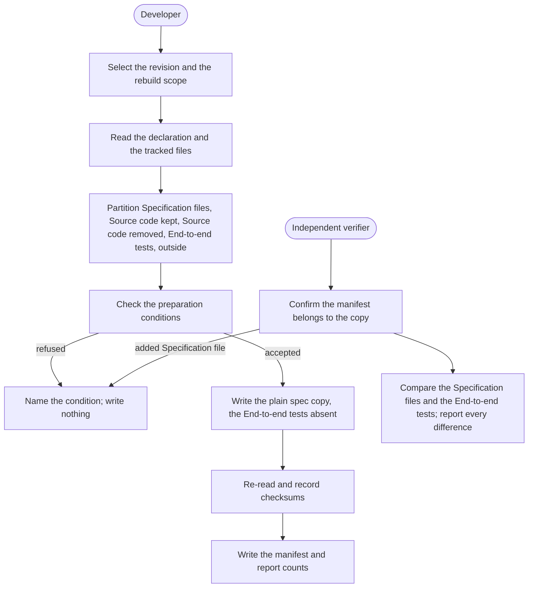

<!-- givn:base-sha256:675649da108bd456eb682bbe4494ce3f6273698e950e9887314b36056f296612 -->
# Use case: prepare-an-ise-test

## Level

!

## Actors

- Developer (the consumer-project owner; the Givn maintainer when Givn rebuilds itself)
- Supporting: Independent verifier (runs the frozen End-to-end (E2E) tests and asks for the comparison)

## Goal

Write a spec copy whose Specification files a verifier can confirm against the copy and the checkout, and in which a builder reads neither the component's Source code nor the frozen End-to-end (E2E) tests.

## Trigger

The developer starts an Ise Test.

## Preconditions

- `ise` is effective in the project, which requires `architecture_principles`.
- The declaration names the five Specification roles and the replaceable source roots, and the selected revision records it.
- The checkout is clean.
- One backend is selected; no missing, mixed, or nested repository.
- A revision is available to read; the selected revision defaults to `HEAD`.
- The component's paths fall inside the declared source roots.

## Main flow

1. The developer selects the revision, or accepts `HEAD`, and runs `rebuild-all` for the whole product or `rebuild-component` with the component's paths (a tracked file or a directory); the system reads the declaration recorded at that revision and the tracked files at that revision.
2. The system partitions the tracked paths into the Specification files (the matches of the Specification roles except the End-to-end (E2E) tests, and the declaration itself), the Source code kept outside the removed paths, the Source code removed, the End-to-end (E2E) tests, and the files outside the spec copy, and counts the tracked files in the removed paths' directories that the developer did not name.
3. The system refuses by name, before any write, on a missing or malformed declaration, an addon that is not effective, a dirty checkout, a missing, mixed, or nested backend, a Specification path or the declaration that is missing at the revision, a component path outside every source root, a component path or directory expansion matched by a Specification role or by the declaration, a write target inside the checkout or already existing, and a repository link or nested repository among the files written into the spec copy.
4. The system writes the Specification files, the declaration included, and the Source code kept into one plain directory outside the checkout, preserving relative paths, the executable bit, and relative symlink targets whose target resolves inside the copy, with no version-control metadata and no ignored or untracked files; no End-to-end (E2E) test enters the spec copy.
5. The system re-reads every written file, compares it to the file recorded at the selected revision, records a checksum for the Specification files and the End-to-end (E2E) tests, reports `Backend`, `Revision`, the five counts, and the End-to-end (E2E) count, and writes the manifest when `--manifest` names a file; no removed-source checksum is recorded. It also writes `givn/ise-verification.yaml` into the copy and records the contract's path and checksum in the manifest. The contract names the component command and feature path, the frozen End-to-end command and feature path, each tier's declared execution-unit count and scenario titles, the rebuilt product path and the environment variable the End-to-end command reads, and the coverage commands and paths when the addon is effective; an execution unit is one plain scenario or one Scenario Outline example row.
6. The independent verifier compares the spec copy with the manifest on request; the system confirms the manifest belongs to this copy, refuses a copy that lost a recorded kept file, a changed or missing verification contract, and a file the agent added under a declared Specification path, and reports the two subjects, `Specification files` and `End-to-end tests`, with a `changed`, `missing`, or `added` count. The comparison is read-only, executes no trial command, and prints `Trial result: unverified`; its exit 0 proves frozen-input equality only.
7. When the verifier claims a whole-system trial result, it runs `givn ise verify-trial --manifest <file> --copy <dir> --result <file>`. The system requires frozen-input equality, then runs the contract's component command inside the copy. It binds the declared rebuilt product path to its bytes or directory tree, passes the absolute path through the declared environment variable and `GIVN_TRIAL_PRODUCT`, and runs the frozen End-to-end command in the checkout with fresh result paths. Each runner result must carry the declared scenario multiset (duplicate titles and outline rows included), with no undeclared title, and the End-to-end result must carry the rebuilt product's path and SHA-256; a count-only, extra-title, or foreign-product result refuses. It requires each executed count to equal its declared count exactly, with zero failed and zero skipped, runs the coverage measurement when the contract carries one (passing `GIVN_COVERAGE_NON_E2E_PATH`, `GIVN_COVERAGE_E2E_PATH`, and `GIVN_COVERAGE_OUTPUT_PATH`), re-checks the frozen inputs after the scripts ran, and writes an `ise-trial-result/v1` record with both tiers' declared/executed/scenario evidence, the product path and digest, per-tier line and branch coverage, and `clean`. It prints a pass line only when every condition holds.

## Extensions

- 3: the declaration is malformed at the selected revision → the system refuses, names the declaration path and the loader's reason, exits 1, and writes nothing; protects the minimal guarantee.
- 3: the declaration bytes are not UTF-8 at the selected revision → the system refuses, names the declaration path and the decoding error, exits 1, and writes nothing; protects the minimal guarantee.
- 3: the revision records the declaration but the backend returns no blob for it → the system refuses, names `givn/specification.yaml`, the revision, and `returned no blob`, exits 1, and writes nothing; protects the minimal guarantee.
- 3: the selected revision does not record the declaration → the system refuses, names `givn/specification.yaml`, the revision, and `does not record`, and writes nothing; protects the minimal guarantee.
- 3: `ise` is not effective, or its `architecture_principles` prerequisite is not effective → the system refuses by name, reads no declaration, and writes nothing; protects the minimal guarantee.
- 3: `rebuild-component` is given no path, or `--into` is omitted → the command refuses as a usage error, names the missing path list or target, exits 2, and writes nothing; protects the minimal guarantee.
- 3: the checkout is dirty → the system refuses, names every dirty path, and writes nothing; protects the minimal guarantee.
- 3: no backend owns the project, both markers sit at the root, or the project root is nested inside a worktree → the system refuses with the backend selector's message and writes nothing; protects the minimal guarantee.
- 3: a declared Specification path is missing at the revision → the system refuses and names the path and the revision; protects the minimal guarantee.
- 3: a component path falls outside every declared source root → the system refuses, names the path, and names `rebuild-all` as the command that writes the copy removing every declared source root; protects the minimal guarantee.
- 3: a component path, or a tracked file under a named directory, is matched by a Specification role or is the declaration → the system refuses, names the path and the role or the declaration, and writes nothing; protects the minimal guarantee.
- 3: a write target is inside the checkout, already exists, is a manifest inside the spec copy, or is a manifest that is an ancestor of the spec copy → the system refuses and names the target; protects the minimal guarantee.
- 3: a copied file is a repository link or a nested repository → the system refuses and names the file; protects the minimal guarantee.
- 3: a copied file is a symlink with an absolute target, even one that resolves inside the spec copy, or with a relative target that resolves outside the spec copy → the system refuses, names the link path and the target, exits 1, and writes nothing; protects the minimal guarantee.
- 5: a written file differs from its content at the selected revision → the system names the drifting paths, removes the partial copy, and writes no manifest; protects the success guarantee.
- 5: the revision cannot be read → the system refuses before any write and names the path and the revision; protects the minimal guarantee.
- 5: the manifest cannot be written → the system names the manifest path, removes the copy it created, and reports no success; protects the success guarantee.
- 6: the manifest does not belong to this copy, names a scope other than `ise-manifest/v1`, or lies inside the copy → the system refuses and names the manifest and the mismatch; protects the success guarantee.
- 6: the copy holds a file under a declared Specification path that the manifest does not list → the system refuses before reporting any count, names the added paths, and reports no clean line; protects the success guarantee.
- 6: the copy lost a path the manifest lists among the Source code kept → the system refuses before reporting any count and names the deleted path; protects the success guarantee.
- 6: the checkout gains a content path in its declared End-to-end (E2E) set, a feature file carrying a selected `@e2e` scenario, an `e2e` root in its declaration, or a path matched by another declared Specification role → the comparison reports the path as added, prints `+ <path>`, and exits 1; protects the success guarantee.
- 6: a Specification file the manifest lists is missing from the copy or differs from its recorded checksum → the comparison reports it and exits 1; protects the success guarantee.
- 6: an End-to-end (E2E) test the manifest lists is missing from the checkout or differs from its recorded checksum → the comparison reports it and exits 1; protects the success guarantee.
- 6: the manifest records no verification contract, or the copy's contract is missing or differs from the recorded checksum → the comparison refuses and names the contract; protects the success guarantee.
- 7: the component command produces no fresh runner result, the result declares zero scenarios, or the executed count differs from the declared count → the system refuses, names `component_executed=<executed>/<declared>`, writes `clean: false`, and prints no pass line; protects the success guarantee.
- 7: a runner result carries counts but not every declared scenario title → the system refuses, names the missing titles, writes `clean: false`, and prints no pass line; protects the success guarantee.
- 7: the contract names no rebuilt product, the product path is missing, symlinked, escaping, or a non-file/non-directory inside the copy, or the End-to-end result names a different product path or digest → the system refuses, writes `clean: false`, and prints no pass line; protects the success guarantee.
- 7: the frozen inputs, manifest, or contract change while the trial scripts run → the post-run comparison refuses, writes `clean: false`, and prints no pass line; protects the success guarantee.
- 7: a project relies on an external or manual trial report instead of `givn ise verify-trial` → Givn does not read or gate that report; only `verify-trial` writes the clean result; protects the success guarantee.
- 7: a tier reports a failed or skipped scenario, or its counts do not reconcile → the system refuses, writes `clean: false`, and prints no pass line; protects the success guarantee.
- 7: a declared component command or End-to-end command is unconfigured → the system refuses by name before running it and writes `clean: false`; protects the minimal guarantee.
- 7: the coverage addon is effective and the component report measures zero lines or no executed line, a tier report is invalid, two instrumented reports are identical, or a missing or 0-line End-to-end report is not declared as a subprocess limitation → the system refuses, writes `clean: false`, and prints no pass line; protects the success guarantee.
- 7: `--component-not-run` is given while the contract declares component execution units → the system refuses and never treats the decision as a pass; protects the success guarantee.

## Rules

- Deletion is set arithmetic: `rebuild-component` removes every tracked file named with a path, and every tracked file beneath a named directory, at the selected revision; a glob-shaped value is never expanded; `rebuild-all` removes every tracked file under every declared `source:` root; a named path absent from the revision removes nothing and is not one of the refusals.
- The End-to-end (E2E) tests are never copied: the set is every tracked file of the `e2e` role's resolved package at the selected revision, the resolution rule below included, except the declaration. The spec copy holds no file the set covers, and an End-to-end (E2E) file is neither a Specification file, Source code kept, Source code removed, nor outside the spec copy.
- The declaration is never frozen: a package root that covers `givn/specification.yaml` still leaves the declaration among the Specification files, so every spec copy carries it.
- The five counts are placement counts for the files the spec copy holds or the rebuild removes; `Files beside removed paths` is a containment count, not a partition member, because a file it counts is also counted in `Specification files`, `Source code kept`, or `Outside the spec copy`. The End-to-end (E2E) set is counted separately by the `End-to-end tests: not copied (<n> files)` line, and the manifest keeps one checksum per End-to-end (E2E) path.
- The declaration is an implicit Specification entry, not a sixth role: every spec copy carries `givn/specification.yaml` under both commands, no role declares it, and the copy recorded at the selected revision is the one the partition reads, so a builder reads the roles that were applied. The Specification set is a union, so a Specification role that also matches the declaration counts it once, and `Specification files` equals the number of the manifest's `specification_files` entries. Naming the declaration with a component path, or naming a directory whose tracked files include it, refuses like any Specification path.
- Internal unit tests are named the same way as any other removed path; no unit-test path is inferred from `#[cfg(test)]`, `test_*.py`, a Maven test root, or a file-name convention.
- A Specification role entry that matches a directory retains every tracked file under it; an entry that matches a file retains that file, and a path matched by a role or by the declaration is never removed.
- A tracked path that matches both a Specification role and a `source:` root is a Specification file: it stays in the spec copy under both commands and is never removed. The declaration is a Specification path on the same terms, so a `source:` root that covers it removes nothing. A tracked path that the End-to-end (E2E) set covers and a `source:` root also covers is not copied and not removed.
- `Files beside removed paths` counts the direct tracked files in the removed files' parent directories that the developer did not name and that are not themselves removed; it is a containment count, never a refusal, and it never changes the recorded sets.
- `Outside the spec copy` counts the tracked files that fall outside every declared role and outside every source root and are not copied; they are neither errors nor spec-copy content. The declaration is never counted there: it is always copied.
- `Source code kept` counts the tracked files under a declared `source:` root that the command did not remove and that are not Specification files and not End-to-end (E2E) matches. A file matched by a Specification role under a source root is a Specification file, not Source code kept, so a whole-product rebuild with one such file reports `Source code kept: 0`.
- Only the End-to-end (E2E) tests are frozen; component step definitions, fakes, and harness are implementation, never frozen or diff-counted, and enter the spec copy only as Source code kept when the declaration places them inside a source root.
- The spec-copy commands prepare an external copy from a selected revision and never edit the project working tree. A `Single-Component Rebuild` with `Rebuilt code: ship` rebuilds in the project working tree and does not use this use case; the copy path serves `Rebuilt code: discard` or a copy-based Ise Test.
- One path checksum is the SHA-256 of the path, NUL, the entry kind (`f` regular, `x` executable regular, `l` symlink, `g` gitlink), NUL, the executable marker (`1` or `0`), NUL, and the content bytes, rendered as lowercase hex; the content is the regular file's bytes, the symlink target's text bytes, the recorded commit id for a gitlink, or the bytes the selected backend returns for the entry. The End-to-end (E2E) set may hold a gitlink and hashes it as kind `g`; the copy set refuses a gitlink because the copy cannot hold history. A rollup is the SHA-256 of each sorted `path, NUL, checksum, LF`; `specification_checksum` rolls up `checksums.specification`, and `end_to_end_checksum` rolls up the union of `checksums.end_to_end` and `checksums.scenarios` keyed by path, with the scenario checksum winning when one path is in both maps. The report prints the first 12 lowercase hex characters; the manifest keeps the full value.
- The per-feature scenario checksum is the SHA-256 of the feature path, NUL, then each selected scenario in file order as its title, NUL, its executable content, NUL. A feature-level `@e2e` tag selects every scenario; otherwise each scenario carrying `@e2e` is selected; a scenario under a `Rule:` is never selected; a feature that selects none contributes no entry. The feature paths are the `.feature` files the declared `behavior` role matches, sorted by path.
- The executable content is the compact JSON array `[scenario keyword, background, tags, steps, examples]`: `background` is null or the background steps; `tags` is the sorted, duplicate-free union of the feature's and the scenario's tags with every tag beginning `givn.` and the tag `wip` removed; a step is `[trimmed keyword, Given|When|Then, text, docstring, table]`, where `And`, `But`, and `*` inherit the preceding type (or `Given` when none precedes), the text has trailing whitespace removed, the docstring is the delimiter-stripped value with the common indentation removed, and it loses the line break after the opening delimiter and the line break before the closing delimiter, and the table is its rows with the Gherkin escapes decoded and surrounding whitespace removed; `examples` is one `[tags, table]` pair per `Examples:` block, with the same tag filter. The JSON is UTF-8 with no insignificant whitespace, `"` and `\` escaped, the short control escapes, every other code point below U+0020 as `\u00xx`, non-ASCII as literal UTF-8, and `/` unescaped. No timestamp is recorded.
- The End-to-end (E2E) set is read from the selected revision's tracked paths, never the working tree. Each declared `e2e` entry matches tracked files and tracked directory prefixes; a matched file resolves through its parent directory, and each match takes as its root the nearest directory at or above it that holds a tracked `Cargo.toml`, or the matched path itself when no such directory exists; the set is every tracked file at or below a root, minus the declaration. An entry that matches the project root covers the whole tracked tree. Ignored and untracked files cannot enter, and the set is ordered by path.
- A scenario is frozen only after it was observed failing against the pre-change implementation for the intended reason; a mid-rebuild test defect stops the rebuild as a `Spec gap: E2E test defect`, and the rebuild restarts after the End-to-end (E2E) test is corrected because the `e2e` package is part of the Specification. When a behavior-corpus component scenario contradicts the frozen suite, the builder does not adjust the suite; the difference is recorded as a `Spec gap` and the rebuild restarts after the Specification or the suite is corrected.
- The spec copy is a plain directory outside the checkout, never a branch or a worktree, because a branch carries history and a Fossil checkout carries the repository database.
- A rebuild command reads the selected revision (`HEAD` when none is named), never the working tree, so ignored and untracked files cannot enter the spec copy; the declaration the partition reads and the declaration the copy holds are both the revision's copy. The checkout is never written, including the manifest, and the removed component's Source code and its history are absent from the copy.
- Both commands and the comparison use the project's one selected backend; a missing, mixed, or nested repository is refused by name.
- Every refusal is checked before the first write, names its condition, and leaves the checkout and the target path unchanged.
- The command surface is `givn ise rebuild-all --into <dir> [--at <revision>] [--manifest <file>] [--dry-run]` and `givn ise rebuild-component <path>... --into <dir> [--at <revision>] [--manifest <file>] [--dry-run]`; `--at` defaults to `HEAD`, `rebuild-component` requires at least one path, and `--into` is required and must lie outside the checkout. The verifier surface is `givn ise compare --manifest <file> --copy <dir>` and `givn ise verify-trial --manifest <file> --copy <dir> --result <file> [--component-not-run <reason>]`.
- `verify.product_path` names the rebuilt product relative to the copy and `verify.product_env` names the environment variable the End-to-end command reads (default `GIVN_BIN`). The gate requires the file or directory tree, refuses a symlink or non-regular product, hashes a file's bytes or a directory's regular files, sets the declared variable, `GIVN_TRIAL_PRODUCT`, and `GIVN_TRIAL_PRODUCT_SHA256`, and refuses a result whose product path or digest differs.
- A runner result must carry `scenarios`: one title per declared execution unit, preserving duplicate titles and outline example rows, and no undeclared title. A count-only, missing, extra-title, or collapsed-multiplicity result refuses. The `ise-trial-result/v1` record carries both tiers' scenario titles and the product path and digest, so the result itself is the evidence.
- The coverage measurement receives `GIVN_COVERAGE_NON_E2E_PATH`, `GIVN_COVERAGE_E2E_PATH`, and `GIVN_COVERAGE_OUTPUT_PATH`; the contract records all three relative paths.
- The frozen inputs are compared again after the component, End-to-end, and coverage commands; a script that changes the checkout, manifest, or contract makes the trial `clean: false`.
- Givn does not inspect an external or manual trial report, including a `givn/trials/**` report; such a report is outside Givn enforcement. `givn ise verify-trial` is the only command that writes an `ise-trial-result/v1` with `clean: true`.
- Every rebuild writes `givn/ise-verification.yaml` into the spec copy and records its path and checksum in the `ise-manifest/v1` manifest. The path is reserved: a revision that tracks it refuses before any write. The contract is strict; an unknown field, a wrong scope, or a malformed value refuses by name. It carries the component command and feature path, the frozen End-to-end command and feature path, each tier's declared execution-unit count, and the coverage command and report paths when the coverage addon is effective; the End-to-end subprocess limitation is declared in the contract from `coverage.e2e_subprocess`.
- An execution unit is one plain scenario, or one example row of a Scenario Outline. A feature-level `@e2e` tag selects every scenario in the file; otherwise a scenario carrying `@e2e` is an End-to-end unit. A scenario under a `Rule:` is outside the selection. The declared counts are read from the behavior feature files at the selected revision.
- `givn ise compare` is read-only: it executes no contract command and its exit 0 proves frozen-input equality only. It prints `Trial result: unverified` after the two subject lines. It also confirms the copy's verification contract against the manifest's recorded checksum and excludes that reserved path from the added-Specification-file refusal.
- `givn ise verify-trial` requires frozen-input equality, re-derives each tier's declared multiset from the frozen behavior features and refuses a contract whose revision, counts, or titles differ, removes each raw result path before its run, executes the component command inside the copy with `GIVN_FEATURES`, `GIVN_RESULT_FILE`, and `GIVN_RESULT_SCOPE=component`, and executes the frozen End-to-end command in the checkout with `GIVN_RESULT_SCOPE=e2e`. A tier's fresh result must declare `total` equal to its declared execution-unit count, with zero failed, zero skipped, and reconciling counts. A missing or malformed result, a non-zero exit, a failed or skipped scenario, or a count mismatch refuses, writes an `ise-trial-result/v1` record with `clean: false`, and prints no pass line.
- When the contract carries coverage, `verify-trial` removes both reports, runs `coverage.measure_command` inside the copy with `GIVN_FEATURES`, `GIVN_COVERAGE_NON_E2E_PATH`, and `GIVN_COVERAGE_E2E_PATH`, requires a component report with non-zero measured and executed lines, requires the two instrumented reports to be distinct, and accepts a 0-line End-to-end report only when the contract declares `e2e_subprocess: true`. The record carries each tier's line and branch counts.
- The `ise-trial-result/v1` record carries the scope, revision, copy directory, the component and End-to-end command/feature/declared/executed/passed/failed/skipped fields, optional per-tier coverage, and `clean`. That flag is true only when both tiers ran their exact declared counts and coverage passed; the command exits 0 only then. An explicit `--component-not-run <reason>` is accepted only when the declared component count is zero and is recorded as `not_run`; it never produces `clean: true` over a declared corpus. The whole-system pass line is printed only by this command.
- A component path accepts a tracked file or a directory; a directory expands to every tracked file beneath it at the selected revision, the Specification-role and declaration check runs over the expansion, and a directory that contains a Specification path or the declaration refuses.
- The two write targets are the spec copy directory and, when given, the manifest file; both lie outside the checkout, the spec copy directory does not exist, and the manifest does not exist, does not lie inside the spec copy, and is not an ancestor of it.
- `--dry-run` performs every read, the partition, every refusal, the counts, and the checksums, writes no directory and no manifest, and prints `Copy directory (would write):` and, only when a manifest path was given, `Manifest (not written):` in place of the two write lines.
- An omitted `--manifest` writes no manifest and prints no `Manifest:` line; the report is the only output, and `givn ise compare --manifest <file>` requires an explicit path.
- The manifest carries the scope, the revision, the removed paths, the Specification files, the Source code kept files, the End-to-end (E2E) files, the five counts, the three checksum maps, the two rollups, the copy directory, and the running Givn version. `end_to_end_files` is the sorted union of the keys of `checksums.end_to_end` and `checksums.scenarios`: `checksums.end_to_end` holds one path checksum per `end_to_end_files` path, including a feature path that carries a selected `@e2e` scenario, and `checksums.scenarios` holds one checksum per feature scenario set. The Source code kept files are paths without checksums, so a kept edit is not a difference and a deleted kept path is refused. The Specification set includes `givn/specification.yaml`, so `Specification files` counts the declaration and every role-matched file once, and `Specification checksum` covers it.
- The manifest keeps its `ise-manifest/v1` scope and is strict: an unreadable file, a scope other than `ise-manifest/v1`, an unknown field, a missing field, or a malformed checksum refuses naming the manifest and the reason. A scope with no optional field requires every field it lists; a field added later is optional only when the scope states its default, and a field with no derivable default opens a new scope, so a reader refuses a mismatched scope naming the manifest and the expected value. The prepare-time backend is not evidence: `compare` re-selects the backend and the manifest carries no `backend` field. The earlier `ise-trial/v1` record shape is refused by name and is not migrated, because a spec copy is ephemeral evidence that one command re-prepares.
- A path's checksum names the entry kind (`f`, `x`, `l`, or `g`) beside the path and the executable marker, so a symlink, a gitlink, and a regular file with the same target text are different entries.
- The report prints `Backend`, `Revision`, `Specification files`, `Source code kept`, `Source code removed`, `Outside the spec copy`, `Files beside removed paths`, `Specification checksum`, `End-to-end checksum`, `End-to-end tests: not copied (<n> files)`, and `Copy directory`, plus `Manifest` when a manifest path was given: eleven fixed lines and a twelfth with the manifest path.
- The two printed checksums are the first 12 lowercase hex characters of the rollup; the manifest carries the full values.
- With `ise` off, both commands and the comparison refuse by name and no declaration is read; the effective project configuration decides effectiveness, and a change lock decides the change-scoped boundary gate, not these project-scoped commands. A project whose `architecture_principles` is off refuses the same way.
- A rebuild command reads the declaration recorded at the selected revision as a blob and never reads the working tree's copy. The revision not recording it names the path, the revision, and `does not record`; the backend returning no blob for it names the path, the revision, and `returned no blob`; the bytes not being UTF-8 names the path and the decoding error; the bytes not being a valid declaration names the path and the loader's reason; each exits 1 and writes nothing. A present but unreadable working-tree declaration is the declaration reader's caller's case: `givn lint` refuses it by name and exits 1.
- The spec copy directory and the manifest are created with create-new semantics; an existing path is refused, never overwritten.
- The comparison confirms that the manifest's `copy_directory` is the given copy, then applies the four rule sentences of the spec copy: the copy is written with the project's Specification files; during a rebuild the agent adds files, and those are the rebuilt Source code; the agent may edit Source code kept because it is the product, but it does not delete any file the copy was written with; the agent does not modify any Specification file, and adding a file under a declared Specification path is a Specification change, not the product, and is refused.
- The comparison prints two subject lines, `Specification files` and `End-to-end tests`: each prints `match` alone when it has no difference, or its non-zero counts in the fixed order `changed`, `missing`, `added`, comma-separated. A changed or missing path prints one `- <path>` line, an added path prints one `+ <path>` line, a path that drifts in both the copy and the checkout prints one line, and the exit is 0 only when both lines say `match`. When a path differs on both sides, that line and its count belong to the subject that owns the path: `End-to-end tests` when the checkout side owns it, `Specification files` otherwise; the copy-side and checkout-side observations are one difference, not two.
- The `Specification files` line compares the manifest's per-path checksums with the copy: a differing file is `changed` and an absent file is `missing`. It compares the recorded paths with the checkout's content paths. A recorded feature path carrying a selected `@e2e` scenario is owned by `End-to-end tests` and contributes no count or line here. Every other recorded file that is absent is `missing`; every other one that differs prints `Specification changed after the copy was written` and `- <path>`. It counts an added content path matched by a declared Specification role that the manifest does not record as `added`, with `+ <path>`, except a content path in the checkout's declared End-to-end (E2E) set or a feature path carrying a selected `@e2e` scenario. Such a path is owned on the checkout side by `End-to-end tests` even when another Specification role also matches it, so it contributes no count or line here; the copy side still compares the file's bytes under `Specification files` when the manifest records it.
- The `End-to-end tests` line compares the manifest's End-to-end (E2E) paths with the checkout's content paths: a recorded path that is absent is `missing`; one whose `checksums.end_to_end` content checksum or, for a feature path carrying a selected `@e2e` scenario, whose `checksums.scenarios` checksum differs is `changed`, so an edit outside the selected scenario is still `changed`; and a content path in the checkout's declared End-to-end (E2E) set that the manifest does not record is `added`. An added feature file carrying a selected `@e2e` scenario is an added End-to-end test even when a Specification role also matches it, so one `+ <path>` line prints.
- The checkout's added paths are read with the checkout's declaration and the copy's added-file refusal with the copy's declaration; a checkout declaration the loader refuses is already a `changed` or `missing` difference and contributes no roles.
- The comparison refuses before reporting any count when the copy holds a file under a declared Specification path that the manifest does not list, naming the added paths, and when the copy lost a path the manifest lists among the Source code kept, naming the deleted path. A declared Specification path is a match of any of the five roles, so a file added under an `e2e` match refuses even though the copy never carries one.
- The declaration is the reader's boundary: the copy's declaration derives the Specification paths the added-file refusal tests, the checkout's declaration derives the added-path scan, and an edit that moves only `structure:` or `limits:` changes the copy's Specification files like any other Specification edit.
- On unix, the executable bit and a relative symlink target that resolves inside the spec copy are written as recorded; a symlink with an absolute target refuses by name with the link path and the target even when that target resolves inside the copy, and a relative target that resolves outside the copy refuses the same way, because the copy withholds the removed Source code; on a platform without symlink support a symlink entry refuses by name before the manifest is written. R-150 covers the archive guard reading a declared Specification path that is a symlink into the change tree; this refusal covers the symlink entry written into the copy.
- The verifier names every drifting path in one run and never edits the spec copy; a changed component file outside the Specification files produces no difference.

## Examples

- A `passuff` project declares `source: ["crates/**", "scripts/**"]` and `e2e: ["crates/passuff-e2e"]`, and runs `givn ise rebuild-component crates/passuff-tui/src/keys/parser.rs crates/passuff-tui/tests/keys.rs --into /tmp/ise-passuff --manifest /tmp/ise-passuff.yaml`; the copy holds 20 Specification files after 12 End-to-end (E2E) paths leave the 32 the declaration originally declared, and the report prints `Backend: git`, `Revision: <resolved>`, `Specification files: 20`, `Source code kept: 72`, `Source code removed: 2`, `Outside the spec copy: 3`, `Files beside removed paths: 2`, `Specification checksum: 4f1c9a2b7d01`, `End-to-end checksum: 82be07c3e5a9`, `End-to-end tests: not copied (12 files)`, `Copy directory: /tmp/ise-passuff`, and `Manifest: /tmp/ise-passuff.yaml`.
- The builder opens `/tmp/ise-passuff/givn/specification.yaml` first and reads the five declared roles and the `source:` roots that the partition applied, so it knows which paths are the Specification, which it may rewrite, and that the `e2e` role's package is recorded but absent.
- The component's directory `crates/passuff-tui/src/keys/` still holds `mod.rs` and `tests.rs`, neither named; the command succeeds, the report says `Files beside removed paths: 2`, and the two files remain in the copy as Source code kept, so the count shows what the component still contains.
- The developer runs `givn ise rebuild-all --into /tmp/ise-passuff`; every tracked file under `crates/**` and `scripts/**` is removed, the copy still holds `givn/specification.yaml`, the report says `Files beside removed paths: 0`, and the copy holds only the non-frozen Specification roles and the declaration.
- The developer runs `givn ise rebuild-component crates/passuff-tui/src/keys --into /tmp/ise-passuff`; the directory expands to every tracked file beneath it, so `parser.rs` and `mod.rs` are removed while `crates/passuff-tui/src/tui.rs` stays.
- The developer runs `givn ise rebuild-component crates/passuff-e2e/tests/keys.rs --into /tmp/ise-passuff` in a project whose `source:` roots cover `crates/**`; the path is a Specification-role match, so the command refuses, names `crates/passuff-e2e/tests/keys.rs` and the `e2e` role, and writes nothing.
- The developer runs `givn ise rebuild-component --into /tmp/ise-passuff`; the command refuses as a usage error, names the missing path list, exits 2, and writes nothing.
- The developer runs `givn ise rebuild-component docs/reference.md --into /tmp/ise-passuff`; the refusal names `docs/reference.md` because it falls outside every declared source root, and names `rebuild-all` as the command that writes the copy removing every declared source root.
- The developer runs `givn ise rebuild-component givn/specification.yaml --into /tmp/ise-passuff`; the refusal names `givn/specification.yaml` as a Specification file, and nothing is written.
- The developer runs `givn ise rebuild-component givn --into /tmp/ise-passuff`; the directory expands to the declaration, the refusal names `givn/specification.yaml`, and nothing is written.
- The developer runs `givn ise rebuild-all --at 8c1f2ab --into /tmp/ise-passuff` while `HEAD` declares an extra `limits:` entry that 8c1f2ab does not; the partition follows 8c1f2ab, the copy's declaration is 8c1f2ab's copy, and the report counts the paths that revision declares.
- The developer runs `givn ise rebuild-all --at 8c1f2ab --into /tmp/ise-passuff` against a revision that predates the declaration; the refusal names `givn/specification.yaml` and the revision, and nothing is written.
- The developer runs `givn ise rebuild-all --at 8c1f2ab --into /tmp/ise-passuff` against a revision whose declaration carries an unknown key while `HEAD`'s declaration is valid; the refusal names `givn/specification.yaml` and the loader's reason, and nothing is written.
- The developer runs the command with `--into ./copy` inside the checkout; the refusal names the target, and the checkout keeps no copy directory.
- The developer runs the command into `/tmp/ise-passuff` a second time; the refusal names the existing directory and leaves it untouched.
- The developer names `--manifest /tmp/ise-passuff/manifest.yaml`; the refusal names the manifest because it lies inside the copy, and nothing is written.
- The developer names `--manifest /tmp` while the copy is `/tmp/ise-passuff`; the refusal names the manifest because it is an ancestor of the copy, and nothing is written.
- The declaration names `contracts: ["docs/cli-contract.md"]`, but no such file exists at the selected revision; the refusal names `docs/cli-contract.md` as a Specification path missing at the revision.
- The checkout has one uncommitted file; the refusal names the dirty path and writes no copy.
- The developer names `crates/passuff-tui/src/keys/parsr.rs` (a typo); the path is absent from the revision, so nothing is removed, the report says `Source code removed: 0`, and the developer sees that the component file stayed in the copy.
- A project declares `e2e: []`, so the End-to-end (E2E) set is empty, the report says `End-to-end tests: not copied (0 files)`, and the copy holds every declared Specification path.
- A declaration declares `e2e: ["givn/**"]`, so the package root covers the declaration itself; the copy still holds `givn/specification.yaml`, which stays a Specification file and never becomes an End-to-end (E2E) path, and the comparison reports every line matching and exits 0.
- The agent adds `crates/passuff-e2e/tests/keys.rs` to `/tmp/ise-passuff` after the copy was written; `givn ise compare --manifest /tmp/ise-passuff.yaml --copy /tmp/ise-passuff` refuses, names that path as a Specification change, and reports no clean line.
- The agent edits `/tmp/ise-passuff/crates/passuff-tui/tests/steps/tui.rs` (Source code kept, outside the Specification files); the comparison prints `Specification files: match` and `End-to-end tests: match` and exits 0, because kept Source code is the product and its content is not verified (R-162).
- The agent adds `/tmp/ise-passuff/crates/passuff-tui/src/keys/parser.rs` and `/tmp/ise-passuff/crates/passuff-tui/src/keys/new.rs` while rebuilding; both are Source code, the comparison prints `Specification files: match` and `End-to-end tests: match`, and it exits 0, because the rebuild's product is not a frozen input.
- The agent deletes `/tmp/ise-passuff/crates/passuff-tui/src/keys/mod.rs` (Source code kept); the comparison refuses before reporting any count, names the deleted path, and exits 1, because the agent does not delete a file the copy was written with.
- The committed revision holds a symlink `src/out` to `../../outside`; the rebuild refuses, names `src/out` and `../../outside`, exits 1, and writes no copy or manifest, because the target resolves outside the spec copy.
- The committed revision holds `src/run.sh` and a symlink `src/abs` to `/tmp/ise-passuff/src/run.sh`, an absolute target inside the spec copy; the rebuild refuses, names `src/abs` and `/tmp/ise-passuff/src/run.sh`, exits 1, and writes no copy or manifest, because an absolute target always refuses.
- The committed End-to-end (E2E) set holds a gitlink `tests/e2e/vendor/dep`; the copy omits it, the report counts it in `End-to-end tests: not copied (2 files)`, and the manifest hashes it as kind `g` with the recorded commit id.
- The agent edits `/tmp/ise-passuff/givn/specs/verify-change/usecase.md` after the copy was written; the comparison reports `Specification files: 1 changed` and `- givn/specs/verify-change/usecase.md`, and exits 1.
- The agent deletes `/tmp/ise-passuff/givn/specification.yaml`; the comparison reports `Specification files: 1 missing` and names the path, because the declaration was one of the files the copy was written with.
- The developer edits `crates/passuff-e2e/tests/keys.rs` in the current checkout after the copy was written; the comparison reports the changed End-to-end (E2E) path and exits 1.
- The developer edits a scenario tagged `@e2e` in the current checkout after the copy was written; the comparison names its feature file, because the selected scenario content changed.
- The developer edits only the `Feature:` description of a feature carrying a selected `@e2e` scenario in the current checkout after the copy was written; the selected scenario text is unchanged, so its scenario checksum matches, but the file's `checksums.end_to_end` content checksum differs, and the comparison prints `Specification files: match` and `End-to-end tests: 1 changed`, names `- <feature path>`, and exits 1.
- The developer edits `givn/specs/verify-change/usecase.md` in the current checkout after the copy was written; the comparison prints `Specification changed after the copy was written`, names the path, and exits 1.
- The developer adds an ignored file under the checkout's `e2e` package after the copy was written; the comparison reports `End-to-end tests: match` and exits 0, because ignored files are not content paths.
- The developer adds `tests/e2e/steps/extra.rs` under the checkout's declared `tests/e2e` package; the comparison prints `Specification files: match` and `End-to-end tests: 1 added`, names `+ tests/e2e/steps/extra.rs`, and exits 1, because the path is owned by the End-to-end tests and contributes no Specification count.
- The developer adds `givn/specs/demo/extra.feature` with one `@e2e` scenario; the comparison prints `Specification files: match` and `End-to-end tests: 1 added`, names `+ givn/specs/demo/extra.feature`, and exits 1, because a path carrying a selected `@e2e` scenario is owned by the End-to-end tests.
- The developer adds the `e2e` root `tests/extra-e2e` to the checkout's declaration and commits `tests/extra-e2e/Cargo.toml`; the comparison prints `Specification files: 1 changed` with `- givn/specification.yaml` and `End-to-end tests: 1 added` with `+ tests/extra-e2e/Cargo.toml`, and exits 1.
- The developer adds `docs/extra.md` under the checkout's `docs/**` contracts role; the comparison prints `Specification files: 1 added` and `+ docs/extra.md`, and exits 1.
- The developer rewrites the manifest's `copy_directory` to another directory; the comparison refuses and names the manifest and the copy, because the manifest does not belong to this copy.
- The developer opens a manifest whose scope is `ise-trial/v1`; the comparison refuses, names the manifest and the expected `ise-manifest/v1`, and compares nothing.
- The pinned canonical checksum fixture is a Git project with `givn/config.yaml` excluded from version control and one commit holding these bytes, every line ending in LF and no trailing blank line: the declaration `behavior: ["givn/specs/**"]`, `structure: ["docs/glossary.md"]`, `contracts: ["docs/reference.md"]`, `limits: ["docs/arc42/02-architecture-constraints.md"]`, `e2e: ["tests/e2e"]`, `source: ["src/**"]`; `givn/specs/demo.feature` holding `Feature: demo`, a blank line, `  @e2e`, `  Scenario: demo`, `    Given nothing`; `docs/glossary.md` holding `glossary`; `docs/reference.md` holding `reference`; `docs/arc42/02-architecture-constraints.md` holding `constraints`; `tests/e2e/Cargo.toml` holding `[package]` then `name = "e2e"`; and `src/kept.rs` holding `kept`. `givn ise rebuild-all --manifest <file>` writes a manifest whose `specification_checksum` is `35444598f1c4238a9db8c2cdea5b5cf5391604a3608aebd6fe2e9f91f105b917`, whose `end_to_end_checksum` is `00580162d8a019161c476e2772c5a85e7506fc0c254cbc28424299343b479b07`, whose `removed_paths` is `[src/kept.rs]`, and whose per-path values are the ones the golden scenario lists.
- The pinned richer checksum fixture is the same project with `givn/specs/demo.feature` replaced by exactly these lines, every line ending in LF and no trailing blank line: `Feature: rich`; a blank line; `  Background:`; `    Given a background step`; a blank line; `  @e2e`; `  Scenario: plain scenario`; `    Given a docstring step`; `      """`; `      line one`; `        indented`; `      line four`; `      """`; `    And a table step`; `      | name  | value |`; `      | pipe  | a\|b  |`; `      | slash | a\\b  |`; `      | new   | a\nb  |`; a blank line; `  @e2e`; `  Scenario Outline: outline scenario`; `    Given a value <value>`; `    Then the value is <value>`; a blank line; `    Examples: values`; `      | value |`; `      | one   |`; `      | two   |`. The docstring's content lines are `line one`, `  indented`, and `line four` after the delimiter's indentation is removed; the table cells decode to `a|b`, `a\b`, and `a` newline `b`. `givn ise rebuild-all --manifest <file>` writes a manifest whose `specification_checksum` is `c1102713bbf0a24482eaf6e3b8ff5b787ffa32d9ff414dc1c9434cba7a192e0e`, whose `end_to_end_checksum` is `2c16dfedf4203acf3a1d2f67340b4897d5e1c04c26a8d212fa95f1b8e0eb2844`, whose per-path checksum for `givn/specs/demo.feature` is `1825ffb98301111d35a66915563151034930b56d8c7a6cd63c51f1c4d841713a`, and whose scenario checksum for `givn/specs/demo.feature` is `d5e995848ed1491e131b5f13504c3295e79f23646909ff5d4fb3b548d03e0520`.
- The revision records `givn/specification.yaml`, but its blob is absent from the object store; the command refuses, names `givn/specification.yaml` and the revision, exits 1, and writes no copy or manifest.
- A spec copy holds `src/kept.rs` because the `structure` role names it under the `source: src/**` root; it is the only tracked file under the root, so `rebuild-all` removes nothing, the report says `Specification files: 2`, `Source code kept: 0`, `Source code removed: 0`, and `Files beside removed paths: 0`, and the copy holds `src/kept.rs`. A reader that defines Source code kept as every unremoved file under a source root would report `1`.

## Minimal guarantee

A refusal leaves the checkout byte-for-byte unchanged and writes no spec copy directory or manifest.

## Success guarantee

**Trial outcome.** A spec copy directory outside the checkout holds the declared Specification, its declaration included, and the Source code kept, with the component's paths removed and no End-to-end (E2E) test; when a manifest path was given, its frozen Specification, End-to-end, and generated-contract inputs match and the comparison prints `Trial result: unverified`; and when `givn ise verify-trial` is claimed, both tiers execute exactly their declared execution-unit counts with zero failed and zero skipped, every declared scenario title and the rebuilt product path and digest are recorded, any declared coverage passes, the `ise-trial-result/v1` record carries `clean: true`, and the only pass line is printed.

## Personas

- developer--primary-user
- agent--technical-role
- givn-maintainer--owner

## Capabilities

- clean-room-preparation
- trial-input-verification

## Interactions

| Capability | Consumer action | E2E scenario |
|---|---|---|
| clean-room-preparation | write the spec copy, wholly with `rebuild-all` or for named component paths with `rebuild-component` (both commands, dry run, both backends, and the refusals are variants of this action) | Developer rebuilds the whole product from its Specification |
| trial-input-verification | compare the frozen inputs with the manifest, then, when claiming a whole-system result, run the trial verification against the contract (read-only comparison, exact component and End-to-end counts, a missing runner, a count mismatch, a not-run decision, and coverage are variants of this action) | Verifier compares the spec copy with the manifest |

## Includes

- none

## Extends

- none

## Out of scope

Boundary: the spec copy directory and its manifest. The checkout, the declaration, and the corrective change stay outside it.

- Declaring the roles and source roots: `declare-the-specification`.
- Building the replacement: the rebuilding agent, inside the spec copy.
- Running the frozen End-to-end (E2E) tests: the independent verifier, outside Givn.
- Classifying a difference and opening the corrective change: `create-change` (`spec-gap`).

## Diagram

