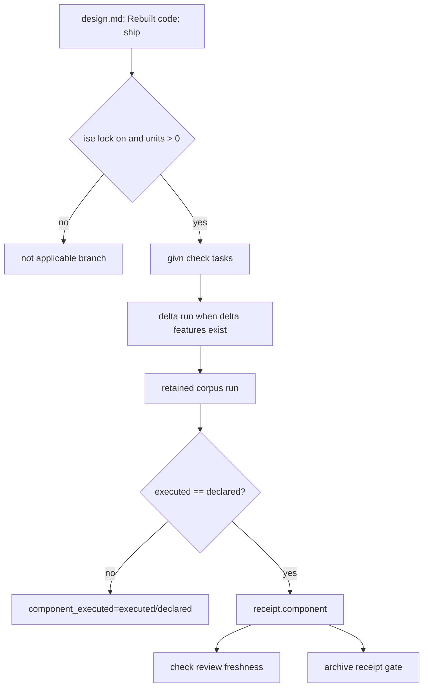

# Design: ise-ship-component-tier

## Scope

Make an Ise change that records `Rebuilt code: ship` prove the retained
component corpus. `givn check tasks` executes `givn/specs/**` with a runner
result, refuses a missing result or a count below the declared component
execution units, and records the corpus as component evidence. `givn check
review` and `givn archive` refuse a ship receipt without that evidence. The
served `ise`, design, design-review, tasks, and review instructions name the
whole-system working-tree ship and the two tiers.

The change does not add a CLI command, change `GIVN_FEATURES` semantics, or
alter the `ise-trial-result/v1` gate.

## Architecture Impact

| Area | Change |
|---|---|
| `src/ise/ship.rs` (new) | Reads the design's `Rebuilt code:` value through `state::actual_markdown`, tolerating markdown emphasis and wrapping, and reports `component_tier_required(project_root, change_dir) -> Result<Option<usize>>`: `Some(declared)` only when the change lock has `ise` on, the design records `ship`, and `givn/specs/**` declares at least one component unit. |
| `src/ise/contract.rs` | Adds `retained_component_units(project_root) -> Result<usize>` and extracts the tier-selection loop into one `count_feature_source` core shared with `count_feature_paths`, so the ship gate and the trial gate count units by one implementation. |
| `src/proof.rs` | `ChangeReceipt` gains an optional `component: ChangeComponentEvidence { result, features_path, features_digest }`. `ChangeVerification` carries the executed subject's `features_path` and `features_digest`. `change_verification_required` is the one predicate the three gates share: not-applicable only when no component tier is required. `freshness` compares the recorded `features_path` instead of assuming the change delta, and adds `ComponentTierMissing`, `ComponentTierNotGreen`, and `ComponentTierCountMismatch` for a required tier. |
| `src/cli/check.rs` | The not-applicable branch returns early only when no component tier is required. A required tier selects `givn/specs` as the change-scope subject when the change has no delta, or runs the retained corpus into `verification/component-result.json` after the delta. The component result must equal the declared count. `check review` stops taking the not-applicable shortcut for a required tier. |
| `src/cli/archive.rs` | `ensure_change_receipt` stops taking the not-applicable shortcut for a required tier, so the archive reads and validates the receipt before any mutation. |
| `src/state.rs` | `inspect_verification` reports "not applicable" only when no component tier is required; a required tier without a receipt reports "not checked". |
| `src/hooks.rs` | `run_verify_hook` sets `GIVN_RESULT_FILE`, `GIVN_RESULT_SCOPE=change`, and `GIVN_FEATURES`, then validates the result. An exit-0 command that writes no valid result no longer passes a `verify` hook. |
| `assets/instructions/ise.md` | The practice table maps working-tree ship to both rebuild decisions; a new `Whole-system rebuild with Rebuilt code: ship` sequence requires removing the coupled step definitions and fakes, rebuilding the component runner, and executing both tiers; the `Rebuilt code` definition states the incomplete-ship refusal. |
| `assets/instructions/design.md` | The whole-system row names the coupled step definitions, fakes, and fixture builders; the ship paragraph requires the component runner, one step-definition file per capability, both tier commands, and each declared count; the runner bullet states that skipping `specs` removes only the delta. |
| `assets/instructions/design-review.md` | Adds the `Two-tier runner coverage` grilling branch. |
| `assets/instructions/tasks.md` | States that the `specs` skip removes the delta batch, not the retained corpus runner. |
| `assets/instructions/review.md` | The preflight requires fresh result files with declared counts; a missing declared tier is a critical finding. |
| `tests/steps/e2e_boundary_support.rs`, `tests/steps/workflow_enforcement_steps.rs` | The `ise`-effective ship fixture: no behavior change, a specs skip, `Rebuilt code: ship`, two retained component scenarios, and a runner that reports every, one, or no scenario. |
| `tests/steps/prose_consolidation_steps.rs`, `tests/steps/change_strategy_steps.rs` | Bind the served-guidance phrase assertions. |
| `docs/reference.md`, `docs/arc42/**` | Record the receipt field, the ship gate, and the revised instruction obligation. |

### Contracts and Components

| Contract | Consumer use case | Consumers | Implementing component today | Split trigger |
|---|---|---|---|---|
| `ChangeVerificationEvidence` (receipt and result) | `verify-change` | Developer, Reviewer | `cli::check` plus `proof` | A second evidence consumer needs a different binding |
| `IseShipDecision` (design decision and component tier) | `create-change`, `verify-change` | Author, Developer | `ise::ship` plus `ise::contract` | A second rebuild practice needs its own trigger |
| `ServedInstruction` (ise and authoring guidance) | `obtain-effective-guidance` | Author, Builder agent | `cli::instructions` plus the five assets | Another instruction id needs an independent source |



## Data Model

`ChangeReceipt` keeps schema 2 and adds one optional field:

```json
"component": {
  "features_path": "givn/specs",
  "features_digest": "<sha256>",
  "result": {"total": 185, "passed": 185, "failed": 0, "skipped": 0}
}
```

`features_path` and `features_digest` on the receipt itself now describe the
subject that produced `result`; a whole-system ship with no delta records
`"features_path": "givn/specs"`. `freshness` resolves that path against the
project root, falling back to the change delta when the field is empty (schema
1). The separate component record is written only when the delta also ran.

`verification/component-result.json` holds the raw component result. It is
evidence, already covered by `is_evidence_path` through the change's
`verification/**` entry.

## Step Definitions

| Capability | Step definition file | Permanent merge target |
|---|---|---|
| `givn-workflow-enforcement` | `tests/steps/workflow_enforcement_steps.rs` | same file |
| `serve-extended-rules` | `tests/steps/serve_extended_rules_steps.rs` | same file |

The ship fixture lives in `tests/steps/e2e_boundary_support.rs`, the file the
existing `ise` boundary steps own. The five guidance scenarios bind through the
existing generic `the served <id> instruction contains "<text>"` step; no new
step definition is added for them.

## Test Runner

`cargo test --test features_runner` (through `./run-tests.sh`). It executes
`givn/specs/**` by default and the change delta when `GIVN_FEATURES` names it.
The change-scope run uses `./run-tests.sh` with `GIVN_FEATURES` and
`GIVN_RESULT_FILE`, which the repository runner honours.

## Single-Scenario Run Command

```sh
GIVN_FEATURES=givn/changes/ise-ship-component-tier/specs \
  cargo test --locked --test features_runner -- \
  --exact "verify-change/givn-workflow-enforcement.feature::A whole-system Ise ship executes the retained component corpus"
```

## Strict Mode

cucumber-rs through `tests/features_runner.rs`: the runner calls
`.fail_on_skipped()` and exits non-zero on any failed or skipped step, so an
undefined step fails the scenario. Every new step asserts observable output;
no empty step body is added.

## Decisions

- **Decides D1**: the component tier applies to every `Rebuilt code: ship`,
  not only `Whole-system rebuild`. Realized in `ise::ship::component_tier_required`
  and the ship fixture. `discard` stays outside the gate because the
  replacement is not adopted.
- **Decides D2**: the component result must execute exactly the declared
  component units under `givn/specs/**` (plain scenarios plus Scenario Outline
  example rows, excluding `@e2e`), with zero failed and zero skipped. A missing
  or short result refuses as `component_executed=<executed>/<declared>`.
  Realized in `cli::check::read_component_result` and
  `ise::contract::retained_component_units`.
- **Decides D3**: a ship with delta features runs the delta first, then the
  retained corpus, into two result files and one receipt. A ship with no delta
  runs the retained corpus as the change-scope subject. `GIVN_FEATURES` stays a
  single path; the component run uses `GIVN_RESULT_SCOPE=change` so every
  existing project runner keeps its documented scope values. Realized in
  `run_change_verification`.
- **Decides D4**: the requirement applies only when at least one component
  unit is declared. A zero-unit corpus keeps the existing not-applicable
  branch, matching the trial gate's zero-unit rule.
- **Decides D5**: `run_verify_hook` adopts the result contract. Every `verify`
  hook writes or validates a runner result; an exit-0 command without one
  fails. Realized in `hooks::run_verify_hook`, with the failure naming the
  missing result.
- **Decides D6**: the `Rebuilt code` reader normalizes markdown before
  matching: fenced blocks and HTML comments are stripped (the shared
  `state::actual_markdown`), whitespace runs collapse, and the value is the
  first alphanumeric word after `Rebuilt code:`. This accepts a plain line and
  the bold, wrapped form used in real designs. Realized in `ise::ship`.
- **Decides D7**: Ise rebuild decision: `No rebuild`. This change edits the
  existing verifier, receipt, and guidance in place; no declared `source:` root
  is replaced and no `Rebuilt code` line is recorded.
- **Decides D8**: ADR-070 is amended. Its "a no-behavior-change declaration
  reports applicability instead of a fabricated green result" rule now reads
  "applicability unless an Ise ship requires the retained component tier"; the
  receipt's subject binding and the component evidence are the amendment. No
  replacement record is created because ADR-070 already owns the change
  verification receipt.
- **Decides D9**: the served guidance asserts phrases that fit on one physical
  line each, so the step's whitespace normalization and the markdown wrap agree.
  Realized in the five assets and `serve_extended_rules` assertions.

## Use-Case Traceability

| Use-case guarantee, rule, or capability | Decision | E2E or regular evidence |
|---|---|---|
| `verify-change` checks applicable verification evidence | D1, D2, D3 | `A whole-system Ise ship executes the retained component corpus` |
| A failed or missing scope refuses rather than reporting a pass | D2 | `A whole-system Ise ship without a runner result is refused`; `A whole-system Ise ship that executes fewer component scenarios is refused` |
| Review and archive read the same freshness rule | D3 | `freshness` unit tests for the three component stale reasons |
| `obtain-effective-guidance` serves the instruction that owns the obligation | D6, D8 | The five guidance scenarios |
| `prepare-an-ise-test` keeps the component tier mandatory for a rebuild | D1, D2 | The `ise` whole-system sequence asserted by the guidance scenario |

Persona impact: `developer--primary-user`, `agent--technical-role`, and
`givn-maintainer--owner` read the changed command output and served guidance;
the change declares no visual design contract (`Interface: none`).

## Version Freshness

No new language, runtime, framework, library, database, browser, or container
version is introduced. The repository keeps its pinned Rust toolchain and the
existing dependencies; no version is asserted from memory.

## Coverage Process Boundaries

The coverage addon is effective in this repository, so the archive runs the
coverage gate. The change adds branches in `ise::ship`, `ise::contract`,
`proof::freshness`, `cli::check`, `cli::archive`, `state`, and `hooks`. The new
fixtures execute the required and refused branches; the delta scenarios and the
Rust unit tests cover them, and the archive gate measures the resulting
instrumented tree.
