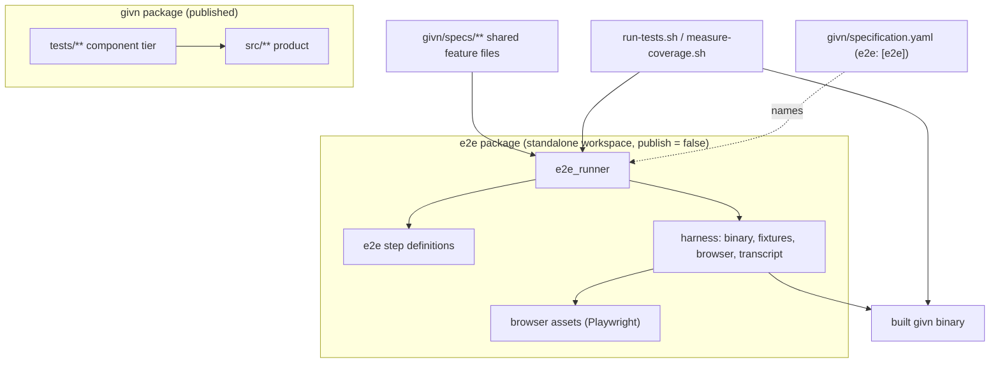

# Design: move-givn-e2e-to-black-box-package

## Overview

The change moves Givn's `@e2e` tier out of the target that links the product
and into one standalone workspace package, then points the E2E verification
scope at that package. Five surfaces:

1. **`e2e/` package (new).** Its own manifest with `[workspace]` and
   `publish = false`, the Gherkin runner, the harness, one step file per
   capability, the browser driver assets, a committed `Cargo.lock`, and no
   dependency on the `givn` crate.
2. **Project runner wiring.** `run-tests.sh --e2e --package e2e` canonicalizes
   the paths, builds the product binary (unless an instrumented `GIVN_BIN` is
   supplied), and runs the package against it. `measure-coverage.sh` instruments the product
   binary for the E2E scope. `setup-e2e-browser.sh` names the moved browser
   assets. The root manifest excludes `e2e/**` from the published crate.
3. **Declaration.** `givn/specification.yaml` declares the plan's six keys,
   including `e2e: ["e2e"]` and `source: ["src/**", "tests/**"]`. It stays inert
   because `ise` is off.
4. **Qualification.** `scripts/qualify-givn-e2e.sh` proves the package fails on
   a seeded product defect and that its dependency tree names no product crate.
5. **Documentation.** `docs/reference.md`, the affected arc42 chapters, the
   glossary, and a new ADR record the acceptance-package boundary.

Measured corpus on 2026-11-16: 116 `@e2e` scenarios in 57 feature files; the
seed's figures are stale. The measured binding set of the `@e2e` corpus spans
76 step modules: 31 `*_e2e_steps.rs` files, 9 support modules, and shared files
that also bind component scenarios (including the generic fixture steps in
`tests/steps/mod.rs`). `tests/features_runner.rs` calls
`givn::gherkin::delta::is_removed_placeholder`; the package runner replaces that
call with a tag filter.

Product-calling bindings, measured on 2026-11-16 by binding every step phrase of
the `@e2e` corpus to its `#[given|when|then]` attribute and reading each bound
body for `givn::` or a module-scope `use givn::…` identifier: **23 step
definitions across 18 scenarios in 11 files**. Three further call sites sit in
`tests/steps/mod.rs` fixture helpers (`:461-465`, `:1487`, `:1506`), and four
support modules under `tests/steps/` call the product
(`archive_proof_support`, `development_timeline_support`,
`outline_report_support`, `repository_ownership_fixtures_support`) beside the
`tests/common/mod.rs`, `browser.rs`, and `terminal_evidence.rs` helpers the
package copies. Every site and its rewrite is listed under Migration Inventory.
The package groups the moved definitions one file per capability; completeness
is proven by the run, because an unbound step fails it.

Retag count: **0**. No scenario changes its wording, title, or tag; every
product-calling binding is rewritten to assert a literal, a value the binary
printed, or a file the package wrote.

## Visual Design Contract

```
- Interface: terminal
- Viewports: not applicable (terminal text surface)
- States: not applicable
- Design system: none (CLI)
```

The change alters terminal text, exit codes, and the receipt, not a rendered
screen. The delta adds no `@e2e` scenario, so no transcript evidence is
required. The terminal baseline is the runner's own output: every failing
scenario names the scenario and the failing step, the summary prints four
counts, and a missing binary, ready fixture, or result path fails by name.

Personas: `agent--technical-role` runs the E2E scope and reads its failures;
`givn-maintainer--owner` owns the package, the lockfile, and the qualification.

## Use-Case Traceability

Owning use cases: `verify-change` (`givn-workflow-enforcement`) and the
`fragments` document (`adr-qualification-gate`).
Ideation source: `ise-rebuildability`.
Confirmed Persona IDs: `agent--technical-role`, `givn-maintainer--owner`.

| Use-case contract element | Technical decision | Capability / scenario evidence |
|---|---|---|
| `verify-change` rule: the declared `e2e` role resolves one or more packages, each holding its own manifest, the runner, and every `@e2e` step definition | `e2e/Cargo.toml` is the manifest; `e2e/tests/e2e_runner.rs` is the runner; `e2e/tests/steps/<capability>.rs` holds the definitions | the moved suite runs through the package; the delta scenario proves a standalone-workspace package resolves and binds |
| `verify-change` rule: the package links no production source | no manifest edge, no `use givn::`, products reached through `GIVN_BIN` | `cargo tree --manifest-path e2e/Cargo.toml`; the package runner's `e2e/Cargo.lock` assertion; `scripts/qualify-givn-e2e.sh` |
| `verify-change` rule: `verify.e2e_command` names every resolved root | `givn/commands.yaml` carries `./run-tests.sh --e2e --package e2e`; the declaration root is `e2e`; `names_root` reads the root as the token after `--package` or as a path token | the predecessor's runner-target rule; the added delta scenario (accepted command) and the modified outline row (`--e2e` without `--package`) |
| `verify-change` rule: a delta with `@e2e` scenarios runs the E2E scope and binds its identity | `./run-tests.sh --e2e --package e2e` passes `GIVN_RESULT_SCOPE=e2e` and `GIVN_RESULT_FILE` through; the package writes the four counts and the scope | the delta scenario asserts the receipt binds both digests and records a passed E2E scope |
| `verify-change` extension: a resolved package that declares its own workspace is accepted | the resolver reads the nearest package manifest; an `exclude` entry is not a dependency edge | the delta scenario |
| `verify-change` rule: an unbound or skipped step fails the E2E run | `.fail_on_skipped()` plus a filter that excludes `@givn.removed`; exit 1 on failed, skipped, or zero | the package runner; the strict-mode probe in tasks |
| `verify-change` rule: feature files stay shared | the package reads `GIVN_FEATURES` and selects by `@e2e`; no feature moves | `givn/specs/**` unchanged |
| `verify-change` rule: the receipt binds the package digests and the runner command digest | unchanged product code; the digest now covers `e2e/**` instead of the product-linked step files | the delta scenario |
| `fragments` (`adr-qualification-gate`) rule: the active register agrees with the canonical sources | ADR-079 is accepted, so the register carries 31 accepted records | the modified scenario and its new 31-count binding |

## Architecture Impact



Arrows point from consumer to provider. The package depends on no product
crate; the only product it reaches is the built binary.

### Package layout

```text
e2e/
  Cargo.toml            # package givn-e2e, [workspace], publish = false
  Cargo.lock            # committed; every package command runs --locked
  tests/
    e2e_runner.rs       # harness = false; @e2e filter, result file, GIVN_BIN check
    harness/
      mod.rs            # World, fixture project, run_givn, stdout/stderr
      binary.rs         # GIVN_BIN and GIVN_READY_FIXTURE resolution
      browser.rs        # the JSON-line Playwright driver client
      terminal_evidence.rs
      timing.rs         # scenario slug helper for evidence paths
    steps/
      mod.rs
      <capability>.rs   # one module per moved capability module with an
                        # @e2e scenario; the module keeps its capability name
  browser/
    browser-driver.mjs
    package.json
    package-lock.json
```

`givn/commands.yaml` carries
`e2e_command: "./run-tests.sh --e2e --package e2e"`. The `e2e` token is the
value of `--package`, so the runner-target rule reads a typed flag value rather
than a bare tier flag: the `--e2e` flag names no root and is refused. The regular
scope keeps `command: "./run-tests.sh --non-e2e"`.

### Contracts and Components

| Contract | Consumer use case | Consumers | Implementing component today | Split trigger |
|---|---|---|---|---|
| E2E runner contract (`GIVN_BIN`, `GIVN_READY_FIXTURE`, `GIVN_FEATURES`, `GIVN_RESULT_FILE`, `GIVN_RESULT_SCOPE`) | `verify-change` (`givn-workflow-enforcement`) | `run-tests.sh`, `measure-coverage.sh`, `givn check tasks`, `givn archive` | `e2e/tests/e2e_runner.rs` | a second E2E runner, or a stack that cannot expose a built binary path |

One contract, one component. The product's `e2e_boundary` resolver and
`proof` module keep their responsibilities from
`enforce-ise-e2e-boundary`; this change adds the `--package` acceptance form to
`names_root` and supplies the package those checks were written for. No other
product code changes.

## Data Model Changes

None. The change touches durable values without changing their shape:

- the change verification receipt keeps `change-proof/v1`, `e2e_identity`, and
  `e2e_scope`; the package digest now covers `e2e/**`;
- the trial record keeps `ise-trial/v1` and `e2e_files`; the frozen set now
  covers `e2e/**`;
- `givn/specification.yaml` keeps the six-key strict schema.

No migration. A receipt or trial record written before the move is stale by
its package digest, which is the intended behaviour.

## Technology Decisions

| Technology | Version | Resolution |
|---|---|---|
| Rust | edition 2024, toolchain from `flake.nix`/`rust-toolchain` | Repository-pinned; unchanged |
| cucumber-rs | 0.23 (locked in `Cargo.lock`) | Existing runner; the package pins the same major |
| tokio | 1 (locked in `Cargo.lock`) | Existing dev-dependency; the package needs the macros and multi-thread runtime |
| serde_json | 1 (locked in `Cargo.lock`) | Existing; receipt and fixture JSON |
| gherkin | 0.16 (locked in `Cargo.lock`) | Existing; the package parses merged features with the same crate instead of a product wrapper |
| serde_yaml_ng | 0.10 (locked in `Cargo.lock`) | Existing; the package reads `givn/config.yaml` skills targets itself |
| tempfile | 3 (locked in `Cargo.lock`) | Existing; fixture project directories |
| cargo-nextest | current `run-tests.sh` default | Regular scope only; the E2E package uses `cargo test` so one process writes one result file |
| Playwright | 1.64.1 (read from `tests/e2e/package.json` on 2026-11-16) | Moves unchanged to `e2e/browser/package.json` |
| Node.js | resolved from `PATH` | Unpinned, existing behaviour of the browser tier |
| POSIX shell | `/bin/sh` | Existing project scripts |

No new product dependency. The E2E package's dependencies are test-only and
never enter the published crate.

## Decisions

- Decides D2 (proposal): **write `givn/specification.yaml` in this change**. It
  carries the plan's roles: `behavior: ["givn/specs/**"]`,
  `structure: ["docs/glossary.md", "docs/domain-model.md"]`,
  `contracts: ["docs/reference.md"]`,
  `limits: ["docs/arc42/02-architecture-constraints.md"]`, `e2e: ["e2e"]`, and
  `source: ["src/**", "tests/**"]`. The file is inert while `ise` is off, and
  `givn lint` reads nothing because `Declaration::is_effective` is false.
  Rejected: deferring the file to the enabling change, because Change A must
  land the package and the role that names it together. Realized in
  `givn/specification.yaml`; the enabling change only flips the addon.
- Decides D3 (proposal): **standalone workspace, excluded from the root
  package**. `e2e/Cargo.toml` declares `[workspace]`, and the root manifest's
  `exclude` list gains `e2e/**`. Cargo forbids a package that is both a member
  of the root workspace and its own workspace root, so the plan's "workspace
  member" wording is realized as an excluded standalone package (the Passuff
  pattern). The package gets its own lockfile and target directory under
  `target/e2e-package`; `run-tests.sh` and `measure-coverage.sh` invoke its
  format and lint explicitly. Rejected: a root workspace member, because it
  shares the product workspace graph and lockfile, weakens the independent
  `cargo tree`, and cannot be copied without the repository root. Realized in
  `e2e/Cargo.toml`, the root `Cargo.toml`, and `.gitignore`.
- Decides D1 (proposal): **carried, not decided here**. Default: this change
  proceeds on the operator's authorization and makes no claim that the Ise
  protocol is validated. Owner: `givn-maintainer--owner`. Trigger: the start of
  `enable-ise-on-givn-and-run-a-dry-run`. Deciding artifact:
  `givn/ideation/ise-rebuildability/plan.md` (`S7` to `S12`). Switching is
  cheap for this change because no scenario depends on the answer.
- **Decides the runner-naming question: the command names the package through
  `--package`.** `verify.e2e_command` becomes
  `./run-tests.sh --e2e --package e2e`. `names_root` in
  `src/e2e_boundary/mod.rs` reads the token after `--package` and accepts the
  root when that value equals it; a bare `--e2e` flag, or a `--package` value
  naming something else, names nothing. The existing whole-token and `<root>/`
  path forms stay accepted, so `--manifest-path e2e/Cargo.toml` and the
  existing fixture commands are unchanged and no consumer-visible refusal
  changes. Rejected: accepting `--e2e` as evidence, because the flag names the
  tier, not the package; and narrowing the whole-token form, because that
  would refuse a positional root token projects use today. Realized in
  `src/e2e_boundary/mod.rs`, `givn/commands.yaml`, `docs/reference.md`, and the
  delta scenarios.
- **Decides the path question: the project runner canonicalizes the paths it
  hands the package.** The package's working directory is `e2e/`, so
  `run-tests.sh` resolves `GIVN_FEATURES`, `GIVN_RESULT_FILE`, and the binary
  directory to absolute paths before it runs the package. Callers keep passing
  project-relative paths: `givn check tasks` already passes an absolute delta
  path, and `givn archive` and `measure-coverage.sh` pass `givn/specs`.
  Rejected: requiring absolute paths from every caller, because that changes the
  product's runner contract for every project to fix one project's script.
  Realized in `run-tests.sh`; no product change, so `src/cli/archive.rs:1769`
  keeps its `givn/specs` value.
- **Decides the dependency question: the package runner asserts its own
  lockfile.** `e2e/tests/e2e_runner.rs` reads `e2e/Cargo.lock` before the suite
  and exits 2 when any `[[package]]` named `givn`, `givn-config`, or
  `givn-core` appears. It is a permanent check inside the frozen package: it
  covers a registry or git edge the static manifest reader admits, and it runs
  on every E2E invocation, including under coverage. Rejected: a one-time
  qualification script, because a later dependency addition would pass the
  static reader and never be checked again. Realized in
  `e2e/tests/e2e_runner.rs`; the static reader's registry blindness is a named
  limit with risk row `R-159`.
- **Decides the coverage question: coverage hands the instrumented binary in.**
  `run-tests.sh --e2e` uses a pre-set executable `GIVN_BIN` and profile
  directory instead of rebuilding, and `measure-coverage.sh` builds the
  instrumented binary with
  `cargo llvm-cov --no-run --no-report --locked --bin givn`, exports its path
  and `LLVM_PROFILE_FILE`, and calls `./run-tests.sh --e2e` instead of the
  package directly. Rejected: a package-side coverage flag, because the package
  must stay runnable without llvm-cov. Realized in `run-tests.sh` and
  `measure-coverage.sh`.
- **Scope selection by tag.** The package runner filters `@e2e` and excludes
  `@givn.removed`, independent of the command string, so a shared feature file
  can hold both tiers. `GIVN_RESULT_SCOPE` is still written into the result,
  because the product refuses a scope mismatch.
- **Binary path contract.** `GIVN_BIN` is required and must be executable;
  `GIVN_READY_FIXTURE` is required only by the run-execution scenarios. The
  runner refuses with exit 2 and a named message when a required path is
  missing. `run-tests.sh --e2e --package e2e` builds `givn` and `ready_fixture`
  and exports both paths unless `GIVN_BIN` already names an executable.
- **One file per capability.** The moved definitions are regrouped into
  `e2e/tests/steps/<capability>.rs`: the package's step module keeps the
  capability's own module name, so the move stays reviewable against the module
  it came from. Measured on 2026-11-16, the `@e2e` corpus binds definitions from
  75 modules across the 18 capabilities, and a single file per capability would
  mean re-splitting state types and fixture helpers that those modules share;
  the acceptance boundary is the package, not the file name. The old
  `*_e2e_steps.rs` files are deleted from `tests/steps/`; shared files keep
  their component bindings and the package receives a rewritten copy. This is a
  move, not a duplicate tier.
- **Rewrite every product-calling binding.** The 23 bindings below name their
  rewrite. No scenario is retagged and no scenario title changes.
- **Coverage hands the instrumented binary in.** The E2E group builds `givn`
  with `cargo llvm-cov --no-run --no-report --locked --bin givn` and calls
  `./run-tests.sh --e2e` with `GIVN_BIN` and `LLVM_PROFILE_FILE` set, so the
  E2E report still measures `src/**` and the runner does not rebuild.
- **One seeded defect.** `scripts/qualify/status-verification-current.patch`
  makes `givn status` report `Verification: current` when no receipt exists.
  The `@e2e` scenario `Detail mode — active change with all required done
  (text)` asserts `not checked`, so the package fails. The script reverts the
  patch and requires the suite to pass again.
- **Qualification script scope.** `scripts/qualify-givn-e2e.sh` runs the full
  E2E suite twice on a scratch copy. It is a maintainer and release check, not
  part of `verify.command` or the archive gate.

## Migration Inventory

Rule: the package holds every definition bound to an `@e2e` scenario. A
definition moves when its phrase can be bound without a product import;
otherwise the step body is rewritten against `GIVN_BIN`, a literal, or a file
the package wrote. A scenario is retagged only when its assertion cannot be
expressed through the binary. None is.

Measured on 2026-11-16: 116 `@e2e` scenarios in 57 feature files; 23
product-calling step definitions across 18 of those scenarios in 11 files; 3
fixture-helper sites in `tests/steps/mod.rs`; 4 product-calling support modules
under `tests/steps/`; 3 copied `tests/common/` helpers. Lines are this
revision's.

### Product-calling step bindings

| Binding (file:line) | Bound step definition | In-process use today | Rewrite |
|---|---|---|---|
| `archive_proof_e2e_steps.rs:150` | `capture_archive_transcript` | `givn::integrity_hook::scenario_slug` | package-local `scenario_slug` copy |
| `deduplicate_change_dir_detection_steps.rs:8` | `e2e_given_change_with_design_and_valid_hashes` | `scm::select`, `Manifest::load_embedded`, `proof::digest_tested_content`, `proof::write_change_receipt` at `:51-63` | run `givn check tasks` on the fixture, or write the receipt JSON from `git rev-parse HEAD` with literal `content_scope` and counts |
| `development_report_e2e_steps.rs:331` | `report_has_been_generated` (3 scenarios) | `givn::history::Scope` | package-local `ReportScope` enum |
| `development_report_e2e_steps.rs:554` | `browser_shows_the_longest_recorded_step` | `cli::timeline::format_duration` | assert the duration text the fixture report prints |
| `development_report_e2e_steps.rs:699` | `topic_record_holds_persona_and_event_storming_markers` | `givn::history::Scope` | package-local `ReportScope` |
| `development_report_e2e_steps.rs:737` | `browser_shows_the_linked_ideation_group_before_the_workflow` | `format_duration` | literal duration text |
| `development_report_e2e_steps.rs:1082` | `open_report_with_parallel_sessions` (2 scenarios) | `givn::history::Scope` | package-local `ReportScope` |
| `development_report_e2e_steps.rs:1319` | `open_report_with_a_recorded_history` | `givn::history::Scope` | package-local `ReportScope` |
| `development_report_e2e_steps.rs:1413` | `log_names_the_lane_start_duration_and_outcome` | `format_duration` | literal duration text |
| `extract_coverage_gate_steps.rs:76` | `e2e_given_completed_change` (2 scenarios) | `usecase_md_template` | literal use-case narrative |
| `grouped_merge_steps.rs:358` | `published_content_retained` | `givn::gherkin::parse::parse_supported_source` at `:363-364` | parse with the package's `gherkin` dependency |
| `instruction_integrity_steps.rs:2904` | `no_separately_authored_agent_command` | `skills::targets::AgentTarget::ALL` | package-local target-name list |
| `prose_consolidation_e2e_steps.rs:72` | `project_all_targets_with_optional_guidance` | `AgentTarget::ALL` | package-local target-name list |
| `prose_consolidation_e2e_steps.rs:209` | `generated_spec_skill_points_to_canonical_instruction` | `config::overlay::load_skills_targets` | read `givn/config.yaml` with the package's YAML parser |
| `prose_consolidation_e2e_steps.rs:239` | `thin_skills_do_not_repeat_policy` | `load_skills_targets` | same |
| `prose_consolidation_e2e_steps.rs:285` | `sync_reports_skills_without_commands` | `load_skills_targets` | same |
| `prose_consolidation_steps.rs:264` | `project_with_all_targets` (2 scenarios) | `AgentTarget::ALL` | package-local target-name list |
| `readme_enforcement_steps.rs:289` | `completed_change_short` (2 scenarios) | `usecase_md_template` | literal use-case narrative |
| `readme_enforcement_steps.rs:462` | `ordered_stale_block` | `cli::readme::check_readme`, `ReadmeFindingKind` | assert the README holds exactly one ordered marker pair |
| `readme_enforcement_steps.rs:485` | `surrounding_prose_unchanged` | `cli::readme::DEV_BLOCK_BEGIN` / `DEV_BLOCK_END` | literal marker strings |
| `run_execution_e2e_steps.rs:319` | `commands_file_has_sentinel` | `config::manifest::Run::SENTINEL` | literal `givn missing-run-command` |
| `workflow_enforcement_steps.rs:1411` | `clean_project_with_passing_change` | `usecase_md_template` | literal use-case narrative |
| `workflow_enforcement_steps.rs:2603` | `receipt_bound_to_inputs` | `proof::ChangeReceipt::read`, `proof::CONTENT_SCOPE` | read the receipt JSON with `serde_json`, compare `content_scope` to `change-proof/v1` |

### Fixture helpers and copied modules

| Site | In-process use today | Rewrite |
|---|---|---|
| `tests/steps/mod.rs:461-465` (`ensure_fixture_usecase`) | `usecase_md_template`, `fragment_md_template` | literal narratives selected by use case or fragment |
| `tests/steps/mod.rs:1487`, `:1506` (persona fixture documents) | `usecase_md_template` | literal narratives |
| `tests/steps/archive_proof_support.rs` (7 sites) | receipt write, tested-content digest, `usecase_md_template` | run `givn check tasks` against the fixture, or write literals |
| `tests/steps/development_timeline_support.rs` (3 sites) | `HistoryEntry`, `HistoryStore`, `Scope`, `SCHEMA`, `CONTENT_FIELD_LIMIT` | write the record JSONL with literals; package-local scope type |
| `tests/steps/outline_report_support.rs` (4 sites) | `outline` model types and analyzer trait | write the fixture source and assert the binary's report; no analyzer |
| `tests/steps/repository_ownership_fixtures_support.rs` (1 site) | `usecase_md_template` | literal narrative |
| `tests/common/mod.rs` (10 sites, `effective_manifest`) | `Manifest::load_embedded`, `overlay::apply_config`, `overlay::apply_commands` | read the written `givn/config.yaml` and `givn/commands.yaml`; drop the helper where unused |
| `tests/common/browser.rs`, `tests/common/terminal_evidence.rs` | `integrity_hook::scenario_slug` | package-local `scenario_slug` copy |
| `tests/features_runner.rs` | `gherkin::delta::is_removed_placeholder` | `@givn.removed` tag filter |

### Step modules and their disposition

| Current home | Disposition |
|---|---|
| 30 `tests/steps/*_e2e_steps.rs` files | moved and regrouped into `e2e/tests/steps/<capability>.rs`; deleted from `tests/steps/` |
| `tests/steps/llm_attribution_e2e_steps.rs` | the package receives a rewritten copy; the component copy stays because non-`@e2e` attribution scenarios bind its fixture builders (checked on 2026-11-16: 30 of the 31 files bound only `@e2e` phrases, this one binds both tiers) |
| `tests/steps/mod.rs` fixture steps used by `@e2e` scenarios | copied into the package harness with the three helper rewrites above; the component copy stays |
| `tests/steps/archive_proof_support.rs`, `development_timeline_support.rs`, `outline_report_support.rs`, `repository_ownership_fixtures_support.rs` | copied with the rewrites above; the component copies stay |
| `tests/steps/run_declaration_fixtures_support.rs`, `run_execution_support.rs`, `ise_clean_room_support.rs`, `template_conditional_rendering_support.rs` | copied unchanged; they name no product symbol |
| `tests/common/browser.rs`, `tests/common/terminal_evidence.rs`, `tests/common/mod.rs` | copied with a local `scenario_slug` and the `effective_manifest` rewrite; the originals stay for the component tier |
| `tests/steps/run_command_steps.rs`, `workflow_enforcement_steps.rs`, `instruction_integrity_steps.rs`, `prose_consolidation_steps.rs`, `default_all_addons_steps.rs`, `development_report_steps.rs` | the `@e2e`-bound definitions are copied and rewritten; the component definitions stay |
| `tests/features_runner.rs` and every `tests/steps/*_e2e_steps.rs` reference in `mod.rs` | removed from the component tier; the package runner is its own target |

Every `@e2e` scenario keeps its title. The package's run is the completeness
check: a missing binding fails with the phrase.

## External Boundary Cases

- **Missing or non-executable `GIVN_BIN`**: the runner exits 2 and names the
  variable and the path; no result file is written.
- **Missing `GIVN_READY_FIXTURE` at a run-execution scenario**: the step fails
  with the variable name; it is never skipped.
- **Wrong `GIVN_RESULT_SCOPE`**: the product refuses the result by scope.
- **Malformed, missing, or zero-count result**: exit 2; the check refuses.
- **Unbound step**: cucumber reports one failed step; the run exits 1.
- **Skipped step**: `fail_on_skipped()` turns it into a failure; the run exits 1.
- **Missing browser driver or Chromium**: the browser step fails with the
  driver error; it is never skipped.
- **Package links `givn` by a path or workspace edge**: the change check refuses
  the dependency edge (predecessor behaviour).
- **Package links `givn` by a registry or git edge**: the static manifest reader
  admits the edge because it resolves no project path (named limit, `R-159`);
  the package runner reads `e2e/Cargo.lock` and exits 2 naming the product
  package before any scenario runs.
- **Runner command names no `e2e` root**: the check refuses by name
  (predecessor behaviour). `./run-tests.sh --e2e` is refused because the flag
  names the tier; `./run-tests.sh --e2e --package e2e` is accepted because the
  token after `--package` equals the resolved root.
- **Relative feature or result path handed to the package**: `run-tests.sh`
  canonicalizes `GIVN_FEATURES`, `GIVN_RESULT_FILE`, and the binary directory
  before it changes into `e2e/`, so a caller keeps passing `givn/specs`.
- **Seeded defect**: the qualification script requires a failing suite and then
  a passing suite after the revert.
- **Stale lockfile or dependency drift**: every package command runs
  `--locked`; a lockfile mismatch fails the build.

High-risk rules with sensitivity checks: package identity (a one-line step edit
changes the digest), alternative coverage (unbound and skipped steps fail),
boundary (no product import in the package), lifetime (lockfile and Playwright
pin), and precedence (scope selection by tag, not by command shape).

## Step Definitions

| Capability | Step definition file | Permanent merge target |
|---|---|---|
| `givn-workflow-enforcement` (delta, non-`@e2e`) | `tests/steps/workflow_enforcement_steps.rs` | same file, extended in place |
| `givn-workflow-enforcement` (`@e2e`, moved corpus) | `e2e/tests/steps/workflow_enforcement.rs` | permanent package file, created by the move |
| `adr-qualification-gate` (delta, `@givn.modified`) | `tests/steps/adr_qualification_gate_steps.rs` | same file, extended in place |

New and changed phrases:

| Phrase (exact) | Binding file | Note |
|---|---|---|
| `an ise-effective change ready for change-scoped verification whose declared e2e package declares its own workspace, whose E2E runner command is "./run-tests.sh --e2e --package e2e", and whose delta has an E2E scenario` | `tests/steps/workflow_enforcement_steps.rs` | New Given; calls a new `e2e_boundary_support` helper that writes `[workspace]` into the fixture package, a root manifest that excludes `e2e/**`, a fixture `run-tests.sh` writing one passing scoped result, and the delta `@e2e` scenario, then commits |
| `an ise-effective change ready for change-scoped verification whose E2E runner command is "<command>"` | `tests/steps/workflow_enforcement_steps.rs` | Existing Given, unchanged; the modified outline adds `./run-tests.sh --e2e` to its Examples |
| `the final register has 31 accepted decisions and no proposed decisions` | `tests/steps/adr_qualification_gate_steps.rs` | Changed Then for the modified scenario; counts the register rows, requires 31 accepted and zero proposed, and requires the ADR-079 row to be accepted |

The delta introduces no delta step copy. The moved `@e2e` definitions are
permanent files under `e2e/tests/steps/`; they are not phrases of this change.
Both commands execute the `.feature` files through cucumber; no parallel
hand-written test file is added.

Test runner command (regular scope):

```text
./run-tests.sh --non-e2e
```

E2E runner command:

```text
./run-tests.sh --e2e --package e2e
```

Single-scenario run command (delta scenario):

```sh
GIVN_FEATURES=givn/changes/move-givn-e2e-to-black-box-package/specs \
  cargo test --locked --test features_runner -- \
  --exact "verify-change/givn-workflow-enforcement.feature::A change whose declared E2E package is a standalone workspace passes the tasks check and binds the E2E scope"
```

Single-scenario run command (moved `@e2e` scenario):

```sh
GIVN_FEATURES="$PWD/givn/specs" GIVN_BIN="$PWD/target/debug/givn" \
  cargo test --locked --manifest-path e2e/Cargo.toml --test e2e_runner -- \
  --exact "inspect-change-state/report-change-status.feature::Detail mode — active change with all required done (text)"
```

The manual `@e2e` command passes `GIVN_FEATURES` as an absolute path because the
package's working directory is `e2e/`; `./run-tests.sh --e2e` performs the same
canonicalization for its callers.

## Internal Primitives

- **`run_givn(env, args)`**: spawns `GIVN_BIN` with the fixture as the current
  directory, an empty `GIVN_FEATURES`, and piped stdio where a scenario answers
  a prompt; captures output. No product import.
- **Fixture projects**: `tempfile::TempDir` plus the real `givn init` and
  `givn new`, so the fixture shape is the product's own.
- **`scenario_slug(title)`**: lowercase ASCII alphanumerics, one dash between
  runs of other characters. The package carries its own copy because the
  visual-evidence path must match the product's rule; a mismatch fails the
  visual gate by a missing file.
- **Expected values are literals, except measured durations.** The duration
  assertions compare the page's printed text against
  `harness::duration_text(ms)`, the report format's own four-branch rendering
  (milliseconds, seconds, minutes, `h mm m`). The durations in the record are
  measured, because a command entry takes as long as the fixture's real
  invocation, so a fixed literal drifts run to run and the fixture cannot pin
  the text. The
  helper is a format rule beside the receipt and record mirrors, not the
  product's `format_duration` implementation: it exists only to name the text
  the page must print for a measured millisecond value.
- **Browser driver client**: one `node` process per scenario, one JSON command
  per line, a 60 second per-command timeout, and a killed process on drop. A
  driver error or timeout fails the step.
- **Terminal evidence writer**: writes `transcript.txt` under the active
  change's `evidence/visual/<slug>/`, or under `target/terminal-evidence/` for
  the permanent corpus; the package mirrors the existing rule with its own
  slug helper.

## Strict Mode

The package runner calls `World::cucumber().fail_on_skipped()` and filters to
`@e2e` scenarios that are not `@givn.removed`. An undefined step fails the
scenario; a skipped or pending step becomes a failure. The runner exits nonzero
when `failed > 0`, `skipped > 0`, or `total == 0`, and it writes the result file
before exiting.

Strict-mode proof (tasks setup): a scratch feature with one undefined step run
through the package exits 1 with `failed = 1`; the same feature with one
`Skipped` step exits 1 with `skipped = 1`; the unmodified suite exits 0.

## Interaction Coverage Matrix

The delta adds no inventory entry. Every entry below is unchanged and is now
driven by the package for its `@e2e` execution.

| Inventory entry | @e2e scenario title | Real interface | Driving mechanism |
|---|---|---|---|
| validate-artifact-ids: check an unknown artifact | Consumer invokes givn check with an unknown artifact and gets a helpful error | CLI | `run_givn` spawns `GIVN_BIN` with `check bad` and reads stderr |
| visual-review-gate: run the review check on a visual change | A visual change with complete evidence passes review | CLI | `run_givn` spawns `GIVN_BIN` with `check review --change <id>` |
| visual-review-gate: read the visual review guidance | Review guidance requires the visual verdict and persona lenses | CLI | `run_givn` spawns `GIVN_BIN` with `instructions review` |
| spec-overlap-gates: detect a duplicate title | A duplicate title across two permanent spec files is a hard error | CLI | `run_givn` spawns `GIVN_BIN` with `lint` |
| spec-overlap-gates: inspect duplicate JSON | The json output reports duplicate-title findings machine-readably | CLI | `run_givn` spawns `GIVN_BIN` with `lint --json` |
| resolve-change-directories: run integrity in a change | Consumer runs the integrity check on a change inside givn/changes and the correct directory is detected | CLI | `run_givn` spawns `GIVN_BIN` with `check integrity --change <id>` |
| resolve-change-directories: reject placeholder commit evidence | Integrity check detects a placeholder COMMIT hash in tasks.md and fails | CLI | `run_givn` spawns `GIVN_BIN` with `check integrity --change <id>` |
| check-specification-health: lint the specification corpus | All clean .feature files report a clean summary on stdout | CLI | `run_givn` spawns `GIVN_BIN` with `lint` |
| givn-workflow-enforcement: run migration coverage check | Consumer runs migration coverage check and sees passed evidence | CLI | `run_givn` spawns `GIVN_BIN` with `check migration` |
| givn-workflow-enforcement: run the change-scoped checks | Consumer runs check tasks and receives a change verification receipt | CLI | `run_givn` spawns `GIVN_BIN` with `check tasks --change <id>` |
| givn-workflow-enforcement: request bare-check guidance without execution | Consumer invokes bare check and receives explicit non-executing guidance | CLI | `run_givn` spawns `GIVN_BIN` with `check` |
| givn-workflow-enforcement: write a runner result | The result helper writes four counts without a scope | CLI | `run_givn` spawns `GIVN_BIN` with `test-result` |
| givn-workflow-enforcement: run the review check on a change with use-case schema errors | Consumer runs review and receives every use-case schema problem in one pass | CLI | `run_givn` spawns `GIVN_BIN` with `check review --change <id>` |
| adr-qualification-gate: request architecture-decision guidance (design-review selection is a regular variant) | An author requests the strict ADR guidance through the Givn CLI | CLI | `run_givn` spawns `GIVN_BIN` with `instructions design-review` |

## Black-Box-First

Every `@e2e` scenario reaches the product only through `GIVN_BIN`. The component
tier is retained unchanged and answers a distinct question: it covers runner
result shape, scope handling, generated file content, and served instruction
text whose subject is the product's internal contract, not a consumer action.
No component scenario duplicates a moved `@e2e` assertion layer: the moved
scenario asserts what the binary printed, and the component copy asserts the
internal rule that produces it only where that rule has no separate consumer
surface.

## Persona impact

| Persona | Impact |
|---|---|
| `agent--technical-role` | Runs `./run-tests.sh --e2e --package e2e`, reads named failures, and no longer needs the product crate to run the acceptance suite |
| `givn-maintainer--owner` | Owns the package manifest, the lockfile, the Playwright pin, and the qualification script |

## E2E Smoke Test Infrastructure

- **E2E runner command**: `./run-tests.sh --e2e --package e2e`. The script
  canonicalizes `GIVN_FEATURES`, `GIVN_RESULT_FILE`, and the binary directory,
  sets `GIVN_RESULT_SCOPE=e2e`, builds `givn` and `ready_fixture` unless
  `GIVN_BIN` is already an executable, exports `GIVN_BIN` and
  `GIVN_READY_FIXTURE`, and runs
  `cargo test --locked --manifest-path e2e/Cargo.toml --test e2e_runner` with
  `e2e/` as the working directory. `givn check tasks` and `givn archive` run
  the same command with `GIVN_FEATURES` and `GIVN_RESULT_FILE`; `check tasks`
  passes an absolute delta path, and archive's `givn/specs` is resolved by the
  script.
- **Package runner preflight**: reads `e2e/Cargo.lock` and exits 2 when a
  `[[package]]` named `givn`, `givn-config`, or `givn-core` appears; then
  requires an executable `GIVN_BIN`.
- **Step definition location**: `e2e/tests/steps/<capability>.rs`, one file per
  capability, separate from `tests/steps/`.
- **Local test infrastructure**: the built `givn` binary, the built
  `ready_fixture`, a temporary project directory per scenario, and, for the
  browser scenarios, Node.js with the pinned Playwright and its Chromium. No
  server, port, database, or container.
- **Framework choice**: cucumber-rs 0.23, because the corpus is Gherkin and the
  product's runner contract already uses it; the package uses `cargo test` in
  one process so one result file is written.
- **Strict-mode proof**: `fail_on_skipped()` plus the exit rules in `Strict
  Mode`; the tasks setup proves an undefined and a skipped step both fail.

## Local Runnability & Digital Twins

- **Local run command**: `./run-tests.sh` (regular and E2E), or
  `./run-tests.sh --e2e --package e2e` alone.
- **Browser setup**: `./setup-e2e-browser.sh`, which now runs `npm ci` and the
  Playwright Chromium install against `e2e/browser`.
- **Isolated network**: not applicable. No scenario talks to a third-party
  service; the browser loads a `file://` report and the CLI runs locally.
- **Digital twins**: none. The product's external boundary is the local
  filesystem and the local subprocess; there is no third-party dependency to
  emulate.
- **Foreseen interface obstacle**: the package needs the product binary, which
  `CARGO_BIN_EXE_givn` cannot provide outside the product test target. The fix
  is the required `GIVN_BIN` variable, exported by both project runners. A
  missing value fails before any scenario runs.

## Coverage

The archive coverage gate stays enabled. Both scopes must report distinct,
non-zero Cobertura reports.

| Process | Started by | Instrumented artifact | Profile output | Merge step | Non-zero production probe |
|---|---|---|---|---|---|
| regular runner | `measure-coverage.sh` non-e2e group | `cargo llvm-cov nextest --no-report --locked --test features_runner` | llvm-cov's profraw under `target/llvm-cov-target` | `cargo llvm-cov report --cobertura --output-path coverage/non-e2e-cobertura.xml` | a component scenario executes `src/cli/new.rs` |
| `givn` binary | `measure-coverage.sh` exports the instrumented `GIVN_BIN` and `LLVM_PROFILE_FILE`, then calls `./run-tests.sh --e2e --package e2e` | `cargo llvm-cov --no-run --no-report --locked --bin givn` | `LLVM_PROFILE_FILE="$PWD/target/llvm-cov-target/givn-%p-%m.profraw"` | `cargo llvm-cov report --cobertura --output-path coverage/e2e-cobertura.xml` after the suite | the check-tasks scenario executes `src/cli/check.rs` |
| `ready_fixture` (test-only) | run-execution scenarios through `GIVN_READY_FIXTURE` | `cargo llvm-cov --no-run --test ready_fixture` | merged with the binary's profraw; its own code is test-only | same report | not measured; test-only |

Measured population: product source under `src/**`. Excluded: the `e2e`
package, `tests/**`, generated code, and test fixtures. The population is
declared before the first run and does not change after seeing a result.

## Risks and Trade-offs

- **The E2E report measures nothing.** If `GIVN_BIN` points at an
  uninstrumented binary, the E2E report is empty or duplicated. Mitigation:
  `measure-coverage.sh` builds the instrumented binary with `cargo llvm-cov
  --no-run`, exports that exact path, and `run-tests.sh` does not rebuild it;
  the merge gate rejects duplicate or empty reports.
- **Local mirrors drift.** `scenario_slug` and the fixture narratives and
  expected durations are copied literals. Mitigation: assertions compare
  against literals or the binary's printed output; the qualification suite
  catches a seeded defect; the unbound-step failure catches a moved phrase.
- **The second lockfile drifts.** Mitigation: every package command runs
  `--locked`, both project runners execute the package, and the package runner
  refuses a lockfile that names a product crate.
- **The static boundary reader is blind to registry and git edges.** A
  `givn = "9"` dependency or a `git =` dependency carries no project path, so
  the change check admits it. Mitigation: `e2e/Cargo.lock` is committed and the
  package runner refuses a lockfile naming `givn`, `givn-config`, or
  `givn-core`; the limit is stated in `docs/reference.md` and recorded as
  `R-159`.
- **Archived browser evidence rewrites during a suite run.** The browser
  scenarios write into their change's evidence directory, active or archived.
  Mitigation: the Playwright version stays pinned, so the bytes are stable; a
  drift fails the archive gate with the dirty path and is recorded as R-157.
- **The qualification script is slow.** It runs the full suite twice. Mitigation:
  it is a maintainer and release check, not part of `verify.command`.
- **The move loses a binding.** Mitigation: the package's run fails on the
  unbound phrase, and the inventory maps every scenario to its definitions.

## Open Technical Questions

None. The product's boundary, receipt, and freshness behaviour are unchanged;
the only open question is the proposal's D1, which is carried with an owner and
a deciding artifact.
