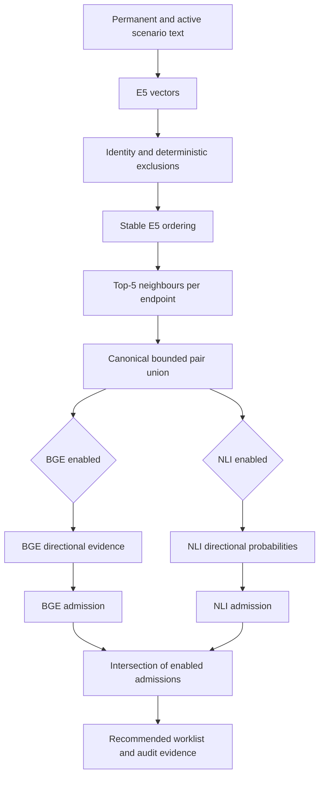

# Design: NLI Evidence

## Product Boundary

E5 remains the only raw candidate generator. NLI is an optional, local,
second-stage evidence layer over the same deterministic top-K union already
used by BGE. It reduces the recommended review worklist but never edits a
feature file, assigns a Givn class, or proves remediation.

The fixed NLI admission rule is inclusive: a candidate is
`NLI_RECOMMENDED` when its symmetric entailment probability is at least
`0.5000`; otherwise it is `NLI_FILTERED`. This is an evidence admission rule,
not a probability-to-class mapping. A candidate is in the final recommended
set only when every enabled and available second-stage layer recommends it.
The E5 raw set remains visible in every output.

## Feature Matrix

The existing `nli-evidence` Cargo feature becomes the complete independent
capability. `cross-encoder-reranker` continues to control BGE. The four
supported combinations are:

| Build/runtime | E5 | BGE | NLI | Recommended set |
|---|---:|---:|---:|---|
| E5-only | on | off | off | E5 raw candidates |
| E5+BGE | on | on | off | BGE-recommended candidates |
| E5+NLI | on | off | on | NLI-recommended candidates |
| E5+BGE+NLI | on | on | on | candidates recommended by both |

Runtime selectors remain explicit and independent:

- `GIVN_SPEC_BGE=disabled|stub|local|missing` controls BGE.
- `GIVN_SPEC_RERANKER=disabled|nli-stub|nli|nli-missing` controls NLI when
  `nli-evidence` is compiled.
- An unset NLI selector leaves NLI off. The legacy `nli-stub` selector no
  longer creates a diagnostic-only early return; it selects the NLI evidence
  layer and retains the diagnostic wording for compatibility.

Missing artifacts and bounded-pool refusal are explicit `NLI_UNAVAILABLE`
results. They have reason `missing-artifact` or `pair-cap`, zero scored pairs,
zero model-load attempts, and all raw candidates as `NLI_UNSCORED`. They do
not silently filter candidates. An unavailable NLI layer does not prevent an
independently enabled BGE layer from filtering candidates.

## Shared Candidate Pipeline

Candidate construction stays shared and only the evidence renderers differ.
The existing E5 top-K union, identity exclusions, deterministic overlap
exclusions, canonical undirected pair identity, and `512` maximum unique pairs
are reused by NLI without a second all-pairs pass.



NLI scores `(A, B)` and `(B, A)` for every selected pair. The local model
returns logits in the model's configured label order; labels are resolved by
name as `entailment`, `neutral`, and `contradiction`. Each direction is
softmaxed independently. The symmetric summary is the softmax of the
arithmetic mean of the two directional logits, matching the existing
directional evidence convention. The runtime is measured around model load
and scoring and reported as elapsed milliseconds.

The deterministic test seam accepts endpoint-keyed directional NLI logits:

```text
<file>|<title>-><file>|<title>=<entailment>,<neutral>,<contradiction>
```

Both directions are required, entries must be finite and unique, and malformed
input fails before model construction. `nli-stub` uses deterministic token
overlap when no override is supplied. Local model mode preflights
`model.onnx`, `config.json`, `tokenizer.json`, and `tokenizer_config.json`
before constructing the ONNX session. No downloader-backed constructor is
used.

## Data And Output Contracts

`src/spec/retrieval.rs` gains model-neutral NLI evidence fields alongside the
existing BGE fields:

- `NliEvidence` stores three-element forward, reverse, and symmetric
  probability arrays.
- `NliRun` stores status, unavailable reason, pair evidence, E5 count,
  unscored count, model-load attempts, and elapsed runtime.
- Explore, semantic-review, and duplicate candidates retain both optional BGE
  and NLI evidence and independent admission statuses.

The output contracts are additive when NLI participates:

- Explore text prints E5 raw count, NLI-recommended/filtered/unscored counts,
  model, pair counts, runtime, both directional probability sets, and the
  advisory boundary. JSON keeps the existing BGE `evidence` object unchanged
  and appends `nli_evidence` and `nli_recommended_results`; each raw result can
  append an `nli` object.
- Advisory review prints `NLI_RECOMMENDED` and `NLI_FILTERED` evidence and
  states that NLI is diagnostic/advisory. It does not write a report.
- Blocking semantic review appends the NLI run summary and NLI fields to
  candidate blocks. `NLI_FILTERED` entries are rendered as `## NLI Filtered
  Candidate` blocks without classification or rationale and do not contribute
  to the blocking count. `NLI_UNSCORED` entries remain normal blocking
  candidates with null NLI probabilities.
- Duplicate text and JSON output report NLI counts and the same evidence for
  semantic pairs. NLI-only output uses schema version `3`; BGE-only output
  remains schema version `2`; E5-only output remains byte-compatible schema
  version `1`. Combined output uses schema version `3` and appends NLI fields
  after the existing BGE fields.

When BGE and NLI are both active, a candidate filtered by either layer is
non-blocking only for that candidate's filtered evidence. A candidate that is
unscored or unavailable in either layer remains blocking because the evidence
did not disprove it. This preserves the existing BGE safety rule while making
the final recommended count the intersection of both admissions.

## Architecture Impact

Production changes:

- `src/spec/retrieval.rs`: shared NLI run/evidence types, local/stub scoring,
  bounded application to Explore, advisory review, blocking semantic review,
  and duplicate audit; combined admission rendering.
- `Cargo.toml`: retain the independent `nli-evidence` feature boundary and its
  existing optional retrieval dependencies.
- `run-tests.sh`: add isolated NLI-only and combined NLI+BGE feature-matrix
  invocations for the active change feature file and its E2E scenarios.
- `measure-coverage.sh`: detect the active `@nli-evidence` feature and measure
  it with the combined retrieval feature matrix; measure the permanent BGE
  feature matrix without the independent NLI capability so the existing BGE
  isolation contract remains valid during coverage.
- `plan-semantic.md`: carry the new stack-tip state and record PR 23 as the
  NLI layer.

Test changes:

- `tests/steps/nli_evidence_steps.rs`: one capability-specific regular
  black-box step module for deterministic fixtures, CLI calls, JSON/report
  assertions, and NLI selector seams.
- `tests/steps/nli_evidence_e2e_steps.rs`: one separate capability-specific
  real-subprocess E2E step module.
- `tests/steps/mod.rs`: register both NLI modules.
- `givn/changes/nli-evidence/specs/nli-evidence/nli-evidence.feature`: the
  executable change specification.

The existing BGE step modules and permanent BGE feature remain the regression
surface. The legacy NLI diagnostic scenario is modified by this change so its
selector now proves the real reduction behavior rather than a separate early
return.

## Testing And Runnability

The project has no server, database, cloud service, or third-party runtime
dependency. The local full-system command is `./run-tests.sh`; it builds and
drives the real compiled `givn` CLI through `cucumber-rs`. Temporary project
roots isolate every scenario. E5, BGE, and NLI stubs remove network and model
download requirements. There are no external dependencies requiring a
digital twin and no isolated network setup beyond the subprocess fixtures.

The configured unit/integration command remains `./run-tests.sh`. It runs the
existing permanent features and the active NLI feature with the E5-only,
BGE-only, NLI-only, and combined feature matrices. The exact NLI scenario
command is:

```sh
GIVN_FEATURES=givn/changes/nli-evidence/specs \
GIVN_SPEC_EMBEDDER=stub GIVN_SPEC_BGE=disabled GIVN_SPEC_RERANKER=nli-stub \
cargo test --features spec-retrieval,nli-evidence --test features_runner -- \
  --name "NLI reduces permanent exploration candidates without changing E5 raw results"
```

The configured E2E command is `./run-tests.sh --e2e`. It invokes the same
compiled CLI as a subprocess against temporary roots; there is no browser or
HTTP layer for this CLI-only capability. E2E steps live in
`tests/steps/nli_evidence_e2e_steps.rs`, and `cucumber-rs` strict mode is
`.fail_on_skipped()` in `tests/features_runner.rs`. During RED, every new
step is registered with an `unimplemented!()` body, so the targeted command
must exit non-zero before implementation. No new step body may be empty.

The coverage command remains the configured repository coverage workflow. The
NLI scenarios exercise the production CLI subprocess, so the retrieval,
renderer, and artifact-preflight paths are attributed to the same instrumented
binary as the existing BGE scenarios.

## Interaction Coverage Matrix

| Inventory entry | @e2e scenario title | Real interface | Driving mechanism |
|---|---|---|---|
| explore a draft scenario against permanent candidates through the givn CLI | NLI reduces permanent exploration candidates without changing E5 raw results | CLI | `nli_evidence_e2e_steps.rs` invokes the compiled `givn spec explore --file ...` subprocess and asserts stdout/counts |
| explore a draft scenario against permanent and active-change candidates through the givn CLI | NLI reduces change-aware exploration candidates without changing E5 raw results | CLI | `nli_evidence_e2e_steps.rs` invokes `givn spec explore --change current-change --file ...` and asserts source scopes, identity exclusions, and counts |
| run advisory change review with NLI evidence through the givn CLI | NLI reduces advisory review candidates without assigning a Givn class | CLI | `nli_evidence_e2e_steps.rs` invokes `givn spec review --change ...` and asserts the returned advisory evidence |
| run blocking change review with NLI evidence through the givn CLI | NLI filtered evidence does not block the blocking review | CLI | `nli_evidence_e2e_steps.rs` invokes `givn check review --change ...` and asserts exit status plus the generated report |
| run the permanent duplicate audit with NLI evidence through the givn CLI | NLI uses the bounded E5 neighbour union for the permanent duplicate audit | CLI | `nli_evidence_e2e_steps.rs` invokes `givn spec duplicates` and asserts the real JSON/text response |

The E2E scenarios assert on CLI output first. File/report checks are secondary
evidence for the blocking review scenario. No interface obstacle is expected:
each scenario uses one temporary project root and one real subprocess, with
environment variables selecting deterministic local model seams.

## Version Freshness

The implementation uses the repository's existing locked Rust, `cucumber-rs`,
FastEmbed, ONNX Runtime, tokenizer, and ndarray dependencies. No new library
or version is introduced. The current lockfile was checked on 2026-08-18; the
existing FastEmbed version is already covered by the BGE design and is not
changed here.
