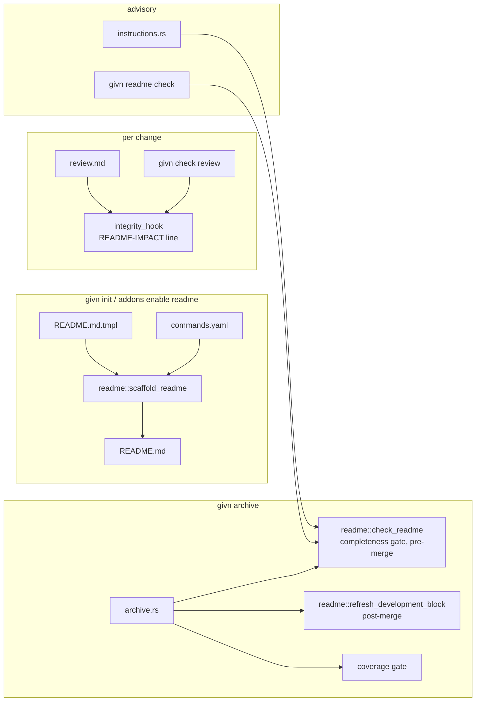

# Design: readme-enforcement

## Scope

The change touches seven surfaces of the single Rust binary:

1. **README scaffold template** — `assets/addons/readme/README.md.tmpl` is
   rewritten: every request-for-content comment becomes a machine-recognizable
   open placeholder line, and the Development section becomes a managed block
   rendered from the effective `givn/commands.yaml` at scaffold time.
2. **README module** — `src/cli/readme.rs` grows the deterministic checker
   (pure functions over the README text) plus the scaffold-time managed-block
   renderer and the archive-time refresh.
3. **CLI** — `main.rs` dispatch and `src/cli/mod.rs` gain `givn readme check`.
4. **Archive** — `src/cli/archive.rs` runs the completeness gate before any
   mutation and refreshes the development managed block after the post-merge
   gates.
5. **Integrity hook** — `src/integrity_hook.rs` enforces the README impact
   decision in `review.md`; the readme addon flag is threaded through the two
   call sites (`src/hooks.rs`, `src/cli/check.rs`).
6. **Session instructions** — `src/cli/instructions.rs` surfaces an unfinished
   README in both the no-active-change and active-change reports.
7. **Skills** — `assets/skills/givn-archive/SKILL.md.tmpl` (pre-archive README
   step) and `assets/skills/givn-review/SKILL.md.tmpl` (impact decision
   guidance) are extended; `givn skills sync` regenerates the integrations.

Rust, `anyhow`, and the existing cucumber-rs harness are kept; no new
dependencies.

### Open placeholder marker format

A scaffold placeholder is a single line:

```
<!-- givn:todo: One-paragraph description of what this project does and who it is for. -->
```

Detection rule: a line containing the literal `<!-- givn:todo:` and ending
with `-->`. The text after `givn:todo:` is the expectation shown in reports
and in the rendered README.

### Legacy scaffold detection

The previous template's placeholder sentences are fixed known strings. The
checker matches this exact list (substring match — the texts cannot occur in
hand-written prose by accident):

- `One-paragraph description of what this project does and who it is for.`
- `List any required tools, languages, or runtimes.`
- `Brief example or \`--help\` output to show how to use the project.`
- `PR guidelines, commit conventions (Conventional Commits), code style,`
- the exact license line `TBD` (whole line, outside fenced code)
- `{{PROJECT_NAME}}` anywhere outside a managed block

(`git clone <repo>` is deliberately NOT a matcher: it plausibly occurs in real
hand-written quick-starts, and the gate is blocking.)

Legacy findings are reported as open placeholders whose remediation is the
README migration (rewrite with the new template, preserving real content).
No heuristic comment-only-section detection — the list is exact, so there are
no false positives.

### Management markers and the unmanaged rule

A README counts as **givn-managed** when it contains at least one management
marker: any `<!-- givn:begin:` line, any `<!-- givn:todo:` line, or a legacy
scaffold text. With the readme addon enabled and README.md present:

- zero management markers → blocking `Unmanaged` finding; remediation is
  "adapt the README to the marked form (README migration) or disable the
  readme addon".
- README.md absent → blocking `MissingReadme` finding; remediation is
  re-scaffolding or migration.

Consequence: enabling the addon on an existing project blocks the archive
until the README is adapted or the addon is disabled. That is intended — the
addon asserts ownership of the README.

### Managed development block

```
<!-- givn:begin:development -->
## Development
... generated from givn/commands.yaml ...
<!-- givn:end:development -->
```

Generated content: the effective `verify.command`, `verify.e2e_command`, and —
when the coverage addon is enabled — `coverage.measure_command` and
`coverage.merge_command`, each as a fenced `sh` line with one explanatory
sentence, mirroring the current static template text.

- **Scaffold time**: rendered from the effective command file (`givn init`
  writes `givn/commands.yaml` before addon scaffolding runs, so init renders
  the real file; the embedded-defaults fallback covers standalone
  `givn addons enable readme` in a project without a command file).
- **Archive time**: if both markers are present, the block content is
  replaced wholesale; a missing block is left alone (the README stays managed
  through its other markers, e.g. coverage blocks, and is not re-injected);
  exactly one marker present is a damaged block finding.

### Data model

No schema changes. New pure types in `src/cli/readme.rs`:

- `ReadmeFindingKind` — `OpenPlaceholder`, `Remnant`, `DamagedBlock`,
  `Unmanaged`, `MissingReadme`.
- `ReadmeFinding { kind, section: String, message: String }`.

The checker owns the development managed block only; the coverage badge and
coverage summary blocks are self-healing at archive and are not validated.
The development managed block reuses the exact begin/end-marker upsert and
split primitives already implemented and unit-tested in
`crate::cli::agents_block`; `src/cli/readme.rs` owns only rendering the block
body, the checker, and the scaffold.

The README impact decision is a line convention in `review.md`, parsed the
same way the existing sign-off markers are parsed:

- `README-IMPACT: none` — this change did not touch the project's public face.
- `README-IMPACT: updated - <comma-separated sections>` — the named sections
  were refreshed.
- Anything else (missing line, unknown value) fails the check when the readme
  addon is enabled.

### Architecture impact

`mermaid`



New public surface: `givn readme check` (deterministic, exit 0/1). The
completeness gate runs before backup/merge, so a blocked archive needs no
rollback. The development-block refresh runs after the post-merge verify
gates and before the coverage gate; on failure the existing README backup
restoration is invoked, matching the coverage gate's rollback behaviour.

### Instructions nudge

`instructions.rs` gains one helper: when the effective manifest has the readme
addon enabled and the checker reports findings, both report paths
(`report_no_active_changes`, `report_change`) append one status line naming
`givn readme check` and the finding count. With a complete README the output
is unchanged. The nudge is a text-only line; the JSON report shape is
untouched (no ADR-048 surface).

## Step definition locations

One file per capability, per repo convention:

- `tests/steps/readme_enforcement_steps.rs` — regular scenarios.
- `tests/steps/readme_enforcement_e2e_steps.rs` — the five `@e2e` scenarios.

Both registered in `tests/steps/mod.rs`. The world is the existing
`GivnWorld`; fixtures reuse `common::TestEnv` (temp project root, real
subprocess invocation of the compiled `givn` binary).

## Test runner

- verify.command: `./run-tests.sh` (unchanged).
- verify.e2e_command: `./run-tests.sh --e2e` (unchanged).
- The runner executes the delta specs via `GIVN_FEATURES=givn/changes/readme-enforcement/specs`.

- **Strict mode**: cucumber-rs with `.fail_on_skipped()` on the `Cucumber`
  builder (`tests/features_runner.rs`) — already proven in this repository.
  The not-implemented stub pattern is `unimplemented!()` in Rust; an
  undefined step fails the run.

### Design-review decisions (2026-08-31)

Recorded from the grilling phase; all applied to these artifacts:

1. Missing README with addon enabled **blocks** (gate stays void-proof).
2. Hand-written README without givn markers **fails** as `Unmanaged` —
   remediation: adapt the README (README migration) or disable the addon.
   This overrides the earlier "marker-less passes" assumption.
3. Damage validation is scoped to the **development managed block only**;
   glossary reworded accordingly.
4. Legacy matcher `git clone <repo>` **dropped** (false-positive risk in real
   quick-starts).
5. Instructions do **not** surface a missing README impact decision; the
   review gate already refuses sign-off without it (proposal amended).
6. ADR routing: `CANONICAL_ARTIFACT` — the five qualification gates pass but
   the choice stays inside the ADR-028 mandatory-check boundary; canonical
   homes are arc42 ch. 08 (gate/marker semantics) and ch. 12 (glossary). No
   MADR.

Fixture note: e2e archive scenarios run with all addons enabled by default,
so the fixtures set `verify.command: "true"` and disable or satisfy the
coverage addon per the harness convention (`extract_coverage_gate_steps.rs`).

### Single-scenario run

The runner executes the change delta via `GIVN_FEATURES`; semantic fixtures
keep the runs offline and fast (`--name` with zero matches exits 0 — every
invocation must target an existing title):

```
GIVN_FEATURES=givn/changes/readme-enforcement/specs \
GIVN_SPEC_EMBEDDER=stub GIVN_SPEC_RERANKER=disabled \
cargo test --test features_runner -- --name "<scenario title>"
```

For the e2e tag filter, add `--tags '@e2e'` to the same invocation.

## E2E smoke test infrastructure

- **Interface type**: CLI — the real interface is the compiled `givn` binary
  invoked as a subprocess with a per-scenario temp project root
  (`tests/common::TestEnv`).
- **E2E runner command**: `./run-tests.sh --e2e` (drives the same
  `features_runner` binary filtered to `@e2e`).
- **E2E step definition location**: `tests/steps/readme_enforcement_e2e_steps.rs`.
- **Local test infrastructure**: none beyond the compiled binary and a temp
  directory; `givn init` fixtures are produced by invoking the real binary.
- **Framework choice**: cucumber-rs — repo-wide convention, one runner for
  unit-level and e2e steps, subprocess assertions on stdout/stderr/exit code.
- **Strict-mode proof**: the same `.fail_on_skipped()` builder; the tasks
  setup task re-proves it by running one deliberately unimplemented step and
  observing the failure.

## Interaction Coverage Matrix

| Inventory entry | @e2e scenario title | Real interface | Driving mechanism |
|---|---|---|---|
| initialise a project with givn (scaffolds the README via the readme addon) | Consumer scaffolds a project and the README marks its unfilled sections | CLI | subprocess: `givn init` in temp project; assert README.md content |
| run `givn readme check` | Consumer runs the README check on a complete README and it passes | CLI | subprocess: `givn readme check`; assert exit 0 |
| run `givn check review --change <id>` | Consumer checks a review with a recorded README impact decision and it passes | CLI | subprocess: `givn check review --change readme-demo` with `README-IMPACT: none` present; assert exit 0 |
| run `givn archive --change <id>` | Consumer archives a change and the development managed block refreshes | CLI | subprocess: `givn archive --change readme-demo`; assert exit 0, refreshed block, moved change |
| run `givn instructions` | Consumer asks for instructions and the unfinished README is surfaced | CLI | subprocess: `givn instructions`; assert README mention and `givn readme check` |

## Black-Box-First

All scenarios drive the real CLI. No internal tests are introduced; the pure
checker helpers get coverage through the subprocess scenarios only.

## Local runnability

- **Local run command**: `cargo build && ./run-tests.sh` (and
  `./run-tests.sh --e2e` for the smoke tests). No services.
- **Digital twins**: none — givn talks to no third-party service in these
  scenarios; retrieval/model layers are not exercised by this capability.
- **Anticipated interface obstacles**: the archive e2e fixtures must configure
  a passing `verify.command` and a satisfied-or-disabled coverage addon, or
  the archive fails for reasons unrelated to this capability (harness
  convention: `tests/steps/extract_coverage_gate_steps.rs`). No browser or
  network obstacles exist for this CLI capability.

## Coverage process boundaries

Not enabled for this capability: the coverage addon measures the Rust sources
via the project scripts; no new process is introduced. The only production
process is the `givn` subprocess launched by the runner, instrumented by the
existing `measure-coverage.sh` workflow.

## Out of technical scope

- No migration-bundle machinery: the migration is guidance (checker report +
  instructions) executed by an agent; acceptance is `givn readme check`.
- No changes to the workflow graph manifest.
