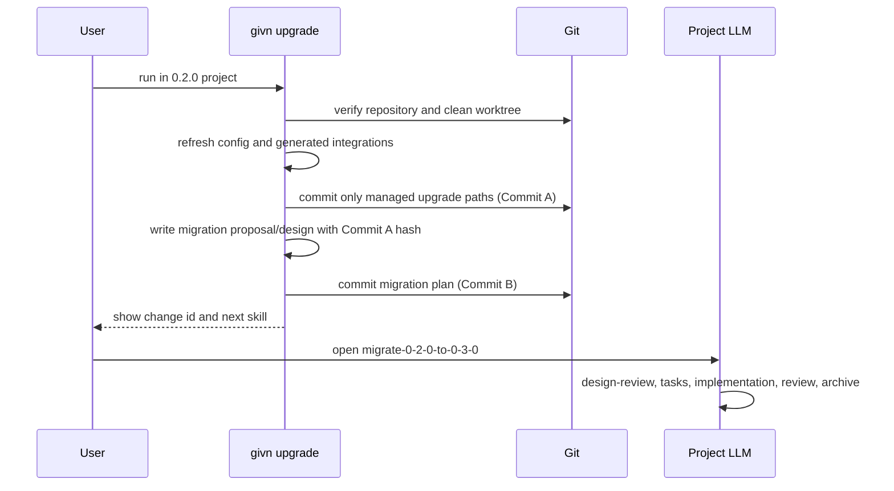
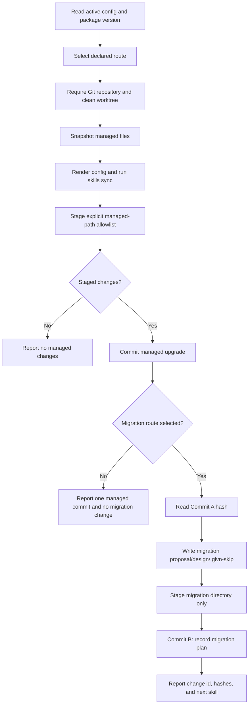

# Design: release-0-3-0

## Overview

This change publishes Givn 0.3.0 and makes the complete stacked change set
upgradeable for projects created from the 0.2.0 master branch.

The release has two distinct migration boundaries:

1. Givn performs a deterministic, machine-safe preparation: it refreshes the
   managed config scaffold, regenerates managed agent integrations, and records
   those changes in one narrowly scoped Git commit.
2. A visible maintenance change is created for all project-specific work. Its
   proposal and design contain the migration prompts and the machine commit
   hash. The project LLM must derive tasks, pass design review, implement only
   applicable changes, complete review, and archive the maintenance change.

The migration does not pretend that a generic tool can decide whether a domain
scenario, step definition, ADR, or Arc42 statement is correct.



## Technology Decisions

| Technology | Version | Resolution |
|---|---|---|
| Rust | edition 2024, current stable toolchain | Existing repository `Cargo.toml`; resolve the installed compiler with `rustup show active-toolchain` during implementation. |
| `clap` | existing lockfile version | Existing repository lockfile; no new CLI dependency is introduced. |
| `serde_yaml_ng` | existing lockfile version | Existing repository lockfile; used only where the existing config path already uses it. |
| Git CLI | latest installed compatible version | Invoke the user's `git` executable; verify `git rev-parse`, `git status`, `git add`, `git commit`, and `git rev-parse HEAD` in the E2E fixture. |
| Cucumber runner | existing repository `cucumber` dependency | `./run-tests.sh` and `./run-tests.sh --e2e` remain the repository-owned runners. |

No new runtime library is required. Git is an external process dependency of
the automatic commit path, not a Rust library dependency.

## Step Definitions

| Capability | Step definition file |
|---|---|
| Release metadata, prompt guide, and migration plan assertions | `tests/steps/release_0_3_0_steps.rs` |
| Real `givn upgrade` and Git commit behavior | `tests/steps/release_0_3_0_e2e_steps.rs` |

Test runner command:

```sh
GIVN_FEATURES=givn/changes/release-0-3-0/specs ./run-tests.sh
```

E2E runner command:

```sh
GIVN_FEATURES=givn/changes/release-0-3-0/specs ./run-tests.sh --e2e
```

Single-scenario run command:

```sh
GIVN_FEATURES=givn/changes/release-0-3-0/specs cargo test --features spec-retrieval --test features_runner -- --name "A clean 0.2.0 project receives a reviewable 0.3.0 migration plan"
```

The repository runner invokes the feature files through Cucumber. It is not a
parallel unit-test substitute.

## Internal Primitives

| Primitive | Type | Purpose |
|---|---|---|
| `active_config_version` | `fn` | Reads the active `givn_config_version` marker without rewriting comments or user values. |
| `MigrationCatalog` | `struct` | Deserializes the embedded ordered migration bundles and their source/target boundaries. |
| `migration_path` | `fn` | Resolves a version gap into an ordered list of declared bundles or reports an incomplete declared path. |
| `aggregate_migration_id` | `fn` | Defines the deterministic maintenance-change path for a complete source-to-target gap. |
| `pending_migration_change` | `fn` | Detects a visible active aggregate plan after its config marker has advanced. |
| `git_status_is_clean` | `fn` | Rejects dirty or non-Git projects before the automatic migration writes anything. |
| `managed_generated_paths` | `fn` | Returns the exact config, generated skill/command, and owned-block paths eligible for Commit A. |
| `prepare_managed_upgrade` | `fn` | Runs the common config/synchronization/allowlist/commit path when no project migration is required. |
| `create_aggregate_migration_plan` | `fn` | Combines every declared bundle into one ordered proposal/design/metadata plan and writes `.givn-skip` without a synthetic feature. |
| `run_git` | `fn` | Executes Git commands in the project root and turns non-zero output into actionable errors. |

The migration module owns orchestration. Existing config rendering, skill
rendering, and project-owned override resolution remain in their existing
modules.

## Strict Mode

The feature runner is `cucumber-rs` and uses
`GivnWorld::cucumber().fail_on_skipped()` in `tests/features_runner.rs`.
Every new step definition has a real assertion or filesystem/process action;
there are no empty step bodies. This is independently checked by the review
fabrication audit.

## Local Runnability & Digital Twins

The change tests a single Rust CLI binary and a temporary Git repository. No
application server, database, queue, browser, or third-party service exists in
this capability.

**Local run command:**

```sh
./run-tests.sh
```

The E2E scenario creates an isolated temporary repository, sets a local Git
author identity in that repository, writes a 0.2.0 config fixture, invokes the
real compiled `givn` subprocess, and inspects its real stdout, exit status, file
tree, and Git history. The temporary repository has no remote and does not use
the parent repository's Git metadata.

**Digital twins:** none. Git is a local executable boundary, not a
third-party service. The test uses a temporary local repository rather than a
shared working tree.

**Anticipated interface obstacles and fixes:**

- A test runner may inherit the parent Git identity or repository: the fixture
  initializes its own repository and sets `user.name` and `user.email` locally.
- A pre-existing untracked file could be accidentally staged: the production
  path performs a full `git status --porcelain --untracked-files=all` preflight
  and refuses before writing.
- A generated file may share a directory with user files: production staging is
  an explicit path allowlist, never `git add -A` or a directory-wide wildcard.
- The second commit cannot contain its own hash: Commit A is created first;
  its resolved hash is inserted into the migration plan before Commit B.

## E2E Smoke Test Infrastructure

**Interface type:** CLI.

**Driving mechanism:** the test starts the compiled Givn binary as a real
subprocess with a temporary project as its current directory, then uses local
Git subprocesses to inspect the resulting commits. The primary assertions are
the CLI exit status/output and the files/commit paths the CLI made visible.

**E2E step location:** `tests/steps/release_0_3_0_e2e_steps.rs`, separate from
the release documentation and pure fixture assertions.

**Interaction Coverage Matrix:**

| Inventory entry | @e2e scenario title | Real interface | Driving mechanism |
|---|---|---|---|
| run `givn upgrade` in a clean project created with Givn 0.2.0 | A clean 0.2.0 project receives a reviewable 0.3.0 migration plan | CLI | Invoke the compiled `givn upgrade` subprocess and inspect stdout, files, and local Git commits. |
| run `givn upgrade` in a clean project that needs managed guidance refresh but no project migration | A clean project without migration requirements receives one managed upgrade commit | CLI | Invoke the compiled `givn upgrade` subprocess against a stale generated integration and inspect the single managed commit. |
| archive a completed 0.2.0-to-0.3.0 maintenance migration without a product specification | A completed maintenance migration can be archived without a product specification | CLI | Invoke the compiled `givn archive --change migrate-0-2-0-to-0-3-0` subprocess and inspect the archive and permanent spec tree. |

The upgrade E2E test does not rely on a pre-existing migration plan, parent
checkout, network, or direct library calls to prove preparation. The archive
E2E test creates a controlled completed maintenance plan because its behavior
is specifically the archive boundary for that plan.

## Architecture Impact

- Bump the package version and lockfile package metadata to 0.3.0.
- Add `src/cli/migration.rs` for legacy-version detection, Git preflight,
  allowlisted staging, the two-commit sequence, and migration-plan creation.
- Extend `src/cli/upgrade.rs` to select a declared migration route or the
  migration-free managed-upgrade path.
- Expose the generated-path calculation from `src/skills/targets.rs` so the
  upgrade commit can stage exactly what `skills sync` owns.
- Add the public changelog and LLM migration guide under `CHANGELOG.md` and
  `docs/migrations/0.2.0-to-0.3.0.md`.
- Update the repository's own config marker and generated integrations as
  release-maintenance work, without creating a false migration change in this
  repository.

The migration policy is explicit and stored in the embedded catalog. The current
route applies to source config 0.2.0 at target package 0.3.0 or later compatible
0.3.x releases. Every other transition is migration-free unless a later release
adds another declared bundle; SemVer alone never invents a project migration.

If a version gap crosses multiple catalog bundles, the resolver follows the
ordered source-to-target edges and creates one aggregate maintenance change.
The aggregate metadata and design preserve each bundle's identity, source,
target, and order so the LLM performs the phases sequentially.

## Migration Bundle Contract

Each release-owned bundle is stored below `assets/migrations/<bundle-id>/` and
is registered by `assets/migrations/catalog.yaml`. The catalog entry declares a
strictly advancing `source_version`, `target_version`, deterministic `order`,
and the embedded Proposal/Design asset paths. The Design asset must be
self-contained for a consumer LLM; the current bundle's explicit guide marker
is replaced during materialization, while future bundles must carry their own
complete prompts.

The resolver follows one declared edge after another. If the installed target
is later in the same compatible minor line, the last bundle covers that patch
release. If a declared path starts but has no next edge before a different
minor/major target, upgrade fails explicitly instead of silently skipping a
required phase.

## Aggregate Migration-Plan Contract

The automatically created directory is deterministic for the complete version
gap:

```text
givn/changes/migrate-<source>-to-<installed-target>/
├── .givn-skip                 # contains `specs`
├── proposal.md               # populated migration proposal
├── migration.yaml            # aggregate bundle sequence and version metadata
└── design.md                 # aggregate design plus all bundle prompts
```

`specs` is skipped intentionally because the migration is a maintenance
operation, not a product capability. `design-review.md`, `tasks.md`, and
`review.md` are not fabricated. The project LLM must create and complete them
through the normal Givn workflow. Archive can move the maintenance record
without merging a synthetic feature into `givn/specs/`.

The generated design records:

- `source_version`: the active project marker;
- `target_version`: the installed package version;
- `upgrade_commit: <Commit A hash>`;
- `migration_bundles`: the complete ordered catalog path;
- the exact machine-safe file boundary;
- all LLM prompts from every selected bundle, in sequence;
- the rule that project-specific decisions require evidence and review.

If the deterministic migration path already exists under either
`givn/changes/` or `givn/archive/`, it is never overwritten or duplicated.

For a migration-free transition, the same managed path refreshes config and
generated integrations and creates one allowlist-only commit if the refresh
actually changes files. If there are no staged changes, it creates no empty
commit and no migration change.

## Two-Commit Protocol



The clean-worktree check happens before any write. The allowlist includes the
config file, generated files for the persisted agent targets, known generated
opencode commands, and `AGENTS.md` because Givn owns only its fenced blocks in
that file. It excludes source code, specs, active changes other than the
deterministic migration directory, Arc42 durable content, ejected facets, and
all unrelated files.

When the maintenance change lists `specs` in `.givn-skip`, archive verification
uses the project's permanent `verify.features_path` rather than the absent
change delta. The blocking semantic gate is not run for a change with no
product delta. Archive still requires the maintenance change's tasks and review
artifacts and still runs the configured global verification and coverage gates.

If a managed render fails before Commit A, the pre-write snapshot is restored
and no commit is attempted. If Git refuses Commit A or Commit B, the command
returns the Git error and identifies any staged/generated files for manual
review; it never resets or destroys user history.

## Data Model Changes

No persistent database or serialized Rust data model changes. The existing
`givn_config_version` marker is advanced to the running package version. The
source and target versions plus Commit A hash are recorded in the generated
maintenance design as human-readable migration evidence.

## Public Documentation Contract

`CHANGELOG.md` describes the complete release relative to the 0.2.0 master
branch, including runtime commands, generated guidance, retrieval/overlap
behavior, Arc42/ADR guidance, and the migration behavior.

`docs/migrations/0.2.0-to-0.3.0.md` is the canonical LLM prompt pack. It has
ordered prompts for:

1. preflight and evidence inventory;
2. machine-safe upgrade and Commit A verification;
3. generated guidance synchronization;
4. active-change and permanent-spec review;
5. deterministic overlap and semantic review remediation;
6. Arc42 and ADR reconciliation;
7. final verification and maintenance-change archive.

Each prompt states what to inspect, what may be changed, what must remain
human-reviewed, and which Givn command or artifact is next. It never invents a
project's domain facts or architecture decisions.

## Open Technical Questions

None. The two-commit protocol, exact source/target versions, maintenance-change
shape, clean-worktree requirement, and allowlist boundary were decided during
exploration.
