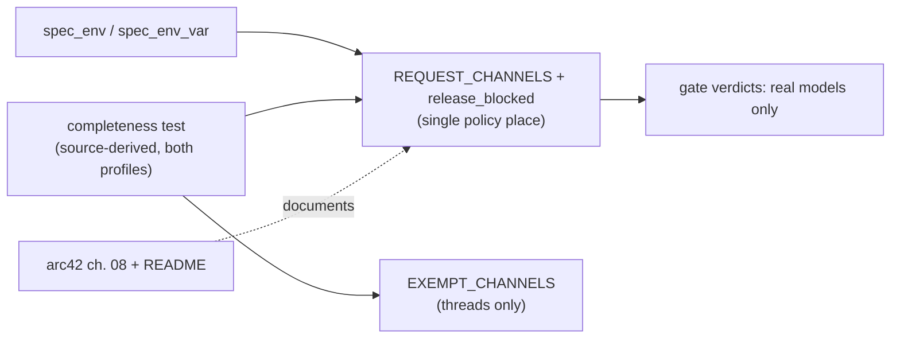

# Design: release-override-hardening

## Scope

Hardening of an existing guarantee — the behaviour of an installed build does
not change; the guarantee becomes mechanically complete and documented. Four
surfaces of the single Rust binary and two documentation surfaces:

1. **Policy registry** — `src/spec/retrieval.rs` keeps `REQUEST_CHANNELS` +
   `release_blocked` as the single policy place. No semantics change: the
   same channels are refused with the same value rules.
2. **Completeness net (new)** — a unit test that proves the registry covers
   every environment channel the semantic review reads (see below). This is
   the change's core deliverable.
3. **Profile tests** — the existing `release_strict_tests` module stays the
   behavioural proof; the new completeness test runs on both profiles and is
   wired into the suite via the existing `@release-proof` branch of
   `run-tests.sh` (`cargo test --release --lib -- release_strict`).
4. **Accepted-exception record** — the local-model-path sites get a comment
   naming the trust decision; no code change.
5. **Docs** — arc42 ch. 08 gains the environment-fixture-policy section;
   README.md states the rule for the agent audience.

No new dependencies. Rust, `anyhow`, cucumber-rs harness unchanged.

### Completeness net

`spec_env` / `spec_env_var` are already the only `GIVN_SPEC_*` read paths in
`src/` (verified by search; the only ungated reads are the cache-location
helpers `HF_HOME` / `XDG_CACHE_HOME` / `HOME` and the download mirror
`HF_ENDPOINT`, none of which can alter verdicts). The net pins this state:

- A new test module reads its own source file via `include_str!` and extracts
  every `GIVN_SPEC_*` string literal.
- It asserts set equality: every extracted literal is either in
  `REQUEST_CHANNELS` (policy-governed) or in an explicit `EXEMPT_CHANNELS`
  constant (`GIVN_SPEC_THREADS` plus a doc-comment why it is exempt — thread
  budget only, no verdict influence).
- A literal appearing in neither fails the test at development time, on both
  profiles. Adding a channel without a policy entry now breaks the build's
  own suite instead of silently reopening a bypass.
- `REQUEST_REPRESENTATIVE` gains a per-channel row automatically validated
  against the same extraction, so the table cannot drift from the code.

### Environment fixture policy (arc42 ch. 08 section, content sketch)

| Request class | Installed build | Development build |
|---|---|---|
| Simulated embedder output (any value) | refused + announced | honoured |
| Disable/simulate second-stage selectors | refused + announced | honoured |
| Score injection, token budgets, test pools, pair-budget resizes | refused + announced | honoured |
| Model-location requests (`auto`/`local`/`nli`) | honoured | honoured |
| Thread budget | honoured | honoured |
| Missing model artifacts | fail-safe: binding embedding threshold stays the verdict | same |

The section records the accepted exception: locally provided artifact sets
are structure-validated but not identity-verified; the fail-safe keeps the
gate alive if the artifacts are unusable.

### Architecture impact



## Step definition locations

The behavioural scenarios already exist in
`givn/specs/release-strict-model-overrides/`. The specs step of this change
adds scenarios to that feature file (or a sibling file) for the two not-yet-
specified observables:

- the fail-safe verdict when model evidence is unavailable (binding embedding
  threshold stays the verdict);
- the announcement naming a refused request for a channel class that today
  has no covering scenario.

Regular steps: `tests/steps/release_strict_model_overrides_steps.rs`
(existing). No new step files anticipated.

## Test runner

- verify.command: `./run-tests.sh` (unchanged).
- verify.e2e_command: `./run-tests.sh --e2e` (unchanged); its `@release-proof`
  branch already runs `cargo test --release --lib -- release_strict` — the
  completeness test rides that branch with no script change.
- Strict mode: cucumber-rs `.fail_on_skipped()` (proven, unchanged);
  not-implemented stub pattern `unimplemented!()`.

### Single-scenario run

```
GIVN_FEATURES=givn/changes/release-override-hardening/specs \
GIVN_SPEC_EMBEDDER=stub GIVN_SPEC_RERANKER=disabled \
cargo test --test features_runner -- --name "<scenario title>"
```

## E2E smoke test infrastructure

- **Interface type**: CLI (real `givn` subprocess on a temp project root).
- **E2E runner**: `./run-tests.sh --e2e` via the existing `@release-proof`
  grouping; the release-profile unit proof is part of that branch.
- **Framework**: cucumber-rs, one runner, unchanged.
- **Digital twins**: none — no third-party service involved; model artifacts
  come from the local fixture setup as today.
- **Anticipated interface obstacles**: none new; the release-profile unit
  tests cannot be exercised through the debug e2e binary, which is exactly
  why the `@release-proof` script branch exists and is reused.

## Interaction Coverage Matrix

Inventory finalised in the specs step (design precedes specs for this
scaffold by decision of the product owner). Planned rows:

| Inventory entry | @e2e scenario title (planned) | Real interface | Driving mechanism |
|---|---|---|---|
| unavailable model evidence keeps the binding threshold verdict | An installed givn keeps the binding embedding threshold when model evidence is unavailable | CLI | subprocess: `givn spec index` with artifacts absent; assert fail-safe verdict line and exit behaviour |
| refused-request announcement covers every gated channel class | An installed givn announces each refused request by name | CLI | subprocess: `givn spec index` with one representative fixture request per channel class; assert announcement lines |
| completeness net guards future channels | (repo-invariant — covered by `cargo test --release --lib -- release_strict`, not a Gherkin row) | test suite | `run-tests.sh --e2e` `@release-proof` branch |

## Black-Box-First

Scenarios drive the real CLI. The registry completeness proof is a source-
derived unit test — the case it covers (a channel read without a policy
entry) cannot be produced through the CLI at all, which is the concrete
answer to "which case does this internal test cover that the E2E does not".

## Local runnability

- **Local run command**: `cargo build && ./run-tests.sh`; release proof:
  `./run-tests.sh --e2e` (includes `cargo test --release --lib`).
- **Digital twins**: none.
- **Anticipated interface obstacles**: none.

## Coverage process boundaries

Not enabled for this capability; no new process.

## Sequencing

`release-override-hardening` lands before `unified-semantic-rulebook`; the
rulebook change registers every new channel it introduces
(`TOP_K_CAP`, neighbour count) in `REQUEST_CHANNELS` + the representative
table from the start, so the net holds.
