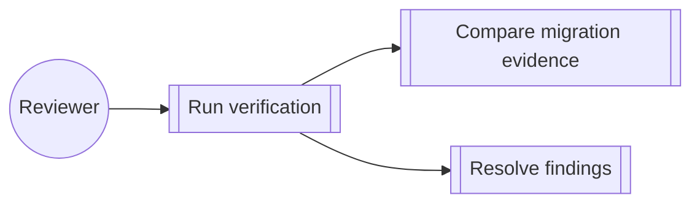

# Use case: verify-change

## Level

!

## Actors

- Developer
- Supporting: Reviewer

## Goal

Check a change for structural validity, completeness, and unresolved overlap before implementation or archive.

## Trigger

The developer requests verification of a change.

## Preconditions

- The change artifacts and active specifications are available.

## Main flow

1. The developer requests verification; the system reads the active specifications and workflow artifacts.
2. The system confirms the change-scoped verification receipt is current (or reusable across a documentation-only revision), green, and bound to the tested revision, selected features, verify command, and tested content.
3. The system detects duplicate behavior, structural overlap, and invalid references.
4. The system compares migration evidence when a migration is checked.
5. The system reports blocking and advisory findings.

## Extensions

- 5: a review disposition is missing → completion is blocked; protects the success guarantee.
- 4: a migration shows missing behavior, lost E2E evidence, lower interaction coverage, or lower source coverage → completion is blocked; protects the success guarantee.

## Rules

- Structural failures outrank other findings.
- A review PASS requires a current green change-scoped verification receipt, including one reused across a documentation-only revision.
- Each checked scenario records one real, unique revision whose message names the scenario; the task check refuses a missing, duplicate, unreachable, or unnamed revision.
- The README-impact decision is reported before review and remains a blocking review requirement.
- The receipt binds the tested revision, the selected delta features, the verify command, and the tested content.
- A revision that changes only documentation or evidence keeps the receipt current; any change to tested content makes it stale.
- A review report names every use-case schema and capability-routing problem in one pass; the schema stays strict and semantic validation is not weakened.
- Every blocking overlap has an explicit disposition.
- Migration coverage cannot regress without an explicit retirement record.

## Examples

- A duplicate title is reported as a hard error in JSON and text output.
- A migration with lower branch coverage is rejected before archive.

## Minimal guarantee

An invalid change cannot pass the verification gate.

## Success guarantee

The developer receives a complete verification result.

## Personas

- developer--primary-user

## Capabilities

- validate-artifact-ids
- spec-overlap-gates
- review-disposition-gates
- resolve-change-directories
- givn-workflow-enforcement
- check-specification-health
- visual-review-gate

## Interactions

| Capability | Consumer action | E2E scenario |
|---|---|---|
| validate-artifact-ids | check an unknown artifact | Consumer invokes givn check with an unknown artifact and gets a helpful error |
| visual-review-gate | run the review check on a visual change | A visual change with complete evidence passes review |
| visual-review-gate | read the visual review guidance | Review guidance requires the visual verdict and persona lenses |
| spec-overlap-gates | detect a duplicate title | A duplicate title across two permanent spec files is a hard error |
| spec-overlap-gates | inspect duplicate JSON | The json output reports duplicate-title findings machine-readably |
| review-disposition-gates | pass a disposed review | Review passes when every shape match is disposed and reports the net-delta receipt |
| resolve-change-directories | run integrity in a change | Consumer runs the integrity check on a change inside givn/changes and the correct directory is detected |
| resolve-change-directories | reject placeholder commit evidence | Integrity check detects a placeholder COMMIT hash in tasks.md and fails |
| givn-workflow-enforcement | run migration coverage check | Consumer runs migration coverage check and sees passed evidence |
| givn-workflow-enforcement | run the change-scoped checks | Consumer runs check tasks and receives a change verification receipt |
| givn-workflow-enforcement | write a runner result | The result helper writes four counts without a scope |
| givn-workflow-enforcement | run the review check on a change with use-case schema errors | Consumer runs review and receives every use-case schema problem in one pass |

## Includes

- fragment: support

## Extends

- none

## Out of scope

Running the product test suite or changing implementation code.

## Diagram

<!-- givn:base-sha256:2a8395dea51c230f8ff63ba95ccec982908d623d2d768b042f27fc74bcbe5669 -->
