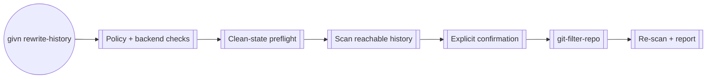

# Use case: rewrite-history

## Level

!

## Actors

- Developer

## Goal

Remove every generated rule from the project's reachable history so a
published repository carries none, while every rule file stays on disk.
Explicit, opt-in, and never automatic.

## Trigger

The developer runs `givn rewrite-history` after the cleanliness report named
historical occurrences.

## Preconditions

- The rules policy resolves to `local-only` (`rules-policy`).
- The active version-control system is Git, with `git-filter-repo`
  available.
- The checkout is clean.

## Main flow

1. Refuse under the `versioned` policy and on the Fossil backend, by name.
2. Witness the clean state and refuse before any write when the project is
   dirty.
3. Scan reachable history for the generated rules and report the paths and
   the affected revision count.
4. Confirm: with `--yes` proceed; on a terminal without `--yes`, ask; with
   piped or closed input and no `--yes`, refuse, naming the flag.
5. Rewrite reachable history through `git-filter-repo`, keeping every
   working file on disk.
6. Re-scan, report the new revision identifier, and name the remaining
   boundary: rule files are still on disk, a force-push is required, and
   remote repositories and forks are outside the guarantee.

## Extensions

- `git-filter-repo` is missing: refuse by name with install guidance; nothing
  changes.
- Nothing to rewrite: report no rule in reachable history; change nothing.
- Confirmation withheld: nothing changes.

## Rules

- Never automatic; no other command invokes the rewrite.
- The strict set only: file-precise paths; never `AGENTS.md`; never a
  user-owned file.
- Files are preserved; the rewrite changes history, not the working tree.
- The command never pushes and never contacts a remote.
- The result is verified by a re-scan before success is reported.

## Examples

- `givn rewrite-history --yes` on a project with a rule in history:
  reports the path and revision count, rewrites, reports the new revision,
  and states that a force-push is required.
- Versioned project: "the rules are versioned by policy; nothing to purge".
- Dirty checkout: "history rewriting requires a clean checkout".
- Fossil: "history rewriting is not available on the Fossil backend".
- Piped input without `--yes`: "confirmation required: re-run with --yes".
- No occurrence: "no generated rule in reachable history; nothing to
  rewrite".

## Minimal guarantee

A dirty checkout, missing tool, unsupported backend, or withheld
confirmation changes nothing; working files are never deleted.

## Success guarantee

After a successful run, no reachable revision contains a rule, every rule
file still exists on disk, the new revision identifier is reported, and the
force-push need and the boundary are named.

## Personas

- developer--primary-user
- givn-maintainer--owner

## Capabilities

- `history-rewrite` — new

## Interactions

| Capability | Consumer action | E2E scenario |
|---|---|---|
| history-rewrite | rewrite a project with historical rules | Consumer runs the command and receives clean reachable history with the files intact |
| history-rewrite | run it dirty | Consumer gets a refusal and the worktree stays unchanged |
| history-rewrite | run it on Fossil | Consumer gets a named refusal that names the backend |

## Includes

- `rules-policy` (fragment)

## Extends

- none

## Out of scope

Reporting (`publication-cleanliness`); pushing or remote repair; backup
policy; Fossil rewriting.

## Diagram

