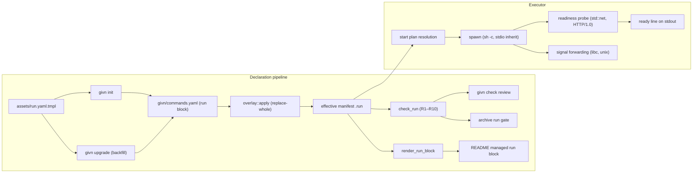

# Design: run-command

## 1. Technology decisions

- **Rust, edition 2024** — pinned by the existing workspace `Cargo.toml`
  (`edition = "2024"`, `givn 0.4.0`). No toolchain decision is introduced.
- **Zero new external crates in the production dependency set.** The readiness
  probe uses `std::net::TcpStream` (blocking, HTTP/1.0); process control uses
  `std::process`. No tokio in `src/` (tokio is a dev-dependency of the cucumber
  runner only). No HTTP client crate.
- **Signals: declare `libc` as a direct, unix-gated dependency.** Verified
  decision, not an assumption:
  - `cargo tree -i libc` (checked 2026-09-02 in this checkout) shows
    `libc v0.2.189` already compiled into every configuration this repo builds
    (`console` via cucumber, `dirs-sys`/`getrandom`/`ring` via hf-hub → ureq →
    rustls, including the `--no-default-features --features spec-retrieval`
    profiles that `run-tests.sh` uses).
  - It is **not** currently a direct dependency, so per the version-freshness
    rule this design states the decision explicitly: add
    `[target.'cfg(unix)'.dependencies] libc = "0.2"` (lockfile-pinned at
    0.2.189; no new compiled crate enters the graph).
  - Signal catching/forwarding uses `libc::sigaction` writing into a
    `static AtomicI32` and `libc::kill(child_pid, sig)`. No `signal-hook`, no
    `ctrlc`, no tokio `signal` feature.
- **No new external crates otherwise.** Everything else is already declared:
  `serde`/`serde_yaml_ng`, `clap 4.6`, `anyhow`, `gherkin 0.16` (spec parsing),
  `tempfile`/`cucumber 0.23`/`tokio 1` (dev, pinned by the existing
  workspace lockfile — all versions resolved from `Cargo.toml`/`Cargo.lock`,
  not from memory).
- **Pattern: follow `verify`/`coverage` for the data path** (manifest field +
  `OverlayDoc` field + replace-whole merge) and **follow `missing-testrunner`**
  for the sentinel subcommand.

## 2. Version freshness

| Technology | Version | Resolution |
|---|---|---|
| Rust edition | 2024 | pinned by this repo's `Cargo.toml` |
| clap | 4.6 | pinned by workspace `Cargo.toml`/lockfile |
| serde_yaml_ng | 0.10 | pinned by lockfile |
| gherkin (parser crate) | 0.16 | pinned by lockfile |
| cucumber (dev) | 0.23 | pinned by lockfile |
| tokio (dev only) | 1 | pinned by lockfile; **not used in `src/`** |
| libc (new direct dep) | 0.2.189 | verified via `cargo tree -i libc` on 2026-09-02; already in the lockfile transitively |
| tempfile (dev) | 3 | pinned by lockfile |

No container images, browsers, or external services are involved.

## 3. Data model (`src/config/manifest.rs`, `src/config/overlay.rs`)

Verbatim from the source document (§3) — `Run`, `ProductType`, `Default`,
sentinel, `is_unconfigured`:

```rust
/// Product start configuration (`givn/commands.yaml`, key `run`).
#[derive(Debug, Clone, Deserialize, Serialize)]
pub struct Run {
    /// Command that starts the product. Default is the sentinel.
    #[serde(default = "Run::default_command")]
    pub command: String,
    /// `server`, `cli`, or `library`. `None` means unconfigured.
    #[serde(default, skip_serializing_if = "Option::is_none")]
    pub product_type: Option<ProductType>,
    /// Fixed listen port. `product_type: server` only. Mutually exclusive
    /// with `port_env`.
    #[serde(default, skip_serializing_if = "Option::is_none")]
    pub port: Option<u16>,
    /// Env var name through which the caller passes the port.
    /// `product_type: server` only. Mutually exclusive with `port`.
    #[serde(default, skip_serializing_if = "Option::is_none")]
    pub port_env: Option<String>,
    /// HTTP path that answers 2xx once the server is ready. Server only.
    #[serde(default, skip_serializing_if = "Option::is_none")]
    pub ready_path: Option<String>,
    /// Seconds the caller waits for readiness before giving up.
    #[serde(default = "Run::default_ready_timeout_s")]
    pub ready_timeout_s: u64,
}

#[derive(Debug, Clone, Copy, PartialEq, Eq, Deserialize, Serialize)]
#[serde(rename_all = "lowercase")]
pub enum ProductType { Server, Cli, Library }

impl Default for Run { /* command = SENTINEL, ready_timeout_s = 60, rest None */ }

impl Run {
    /// Sentinel: the block exists but was never filled in.
    pub const SENTINEL: &'static str = "givn missing-run-command";
    fn default_command() -> String { Self::SENTINEL.to_string() }
    fn default_ready_timeout_s() -> u64 { 60 }
    /// True while the block is unconfigured.
    pub fn is_unconfigured(&self) -> bool {
        self.command.trim() == Self::SENTINEL || self.product_type.is_none()
    }
}
```

- `Manifest` gains `#[serde(default)] pub run: Run` (next to `verify`,
  `src/config/manifest.rs:6-34`). `Manifest` carries
  `#[serde(deny_unknown_fields)]` (`manifest.rs:5`) but is only deserialized
  for the **embedded default manifest**; project files go through
  `OverlayDoc`.
- `OverlayDoc` (`src/config/overlay.rs:295-310`, no `deny_unknown_fields`)
  gains `run: Option<Run>`.
- Merge in `apply` (`overlay.rs:16`, directly after the verify merge at lines
  24-26): `if let Some(r) = overlay.run { result.run = r; }` — **replace-whole
  semantics, deliberately identical to `verify`**: a project that sets only
  `run.command` gets defaults for every other field. Documented in the
  template comments.
- `givn/config.yaml` accepts `run:` too: `OverlayDoc` is shared by both
  config files and is applied in the existing order (`config.yaml` first,
  `commands.yaml` later, `overlay.rs:16`), so a `run:` block in
  `config.yaml` is legal and the commands file wins by apply order —
  deliberately identical to the existing `verify:`/`coverage:` overlay
  behaviour. Continuity, not a feature: no gate and no new scenario cover it.
- An unknown `product_type` value (e.g. `web`) fails `load_effective` with a
  serde error naming `product_type` (spec: "An unknown product type is
  rejected when the commands file loads").

## 4. Module layout

| File | Change |
|---|---|
| `src/config/manifest.rs` | `Run`, `ProductType`, `Default`, `Manifest.run` |
| `src/config/overlay.rs` | `OverlayDoc.run`, merge in `apply` |
| `assets/run.yaml.tmpl` | **new** — scaffold text, `include_str!`ed by upgrade; single source for template and backfill |
| `assets/commands.yaml.tmpl` | embeds the run scaffold (verbatim, see §4.1) |
| `assets/addons/readme/README.md.tmpl` | `{{RUN_BLOCK}}` under Quick start; quick-start todo shortened (§8) |
| `src/cli/init.rs` | **no change** — the template is written whole (`init.rs:71-73`) |
| `src/cli/run_block.rs` | **new** — `check_run` + findings (R1–R10), `pub` for integration tests |
| `src/cli/missing_run_command.rs` | **new** — sentinel, pattern `missing_testrunner.rs` |
| `src/cli/run.rs` | **new** — `givn run` CLI + executor (§7) |
| `src/cli/mod.rs` | `pub mod run_block; pub mod run; pub mod missing_run_command;` |
| `src/main.rs` | `Commands::Run { port, print }`, hidden `MissingRunCommand` (pattern `main.rs:138`, dispatch `main.rs:318`) |
| `src/cli/readme.rs` | `RUN_BLOCK_BEGIN/END`, `render_run_block` (pub), `refresh_run_block`, damage check, `scaffold_readme` replacement |
| `src/cli/check.rs` | run findings in the `"review"` arm (§6.3) |
| `src/cli/archive.rs` | run gate before the README gate; run-block refresh (§6.4) |
| `src/cli/upgrade.rs` | `backfill_commands` (pub) + `RUN_SCAFFOLD` via `include_str!` |
| `src/cli/migration.rs` | `givn/commands.yaml` in the managed upgrade path (§6.2) |
| `Cargo.toml` | `[[test]] name = "ready_fixture", harness = false`; `[target.'cfg(unix)'.dependencies] libc = "0.2"` |
| `tests/ready_fixture.rs` | **new** — hermetic HTTP-ready fixture binary (§10) |
| `tests/steps/run_command_steps.rs` | declaration capability, unit-level steps |
| `tests/steps/run_command_e2e_steps.rs` | declaration capability, @e2e steps |
| `tests/steps/run_execution_steps.rs` | execution capability, unit-level steps (probe mechanics, signal forwarding) |
| `tests/steps/run_execution_e2e_steps.rs` | execution capability, @e2e steps |
| `tests/steps/run_execution_support.rs` | fixture-binary location, start-plan fixtures, spawn-and-interrupt harness (pattern: `*_support.rs`) |
| `tests/steps/run_declaration_fixtures_support.rs` | **new** — shared run-declaration fixture helpers and their Given wiring (§4.2) |
| `tests/steps/mod.rs` | registration (§9) |

### 4.1 Shared scaffold asset

`assets/run.yaml.tmpl` holds the documented `run:` block (sentinel command,
commented server example, overlay-semantics note — text from the source doc
§5.1). `assets/commands.yaml.tmpl` embeds the same text verbatim. Assets are
static, so the template embeds a copy; a unit `#[test]`
(`assets/run_scaffold_is_embedded_verbatim`, style of
`config_template_keys_match_manifest_schema` in `manifest.rs:262`) asserts
`commands.yaml.tmpl` contains `run.yaml.tmpl` byte for byte, so the two cannot
drift. This is an asset-integrity test, not scenario behaviour — it stays a
`#[test]` like the existing template/schema integrity tests.

### 4.2 Shared run-declaration fixture step

Once the run gate sharpens, every fixture project that reaches
`givn check review` or `givn archive` must carry a complete run declaration,
across this change's own scenarios **and** the permanent suite. One shared
fixture Given provides it, following the `repository_ownership_fixtures_`
support pattern (a `*_fixtures_support.rs` helper module plus steps registered
in `tests/steps/mod.rs`, so every capability and the permanent specs reuse
them):

- File: `tests/steps/run_declaration_fixtures_support.rs`.
- Helpers:
  - `pub(crate) fn declare_run(world: &mut GivnWorld, product_type: &str)` —
    rewrites the top-level `run:` key in the current fixture project's
    `givn/commands.yaml`, preserving all other content (existing
    `verify:`/`e2e_command` lines survive), so it composes with
    `verify commands are no-ops` in either order. Declarations per product
    type: `server` → `./serve-fixture.sh`, `port_env: "PORT"`,
    `ready_path: "/healthz"`, `ready_timeout_s: 60`; `cli` →
    `./fixture-start.sh`; `library` → `./build-lib.sh`. The commands are
    never executed by the gates — `check_run` only validates.
  - `pub(crate) fn strip_run(world: &mut GivnWorld)` — removes the `run:` key
    (backfill fixtures).
- Shared Givens registered in `tests/steps/mod.rs`:
  - `Given("the project declares a complete run declaration")` → `cli`
    (the smallest complete declaration; the default keeps the permanent-suite
    migration mechanical).
  - `Given("the project declares a complete run declaration for a {word}
    product")` → `server` | `cli` | `library`.
  - `Given("the commands file has no run declaration")` → strips the key.
- The change's planned combined step
  `verify commands are no-ops with a complete server run declaration` is
  dropped in favour of composing the existing `verify commands are no-ops`
  with `the project declares a complete run declaration for a server product`.

## 5. Architecture impact



New building blocks: `run_block` (validation), `run` (CLI + executor),
`missing_run_command` (sentinel), `run.yaml.tmpl` (asset), `ready_fixture`
(test-only). No lifecycle-DAG change; the run block is configuration.

## 6. Behaviour per entrypoint (verified citations)

### 6.1 `givn init` / sentinel

- No `init.rs` change: `src/cli/init.rs:71-73` writes
  `assets/commands.yaml.tmpl` verbatim, so the scaffold ships automatically.
- `src/cli/missing_run_command.rs` mirrors `missing_testrunner.rs`: prints
  configuration help to stderr, exits 1. Registered in `src/main.rs` as
  `#[command(name = "missing-run-command", hide = true)]` (pattern at
  `main.rs:138`, dispatch arm at `main.rs:318`). Rationale (unchanged from
  source doc): the sentinel string lands in README and commands.yaml; someone
  will copy-execute it and must see guidance, not `command not found`.

### 6.2 `givn upgrade` — managed backfill

- New `pub fn backfill_commands(existing: &str) -> Option<String>` in
  `src/cli/upgrade.rs`: returns `None` when a top-level `run:` key already
  exists (line-based scan, comments excluded), else appends
  `"\n\n" + RUN_SCAFFOLD` (`RUN_SCAFFOLD` = `include_str!("../../assets/run.yaml.tmpl")`).
  Idempotent — a repeated upgrade produces no diff.
- `src/cli/migration.rs` wiring (function positions verified):
  - `prepare_managed_upgrade` (`migration.rs:324`): add
    `project_root.join("givn/commands.yaml")` to the `FileSnapshot::capture`
    iterator (`migration.rs:335-337`) so a failed upgrade rolls back.
  - `apply_managed_upgrade` (`migration.rs:357-365`): after writing
    `config.yaml` and syncing skills, apply the backfill when the commands
    file exists; print
    `  wrote    run: scaffold to givn/commands.yaml — fill it in; `+"`givn archive`"+` is blocked until you do`
    when it applied.
  - `commit_managed_upgrade` (`migration.rs:367-389`): append the commands
    path to `paths` (the vec at `migration.rs:373`);
    `stage_paths` (`migration.rs:650`) already filters non-existing paths.
  - `has_staged_changes` decides commit creation: a project that already has
    `run:` produces no empty commit (existing test
    `managed_upgrade_without_changes_does_not_create_empty_commit` covers the
    mechanism).
- **No migration bundle** (decision E4): the field has `#[serde(default)]`,
  the overlay is lenient, nothing breaks; the pressure arrives at the archive
  gate with an actionable message.

### 6.3 `givn check review`

Insert directly behind the integrity hook in the `"review"` arm
(`src/cli/check.rs:109-126`; integrity call at lines 115-120, before the
overlap/retrieval gates at 122-125):

```rust
let run_findings = crate::cli::run_block::check_run(manifest);
if !run_findings.is_empty() {
    for f in &run_findings {
        println!("  [{}] {}", crate::cli::run_block::label(f.kind), f.message);
    }
    anyhow::bail!("run declaration incomplete — configure `run:` in givn/commands.yaml");
}
println!("  ✓ run declaration passed");
```

`review`, not `tasks` (decision E3): a missing start command is a
delivery defect, not a test failure. Findings print to **stdout** here,
matching the existing finding-report convention of `check`/`archive`.

### 6.4 `givn archive`

Insert the run gate after the similarity gate (`archive.rs:88-89`) and before
the README gate (`archive.rs:91-109`), so it runs before any mutation and
independently of the readme addon (decision E2 — the README gate and the run
gate are separate obligations):

```rust
let run_findings = crate::cli::run_block::check_run(&manifest);
if !run_findings.is_empty() {
    println!("archive blocked: declaration check found {} finding(s):", run_findings.len());
    for f in &run_findings { println!("  [{}] {}", label(f.kind), f.message); }
    bail!("archive blocked: the run declaration is incomplete — configure `run:` in givn/commands.yaml");
}
println!("✓ Run gate passed");
```

Additionally, inside the existing readme-addon refresh section
(`archive.rs:243-255`), call `refresh_run_block(&project_root)` next to
`refresh_development_block` with the same rollback-on-failure handling.

### 6.5 README

In `src/cli/readme.rs`:

- `pub const RUN_BLOCK_BEGIN: &str = "<!-- givn:begin:run -->";` /
  `RUN_BLOCK_END` (alongside `DEV_BLOCK_BEGIN/END`, `readme.rs:36-38`).
- `check_readme` (`readme.rs:41`): the unconfigured block body is **exactly
  one** todo line — `<!-- givn:todo: set run.command and run.product_type in givn/commands.yaml -->`
  — so the existing `OpenPlaceholder` path (`readme.rs:84-96`) reports it with
  no new code. Damage check mirrors the development block
  (`readme.rs:129-139`): exactly one of the run markers present →
  `DamagedBlock` with message naming the **run managed block**. A missing
  marker pair is left alone (README stays managed via other markers).
- `render_run_block()` (pub; pattern `render_development_block`,
  `readme.rs:210`), governed by one design-wide **render predicate**: the
  block shows the todo placeholder exactly when `check_run` reports findings
  for the current manifest, and shows the real render otherwise.
  `render_run_block` consults `check_run`, so "configured" has one source of
  truth:
  - findings non-empty — unconfigured **or half-configured** (e.g. a server
    with command and port but no `ready_path`) → body is exactly the todo
    line; never a partial render;
  - `server`, no findings → start command in a fenced block plus one line
    naming the port source (`<port>` or `$<port_env>`), the readiness path,
    and the timeout;
  - `cli`, no findings → "Run the tool:" + fenced start command;
  - `library`, no findings → exactly `This project is a library; there is
    nothing to start.`, **plus the declared start command in a fenced block
    when a real (non-sentinel) command is declared** (R10).
- Library consequences (R10 + the render predicate): a library keeping the
  sentinel has no findings, so it renders the library line only — **no
  placeholder**. A placeholder here would fail the README completeness gate
  and block archiving an otherwise complete library declaration ("a library
  without a start command blocks nothing"). A library with a real command
  renders the library line and that command.
- Archive consistency: `refresh_run_block` only runs after the run gate has
  passed, so a refresh never re-introduces a placeholder.
- `refresh_run_block()` mirrors `refresh_development_block`
  (`readme.rs:268-290`): no markers → do nothing; both markers → replace
  content.
- `scaffold_readme` (`readme.rs:185-203`) additionally replaces
  `{{RUN_BLOCK}}` next to `{{DEVELOPMENT_BLOCK}}`.

### 6.6 `givn check` and gate order

Run-block findings surface in exactly two places: `givn check review` (§6.3)
and the archive gate (§6.4). `givn check tasks` is untouched.

## 7. Executor (`givn run`)

New public subcommand:

```rust
/// Start the product declared in the run block.
Run {
    /// Caller-provided port, handed to the product through run.port_env.
    #[arg(long)]
    port: Option<u16>,
    /// Print one sh-eval-able start line without executing.
    #[arg(long)]
    print: bool,
},
```

**Executor seam (library vs binary).** The library entry point
`givn::cli::run::execute(...) -> i32` performs preflight, plan resolution,
spawn, probe, and signal handling and **returns the exit code to the
caller**; only the binary wrapper in `src/main.rs` converts the returned
code with `std::process::exit`. The in-process SIGTERM-143 scenario calls
the library entry point and asserts the returned code; `process::exit`
never runs inside the cucumber runner.

### 7.1 Start-plan resolution (`resolve_start_plan`, pub for tests)

| Inputs | Resolution |
|---|---|
| `product_type: library` | nothing to start → print the library explanation line, exit 0; `--print` with a real (non-sentinel) command resolves that command line, matching the README render predicate — the sentinel is never printed |
| `--port N` **and** `port_env` set | inject `port_env=N` |
| `--port N` without `port_env` | preflight error, exit 1 (message names `port_env`) |
| no `--port`, `port_env` set | ephemeral port: `TcpListener::bind(("127.0.0.1", 0))`, read `local_addr().port()`, drop the listener, inject `port_env=<port>` (TOCTOU race accepted and documented, §13) |
| no `--port`, no `port_env` (server) | fixed `run.port` applies, nothing injected |
| `check_run` findings non-empty | print labeled findings, exit 1 |

Preflight findings for `givn run` print to **stderr** (deliberate deviation
from the stdout convention of `check`/`archive`: stdout is the executor's
machine contract — ready line and `--print` line — and must stay clean; exit
code 1 already signals the failure).

### 7.2 Ready line and `--print`

- Ready line on **stdout**, emitted once after the first 2xx probe response:
  `givn run: ready at http://127.0.0.1:{port}{ready_path}` — stable, greppable
  prefix `givn run: ready at `. Child stdio is inherited, so child output
  interleaves; the prefix stays unambiguous.
- `--print`: emit **one** sh-eval-able line without executing:
  `PORT={port} {command}` when `port_env` is set (port resolved as in §7.1 —
  caller-provided or freshly allocated), else `{command}`. Exit 0.
  - Each `--print` call resolves a **fresh** ephemeral port: evaluating the
    printed line and afterwards running `givn run` can yield a different
    port. Stated and deliberate — the printed line is a one-shot plan, not a
    reservation.
  - The sentinel and the placeholder never reach the printed line. A library
    prints the same explanation line `givn run` prints ("nothing to start"),
    or, with a real declared command, that command.
  - `--print` performs the same preflight as `givn run`: findings → labeled
    findings on stderr, exit 1, no plan line.

### 7.3 Readiness probe (`probe_until_ready`, pub for tests)

Blocking `std::net::TcpStream` HTTP/1.0 probe — **no new HTTP client
dependency** (tokio is dev-only and feature-gated; ureq arrives only via
hf-hub):

- `TcpStream::connect_timeout(("127.0.0.1", port), 500ms)`; on success write
  `GET {ready_path} HTTP/1.0\r\nHost: 127.0.0.1:{port}\r\n\r\n`, read the
  response head (up to first `\r\n\r\n`, 8 KiB cap), parse the status code.
- **2xx accepts; anything else (other statuses, malformed, connection
  refused, reset) retries** until the deadline `ready_timeout_s`.
- Poll interval 100 ms. Deadline exceeded → timeout outcome.
- Pure function over `(port, ready_path, deadline)` returning
  `{ Ready { attempts }, TimedOut }` — the returned attempt count is what the
  retry scenarios assert.

### 7.4 Spawn, wait, signals

- Spawn: `sh -c <command>` (unix), child env gets `port_env` when resolved,
  stdio inherited. Child pid captured. The child is put into its own process
  group (`pre_exec` + `setpgid(0, 0)`) — deviation from the original draft,
  added during implementation: the readiness-timeout teardown found below
  kills `sh` only, and a server started by a compound command survives as an
  orphan holding the inherited stdio pipes (observed as a hanging test
  harness, but equally real for callers). Group id equals the child pid.
- Single wait loop (50 ms tick): child `try_wait` → early exit forwards the
  child's exit code; readiness pending → probe attempt; deadline passed
  without 2xx → `SIGKILL` the child's **process group** (`kill(-pgid)`, so
  `sh` and everything it started die together) → exit 2; signal flag set →
  forward and exit 128+sig.
- Signal forwarding (unix-only, documented platform constraint): `libc`
  `sigaction` handlers for `SIGINT`/`SIGTERM` store the signal number in a
  `static AtomicI32` (async-signal-safe; no allocation in the handler). On
  flag, `libc::kill(child_pid, sig)`, then `wait` the child; the library
  entry point then **returns** `128 + sig` → **130 for SIGINT (pinned
  decision), 143 for SIGTERM** (conventional 128+n; judgment call, flagged),
  and the binary wrapper converts it to `process::exit` (§7 seam) — the
  in-process SIGTERM scenario asserts the returned code.
- Teardown boundary: the readiness-timeout kill reaches the whole process
  group (see spawn bullet above). Signal **forwarding** remains scoped to
  givn's direct child (`sh -c`) only.
  **Residual (R-44):** grandchildren of compound start commands (`a && b`,
  pipelines) are not signalled and may survive the interrupt. Start commands
  should use `exec` so the shell process is replaced by the product; accepted
  as a unix-boring tradeoff rather than reimplementing process-group signal
  fan-out inside givn. With `exec`-style commands, killing the givn pid
  tears down everything it started.
- Non-unix hosts: `givn run` refuses server products at preflight with a
  clear message, exit 1; `cli`/`library` products work (no signals needed).
- Exit-code contract (spec'd machine interface, primary caller kiekste):

| Outcome | Exit code |
|---|---|
| library (nothing to start); clean shutdown after ready | 0 |
| preflight findings; `--port` without `port_env` | 1 |
| readiness timeout (`ready_timeout_s` elapsed, no 2xx) | 2 |
| child exits before ready (server); cli product exit | child's code, forwarded exactly |
| SIGINT while running | 130 |
| SIGTERM while running | 143 |

### 7.5 `givn`'s own run block (dogfood)

`givn/commands.yaml` gains, filled before this change archives:

```yaml
run:
  command: "cargo run -- instructions"
  product_type: cli
```

## 8. Regression protection

- The README template shortens the Quick-start todo from
  `Exact commands to clone, build, and run the project.` to
  `Exact commands to clone and build the project.` — starting is now the
  managed block's job. The prefix `Exact commands to clone` is preserved so
  the permanent scenario `The check names every open placeholder`
  (`givn/specs/readme-enforcement/readme-enforcement.feature:19`) stays green
  **without modification**; that scenario's assertions are
  `stdout mentions` (substring) checks, so the additional run placeholder in
  the same section does not break it. If any new spec collided with the
  readme-enforcement capability it would have to be flagged — none does: all
  run-block README scenarios assert run-specific block content, not the
  generic placeholder report.
- `tests/common::make_init_root`'s complete-README fixture
  (`tests/common/mod.rs:227`) is **unchanged**: a README without run markers
  is legal (missing pair = no damage, no re-insertion), so existing archive
  and readme fixtures keep passing.

## 9. Test runner, strict mode, step definitions

- **Runner**: `features_runner` (cucumber-rs, `[[test]] harness = false`,
  `Cargo.toml:58-60`). `verify.command` is `./run-tests.sh`
  (`givn/commands.yaml`), which drives
  `cargo test --no-default-features --features spec-retrieval --test
  features_runner -- --tags ...` with `GIVN_FEATURES` scoping
  (`run-tests.sh:7`, `run-tests.sh:78`). Feature scope for this change:
  `GIVN_FEATURES=givn/changes/run-command/specs`. Note: the default
  (no-arg) and `--e2e` paths both execute `@e2e` scenarios; `--non-e2e`
  excludes them — the e2e scenarios here are plain subprocess tests and are
  safe to run in both.
- **Strict-mode proof** (verified, not assumed): `tests/features_runner.rs:19-21`
  builds the runner with
  `GivnWorld::cucumber().fail_on_skipped().run_and_exit(features_path)`.
  `.fail_on_skipped()` is cucumber-rs's strict mechanism — any undefined or
  skipped step fails the run with a non-zero exit. This covers unit and e2e
  steps alike (one binary, one builder). Not-implemented stub for Rust:
  `unimplemented!()` in step bodies is not needed — the runner fails
  undefined steps; the repo convention (e.g. `tests/steps/mod.rs:272-275`)
  is explicit no-op bodies only for `@givn.removed` placeholders, which this
  change does not add.
- **Single-scenario command** (cucumber 0.23 `--name`, verified in the
  registry source: `--name <regex>`, alias `--scenario-name`, conflicts with
  `--tags`):

  ```sh
  GIVN_FEATURES=givn/changes/run-command/specs \
    cargo test --test features_runner -- --name "Archive passes once the run declaration is complete"
  ```

- **Step files** (one file per capability, unit/e2e separated — matches the
  `tests/steps/mod.rs` registration pattern, `pub mod` list at lines 13-86):
  - `tests/steps/run_command_steps.rs` — in-process declaration steps:
    `check_run` (`givn::cli::run_block`), render (`givn::cli::readme::render_run_block`),
    backfill (`givn::cli::upgrade::backfill_commands`), overlay load errors
    (`givn::config::overlay::apply`). The lib exports `pub mod cli`
    (`src/lib.rs:7`), so these are reachable without process starts.
  - `tests/steps/run_command_e2e_steps.rs` — declaration @e2e steps: reuses
    shared steps from `tests/steps/mod.rs` (`a project root without a givn/
    directory`, `the user runs ...`, `stdout mentions ...`, `the command
    exits ...`, `the directory givn/changes/<id>/ exists`,
    `verify commands are no-ops`, `the semantic gate is offline`,
    `givn addon "coverage" is "false"`); new fixtures: complete-declaration
    commands files via the shared fixture steps (§4.2), git-managed project
    (pattern:
    `release_0_3_0_e2e_steps::legacy_git_project` git init/add/commit — a
    current-version project, not the 0.2.0 legacy fixture), broken run
    managed block, sentinel/completeness file assertions, git-state
    assertions for the upgrade-commit scenarios.
  - `tests/steps/run_execution_steps.rs` — in-process probe mechanics
    (canned `TcpListener` responses) and in-process signal forwarding via
    the library entry point (`givn::cli::run::execute`), asserting the
    returned exit code — `process::exit` never runs inside the runner (§7).
  - `tests/steps/run_execution_e2e_steps.rs` — @e2e: spawn the real givn
    binary (`tests/common::run_givn`) with run-block fixtures pointing at
    the ready fixture; spawn-and-interrupt harness from
    `run_execution_support`.
  - `tests/steps/run_execution_support.rs` — fixture location
    (`ready_fixture_path()`), start-plan commands-file writer, spawn/read-
    ready-line/send-signal/wait harness.
  - Registration: `pub mod run_command_steps; pub mod run_command_e2e_steps;
    pub mod run_execution_steps; pub mod run_execution_e2e_steps;
    pub mod run_execution_support; pub mod run_declaration_fixtures_support;`
    in `tests/steps/mod.rs`.

## 10. E2E infrastructure

- **Runner command**: `./run-tests.sh --e2e` (`verify.e2e_command`,
  `givn/commands.yaml`) → `cargo test ... --test features_runner -- --tags
  '... and @e2e'` (`run-tests.sh:78`), scoped via `GIVN_FEATURES` to the
  change's specs during implementation and to `givn/specs` after archive.
- **Step location**: `tests/steps/run_command_e2e_steps.rs` and
  `tests/steps/run_execution_e2e_steps.rs`, separate from unit steps, one
  file per capability.
- **Local infrastructure**: per-scenario temp project via
  `tests/common::make_init_root`/`make_bare_root` (`TestEnv`, tempfile);
  subprocess invocation via `tests/common::run_givn`
  (`tests/common/mod.rs:277`, uses `CARGO_BIN_EXE_givn`); the ready fixture
  supplies HTTP-ready child processes on localhost. No containers, no
  databases.
- **Framework choice and justification**: cucumber-rs inside the existing
  `features_runner` binary. The real interface of this capability is a real
  subprocess invocation of the givn binary in a temp project — exactly what
  the existing e2e steps already do (`readme_enforcement_e2e_steps.rs`
  pattern). Reusing the same runner keeps one strict-mode story and one
  coverage story; a separate harness would duplicate it.
- **Named interface obstacle — the ready-server fixture — decision: a
  cargo-built fixture binary.** `tests/ready_fixture.rs`, declared as
  `[[test]] name = "ready_fixture", harness = false`. Justification against
  the analyzed alternatives:
  - *nc-based shell fixture*: rejected — nc flag dialects differ (BSD/GNU),
    non-hermetic.
  - *python3 http.server*: rejected — environment dependency outside the
    repo's own build graph.
  - *hidden shipped test-server subcommand*: rejected in exploration —
    product pollution; every user install would carry a test endpoint.
  - *fixture `[[bin]]`*: rejected — `cargo install --path .` ships bin
    targets; gating by feature adds install/CI wiring.
  - **chosen**: a harness-false test target is built by the toolchain, never
    installed, and lives in-tree. Located at runtime by scanning
    `current_exe().parent()` for `ready_fixture-*` executables (same deps
    dir as `features_runner`); if absent, `ready_fixture_path()` performs a
    one-time `cargo build --test ready_fixture` and rescans (same
    build-on-demand precedent as `tests/common::release_givn_binary`,
    `tests/common/mod.rs:367`). With **no arguments** (how `cargo test` and
    cargo-nextest execute it) it exits 0 immediately, so the target never
    hangs a harness run. Serve mode: `serve` binds `127.0.0.1:$PORT`,
    answers 2xx on `--ready-path`, 404 otherwise, supports `--exit-after N`
    (clean self-exit for happy-path e2e), `--never-ready` (404 forever, for
    the timeout e2e), `fail --code N` (immediate exit for early-exit
    forwarding), and `--trap-marker PATH` (writes a marker file on receiving
    SIGINT/SIGTERM, for teardown assertions).

## 11. Black-Box-First policy

- Every user action is covered by an @e2e scenario through the real givn
  binary (matrix, §12). In-process scenarios are retained for exactly two
  families, each answering the required question "which case does the @e2e
  scenario not cover?":
  1. **Probe mechanics** ("A port that is not listening yet is retried until
     ready", "A failing readiness response is retried until ready", "Any
     success response satisfies the readiness probe", "The readiness probe
     gives up after the timeout"): retry cadence, mid-deadline state flips,
     and first-attempt acceptance need sub-second, deterministic timing
     control. An e2e equivalent would need a product that fails readiness for
     a controlled number of polls — minutes-long or racy at e2e granularity.
     The timeout e2e ("A readiness timeout abandons the start", exit 2) stays
     black-box.
  2. **Signal forwarding in-process** ("A terminate request is forwarded and
     the start waits"): the SIGTERM exit code 143 and the guaranteed
     child-signal delivery (trap marker) without racing a shell pipeline.
     The SIGINT path is covered e2e ("An interrupt stops the started
     product") because that is the primary caller action; SIGTERM is the
     variant held to the executor's own contract.
- No scenario duplicates another's assertions at a lower layer: declaration
  validation scenarios assert per-rule findings; their @e2e counterparts
  assert command-level outcomes (exit codes, stdout).

## 12. Interaction Coverage Matrix

| Inventory entry | @e2e scenario title | Real interface | Driving mechanism |
|---|---|---|---|
| initialise a new project with `givn init` | Scaffolding ships an unconfigured run declaration | CLI | `tests/common::run_givn(env, ["init"])` in a bare temp root; asserts commands.yaml sentinel + README run block/placeholder |
| run the review check with `givn check review --change <id>` | The review check reports an unconfigured run declaration | CLI | `run_givn(env, ["check", "review", "--change", "run-demo"])`; asserts exit non-zero + named findings on stdout |
| archive a change with `givn archive --change <id>` | Archive passes once the run declaration is complete | CLI | `run_givn(env, ["archive", "--change", "run-demo"])` in a staged project (complete README, no-op verify, complete server declaration, semantic gate offline); asserts exit 0 + archived dir |
| refresh managed files with `givn upgrade` | Upgrade backfills the run declaration into an existing project | CLI | git-managed temp project, run block stripped, `run_givn(env, ["upgrade"])`; asserts exit 0, file contains `run:`, stdout mentions "fill it in" |
| check the README for run managed-block damage with `givn readme check` | The check names a damaged run managed block | CLI | `run_givn(env, ["readme", "check"])` with a one-marker run block; asserts exit non-zero + stdout "run managed block" |
| start the product with `givn run` | The started server reports readiness and forwards a clean exit | CLI + fixture child | `run_givn(env, ["run"])` with a declaration pointing at the ready fixture (`--exit-after 1`); asserts exit 0 + ready line prefix + readiness path |
| start the product with `givn run --port <n>` | A caller-provided port is handed to the product | CLI + fixture child | step reserves a free port, `run_givn(env, ["run", "--port", N])`; asserts ready line names N |
| print the start plan with `givn run --print` | Print mode emits the start plan without starting | CLI | `run_givn(env, ["run", "--print"])`; asserts single `PORT=<n> <command>` line, no ready line |
| interrupt the started product with SIGINT | An interrupt stops the started product | CLI + fixture child (signals) | `run_execution_support`: spawn `givn run`, read the ready line from stdout, `libc::kill(givn_pid, SIGINT)`, wait; asserts exit 130 + fixture trap marker |
| execute the sentinel with `givn missing-run-command` | The sentinel start command prints setup guidance | CLI | `run_givn(env, ["missing-run-command"])`; asserts exit non-zero + stderr guidance naming `run.command is unset` |

## 13. Local runnability & digital twins

- **Local run command**: `./run-tests.sh` (full non-e2e suite, permanent +
  delta scope via `GIVN_FEATURES`) and `./run-tests.sh --e2e` (@e2e). One
  command runs everything locally; no service stack exists.
- **Isolated network / digital twins**: none required. This is a dev-tool CLI
  change with no external third-party services: every e2e interaction is a
  local temp project + the compiled givn binary + the in-tree ready fixture
  on `127.0.0.1`. There is nothing to twin — no payment, mail, auth, or
  hosted-inference dependency is touched by this change (the semantic gates
  run stubbed/offline in archive fixtures exactly as the existing archive
  scenarios do).
- **Anticipated interface obstacles and named fixes**:
  1. *Ready-server fixture* → in-tree harness-false `ready_fixture` test
     target, built on demand (§10) — hermetic, no environment dependency.
  2. *Child process teardown in tests* → fixture `--trap-marker` proves
     signal delivery; `givn` waits for the child before exiting, so
     `run_givn`-style blocking waits terminate deterministically; TempDir
     drop semantics unchanged (fixture child is killed by signal forwarding,
     not by tempdir cleanup).
  3. *Port collision* → default path allocates an ephemeral port
     (bind-127.0.0.1:0, read, drop) both for `port_env` products and for test
     fixtures; fixed-port and `--port` scenarios reserve a port immediately
     before spawn inside the step. cucumber-rs's default scenario concurrency
     is 64 (verified in the cucumber 0.23 runner source: `concurrency ...
     64 by default`), so the reserve-then-use window is the accepted
     mitigation; scenarios assert the port they passed, never a global
     constant.
  4. *Ephemeral-port TOCTOU between allocation and child bind* → accepted,
     documented residual risk (arc42 ch.11); mitigation is retry-free by
     design: givn reports the child's early exit or readiness timeout rather
     than retrying allocation.

## 14. Validation rules (R1–R10, verbatim)

`check_run(manifest) -> Vec<RunFinding>` (`src/cli/run_block.rs`); finding
kinds `Unconfigured`, `MissingField`, `ForbiddenField`, `NoOpCommand`; labels
`"UNCF "`, `"MISS "`, `"FORB "`, `"NOOP "`.

| Nr | Condition | Kind | Message core |
|---|---|---|---|
| R1 | `command.trim()` is empty or equals `Run::SENTINEL` | `Unconfigured` | `run.command is unset — set the command that starts the product` |
| R2 | `product_type` is `None` | `Unconfigured` | `run.product_type is unset — one of server, cli, library` |
| R3 | `product_type: server` and `ready_path` is `None` | `MissingField` | `product_type server requires run.ready_path` |
| R4 | `product_type: server` and neither `port` nor `port_env` set | `MissingField` | `product_type server requires exactly one of run.port or run.port_env` |
| R5 | `product_type: server` and both set | `ForbiddenField` | `run.port and run.port_env are mutually exclusive` |
| R6 | `product_type: cli`/`library` and any of `port`, `port_env`, `ready_path` set | `ForbiddenField` | `run.<field> applies to product_type server only` |
| R7 | `product_type: server` and `ready_timeout_s == 0` | `MissingField` | `run.ready_timeout_s must be greater than zero` |
| R8 | `product_type: server` and `ready_path` does not start with `/` | `MissingField` | `run.ready_path must be an absolute path, e.g. /healthz` |
| R9 | first whitespace-separated token of `command` is on the no-op list | `NoOpCommand` | `run.command '<cmd>' does nothing — it cannot start the product` |
| R10 | `product_type: library` and command set (non-sentinel) | — | **no** finding; allowed, rendered into the README |

- Skip logic: with `product_type: None`, R3–R8 are skipped (no type → no
  type-dependent checks); R9 still runs. R1 fires only when `product_type`
  is `None`, `Server`, or `Cli` — **a library may keep the sentinel** (R10
  exception).
- No-op list: `["true", ":", "echo", "printf", "sleep", "cat", "test", "["]`;
  R9 additionally fires when `command.trim() == "exit 0"`.
- Anti-gaming stance: R9's denylist is the only gaming countermeasure in
  givn. Declaring `product_type: library` to escape server requirements is
  deliberately *not* countered by heuristics — givn cannot know the product,
  a wrong declaration is visible in the versioned diff and rendered README,
  and the caller's preview gate (kiekste) catches the falsified entry. This
  follows the `run_verify_e2e_hook` precedent (`src/hooks.rs:134`): givn
  checks only what it can prove deterministically.

## 15. Implementation sequence (16 tasks, inform tasks.md later)

1. Data model: `Run`, `ProductType`, `Default`, `Manifest.run`,
   `OverlayDoc.run`, merge. No external behaviour change.
2. `assets/run.yaml.tmpl`, embed into `assets/commands.yaml.tmpl`, verbatim
   containment unit test.
3. `src/cli/run_block.rs`: `check_run` + R1–R10 (unit-level scenarios green).
4. `src/cli/missing_run_command.rs` + `main.rs` registration (sentinel
   guidance e2e).
5. Executor plan resolution + ready-line construction (pure logic, unit
   scenarios).
6. Executor spawn/probe loop + exit-code forwarding (in-process probe
   mechanics scenarios).
7. Signal forwarding + teardown (libc, unix-gated; library seam returns the
   code; 130/143).
8. `--port` / `--print` + preflight exits (1/2).
9. README run block: markers, render/refresh, damage check, template change,
   `scaffold_readme`.
10. Shared fixture step: `tests/steps/run_declaration_fixtures_support.rs` +
    shared Givens in `tests/steps/mod.rs` (§4.2).
11. Permanent-suite migration: the ~125 archive/review invocations across 14
    permanent spec files carry the shared complete-run-declaration fixture;
    audit exact-output assertions for the new gate lines.
12. Dogfood: fill givn's own `givn/commands.yaml` run block
    (`command: "cargo run -- instructions"`, `product_type: cli`).
13. `givn check review` wiring (gate sharpens).
14. `givn archive` run gate before the README gate + run-block refresh.
15. `backfill_commands` + managed-upgrade wiring (commit-observability
    scenarios).
16. ADR + arc42 chapters finalized.

Order constraints: tasks 10–12 precede the gate tasks (13–14). The shared
fixture (10) lands before its consumers (11); the permanent suite keeps
passing while the gates sharpen; and givn's own repository satisfies its own
run gate before that gate exists, so interleaved repo work is never blocked.
Executor tasks (5-8) sit after model + validation (1-3) per the exploration
decision; task 16 closes the change.

## 16. Test-economy notes

- Reused existing steps (no new definitions): `a project root without a givn/
  directory`, `a project root with givn/ initialised`, `the user runs ...`,
  `the command exits ...`, `stdout mentions ...`, `the file "..." exists`,
  `the directory givn/changes/<id>/ exists`, `stdout does not contain`,
  `verify commands are no-ops`, `a reviewable change "..."`, `its review
  records the impact "..."`, `a completed change "..."`, `a complete README`,
  `the semantic gate is offline`, `givn addon "coverage" is "false"`.
- New Given steps needed in the declaration e2e file:
  `a git-managed project with givn initialised`, `a README with a broken run
  managed block`, `the archived change directory "<id>" exists`; the
  complete-declaration Givens are the shared fixture steps of §4.2
  (`the project declares a complete run declaration [for a <word> product]`,
  `the commands file has no run declaration`) — the previously planned
  combined `verify commands are no-ops with a complete server run
  declaration` step is replaced by composing the existing no-ops step with
  the shared Given; `stderr mentions "..."` is provided by the execution
  unit steps and reused by the sentinel e2e scenario; assertion steps for
  the sentinel/placeholder/markers.
- New git-state assertion steps (upgrade commit observability), implemented
  next to the git-managed fixture in `run_command_e2e_steps.rs` (git
  helpers pattern: `release_0_3_0_e2e_steps`): `the working tree is clean`,
  `the latest commit contains "givn/commands.yaml"`,
  `the user runs \`givn upgrade\` again`, `the latest commit is unchanged by
  the second upgrade` — real `git` state of the fixture project.
- New execution Given: `a project with a library run declaration with a real
  start command` (library `--print` variant; the sentinel-leak assertion
  reuses `stdout does not contain`).
- `tests/common::complete_readme_fixture` is intentionally not extended with
  a run block (§8).
