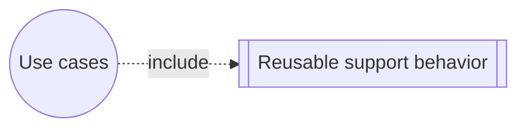

# Fragment: support

## Capabilities

- ideation-skill
- template-conditional-rendering
- domain-skill-trigger
- spec-explore-permanent
- coverage-script-workflow
- repository-ownership-fixtures
- coverage-readme-example
- spec-explore-change
- readme-coverage-badge
- skill-rewrites
- arc42-review-alignment
- instruction-integrity
- choose-project-license
- adr-qualification-gate
- llm-attribution
- scm-backend-selection

## Interactions

- none

## Diagram

