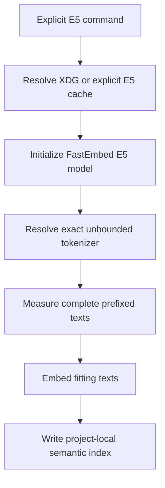

# Design: semantic-model-download

## Technical Approach

The change stays in the existing synchronous Rust retrieval pipeline in
`src/spec/retrieval.rs`. The permanent index remains project-owned at
`givn/.spec-index.json`; large model artifacts are user-owned cache data and
are moved out of the project tree.

The current dependency versions are taken from `Cargo.lock`, checked on
2026-08-23: `fastembed` `5.17.2`, `hf-hub` `0.5.0`, and `sha2` `0.11.0`.
`hf-hub` is currently a transitive dependency of FastEmbed and becomes a direct
optional dependency of the `spec-retrieval` feature. `sha2` becomes a direct
optional dependency for cache-manifest digests. No new public Cargo feature is
introduced.

The existing default feature set remains unchanged:

- `spec-retrieval`
- `spec-similarity-gate`
- `cross-encoder-reranker`
- `nli-evidence`

## XDG Cache Policy

`model_cache_root(role)` resolves the cache in this order:

1. An explicit role-specific override, when one is supplied.
2. `HF_HOME`, when it is set and no role-specific override is supplied. This is
   treated as an explicit Hugging Face compatibility cache root, not as the
   product default.
3. An absolute `XDG_CACHE_HOME` followed by `givn/<role>`.
4. `$HOME/.cache/givn/<role>` when `XDG_CACHE_HOME` is unset.

The default role directories are:

```text
$XDG_CACHE_HOME/givn/e5
$XDG_CACHE_HOME/givn/bge
$XDG_CACHE_HOME/givn/nli
```

When `XDG_CACHE_HOME` is unset, `$HOME/.cache` is used. A relative
`XDG_CACHE_HOME` and a missing `HOME`/`HF_HOME` produce an actionable
configuration error instead of silently writing model files into the project.
The resolved directories are created only when a matching model is explicitly
needed. Direct HF Hub calls use `ApiBuilder::from_cache(Cache::new(path))`,
never `ApiBuilder::new()` or `from_env()`, so resolution is deterministic and
cannot panic while looking up an unrelated home directory.

Existing explicit paths remain supported as user-owned overrides:

- `GIVN_SPEC_MODEL_CACHE` selects the E5 FastEmbed cache root.
- `GIVN_SPEC_E5_TOKENIZER` selects an exact tokenizer file for token-cap
  measurement.
- `GIVN_SPEC_BGE_MODEL_DIR` selects a complete flat BGE artifact directory.
- `GIVN_SPEC_BGE_CACHE` selects the BGE download/cache root.
- `GIVN_SPEC_NLI_MODEL_DIR` selects a complete flat NLI artifact directory.
- `GIVN_SPEC_NLI_CACHE` selects the NLI download/cache root.

The complete precedence is:

| Layer | Flat artifact directory | Download/cache root | Default |
|---|---|---|---|
| E5 | `GIVN_SPEC_E5_TOKENIZER` for the tokenizer only | `GIVN_SPEC_MODEL_CACHE` | `HF_HOME`, otherwise `$XDG_CACHE_HOME/givn/e5`, otherwise `$HOME/.cache/givn/e5` |
| BGE | `GIVN_SPEC_BGE_MODEL_DIR` | `GIVN_SPEC_BGE_CACHE` | `HF_HOME`, otherwise `$XDG_CACHE_HOME/givn/bge`, otherwise `$HOME/.cache/givn/bge` |
| NLI | `GIVN_SPEC_NLI_MODEL_DIR` | `GIVN_SPEC_NLI_CACHE` | `HF_HOME`, otherwise `$XDG_CACHE_HOME/givn/nli`, otherwise `$HOME/.cache/givn/nli` |

For E5, a tokenizer override does not redirect model weights. For BGE and NLI,
a flat directory wins over the corresponding cache root and disables
acquisition. A role-specific cache override wins over `HF_HOME`. `HF_HOME` is
the compatibility choice only when no role-specific Givn path is supplied;
when both `HF_HOME` and `XDG_CACHE_HOME` are set, `HF_HOME` wins as the explicit
Hugging Face selection.

For role-specific overrides, flat model directories have precedence over cache
roots and are never downloaded into. `GIVN_SPEC_MODEL_CACHE` and
`GIVN_SPEC_BGE_CACHE`/`GIVN_SPEC_NLI_CACHE` are cache roots for automatic
acquisition. Relative explicit paths are interpreted relative to the current
working directory, matching existing CLI path behavior. `HF_HOME` is honored
only as the compatibility root described above; it never overrides a
role-specific Givn path. When both `HF_HOME` and `XDG_CACHE_HOME` are set,
`HF_HOME` wins
because it is an explicit Hugging Face cache selection. The project-local
`.spec-model-cache`, `.spec-reranker-cache`, and
`.spec-nli-cache` paths remain readable only when explicitly selected by an
override or when a legacy path is passed to a flat model-directory override.
They are never created by automatic downloads. The permanent index and its
atomic replacement remain project-local.

## E5 Acquisition And Token Guard

The production E5 path constructs the FastEmbed E5 model with the resolved E5
cache before calling the actual tokenizer preflight. FastEmbed's first-use
initialization downloads the E5 model and tokenizer artifacts into the XDG
cache and reuses them on later calls. The existing unbounded tokenizer remains
separate from FastEmbed's inference tokenizer so the 512-token guard cannot be
silently bypassed by truncation.

The E5 acquisition contract is fixed to the FastEmbed model mapping verified in
`fastembed` `5.17.2`:

| Logical model | HF repository | Revision | Required files |
|---|---|---|---|
| `intfloat/multilingual-e5-large` | `Qdrant/multilingual-e5-large-onnx` | FastEmbed's `main` reference; the resolved snapshot commit is recorded in the local cache manifest | `model.onnx`, `model.onnx_data`, `tokenizer.json`, `config.json`, `special_tokens_map.json`, `tokenizer_config.json` |

The unbounded token-cap tokenizer is always the `tokenizer.json` from that
exact E5 repository snapshot, or the explicitly supplied
`GIVN_SPEC_E5_TOKENIZER` file. It is never selected by recursively searching a
shared directory containing other model roles. The resolver records the
snapshot commit and SHA-256 for every required file in a role-local manifest;
an existing manifest mismatch invalidates the snapshot before model use.

The flow is:



If model initialization or tokenizer resolution fails, the error identifies
the logical model, resolved cache, failed artifact, and
`GIVN_SPEC_MODEL_CACHE`/`GIVN_SPEC_E5_TOKENIZER` alternatives. No index is
written from a failed E5 batch.

The deterministic `GIVN_SPEC_EMBEDDER=stub` selector remains download-free for
the existing suite. A dedicated test-only download fixture selector exercises
cache population and failure handling without requiring live Hugging Face
traffic or multi-gigabyte test fixtures.

## BGE Acquisition

Add a feature-gated synchronous HF Hub resolver for the approved BGE model
`rozgo/bge-reranker-v2-m3`. The resolver uses the XDG BGE cache by default and
retrieves the complete required set:

```text
model.onnx
model.onnx.data when referenced by the ONNX graph
tokenizer.json
config.json
special_tokens_map.json
tokenizer_config.json
```

The resolver uses `ApiBuilder::from_cache(Cache::new(resolved_root))` with the
optional `HF_ENDPOINT` override and a pinned BGE revision
`fbd57b17b4db111a9d16813bb08b4c804fac18e9`. It calls the synchronous repository
cache lookup for each file. A missing or invalid cached file is quarantined by
removing only the affected snapshot entry, downloaded once, and validated
again. HF Hub's temporary download files provide the transfer boundary; Givn's
manifest, file-size, JSON/tokenizer, external-data, and SHA-256 checks provide
the content boundary.

The existing local FastEmbed user-defined loader remains the scoring loader.
The resolver returns the validated snapshot directory and model path without
copying large external-data files into the project. Explicit flat directories
continue to work. `GIVN_SPEC_BGE=disabled`, `GIVN_SPEC_BGE=stub`, and
`GIVN_SPEC_BGE=missing` never invoke the downloader. `local` remains an
offline, explicitly provisioned flat-artifact mode and never downloads;
`auto` resolves/downloads missing cache artifacts. A valid default admission
document is still required for implicit product participation.

Download and artifact failures continue to map to `BGE_UNAVAILABLE` with
`missing-artifact`; the diagnostic additionally names the cache path, model,
failed remote file, and `GIVN_SPEC_BGE_MODEL_DIR`/`GIVN_SPEC_BGE_CACHE` escape
paths. JSON stdout remains valid JSON, so detailed diagnostics are written to
stderr.

## NLI Acquisition

Add the same resolver shape for
`MoritzLaurer/mDeBERTa-v3-base-xnli-multilingual-nli-2mil7` under the XDG NLI
cache. The required remote files are:

```text
onnx/model.onnx
config.json
tokenizer.json
tokenizer_config.json
special_tokens_map.json when present in the source export
```

The resolved NLI artifact value contains the snapshot directory, model path,
tokenizer path, metadata paths, and optional external-data path. This is
necessary because the automatic HF snapshot stores the model at
`onnx/model.onnx`, while the existing flat override stores it as `model.onnx`.
The pinned NLI revision is
`b5113eb38ab63efdd7f280f8c144ea8b13f978ce`. `NliClassifier` consumes the
resolved model path and continues to validate `id2label` before ONNX
construction.

`GIVN_SPEC_RERANKER=disabled`, `stub`, `nli-stub`, and `nli-missing` never
invoke the downloader. `nli` remains an explicitly provisioned flat-artifact
mode; `nli-auto` resolves/downloads the pinned snapshot and maps failures to
`NLI_UNAVAILABLE` with an actionable stderr diagnostic. The deterministic
`nli-stub` selector remains fully offline. A separate test-only acquisition
fixture exercises the resolver and validation before deterministic scores.

## Shared Artifact Validation

The resolver validates every required artifact before reporting availability and
writes a role-local manifest only after the complete snapshot passes:

- regular file and non-zero length;
- JSON syntax for JSON metadata;
- tokenizer syntax through `Tokenizer::from_file`;
- BGE external-data presence when referenced by `model.onnx`;
- NLI `id2label` entries for entailment, neutral, and contradiction;
- expected remote size and SHA-256 for each downloaded file;
- one repository revision for every file in the snapshot.

The logical model IDs used in reports remain unchanged. HF repository IDs and
remote filenames are resolver metadata, not a change to the semantic index
schema or evidence wire format. BGE and NLI revisions are pinned to the
verified commits above. E5 remains on FastEmbed's fixed `main` mapping because
the current public FastEmbed constructor does not accept a revision; its cache
manifest detects replacement and forces a fresh acquisition. Explicit artifact
paths remain the reproducible option for maintainers requiring pinned E5 bytes.

Each automatic role cache has an atomic `givn-artifacts.json` manifest with the
logical model, repository, resolved revision, exact required remote filenames,
byte lengths, and SHA-256 digests. A snapshot is usable only when the manifest
and every file agree and all files belong to one snapshot directory. A missing
manifest, mixed revision, changed digest, truncated file, or invalid metadata
causes the affected snapshot to be invalidated and reacquired; other model
roles in the shared cache are untouched. The manifest is written through a
temporary file and rename only after every required file validates. Explicit
flat directories have no generated manifest and are validated on every use.

## Missing-Index Diagnostics

Add one shared diagnostic formatter for:

```text
spec index is missing at <path>; run `givn spec index` first
```

`spec search` keeps its current failing read behavior and wraps only an absent
file with this text. `spec explore`, `spec review`, and `check review` emit the
same diagnostic to stderr when they begin without an index, then retain their
existing automatic refresh behavior. `spec duplicates` emits the diagnostic
when it falls back to its existing transient, read-only audit path. This makes
the repair command visible on every surface without turning a deliberately
read-only or refresh-capable command into an unexpected hard failure.

The diagnostic is emitted at most once per top-level command. `read_index` uses
an explicit absent-file result distinct from malformed, incompatible, and
dimension-invalid results. Malformed or incompatible indexes keep their
existing rebuild/fallback behavior and are reported by their validation errors
rather than being mislabeled as a missing file. The command entrypoints pass a
single diagnostic context through nested semantic calls so `check review` does
not print the hint twice.

## Test Seams And Fixtures

No test invokes a live third-party service. The regular and E2E bindings create
an isolated temporary `XDG_CACHE_HOME` and point the compiled CLI at a local
HF-compatible artifact-source fixture through `HF_ENDPOINT`. The fixture
serves the pinned repository paths, records request order and requested files,
and returns small valid metadata/fixture artifacts. E5 indexing uses the
deterministic embedding backend only after the resolver event has completed;
the production FastEmbed constructor remains a manual release probe because
its weights are multi-gigabyte artifacts. The subprocess sees the fixture as a
real endpoint, so E2E covers resolver requests rather than an in-process fake.
The E5 regression records `artifact-resolved` before `token-budget-measured`;
the BGE/NLI regression records all required remote filenames before evidence
scoring. A resolver fixture is not the same as the existing `stub` selector.

The test-only environment seam is kept explicit and is never selected by
normal users. Existing `stub`, `missing`, and `disabled` selectors preserve
their no-network semantics.

## Archive Download Boundary

`givn archive` is not an explicit semantic operation. Its pre-merge retrieval
gate may use a complete validated cache, but it must not acquire a model. The
retrieval module therefore exposes a no-download policy for the archive gate
and the post-archive best-effort refresh. A cold archive either fails before
permanent mutation with the same actionable setup error or completes while
leaving the cache untouched; it never starts a model download after the change
has been archived.

The user-facing `givn spec index`, `spec search`, `spec explore`, `spec review`,
`spec duplicates`, and `check review` entrypoints use the download-enabled
policy. This distinction is passed explicitly rather than through a mutable
process-global environment variable.

## Existing Contract Amendments

The permanent NLI scenario titled `NLI uses the bounded E5 neighbour union for
the permanent duplicate audit` is amended by this change to state the existing
independent full-E5-pool contract recorded by ADR-058 and ADR-061. No scoring
threshold, output schema, or BGE/NLI recommendation rule changes.

## Architecture Impact

- `Cargo.toml` and `Cargo.lock`: add direct optional `hf-hub` and `sha2`
  dependencies to `spec-retrieval`.
- `src/spec/retrieval.rs`: resolve XDG caches, initialize E5 before token
  preflight, download/validate BGE and NLI artifacts, pass resolved NLI model
  paths, and emit shared missing-index diagnostics.
- `tests/common/mod.rs`: carry isolated XDG cache and start/stop the local
  deterministic HF-compatible artifact-source fixture for subprocesses.
- `tests/steps/mod.rs`: register the regular and E2E capability bindings and
  carry the cache/download fixture selectors.
- `tests/steps/semantic_model_download_steps.rs`: regular Gherkin bindings,
  one file for this capability.
- `tests/steps/semantic_model_download_e2e_steps.rs`: compiled-CLI E2E
  bindings, separate from regular bindings.
- `run-tests.sh`: route the combined BGE/NLI E2E scenario through the existing
  combined-feature command, exclude `@nli-combined` from E5-only phases, and
  fail explicitly if the active feature path cannot be resolved.
- `docs/arc42/07-deployment-view.md`, `08-crosscutting-concepts.md`,
  `09-architecture-decisions.md`, `11-risks-and-technical-debt.md`, and
  `12-glossary.md`: document XDG ownership, resolver validation, and the
  amended BGE artifact boundary.
- `docs/arc42/adr/ADR-057-bge-local-artifacts.md`: amend the no-hidden-download
  decision to allow explicit-operation acquisition into the XDG cache before
  the unchanged local loader.
- `README.md` and `docs/retrieval-models.md`: distinguish project-local index
  data from user-level model caches and document sources, overrides, offline
  behavior, and recovery.

No persistent index schema change is required.

## Test Runner And Strictness

The existing Cucumber runner remains the executable specification runner. The
configured commands in `givn/commands.yaml` are:

```text
verify.command = ./run-tests.sh
verify.e2e_command = ./run-tests.sh --e2e
```

`./run-tests.sh` runs the Cucumber binary over `givn/specs/` and the active
change feature files through `GIVN_FEATURES` when a targeted task run sets it.
The runner is `cucumber-rs` from the existing locked dev dependencies and uses
`GivnWorld::cucumber().fail_on_skipped()` as strict mode. New unimplemented Rust
steps use `unimplemented!()`; no step body may be empty.

The exact single-scenario command is:

```sh
GIVN_FEATURES=givn/changes/semantic-model-download/specs \
  cargo test --features spec-retrieval,cross-encoder-reranker,nli-evidence \
  --test features_runner -- \
  --name "First semantic indexing downloads E5 artifacts before applying the token guard"
```

E2E uses the existing compiled-CLI subprocess binding and the exact command
`./run-tests.sh --e2e`. It is a strict subset of `./run-tests.sh`: the full
runner executes all non-E2E scopes, while the E2E command applies `@e2e` tag
filters. The combined BGE/NLI scenario is tagged `@nli @nli-combined @e2e`;
the E5-only filters exclude both `@nli` and `@nli-combined`, while the combined
phase is its sole executor. Each E2E scenario starts exactly one compiled CLI
subprocess for its inventory action. The E2E strictness proof uses the same
`.fail_on_skipped()` mechanism and a dedicated `unimplemented!()` E2E step
before scenario implementation. Targeted runs pass the active change path via
`GIVN_FEATURES`.

## Local Runnability And External Dependencies

The local run command is `./run-tests.sh`; no application server, database,
queue, browser, or external service is required. The only third-party runtime
dependency is Hugging Face Hub, and every Gherkin scenario uses the local
deterministic artifact-source fixture instead of the live service. The fixture
is the digital twin for Hugging Face file retrieval and runs in the test
process, with per-scenario cache isolation. Release/manual real-model probes
may use an explicitly provisioned network or local artifact set but are not
part of the executable suite.

There is no interface obstacle: E2E drives the actual compiled `givn`
subprocess, captures stdout/stderr and exit status, and asserts the CLI output
as the primary boundary. Filesystem cache and index checks are secondary
evidence.

## Interaction Coverage Matrix

| Inventory entry | @e2e scenario title | Real interface | Driving mechanism |
|---|---|---|---|
| build or refresh the permanent semantic index through `givn spec index` | First semantic indexing downloads E5 artifacts before applying the token guard | CLI / terminal | Cucumber E2E binding starts the compiled `givn spec index` subprocess and asserts exit status and stdout, then checks the cache as secondary evidence |
| search permanent semantic scenarios through `givn spec search` | Search identifies the missing-index repair command | CLI / terminal | Cucumber E2E binding starts the compiled `givn spec search` subprocess and asserts the missing-index stderr diagnostic |
| explore a permanent or change-aware semantic scenario through `givn spec explore` | Explore identifies the missing-index repair command | CLI / terminal | Cucumber E2E binding starts the compiled `givn spec explore` subprocess and asserts the missing-index stderr diagnostic |
| request advisory semantic review through `givn spec review` | Advisory review identifies the missing-index repair command | CLI / terminal | Cucumber E2E binding starts the compiled `givn spec review --change` subprocess and asserts the missing-index stderr diagnostic |
| request blocking semantic review through `givn check review` | Blocking review identifies the missing-index repair command | CLI / terminal | Cucumber E2E binding starts the compiled `givn check review --change` subprocess and asserts the missing-index stderr diagnostic |
| run a second-stage semantic audit through `givn spec duplicates --format json` | Duplicate audit identifies the second-stage model caches | CLI / terminal | Cucumber E2E binding starts the compiled `givn spec duplicates --format json` subprocess with both evidence selectors and asserts JSON stdout, then checks both caches |

## Coverage Process Boundaries

| Process | Started by | Instrumented artifact | Profile output | Merge step | Non-zero production probe |
|---|---|---|---|---|---|
| `givn` CLI subprocess | Cucumber bindings via `./run-tests.sh` and `./run-tests.sh --e2e` | Existing Cargo coverage wrapper and compiled `givn` binary | Existing collision-safe `coverage/non-e2e-cobertura.xml` or `coverage/e2e-cobertura.xml` | `./merge-coverages.sh` | E5 cache resolution, BGE/NLI artifact resolution, and missing-index diagnostic paths |
