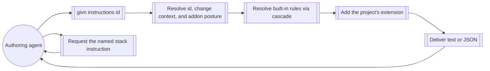

<!-- givn:base-sha256:5e1afe6e63df64b718b29da7e0bb6932214dabe7e3286478617234898925f2f4 -->
# Use case: obtain-effective-guidance

## Level

!

## Actors

- Authoring agent
- Supporting: Developer (manual reading)

## Goal

Obtain the rules governing the work at hand, extended with the project's
extension.

The delta: an instruction bound to an addon is served only while that addon is
effective, and a core step instruction names the stack instruction it leaves to
a separate request instead of carrying that body.

## Trigger

The authoring agent requests the guidance for an instruction id
(`givn instructions <id> [--change <id>] [--json]`), typically because an
invoked skill directs it there; the developer may request
the same id manually.

## Preconditions

- The project is initialized as a Givn project.
- For an artifact instruction, exactly one change context resolves: the explicit `--change`, or the single active change.
- For the `ise` instruction, `ise` is effective, which requires its prerequisite `architecture_principles` to be on.
- A stack instruction id is a policy instruction id: it resolves with no change context, and the stack instruction the guidance names is served while the shipped corpus carries it.

## Main flow

1. The authoring agent requests the guidance for an instruction id; the system resolves the id as an artifact, a policy, a step, or a stack instruction, and resolves an addon-bound id only while its addon is effective.
2. For an artifact instruction, the system resolves the change context (explicit `--change`, or the single active change).
3. The system resolves the built-in rules through the project-overrides-first cascade (project replacement, then embedded, then addon).
4. The system loads and validates the project's configured extension for that id, then adds it after the built-in rules under a marked section; a rejected entry warns and is skipped, and the built-in rules stay unmodified.
5. The system delivers the effective content on the requested path — text or machine-readable — with identical content. The served text of `steps` and `design` names each stack instruction id and the condition for loading it, and carries no stack body; `specs` and `review` carry no stack body and name no stack instruction.
6. The agent follows the extended rule for its step and requests the named stack instruction by id when the change's runner is that stack; a stack instruction's body is served only by a request for its own id.

## Extensions

- 1: the id is unknown → the system refuses by name and lists the known ids; protects the minimal guarantee.
- 1: the id is served by an addon that is not effective → the system refuses and names the addon; protects the minimal guarantee.
- 2: multiple active changes and no `--change` → the system refuses and names the boundary; protects the minimal guarantee.
- 2: no active change and no `--change` for an artifact instruction → the system refuses and names the missing context; protects the minimal guarantee.
- 4: no extension exists for the id → the built-in rules are served alone; the call is valid and unchanged.
- 4: a configured entry is rejected while the guidance is resolved (unknown id, or a malformed, empty, or whitespace-only rule) → the entry is skipped with a warning and the request serves the built-in rules alone for it; nothing is mutated.
- 5: the machine-readable path is requested → the same extended content is carried as `instruction` alongside `id`, `generates`, `requires`, and `skill_to_load`.
- 5: the requested id is a stack instruction → its body is served on that request only and never inside a core instruction's served text; protects the success guarantee.
- 6: the change touches no stack the core instruction named → no stack instruction is requested and the core guidance stands alone; protects the success guarantee.

## Rules

- The served content is the extended rule: the built-in rules resolved from the canonical asset (or the project's replacement of the instruction facet) plus the project's extension when one exists.
- An extension never overrides, suppresses, or reorders the built-in rules.
- The text path and the machine-readable path carry the same effective content, extensions included.
- Improved built-in rules are served at the next request after an upgrade; no project action and no synchronization is needed.
- A request never mutates project state: it resolves configuration and content and prints. A rejected configuration entry warns and is skipped; the request still succeeds and serves the built-in rules alone for it.
- The unknown-id refusal, the change-context rules, and the machine contract shape are unchanged.
- The built-in rules stay technology-agnostic; project-specific guidance arrives only through the extension.
- The `ise` instruction is served as its own instruction id only while the `ise` addon is effective; it names `steps` as the mapping for the change's stack mechanics and names one stack instruction id as a worked example, and the obligations it carries belong to the `instruction-integrity` capability.
- An addon's effective state is read at request time, so enablement or disablement changes the next request's outcome with no synchronization step for the instruction itself.
- Guidance for a disabled addon is omitted; enabling `ise` adds its instruction without changing guidance for a project that did not enable it.
- Each core step instruction that carries per-stack mechanics states the stack instruction id it leaves out and the condition for loading it; the stack instruction's body is served only by a request for its own id. The id convention `<id>-<stack>` carries the pairing, and the existing `<id>-examples` companion (`dialog` to `dialog-examples`) is the policy precedent it follows.
- A core instruction's served text is complete for a change that touches no named stack: the split reduces what a reader loads and removes no universal rule. `givn instructions specs` and `givn instructions review` carry no stack body and name no stack instruction.
- The stack instruction carries the rows the core instruction used to hold for one runner: the step definition file, the binding form, the empty-body stub, the strict-mode mechanism, and the single-scenario run command that stack's runner uses.
- A named stack instruction id that does not resolve is a named defect of the guidance corpus, not a silent omission; the reference check that proves it belongs to the `instruction-integrity` capability.
- No phrase-uniqueness rule exists between a core instruction and a stack instruction: the stack body is simply not part of the core text.
- Managed bootstrap owns loading the effective dialog policy once per context before the first user-facing question, independently of addons or named skills; reload it if lost. Thin skills do not repeat dialog, handoff, or delegation blocks.
- The concise dialog policy indexes a preserved companion of regression examples. Read the relevant examples before the first scope-approval, target-selection, behavior-choice, persistent-format-commitment, or discoverable-diagnosis question in the context; ask one question at a time and retain concrete decision consequences and resolved reasons.
- Effective implementation and steps guidance plans a coherent named behavior batch with scenarios, validation, and intended commit boundary. Tests and bindings run before production edits; meaningful behavioral RED is not a missing binding, syntax, registration, fixture, or environment failure.
- Record the actual RED command and short observed failure as it happens, then briefly record actual GREEN and REFACTOR checks. An immediately passing distinct requirement is explicitly existing behavior protected and needs no production edit for that requirement.
- Admit skipped RED; never backdate evidence, rewrite history, break finished behavior, or present mutation/discrimination tests as historical RED. Separate phase commits and retrospective commit-shape or TDD-order gates are not required.
- Inspect the intended explicit-path diff, commit a coherent completed batch, record its actual reachable implementation or regression-test revision, then complete scenario tasks. Multiple scenarios may share a batch revision; implicit staging of all work and per-scenario production-diff requirements are not part of the contract.
- Prove runner strictness at initial setup and relevant runner, version, invocation, or failure-configuration changes, not for every behavior batch. New behavior still requires behavioral RED.
- During REFACTOR inspect the advisory outline once per batch for changed supported-language components and relevant neighbors. Assess cohesive responsibility, narrow interfaces, dependency direction, and understandable decomposition, confirming suspected issues against source. Structural call order is not a complete runtime trace; uncertain or omitted edges limit conclusions.
- Assess unsupported Go/Java components directly against source using the same questions, without failure, waiver, outline verdict, or forced reviewer context. Outline supports final review but never supplies its own blocking verdict.
- Modular boundaries apply from the first implementation: cohesive responsibility modules, narrow consumer contracts and Interface Segregation, external adapters, separate composition, and explicit dependency direction. Narrow module APIs suffice unless isolation or substitution requires an explicit interface; do not invent hypothetical providers or plugin registries.
- Make concrete encountered cleanup in separate explicit-path behavior-preserving refactoring commits with actual GREEN checks, not speculative features or broad abstraction rewrites.
- Instruction and skill regressions may assert focused meaningful content; a giant whole-output substring does not substitute for discrimination.
- Optional challenge uses the same effective-instruction request action with subject variants for proposal, tests, specs, design, code, and whole changes; it adds no mandatory lifecycle gate. Research first, report discoverable defects as bounded actionable findings, label hypotheses, and ask only unresolved human decisions.
- Challenge uses evidence, counterexamples, discriminating assertions, root causes, compatibility consequences, justified special cases, failure/recovery paths, and measured performance where relevant. General principles are referenced canonically through dev-principles rather than copied; accepted modularity and fix-forward choices take precedence over blanket compatibility or rollback prescriptions.

## Examples

- A Rust change: `givn instructions steps` names `steps-rust` with the condition "the change's runner is Rust"; the author then requests `givn instructions steps-rust` and receives the Rust step file, binding form, stub, strict-mode mechanism, and single-scenario command, none of which appeared in the `steps` text.
- A change on a stack the core instruction does not name: the author never requests a stack instruction, and the universal step rules it holds are complete for the change.
- An `ise`-enabled project: `givn instructions ise --change rebuild-key-parser` serves the five obligations.
- An `ise`-disabled project: the same request refuses and names `ise`, and no project state changes.
- An extension exists: the project records "Keep proposals under 500 words" for the proposal instruction. The agent runs `givn instructions proposal --change add-user-auth` and receives the built-in proposal rules followed by the marked section carrying the project's line.
- No extension exists: `givn instructions specs --change add-user-auth` serves the built-in rules alone.
- Unknown id: `givn instructions propozal` exits non-zero with the unknown-artifact error naming the known ids; request for `steps-rustt` does the same and the known list includes `steps-rust`.
- Machine-readable: an agent requests the same proposal id with `--json` and finds the project's line inside `instruction`; the same call for `steps-rust` carries the same Rust text as the text path.

## Minimal guarantee

A request never modifies project state. A request that cannot be satisfied
refuses and names what is missing — the unknown id, the addon that is not
effective, the ambiguous change context, or the absent change; a rejected
configuration entry is skipped with a warning and the request serves the
built-in rules alone for it.

## Success guarantee

The caller holds the extended rule for the requested id: Givn's built-in
rules as the canonical asset (or the project's replacement) defines them,
plus the project's extension when one exists — identical on the text and
machine-readable paths. An addon-bound id is served only while its addon is
effective, a core step instruction names each stack instruction id with its
load condition, and a stack instruction's body reaches the caller only on a
request for that id.

## Personas

- agent--technical-role
- developer--primary-user
- givn-maintainer--owner

## Capabilities

- serve-extended-rules

## Interactions

| Capability | Consumer action | E2E scenario |
|---|---|---|
| serve-extended-rules | request effective instructions by id (artifact, policy, step, stack, addon-bound, challenge subject, JSON, and change context are variants) | An agent receives the extended rules through the Givn CLI |

## Includes

- fragment: support

## Extends

- none

## Out of scope

The cascade resolution mechanics, override precedence, and reference
integrity (the instruction-integrity capability); recording, changing, or
removing the project's extensions (extend-an-instruction); generating and
refreshing installed guidance (initialize-project, upgrade-a-project);
addon enablement and its prerequisite refusal (initialize-project);
session-start next-step guidance (inspect-change-state); changing the
built-in flow; enabling `ise` on Givn itself and the self-rebuild
(`enable-ise-on-givn-and-run-a-dry-run`); the `givn ise replace` and
`givn ise verify` commands (`add-ise-clean-room-commands`); the stack
mechanics' content, because the split moves rows and adds no runner.

## Diagram

