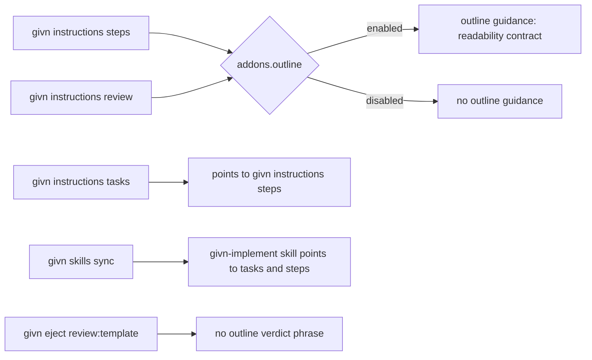

# Design: strengthen-outline-guidance

## Overview

The change edits rendered instruction assets, one ejected template, the
generated implementation skill, the outline guide, arc42 chapter 08, and the
README. It adds no production code path: the existing renderer already knows
the `outline` addon key (`src/skills/render.rs`, `src/cli/instructions.rs`).

Three boundaries define the work:

1. **Render boundary.** The REFACTOR outline paragraph in
   `assets/instructions/steps.md`, the review-context paragraph in
   `assets/instructions/review.md`, and the existing advisory-outline section
   render only when `addons.outline` is true. The review template
   (`assets/templates/review.md`) is ejected raw, so it must hold no
   addon-specific phrase; the retired-gate wording is removed from it.
2. **Meaning boundary.** The steps and review outline guidance state a
   readability contract: responsibility and ordered call flow from the outline
   alone, names/signatures as the domain contract, generic machinery names as
   findings, metrics never excusing an unreadable outline, and an unreadable
   changed unit as a fixed-in-REFACTOR or substantive-review-finding outcome.
   The report stays advisory: no verdict, no waiver, no second context.
3. **Routing boundary.** `assets/instructions/tasks.md` names
   `givn instructions steps` as the step mechanics, and
   `assets/skills/givn-implement/SKILL.md.tmpl` names both instructions. The
   tasks instruction keeps batch sequencing, verification, and commit
   evidence.

The served guidance never names a concrete language set. The current analyzer
support (Rust and Python) stays in the factual capability sections of
`docs/outline.md` and the report's own disclosure.

## Visual Design Contract

- Interface: terminal
- Viewports: not applicable
- Design system: not applicable
- Persona: agent--technical-role, developer--primary-user

The product surface is served CLI text. No screen is rendered in a browser:
the assertions read stdout and the ejected Markdown file, so the opposite
classification (Web UI) does not hold. The changed `@e2e` scenario commits a
terminal transcript under
`givn/changes/strengthen-outline-guidance/evidence/visual/<scenario-slug>/transcript.txt`.

## Use-Case Traceability

Owning use case: `obtain-effective-guidance` (`givn/specs/obtain-effective-guidance/usecase.md`).
Supporting owners: `assess-code-structure` (outline use in REFACTOR and review),
`verify-change` (review findings), and the reusable `fragments` document.

| Use-case contract element | Technical decision | Capability / E2E evidence |
|---|---|---|
| The served content is the effective guidance for the requested instruction | The outline blocks remain part of the canonical steps and review assets; only their rendering is conditional | `serve-extended-rules`, `Implementation guidance routes to the shared step mechanics` |
| An extension never overrides built-in rules | No extension mechanism changes; the new text is built-in guidance | `serve-extended-rules`, existing extension scenarios |
| The built-in rules stay technology-agnostic | Served guidance says supported/unsupported; the concrete language list is confined to factual capability sections | `serve-extended-rules`, `Refactor guidance treats an unreadable changed unit as a finding` |
| The outline is advisory and never blocks | The report keeps no verdict; a readability finding is an ordinary review finding about the changed code | `review-architecture-documentation`, `A changed unit unreadable from its outline rejects PASS` |
| Addon-gated sections follow the addon | Both outline blocks render behind `{{#if addons.outline}}` | `match-guidance-to-enabled-addons`, `Outline guidance follows the opt-in addon` |
| Generated skills are thin pointers | `givn-implement` points to both the tasks and steps instructions without copying rules | `refresh-generated-guidance`, `Generated implementation guidance routes to the task and step instructions` |
| The developer can read the current architecture | Chapter 08 records the serving path and the comprehension test | arc42 assessment in `arc42.md` |

## Technology Decisions

| Technology | Version | Resolution |
|---|---|---|
| Rust | existing workspace toolchain | `Cargo.toml` / `Cargo.lock`; no new dependency and no `src/` change |
| cucumber-rs | existing workspace pin | `Cargo.lock`; `.fail_on_skipped()` remains the strict-mode mechanism |
| Markdown asset templates | n/a | Existing `{{#if addons.<key>}}` renderer; no new template directive |

## Decisions

The proposal records no `D<n>` open question. The operator's plan fixes the
conditional boundaries, the preserved sentence set, the language-neutral
wording, and the advisory-versus-finding distinction; the exact wording is
recorded here and in the implementation.

- **Preserve asserted sentences.** Existing step definitions assert phrases
  verbatim. The implementation preserves every listed phrase and adds the new
  meaning around it; only language-specific phrases are replaced in the same
  change as their feature text.
- **Keep the advisory semantics.** No `OUTLINE:` marker, no metric waiver, no
  second reviewer context, and no new mechanical gate. The retired gate stays
  dead.
- **No language list in guidance.** Served guidance says supported and
  unsupported. The analyzer reference in `docs/outline.md` and the report's
  capability disclosure may state the current Rust/Python scope as data.
- **Keep the once-per-batch cadence.** The existing cadence scenario remains
  the cadence contract; this change only makes its wording language-neutral
  and adds the readability test.

## Contracts and Components

The change adds no runtime contract. The served-guidance boundary is the
existing instruction resolver; its implementing component is the embedded
asset tree, consumed through `givn instructions`.

| Contract | Consumer use case | Consumers | Implementing component today | Split trigger |
|---|---|---|---|---|
| Effective guidance | obtain-effective-guidance | `givn instructions`, generated skills | Embedded instruction assets and the renderer | A second content source or per-language guidance variants appear |

## Step Definitions

| Capability | Step definition file | Permanent merge target |
|---|---|---|
| `serve-extended-rules` | `tests/steps/serve_extended_rules_steps.rs` | same file |
| `match-guidance-to-enabled-addons` | `tests/steps/template_conditional_rendering_steps.rs` + `tests/steps/template_conditional_rendering_support.rs` | same files |
| `review-architecture-documentation` | `tests/steps/arc42_review_alignment_steps.rs` | same file |
| `refresh-generated-guidance` | `tests/steps/skill_rewrites_steps.rs` | same file |

Test runner command (from `givn/commands.yaml`):

```text
./run-tests.sh --non-e2e
```

E2E runner command:

```text
./run-tests.sh --e2e
```

Single-scenario run command:

```text
GIVN_FEATURES=givn/changes/strengthen-outline-guidance/specs cargo test --locked --test features_runner -- --name "<scenario title>"
```

## Strict Mode

`tests/features_runner.rs` calls `.fail_on_skipped()` on the Cucumber builder,
so undefined or pending steps fail the runner. New step bodies start as
`unimplemented!("TODO")` during RED and are replaced before GREEN; no step body
is left empty. The E2E scope inherits the same mechanism.

## Local Runnability & Digital Twins

Local run command:

```text
cargo run -- instructions
```

The product is a local CLI; no database, container, service, or digital twin
is involved. Fixtures are temporary project roots created by the test helpers.

## E2E Smoke Test Infrastructure

- **Interface type:** terminal (CLI text output).
- **E2E step location:** `tests/steps/arc42_review_alignment_steps.rs` for the
  changed template scenario; the existing helpers spawn the real `givn`
  binary.
- **Local test infrastructure:** none beyond the compiled binary; no server or
  browser.
- **E2E framework choice:** cucumber-rs through `tests/features_runner.rs`;
  it drives the real CLI.
- **E2E strict-mode proof:** `.fail_on_skipped()` in `tests/features_runner.rs`;
  inherited from the existing suite.
- **Transcript evidence:** the modified `@e2e` scenario keeps its existing
  transcript step, which writes under the change's `evidence/visual/`.

## Interaction Coverage Matrix

| Inventory entry | @e2e scenario title | Real interface | Driving mechanism |
|---|---|---|---|
| obtain-effective-guidance: request effective instructions by id | An agent receives the extended rules through the Givn CLI | CLI | spawn the `givn` binary with `instructions proposal --change <id>` and read stdout |
| fragments: eject the review template | The review template includes the Arc42 conformance block | CLI | spawn the `givn` binary with `eject review:template`, read the ejected file, write a terminal transcript |
| fragments: synchronize selected skills | Synchronized guidance explains how to resolve the deterministic gates | CLI | spawn the `givn` binary with `skills sync`, read the generated skill files |
| fragments: request architecture-aware review guidance | Arc42-enabled review instructions require conformance evidence | CLI | spawn the `givn` binary with `instructions review --change <id>` and read stdout |

No new inventory entry is introduced: the change alters the served text and
the ejected template behind existing actions. The new scenarios are regular
scenarios asserting distinct invariants except the modified template smoke,
which keeps its `@e2e` tag.

## Architecture Impact



Modified assets and documentation:

| File | Change |
|---|---|
| `assets/instructions/steps.md` | Wrap the REFACTOR outline paragraph in `{{#if addons.outline}}`; language-neutral supported/unsupported wording; add the comprehension and naming contract; keep the architecture questions and cadence |
| `assets/instructions/review.md` | Wrap the review-context outline paragraph and the advisory section in `{{#if addons.outline}}`; add the comprehension/naming test and the ordinary-review-finding distinction |
| `assets/instructions/tasks.md` | Name `givn instructions steps` as the step mechanics immediately after the audience paragraph |
| `assets/skills/givn-implement/SKILL.md.tmpl` | Point to `givn instructions steps` before any step runs |
| `assets/templates/review.md` | Remove the retired-gate phrase from the Arc42 sentence |
| `docs/outline.md` | Comprehension test, naming contract, metrics interpretation, serving rule, data limit, supported/unsupported wording |
| `docs/arc42/08-crosscutting-concepts.md` | Serving path and advisory-use bullets |
| `README.md` | Outline addon bullet names readability and advisory reports |
| `docs/reference.md` | State that outline guidance renders when the addon is enabled |
| `givn/archive`-merge result | The permanent features replace the language-specific steps after archive; dead step bindings are removed in the cleanup commit |

No `src/` module is modified. The renderer key map already contains `outline`
in `src/skills/render.rs` and `src/cli/instructions.rs`; the conditional is
pure asset data.

## Internal Primitives

No new production type or function. Test-side helpers:

| Primitive | Location | Purpose |
|---|---|---|
| `batch_guidance` | `tests/steps/serve_extended_rules_steps.rs` | Serve design + steps guidance in the fixture |
| `normalized_guidance` | same file | Whitespace-normalize served text for phrase assertions |
| `served_instruction` | same file | Request one instruction by id with the fixture's change context |
| `served_artifact_instruction` | `tests/steps/template_conditional_rendering_support.rs` | Request an artifact instruction after optional fixture change creation |
| `installed_skill_texts` | `tests/steps/skill_rewrites_steps.rs` | Read every generated skill for the configured targets |

## Data Model Changes

None. No schema, persistent store, JSON shape, or configuration key changes.

## Coverage process boundaries

| Process | Started by | Instrumented artifact | Profile output | Merge step | Non-zero production probe |
|---|---|---|---|---|---|
| `features_runner` | `./run-tests.sh` | existing coverage build | `coverage/non-e2e-cobertura.xml` | `./merge-coverages.sh` | `instructions` conditional render path exercised by the addon scenarios |

The existing coverage scripts and paths are unchanged.

## Risks and Limits

- The guidance is qualitative. The instruction makes the test concrete
  (responsibility sentence, ordered call flow, signature vocabulary) without
  pretending it is mechanical; reviewers judge it.
- Existing tests assert exact phrases. Preserve every listed phrase, or change
  the feature and the step together. No second authority is left in place.
- The outline omits data (fields and enum variants) and does not prove runtime
  call order. The guidance must not claim more than the report supplies.
- With the addon disabled there is intentionally no outline readability check.
  Architecture and dev-principles guidance still apply.
- The permanent scenarios keep the old language-specific wording until the
  archive merge replaces them. The delta features and new bindings are the
  forward contract; the cleanup commit removes the obsolete bindings.
