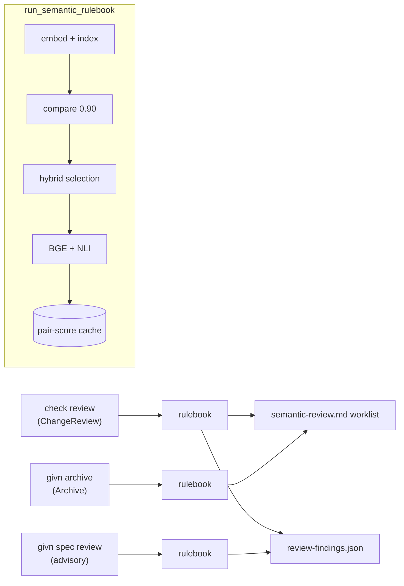

# Design: unified-semantic-rulebook

## Scope

Consolidation of the change-scoped semantic review into one rule set with
three consumers. One Rust module owns the machinery today
(`src/spec/retrieval.rs`); the rule set stays there — splitting the 9.9k-line
module is deliberately not part of this change. Surfaces:

1. **New rulebook entry** — one function, `run_semantic_rulebook(root,
   change_id, surface)`, with `surface ∈ {ChangeReview, Archive}`. It
   replaces the diverging pair of pipelines:
   - `semantic_review_enabled` (classification gate): complete candidate set
     at 0.95, then BGE/NLI over all of it;
   - `review_enabled` + `similarity_candidate_pool` (advisory/archive):
     0.90 floor, top-5 neighbours, projected pool with same-file filters.
2. **Consumers become thin** — `check.rs::run_retrieval_gate` runs the
   rulebook once (today: two full pipelines back to back);
   `archive.rs::run_similarity_gate` runs the same rulebook with
   `surface = Archive` (today: the advisory pipeline); `givn spec review`
   runs the same rulebook (unchanged command).
3. **Pair-score cache** — new persisted evidence store
   `givn/.spec-pair-cache.json` beside the existing spec index.
4. **Constants** — one threshold, two selection constants, one budget.
5. **ADR + docs** — new ADR; ADR-061 superseded; ADR-041/052/058 revised;
   arc42 chapters 04/05/06/08/10/12 updated.
6. **Specs** — the affected feature files are rewritten (list below).

### The rulebook (one deterministic sequence)

```
1. embed: permanent scenarios from the index (content-hash reuse),
   delta scenarios freshly (EmbeddingRole::Passage)
2. compare: delta↔permanent and delta↔delta
   (permanent↔permanent excluded — duplicate audit's domain)
3. cut: pairs below E5_ADMISSION_THRESHOLD (0.90) dropped;
   oversized scenarios reported as E5 token caps (unchanged behaviour)
4. select: per delta scenario keep the NEIGHBOURS_PER_SCENARIO highest-
   scored neighbours, then cap the union at PAIR_CAP pairs,
   ordered by E5 score descending
5. judge: BGE and NLI run on the selected pairs only; each pair both
   directions (symmetry retained); each model recommends independently
   (BGE_ADMISSION_THRESHOLD / NLI_ADMISSION_THRESHOLD unchanged)
6. report: union of recommended pairs → classification worklist
   (semantic-review.md, ADR-046) and advisory evidence document
   (review-findings.json, ADR-054) — both rendered from the same run;
   per-candidate admission states (RECOMMENDED / FILTERED / TOKEN_CAP /
   UNSCORED) keep their meaning
```

Selection consequence recorded explicitly: pairs beyond `PAIR_CAP` are not
candidates (not `UNSCORED`) — selection is deterministic by E5 score, so
verdicts are reproducible; recall beyond the cap is accepted and lands in
arc42 ch. 11 next to R-21.

### Constants

| Constant | Value | Replaces / relation |
|---|---|---|
| `E5_ADMISSION_THRESHOLD` | 0.90 | single threshold; `SEMANTIC_SIMILARITY_THRESHOLD` (0.95) is deleted, including its message use in remediation verification |
| `NEIGHBOURS_PER_SCENARIO` | 5 | new (advisory's top-5 selection becomes the rulebook's stage 4a) |
| `PAIR_CAP` | 20 | new; bounds the judged union globally |
| `GIVN_SPEC_MAX_RERANK_PAIRS` | 2048 | stays as the hard emergency ceiling above selection (ADR-063 reconciled: selection first, budget still truncates + flags `*_UNSCORED`) |

Fixture overrides for the two new constants are registered in
`REQUEST_CHANNELS` + the representative table from day one (refused in
installed builds — release-override-hardening's net).

### Pair-score cache

- Location: `givn/.spec-pair-cache.json` (project-root local, temp-root
  isolated in tests — no environment override).
- Entry key: `(stage, model_id, left_file, left_title, left_content_hash,
  left_evidence_hash, right_file, right_title, right_content_hash,
  right_evidence_hash)`; value: the stage's evidence plus admission-relevant
  raw scores. Schema version field like the spec index.
- Semantics: hash-identical endpoints hit the cache; any endpoint change
  misses and re-judges. The cache never changes verdicts — it only skips
  recomputation of evidence for unchanged pairs. The report gains one
  counter line in both output documents: `pair cache: N reused, M computed`.
- Lifecycle: `check review` and `givn archive` both read/write it; archive
  re-evaluates against the current permanent tree, so stale sign-offs still
  cannot pass, but previously judged unchanged pairs are reused.
- No pruning policy in this change (bounded by change lifetime; the archive
  step may keep the file for audit — decided in specs if contentious).

### Consumer wiring

- `check review`: integrity + overlap gates unchanged; then ONE rulebook run
  (`surface = ChangeReview`). `review_without_index_notice` and
  `semantic_review_without_index_notice` collapse into it; the advisory
  verdict and the blocking classification requirement are two renderings of
  one run.
- `givn archive`: `run_similarity_gate` calls the rulebook
  (`surface = Archive`) instead of `review_without_download`; blocking
  semantics = unclassified/recommended candidates block, carried
  classifications via `apply_prior_classifications` (existing machinery).
- `givn spec review`: same run, advisory rendering (decision-first text,
  JSON findings) — ADR-054 output contract unchanged.

### ADR work

| ADR | Action |
|---|---|
| new | One change-scoped semantic rulebook + pair-score cache (MADR) |
| ADR-061 (surface-specific independent pools) | superseded by the new ADR for the change-scoped surfaces; explore/search/audit keep their pools |
| ADR-041 (0.95 binary E5 boundary) | revised: single 0.90 threshold + deterministic selection bound the gate |
| ADR-052 / ADR-058 | revised pool assignment: change-scoped surfaces share the rulebook pool; surface independence retained for the other surfaces |
| ADR-063 (pair budget) | reconciled: selection before budget; budget remains the emergency ceiling |
| ADR-046 / ADR-054 | unchanged (output contracts) |

### Architecture impact



## Step definition locations

One file per capability:

- `tests/steps/semantic_rulebook_steps.rs` — rulebook mechanics (selection,
  threshold, cache reuse, delta↔delta, token caps).
- `tests/steps/semantic_rulebook_e2e_steps.rs` — the `@e2e` consumer flows.

Both registered in `tests/steps/mod.rs`; world is the existing `GivnWorld`;
fixtures reuse `common::TestEnv` with stub backends (offline, debug builds).

## Test runner

- verify.command: `./run-tests.sh` (unchanged). New tag groups (e.g.
  `@rulebook-cached`) follow the existing `tag_present` pattern in
  `run-tests.sh` — script gains matching case branches only if a group
  needs a different stub configuration than the existing ones.
- verify.e2e_command: `./run-tests.sh --e2e` (unchanged).
- Strict mode: cucumber-rs `.fail_on_skipped()` (proven); stub pattern
  `unimplemented!()`.

### Single-scenario run

```
GIVN_FEATURES=givn/changes/unified-semantic-rulebook/specs \
GIVN_SPEC_EMBEDDER=stub GIVN_SPEC_RERANKER=disabled \
cargo test --test features_runner -- --name "<scenario title>"
```

Stub pair scores (`GIVN_SPEC_STUB_PAIR_SCORES`) drive deterministic
selection/threshold scenarios; cache-reuse scenarios run the same command
twice and assert the second run's `pair cache: N reused, M computed` line.

## Specs to rewrite (specs step)

- `semantic-review/` — threshold, candidate set, classification, remediation
  scenarios (0.95 → 0.90 + selection).
- `bge-reranking-evidence/`, NLI evidence features — pool becomes the
  rulebook selection; `*_UNSCORED` semantics re-pinned.
- E5 admission / advisory review output features — single floor, decision-
  first rendering unchanged.
- New: cache reuse, hybrid cap, delta↔delta retention, archive-same-rules.

## E2E smoke test infrastructure

- **Interface type**: CLI (real `givn` subprocess on temp project roots).
- **E2E runner**: `./run-tests.sh --e2e` with stub backends (existing
  grouping); no live model in any scenario.
- **Digital twins**: none — models are local ONNX fixtures; the stub
  backends are the deterministic twins for the rulebook stages.
- **Anticipated interface obstacles**: archive scenarios need the usual
  fixture configuration (`verify.command: "true"`, coverage satisfied or
  disabled — harness convention); cache assertions need two invocations in
  one scenario (same project root), which `GivnWorld` supports.

## Interaction Coverage Matrix

Inventory finalised with the specs (titles below are the shipped scenario
titles in the delta feature):

| Inventory entry | @e2e scenario title | Real interface | Driving mechanism |
|---|---|---|---|
| run `givn spec review --change <id>` under the unified rulebook | Consumer review judges the selected pairs with both evidence models | CLI | subprocess: `givn spec review --change running-change` with stub backends; assert per-stage pair/directional counts and enabled stages |
| rerun `givn check review --change <id>` without endpoint changes | Consumer rerun reuses recorded pair judgements | CLI | subprocess: run twice in one scenario; assert `pair cache` reused/computed accounting flips from `0/1` to `1/0` |
| run `givn check review --change <id>` with more candidates than the pair cap | Consumer review caps the judged pairs at the pair cap | CLI | subprocess: stub scores admitting 25 pairs; assert candidate count 20, 40 directional calls, no `*_UNSCORED` |
| run `givn archive --change <id>` on a completed change | Consumer archive applies the rulebook to the current permanent tree | CLI | subprocess: `givn archive --change running-change`; assert exit 0, cache accounting in gate output, retained report |
| run `givn check review --change <id>` with an internal duplicate | Consumer review keeps a duplicate pair born inside the delta | CLI | subprocess: delta fixture with internal duplicate; assert `current-change` scope candidate |

The regular scenario `A changed endpoint re-judges its recorded pair` has no
inventory row (same user action as the rerun entry, different data condition).

## Black-Box-First

All scenarios drive the real CLI with stub-backed deterministic evidence.
Internal unit tests are limited to the pair-cache key/serialisation round
trip — the case they cover (hash-collision-grade identity subtleties) is not
observable through the CLI, which is the concrete answer the policy requires.

## Local runnability

- **Local run command**: `cargo build && ./run-tests.sh`; e2e:
  `./run-tests.sh --e2e`. No services, no network (stubs + local artifacts).
- **Digital twins**: stub embedder/reranker/NLI backends (existing).
- **Anticipated interface obstacles**: none beyond the fixture conventions
  above.

## Coverage process boundaries

Not enabled for this capability; no new process.

## Sequencing

After `release-override-hardening` (its net governs the new fixture
channels). `readme-enforcement` is being completed in parallel and is
untouched by this change.
