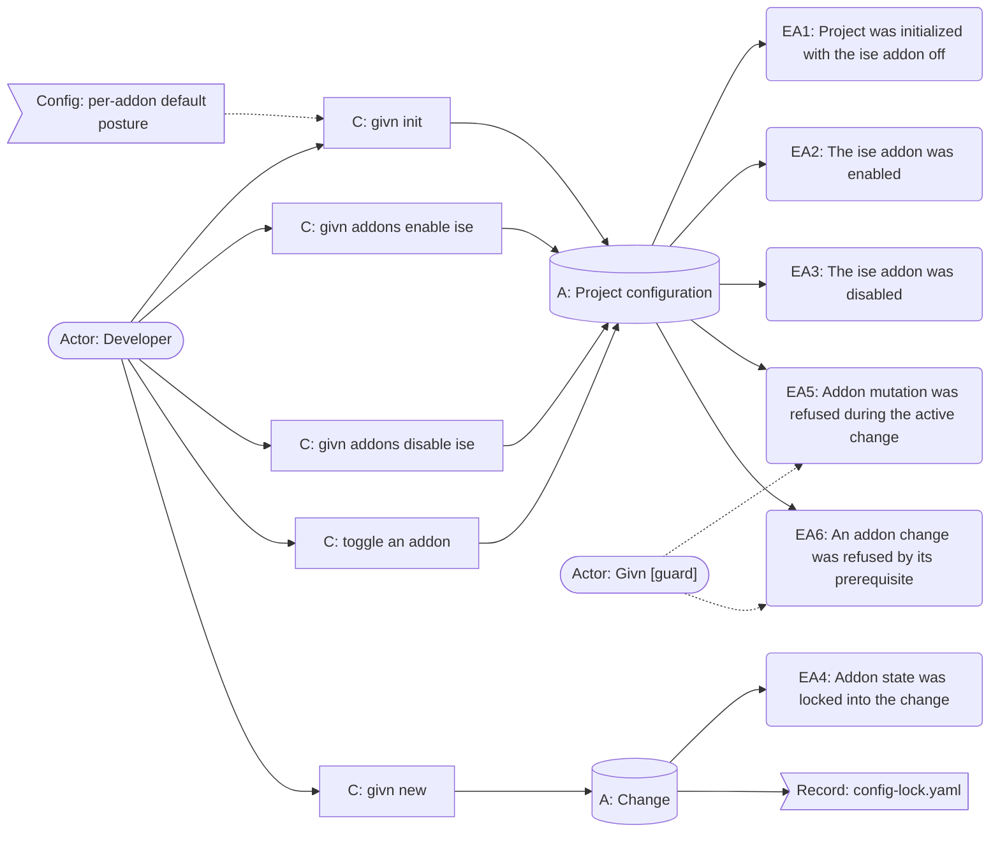
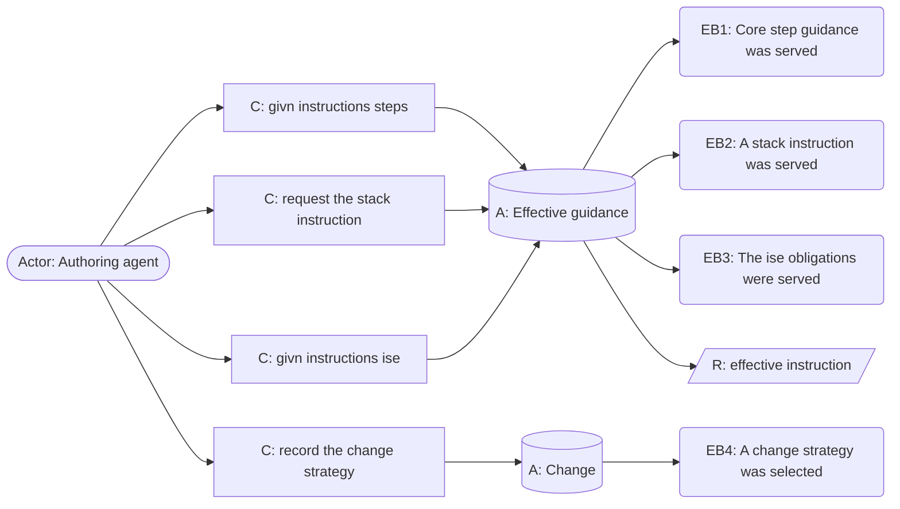
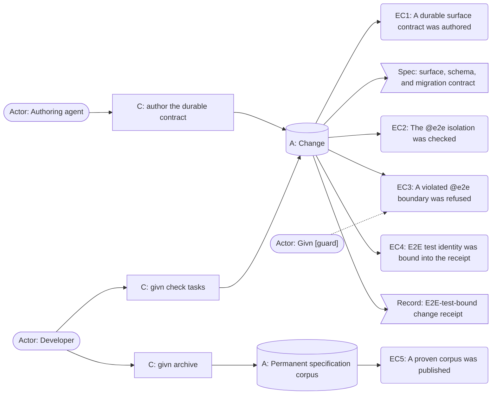
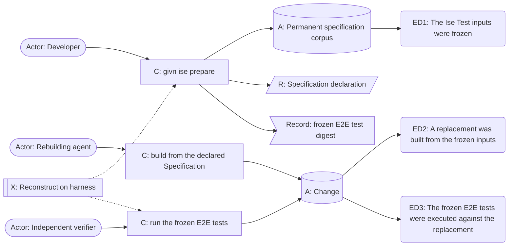
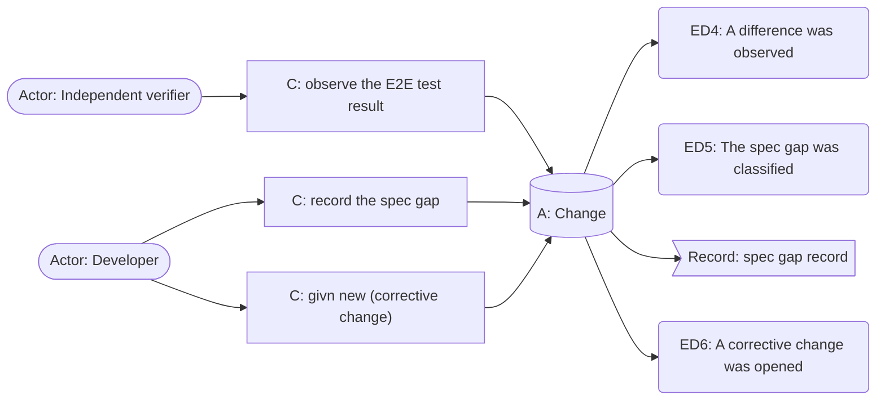

# Event Storming: ise-rebuildability

Domain: the delivery of Ise-compliant reconstruction through Givn: an Opt-in
addon whose absent key stays off until the project enables it, guidance slim
enough to survive context pressure, a durable Specification with an
E2E-test-bound receipt, and a clean-room Ise Test whose
differences are classified rather than ignored.

Aggregates are given by `docs/domain-model.md`, not minted here. Four of its
declared consistency boundaries carry these chains: Chain A uses `Project
configuration` and `Change`, Chain B `Effective guidance` and `Change` (row
B4), Chains C and D `Change` and `Permanent specification corpus`.
`Development record` and `Persona collection` are declared and are not touched
by any chain below.

The addon posture is named `Opt-in addon` (user-verified 2026-11-13, `Q8`),
the durable authoring input is named `Specification`, contrasted with `Source
code` (user-verified 2026-11-13, `Q10`), and the frozen external-interface
suite is named `End-to-end (E2E) test`, with `black-box` as the qualifier for
the no-shared-code rule (user-verified 2026-11-13, `Q11`). The one-unit
change strategy is named `Constant Ise` (user-verified 2026-11-14, `Q12`),
and one clean-room rebuild execution is named `Ise Test` (user-verified
2026-11-14, `Q13`), with `Constant Ise` as the one-unit scope and `Dry-Run
Ise` / `Full replacement` as the two execution modes, and the four-way
classification record is named `Spec gap` (user-verified 2026-11-14, `Q14`),
with the limitation recorded in its definition; this file still names
the addon instance by its registered id, the `ise` addon. The on-demand
instruction keeps Givn's `Instruction` type and the id convention
(`<id>-examples`, `<id>-<stack>`); `Q15` closed 2026-11-14 with no new term,
so this file says "the stack instruction" or names the served id. The
change-level choice is named `Change strategy` (user-verified 2026-11-14,
`Q16`), the only name covering the no-rebuild branch; it is recorded as the
design's `Decides D<n>` entry, with the `Ise Test` mode beside it when a
rebuild runs, and adds no mandatory design field.

State-holders that are not aggregates:

| Element | Kind | Why it is not an aggregate |
|---|---|---|
| Specification | Specification (declared durable artifact set) | The durable authoring input a rebuild reads: behavior and invariants, vocabulary and structural model, contracts and schemas, technical limits, and black-box tests. It is a declaration, so it receives no command of its own; the `Permanent specification corpus` aggregate holds its behavior part, and `givn/specification.yaml` declares the five retained roles as path globs plus the `source:` roots the paths named with `--replace` must fall inside (`Q4` closed 2026-11-14). Component internals are not declared there; the replaced unit is trial input. |
| Stack instruction | Specification (instruction asset) | Content served on request; the `Effective guidance` boundary decides what is served. |
| End-to-end (E2E) test | Specification (black-box scenarios plus the `e2e` package) | The acceptance contract: the `@e2e` scenarios stay in shared feature files, while the declared `e2e` package holds the runner and every step definition those scenarios bind; freezing and digesting them are commands in an Ise Test, not state the suite owns (`Q5` closed 2026-11-14). |
| Frozen E2E test snapshot | Record | The digest of the frozen `@e2e` scenarios plus every file of the `e2e` package at one revision, taken for one `Ise Test`; it is the only frozen acceptance authority, while the declared `Specification` is the builder's read-only input (2026-11-14 constraint 4; `Q5` closed 2026-11-14). |
| `config-lock.yaml` | Configuration record | The change's copy of the effective addon set, written at change start. |
| Per-addon default posture | Configuration | The default each registered addon declares; `givn init` reads it to resolve an absent key, and no chain below writes it. |
| Change verification receipt, verification receipt | Record | Machine-readable evidence binding tested content, the E2E test suite, and revision. |
| Spec gap record | Record | The classification record of one observed difference into exactly one of `E2E test defect`, `implementation defect`, `specification defect`, or `acceptable undocumented change`; the corrective change is the aggregate that acts on it. |
| Reconstruction harness | External system | An outside driver that runs clean-room Ise Tests by invoking `givn ise prepare` and `givn ise verify`; Givn prepares and re-checks the trial and records its outcome, and no chain requires a harness (`Q3` closed 2026-11-14). |

## Chain A — `ise` addon configuration and lock

Covers Frame capability 1. The `ise` addon stays off unless the project
enables it, and a change's addon posture is fixed when the change starts so a
gate cannot appear halfway through.

| ID | Actor | Command | Aggregate | Event | Policy | Read model |
|---|---|---|---|---|---|---|
| A1 | Developer | `givn init` | Project configuration | Project was initialized with the `ise` addon off | Each registered addon declares its own default; `ise` resolves `false` and a fresh init omits its key, while the nine existing addons write explicit `true`; `ise` requires `architecture_principles`, which stays default-on, so a fresh init has the prerequisite without extra action (`Q6` closed 2026-11-14). | Addon list with default posture |
| A2 | Developer | `givn addons enable ise` | Project configuration | The `ise` addon was enabled | Writes `addons.ise: true`, syncs skill files, and adds the addon-conditional guidance sections; refuses by name when `architecture_principles` is off, because the guidance uses `Component` and the other nouns that addon defines (`Q6` closed 2026-11-14). | Effective addon set |
| A3 | Developer | `givn addons disable ise` | Project configuration | The `ise` addon was disabled | Writes `false`; generated guidance drops the `ise` sections; no `ise` gate fires and no other addon is touched. | Effective addon set |
| A4 | Developer | `givn new` | Change | Addon state was locked into the change | Change start copies the effective addon set into `givn/changes/CHANGE_ID/config-lock.yaml`; the change's guidance and gates are fixed at that moment, so a lock written after this release records `ise: false`. | Effective addon set |
| A5 | Givn `[guard]` | toggle an addon | Project configuration | Addon mutation was refused during the active change | The refusal names the addon and the active change ("operator-owned" configuration); `--operator` without an interactive terminal is refused too, and the stored flag is unchanged. | Active change lock |
| A6 | Givn `[guard]` | `givn addons enable ise` or `givn addons disable architecture_principles` | Project configuration | An addon change was refused by its prerequisite | The refusal names both addons: enabling `ise` requires `architecture_principles` on, and disabling `architecture_principles` requires `ise` off first, so a project cannot end `ise`-on with the vocabulary absent; both stored flags are unchanged (`Q6` closed 2026-11-14). | Effective addon set |

Aggregates: `Project configuration`, `Change`. The lock file is a
configuration record; it records the aggregate's state and is not one. The
refusals `A5` and `A6` are guard events: the stored flags are unchanged, and
each refusal names both the addon and the condition it protects (the active
change for `A5`, the prerequisite addon for `A6`).

## Chain B — Core guidance versus on-demand stack instructions

Covers Frame capability 2. Universal step rules stay in the core instruction;
a language or runner instruction is named by the core instruction and loaded
only when the change needs it, so enabling `ise` does not add every stack's
prose to every step. The same mechanism already serves `dialog` and its
on-demand `dialog-examples`.

| ID | Actor | Command | Aggregate | Event | Policy | Read model |
|---|---|---|---|---|---|---|
| B1 | Authoring agent | `givn instructions steps` (also `specs`, `design`, `review`) | Effective guidance | Core step guidance was served | Universal rules only; the instruction names the stack instruction id and the condition for loading it, and carries no per-language body. | Effective instruction |
| B2 | Authoring agent | request the stack instruction by id | Effective guidance | A stack instruction was served | On demand only, through the id convention (`steps` -> `steps-rust`, `dialog` -> `dialog-examples`); the instruction is selected from the runner and languages the change touches and is not included in the core instruction's served text. | Served instruction |
| B3 | Authoring agent | `givn instructions ise` | Effective guidance | The ise obligations were served | Specification completeness, the two-layer test boundary, persisted-state continuity, the `Change strategy` choice, and the four-way `Spec gap` classification; served only when `ise` is effective, which requires `architecture_principles` on (`Q6` closed 2026-11-14). | Effective instruction |
| B4 | Authoring agent | record the change strategy in the design | Change | A change strategy was selected | One of incremental modification, Constant Ise, or whole-product rebuild; the record is the design's `Decides D<n>` ledger entry, naming the affected consumers, the persisted state, and the rebuild boundary, with the `Ise Test` mode (`Dry-Run Ise` or `Full replacement`) recorded beside the strategy when the change rebuilds. Givn executes the trial through `givn ise prepare` and `givn ise verify`, and a harness or a developer calls the same two commands (`Q3` closed 2026-11-14). | Design record |

Aggregates: `Effective guidance`, `Change`. The served instruction and the
effective instruction are served content, never state-holders.

## Chain C — Authoring, the `@e2e` boundary check, and E2E-test-bound receipts

Covers Frame capability 4. Durable contracts are authored inside the change;
the change's gates reject `@e2e` suites that reach into production source or
share the component runner; the receipt binds what was actually executed; a
proven change publishes into the durable corpus.

| ID | Actor | Command | Aggregate | Event | Policy | Read model |
|---|---|---|---|---|---|---|
| C1 | Authoring agent | author the durable contract | Change | A durable surface contract was authored | CLI flags and exit codes, wire/file/database schemas, UI geometry, latency budgets, and state migrations live in the declared Specification paths. `givn/specification.yaml` holds the five role globs (`behavior`, `structure`, `contracts`, `limits`, `e2e`) and the `source:` roots; it declares no component (`Q4` closed 2026-11-14). | Specification declaration |
| C2 | Developer | `givn check tasks` | Change | The `@e2e` isolation was checked | With `ise` effective, the declared `e2e` role names one package holding the runner and every `@e2e` step definition; the package must exist, must link no production source, and `verify.e2e_command` must run it and fail on an unbound or skipped step (`Q5` closed 2026-11-14). `@e2e` steps reach production only through the real interface, and feature files stay shared, so an `@e2e` and a component scenario may live in one `.feature` file. | Declared `e2e` package and runner configuration |
| C3 | Givn `[guard]` | `givn check tasks` | Change | A violated `@e2e` boundary was refused | The refusal names the offending dependency edge, the runner that is not the declared `e2e` package, or the unbound or skipped step, and no receipt is written for the change. | Gate diagnostics |
| C4 | Developer | `givn check tasks` | Change | E2E test identity was bound into the receipt | The change verification receipt records the `e2e` package digests, the e2e runner command digest, and the running givn version, so a weakened black-box E2E suite changes the receipt; an `Ise Test`'s frozen digest covers the `@e2e` scenarios selected by tag plus every file of that package (`Q5` closed 2026-11-14). | Change verification receipt |
| C5 | Developer | `givn archive` | Permanent specification corpus | A proven corpus was published | The archive publishes the change's accepted deltas and durable contracts; the corpus is not a copy of the change, and frozen E2E test files stay byte-identical. | Proven archive receipt |

Aggregates: `Change`, `Permanent specification corpus`. The contract and the
receipt are a specification and a record; neither receives commands.

## Chain D — Clean-room Ise Test and the Spec gap record

Covers Frame capabilities 3 and 4 together. An Ise Test freezes the E2E test
suite as its acceptance authority, hands the declared Specification to the
builder as read-only input, builds without the replaced unit's source or
history, executes the frozen black-box E2E tests from outside the builder's
authority, and turns every difference into exactly one `Spec gap` classification
that feeds the next change.

| ID | Actor | Command | Aggregate | Event | Policy | Read model |
|---|---|---|---|---|---|---|
| D1 | Developer | `givn ise prepare` | Permanent specification corpus | The Ise Test inputs were frozen | The frozen acceptance authority is the `End-to-end (E2E) test` suite (black-box), recorded by digest; the declared `Specification` is the builder's read-only input, and replaced `Source code` plus SCM history are withheld. Replacement removes exactly the component's paths named with `--replace`, each inside the `source:` roots declared in `givn/specification.yaml`, plus their listed internal unit tests, never an inferred test marker; the `Not replaced` count computed at trial time names files in those directories that were not named, and `Outside the declaration` names tracked files outside every declared role that are not copied (2026-11-14 constraints 1 and 2; `Q4` closed 2026-11-14). The command materializes a plain directory outside the checkout, writes the trial record, and computes the retained, `e2e`, and replaced-paths digests; `givn ise verify --trial <receipt> --at <dir>` re-checks the two digests and reports drift per path (`Q3` closed 2026-11-14), and the frozen digest covers the `@e2e` scenarios selected by tag plus every file of the `e2e` package (`Q5` closed 2026-11-14). | Specification declaration and E2E test digests |
| D2 | Rebuilding agent | build from the declared Specification | Change | A replacement was built from the frozen inputs | The builder reads only the declared Specification; the replaced unit's Source code and history are absent from its inputs; neighboring consumer contracts stay unchanged, and a change outside the replaced unit is named in review guidance rather than gated (2026-11-14 constraint 5). | Specification declaration |
| D3 | Independent verifier | run the frozen E2E tests | Change | The frozen E2E tests were executed against the replacement | The E2E tests run outside the builder's write authority; their digests match the frozen record, which covers the `@e2e` scenarios selected by tag plus every file of the `e2e` package, so an edited black-box suite or step definition is a different Ise Test, not a passing one; `givn ise verify` re-checks those digests after the run (`Q5` closed 2026-11-14). The freeze applies only after a new scenario was observed failing for the intended reason, and a mid-trial test defect stops the trial (2026-11-14 constraint 6). | Frozen E2E test digest |
| D4 | Independent verifier `[consequence]` | observe the E2E test result | Change | A difference was observed | The difference is between the frozen E2E tests' result and the declared Specification; it is recorded before any fix, and no difference is closed as silent drift. | E2E test output |
| D5 | Developer | record the spec gap | Change | The spec gap was classified | A `Spec gap` holds exactly one of `E2E test defect`, `implementation defect`, `specification defect`, or `acceptable undocumented change`; the classification names the artifact that is wrong, not who found it. | Spec gap record |
| D6 | Developer | `givn new` | Change | A corrective change was opened | A `Spec gap` of `specification defect` or `E2E test defect` opens a change that edits the corpus or the E2E test suite; a `Spec gap` of `implementation defect` returns to the builder inside the Ise Test; a `Spec gap` of `acceptable undocumented change` is recorded in the corpus. | Spec gap record |

Aggregates: `Permanent specification corpus`, `Change`. The frozen E2E test
snapshot and the spec gap record are records; the reconstruction harness is an
external system.

## Canvases

Kinds are marked on every node: `Actor` (`[guard]` marks a refusing actor),
`C` command issued by one actor, `A` aggregate, `E` event labelled with its
event-table row (`EA1` ... `ED6`), `R` read model, `Record`/`Spec`/`Config`
flag, `X` external system. A dotted edge is a read, an inspection, or a
refusal observation, never a command; policy text stays in the tables.

### A — `ise` addon configuration and lock

Aggregates: `Project configuration`, `Change`. `config-lock.yaml` is a
configuration record and `DEF` is the default posture `givn init` reads;
neither is state, and `DEF` writes nothing. In A5 and A6 the guard issues no
command: it refuses the developer's toggle or enablement, the stored flags are
unchanged, so each is drawn with a dotted refusal edge.

### B — Core guidance versus on-demand stack instructions

Aggregates: `Effective guidance`, `Change`. The served instruction and the
effective instruction are served content, never state-holders.

### C — Authoring, the `@e2e` boundary check, and E2E-test-bound receipts

Aggregates: `Change`, `Permanent specification corpus`. The contract is a
specification and the receipt is a record. The Developer issues `givn check
tasks` (C2, C4) and `givn archive` (C5); C3 is a guard refusal drawn as a
dotted observer labelled `Actor: Givn [guard]`, never a second issuer.

### D1 — Freezing inputs and building the replacement

Aggregates: `Permanent specification corpus`, `Change`. The Specification
declaration is a read model and the frozen E2E test digest is a record; the
harness is an external system. `D1` is issued by the Developer; the Givn
maintainer stands in only when Givn rebuilds itself.

### D2 — Spec gap and the corrective change

Aggregates: `Change`. The spec gap record is a record; the corrective change is
the `Change` aggregate that carries the classification.

## Reverse narrative

Which events must have happened for `ED5 — The spec gap was classified` to be
possible?

The E2E test result was observed (D4), against a replacement built from the
declared Specification (D2) and a black-box E2E suite executed from outside the
builder's authority (D3). Those required the frozen E2E acceptance authority
plus a declared Specification (D1), which required the declared set (C1) and an
E2E test suite whose identity the receipt binds (C4). The E2E test suite could only be frozen because the change that wrote
it published it as proven (C5), and that change could only enforce the boundary because
the `ise` obligations were served to its author (B3) and its addon posture
was locked at start (A4). Locking required the addon to be enabled on the
project (A2), which required the project to exist with the addon off (A1).
The chain starts at project initialization, as the sibling topics' chains do.

## Invariants

- `ise` is an `Opt-in addon`: off unless the project enabled it, so an absent
  `ise:` key resolves `false`, and no `ise` gate fires on a project that never
  opted in (enforcement site: init and addon scenarios).
- A project cannot hold `ise` on with `architecture_principles` off: enabling
  `ise` refuses by name until the prerequisite is on, and disabling
  `architecture_principles` refuses while `ise` is on, so the guidance can use
  `Component` and the other nouns that addon defines (enforcement site:
  `enable-optional-addons.feature`; `Q6` closed 2026-11-14).
- A change's addon state is fixed at change start: `config-lock.yaml` is
  written by `givn new`, and toggling is refused while the change is active
  (enforcement site: `enable-optional-addons.feature`).
- Core step instructions carry no stack instruction body; each stack
  instruction is named by the core instruction and served on request only
  (enforcement site: instruction size and served-id checks).
- With `ise` effective, the declared `e2e` role is one package holding the runner and every `@e2e` step definition; the package links no production source, and `verify.e2e_command` runs it and fails on an unbound or skipped step (enforcement site: `givn check tasks` and the package's dependency graph; `Q5` closed 2026-11-14).
- A change verification receipt binds the E2E identity it ran: the `e2e` package digests, the e2e runner command digest, and the running Givn version; an `Ise Test`'s frozen digest covers the `@e2e` scenarios selected by tag plus that package (enforcement site: `givn check tasks` and the trial record; `Q5` closed 2026-11-14).
- The Specification is declared in `givn/specification.yaml` as five role
  globs plus the `source:` roots, covers every durable surface the product
  exposes, and lives outside `src/`, which holds the Source code it replaces
  (enforcement site: the declared paths and the four project-level advisory
  findings; `Q4` closed 2026-11-14).
- During an `Ise Test` the declared Specification is read-only to the builder
  and the black-box `End-to-end (E2E) test` suite is frozen as the acceptance
  authority, while the replaced unit's Source code and SCM history are absent
  from the builder's inputs (enforcement site: `givn ise prepare`'s trial
  record and `givn ise verify`'s digest re-check; `Q3` closed 2026-11-14).
- Every observed difference receives exactly one `Spec gap` classification
  before any fix, and none is closed as silent drift (enforcement site: the
  spec gap record and the review gate).
- A specification or E2E test defect is fixed in a new change that edits the
  corpus or the E2E test suite; the builder in an Ise Test never edits its
  frozen inputs (enforcement site: the corrective change's delta and archive
  gate).
- An archived, proven change publishes its accepted deltas into the
  Permanent specification corpus; the corpus is not a copy of the change
  (enforcement site: the existing archive proof).
- Enabling `ise` adds obligations and gates; it never removes an existing
  addon, reorders the lifecycle, or changes guidance for projects that did
  not enable it (enforcement site: addon-conditioned guidance checks).

## Question-dependent behavior

| Behavior | Depends on | Status |
|---|---|---|
| Who materializes and verifies the clean-room inputs: a Givn command or `givn check` against a harness-prepared checkout | Q3 | closed 2026-11-14 (user): `givn ise prepare [--at <revision>] [--replace <path>...] --into <dir> [--receipt <path>] [--dry-run]` requires a target outside the checkout, defaults `--at` to `HEAD`, materializes a plain directory outside the checkout, writes the trial record when a receipt path is given, and refuses by name on every stated precondition; `givn ise verify --trial <receipt> --at <dir>` re-checks the retained and e2e digests; both are bound to `addons.ise` and refuse with the addon off |
| What the declared Specification set contains and where it is declared, including how `arc42` changes it | Q4 | closed 2026-11-14 (user): a dedicated `givn/specification.yaml` declaring the five role globs and one `source:` list of replaceable roots; no `components:` key, because component internals are trial input supplied as `givn ise prepare [--at <revision>] [--replace <path>...]` and recorded in the trial receipt; four project-level advisory findings plus a trial-time `Not replaced` count |
| Strictness and language coverage of the `@e2e` isolation check, and the mandatory receipt fields | Q5 | closed 2026-11-14 (user): the declared `e2e` role is one package holding the runner and every `@e2e` step definition, which links no production source and fails on an unbound or skipped step, while feature files stay shared; the frozen digest covers the `@e2e` scenarios selected by tag plus that package; no static import scanner and no phrase-uniqueness rule |
| Whether `ise` requires or auto-enables `architecture_principles`; the `false` default posture itself is settled by the confirmed `Opt-in addon` term and the `Q6` Context records the `TC-14` amendment it forces | Q6 | closed 2026-11-14 (user): `ise` requires `architecture_principles`; enabling `ise` refuses by name until it is on, disabling `architecture_principles` refuses while `ise` is on (naming `ise` first), and `config-lock.yaml` records `ise: false`; the prerequisite lets the guidance use `Component` instead of invented nouns |
| The confirmed persona set and where the bare-clone lens lives | Q7 | closed 2026-11-13 (user): three personas, the lens lives in `givn-maintainer--owner` |
| The name the canvas, the use cases, and the seeds use for the addon posture | Q8 | closed 2026-11-13 (user): `Opt-in addon`; landing the change amends the `Addon default` anti-term at `docs/glossary.md:9` and disambiguates `match-guidance-to-enabled-addons.feature:23,86` |
| The name the canvas, the use cases, and the seeds use for the durable authoring input | Q10 | closed 2026-11-13 (user): `Specification`, contrasted with `Source code`; landing the change amends the `docs/glossary.md:169` anti-term and disambiguates `Permanent spec` and `Permanent specification corpus` |
| The name of the frozen external-interface suite plus its runner configuration | Q11 | closed 2026-11-13 (user): `End-to-end (E2E) test`, with `black-box` as the qualifier for the no-shared-code rule; `@e2e`, `verify.e2e_command`, and `Verification scope` keep their names |
| The name for the one-unit rebuild strategy that deletes and rebuilds a component behind its unchanged consumer contract | Q12 | closed 2026-11-14 (user): `Constant Ise`; the rejected coinage is recorded in `questions.md` (`Q12`) and `domain-terms.md`, and "unit" maps to Givn's `Component` at `assets/instructions/architecture-principles.md:74` |
| The name for one clean-room rebuild execution | Q13 | closed 2026-11-14 (user): `Ise Test`; `Constant Ise` names the one-unit scope and `Dry-Run Ise` / `Full replacement` the two execution modes; the rejected coinage is recorded in `questions.md` (`Q13`) and `domain-terms.md` |
| The name for the four-way classification of one observed difference | Q14 | closed 2026-11-14 (user): `Spec gap`, with exactly four outcome values (`E2E test defect`, `implementation defect`, `specification defect`, `acceptable undocumented change`); the definition records that only `specification defect` is a gap in the Specification; the rejected coinage is recorded in `questions.md` (`Q14`) and `domain-terms.md` |
| The name for the on-demand instruction that carries one language or runner's mechanics | Q15 | closed 2026-11-14 (user): no new term; Givn's `Instruction` plus the id convention (`<id>-examples`, `<id>-<stack>`) carry the concept, so the canvas says "the stack instruction" and names served ids; the rejected candidates are recorded in `questions.md` (`Q15`) and `domain-terms.md` |
| The name for the recorded change-level choice among incremental modification, one-unit rebuild, and whole-product rebuild | Q16 | closed 2026-11-14 (user): `Change strategy`, the only name covering the no-rebuild branch; recorded as the design's `Decides D<n>` entry with the `Ise Test` mode beside it when a rebuild runs, and no new mandatory field; the rejected candidates are recorded in `questions.md` (`Q16`) and `domain-terms.md` |

## Persona reactions (advisory)

- `developer--primary-user`: accepts the opt-in gate only if an ordinary
  project is byte-identical until `givn addons enable ise`; wants the change
  strategy visible in the design, and wants `givn archive` to refuse a
  receipt whose E2E test digests changed. Objects to any `ise` check that
  fires before enablement.
- `agent--technical-role`: wants the core instruction to name the stack
  instruction and its load condition, because a guessed id is a stalled step;
  wants refusals that name the offending path or runner; wants the spec gap to
  force one of four outcomes instead of free prose.
- `givn-maintainer--owner`: accepts the corpus as the freeze source only if
  the bare-clone verifier runs with `givn` absent from PATH; wants the frozen
  digests to reuse receipt machinery Givn already writes; wants
  `givn ise prepare` to write only a plain directory, because a branch or
  worktree would carry the repository history the trial withholds
  (`Q3` closed 2026-11-14).
