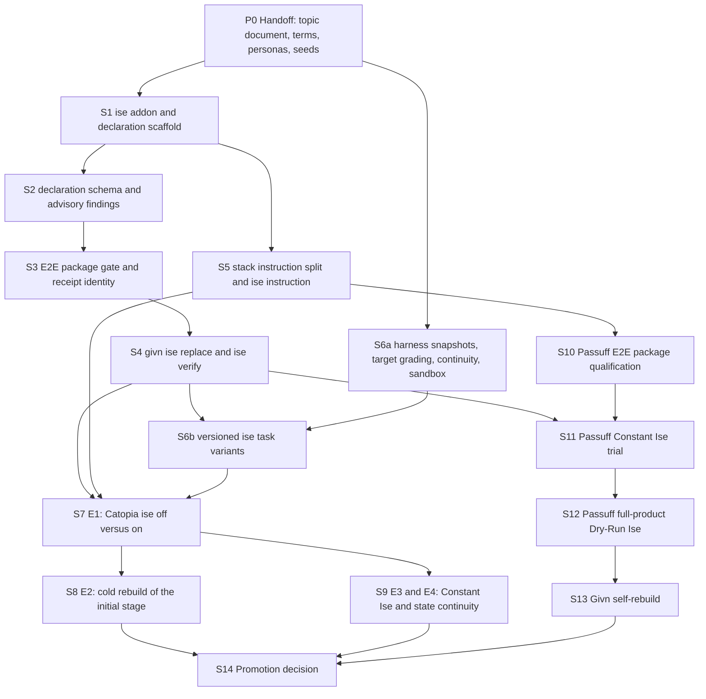

# Plan: ise-rebuildability

Status: executing since 2026-11-14; phase and campaign state as of 2026-11-16
in section 0.

This plan sequences the decisions recorded in `frame.md`, `eventstorming.md`,
`questions.md`, `domain-terms.md`, and `use-cases/*.md` across four
repositories. It reopens no closed decision. Where a command default or a
harness mechanism is not settled by the topic, the phase names the reading it
uses and the reason.

Vocabulary in this file follows the closed term set: `Specification` (the
declared durable authoring input, contrasted with `Source code`),
`End-to-end (E2E) test` (the black-box suite that shares no code with
production), `Constant Ise` (rebuild one component behind its unchanged
consumer contract), `Ise Test` (one clean-room rebuild execution, with
`Dry-Run Ise` or `Full replacement` as its mode), `Spec gap` (one of four
outcomes recorded before a fix), and `Change strategy` (the design's
`Decides D<n>` entry).

## 0. Status

Updated 2026-11-16. `S1` to `S6b` are delivered. `S7` to `S9` ran as the paid
campaign and are reported as experiments, not as passed phases. The
`givn-harness` record at `docs/experiments/ise-rebuild-experiment.md`, in the
worktree `/home/buster/projects/givn-harness-ise`, is authoritative for
arm-level detail: bundles, revisions, spend, and the evidence behind each
finding. This section states only what each phase delivered and what its gate
measured.

**Done.**

| Phase | Delivered by | Receipt |
|---|---|---|
| `S1`, `S2` | `add-ise-addon-and-specification`, archive commit `1e4527ae` | `givn/archive/add-ise-addon-and-specification/verification.json` |
| `S3` | `enforce-ise-e2e-boundary`, archive commit `3808c34f` | `givn/archive/enforce-ise-e2e-boundary/verification.json` |
| `S4` | `add-ise-clean-room-commands`, archive commit `8e887c58` | `givn/archive/add-ise-clean-room-commands/verification.json` |
| `S5` | `split-stack-instructions`, archive commit `cbaee3f4` | `givn/archive/split-stack-instructions/verification.json` |
| `S6a` | `givn-harness` `984231a` (`catopia-v2-ise` `0.3.0`), with `84dcfc1` and `8eda691` (target-stage grading over one data directory) and `dc5002a` (graded requirements from a committed wheelhouse) | none; the harness keeps no archive receipt |
| `S6b` | `givn-harness` `984231a` (three `ise` task variants), with `fe73146` (seeded stages and the pinned frozen verifier) | none; the harness keeps no archive receipt |

`S1` and `S2` shipped as one change: the addon, its prerequisite, the
declaration scaffold, the loader, and the four advisory findings.

**Corrections landed from campaign evidence.**

| Change | Archive commit | Arm failure it fixes |
|---|---|---|
| `guard-retained-paths-across-archive` | `bc33c39e` | An agent declared a change artifact as a retained `limits:` path, `givn archive` moved it, and `givn ise replace` then refused at the recorded revision. |
| `retain-declaration-in-trial` | `bc18decb` | Rebuild 1's trial carried no `givn/specification.yaml`, so `G1` had no declaration to read and the stage stalled before grading. |

**Run.** `S7` to `S9` ran as `E1` to `E4`. The record's `Arm records` section
holds every bundle path, revision, grade, and spend figure.

| Arm | Phase | What ran | Observed |
|---|---|---|---|
| `E1` | `S7` | `catopia-v2-ise` `initial`, one run per arm, same binary and model | `ise` off `archived_and_passed` 14/14; `ise` on `archived_and_failed` 13/14 on `R8` |
| `E2` | `S8` | `rebuild-initial` from seed `4af78d55`, three runs | `delivered_and_passed` 16/16 with the frozen verifier 15/15 and `Kept source 0; Replaced 1`; the two earlier runs failed `G1` |
| `E3` | `S9` | `followup` continuation from `4af78d55` | `archived_and_failed` at 1/2 for the bundle shape, 2/2 after the chain carry; the builder recorded `incremental modification` |
| `E4` | `S9` | `followup2` continuation of `16cb5cb8` with `4af78d55` carried beside it | `archived_and_passed` 9/9 with the chain replayed |

**Outstanding.**

- **`S10` to `S12`, the Passuff arm.** Blocked: the product exists only as
  uncommitted work in another workspace, so there is nothing to declare, gate,
  or rebuild.
- **`S13` and `S14`.** `S13` is gated on `S12`; `S14` is gated on `S8`, `S9`,
  `S12`, and `S13`. The `E3` arm never ran a replacement, so the `Constant
  Ise` row of the `S14` evidence table has no evidence and `ise` stays
  opt-in.

**Withdrawn.** The change `redact-secret-shaped-values-in-history` was
withdrawn on 2026-11-16. The incident it addressed was a harness delivery
defect: the harness wrote the provider key into `.harness/secrets.env` inside
the agent workspace, and the agent printed it. The harness now delivers the
key by environment inheritance only, so a sandboxed run does not put a plain
key where a tool can read or print it. Givn-side redaction is out of scope and
is recorded as an accepted exception rather than an open gap; the harness
delivery fix is the control.

## 1. Purpose and claim

The plan exists to test one claim: a `Specification` declared in
`givn/specification.yaml`, frozen together with the declared `e2e` package and
recorded by digest, is sufficient for a fresh builder to rebuild a component
or a whole product without reading the replaced `Source code` or repository
history, while the frozen `End-to-end (E2E) test` package stays green. The
Givn phases ship the capabilities that make that routine repeatable: the
opt-in `ise` addon, the declaration and its findings, the `@e2e` package gate
and receipt identity, `givn ise replace` and `givn ise verify`, and the
guidance split that keeps each rule in one place. The harness and pilot
phases produce the evidence that decides whether the claim holds and whether
`ise` can ever become default-on. A phase that cannot produce its evidence
stops the plan; a qualitative success report is not a substitute.

## 2. Dependency graph

Solid arrows are hard dependencies. Nodes without an arrow between them may
run in parallel once their shared predecessor finishes. `S6a` starts after
`P0` and runs in parallel with `S1` through `S5`. `S6b` is the only part gated
on the commands, because its `ise` task variants run `givn ise replace` and
`givn ise verify`. `S10` starts after `S5` because it applies the settled E2E
package policy.



## 3. Phase table

| Id | Repo | Deliverable | Hard dependencies | Size | Gate that decides success |
|---|---|---|---|---|---|
| P0 | `givn` | Published topic document at `docs/ideation/ise-rebuildability.md`, confirmed terms merged, personas promoted, change seeds cut | none | S | Every seed is `Status: ready` with accepted decisions and use-case IDs; the user confirmed every promotion |
| S1 | `givn` | `addons.ise` as the first `Opt-in addon`, the `architecture_principles` prerequisite in both directions, per-addon defaults, and the `givn/specification.yaml` scaffold | P0 | M | Fresh init omits `ise:`, both prerequisite refusals print by name, enabling `ise` writes the declaration once and preserves an edited one |
| S2 | `givn` | Declaration loader and the four advisory declaration findings in `givn lint` | S1 | M | Each finding prints with exit 0; a malformed declaration is refused by name; `givn check review` behaviour is unchanged |
| S3 | `givn` | `@e2e` package boundary as a blocking `givn check tasks` check, and receipt binding of the `e2e` digests, runner command digest, and Givn version | S2 | M | Missing package, dependency edge, wrong runner target, unbound step, and skipped step each refuse or fail without a receipt; the receipt carries all three values |
| S4 | `givn` | `givn ise replace` and `givn ise verify` with the settled inputs, nine refusals, ten fixed report lines plus the optional receipt line, and trial record | S3 | L | All nine refusals occur before any write on Git and Fossil; the report prints the ten fixed lines and the receipt line when a receipt is written; tampering with a retained or `e2e` file is reported per path |
| S5 | `givn` | Stack instruction split, the `ise` instruction, the two `specs.md` amendments, and the guidance sweep | S1 | M | `givn instructions steps` carries no per-runner body and names each stack id with its condition; `givn instructions ise` refuses with the addon off; a stack body is served only on its own request |
| S6a | `givn-harness` | Stage snapshots with a recorded revision, target-stage grading, cross-stage state continuity, and sandboxed candidate grading | P0 | L | The grader reports `fail` for a reached stage that lacks Petorania; a state directory created at stage 1 is read at stages 2 and 3; every candidate runs in the sandbox with no host package install |
| S6b | `givn-harness` | Versioned `ise` task variants that run `givn ise replace` and `givn ise verify` | S4, S6a | M | `benchmark verify` passes; the variants run both commands and each seeded defect trips its declared ids |
| S7 | `givn-harness` | Catopia E1: `ise` off versus `ise` on, one run per arm, on the `catopia-v2-ise` `initial` stage with the same binary and model; the historical `catopia-v2` three-stage comparison was not run | S4, S5, S6a, S6b | M | Both arms graded: `ise` off 14/14 `archived_and_passed`, `ise` on 13/14 `archived_and_failed` on `R8`. Neither bundle recorded scenarios or coverage, so the 119 + 11 and 87.33/79.85 thresholds were not evaluated |
| S8 | `givn-harness` | Catopia E2: `rebuild-initial` from the `4af78d55` seed Specification with a fresh builder, three runs | S7 | M | The grade passes 16/16 with the frozen verifier 15/15 on `E0` to `E14` and `G1` at pass, and the trial record reads `Kept source 0; Replaced 1`; the two earlier runs failed `G1` |
| S9 | `givn-harness` | Catopia E3: `followup` continuation from the `initial` seed with `Constant Ise` permitted; E4: `followup2` continuing the `followup` snapshot with the `initial` ancestor carried | S7 | L | E3 grades `M1` and `M2` at pass once the bundle carries its prerequisite, and the archived design records `incremental modification`, so no replacement was measured. E4 grades `P1` to `P4`, `T1` to `T4`, and `A1` at pass with the chain replayed. No arm grades a `followup2` bundle against an empty data directory, so the negative continuity fixture did not run |
| S10 | `passuff` | Separate `e2e` package, PTY at 80x24 and 120x40, HTTP mock, seeded defects that must fail | S5 | M | The package declares no dependency on production crates; every seeded defect fails a named scenario; both viewport sizes produce evidence |
| S11 | `passuff` | Constant Ise trial with `--path`, rebuild, frozen E2E green, neighboring components named | S4, S10 | M | The rebuilt component passes the frozen suite and the review names every changed neighboring component |
| S12 | `passuff` | Full-product `Dry-Run Ise` from `givn/specs` plus `docs` | S11 | L | The frozen suite passes, or every difference is classified; no difference is closed as drift |
| S13 | `givn` | Givn rebuilds itself: `@e2e` steps move out of the production-linked target, `ise` is enabled, a `Dry-Run Ise` runs, and Spec gaps are triaged | S3, S4, S5, S12 | L | The `e2e` package has no dependency on `givn`; all 108 `@e2e` scenarios are moved or retagged with a justification; every gap has one outcome |
| S14 | `givn` | Promotion decision for `ise` with the evidence required to change its default | S8, S9, S12, S13 | S | The evidence table is complete and the user decides; without it `ise` stays off by default |

## 4. Per-phase detail

Each phase's verification names the command and the artifact it leaves. A
command whose output is not recorded does not count as phase evidence.
`givn lint` does not scan `givn/ideation`, so topic documents are verified by
heading and vocabulary checks rather than by lint.

### P0: Handoff (givn, S)

**Changes.**
- Publish the topic document to `docs/ideation/ise-rebuildability.md` in the
  order Frame, Event Storming, Use Case Definition, Use Case Elaboration,
  Handoff.
- Merge the confirmed terms into `docs/glossary.md`: `Specification`,
  `Source code`, `End-to-end (E2E) test`, `Constant Ise`, `Ise Test`,
  `Spec gap`, `Change strategy`, and `Opt-in addon`. Amend the
  `Addon default` row so its anti-term is the rejected mixed posture, not the
  `Opt-in addon` posture. Report every rejected term with its reason.
- Promote the three persona files with a user-confirmed merged diff. The topic
  files stay as historical record.
- Cut change seeds under `givn/ideation/ise-rebuildability/changes/`, one per
  deliverable guarantee for the Givn phases (`S1` to `S5`, `S13`, `S14`).
  `S13` yields two seeds, the `e2e` boundary and the self-rebuild, because each
  ships alone. Each seed names its use-case IDs, topic, personas, suggested
  start order, accepted decisions, and open questions. Harness and Passuff
  phases are executed in their own repositories and get their own proposals
  there.

**Must not change.**
- No source code, no instruction content, no benchmark file.
- No term is marked `confirmed` without the user's verified name.
- No persona is promoted automatically.

**Verification.**
- `givn lint` does not scan `givn/ideation`, so it cannot verify these files.
  Check the published document by its heading list and by the confirmed term
  names, and record both checks.
- `ls givn/ideation/ise-rebuildability/changes/*.md` shows one seed per Givn
  deliverable, each `Status: ready`.
- Read `givn/ideation/ise-rebuildability/domain-terms.md`: eight confirmed
  rows, no candidate row, and every rejected row keeps its reason.
- **Evidence:** the published document, the glossary diff, the persona diffs,
  and the seed files.

**Exit criteria.**
- The published document reads start to finish and names the same decisions as
  the topic.
- Every seed can be passed to `/givn-propose` without this conversation.

**Teaches.** Whether the topic state is complete enough for another context to
start the work without re-deriving a decision.

### S1: `ise` addon, prerequisite, and declaration scaffold (givn, M)

**Changes.**
- Add `ise` to the addon registry as `default_enabled: false` and to the
  `Addons` manifest with a default resolver of `false`. Extend `NAMES` from
  nine to ten, `entries()`, `Default for Addons`, and the registry test that
  compares each manifest value with `AddonSpec::default_enabled`.
- Add one prerequisite relation read by four call sites: enable, disable, the
  manifest schema, and the addon lock proposal. `ise` requires
  `architecture_principles`. The two refusals are exact:
  `addon 'ise' requires 'architecture_principles'; enable it first` and
  `addon 'architecture_principles' is required by 'ise'; disable 'ise' first`.
- Replace the uniform default assumption: `lock::proposed_addons` proposes each
  addon's declared default instead of `!no_addons`; `run_enable` reads the
  recorded `before` value with `unwrap_or(addon.default_enabled)`; the
  `givn addons list` tip says each addon resolves its declared default.
- Fresh `givn init` writes explicit `true` for the nine default-on addons,
  omits `ise:`, and writes no declaration. `--no-addons` writes explicit
  `false` for all ten. A forced re-init preserves the project's explicit
  `ise: true`; its lock proposal uses each addon's declared default, so a
  locked project is not proposed an `ise` change it did not record.
- `givn addons enable ise` scaffolds `givn/specification.yaml` from
  `assets/specification.yaml.tmpl` when the file is absent, preserves an
  existing file byte for byte, and reports the path it wrote or skipped. A
  repeated enable changes nothing.
- `givn upgrade` writes and stages the scaffold when `ise` is effective and
  the file is absent, and stages nothing for an existing declaration. Extend
  `apply_managed_upgrade` and the staged allowlist together.
- Add `ise` to `KNOWN_ADDON_KEYS` so `{{#if addons.ise}}` resolves. Amend
  `TC-14`, the `Addon` and `Addon default` glossary rows, the two
  all-default sentences in `assets/config.yaml.tmpl`, the three all-default
  scenarios in `enable-optional-addons.feature`, the partial-block scenario,
  and the two misleading "the opt-in addon" titles in
  `match-guidance-to-enabled-addons.feature`.

**Must not change.**
- The nine existing addons keep `true`; a project that never enables `ise`
  sees no new key, no new file, and no new gate.
- `config-lock.yaml` needs no migration: a lock written before `ise` existed
  omits the key and reports no drift.
- A mid-change addon toggle keeps its operator-owned refusal and
  `--operator --reason` override.
- No fresh-init flag makes `ise` effective.

**Verification.**
- `cargo fmt --all -- --check` and
  `cargo clippy --workspace --all-targets -- -D warnings`.
- `cargo nextest run` and `./run-tests.sh --e2e`.
- Temporary-project smoke:
  ```sh
  tmp=$(mktemp -d); cd "$tmp"
  givn init --agents omp
  givn addons list
  givn addons enable ise
  givn addons list
  givn addons disable architecture_principles
  ```
  Record the output, the written `givn/config.yaml`, and the scaffold bytes.
- A second project with `architecture_principles: false` must print the exact
  enable refusal and write nothing.
- **Evidence:** the init transcript, both refusal transcripts, the written
  `givn/config.yaml`, the change `config-lock.yaml`, and the scaffold bytes.

**Exit criteria.**
- Fresh init output, both refusal strings, the lock file, the scaffold, and the
  edited-declaration preservation are all captured as scenario evidence.
- The delta scenarios pass through `givn check tasks`, review, and archive.

**Teaches.** Whether a default-off addon can join a registry that assumed
uniform defaults without changing an ordinary project's bytes.

### S2: Declaration schema and four advisory findings (givn, M)

**Changes.**
- Add a dedicated loader for `givn/specification.yaml`. It requires exactly
  five roles (`behavior`, `structure`, `contracts`, `limits`, `e2e`) and one
  `source:` list. It refuses an unknown key, an unknown or repeated role, an
  omitted role, an absent `source:` list, and a path outside the project. The
  loader is read-only and is invoked only when `ise` is effective.
- Read the declaration through this one loader from `givn lint` in this phase;
  `S3` and `S4` add their own consumers of the same loader. No second role
  list exists.
- Emit four project-level advisory findings from `givn lint`: a declared path
  missing from the tree; one path declared in two roles; a `.feature` file
  outside the `behavior` globs; the declared `e2e` package missing or carrying
  a dependency edge into `source`. Render them with `Severity::Advisory`; exit
  0.
- Compute the `e2e` dependency edge from the package manifest graph, never
  from source imports. The topic rejected a static import scanner and phrase
  uniqueness.
- Keep the change-scoped lint that `givn check review` consumes separate from
  the project-health pass. The four findings do not become review blockers.

**Must not change.**
- `givn lint` stays static and never runs the project suite (`TC-11`).
- `givn check review` keeps its existing refusals and exit codes.
- No `components:` key, no per-component file list, and no inferred test path.

**Verification.**
- `givn lint` on four fixtures, one per finding, with `echo $?` proving exit
  0 and the finding text naming the path or package.
- `givn lint` on a malformed declaration: unknown key, duplicate role, missing
  `source:`, path outside the project. Each is refused by name, exits nonzero,
  and leaves the file unchanged. A malformed file is an error, not one of the
  four advisory findings.
- `givn check review --change <id>` on the same fixtures: no new blocking
  finding.
- **Evidence:** four lint transcripts with exit 0, four malformed-declaration
  transcripts with a nonzero exit, and the unchanged check-review transcript.

**Exit criteria.**
- Four advisory fixtures and four malformed-declaration fixtures pass.
- A project with `ise` off never reads the file, even when it exists.

**Teaches.** Whether a declaration can refuse invalid content at read time
while staying advisory in the project-health pass.

### S3: `@e2e` package gate and receipt identity (givn, M)

**Changes.**
- With `ise` effective for the change's locked addon set, `givn check tasks`
  requires the declared `e2e` package to exist, to have no dependency edge
  into `source`, and to be the target `verify.e2e_command` runs.
- Refuse and issue no receipt when the package is missing, when a dependency
  edge reaches `source`, or when the runner command names another target. The
  refusal names the package, the edge, or the runner target.
- Fail the E2E run and issue no passed receipt on an unbound or skipped step.
  The runner already fails on a skipped step; add the unbound-step failure to
  the same result path.
- Bind three values into the change verification receipt: the `e2e` package
  digest, the E2E runner command digest, and the running Givn version. Make
  freshness compare all three. Archive refuses a receipt whose relevant
  inputs changed.
- Keep feature files shared. The package boundary, not the file, selects what
  the E2E runner executes.
- Choose the receipt scope version by one rule: an `ise`-effective change must
  not pass with a receipt that lacks the E2E identity. If additive fields can
  keep `change-proof/v1` while refusing an old receipt on an `ise`-effective
  change, keep it; otherwise bump the scope and refuse old receipts by name.

**Must not change.**
- Component step definitions, fakes, and harness are not inspected and get no
  diff accounting.
- No phrase-uniqueness rule and no static import scanner.
- A project with `ise` off keeps today's receipt behaviour.

**Verification.**
- Five fixtures: package missing; dependency edge into `source`; runner target
  mismatch; unbound step; skipped step. Each produces the named refusal or
  failure and leaves no passed receipt.
- A receipt inspection test proves the three values are present, and that
  editing one file in the `e2e` package invalidates the receipt while editing
  a component step definition does not.
- **Evidence:** five refusal or failure transcripts and the receipt JSON with
  the three values.

**Exit criteria.**
- The five fixtures and both receipt comparisons pass.
- `givn archive` refuses a stale E2E-bound receipt.

**Teaches.** Whether the receipt is strong enough to distinguish a protected
black-box suite from candidate-editable component steps.

### S4: `givn ise replace` and `givn ise verify` (givn, L)

**Changes.**
- Add the two commands, bound to `addons.ise` and its `architecture_principles`
  prerequisite. With either off, both refuse by name and read no declaration
  or record.
- `givn ise replace [--at <revision>] (--full | --path <path>...) --into <dir> [--receipt <path>] [--dry-run]`
- `--into` is required and must lie outside the checkout. Exactly one of
  `--full` or `--path` is required: `--full` replaces every tracked file under
  every declared `source:` root, `--path` is repeatable and accepts a tracked
  file or a directory, and a directory expands to every tracked file beneath
  it at the revision. Neither form, both forms, and an omitted `--into` are
  usage errors (exit 2) that name the missing or conflicting flags. `--at`
  defaults to `HEAD`.
- Refuse, by name and before any write, on the nine conditions:

| # | Condition | What the refusal names |
|---|---|---|
| 1 | No `givn/specification.yaml` | The missing declaration |
| 2 | `ise` is off, or `architecture_principles` is off | The addon |
| 3 | Dirty checkout | The dirty path |
| 4 | Backend missing, mixed, or nested | The backend condition |
| 5 | A declared retained path is missing at the revision | The path |
| 6 | A `--path` value is outside every `source:` root | The path |
| 7 | A `--path` value, or a tracked file under a named directory, is matched by a retained role | The path and the role |
| 8 | The target is inside the checkout or already exists, or the receipt is inside the trial or its ancestor | The target |
| 9 | A gitlink or submodule is in the copy set | The link |

- Partition tracked paths at the selected revision into retained, kept source,
  replaced paths, and files outside the declaration. Read the revision through
  the selected backend (`src/scm.rs`, `revision_files` and `revision_blobs`),
  never the working tree.
- Compare containment against the root's base path: `src` and
  `src/cli/archive.rs` both fall inside the declared root `src/**`. `--path`
  accepts a tracked file or a directory: `--path crates/passuff-cli` expands
  to every tracked file beneath it with `source: ["crates/**"]`, a directory
  that contains a retained path refuses, and a glob-shaped value is never
  expanded. `--full` replaces every tracked file under every declared
  `source:` root, so `Not replaced` is `0`. The change design pins this rule
  and tests both forms.
- Write the retained roles and kept source into one plain directory outside the
  checkout. Preserve relative paths, the executable bit, and symlink targets.
  Write no version-control metadata and no ignored or untracked file.
- Re-read every written file and compare it with the revision blob. Record
  three identities: the retained set, the `e2e` package, and the replaced
  paths. Count the tracked files in the replaced paths' directories that were
  not named (`Not replaced`) and the tracked files outside every declared role
  that were not copied (`Outside the declaration`).
- Write the trial record with the revision, the named and replaced paths, the
  counts, the three identities, the backend, and the running Givn version.
- Print the ten fixed report lines in this order:
  `Backend`, `Revision`, `Retained`, `Kept source`, `Replaced`, `Outside the
  declaration`, `Not replaced`, `Retained digest`, `E2E digest`, `Written
  path`, plus `Receipt path` when a receipt is written.
- `givn ise verify --trial <receipt> --at <dir>` confirms the record's
  `written_path` is the given trial, its `backend` is the selected backend,
  and the record lies outside the trial, then re-checks the retained and `e2e`
  identities and reports drift per path. A changed component step definition
  produces no drift; a changed retained file or `e2e` package file fails and is
  named.
- **Receipt output:** `--receipt` is optional. When it is omitted, print the
  trial record to stdout, print no `Receipt path` line, and write nothing.
  `givn ise verify --trial <receipt>` requires a record file, so verification
  needs a replace run with an explicit `--receipt` path.
- **Dry run:** `--dry-run` performs the reads, the partition, the refusals,
  the counts, and the digests, writes no directory and no record, and prints
  the ten fixed lines, the optional receipt line, and the `Would write:` block
  with the sorted paths the trial would hold.
- **Report digests:** print the abbreviated digest as the examples show; the
  trial record holds the full value.
- **Mid-trial restart:** the `e2e` package is part of the Specification. A
  mid-trial test defect is recorded as `Spec gap: E2E test defect`, and the
  trial restarts after the E2E test is corrected.

**Must not change.**
- Deletion is set arithmetic on the files named with `--path` and on the union
  of the source roots under `--full`. No unit-test path is inferred from
  `#[cfg(test)]`, `test_*.py`, a Maven test root, or a file name; a glob is
  never expanded.
- A retained role takes precedence over `source:`.
- The checkout is never written; a refusal leaves it byte for byte unchanged.
- Component step definitions, fakes, and harness are neither frozen nor
  diff-counted.

**Verification.**
- Scenario fixtures for the nine refusals and the three usage errors, each
  asserting named output and an unchanged checkout.
- A Git fixture and a Fossil fixture for the success path, both exercising a
  symlink, an executable file, and a nested tracked directory; the Fossil
  fixture sets `allow-symlinks on`.
- Replacement-form fixtures: a directory path expansion, `--full` reporting
  `Not replaced: 0`, a duplicate path collapsing to one removal, and a
  glob-shaped value removing nothing.
- Tamper fixtures: edit a retained file, edit an `e2e` package file, edit a
  component step definition. The first two fail verification and name the path;
  the third passes. A record with a different `written_path` or `backend`
  refuses, and a record inside the trial refuses.
- A `Not replaced` fixture: a replaced directory holding two tracked files you
  did not name reports `Not replaced: 2` and succeeds.
- `cargo nextest run`, `./run-tests.sh`, `./run-tests.sh --e2e`, and
  `cargo clippy --workspace --all-targets -- -D warnings`.
- **Evidence:** the nine refusal transcripts with a clean `git status
  --porcelain` or `fossil changes`, the ten fixed report lines plus the receipt
  line, the trial record, and the drift transcripts.

**Exit criteria.**
- Nine refusal fixtures, three usage-error fixtures, two backend fixtures,
  three tamper fixtures, the replacement-form fixtures, and the `Not replaced`
  fixture pass.
- The trial record re-checks after a fresh process reads it, and a record from
  another trial or backend refuses.

**Teaches.** Whether one clean-room protocol holds on Git and Fossil and
whether digest re-checks distinguish protected inputs from implementation.

### S5: Stack instruction split and `ise` instruction (givn, M)

**Changes.**
- Extract the Rust mechanics from `assets/instructions/steps.md` into
  `assets/instructions/steps-rust.md`: runner invocation, PTY driving, and
  Rust-specific evidence steps. Keep the universal rules in `steps.md` and name
  `steps-rust` with the load condition ("the change touches a Rust runner").
- Add `assets/instructions/ise.md` with the five obligations: Specification
  completeness, the two-layer test boundary, persisted-state continuity, the
  `Change strategy` choice, and the four-way `Spec gap` classification.
- Register `ise` and `steps-rust` as policy instruction ids. Gate `ise` by the
  addon: `givn instructions ise` refuses and names `ise` when it is off. Do not
  retrofit the same gate to the other addon instructions in this phase.
- Amend `assets/instructions/specs.md` in the two places the topic fixes. The
  library sentence becomes: a consumer's real public API calls may run in
  process only inside the declared E2E package, built as a consumer artifact
  against the published interface and run as a separate process or target. The
  E2E paragraph states that the declared package holds the runner and every
  `@e2e` step definition, `verify.e2e_command` runs it, an unbound or skipped
  step fails, and feature files stay shared.
- Update `prose-consolidation.feature` and `create-change/usecase.md` in the
  same change so the canonical policy has one wording.
- Add the `Change strategy` requirement to the design and design-review
  instructions, and the one-`Spec gap`-outcome plus neighboring-components
  question to the review instruction.
- Extend the instruction reference check so a named `steps-rust` or `ise` id
  that does not resolve is a named defect.

**Must not change.**
- Universal step rules stay in the core instruction; the split reduces loaded
  text and removes no rule.
- A change that touches no named stack still gets complete guidance from the
  core instruction.
- No phrase-uniqueness rule exists between a core instruction and a stack
  instruction.
- A project that never enables `ise` receives no `ise` obligations and no
  changed `specs` policy.

**Verification.**
- `givn instructions steps` shows the Rust body absent and the `steps-rust` id
  with its load condition present.
- `givn instructions steps-rust` proves the mechanics are served only on a
  request for that id.
- `givn instructions ise` with the addon off names `ise`; with it on, the five
  obligations are present.
- `./run-tests.sh` and `./run-tests.sh --e2e`; the instruction-reference
  scenario fails on a dangling id.
- Instruction composition, two independent conditions:
  ```sh
  givn instructions steps
  givn instructions steps-rust
  ```
  The first serves the universal rules and the id mapping with no per-runner
  body. The second serves the Rust mechanics and is the only request that
  carries them. A core instruction that regrows a stack body fails the absence
  scenario, whatever its length.
- **Evidence:** the before and after served core and stack text, the addon-off
  refusal transcript, and the dangling-id failure.

The numeric corpus ceiling this phase originally recorded was withdrawn by
operator decision on 2026-11-15. Instruction length carries no cap; prose that
states no rule is the defect, and a rule that states valid behavior is not
removed or split to satisfy a line count.

**Exit criteria.**
- The core and stack outputs, the `ise` refusal, and the five obligations are
  captured.
- The two `specs.md` sentences and their pinned scenarios agree.

**Teaches.** Whether on-demand stack instructions keep each rule in one place
without an arbitrary size target.

### S6a: Harness snapshots, target grading, continuity, sandbox (givn-harness, L)

**Changes.**
- Create `benchmarks/catopia-v2-ise/` (id `catopia-v2-ise`, version `0.3.0`)
  as a copy of `catopia-v2` with its three current stages. Do not edit
  `catopia-v2` or `catopia-spring-v2`.
- Record a committed revision in each stage snapshot. When the stage workspace
  is dirty, write one checkpoint commit before freezing. Record the revision
  in `stage.json` and `snapshot.json`. This revision serves the later
  `givn ise replace`, but S6a does not call that command.
- Grade by stage. A requirement whose stage is reached is `pass` or `fail`;
  `ungraded` is reserved for a stage that was not reached. At `followup2`, a
  submission that cannot run `--tenant petorania law show` is a `fail` for
  every Petorania requirement, not `ungraded`.
- Carry one state directory per bundle across stage grades. Stage 1 writes it,
  stage 2 reads and migrates it, stage 3 reads it under isolation. Keep the
  legacy CSV import as its own requirement; it does not stand in for
  continuity.
- Grade inside the sandbox. Remove the host `pip install` from the grader;
  provision candidate dependencies from a prepared image or wheelhouse mounted
  read-only, and run the candidate through its black-box entry point with no
  network except the provider mock. State the allowed dependency set in the
  public contract, because the sandbox has no package index; an unlisted
  dependency is a grading failure, not a host install.
- Add the negative fixtures that prove the new rules: a reached stage without
  Petorania is `fail`, and a fresh data directory at stage 2 fails continuity.

**Must not change.**
- Existing benchmarks and their task prompts stay byte-identical.
- The grader still reads snapshots and never imports submission code.
- The authoritative snapshot remains read-only; regrading appends.

**Verification.**
- `uv run givn-harness benchmark verify benchmarks/catopia-v2-ise
  --output /tmp/catopia-v2-ise-verification` passes on the copied stages:
  reference green and scaffold failing.
- `./run-tests.sh` and `./run-tests.sh --e2e` in the harness repository.
- A negative grader test: a snapshot that lacks Petorania support at
  `followup2` yields `fail`, never `ungraded`.
- A continuity test: a state directory written at stage 1 is read by the
  stage 2 and stage 3 grade runs.
- **Evidence:** the benchmark verification output, the negative grade JSON, and
  the continuity transcript.

**Exit criteria.**
- The benchmark verification, the negative grading test, and the continuity
  test pass.
- Candidates run under `--sandbox required` with no host package installation.

**Teaches.** Whether the previous grading contract hid reached-stage failures
behind ungraded requirements and fresh data directories.

### S6b: Versioned `ise` task variants (givn-harness, M)

**Changes.**
- Add three variants under `public/` in `catopia-v2-ise`:
  `task-followup-ise.md` (Constant Ise permitted), `task-followup2-ise.md`
  (multi-tenant continuity), and `task-rebuild-initial.md` (cold rebuild from
  the frozen Specification with no access to the original source or history).
  The copied `task-initial.md` stays as the normal build.
- State the expected commands in each variant:
  `givn ise replace [--at <revision>] (--full | --path <path>...) --into <dir> [--receipt <path>] [--dry-run]`
  and `givn ise verify --trial <record> --at <dir>`. The task must not hide the
  CLI contract the builder depends on.
- Add seeded defects for each new requirement and make `benchmark verify` fail
  when a defect does not trip its declared ids.
- Record the pinned binary, its version, and the revision used by each variant.

**Must not change.**
- Existing benchmarks and their task prompts stay byte-identical.
- The S6a grading, continuity, and sandbox behavior.
- The frozen E2E package once a trial starts.

**Verification.**
- `uv run givn-harness benchmark verify benchmarks/catopia-v2-ise
  --output /tmp/catopia-v2-ise-verification` passes with the variants and the
  seeded defects.
- A stage run of one variant with the pinned `ise` binary records the prepare
  report and a verify transcript.
- `./run-tests.sh --e2e` in the harness repository.
- **Evidence:** the benchmark verification output, the variant bundle, the
  prepare report, the verify transcript, and the defect failures.

**Exit criteria.**
- The variants run both commands and `benchmark verify` passes.
- Each seeded defect fails its declared ids.

**Teaches.** Whether the settled commands are usable as harness task inputs
without a hidden contract.

### S7: Catopia E1: `ise` off versus on (givn-harness, M)

**Campaign record.** `docs/experiments/ise-rebuild-experiment.md` in
`/home/buster/projects/givn-harness-ise` holds this phase's bundles and
evidence. The arm ran the `initial` stage of `catopia-v2-ise` once per
condition, not the three `catopia-v2` stages this section describes, and
neither bundle recorded scenarios or coverage.

**Changes.**
- Pin one Givn binary from the post-S5 `main` with
  `./scripts/build-givn-main.sh`, record its SHA-256 and `--givn-source-ref`,
  and use the same model (`deepseek/deepseek-flash#max`), zero subagents, and
  all default addons in both conditions.
- Run two conditions on the unmodified `catopia-v2` benchmark:

| Condition | Addon invocation | Purpose |
|---|---|---|
| `ise-off` | `--givn-addon ise=off --givn-addon architecture_principles=on` | Control, comparable to the historical runs |
| `ise-on` | `--givn-addon ise=on --givn-addon architecture_principles=on` | Measure the guidance and gates |

- Run the stages sequentially with `--sandbox required`, `--network host`,
  `--allow-unverified-network`, a finite `--budget-usd`, the dated price table,
  and the provider key file. Start with one trial per condition; add a second
  only when the budget allows.
- Compare against the recorded `v0.9.14` row in
  `docs/findings/2026-10-31-givn-0.9.12-to-0.9.16.md`: 1h05m10, $0.8931,
  25/25, 119 regular plus 11 `@e2e` scenarios, 87.33/79.85 coverage. Use the
  absolute metrics for the gate; use `compare` only for descriptive context,
  because fewer than two trials per condition makes a comparison inconclusive.

**Must not change.**
- No benchmark task file, grader, or seeded defect.
- No addon other than `ise` differs between the conditions.
- The `v0.9.15` row is the failure shape to avoid: 76 scenarios and
  67.67/60.76 coverage at the same 25/25 grade.

**Verification.**
- `uv run givn-harness run --benchmark benchmarks/catopia-v2 ...` for each
  condition, then `grade` and `report`.
- Record five values per condition: wall time, committed cost, grade, scenario
  counts, and both coverage numbers.
- **Evidence:** two run bundles, two grade JSON files, two reports, and the
  recorded metric table.

**Exit criteria.**
- Both conditions complete all three stages and are graded.
- `ise=on` reaches 25/25, at least 119 regular plus 11 `@e2e` scenarios, and at
  least 87.33/79.85 coverage. A lower test count or coverage stops the plan.

**Teaches.** Whether the `ise` obligations change ordinary evolution without
repeating the `v0.9.15` collapse.

### S8: Catopia E2: cold rebuild of `initial` (givn-harness, M)

**Campaign record.** `docs/experiments/ise-rebuild-experiment.md` in
`/home/buster/projects/givn-harness-ise` holds this phase's bundles and
evidence. The arm ran `rebuild-initial` three times through `stage-run`; the
third delivered and passed 16/16.

**Changes.**
- Take the `ise=on` `initial` snapshot from S7, confirm its checkpoint
  revision, and treat its declared `Specification` as the only builder input.
  S7 runs the unmodified `catopia-v2`; the rebuild stage lives in
  `benchmarks/catopia-v2-ise` with `task-rebuild-initial.md`.
- Run `givn ise replace [--at <revision>] --full --into <dir> [--receipt <path>] [--dry-run]`
  with the recorded snapshot revision. `--full` replaces the whole declared
  `source:` set and `Not replaced` is 0. Pass `--receipt` to keep the record
  file.
- Start a fresh builder session whose workspace is the trial directory only. It
  sees no original source, no original history, and no previous conversation.
- Run the frozen `e2e` package from outside the builder's write authority.
- Grade the rebuilt workspace against the `initial` requirement set.

**Must not change.**
- The frozen `e2e` package and the frozen `@e2e` scenarios.
- The original snapshot; the trial is a copy outside it.
- The task prompt of the existing `catopia-v2` initial stage.

**Verification.**
- `givn ise verify --trial <record> --at <trial>` before the build and after
  the build.
- The frozen E2E result and the grade result.
- A `Spec gap` record for every difference, with exactly one outcome:
  `E2E test defect`, `implementation defect`, `specification defect`, or
  `acceptable undocumented change`.
- **Evidence:** the trial record, both verify outputs, the frozen E2E result,
  the grade JSON, and the `Spec gap` records.

**Exit criteria.**
- The frozen E2E suite passes, or every difference has one recorded outcome.
- No difference is closed without a record; `Not replaced` matches the intent
  of the replacement.

**Teaches.** Whether the declared Specification is sufficient for a cold
build and which rules it still lacks.

### S9: Catopia E3 and E4 (givn-harness, L)

**Campaign record.** `docs/experiments/ise-rebuild-experiment.md` in
`/home/buster/projects/givn-harness-ise` holds this phase's bundles and
evidence. The arm recorded `incremental modification` for E3, so no component
replacement was measured, and ran E4 as a continuation chain that replays
`initial` and `followup` before grading `followup2`.

**Changes.**
- **E3, Constant Ise on `followup`:** run `benchmarks/catopia-v2-ise` with
  `task-followup-ise.md`, choose one component whose consumer contract is
  unchanged, name its paths with `--path`, prepare a trial, rebuild the
  component, and run the frozen E2E suite.
- **E4, state continuity:** run the three stages of
  `benchmarks/catopia-v2-ise` with the shared state directory. Stage 1 creates
  data, stage 2 reads and migrates it, and stage 3 reads it under tenant
  isolation. Grade each stage with the state that stage received.
- Record for each experiment the revision, replaced paths, trial record,
  frozen digest, result, and any `Spec gap`.

**Must not change.**
- The neighboring consumer contract used by the replaced component.
- The frozen suite.
- The task prompts of the historical benchmarks.

**Verification.**
- E3: the frozen suite green after the rebuild; the trial record's `Replaced`
  count matches the named paths.
- E4: a stage that loses persisted data fails; a stage that reads another
  tenant's data fails. A deliberately broken migration fixture must fail.
- A negative fixture: a fresh data directory at stage 2 must fail the
  continuity requirement, proving the check is live.
- **Evidence:** the E3 trial record and green suite result; the E4 per-stage
  grade JSON files and the negative fixture result.

**Exit criteria.**
- E3 green through the component rebuild.
- E4 passes continuity and isolation; any reached requirement is `pass` or
  `fail`, never `ungraded`.

**Teaches.** Whether one-unit rebuilds and persisted state are measured, not
assumed.

### S10: Passuff E2E package qualification (passuff, M)

**Changes.**
- Create a root `e2e/` package (`passuff-e2e`) with its own `Cargo.toml` and
  add it to the workspace `members`. It declares no dependency on `passuff`,
  `passuff-core`, or `passuff-config`. It holds the runner and every `@e2e`
  step definition.
- Change `scripts/verify.sh --e2e` to run the `e2e` package, not
  `cargo test -p passuff --features test-support --test features_runner`.
- Drive the built `passuff` binary over a real PTY at 80x24 and 120x40, and
  drive the GitHub boundary through the HTTP mock. Record one evidence file per
  viewport size.
- Make the runner write `GIVN_RESULT_FILE` with total, passed, failed, and
  skipped counts and fail on an unbound or skipped step.
- Move the `@e2e` step definitions out of `crates/passuff-cli/tests/steps/`.
  Retag any scenario that can only run in process as `@component` with a
  recorded reason; keep the user action covered by a black-box scenario.
- Run `givn addons enable ise` and declare `givn/specification.yaml` with
  `source: ["crates/**"]`, `e2e: ["e2e"]`, `behavior: ["givn/specs/**"]`,
  `structure: ["docs/glossary.md", "docs/domain-model.md"]`,
  `contracts: ["docs/reference.md"]`, and `limits: ["docs/limits.md"]`. Create
  `docs/limits.md` with the 80x24 and 120x40 budgets and the exit-code
  contract. Set `verify.e2e_command` to the `e2e` package runner.
- Add seeded defects that must fail: one in the key parser, one in the 80x24
  layout, and one in inbox paging. Each defect names the scenario that must
  fail.

**Must not change.**
- Component `.feature` scenarios stay in the specification set.
- Component step definitions, fakes, and harness remain implementation.
- The existing product behavior and public CLI.

**Verification.**
- `cargo tree -p passuff-e2e` shows no `passuff` crate.
- `./scripts/verify.sh --e2e` runs only the `e2e` package and reports the
  expected counts.
- Each seeded defect produces a failing named scenario; the clean tree passes.
- PTY transcripts at 80x24 and 120x40 are retained as evidence.
- **Evidence:** the `cargo tree` output, three defect failure transcripts, the
  clean pass, and the two PTY transcripts.

**Exit criteria.**
- No production dependency, clean pass, three defect failures, and two
  viewport transcripts.
- A scenario that remains in process carries a written reclassification
  reason.

**Teaches.** Whether a real product can meet the package boundary without
losing its E2E evidence.

### S11: Passuff Constant Ise trial (passuff, M)

**Changes.**
- Declare a `Change strategy` of `Constant Ise` with `Ise Test mode Dry-Run
  Ise` in the design ledger.
- Prepare the trial with `givn ise replace [--at <revision>] --path <path>... --into <dir> [--receipt <path>] [--dry-run]`.
  Pass `--path` for `crates/passuff-cli/src/tui/keys.rs` and any internal
  unit tests outside that file, and pass `--receipt` for the record.
- Rebuild the key parser behind its unchanged consumer contract.
- Run the frozen `e2e` package. Record every neighboring component changed
  outside the replaced component and why, as one review question.

**Must not change.**
- The consumer contract of the key parser.
- The frozen E2E package.
- Unrelated product behavior.

**Verification.**
- `givn ise verify` before and after the rebuild.
- The frozen suite green.
- The review record names the neighboring components and the reason.
- **Evidence:** the trial record, both verify outputs, the frozen suite result,
  and the review record naming the neighbors.

**Exit criteria.**
- The trial record, the green frozen suite, and the neighbor record exist.
- A missing contract in the Specification stops the trial as
  `Spec gap: specification defect`; the rebuild does not invent the contract.

**Teaches.** Whether a one-component rebuild transfers to a real product.

### S12: Passuff full-product Dry-Run Ise (passuff, L)

**Changes.**
- Prepare a full-product trial with the canonical replace command and
  `--full`; the whole declared `source:` set is replaced. The trial keeps
  the declared `behavior` (`givn/specs`), `structure`, `contracts`, `limits`,
  and `e2e` paths; the `e2e` package stays outside the replaced root.
- Rebuild the product from the retained Specification with a fresh builder.
- Run the frozen E2E package.
- Classify every difference with one `Spec gap` outcome and open corrective
  changes for defects in the corpus or the E2E suite.

**Must not change.**
- The `e2e` package, the retained `givn/specs`, and `docs`.
- The frozen digest.
- The `source:` declaration.

**Verification.**
- `givn ise verify` at the start and end.
- The frozen suite result and the grade.
- A `Spec gap` record for every difference, with no drift left open.
- **Evidence:** the trial record, both verify outputs, the frozen suite result,
  the grade, and the `Spec gap` records.

**Exit criteria.**
- The frozen suite passes, or every difference is classified.
- The report states which Specification rules were added, which implementation
  defects returned to the builder, and which changes were accepted.

**Teaches.** Whether a complete product can be rebuilt from its own corpus.

### S13: Givn self-rebuild (givn, L)

**Changes.**
- **Change A, the boundary:** create an `e2e/` workspace package with its own
  manifest, runner, and every `@e2e` step definition. It must not depend on the
  `givn` crate. Point `verify.e2e_command` at it. Move the browser assets under
  its ownership.
- **Change A, the inventory:** account for all 108 `@e2e` scenarios in 51
  feature files and the 22 step files that define phrases those scenarios use.
  Move the step definitions that can drive the installed binary. Retag
  scenarios that can only run in process as `@component` with a recorded
  reason, and keep each user action covered by a black-box scenario.
- **Change A, the workspace:** add `e2e` as a workspace member and add
  `e2e/**` to the package `exclude` list so the test package never enters the
  published crate.
- **Change A, the declaration:** declare `behavior: ["givn/specs/**"]`,
  `structure: ["docs/glossary.md", "docs/domain-model.md"]`,
  `contracts: ["docs/reference.md"]`,
  `limits: ["docs/arc42/02-architecture-constraints.md"]`, `e2e: ["e2e"]`, and
  `source: ["src/**", "tests/**"]`.
- **Change A, the gate:** validate the gate on a fixture project whose change
  lock holds `ise: true`. Do not enable `ise` on Givn in Change A; the boundary
  must be green before the project opts in.
- **Change B, the rebuild:** enable `ise`, start a change so the lock records
  `ise: true`, run `givn check tasks` to prove the boundary passes on Givn
  itself, run a `Dry-Run Ise` with the canonical replace command and
  `--full`; the whole declared `source:` set is replaced. Triage every
  difference.
- Keep the component runner for component scenarios. Both runners read the
  same feature files and filter by tag; only the `e2e` package is frozen.

**Must not change.**
- The single feature-free product binary (`TC-2`, `TC-3`); the `e2e` package is
  a non-published test workspace member and ships nothing.
- The existing E2E assertions; a scenario is moved or retagged, never weakened.
- The permanent specs' behavior.

**Verification.**
- `cargo tree -p givn-e2e` shows no `givn` dependency.
- `givn check tasks` with `ise: true` in the change lock passes the package
  boundary and binds the receipt.
- `./run-tests.sh` and `./run-tests.sh --e2e` are green through the new
  package.
- The `Dry-Run Ise` produces a runnable binary from the trial, or every
  difference carries one `Spec gap` outcome.
- After the change archives, run the `AGENTS.md` self-dogfood sequence:
  `cargo install --path . --locked --force`, `givn skills sync`,
  `givn instructions`, `./run-tests.sh`, `./run-tests.sh --e2e`.
- **Evidence:** the `cargo tree` output, the boundary gate transcript, the
  scenario inventory table, the gap list, and the self-dogfood transcript.

**Exit criteria.**
- The boundary gate is green before `ise` is enabled.
- All 108 scenarios are accounted for in an inventory table.
- The gap list is complete and classified.

**Teaches.** Whether Givn can hold the rule it enforces on other projects.

### S14: Promotion decision (givn, S)

**Changes.**
- Assemble the evidence table:

| Evidence | Required result |
|---|---|
| S7 E1 | `ise=on` at 25/25, at least 119 plus 11 scenarios, at least 87.33/79.85 coverage, within budget |
| S8 E2 | Frozen E2E green or every difference classified |
| S9 E3 | Constant Ise green |
| S9 E4 | State created, migrated, and isolated across three stages; no reached requirement ungraded |
| S10 to S12 | No production dependency, defect failures, both viewports, full-product trial green or classified |
| S13 | Givn `e2e` package independent; all 108 scenarios accounted for; gap list classified |
| S5 | The core instructions carry no per-runner body, and every stack body is served only on its own request |

- If every row holds, propose changing `ise` from `default_enabled: false` to
  `true`, with the `TC-14`, glossary, template, and scenario amendments. If
  any row fails, keep `ise` opt-in and record the failed row.

**Must not change.**
- No promotion by inference from a single campaign or a single grade.
- No promotion before S13's boundary is green.

**Verification.**
- Re-read the recorded runs and the evidence table; no row is filled from a
  report summary alone.
- The campaign's measured values live in the `givn-harness` record at
  `docs/experiments/ise-rebuild-experiment.md` in
  `/home/buster/projects/givn-harness-ise`; read each row's bundle, not the
  record's summary line.
- The user decides the promotion.
- **Evidence:** the evidence table and the recorded decision.

**Exit criteria.**
- The decision, its evidence, and the rejected alternative are recorded.

**Teaches.** Whether the claim earned a default posture or remains opt-in.

## 5. Gates and stop rules

| Gate | Testable condition | Action when it fails |
|---|---|---|
| G1 | A seed cannot be passed to `/givn-propose` without this conversation | Return to P0; do not start the phase |
| G2 | A core step instruction (`specs`, `steps`, `design`, `review`) carries a per-runner body, or a stack instruction is served without a request for its own id | Stop S5; finish the composition before S7 |
| G3 | The `e2e` package manifest graph reaches `source` | Stop the change; do not weaken the gate |
| G4 | Any of the nine `ise replace` refusals writes anything before refusing, or a Fossil fixture fails | Stop S4; no trial result is admissible |
| G5 | `ise=on` yields fewer than 119 regular plus 11 `@e2e` scenarios, or coverage below 87.33/79.85 | Stop the plan; the instruction posture repeats `v0.9.15` |
| G6 | A difference in E2 has no `Spec gap` outcome, or a difference is closed as drift | Stop S8; the classification is incomplete |
| G7 | The Constant Ise rebuild changes the consumer contract | Stop E3; the trial is not Constant Ise |
| G8 | A reached state check is `ungraded`, or a lost or leaked state passes | Stop E4; fix the grader before using its result |
| G9 | The Passuff `e2e` package declares a production dependency, or a seeded defect passes | Stop the pilot; the verifier cannot fail |
| G10 | Givn's `e2e` package depends on `givn`, or a scenario is retagged without a reason | Stop S13 before enabling `ise` |
| G11 | Any S14 row is missing or failed | Keep `ise` opt-in |

Additional stop rules:

- **No phase skips its predecessor's evidence.** A later phase may start only
  when its hard dependencies' exit criteria are recorded.
- **A failing gate is reported with the command and the observed value.** A
  prose explanation does not replace the value.
- **A benchmark task file for `catopia-v2` or `catopia-spring-v2` is never
  edited.** A rebuild-permitting prompt is a new versioned benchmark.

## 6. Risk register

| Risk | Early signal | Mitigation |
|---|---|---|
| Instruction growth repeats the `v0.9.15` collapse | A core instruction's served text shows a per-runner table, a stack body appears without its own request, or S7 test volume falls | Land S5 before S7; gate G2; core instructions name stack ids instead of carrying bodies; stop on G5 |
| E2E step migration cost is larger than the phase | The scenario inventory shows most `@e2e` steps cannot leave process, or S13 stalls | Inventory all 108 scenarios first; move in batches; retag only with a recorded reason; keep component scenarios shared; do not enable `ise` until the boundary is green |
| Fossil materialization edge cases | A Fossil fixture fails on symlinks, executable bits, nested checkouts, or a dirty tree | The nine refusals are checked before any write; one Git and one Fossil fixture; refuse gitlinks and submodules by name; no inference from markers |
| Harness grader gaps inflate results | A reached stage reports `ungraded`, a fresh data directory passes a continuity check, or a defect passes | S6a target-stage grading and state carry; S6b seeded defects; negative grader fixtures; no host `pip install` |
| Enabling `ise` on Givn before its E2E steps are black-box | `cargo tree -p givn-e2e` shows `givn`, or `givn check tasks` refuses after enablement | Split S13 into the boundary change and the enablement change; gate G10; do not set `ise: true` in `givn/config.yaml` early |
| A stage snapshot has no usable revision | `givn ise replace` cannot read the recorded revision, or the tree is dirty | S6a writes one checkpoint commit before freezing and records the revision; S8 refuses to start without it |
| A trial record sits in the builder's write authority | The record and the trial can be edited together, and the digest check passes | Require an explicit `--receipt` outside the trial for any trial a verifier re-checks; an omitted `--receipt` prints to stdout and leaves no file to trust |
| Paid campaign cost runs past the budget | The spend line approaches the cap before the third stage | Finite `--budget-usd`, dated price table, sequential conditions, one trial per condition first; stop after `initial` when the budget is tight |
| Passuff in-process tests carry behavior no black-box scenario covers | Retagging removes the only assertion for a user action | Inventory each `@e2e` scenario before retagging; add a black-box scenario first; a reason is required for every retag |
| Scope expands into `Strangler Ise` or the WIP drafts | A phase starts to model a migrated cutover or multi-agent verification | The open-items list holds them; a phase that needs one stops and returns to the user |

## 7. Open items at the end of the plan

- **Promotion to default-on.** S14 decides. Until then `ise` remains an
  `Opt-in addon` with `default_enabled: false`.
- **`Strangler Ise`.** The incremental cutover pattern is not modeled. It
  would need a new topic and a specification for partially replaced products.
- **WIP patterns `Draft 05` to `Draft 07`.** `Shadow Ise`, `Blind
  Verification`, and `Adversarial Breaker` stay out. `ise` v0.1 must work in a
  single context with no subagents.
- **Excluded Givn work.** In-binary model calls, network services, language
  runtimes, user-defined custom workflows, and a per-component declaration are
  outside this plan.
- **Static import scanning and phrase uniqueness.** Both were rejected for the
  E2E boundary. The package dependency graph and the runner's unbound or
  skipped step failure are the settled checks.
- **Historical benchmarks.** `catopia-v2` and `catopia-spring-v2` stay
  byte-identical. Any rebuild-permitting experiment lives in a new versioned
  benchmark.
- **Presentation choices.** The abbreviated digest in the report and the ten
  fixed report lines (plus `Receipt path` only when a receipt is written) are
  fixed in S4's design. The command defaults (`--at` optional, exactly one of
  `--full` and repeated `--path`, `--dry-run`, `--receipt` to stdout when
  omitted) are settled and stated in S4.

## 8. Working branches

No Ise work is committed to `main` in any repository during the experiment.
Each repository has one integration branch, every phase commits to it, and
`main` receives the work only after the `S14` decision and only on the
operator's instruction.

| Repo | Integration branch | Base | Created |
|---|---|---|---|
| `givn` | `ise/implementation` | `discuss-ise-principles-givn-instructions` at `03c5e43d` | before `S1` |
| `givn-harness` | `ise/evaluation` | `main` | before `S6a` |
| `passuff` | `ise/trial` | `generation-2` | before `S10` |

Creation commands, run in each checkout:

```sh
# givn, this worktree
git switch -c ise/implementation discuss-ise-principles-givn-instructions

# givn-harness
git switch -c ise/evaluation main

# passuff
git switch -c ise/trial generation-2
```

**Why the `givn` base is the discussion branch.** The six seeds and the
published plan live in commit `03c5e43d` on
`discuss-ise-principles-givn-instructions`, and that commit is not on `main`.
A branch off `main` would not contain the seeds, so `/givn-propose` would
have nothing to read. The implementation branch descends from the topic
record, which is the design input, and the eventual merge to `main` carries
both.

**Why `passuff` bases on `generation-2`.** The rebuilt product lives there;
`main` does not carry it.

**Clean-checkout precondition.** A branch is created only when the target
checkout carries no pending work, because switching with unrelated changes
entangles two efforts. `givn` is clean, so its branch is created before `S1`.
`givn-harness` carries a modified `AGENTS.md`; `passuff` carries modified
`AGENTS.md` and `README.md`, plus untracked `Cargo.toml`, `Cargo.lock`,
`crates/`, `rust-toolchain.toml`, and `scripts/bundle-macos.sh`. Their
branches are created at `S6a` and `S10`. The phase records the pending work
it found and does not commit it. The `iseprinciples` checkout is never
modified, so it gets no branch.

**One branch, many commits.** Each seed's change is one coherent set of
commits on the integration branch, following `AGENTS.md`: one atomic
`givn commit` per behavior batch with explicit paths.

**Phase report.** Every phase records the branch it is on, the base it was
created from, and whether the checkout was clean at creation.

## 12. Campaign results

Seven paid runs, $2.1804 committed, on `givn-harness` branch `ise/evaluation`.
The record named in section 0 holds every bundle, revision, and grade. E1 is a
shape check at one run per arm: both deliveries pass the same 13 requirements
and differ only on `R8`, and neither bundle recorded scenarios or coverage.

| Arm | Outcome | Grade | Spend |
|---|---|---|---|
| `initial` `ise` on | `archived_and_failed` | 13/14, `R8` | $0.4691 |
| `initial` `ise` off | `archived_and_passed` | 14/14 | $0.9735 |
| cold rebuild, first two runs | `stalled`, then `delivered_and_failed` | `G1` only | $0.2224 |
| cold rebuild, replicate | `delivered_and_passed` | **16/16**, frozen verifier 15/15, fixes `R8` | $0.0812 |
| `Constant Ise` follow-up | 2/2 re-graded, but chose incremental so the replacement is untested | 2/2 | $0.2108 |
| state continuity, two stages | `archived_and_passed` | 9/9 | $0.2234 |

**The protocol works for a cold rebuild.** The replicate rebuilt the executable
surface from the retained Specification and passed the frozen verifier 15/15
and every graded behaviour check `E0` to `E14`, and the seed's `R8` failure has
no counterpart in the rebuild. Evidence: rebuild 3's `result.json` marks `E0`
to `E14` at pass, `run_e2e.py` against that snapshot prints
`frozen-e2e: 15/15 passed`, and the trial record reads
`Kept source 0; Replaced 1`.

**The verifier is weaker than the contract.** Rebuild 1's trial carried
neither `contract.md` nor `law.md`, because the seed's declaration left both
files outside every role (`Retained 64; Outside the declaration 74`), and the
frozen verifier still passed 15/15. A rebuild can pass with the contracts it
never received.

**Three protocol defects were found and fixed.** An agent declared a change
artifact as a retained path, `givn archive` moved it, and `givn ise replace`
refused at the recorded revision; `guard-retained-paths-across-archive` now
refuses that archive and names the archived path to declare instead. Rebuild
1's trial carried no `givn/specification.yaml`; `retain-declaration-in-trial`
copies the declaration into every trial and re-checks it per path. A stage with
`require_archive = false` stalled waiting for an archive that never comes;
harness `4f477bc` grades such a stage in-stage.

**The gap-record failure did not reproduce.** Rebuild 2 failed `G1` for three
`spec-gaps.jsonl` records that named `E12`, a check that passes, one of which
also named a path outside every source root. Rebuild 3 ran the same seed on the
same binary and passed 16/16 with no gap file.

**`Constant Ise` remains unmeasured.** The follow-up arm recorded
`change strategy: incremental modification` and its design review states that
no `Ise Test` mode applies; `app.py` changed by 93 insertions and 38 deletions
with no new module, and the delivered snapshot holds no trial record.

**Harness machinery gaps.** Three, each recorded with its needing arm:

- **Checkpoint commit before freezing a dirty stage.** `freeze_snapshot`
  records `HEAD` and does not commit, so a stage whose delivered files were
  never committed freezes a revision that omits them.
- **Frozen-package digest in the multi-stage `run`.** `stage-run` pins, copies,
  mounts read-only, and records the package; `run` does not, and no
  post-session digest re-check exists. `SandboxPolicy.extra_ro_binds` uses
  `--ro-bind-try`, which skips a missing source without an error.
- **`accepted-spec-gaps.jsonl` written by the runner.** The grader checks the
  prefix when the file exists; no runner writes it, so the history check never
  fires in a campaign.

What remains unproven is `Constant Ise`: no arm rebuilt one component behind
its unchanged consumer contract, so the protocol has evidence for a
whole-product cold rebuild and for ordinary evolution, and none for a component
replacement.
