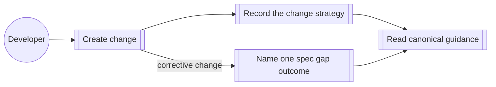

# Use case: create-change

## Level

!

## Actors

- Developer
- Supporting: Authoring agent

## Goal

Create a change ready to carry from intent to executable specification.

The delta: the canonical `@e2e` policy names the declared E2E package
boundary, every change records one `Change strategy` with its `Ise Test` mode
when it rebuilds, and a corrective change names exactly one `Spec gap`
outcome before any fix.

## Trigger

The developer starts a new change.

## Preconditions

- The project is initialized as a Givn project.
- For a corrective change, an observed difference between the frozen
  `End-to-end (E2E) test` result and the declared `Specification` exists and
  is available for classification.

## Main flow

1. The developer starts a change; the system writes the scaffold with a
   stable identity and records the effective add-on set with the change.
2. The developer records the change's authoring decisions: the change
   strategy, and, when the change responds to an observed difference, exactly
   one `Spec gap` outcome before any fix; the system requires the strategy as
   the design's decision-ledger entry and keeps the classification with the
   corrective change.
3. The developer reads the artifact guidance; the system keeps one canonical
   policy per topic, states the declared E2E package boundary there, and
   points derived guidance at it.

## Extensions

- 1: the requested identity is invalid → the system rejects it and leaves the project unchanged; protects the minimal guarantee.
- 2: the `Spec gap` outcome is `implementation defect` → the change's proposal carries no corpus or E2E suite edit and the difference returns to the agent inside the Ise Test; recovers the classification without a corpus edit.

## Rules

- Change identities are stable kebab-case values.
- Generated thin skills are synchronized from canonical source assets; detailed rules have one served owner per topic, with no separately generated command surface.
- The scaffold records the effective add-on set with the change, so a change started while `ise` is off carries `ise: false` and no `ise` gate appears halfway through.
- The `specs` instruction owns the canonical `@e2e` policy; the design, steps, and review instructions point at it and do not restate it.
- With `ise` effective, the canonical `@e2e` policy states that the declared `e2e` role names one package holding the runner and every `@e2e` step definition; that package links no production source, `verify.e2e_command` runs it, and an unbound or skipped step fails the run.
- Feature files stay shared, so an `@e2e` scenario and a component scenario may live in one `.feature` file; no phrase-uniqueness rule applies, because a step definition in the declared package cannot reach production source.
- Component step definitions, fakes, and harness are implementation: never frozen, never diff-counted, and a new feature's step bindings are expected.
- Only the `End-to-end (E2E) test` package is frozen as acceptance authority during an `Ise Test`.
- With `ise` effective, evidence matches the actual product interface: a library's real public API calls run in process only inside the declared E2E package, built as a consumer artifact against the published interface; browser, CLI, and service evidence keep their existing rules.
- Every change records one `Change strategy`: `incremental modification`, `Constant Ise`, or a whole-product rebuild.
- A rebuilding change records its `Ise Test` mode beside the strategy: `Dry-Run Ise` or `Full replacement`.
- The strategy is the design's existing `Decides D<n>` entry; it names the affected consumers, the persisted state, and the rebuild boundary, and it adds no mandatory design field.
- An unresolved or unrecorded change strategy, or a rebuild with no recorded mode, is a design-review finding, not a missing artifact.
- Prose writes `change strategy` in full; a bare `strategy` names no domain decision.
- A `Spec gap` record holds exactly one of `E2E test defect`, `implementation defect`, `specification defect`, or `acceptable undocumented change`, recorded before any fix.
- The record names the artifact that is wrong, not who found it.
- Only `specification defect` is a gap in the Specification; an `E2E test defect` is a gap in the test, an `implementation defect` is a gap in the build, and an `acceptable undocumented change` is no gap at all.
- A corrective proposal names the record and its outcome: an outcome of `specification defect` or `E2E test defect` carries the corpus or E2E suite edit in that change; `implementation defect` returns to the agent inside the Ise Test; `acceptable undocumented change` is recorded in the corpus.
- A `Spec gap` of `E2E test defect` recorded during an `Ise Test` stops that trial, and the trial restarts after the E2E test is corrected. The `e2e` package is part of the Specification, so the corrected test is a Specification correction, not an exception to the freeze.
- No difference is closed as silent drift.
- The permanent contract's other rules stand unchanged: managed dialog bootstrap and its companion index, one release note per change and its batch shape, actual RED, GREEN, and REFACTOR evidence, explicit verification scope, justified E2E reclassification, visual and terminal evidence, and project-owned skill replacements.

## Examples

- A formatting fix records `Decides D2` with `change strategy incremental modification`; tasks 2 and 3 realize it, and no `Ise Test` runs.
- A key-parser swap records `Decides D4` with `change strategy Constant Ise; Ise Test mode Dry-Run Ise`; tasks 3 to 5 realize it, and neighboring consumer contracts keep their wording.
- A whole-product rewrite records `Decides D1` with `change strategy whole-product rebuild; Ise Test mode Full replacement`; tasks 2 to 9 realize it.
- An `Ise Test` reports a missing exit code that the contract never named: the record reads `Spec gap: specification defect`, and the corrective change adds the rule to the corpus. If the contract named the exit code, the record reads `Spec gap: implementation defect`, and the builder fixes it inside the trial with no corpus edit.
- An undocumented column-spacing change that no consumer depends on records `Spec gap: acceptable undocumented change` and is added to the corpus.
- A project whose `e2e` package imports `passuff::tui::keys` violates the
  canonical policy; the step moves to a `@component` scenario or drives the
  TUI through its real interface. An `@e2e` scenario and a component scenario
  may stay in one `.feature` file, because the package boundary, not the file,
  decides what the E2E runner executes.
- A change started while `ise` is off records `ise: false`; enabling `ise` during that change is refused as an add-on change until the change ends.

## Minimal guarantee

The project remains unchanged when an invalid identity is rejected.

## Success guarantee

The project has the requested change, ready to carry from intent to executable
specification; the change's authoring contract requires one change strategy in
the design ledger, and a corrective change names one `Spec gap` outcome.

## Personas

- developer--primary-user
- agent--technical-role
- givn-maintainer--owner

## Capabilities

- `change-release-note`: unchanged
- `change-strategy`: new (the design ledger entry, its values, and its mode)
- `create-a-change`: unchanged
- `prose-consolidation`: modified (the canonical `@e2e` package policy)
- `spec-gap`: new (the four-way classification record and the corrective
  route)
- `visual-design-contract`: unchanged

## Interactions

| Capability | Consumer action | E2E scenario |
|---|---|---|
| prose-consolidation | request canonical E2E guidance | Canonical E2E policy is emitted by specs instructions |
| prose-consolidation | request the canonical E2E policy with `ise` effective | Canonical E2E policy requires the declared E2E package boundary |
| prose-consolidation | synchronize and inspect generated E2E guidance | Generated guidance points to the canonical E2E policy |
| visual-design-contract | request the design guidance for a visual interface | Author requests the visual design contract guidance |
| visual-design-contract | read the synchronized design and step guidance | Synchronized guidance defines the contract approval and capture mechanics |
| change-release-note | create a change | A new change's proposal carries the release-note field |
| change-release-note | read the proposal guidance | The proposal guidance requires a release note |
| change-release-note | read the generated implementation guidance | The generated implementation guidance shares the release note |
| change-strategy | record the change strategy in the design | A rebuilding change records its change strategy and Ise Test mode |
| change-strategy | read the design guidance | The design guidance requires one recorded change strategy |
| spec-gap | record one outcome for an observed difference | A spec gap record holds exactly one of the four outcomes |
| spec-gap | open a corrective change naming the record | A corrective proposal names the spec gap record and its outcome |

## Includes

- fragment: support

## Extends

- none

## Out of scope

Implementing the change's product behavior; archiving the change
(`archive-change`); managed upgrade (`maintain-project`); preparing or
verifying the clean-room trial (`prepare-an-ise-test`); the `@e2e` boundary
gate and the verification receipt (`verify-change`); declaring the
Specification roles (`declare-the-specification`).

## Diagram

