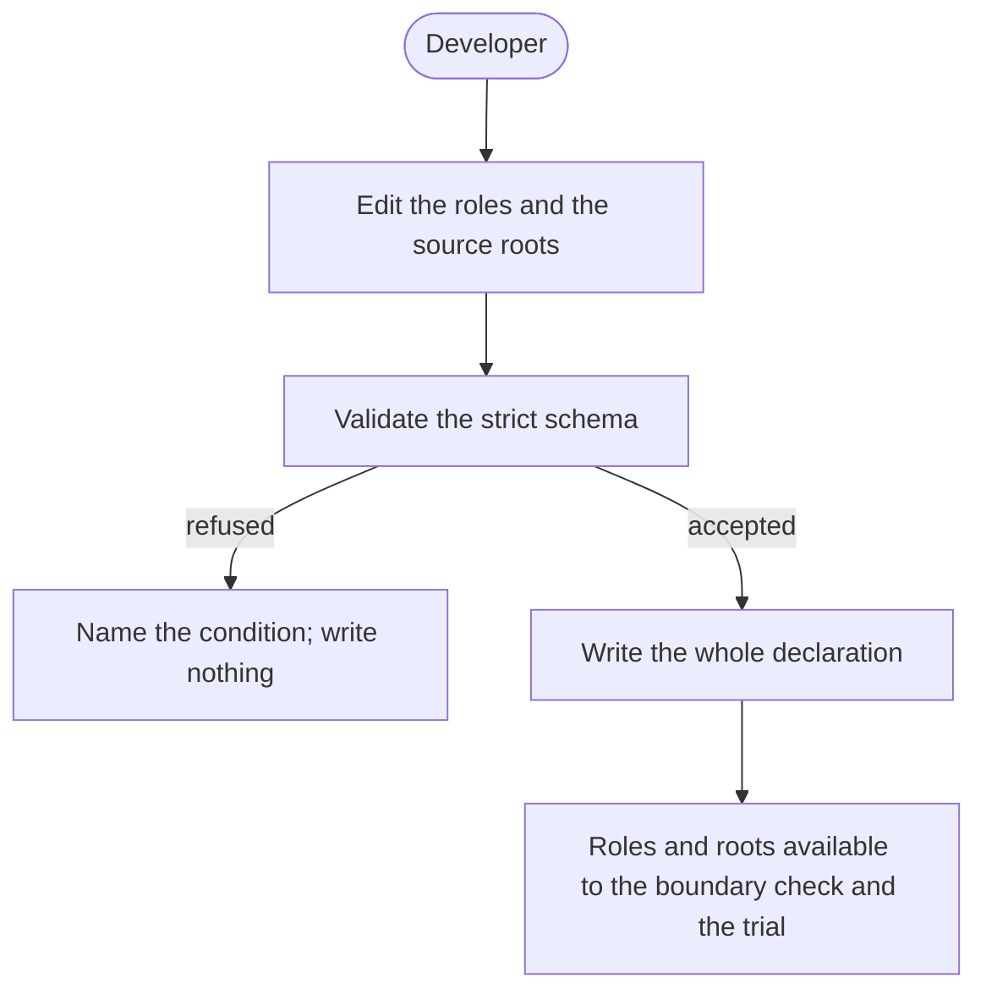

# Use case: declare-the-specification

## Level

!

## Actors

- Developer
- Supporting: Authoring agent (reads the declaration before authoring a change)

## Goal

Declare the boundary between the Specification and the Source code.

## Trigger

The developer changes a declared role or a replaceable source root, or a
durable contract moves to another path.

## Preconditions

- The project is initialized.
- `ise` is effective, which requires `architecture_principles`.
- The declaration is present from project setup or upgrade.
- The project is the developer's to configure.

## Main flow

1. The developer maps each retained role to its paths and lists the replaceable
   source roots in the declaration; the system reads the current declaration
   and the project tree.
2. The developer saves the changed declaration; the system validates the
   proposal against the declaration rules and refuses an unknown key, an
   unknown or repeated role, an omitted role, an absent list of replaceable
   source roots, and a path outside the project.
3. The system writes the whole declaration, replacing the previous content, and
   makes the resolved roles and roots available to the flows that read them:
   the boundary check in `verify-change` and the trial preparation in
   `prepare-an-ise-test`.

## Extensions

- 2: an unknown key or role name → the refusal names it and nothing is written;
  protects the minimal guarantee.
- 2: a role is named twice → the refusal names the role and nothing is written;
  protects the minimal guarantee.
- 2: a retained role is omitted or the list of replaceable source roots is
  absent → the refusal names the missing role or list and nothing is written;
  protects the minimal guarantee.
- 2: a role or a source root falls outside the project → the refusal names the
  path and nothing is written; protects the minimal guarantee.

## Rules

- The declaration is `givn/specification.yaml`, holding exactly five retained
  roles: `behavior`, `structure`, `contracts`, `limits`, `e2e`.
- Exactly one `source:` list of replaceable roots; every declared path and
  every root is bounded to the project.
- The schema is strict: an unknown key, an unknown or repeated role, an omitted
  role, an absent `source:` list, or a path outside the project is refused,
  named, and never written.
- No `components:` key and no per-component file list: the replaced component's
  paths are trial input for `prepare-an-ise-test`, not a permanent project
  declaration.
- A declared path missing from the tree, one path declared in two roles, and a
  `.feature` file outside the `behavior` globs are advisory findings reported
  by `verify-change`; none refuses the write.
- The `e2e` role names the one package holding the End-to-end (E2E) test runner
  and every `@e2e` step definition; whether that package exists and links no
  production source is a `verify-change` finding, not a write refusal.
- One declaration feeds every reader: no second role list or component list
  exists elsewhere.
- A written declaration is project-owned: setup and upgrade scaffold it only
  when absent and never rewrite its content.

## Examples

- A Givn self-rebuild declaration reads `behavior: ["givn/specs/**"]`,
  `structure: ["docs/glossary.md", "docs/domain-model.md"]`, `contracts:
  ["docs/reference.md"]`, `limits:
  ["docs/arc42/02-architecture-constraints.md"]`, `e2e: ["tests/e2e"]`, and
  `source: ["src/**"]`; the write succeeds, and a later trial preparation with
  `--replace src/cli/archive.rs` accepts that path because it falls inside
  `src/**`.
- The developer writes a sixth role named `acceptance`; the refusal names
  `acceptance`, and the declaration keeps its five roles.
- The developer writes `e2e` twice; the refusal names `e2e` and nothing is
  written.
- The developer writes `source: ["../gh-notify/crates/**"]`; the refusal names
  `../gh-notify/crates/**` because the root leaves the project.
- The developer moves `contracts` from `docs/reference.md` to
  `docs/cli-contract.md`; the write succeeds, the next trial preparation
  retains `docs/cli-contract.md`, and `docs/reference.md` is now outside the
  declaration.
- The developer declares `limits: ["docs/performance.md"]` while that file does
  not exist; the write succeeds, and `givn lint` reports an advisory finding
  naming `docs/performance.md` and still exits 0.
- A project edits its `limits` paths and later crosses a release gap; `givn
  upgrade` leaves the declaration byte-identical.

## Minimal guarantee

A refused declaration leaves the previous declaration byte-for-byte unchanged
and exposes no partial role set.

## Success guarantee

The declaration names exactly the five retained roles and one list of
replaceable source roots, every path bounded to the project, and the resolved
roles and roots are available to the flows that read them.

## Personas

- developer--primary-user
- agent--technical-role
- givn-maintainer--owner

## Capabilities

- `specification-declaration`: new

## Interactions

| Capability | Consumer action | E2E scenario |
|---|---|---|
| specification-declaration | declare the five roles and the source roots | The declaration is written and the trial preparation reads exactly those roles |
| specification-declaration | move a durable contract to a new path | The new path is retained and the old path is outside the declaration |
| specification-declaration | declare a role outside the five | The refusal names the role and the declaration is unchanged |
| specification-declaration | declare a path outside the project | The refusal names the path and nothing is written |
| specification-declaration | declare a path that does not exist | The write succeeds and lint reports the missing path as advisory |
| specification-declaration | cross an upgrade with an edited declaration | The declaration stays byte-identical |

## Includes

- none

## Extends

- none

## Out of scope

Boundary: the project's declaration of its retained Specification and
replaceable Source code. Everything below stays outside this case.

- Authoring the durable contracts the roles retain: the change's authoring
  flow.
- Materializing a trial: `prepare-an-ise-test`.
- Reporting declaration findings: `verify-change`.
- Scaffolding the declaration file: `initialize-project` and
  `upgrade-a-project`.

## Diagram

