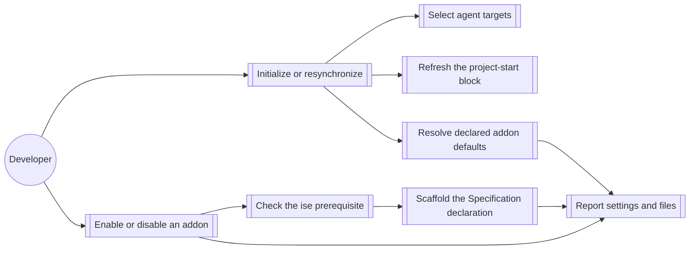

# Use case: initialize-project

## Level

!

## Actors

- Developer
- Supporting: Authoring agent

## Goal

Set up a Givn project and its agent integrations. The delta: `ise` is an
`Opt-in addon`; a fresh initialization never makes it effective, enabling it
requires `architecture_principles`, that prerequisite cannot be disabled while
`ise` is on, and the first effective enable leaves the project holding a
`Specification` declaration.

## Trigger

The developer initializes a project, re-synchronizes the agent integrations,
or enables or disables an optional addon.

## Preconditions

- The project directory is writable.
- The active version-control system is detected when one exists.
- For an addon change, the project is initialized: its configuration file
  exists and its settings are readable.

## Main flow

1. The developer selects at least one agent target; the system opens the
   interactive list with `.opencode` marked, re-asks when nothing is marked,
   and generates for the selected targets only (unchanged).
2. The developer asks for workflow scaffolding; the system writes project
   configuration and thin skills with trigger metadata and a direction to the
   canonical served instruction, without separately authored command files,
   orchestration, or copied rulebooks (unchanged).
3. The developer keeps existing project-owned content authoritative; the
   system reconciles recognizable generated guidance, removes recognizable
   generated legacy commands and disabled-addon skills, preserves project-owned
   replacements and custom commands byte-for-byte, and reports custom commands
   requiring manual transition (unchanged).
4. The developer relies on the served rules from the session start; the system
   refreshes one managed project-start block beside untouched human-authored
   instructions, and bootstrap loads the effective dialog policy before the
   first question once per context, reloading if lost, independently of addons
   and named skills (unchanged).
5. The developer initializes a fresh project or accepts the resolved defaults;
   the system resolves each addon's declared default, writes explicit choices,
   and preserves existing explicit opt-outs on repeated initialization. A fresh
   initialization writes an explicit `true` for every addon whose declared
   default is on and writes no key for `ise` (delta: per-addon default).
6. The developer enables or disables an optional addon; the system checks the
   `ise` prerequisite relation before any write, applies the setting when the
   relation holds, runs that addon's one-time materialization, and reports the
   files it scaffolded. The first effective enable of `ise` leaves the project
   with the documented `Specification` declaration when the project has none
   (delta: prerequisite relation and declaration scaffold).
7. The developer asks which integrations are usable; the system reports the
   detected version-control system, installs supported attribution plumbing
   safely, and names installed or skipped integrations and limitations
   (unchanged).
8. The developer treats initialization as complete; the system reports
   completion only after required skill generation succeeds, and no
   initialization or synchronization action implicitly commits project work
   (unchanged).

## Extensions

- 1: no version-control system exists → the system scaffolds the corpus,
  generates skills, exits 0, and warns that archive and managed upgrade are
  unavailable; protects the success guarantee.
- 1: interactive confirmation marks no target → the selection is shown again
  with the at-least-one-target requirement; protects the success guarantee.
- 1: a non-interactive answer or an agents value resolves to no known target →
  the system names valid targets, exits nonzero, and writes nothing; protects
  the minimal guarantee.
- 3: a project-owned replacement or custom legacy command exists → its bytes
  remain authoritative and unchanged, and any manual command transition is
  reported; protects the minimal guarantee.
- 3: an addon is disabled → only its recognizable generated guidance is
  removed; protects the success guarantee.
- 5: configuration presentation cannot be safely edited → the request refuses
  before writes rather than duplicating sections or changing unrelated values;
  protects the minimal guarantee.
- 6: enabling `ise` while `architecture_principles` is off → the refusal names
  both addons, exits nonzero, writes neither stored flag, and scaffolds
  nothing; protects the minimal guarantee.
- 6: disabling `architecture_principles` while `ise` is on → the refusal names
  `ise` first, exits nonzero, and writes neither stored flag; protects the
  minimal guarantee.
- 6: the `Specification` declaration already exists → its bytes are preserved,
  it is reported as project-owned, and no scaffold is written; protects the
  minimal guarantee.
- 6: an addon change is requested during an active change → the existing
  operator-owned refusal stands, and `--operator --reason` on an interactive
  terminal records the override; protects the minimal guarantee.
- 6: the declaration scaffold cannot be written after the addon setting was
  applied → the command exits nonzero, names the path and the setting already
  written, and claims no completion; protects the success guarantee.
- 7: attribution is unsupported by the active version-control system → the
  report and guidance name the limitation; protects the success guarantee.
- 8: required skill synchronization fails → the command exits nonzero, names
  the failed destination and partial initialization, preserves successful
  scaffold writes and choices, and specifies `givn skills sync` after repair;
  it prints no unconditional Ready and promises no rollback; protects the
  minimal guarantee.

## Rules

- Each registered addon declares its own default posture. `ise` is the one
  `Opt-in addon` (`default_enabled: false`); the nine existing addons keep
  `true`. An omitted key in a partial `addons:` block resolves to that addon's
  declared default, and only an explicit `false` disables a default-on addon.
- A fresh initialization writes an explicit `true` for every addon whose
  declared default is on and omits the `ise` key. `--no-addons` writes an
  explicit `false` for every addon, `ise` included.
- No fresh-initialization flag makes `ise` effective: `--no-addons` only
  disables. `ise` becomes effective through `givn addons enable ise` or a
  forced re-initialization that restores an explicit `ise: true` from the
  project's own settings.
- Enabling `ise` refuses by name until `architecture_principles` is on;
  disabling `architecture_principles` refuses while `ise` is on and names
  `ise` first. Both refusals leave both stored flags unchanged.
- The prerequisite relation is one rule read by enable, disable, the manifest
  schema, and the addon lock proposal. A forced re-initialization proposes
  each addon's declared default, so a locked project is never proposed an
  `ise` change it did not record.
- The first effective enable of `ise` materializes `givn/specification.yaml`
  from its documented shape when the file is absent, preserves an existing
  declaration byte-for-byte, and reports the scaffold it wrote. The scaffold
  content is the documented shape, not a project decision.
- The declaration scaffold follows the same one-time materialization as the
  other addon documents, so the initialization path and the explicit enable
  path produce the same file and a repeated enable changes nothing.
- Addon edits during an active change keep their existing meaning: the
  operator-owned lock refuses, and `--operator` without an interactive
  terminal or with an empty reason is refused too. An override records the
  addon's resolved value before the change, so `ise` records `false` as its
  before value.
- `givn addons list` reports each addon's effective value, and its prose, the
  scaffolded configuration prose, `TC-14`, and the `Addon` and `Addon default`
  glossary rows state the per-addon declared default. The word `opt-in` names
  the `Opt-in addon` posture only.
- The three all-default scenarios and the partial-block scenario are read per
  addon: `givn init enables every addon by default` becomes the nine
  default-on addons with `ise` disabled, and an unnamed key resolves that
  addon's declared default rather than "enabled" unconditionally.
- `initialize-a-project` is unchanged: no fresh-initialization path writes the
  declaration, and setup guidance stays technology-agnostic.
- Explicit choices, including opt-outs, survive initialization reentry and
  force initialization; a repeated initialization changes only intended values.

## Examples

- Fresh project: `givn init --agents opencode` writes the nine explicit `true`
  keys, omits `ise:`, writes no `givn/specification.yaml`, and
  `givn addons list` prints `[disabled]  ise`.
- First enable: `givn addons enable ise` on that project succeeds because
  `architecture_principles` is default-on; it writes `addons.ise: true` and
  creates `givn/specification.yaml` with the documented roles
  (`behavior`, `structure`, `contracts`, `limits`, `e2e`) and a `source:` list.
- Repeated enable: a second `givn addons enable ise` reports the existing file
  and leaves an edited `source:` list byte-for-byte unchanged.
- Prerequisite missing: on a project holding `architecture_principles: false`,
  `givn addons enable ise` prints `addon 'ise' requires
  'architecture_principles'; enable it first`, exits nonzero, and leaves both
  flags as they were.
- Reverse direction: on a project holding `ise: true`,
  `givn addons disable architecture_principles` prints
  `addon 'architecture_principles' is required by 'ise'; disable 'ise' first`
  and writes nothing.
- Addon-free project: `givn init --no-addons --agents opencode` writes an
  explicit `false` for all ten addons, including `ise`, and the mandatory
  dialog bootstrap remains installed.
- Untouched project: a project that never enables `ise` initializes,
  re-synchronizes, and upgrades without an `ise` declaration file and without
  an `ise` gate firing.

## Minimal guarantee

Invalid selections or unsafe configuration edits refuse before writes. An
addon refusal leaves both stored flags unchanged and writes no declaration.
Project-owned guidance and surrounding human-authored instructions are
preserved, and an existing declaration is never rewritten; a later required
generation failure is reported honestly as partial initialization, without an
implicit commit or rollback claim.

## Success guarantee

The project has the selected discoverable thin skills, one managed dialog
bootstrap, consistent effective addon choices in which `ise` is effective only
where the developer enabled it, a `Specification` declaration created at the
first effective enable of `ise` and left project-owned afterwards, truthful
attribution reporting, and explicit unconfigured runner declarations where
newly scaffolded; required generation has succeeded without duplicated
built-in rules or implicit commits.

## Personas

- developer--primary-user
- agent--technical-role
- givn-maintainer--owner

## Capabilities

- `initialize-a-project`: unchanged
- `enable-optional-addons`: modified (per-addon declared default, the `ise`
  prerequisite relation, and the declaration scaffold)

## Interactions

| Capability | Consumer action | E2E scenario |
|---|---|---|
| initialize-a-project | initialize a fresh project with the default posture | A fresh init leaves `ise` disabled, writes no declaration, and installs the nine default-on addons |
| enable-optional-addons | enable `ise` with the prerequisite on | The enable writes `ise: true` and reports the declaration scaffold it wrote |
| enable-optional-addons | enable `ise` with the prerequisite off | The enable refuses by name, exits nonzero, and writes nothing |
| enable-optional-addons | disable the prerequisite while `ise` is on | The refusal names `ise` first and both stored flags are unchanged |
| enable-optional-addons | enable `ise` on a project with an edited declaration | The existing declaration stays byte-for-byte and the scaffold is reported as skipped |
| enable-optional-addons | list addons on a partial `addons:` block | `ise` is reported disabled and every omitted default-on addon is reported enabled |

## Includes

- fragment: support

## Extends

- none

## Out of scope

The declaration's content and validation (`declare-the-specification`); adding
the declaration on upgrade (`upgrade-a-project`); the change-start addon lock
(`create-change`); changing an existing project's configuration without a
request; implementing the product behavior described by a change
(`create-change`).

## Diagram

