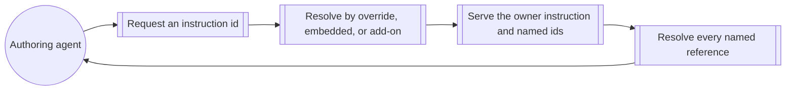

# Use case: instruction-integrity

## Level

fragment

## Actors

- Authoring agent
- Developer
- Givn maintainer

## Goal

Expose the guidance for one instruction id from its canonical source with a
stable machine contract. There is no independent user goal: the lifecycle use
cases include the capability.

## Trigger

An instruction request, or a guidance synchronization or print that checks the
references the served guidance names.

## Preconditions

- The project is initialized as a Givn project.
- For an artifact instruction, the change context resolves.
- For the `ise` instruction, `ise` is effective, which requires
  `architecture_principles` on.

## Main flow

1. The authoring agent requests the guidance for one instruction id; the
   system validates the id and the change context.
2. The system resolves the instruction through the project-overrides-first
   cascade: project replacement, then embedded, then add-on.
3. The system serves the instruction that owns the requested rules: a core
   step instruction carries the universal rules and names each stack
   instruction id with its load condition; the `ise` instruction carries the
   rebuild obligations only while the add-on is effective.
4. The system exposes the same content on the text and machine-readable paths.
5. The reference check resolves every instruction id, file, and setting the
   served guidance names, and names each unresolved reference.

## Extensions

- 1: the id is unknown → the system refuses by name and lists the known ids; protects the minimal guarantee.
- 1: the change context is missing or ambiguous → the system refuses and names the context; protects the minimal guarantee.
- 5: a named instruction id does not resolve → the check fails and names the unresolved id; protects the success guarantee.

## Rules

- Resolution order and override precedence are today's contract: a project override wins entirely and is never modified.
- The machine contract stays `id`, `generates`, `requires`, `instruction`, plus `skill_to_load` when the domain-modeling and arc42 add-ons are active.
- Resolution and the reference check are read-only: neither writes, stages, or modifies a file, override, or configuration.
- One canonical owner per rule: the instruction that owns a rule states it, and the instructions that depend on it point at the owner instead of copying its text.
- The design instruction requires exactly one change strategy in the existing `## Decisions` ledger, as a `Decides D<n>` entry: `incremental modification`, `Constant Ise`, or a whole-product rebuild.
- The design instruction requires a rebuilding change to record its `Ise Test` mode beside the strategy: `Dry-Run Ise` or `Full replacement`.
- The design instruction requires the entry to name the affected consumers, the persisted state, and the rebuild boundary; the entry adds no mandatory design field.
- The design-review instruction keeps an unresolved or unrecorded strategy, and a rebuild with no recorded mode, a finding.
- The review instruction requires exactly one `Spec gap` outcome before any fix and lists the four outcomes: `E2E test defect`, `implementation defect`, `specification defect`, `acceptable undocumented change`.
- The review instruction states that only `specification defect` is a gap in the Specification.
- The review instruction asks the neighboring-components question: name the neighboring components changed outside the replaced component and say why; the answer is one review question, never a gate.
- Each core step instruction (`specs`, `steps`, `design`, `review`) names each stack instruction id it may need and the condition for loading it, and carries no stack body.
- A named instruction id that does not resolve is a named defect of the guidance corpus, not a silent omission; the same id resolves on the text and machine-readable paths.
- The `ise` instruction carries the obligations the add-on promises: Specification completeness, the two-layer test boundary, persisted-state continuity, the `Change strategy` choice, and the four-way `Spec gap` classification.
- `ise` effective requires `architecture_principles`, so the `ise` instruction may use `Component`, `Port`, contract, `Specification`, and `Source code`.
- Guidance for a disabled add-on is omitted; enabling `ise` adds its instruction and sections without changing guidance for a project that did not enable it.
- Every direction to another instruction names the change context only for an artifact instruction; a policy or step instruction names none.
- The permanent capability's other rules stand unchanged: the project-overrides-first cascade, the byte-for-byte override, the unknown-id refusal, the unsafe-change-context refusal, and the existing reference checks.

## Examples

- A rebuilding change: `givn instructions design --change rebuild-key-parser`
  returns the requirement; the design writes `Decides D4` with
  `change strategy Constant Ise; Ise Test mode Dry-Run Ise`, and
  `givn instructions design-review` keeps a D4 that names `Constant Ise` with
  no mode a finding.
- An `Ise Test` result: the frozen suite fails on an exit code the contract
  never named; `givn instructions review` requires one outcome before the fix;
  the record reads `Spec gap: specification defect`, and a review that accepts
  only "fix the exit code" is a finding.
- Neighboring components: the key-parser rebuild also edits
  `crates/passuff-cli/src/main.rs`; the review asks for the component and the
  reason, records both, and no gate refuses the change.
- Stack instructions: `givn instructions steps --change inbox-pty` returns the
  universal step rules and names `steps-rust` with the load condition;
  `givn instructions steps-rust` serves the Rust mechanics;
  `givn instructions steps-rustt` exits non-zero and lists the known ids.
- `ise` off: the project receives no `ise` obligations. After
  `givn addons enable ise`, `givn instructions ise` returns the five
  obligations and names `Component`, because `architecture_principles` is on.
- Override: a project-owned `givn/artifacts/specs/instructions.md` wins
  byte-for-byte, and the reference check still resolves every id it names.

## Minimal guarantee

An unresolvable request changes nothing and refuses by name; the reference
check changes nothing and names each unresolved reference; no request or check
modifies any file, override, or configuration.

## Success guarantee

The caller receives the instruction that owns the requested rules, identical
on the text and machine-readable paths; every instruction id, file, and
setting the served guidance names resolves; the design, design-review, review,
and `ise` obligations are stated in the instructions their authors read.

## Personas

- agent--technical-role
- givn-maintainer--owner

## Capabilities

- `instruction-integrity`: modified (a capability of the `support` fragment;
  no independent user goal)

## Interactions

| Capability | Consumer action | E2E scenario |
|---|---|---|
| instruction-integrity | resolve an instruction and expose the machine contract | An agent requests machine-readable artifact guidance |
| instruction-integrity | request normal session-start instructions | Author starts a session with the universal dialog obligation |
| instruction-integrity | read the design guidance for a rebuilding change | Design guidance requires the change strategy and its Ise Test mode |
| instruction-integrity | read the design-review guidance | Design-review guidance keeps an incomplete change strategy a finding |
| instruction-integrity | read the review guidance after an Ise Test | Review guidance requires one spec gap outcome before any fix |
| instruction-integrity | read the review guidance for a neighboring change | Review guidance asks the neighboring-components question |
| instruction-integrity | read the step guidance for a stack-specific change | Core step guidance names the stack instruction id and its load condition |
| instruction-integrity | request the ise instruction with the addon effective | The ise instruction carries the five obligations |
| instruction-integrity | keep a project-owned override | The override stays byte-for-byte and wins over the embedded asset |
| instruction-integrity | resolve a named instruction id that does not exist | The reference check fails and names the unresolved id |

## Includes

- none

## Extends

- none

## Out of scope

Serving policy content, the serving-time add-on gate, project extensions, and
delivery (the `serve-extended-rules` capability of
`obtain-effective-guidance`); the record shapes the guidance requires
(`create-change`); the Specification declaration schema
(`declare-the-specification`); the `@e2e` boundary gate and the verification
receipt (`verify-change`); writing a change's design, review, or tests.

## Diagram

