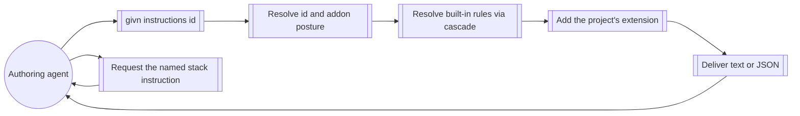

# Use case: obtain-effective-guidance

## Level

!

## Actors

- Authoring agent
- Supporting: Developer (manual reading)

## Goal

Obtain the rules governing the work at hand, extended with the project's
extension.

The delta: an instruction bound to an addon is served only while that addon is
effective, and a core step instruction names the stack instruction it leaves to
a separate request instead of carrying that body.

## Trigger

The authoring agent requests the guidance for an instruction id
(`givn instructions <id> [--change <id>] [--json]`), typically because an
invoked skill directs it there; the developer may request the same id manually.

## Preconditions

- The project is initialized as a Givn project.
- For an artifact instruction, exactly one change context resolves: the explicit `--change`, or the single active change.
- When the `ise` addon is effective, its prerequisite `architecture_principles` is on, because enablement refuses otherwise; the served obligations therefore never rely on an undefined noun.

## Main flow

1. The authoring agent requests the guidance for an instruction id; the system
   resolves the id as an artifact, a policy, or a step, and resolves an
   addon-bound id only while its addon is effective.
2. For an artifact instruction, the system resolves the change context
   (explicit `--change`, or the single active change).
3. The system resolves the built-in rules through the project-overrides-first
   cascade (project replacement, then embedded, then addon).
4. The system loads and validates the project's configured extension for that
   id, then adds it after the built-in rules under a marked section; a rejected
   entry warns and is skipped, and the built-in rules stay unmodified.
5. The system delivers the effective content on the requested path, text or
   machine-readable, with identical content. The served text of a core step
   instruction (`specs`, `steps`, `design`, `review`) names each stack
   instruction id and the condition for loading it, and carries no stack body.
6. The agent follows the extended rule for its step and requests the named
   stack instruction by id when the change touches that stack; a stack
   instruction's body is served only by a request for its own id.

## Extensions

- 1: the id is unknown → the system refuses by name and lists the known ids; protects the minimal guarantee.
- 1: the id is served by an addon that is not effective → the system refuses and names the addon; protects the minimal guarantee.
- 2: multiple active changes and no `--change` → the system refuses and names the boundary; protects the minimal guarantee.
- 2: no active change and no `--change` for an artifact instruction → the system refuses and names the missing context; protects the minimal guarantee.
- 4: no extension exists for the id → the built-in rules are served alone; the call is valid and unchanged; protects the success guarantee.
- 4: a configured entry is rejected while the guidance is resolved (unknown id, or a malformed, empty, or whitespace-only rule) → the entry is skipped with a warning and the request serves the built-in rules alone for it, with nothing mutated; protects the success guarantee.
- 5: the machine-readable path is requested → the same content is carried as `instruction` alongside `id`, `generates`, `requires`, and `skill_to_load`; protects the success guarantee.
- 5: the requested id is a stack instruction → its body is served on that request only and never inside a core instruction's served text; protects the success guarantee.
- 6: the change touches no stack the core instruction named → no stack instruction is requested and the core guidance stands alone; protects the success guarantee.

## Rules

- The served content is the extended rule: the built-in rules resolved from the canonical asset (or the project's replacement of the instruction facet) plus the project's extension when one exists.
- An extension never overrides, suppresses, or reorders the built-in rules.
- The text path and the machine-readable path carry the same effective content, extensions included.
- Improved built-in rules are served at the next request after an upgrade; no project action and no synchronization is needed.
- A request never mutates project state; a rejected configuration entry warns and is skipped and the request still succeeds and serves the built-in rules alone for it.
- The unknown-id refusal, the change-context rules, and the machine contract shape are unchanged.
- The built-in rules stay technology-agnostic; project-specific guidance arrives only through the extension.
- The `ise` instruction is served as its own instruction id only while the `ise` addon is effective; the obligations it carries are `instruction-integrity`'s.
- An addon's effective state is read at request time, so enablement or disablement changes the next request's outcome with no synchronization step for the instruction itself.
- Each core step instruction (`specs`, `steps`, `design`, `review`) carries that step's universal rules and names each stack instruction id with the condition for loading it; the stack instruction's body is served only by a request for its own id.
- The core instruction's served text is complete for a change that touches no named stack: the split reduces what a reader loads and never removes a universal rule.
- The id convention `<id>-<stack>` carries the pairing, and the existing `<id>-examples` companion (`dialog` -> `dialog-examples`) is the policy precedent it follows.
- A named stack instruction id that does not resolve is a named defect of the guidance corpus, not a silent omission; reference integrity stays with the `instruction-integrity` capability the `support` fragment supplies.
- The `ise` instruction's content, including the vocabulary it may use and its naming of the replaced component's paths as trial input, belongs to `instruction-integrity`; this capability serves it unchanged.
- No phrase-uniqueness rule exists between a core instruction and a stack instruction; the stack body is simply not part of the core text.
- The permanent contract's other rules stand unchanged in `givn/specs/obtain-effective-guidance/usecase.md`: the dialog policy bootstrap and its companion example index, the batch, RED, GREEN, and REFACTOR guidance, runner-strictness proof, the advisory outline inspection, the modular-boundary rules, explicit-path cleanup commits, instruction-regression content assertions, and the optional challenge.

## Examples

- A Rust TUI change: `givn instructions steps` names `steps-rust` with the condition "the change touches a Rust runner"; the agent then requests `givn instructions steps-rust` and receives the Rust mechanics, none of which appeared in the `steps` text it read.
- A library change that touches no named stack: the agent never requests a stack instruction, and the `steps` guidance it holds is complete for the change.
- An `ise`-enabled project: `givn instructions ise --change rebuild-key-parser` serves the five obligations `instruction-integrity` defines.
- An `ise`-disabled project: the same request refuses and names `ise`, and no project state changes.
- A core step instruction names `steps-rust` while no such instruction exists: the guidance corpus reports the dangling id as a defect instead of serving a silent gap.
- Text and machine-readable: `givn instructions steps --change rebuild-key-parser` and the same call with `--json` name `steps-rust` with the same load condition, and the JSON carries it inside `instruction`.

## Minimal guarantee

A request never modifies project state. A request that cannot be satisfied
refuses and names what is missing: the unknown id, the addon that is not
effective, the ambiguous change context, or the absent change. A rejected
configuration entry is skipped with a warning and the request serves the
built-in rules alone for it.

## Success guarantee

The caller holds the extended rule for the requested id: Givn's built-in rules
as the canonical asset (or the project's replacement) defines them, plus the
project's extension when one exists, identical on the text and machine-readable
paths. An addon-bound id is served only while its addon is effective, a core
step instruction names each stack instruction id with its load condition, and a
stack instruction's body reaches the caller only on a request for that id.

## Personas

- agent--technical-role
- developer--primary-user
- givn-maintainer--owner

## Capabilities

- serve-extended-rules

## Interactions

| Capability | Consumer action | E2E scenario |
|---|---|---|
| serve-extended-rules | request guidance by id | An agent receives the extended rules through the Givn CLI |
| serve-extended-rules | request the `ise` obligations with the addon enabled | The agent receives the five `ise` obligations |
| serve-extended-rules | request an addon-bound id with the addon disabled | The request refuses by name and nothing changes |
| serve-extended-rules | request core step guidance for a stack-specific change | The core text names `steps-rust` and its load condition and carries no Rust body |
| serve-extended-rules | request the named stack instruction | The agent receives the Rust mechanics as a separate served instruction |
| serve-extended-rules | request the machine-readable path | The JSON carries the same served content as the text path |

## Includes

- fragment: support

## Extends

- none

## Out of scope

The cascade resolution mechanics, override precedence, and reference integrity
(the `instruction-integrity` capability); recording, changing, or removing the
project's extensions (`extend-an-instruction`); generating and refreshing
installed guidance (`initialize-project`, `upgrade-a-project`); addon
enablement and its prerequisite refusal (`initialize-project`); session-start
next-step guidance (`inspect-change-state`); changing the built-in flow.

## Diagram

