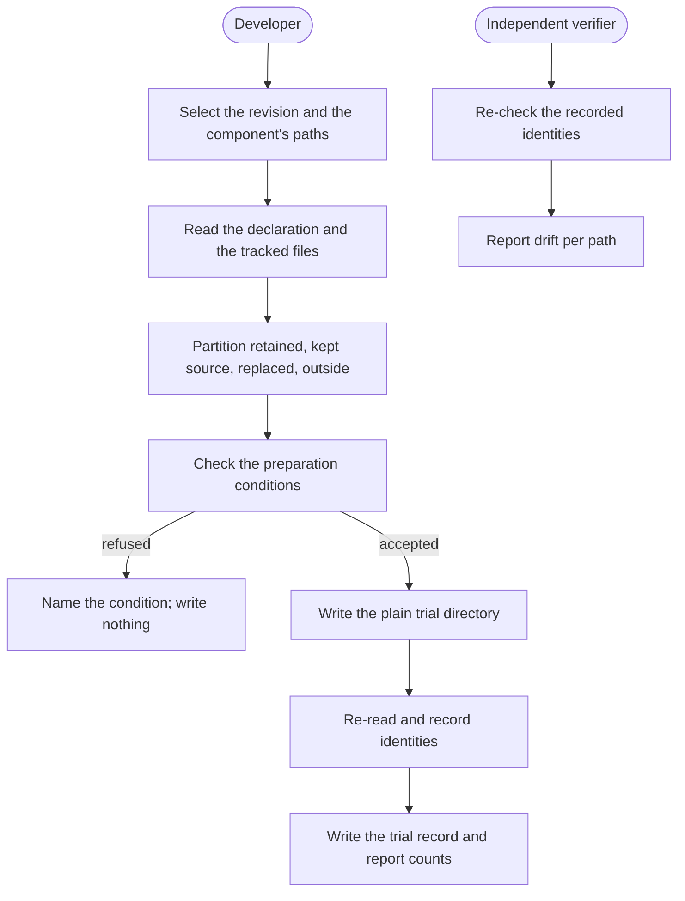

# Use case: prepare-an-ise-test

## Level

!

## Actors

- Developer (the consumer-project owner; the Givn maintainer when Givn rebuilds itself)
- Supporting: Independent verifier (runs the frozen End-to-end (E2E) test target and asks for the re-check)

## Goal

Produce a clean-room trial whose frozen inputs a verifier can confirm.

## Trigger

The developer starts an Ise Test.

## Preconditions

- `ise` is effective, which requires `architecture_principles`.
- The declaration names the five retained roles and the replaceable source
  roots.
- The checkout is clean.
- One backend is selected; no missing, mixed, or nested repository.
- A revision is available to read; the selected revision defaults to `HEAD`.
- The component's paths fall inside the declared source roots.

## Main flow

1. The developer selects the revision, or accepts `HEAD`, and names the
   component's paths, its internal unit tests included; the system reads the
   declaration and the tracked files at that revision.
2. The system partitions the tracked paths into the retained roles, the kept
   source outside the replaced paths, the replaced paths, and the files outside
   the declaration, and counts the tracked files in the replaced paths'
   directories that the developer did not name.
3. The system refuses by name, before any write, on a missing declaration, an
   addon that is not effective, a dirty checkout, a missing, mixed, or nested
   backend, a retained path that is missing at the revision, a replaced path
   outside every source root, a replaced path matched by a retained role, a
   target inside the checkout or already existing, and a repository link or
   nested repository among the files written into the trial.
4. The system writes the retained roles and the kept source into one plain
   directory outside the checkout, preserving relative paths, the executable
   bit, and symlink targets, with no version-control metadata and no ignored or
   untracked files.
5. The system re-reads every written file, compares it to the file recorded at
   the selected revision, records a tamper-evident identity for the retained
   set, the `e2e` package, and the replaced paths, reports the counts, and
   prints the trial record with the revision, the replaced paths, the counts,
   the identities, the backend, and the running Givn version; a receipt path
   writes that record to the named file.
6. The independent verifier confirms the frozen inputs on request; the system
   re-checks the recorded identities against the written trial and the `e2e`
   package and reports drift per path.

## Extensions

- 3: any named condition holds → the system refuses by name, exits non-zero,
  and writes nothing; protects the minimal guarantee.
- 5: a written file differs from its content at the selected revision →
  preparation fails, names the drifting paths, and writes no trial record;
  protects the success guarantee.
- 6: a recorded identity no longer matches → verification fails and names the
  drifting paths; protects the success guarantee.

## Rules

- Deletion is set arithmetic: preparation removes exactly the paths the
  developer names, and nothing else. Internal unit tests are named the same
  way; no unit-test path is inferred from `#[cfg(test)]`, `test_*.py`, a Maven
  test root, or a file-name convention.
- A retained role takes precedence over the source roots: a path matched by a
  role is never replaced, and naming it for replacement is refused.
- `Not replaced` counts the tracked files in the replaced paths' directories
  that the developer did not name. It is a containment count, never a refusal,
  and it never changes the recorded sets.
- `Outside the declaration` counts the tracked files that fall outside every
  declared role and are not copied. They are neither errors nor trial content.
- Only the `End-to-end (E2E) test` package is frozen. Component step
  definitions, fakes, and harness are implementation: they are never frozen or
  diff-counted, and they enter the trial only as kept source when the
  declaration places them inside a source root.
- The `E2E digest` covers the `@e2e` scenarios selected by tag plus every file
  of the `e2e` package.
- A scenario is frozen only after it was observed failing against the
  pre-change implementation for the intended reason. A mid-trial test defect
  stops the trial as a `Spec gap: E2E test defect`, and the trial restarts
  after the E2E test is corrected. The `e2e` package is part of the
  Specification, so correcting the test is a Specification correction rather
  than an exception to the freeze.
- The trial is a plain directory outside the checkout, never a branch or a
  worktree: a branch carries history and a Fossil checkout carries the
  repository database.
- Preparation reads the selected revision (`HEAD` when none is named), never
  the working tree, so ignored and untracked files cannot enter the trial. The
  checkout is never written, and the replaced component's Source code and its
  history are absent from the trial.
- Preparation and the re-check use the project's one selected backend; a
  missing, mixed, or nested repository is refused by name.
- Every refusal is checked before the first write, names its condition, and
  leaves the checkout and the target path unchanged.
- The command surface is `givn ise prepare [--at <revision>]
  [--replace <path>...] --into <dir> [--receipt <path>] [--dry-run]`; `--at`
  defaults to `HEAD`, and `--into` is required and must lie outside the
  checkout.
- `--dry-run` performs every read, the partition, every refusal, the counts,
  and the digests, writes no directory and no record, and prints the paths it
  would use.
- An omitted `--receipt` prints the trial record to stdout only and writes
  nothing, so `givn ise verify --trial <receipt>` requires an explicit path.
- The trial record carries the revision, the replaced paths, the counts, the
  identities, the backend, and the running Givn version.
- The report prints `Backend`, `Revision`, `Retained`, `Kept source`,
  `Replaced`, `Outside the declaration`, `Not replaced`, `Retained digest`,
  `E2E digest`, `Written path`, and, when a receipt path was given,
  `Receipt path`.
- With `ise` off, preparation and the re-check refuse by name and no
  declaration is read.

## Examples

- A `passuff` project declares `source: ["crates/**", "scripts/**"]` and runs
  `givn ise prepare --at 8c1f2ab --replace
  crates/passuff-tui/src/keys/parser.rs --replace
  crates/passuff-tui/tests/keys.rs --into /tmp/ise-passuff --receipt
  /tmp/ise-passuff-trial.yaml`; the report prints `Backend: git`, `Revision:
  8c1f2ab`, `Retained: 214`, `Kept source: 72`, `Replaced: 2`, `Outside the
  declaration: 3`, `Not replaced: 2`, `Retained digest: 4f1c9a…`, `E2E digest:
  82be07…`, `Written path: /tmp/ise-passuff`, and `Receipt path:
  /tmp/ise-passuff-trial.yaml`.
- The component's directory `crates/passuff-tui/src/keys/` still holds
  `mod.rs` and `tests.rs`, neither named; preparation succeeds, the report says
  `Not replaced: 2`, and the two files remain in the trial as kept source, so
  the count shows what the replacement unit still contains.
- The developer runs `givn ise prepare --at 8c1f2ab --replace docs/reference.md
  --into /tmp/ise-passuff`; the refusal names `docs/reference.md` because it
  falls outside every declared source root, and nothing is written.
- The developer runs preparation with `--into ./trial` inside the checkout;
  the refusal names the target, and the checkout keeps no trial directory.
- The developer runs preparation into `/tmp/ise-passuff` a second time; the
  refusal names the existing directory and leaves it untouched.
- The declaration names `contracts: ["docs/cli-contract.md"]`, but no such
  file exists at the selected revision; the refusal names
  `docs/cli-contract.md` as a retained path missing at the revision.
- The checkout has one uncommitted file; the refusal names the dirty path and
  writes no trial.
- The developer edits `/tmp/ise-passuff/givn/specs/verify-change/usecase.md`
  after preparation; `givn ise verify --trial
  /tmp/ise-passuff-trial.yaml --at /tmp/ise-passuff` fails and names that path.
- The developer edits `/tmp/ise-passuff/tests/e2e/steps/keys.rs`; the re-check
  fails and names that file, because every file of the `e2e` package is frozen.
- The developer edits `/tmp/ise-passuff/crates/passuff-cli/tests/steps/tui.rs`
  (kept source, outside the frozen inputs); the re-check reports no drift,
  because component step definitions are implementation.
- A new `@e2e` scenario was observed failing against the pre-change
  implementation for the intended reason, so it enters the frozen set. A
  scenario that turns out mid-trial to assert the wrong behavior stops the
  trial as a `Spec gap: E2E test defect`; the trial restarts after the E2E test
  is corrected.
- With `ise` off, `givn ise prepare` refuses by name and reads no declaration.

## Minimal guarantee

A refusal leaves the checkout byte-for-byte unchanged and writes no trial
directory or receipt.

## Success guarantee

A trial directory outside the checkout holds the declared Specification and
the kept source with the component's paths removed, and, when a receipt path
was given, the trial record's retained and `e2e` evidence re-checks against
it.

## Personas

- developer--primary-user
- agent--technical-role
- givn-maintainer--owner

## Capabilities

- `clean-room-preparation`: new
- `trial-input-verification`: new

## Interactions

| Capability | Consumer action | E2E scenario |
|---|---|---|
| clean-room-preparation | prepare a trial for a component's paths | Developer prepares a trial and receives the directory, the report, and the record |
| clean-room-preparation | replace a path outside the source roots | The refusal names the path and nothing is written |
| clean-room-preparation | leave files in a replaced path's directory | The report counts the files not named and preparation succeeds |
| clean-room-preparation | prepare from a dirty checkout | The refusal names the dirty path and writes no trial |
| trial-input-verification | re-check a trial before running the frozen tests | The verifier receives the per-path drift report for the written trial |
| trial-input-verification | re-check after a retained file changed | Verification fails and names the drifting path |
| trial-input-verification | re-check after an `e2e` package file changed | Verification fails and names the drifting file |

## Includes

- none

## Extends

- none

## Out of scope

Boundary: the clean-room trial directory and its record. The checkout, the
declaration, and the corrective change stay outside it.

- Declaring the roles and source roots: `declare-the-specification`.
- Building the replacement: the rebuilding agent, outside Givn.
- Running the frozen End-to-end (E2E) tests: the independent verifier, outside
  Givn.
- Classifying a difference and opening the corrective change: `create-change`
  (`spec-gap`).

## Diagram

