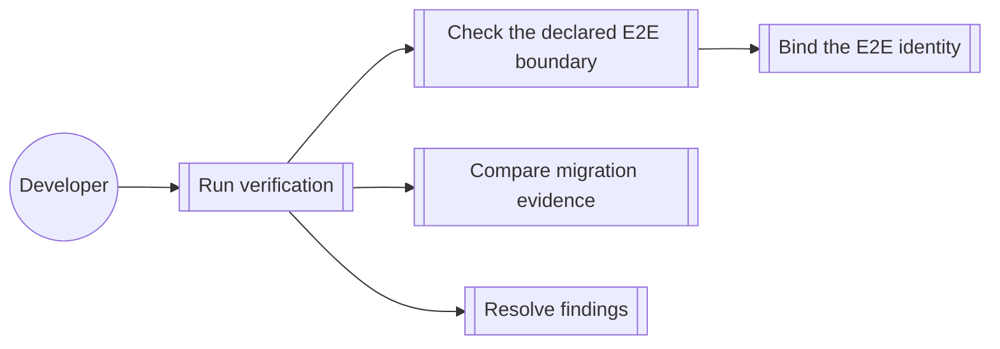

# Use case: verify-change

## Level

!

## Actors

- Developer
- Supporting: Reviewer

## Goal

Check a change for structural validity, applicable verification evidence, and
completed review without treating advisory structural matches as proof or
blockers.

The delta: with the `ise` addon effective, the check also holds the change to
the project's declared Specification boundary, refuses a declared E2E
acceptance set that is missing, links production source, or is not the one the
acceptance run uses, and binds the E2E identity of the accepted results into
the evidence it issues.

## Trigger

The developer requests verification of a change.

## Preconditions

- The change artifacts and active specifications are available.
- When the `ise` addon is effective, the project declares its retained roles and replaceable source roots (`declare-the-specification`).

## Main flow

1. The developer selects an explicit check; the system reads its applicable
   specifications and workflow artifacts and, when the `ise` addon is
   effective, the project's declared Specification.
2. The system collects independent cheap structural, identity, integrity,
   relationship, and capability-routing failures; checks depending on failed
   prerequisites are reported as not performed. When the `ise` addon is
   effective, this pass also holds the declared E2E package to its boundary:
   the package exists, links no production source, and is what the E2E runner
   command runs.
3. For changed-scenario verification, the system clears prior runner output and
   captures the revision, selected delta features, runner command, the declared
   E2E identity when the `ise` addon is effective, and relevant inputs before
   execution.
4. The system requires fresh valid passing results and stable inputs after
   execution before issuing a bound receipt. An explicitly declared
   no-behavior-change change without deltas records changed-scenario
   verification as not applicable.
5. Completed-review checks inspect the review and applicable existing
   verification evidence, report blocking findings and the net delta, and
   execute no verification suite.
6. A bare check instead prints non-executing guidance to explicit checks,
   labeling which commands execute runners; it executes neither configured
   hooks nor runners.

## Extensions

- 1: the `ise` addon is effective and the declared Specification is absent or unreadable → the checks that read it are reported as not performed and the missing declaration is named; protects the minimal guarantee.
- 1: the developer selects the specification-health check and the `ise` addon is effective → the four declaration findings are reported as advisory and the lint exit code is unchanged; protects the minimal guarantee.
- 2: a structural or integrity prerequisite fails → independent cheap errors are reported together and dependent checks are marked not performed; protects the minimal guarantee.
- 2: the declared `e2e` package is missing → the check refuses, names the package, and issues no receipt; protects the minimal guarantee.
- 2: the declared `e2e` package has a dependency edge into `source` → the check refuses, names the edge and the package, and issues no receipt; protects the minimal guarantee.
- 2: the E2E runner command runs a target other than the declared `e2e` package → the check refuses and names the runner target; protects the minimal guarantee.
- 3: tested inputs, including the E2E identity, change during execution → no passed receipt is issued for those changed inputs; protects the success guarantee.
- 4: fresh output is missing, malformed, has the wrong scope, has unreconciled or zero counts, or reports failures → verification fails without a passed receipt; protects the success guarantee.
- 4: the E2E run reports an unbound step → the run fails and no passed receipt is issued; protects the success guarantee.
- 4: the E2E run reports a skipped step → the run fails and no passed receipt is issued; protects the success guarantee.
- 4: no delta exists without an explicit no-behavior-change declaration → verification refuses without substituting a permanent full-suite run; protects the success guarantee.
- 5: a required long-scenario disposition, actual review verdict, or README-impact decision is missing or invalid → completion is blocked; protects the success guarantee.
- 5: applicable verification evidence is missing or stale → completion is blocked; protects the success guarantee.

## Rules

- The declared `e2e` role names one package: the runner and every `@e2e` step definition, linking no production source.
- Feature files stay shared, so an `@e2e` scenario and a component scenario may live in the same `.feature` file; the tag is the package's scope, not a file boundary.
- With the `ise` addon effective, the change check requires that package to exist, to have no dependency edge into `source`, and to be the target `verify.e2e_command` runs.
- An unbound or skipped step fails the E2E run; a run reporting skips yields no passed receipt.
- The verification receipt binds the `e2e` package digests, the E2E runner command digest, and the running Givn version, so a weakened black-box suite changes the receipt.
- Only the declared `End-to-end (E2E) test` package is frozen as acceptance authority; component step definitions, fakes, and harness are implementation and are never inspected or diff-counted by this check.
- The boundary is the package's dependency graph plus the runner's unbound or skipped step failure; no per-step phrase uniqueness rule exists, and the outline parsers are not repurposed for it.
- The four declaration findings are advisory on the specification-health check: a declared path missing, a path declared in two roles, a `.feature` outside the `behavior` globs, and the declared `e2e` package missing or with a dependency edge into `source`.
- Advisory findings are rendered with `Severity::Advisory` and never change the lint exit code; checks that refuse on blocking findings keep their refusal.
- Blocking checks belong to the change-scoped tasks check; the specification-health check reports the project-level declaration state and vetoes no change, review, or archive.
- A change to a neighboring component is a review question, never a gate: the review names the neighboring components changed outside the replaced component and says why.
- The permanent contract's other rules stand unchanged in `givn/specs/verify-change/usecase.md`: typed relationship resolution, interaction coverage, long-scenario dispositions, evidence-ordering and receipt freshness, and migration preservation.

## Examples

- A `passuff` change with `ise` effective: an `@e2e` step imports `passuff::tui::keys` in process, so the tasks check fails and names the dependency edge from the `e2e` package into `source`; no receipt is written.
- The declared `e2e` package exists and links no production source, but `verify.e2e_command` still invokes the component runner; the check refuses and names the runner target.
- An `@e2e` scenario's step definition is deleted: the run reports an unbound step, the check fails, and no receipt is written.
- The E2E runner reports one skipped step: the run fails, and the counts are not accepted as evidence.
- A project's `behavior` globs miss `tests/features/extra.feature`: `givn lint` prints an advisory finding naming the file, and the exit code stays 0.
- An assertion is deleted from an `@e2e` scenario after a receipt was issued: the package digests no longer match, so archive's freshness check refuses the earlier receipt.
- A change also edits a neighboring component: review asks for the component and the reason, and no gate refuses the change.

## Minimal guarantee

An invalid explicit check cannot pass; a bare check never implies verification
success or executes hooks or runners; an advisory finding never converts a
satisfiable request into a refusal.

## Success guarantee

The developer receives applicable, fresh, input-bound verification evidence or
actionable failures, with advisory findings and not-applicable checks
distinguished from completed proof. With the `ise` addon effective, the
evidence carries the E2E identity of the accepted results and names any
violation of the declared `e2e` package boundary.

## Personas

- developer--primary-user
- agent--technical-role
- givn-maintainer--owner

## Capabilities

- validate-artifact-ids
- spec-overlap-gates
- review-disposition-gates
- resolve-change-directories
- givn-workflow-enforcement
- check-specification-health
- visual-review-gate

## Interactions

| Capability | Consumer action | E2E scenario |
|---|---|---|
| givn-workflow-enforcement | run the change-scoped checks | A change whose `e2e` package has a dependency edge into `source` fails the tasks check and no receipt is written |
| givn-workflow-enforcement | run the change-scoped checks on a change whose E2E run skipped a step | The run fails and no receipt is written |
| givn-workflow-enforcement | run the change-scoped checks and inspect the receipt | The receipt carries the `e2e` package digests and the E2E runner command digest |
| check-specification-health | lint a declaration with a missing path | The advisory finding names the path and the exit code stays 0 |
| check-specification-health | lint a project whose declared `e2e` package depends on `source` | The advisory finding names the package and the dependency edge |
| validate-artifact-ids | check an unknown artifact | Consumer invokes the check with an unknown artifact and gets a helpful error |

## Includes

- fragment: support

## Extends

- none

## Out of scope

Changing implementation code; automatic test execution from a bare check,
status, or completed-review inspection; retrospective reconstruction of
test-first history; preparing the trial (`prepare-an-ise-test`); declaring the
roles (`declare-the-specification`); publishing (`archive-change`).

## Diagram

