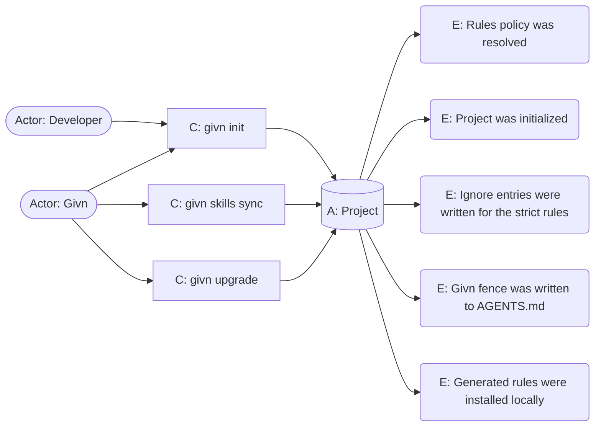
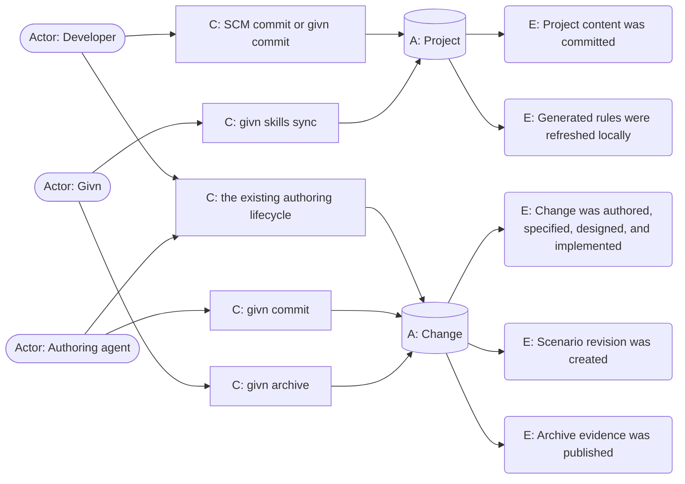
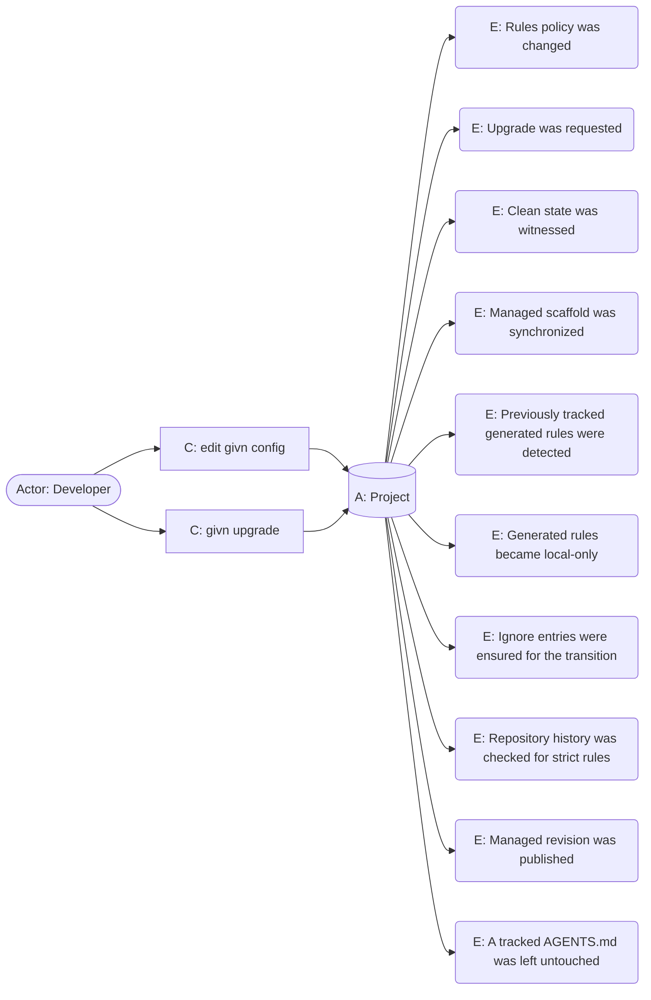
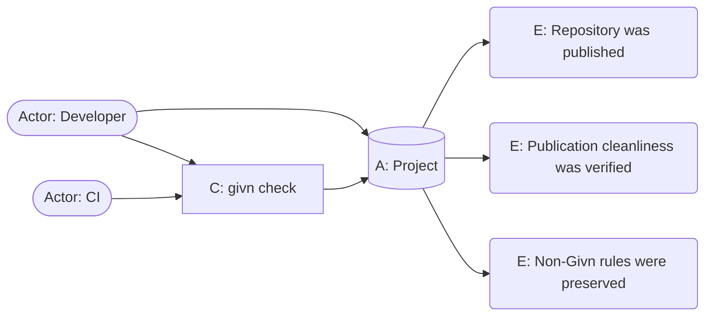
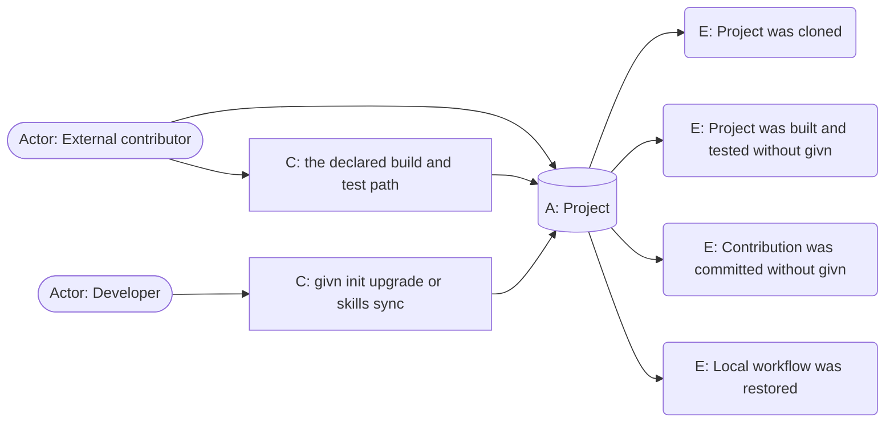
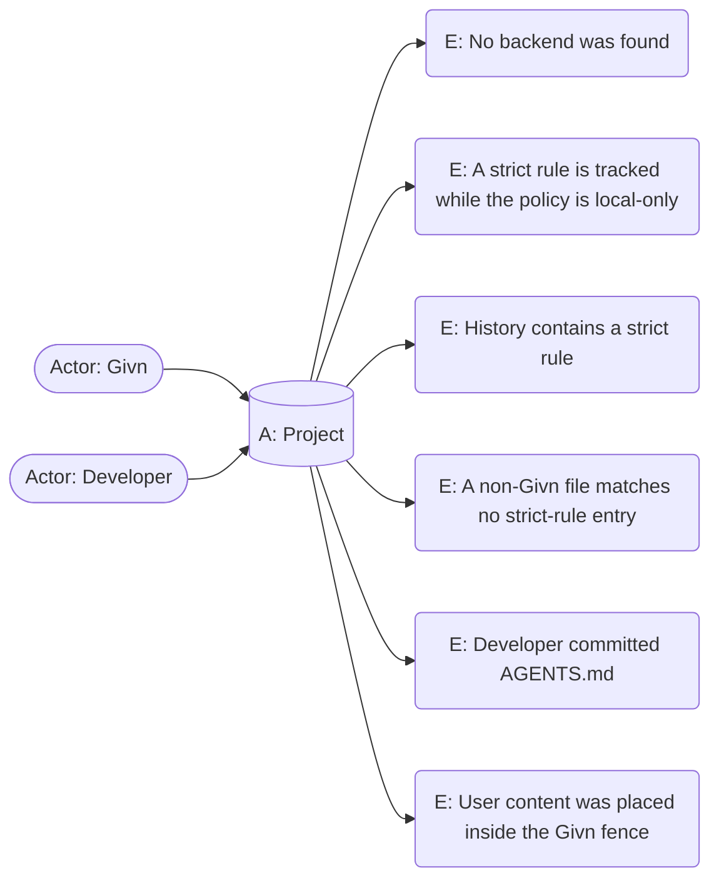
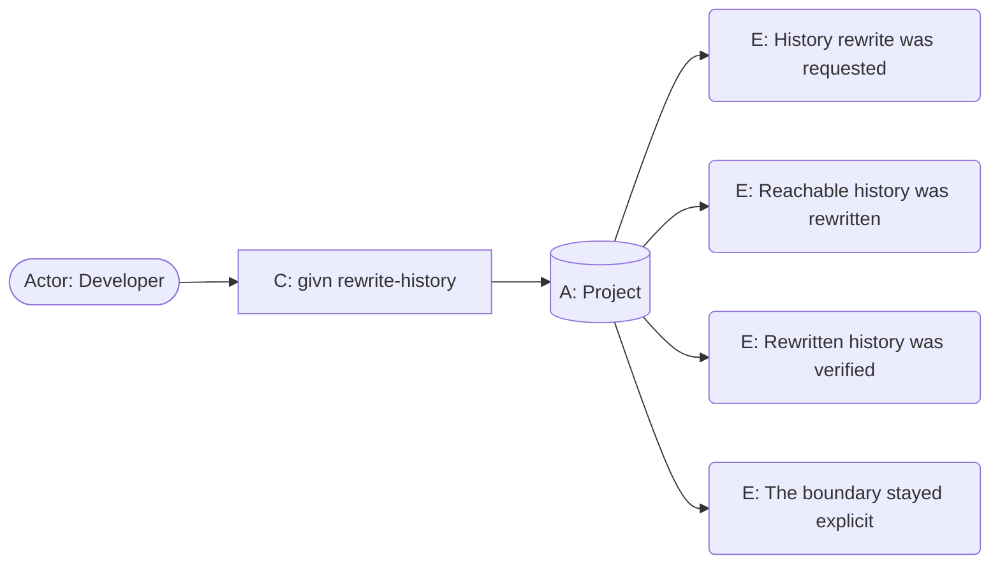

# Event Storming: local-only-integrations

Domain events in the order they happen, with actor, command, reacting policy,
and read model. `[diverges]` marks a policy that differs by SCM backend.
`[guard]` marks an internal check or refusal rather than a value event.
`[Qn]` marks a policy that depends on an open question. `.policy` marks an
event whose behavior depends on the rules policy
(`local-only` default, or `versioned`); see the policy divergence table. IDs
are stable for cross-references from `use-case-definitions.md`.

`strict rules` names every Givn-owned generated file that must stay
local under the local-only policy: skills, commands, plugins, the shared
`commit-msg` dispatcher, and the Claude hook. It excludes the `AGENTS.md`
fence, the confirmed single exception (Q3). The code computes a broader list,
`managed_generated_paths`, which also names `AGENTS.md` and user-owned files
such as the shared `.claude/settings.json`.

## Chain

### A. Project start

- **A1 — Rules policy was resolved** — Aggregate: Project. Actor: givn (on every
  command that writes rules). Command: `givn init`, `givn upgrade`,
  `givn skills sync`. Policy: the persisted setting selects `local-only`
  (default) or `versioned`; an absent or invalid value resolves to
  local-only (Q1). Read model: `givn/config.yaml`.
- **A2 — Project was initialized** — Aggregate: Project. Actor: developer. Command: `givn init`.
  Policy: scaffold `givn/`, resolve targets, write generated rules
  locally. Read model: project root, selected backend, skill targets.
- **A3 — Ignore entries were written for the strict rules** — Aggregate: Project. Actor: givn.
  Command: `givn init` / `givn skills sync` / `givn upgrade`. Policy
  `.policy`: under local-only only; file-precise entries for each strict rule
  path, never a directory, never `AGENTS.md`, never a user-owned or non-Givn
  path, written to both destinations — the fenced tracked block (Git
  `.gitignore`, Fossil `.fossil-settings/ignore-glob`) and the local exclude
  (Git `.git/info/exclude`, Fossil checkout-local ignore setting) (Q5, Q10).
  Read model: effective manifest, backend ignore mechanism.
- **A4 — Givn fence was written to `AGENTS.md`** — Aggregate: Project. Actor: givn. Command:
  `givn init` / `givn skills sync` / `givn upgrade`. Policy (changed from
  today): fenced block only — the always-on `givn-project` block and, when
  enabled, `absolute-mode`; user prose untouched; the file is never staged or
  committed by givn under either policy, while today's managed revision
  force-stages it. The tracking decision belongs to the developer. Read
  model: `AGENTS.md`, enabled addons.
- **A5 — Generated rules were installed locally** — Aggregate: Project. Actor: givn.
  Command: `givn init` / `givn skills sync`. Policy: write only Givn-owned
  generated paths, including the shared `commit-msg` dispatcher on Git;
  under local-only the Claude attribution hook goes to the project-local
  `.claude/settings.local.json`, never the shared `.claude/settings.json`
  (Q19); non-Givn files in the same directories stay untouched. Read model:
  targets, addon flags.

### B. Local life of the project

- **B1 — Project content was committed** — Aggregate: Project. Actor: developer. Command: raw
  SCM commit or `givn commit`. Policy: with the ignore rules in place (A3),
  strict rules do not enter the revision; `AGENTS.md` enters only
  when the developer stages it explicitly. `.policy` local-only precondition:
  without ignore rules the strict rules are untracked-not-ignored,
  dirty the tree, and block archive (B4). Read model: backend status.
- **B2 — Change was authored, specified, designed, and implemented** — Aggregate: Change. Actor:
  developer and authoring agent. Commands: the existing lifecycle. Policy
  unchanged; local rules provide the guidance.
- **B3 — Scenario revision was created** — Aggregate: Change. Actor: authoring agent. Command:
  `givn commit` (or raw commit). Policy (changed from today): under
  local-only, the stage-all path of `givn commit` excludes `AGENTS.md` and
  every strict rule, so only project content is staged; attribution
  remains best-effort. Read model: pending change set.
- **B4 — Archive evidence was published** — Aggregate: Change. Actor: givn. Command:
  `givn archive`. Policy: ignored strict rules are invisible to the
  clean-state witness; untracked-not-ignored files still block (Q13).
- **B5 — Generated rules were refreshed locally** — Aggregate: Project. Actor: givn.
  Command: `givn skills sync`. Policy: local filesystem only; no repository
  side effect beyond the `AGENTS.md` fence.

### C. Upgrade and reconciliation

- **C0 — Rules policy was changed** — Aggregate: Project. Actor: developer.
  Command: edit `givn/config.yaml`; the next givn command applies it. Policy
  `.policy`: changing to `local-only` triggers the same reconciliation as
  C4-C6; changing to `versioned` leaves the paths where they are and the
  managed upgrade stages them again. Idempotent (Q12, Q14). Read model:
  `givn/config.yaml`, revision membership of the allowlist.
- **C1 — Upgrade was requested** — Aggregate: Project. Actor: developer. Command:
  `givn upgrade`. Policy: version gap resolution through the migration
  catalog.
- **C2 — Clean state was witnessed** — Aggregate: Project. Actor: givn. Policy: same preflight
  as today; ignored strict rules do not block.
- **C3 — Managed scaffold was synchronized** — Aggregate: Project. Actor: givn. Policy: config
  and commands scaffold refreshed; generated rules refreshed locally
  through A5.
- **C4 — Previously tracked generated rules were detected** — Aggregate: Project. Actor:
  givn `[guard]` `.policy`: local-only only; under versioned, C4-C6 do not
  run. Policy: managed paths tracked at the current revision must become
  local-only (Q7, Q12). Read model: revision membership of
  `managed_generated_paths`.
- **C5 — Generated rules became local-only** — Aggregate: Project. Actor: givn. Policy
  `[diverges]`: remove exactly the tracked strict rules from the
  current revision while keeping the files on disk (Git: `git rm --cached`;
  Fossil: `fossil rm --soft` or `fossil forget`, pinned so the user's
  `mv-rm-files` setting cannot delete files); never a directory; never
  `AGENTS.md`; never a non-Givn file. The same fragment fires during setup
  (`givn init` / `givn skills sync`), where the removals stay staged for the
  developer instead of joining a managed revision.
- **C6 — Ignore entries were ensured for the transition** — Aggregate: Project. Actor: givn
  `.policy` local-only. Policy: the ignore-rule changes join the managed
  revision so the working tree stays clean for archive and the next commit
  cannot re-add the paths (Q10).
- **C7 — Repository history was checked for strict rules** — Aggregate: Project. Actor:
  givn `[guard]`. Policy (confirmed 2026-09-23): report the occurrences and
  point at the opt-in rewrite (G1-G4); never blocking. The reachable-refs
  boundary is named. Read model: backend history of the strict rules.
- **C8 — Managed revision was published** — Aggregate: Project. Actor: givn. Policy `.policy`:
  local-only revision contains the config scaffold, commands scaffold,
  ignore-rule changes, and the local-only removals only — no strict
  rule content and no `AGENTS.md` (Q7, Q9); versioned revision stages the
  generated rules per today's allowlist, with `AGENTS.md` excluded.
- **C9 — A tracked `AGENTS.md` was left untouched** — Aggregate: Project. Actor: givn `[guard]`.
  Policy: givn never stages it under either policy, even when it is tracked;
  a fence refresh may dirty the working tree; committing and merging are the
  developer's responsibility.

### D. Publication

- **D1 — Repository was published** — Aggregate: Project. Actor: developer. Policy: the strict
  rules are absent from the repository and its history; `AGENTS.md`
  content is the developer's choice.
- **D2 — Publication cleanliness was verified** — Aggregate: Project. Actor: developer or CI.
  Command: givn check. Policy `[guard]`: report tracked or
  historical strict rules in the checkout and in a fresh clone, name the
  reachable boundary, and point at the opt-in rewrite; `AGENTS.md` is exempt.
- **D3 — Non-Givn rules were preserved** — Aggregate: Project. Actor: developer. Policy: Givn
  never ignores, untracks, or deletes developer-owned files, including files
  named like generated paths but not on the strict set.

### E. Fresh clone

- **E1 — Project was cloned** — Aggregate: Project. Actor: external contributor, or the
  developer on a second machine. Policy: a published clone carries no
  generated rules; `AGENTS.md` only if the developer committed it.
- **E2 — Project was built and tested without givn** — Aggregate: Project. Actor: external
  contributor. Command: the project's declared build and test path.
  Evidence: the test script's exit status; the run doubles as the
  published-clone check that no strict rule is required (Q15).
- **E3 — Contribution was committed without givn** — Aggregate: Project. Actor: external
  contributor. Policy: a published clone carries no Givn hook; on a machine
  where rules were once installed and the binary is later absent, the
  hook degrades silently (verified in the hook asset).
- **E4 — Local workflow was restored** — Aggregate: Project. Actor: developer on the second
  machine. Command: `givn init` / `givn upgrade` / `givn skills sync`.
  Policy: regenerate every local rule; no strict-rule
  repository change; the `AGENTS.md` fence merge stays the developer's; no
  drift detection exists — sync overwrites (Q14).

### F. Failure, refusal, and repair

- **F1 — No backend was found** — Aggregate: Project. Actor: givn `[guard]`. Policy: named
  refusal as today for archive and managed upgrade.
- **F2 — A strict rule is tracked while the policy is local-only** — Aggregate: Project.
  Actor: givn `[guard]`. Policy: it must become local-only on upgrade
  (C4-C5) and is reported by the check (D2); whether any command refuses is
  open (Q7).
- **F3 — History contains a strict rule** — Aggregate: Project. Actor: givn `[guard]`.
  Policy: report the occurrences and point at the opt-in rewrite (G1-G4);
  never automatic, never blocking.
- **F4 — A non-Givn file matches no strict-rule entry** — Aggregate: Project. Actor: givn
  `[guard]`. Policy: never ignored, never untracked, never deleted; no
  directory-level rule.
- **F5 — Developer committed `AGENTS.md`** — Aggregate: Project. Actor: developer. Policy:
  accepted; givn still never stages it and never rewrites user prose.
- **F6 — User content was placed inside the Givn fence** — Aggregate: Project. Actor: developer.
  Policy: the fence region is Givn-owned; the next sync replaces it; prose
  outside the fence is preserved.

### G. History repair (opt-in)

- **G1 — History rewrite was requested** — Aggregate: Project. Actor: developer. Command: the
  explicit rewrite command (working name `givn rewrite-history`). Policy:
  never automatic; requires the clean-state witness and names the strict
  rules found, the reachable boundary, and the revision identifiers before
  rewriting. Read model: backend history of the strict rules.
- **G2 — Reachable history was rewritten** — Aggregate: Project. Actor: givn. Policy
  `[diverges]`: no reachable revision contains a strict rule afterwards, and
  every rule file still exists on disk. Git mechanism open (Q20); Fossil
  support and mechanics open (Q20), including a possible named refusal.
- **G3 — Rewritten history was verified** — Aggregate: Project. Actor: givn `[guard]`. Policy:
  re-check reachable history and report the new revision identifiers; when
  the backend cannot rewrite, refuse by name instead of claiming success.
- **G4 — The boundary stayed explicit** — Aggregate: Project. Actor: givn `[guard]`. Policy:
  name that unreachable objects, remotes, and forks are outside the local
  guarantee; givn never claims a remote or a teammate's clone is clean.

## Canvas

Every event of the chain with its actor, command, and aggregate. Kinds are
marked on every node (`Actor`, `C`, `A`, `E`, `P`, `RM`, `X`, `Record`): a
command sits between the actor that issues it and the aggregate it changes,
and the aggregate emits its events. The only aggregates are `Project` (the
version-controlled Givn project) and `Change` (a unit of work under
`givn/changes/`); ignore blocks, policies, reports, and paths are
configurations, records, or specifications and are never drawn in the
aggregate shape.

### A. Project start

### B. Local life of the project

### C. Upgrade and reconciliation

### D. Publication

### E. Fresh clone

### F. Failure, refusal, and repair

### G. History repair

## Policy divergence

| Event | local-only (default) | versioned |
|---|---|---|
| A3 ignore rules | written | not written |
| A4 `AGENTS.md` fence | written, never staged | written, never staged (changed from today) |
| B1/B3 commits | strict rules excluded from stage-all | unchanged |
| C4-C6 | detect, become local-only, ensure ignore rules | skipped |
| C7 history check | strict rules | not applicable |
| C8 managed revision | scaffold + ignore entries + removals only | scaffold + allowlist rules, `AGENTS.md` excluded |
| D2 cleanliness check | strict rules absent | not applicable |

## Backend divergence

| Concern | Git | Fossil |
|---|---|---|
| Ignore entries | Fenced block in `.gitignore` (tracked) + `.git/info/exclude` (local) | `.fossil-settings/ignore-glob` (tracked) + checkout-local `ignore-glob` setting (exact command open, Q10) |
| Become local-only | `git rm --cached` per path | `fossil rm --soft` or `fossil forget` per path |
| History check | `git log --all -- <paths>`; dangling commits are outside the current reachable boundary unless Q2 says otherwise | artifact/timeline history open (Q10) |

## Term collisions and notes

- "Tracked" / "untracked" are Git mechanics vocabulary; the neutral states
  are versioned and local-only (see `domain-terms.md`).
- `strict rules` is the policy set; `managed_generated_paths` is the
  code list and also names `AGENTS.md`; the staging allowlist is
  policy-dependent.
- `givn/` never enters the ignore set or the strict set; it stays versioned.
