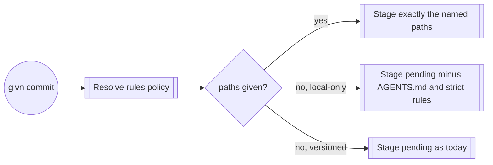

# Use case: support — capability `attribute-commits` (fragment)

Reusable commit plumbing with no independent user goal; included by the
authoring and archive flows. The delta: under `local-only`, the stage-all
path never carries `AGENTS.md` or a strict rule.

## Level

fragment

## Actors

- Developer — invokes `givn commit`.
- Authoring agent — uses the same command for one revision per scenario.

## Goal

Create one attributed revision per invocation with the policy-appropriate
stage set: project content only under `local-only`, today's behavior under
`versioned`.

## Trigger

`givn commit -m <message>` with no paths (stage-all) or with named paths.

## Preconditions

- The active version-control system is selected.
- The rules policy is resolved (`rules-policy` fragment).

## Main flow

1. Resolve the rules policy.
2. With no paths and `local-only`: compute the pending set and remove
   `AGENTS.md` and every strict rule from it; stage only the remainder.
3. With no paths and `versioned`: stage the pending set as today.
4. With named paths: stage exactly those paths, as today.
5. Commit with the attribution trailer when context is active; attribution
   failures never block (existing behavior).

## Extensions

- The remaining stage set is empty: report "nothing to commit" and exit
  non-zero as today; nothing is committed.
- A named path points at `AGENTS.md`: it is staged as given — naming a path
  is explicit developer intent, and the developer stages `AGENTS.md` this way
  when they want it committed.
- A named path points at an ignored strict rule: the backend's ignored-path
  error surfaces; givn does not force the path.

## Rules

- The stage-all path is closed: it never stages `AGENTS.md` or a strict rule
  under `local-only`.
- Named paths stay explicit and are staged verbatim; no path is ever removed
  from the working tree by this capability.
- Under `versioned`, the existing stage-all behavior is unchanged.
- Attribution behavior is unchanged and best-effort.
- The capability consumes the resolved policy; it never reads or defaults the
  raw config itself.

## Examples

- `givn commit -m "feat: parser"` in a local-only project with a fresh
  `AGENTS.md` fence change: the fence stays unstaged; only project content is
  committed.
- The same command with `-- AGENTS.md` (explicit path): the fence is staged
  and committed.
- A stale untracked strict rule that somehow lacks an ignore entry: the
  stage-all path still excludes it.
- A versioned project: stage-all behaves exactly as today.

## Minimal guarantee

No commit ever includes `AGENTS.md` or a strict rule unless the developer
named the path explicitly.

## Success guarantee

One revision is created with the policy-appropriate content, and under
`local-only` the repository continues to carry no strict rule.

## Personas

- developer--primary-user
- agent--technical-role

## Capabilities

- `attribute-commits` — modified

## Interactions

| Capability | Consumer action | E2E scenario |
|---|---|---|
| attribute-commits | commit during a change under local-only | Consumer commits project content and the rules stay out of the revision |
| attribute-commits | commit with `AGENTS.md` named | Consumer explicitly commits the fence and it enters the revision |
| attribute-commits | commit under versioned | Consumer keeps today's stage-all behavior |

## Includes

- `rules-policy` (fragment)

## Extends

- none

## Out of scope

Policy resolution; ignore entries; reconciliation and removals; history
reporting and rewriting.

## Diagram

