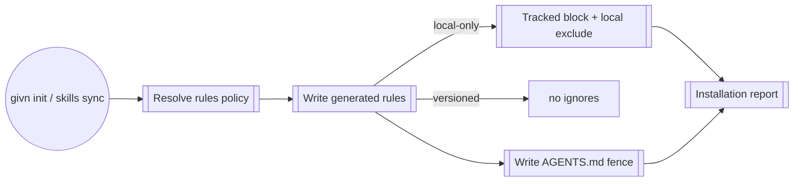

# Use case: initialize-project

## Level

!

## Actors

- Developer
- Supporting: Authoring agent

## Goal

Set up a Givn project and its agent rules. The delta: the rules install
locally by default, the repository stays free of them, and the installation
report names the active rules policy.

## Trigger

The developer initializes a project (`givn init`) or re-syncs the agent
integrations (`givn skills sync`).

## Preconditions

- The project directory is writable.
- The active version-control system is detected when one exists.

## Main flow

1. Resolve the rules policy through the `rules-policy` fragment (default
   `local-only`).
2. Write or refresh the generated rules for the selected targets, as today.
3. Under `local-only`: add a file-precise entry for every strict rule to both
   the ignore destinations (see Rules); under `versioned`: write no ignore
   entries.
4. Write or refresh the `AGENTS.md` fence; never stage the file.
5. Report the policy, what was installed, what was kept local, what was
   skipped and why, and the rules cleanliness of the current revision and
   reachable history (`publication-cleanliness` fragment).

## Extensions

- An unsupported or unknown target set: fall back to opencode and state the
  fallback (existing behavior, unchanged).
- A strict rule path is already tracked in the repository: detect it and make
  it local-only through the `local-only-transition` fragment — the file stays
  on disk and the path leaves the current revision, left staged for the
  developer to review and commit. `givn init` reports the paths and still
  never commits.
- No version-control system exists: scaffold and generate as today, warn that
  archive and managed upgrade are unavailable (existing behavior,
  unchanged).

## Rules

- The tracked destination is a Givn-managed, fenced block: Git
  `.gitignore`, Fossil `.fossil-settings/ignore-glob`. User content outside
  the block is never touched; the block is content, not a Givn rule, and may
  be committed like any project file.
- The local destination is Git `.git/info/exclude` and the Fossil
  checkout-local ignore setting. It takes effect immediately, before any
  commit.
- Entries are file-precise: one path per strict rule, never a directory,
  never `AGENTS.md`, never a user-owned or non-Givn path.
- `givn init` never commits. It stages nothing except the removals produced
  by the `local-only-transition` fragment, which the developer reviews and
  commits.
- Fresh `givn/config.yaml` carries the active scalar `rules: local-only`; a
  later change is a user edit that `givn upgrade` preserves.
- Re-running init or sync keeps the persisted policy and the target
  selection (existing behavior), and refreshes both ignore destinations to
  match the current rule set.

## Examples

- Fresh project: `givn init` writes the rules locally, adds their paths to
  `.gitignore`'s managed block and to `.git/info/exclude`, writes the fence,
  and reports `rules: local-only`.
- Opted in: `givn/config.yaml` has `rules: versioned`; init writes the rules
  and no ignore entries, and the developer commits them like source.
- Addon toggle: disabling the grill addon removes its command and its ignore
  entries from both destinations on the next sync.
- Legacy project: rules are tracked from before the policy; init removes
  them from the current revision, keeps the files on disk, leaves the
  removals staged, and reports the paths.
- Clone: `givn init` or `givn skills sync` in a fresh clone restores every
  local rule and both ignore destinations `[gated]` (E4; Q14).

## Minimal guarantee

Setup writes only Givn-owned paths and the fenced ignore block; user content
in `.gitignore` or `AGENTS.md` stays byte-for-byte unchanged, and nothing is
staged except the `local-only-transition` removals.

## Success guarantee

The local workflow works after one command, and under `local-only` the
repository receives no strict rule, so a clone that never runs Givn builds,
tests, and commits without it.

## Personas

- developer--primary-user
- givn-maintainer--owner

## Capabilities

- `initialize-a-project` — modified
- `enable-optional-addons` — modified (the report names the policy alongside
  the addon list)

## Interactions

| Capability | Consumer action | E2E scenario |
|---|---|---|
| initialize-a-project | init a fresh project | Consumer initializes and the rules stay local, with both ignore destinations in place |
| initialize-a-project | set `rules: versioned` | Consumer opts in and the rules are written as repository content with no ignores |
| initialize-a-project | clone and re-init | Consumer clones the project and one command restores the local rules without touching project content |

## Includes

- `rules-policy` (fragment)
- `local-only-transition` (fragment)
- `publication-cleanliness` (fragment)

## Extends

- none

## Out of scope

The upgrade's clean preflight and managed revision (`upgrade-a-project`);
archive and commit flows; the dedicated cleanliness command; the commit
stage-set rule (`attribute-commits` capability).

## Diagram

